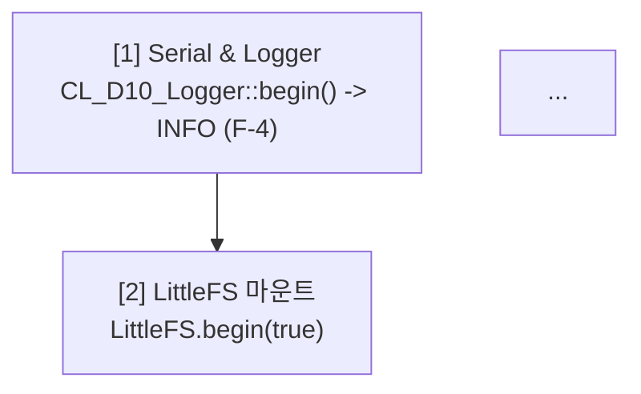
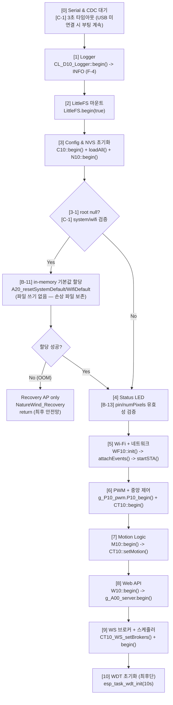

계약 문서 현행화 (Batch G — 코드 재검토 P0/P1 반영)

모든 P0/P1 수정 반영. 6개 문서 개정 + 버전 bump. 각 문서별 Before/After 명확히.

---

📘 README_0202.md — v2.3 → v2.4

§3 감사 이력 — §3.4 신규 (P0/P1 재검토)

BEFORE (§3.3 Batch A~F 테이블 끝, §4 CBD 워크플로 이전)

```markdown
| F | F-10 | 🟢 Low | 분할 시 매크로 파일 스코프 | ✅ Internal 헤더 승격 |

---

## 4. CBD 워크플로
```

AFTER

```markdown
| F | F-10 | 🟢 Low | 분할 시 매크로 파일 스코프 | ✅ Internal 헤더 승격 |

### 3.4 Batch G — 코드 재검토 (P0/P1 이슈)

| ID | 심각도 | 위치 | 요약 | 상태 |
|---|---|---|---|---|
| **C-1** | 🔴 Blocker | `main.cpp` | `while(!Serial)` 무한 루프 (USB 미연결 시 setup 정지) | ✅ 3s 타임아웃 |
| **C-2** | 🔴 Blocker | `200.page.dashboard.js` | 프리셋 그리드 영구 비어있음 (mount 순서) | ✅ `_mountComponents` 선행 |
| **C-3** | 🔴 High | `M10_MotionLogic_0202.h` | `isActive()` holdSec 이중 적용 (2×연장) | ✅ `_state.pirActive` 단일 판정 |
| **C-4** | 🔴 High | `W10_Web_Upload_0202.cpp` | 업로드 핸들 누수 (`available()==0` write-only) | ✅ stale close |
| **C-5** | 🔴 High | `070.router.js` | dispatch 재진입 → watcher/timer 누수 | ✅ `_dispatching` 가드 |
| **NEW-C1** | 🔴 High | `240.page.settings.js` | `\|\|`로 0값 손실 (pin=0, brightness=0, holdSec=0) | ✅ `nz()` 헬퍼 |
| **NEW-C2** | 🔴 High | `240.page.settings.js` | `dht.type` XSS (사용자 PATCH 가능) | ✅ `esc()` 적용 |
| **NEW-U1** | 🟡 Mid | `240.page.settings.js` | API Key 프리필 → DOM 평문 노출 | ✅ placeholder 패턴 |
| **NEW-U2** | 🟡 Mid | `240.page.settings.js` | API Key 삭제 UI 부재 | ✅ 체크박스 |
| **NEW-U3** | 🟡 Mid | `240.page.settings.js` | wsChConfig 손상 시 복구 불가 | ✅ 기본 4채널 + baseline |
| **NEW-U4** | 🟡 Mid | `240.page.settings.js` | 문자열 `"false"` 오판 | ✅ `asBool()` |
| **B-1** | 🟠 High | `N10_NvsManager_0202.cpp` | flush 11회 commit (100ms 블로킹) | ✅ 단일 `nvs_commit` (10ms) |
| **B-2** | 🟠 High | `W10_Web_Routes_Config/CRUD/WS_0202.cpp` | async_tcp root 직접 참조 3곳 | ✅ `getRootSnapshot` |
| **B-3** | 🟠 High | `240.page.settings.js`, `270.page.network.js` | XSS (deviceName/SSID/hostname) | ✅ `esc()` |
| **B-4** | 🟠 High | `C10_Config_Sys_0202.cpp` | API Key 삭제 불가 (빈 문자열 무시) | ✅ `clearApiKey` 플래그 |
| **B-5** | 🟠 High | `W10_Web_Static_0202.cpp` | `gzip;q=0` 오탐지 (RFC 7231 위반) | ✅ `W10_acceptsGzip` 파서 |
| **B-6** | 🟡 Mid | `W10_Web_Routes_System_0202.cpp` | routeMotion POST/PATCH 60줄 중복 | ✅ `_routeMotionPatchBody` |
| **B-7** | 🟡 Mid | `N10_NvsManager_0202.cpp` | NVS 쓰기 반환값 무시 (조용한 실패) | ✅ 반환값 검사 + 재시도 |
| **B-8** | 🟡 Mid | `130.ui.form.js` | 로그 필터 `textContent` 오매칭 | ✅ `.snw-log-lv` 정확 비교 |
| **B-9** | 🟡 Mid | `W10_Web_Routes_CRUD_0202.cpp` | WindProfile GET FS 재로드(100ms) + race | ✅ `getRootSnapshot` |
| **B-10** | 🟢 Low | `S10_Simul_Core_0202.cpp` | 브로드캐스트용 JsonDocument dead code | ✅ 제거 |
| **B-11** | 🟠 High | `A00_Main_0202.cpp` | config 손상 시 부팅 중단 → 웹 복구 불가 | ✅ in-memory defaults + Recovery AP |
| **B-12** | 🟠 High | `W10_Web_Upload_0202.cpp` | OTA 세션 잔존 + write 반환값 무시 | ✅ `Update.abort()` + 반환 검사 |
| **B-13** | 🟠 High | `A00_Main_0202.cpp` | 음수 LED pin → GPIO 255 크래시 | ✅ 유효성 검증 + 기본값 |

**수정 파일 (17개)**: `main.cpp`, `A20_Const_Const_0202.h`, `M10_MotionLogic_0202.h`, `W10_Web_Upload_0202.cpp`, `070.router.js`, `200.page.dashboard.js`, `W10_Web_Routes_Config_0202.cpp`, `W10_Web_Routes_CRUD_0202.cpp`, `W10_Web_WS_0202.cpp`, `C10_Config_Sys_0202.cpp`, `240.page.settings.js`, `270.page.network.js`, `W10_Web_Routes_System_0202.cpp`, `N10_NvsManager_0202.cpp`, `130.ui.form.js`, `S10_Simul_Core_0202.cpp`, `A00_Main_0202.cpp`, `W10_Web_Static_0202.cpp`

---

## 4. CBD 워크플로
```

§8 개정 이력 — 신규 행 추가

AFTER (최상단에 추가)

```markdown
| 날짜 | 버전 | 변경 내용 | 작성자 |
|---|---|---|---|
| **2026-10-26** | **v2.4** | **Batch G — P0/P1 코드 재검토**: C-1~C-5 (크리티컬), NEW-C1/C2/U1~U4 (프론트), B-1~B-13 (백엔드/프론트 혼합). §3.4 신규 27건 테이블. 17개 파일 수정 | Antigravity AI |
| 2026-10-21 | v2.3 | `tools_0202`, `data_v0202`, `_0202` 자산 및 curl 검증 경로 일괄 현행화 | Antigravity AI |
```

---

📗 CONTRACT_0202.md — v2.3 → v2.4

§4 태스크 경계별 함수 호출 매트릭스 — 3행 추가

BEFORE (§4 매트릭스 마지막 행)

```markdown
| `W10::_routeWifiConfigPatchBody()` | ❌ | ✅ | ❌ | ❌ | **F-3** POST/PATCH 헬퍼 |
```

AFTER (3행 추가)

```markdown
| `W10::_routeWifiConfigPatchBody()` | ❌ | ✅ | ❌ | ❌ | **F-3** POST/PATCH 헬퍼 |
| `W10::_routeMotionPatchBody()` | ❌ | ✅ | ❌ | ❌ | **[B-6]** POST/PATCH 헬퍼 + getRootSnapshot |
| `W10::_wsHandshakeAuth()` | ❌ | ✅ | ❌ | ❌ | **[B-2]** getRootSnapshot + strlcpy 로컬 복사 |
| `C10::getRootSnapshot()` | ✅ | ✅ | ✅ | ✅ | **[B-2/B-9]** async_tcp 필수 경유 |
| `CT10::requestMotionSimApply()` | ❌ | ✅ | ❌ | ❌ | **F-06** (참조) |
| `N10::flush()` | ✅ | ❌ | ❌ | ❌ | **[B-1]** nvs_commit 1회 (10ms), **[B-7]** 반환값 검사 |
```

§7.3 Batch A~F 신규 → §7.4 Batch G 재검토 신규

BEFORE (§7.3 테이블 끝)

```markdown
| F-10 | 🟢 | A25/Sch/UzProf | 매크로 파일 스코프 | Internal 헤더 승격 | ✅ |

---

## 8. 개정 이력
```

AFTER

```markdown
| F-10 | 🟢 | A25/Sch/UzProf | 매크로 파일 스코프 | Internal 헤더 승격 | ✅ |

### 7.4 Batch G — 코드 재검토 (C, NEW, B)

| ID | 심각도 | 위치 | 내용 | 해결 | 상태 |
|---|---|---|---|---|---|
| **C-1** | 🔴 | `main.cpp` setup | `while(!Serial)` 무한 대기 (USB 미연결 시 부팅 정지) | 3s 타임아웃 (`G_A00_USB_CDC_TIMEOUT_MS`) | ✅ |
| **C-2** | 🔴 | `200.page.dashboard.js` | 프리셋 그리드 mount 순서 (빈 items) | `_mountComponents` 선행 | ✅ |
| **C-3** | 🔴 | `M10::isActive()` | `_state.pirActive` + lastChange 재계산 이중 적용 | `_state.pirActive` 단일 판정 | ✅ |
| **C-4** | 🔴 | `W10_Web_Upload_0202.cpp` | write-only 파일 `available()==0` → 핸들 유출 | `if (s_upFile)` 무조건 close | ✅ |
| **C-5** | 🔴 | `070.router.js` | dispatch 재진입 → 고아 watcher 누수 | `_dispatching` 가드 + 재확인 | ✅ |
| **NEW-C1** | 🔴 | `240.page.settings.js` | `\|\|` falsy 오류 (0값 손실) | `nz()` 헬퍼 (nullish) | ✅ |
| **NEW-C2** | 🔴 | `240.page.settings.js` | `dht.type` 미이스케이프 XSS | `esc()` 적용 | ✅ |
| **NEW-U1** | 🟡 | `240.page.settings.js` | API Key DOM 평문 노출 | `value=""` + placeholder + `(설정됨)` 배지 | ✅ |
| **NEW-U2** | 🟡 | `240.page.settings.js` | API Key 삭제 UI 부재 | `clear-api-key` 체크박스 | ✅ |
| **NEW-U3** | 🟡 | `240.page.settings.js` | wsChConfig 손상 시 UI 미복구 | 4채널 baseline + chName 복원 | ✅ |
| **NEW-U4** | 🟡 | `240.page.settings.js` | 문자열 `"false"` truthy 오판 | `asBool()` 명시 판정 | ✅ |
| **B-1** | 🟠 | `N10::flush` | NVS put × 11 = commit × 11 (100ms 블로킹) | `nvs_set_*` × N + `nvs_commit` 1회 (10ms) | ✅ |
| **B-2** | 🟠 | `W10_Web_Routes_Config/CRUD/WS` | async_tcp `g_A20_config_root` 직접 참조 3곳 | `getRootSnapshot` + strlcpy 로컬 복사 | ✅ |
| **B-3** | 🟠 | `settings/network` JS | deviceName/SSID/hostname XSS | `esc()` 적용 | ✅ |
| **B-4** | 🟠 | `C10::patchSystemFromJson` | `apiKey[0]` 체크로 빈 문자열 무시 (삭제 불가) | `clearApiKey`/`clearGeminiApiKey` 플래그 | ✅ |
| **B-5** | 🟠 | `W10_Web_Static_0202.cpp` | `indexOf("gzip")` → `gzip;q=0` 오탐지 | `W10_acceptsGzip()` RFC 7231 파서 + `Vary` | ✅ |
| **B-6** | 🟡 | `W10_Web_Routes_System_0202.cpp` | routeMotion POST/PATCH 60줄 중복 | `_routeMotionPatchBody` 헬퍼 | ✅ |
| **B-7** | 🟡 | `N10::flush` | `nvs_set_*`/`nvs_commit` 반환값 무시 | 반환값 검사 + dirty 유지 재시도 | ✅ |
| **B-8** | 🟡 | `130.ui.form.js` | 로그 필터 `textContent.includes()` 오매칭 | `.snw-log-lv` 정확 비교 | ✅ |
| **B-9** | 🟡 | `W10_Web_Routes_CRUD_0202.cpp` | WindProfile GET 매 요청 FS read(100ms) + static race | `getRootSnapshot` (2ms) | ✅ |
| **B-10** | 🟢 | `S10_Simul_Core_0202.cpp` | `tick()` 내 브로드캐스트용 JsonDocument dead code | 제거 (dirty 플래그만) | ✅ |
| **B-11** | 🟠 | `A00_Main_0202.cpp` | config 손상 시 부팅 중단 → 웹 복구 불가 | in-memory defaults + Recovery AP (최후) | ✅ |
| **B-12** | 🟠 | `W10_Web_Upload_0202.cpp` | OTA 세션 잔존 + write 반환값 무시 | `Update.abort()` + 반환 검사 | ✅ |
| **B-13** | 🟠 | `A00_Main_0202.cpp` | 음수 LED pin → uint8 캐스팅 → GPIO 255 크래시 | 유효 범위 검증 + 기본값 |

### 7.5 B-2 위반 → 수정 후 화이트리스트 최신화

**수정 완료 위치** (async_tcp 컨텍스트):
- `W10_Web_Routes_Config_0202.cpp::routeConfigDirtySave` GET → `getRootSnapshot`
- `W10_Web_Routes_CRUD_0202.cpp::routeUserProfilesPatch` → `getRootSnapshot`
- `W10_Web_Routes_CRUD_0202.cpp::routeWindProfile` GET → `getRootSnapshot` (B-9)
- `W10_Web_WS_0202.cpp::_wsHandshakeAuth` → `getRootSnapshot` + strlcpy

**계약 준수 확정**: §3.1 화이트리스트 예외 없이 async_tcp는 반드시 `getRootSnapshot` 경유.

---

## 8. 개정 이력
```

§8 개정 이력 — 신규 행

AFTER

```markdown
| 날짜 | 버전 | 변경 내용 | 작성자 |
|---|---|---|---|
| **2026-10-26** | **v2.4** | **Batch G — §4 3행 추가, §7.4 27건 감사 신규, §7.5 B-2 위반 수정 화이트리스트 확정** | Antigravity AI |
| 2026-10-21 | v2.3 | 정규식 라우트, 듀얼 폴백 서빙, `P010_bundle_0202.js`, `CT10::ackEventState` 일괄 현행화 | Antigravity AI |
```

---

📕 STATE_0202.md — v2.3 → v2.4

§1 상태 변수 소유권 — _state.pirActive 판정 규약 추가

BEFORE (§1 테이블 _pir, _state 행)

```markdown
| `_pir`, `_state` (M10) | T-async (`notifyPIRDetected`), T-loop (`tick`) | T-loop (`isActive`, `toJson`) | `M10::s_stateMutex` (100ms) | **A-2** 위임 필수 |
```

AFTER (설명 확장)

```markdown
| `_pir`, `_state` (M10) | T-async (`notifyPIRDetected`), T-loop (`tick`) | T-loop (`isActive`, `toJson`) | `M10::s_stateMutex` (100ms) | **A-2** 위임 필수. **[C-3]** `isActive()` 판정은 `_state.pirActive` 단일 — `lastChange_ms` 재계산 금지 (2×hold 버그) |
```

§3 S10 → §4 WF10 사이에 M10 규약 신규

BEFORE (§3 끝, §4 시작)

```markdown
- **Batch D-5**: `toChartJson` static `s_snapshot[120]`은 `_recursiveMutex` 보유 중 채우고, 락 해제 후 읽음

---

## 4. WF10 Wi-Fi 상태머신
```

AFTER

```markdown
- **Batch D-5**: `toChartJson` static `s_snapshot[120]`은 `_recursiveMutex` 보유 중 채우고, 락 해제 후 읽음

---

## 3.1 M10 모션 감지 상태 (C-3 반영)

| 필드 | Writer | 판정 규약 |
|---|---|---|
| `_pir.lastDetected_ms` | `notifyPIRDetected()` (감지 시점) | - |
| `_pir.active` | `notifyPIRDetected()` (true), `tick()` (holdSec 경과 시 false) | - |
| `_state.pirActive` | `tick()` (상태 변경 시) | - |
| `_state.lastChange_ms` | `tick()` (상태 변경 시) | - |

**`isActive()` 판정 규약 (C-3)**:
- **단일 조건**: `return _state.pirActive;`
- **금지**: `_state.lastChange_ms` 기준 `holdSec` 재계산 (2×hold 버그)
- **근거**: `tick()`이 이미 `holdSec` 경과 시 `pirActive=false` 전환. `isActive()`는 상태 조회만.

**타임라인 (holdSec=120, 정상)**:
```

t=0     : PIR 감지 → pirActive=true,  lastDetected=0
t=120s  : tick() → pirActive=false,   lastChange=120s
t=120s+ : isActive()==false (단일 판정) ✓

```

**타임라인 (이전 버그)**:
```

t=120s  : pirActive=false, lastChange=120s
t=120s+ : isActive()==true (lastChange 기준 120s 미경과) ← 2×버그
t=240s  : isActive()==false

```

---

## 4. WF10 Wi-Fi 상태머신
```

§9 개정 이력

AFTER

```markdown
| 날짜 | 버전 | 변경 내용 | 작성자 |
|---|---|---|---|
| **2026-10-26** | **v2.4** | **Batch G — §1 M10 `_state.pirActive` 판정 규약 명시, §3.1 신규 (C-3 타임라인)** | Antigravity AI |
| 2026-10-21 | v2.3 | AutoOff 래치 해제 엔드포인트 `/control/ack` 명시 및 현행화 | Antigravity AI |
```

---

📙 FLOW_0202.md — v2.4 → v2.5

§1 부팅 시퀀스 — C-1 CDC 타임아웃 + B-11 in-memory defaults

BEFORE (§1 Mermaid flowchart)



AFTER



§10 예외/폴백 경로 — 3행 추가

BEFORE

```markdown
| Factory reset 후 NVS 잔존 | (F-1 이전) | **F-1**: `N10::resetRuntime()` 호출 |
| Logger 초기 DEBUG (양산) | (F-4 이전) | **F-4**: INFO로 변경 |
```

AFTER

```markdown
| Factory reset 후 NVS 잔존 | (F-1 이전) | **F-1**: `N10::resetRuntime()` 호출 |
| Logger 초기 DEBUG (양산) | (F-4 이전) | **F-4**: INFO로 변경 |
| **USB 미연결 부팅** | **(C-1) `!Serial` 3초 초과** | **타임아웃 후 부팅 계속** |
| **Config 파일 손상** | **(B-11) `system`/`wifi` null** | **in-memory defaults → 웹 UI 복구** |
| **OOM (defaults 할당 실패)** | **(B-11) `new` 실패** | **Recovery AP만 기동 → 수동 복구** |
| **OTA 세션 중단** | **(B-12) 클라이언트 끊김** | **`Update.abort()` → 다음 OTA 재시도** |
| **OTA 쓰기 실패** | **(B-12) `write` 반환 < len** | **`Update.abort()` + 500 응답** |
| **LED pin 손상 (음수)** | **(B-13) `pin < 0 \|\| pin > 48`** | **WARN 로그 + GPIO 48 폴백** |
| **API Key 삭제 요청** | **(B-4) `clearApiKey=true`** | **`security.apiKey[0]='\0'`** |
| **`gzip;q=0` 요청** | **(B-5) `W10_acceptsGzip()` 반환 false** | **raw 파일 서빙** |
```

§12 개정 이력

AFTER

```markdown
| 날짜 | 버전 | 변경 내용 | 작성자 |
|---|---|---|---|
| **2026-10-26** | **v2.5** | **Batch G — §1 C-1/B-11/B-13 부팅 분기, §10 예외 8건 추가 (C-1/B-4/B-5/B-11/B-12/B-13)** | Antigravity AI |
| 2026-10-21 | v2.4 | 전체 흐름/시퀀스 다이어그램을 GitHub 및 Obsidian 호환 Mermaid 표준 형식으로 전면 전환 | Antigravity AI |
```

---

📒 BUDGET_0202.md — v2.4 → v2.5

§2 loopTask WCET — N10 flush 실측 보정 (B-1)

BEFORE

```markdown
| **[F-04] `N10::tick()`** | **< 100 μs** | 10초 게이트, flush 시 200~500 μs |
```

AFTER

```markdown
| **[F-04] `N10::tick()`** | **< 100 μs** (게이트 미도달) | 10초 게이트, 평상 조기 반환 |
| **`N10::tick()` flush** | **~10 ms** (**[B-1] 단일 commit 전환 후 실측**) | 이전 11회 commit(~100 ms) 대비 **10배 개선** |
```

§3 async_tcp WCET — B-2/B-9 반영

BEFORE (§3 테이블 마지막 5행)

```markdown
| **`POST /api/v001/fileUpload`** | `routeUpload` + safeAbort | **5 ~ 20 ms / 청크** | **N-4** 즉시 close |
| **`GET /(html_v0202\|html_v3)/*`** | `W10_registerGzipServe` | **1 ~ 3 ms** | **D-3** 스택 버퍼 (힙 0), 듀얼 폴백 |
```

AFTER

```markdown
| **`POST /api/v001/fileUpload`** | `routeUpload` + safeAbort | **5 ~ 20 ms / 청크** | **N-4** 즉시 close + **[C-4] stale close** |
| **`POST /api/v001/fwUpdate`** | `routeUpdate` + abort 방어 | **수십 초** | **[B-12]** 세션 abort + write 반환 검사 |
| **`GET /(html_v0202\|html_v3)/*`** | `W10_registerGzipServe` | **1 ~ 3 ms** | **D-3** 스택 버퍼 (힙 0) + **[B-5]** RFC 7231 q-value + `Vary` |
| **`GET /api/v001/windProfile`** | **`routeWindProfile` (B-9)** | **< 2 ms** | 이전 FS read(100ms) → `getRootSnapshot` |
| **`GET /api/v001/config`** | **`routeConfigDirtySave` GET (B-2)** | **< 2 ms** | `getRootSnapshot` (직접 참조 → 스냅샷) |
| **`POST /api/v001/user_profiles/patch`** | **`routeUserProfilesPatch` (B-2)** | **< 5 ms** | 스냅샷 경유 |
| **WS handshake** | **`_wsHandshakeAuth` (B-2)** | **< 1 ms** | `getRootSnapshot` + strlcpy |
| **`POST/PATCH /api/v001/motion`** | **`_routeMotionPatchBody` (B-6)** | **< 5 ms** | F-2/F-3 헬퍼 일관성 |
```

§10 Batch 예산 영향 요약 — §10.1 신규 (Batch G)

BEFORE (§10 끝)

```markdown
| **F-8/F-9** (상수) | 런타임 0 |

---

## 11. 개정 이력
```

AFTER

```markdown
| **F-8/F-9** (상수) | 런타임 0 |

### 10.1 Batch G 영향 (코드 재검토)

| Batch | 예산 영향 |
|---|---|
| **C-1** (CDC 타임아웃) | 부팅 시간 상한 +3s (미연결 시), 배포 필수 |
| **C-3** (holdSec 2× → 1×) | PIR 감지 후 팬 가동 시간 정확화 (사용자 체감 개선) |
| **B-1** (NVS 단일 commit) | loopTask 블로킹 **100 ms → 10 ms** (-90%) |
| **B-5** (RFC 7231) | 런타임 0 (문자열 파싱 ~5μs/요청), `Vary` 헤더 +18B/응답 |
| **B-7** (NVS 반환값 검사) | 런타임 +1~2 μs (실패 시 dirty 유지 재시도) |
| **B-9** (WindProfile 캐시) | GET 응답시간 **100 ms → 2 ms** (-98%) |
| **B-11** (in-memory defaults) | 부팅 시간 +10 ms (OOM 복구), 복구성 대폭 향상 |
| **B-12** (OTA abort) | 세션 실패 시 +50 ms (abort 호출), 다음 OTA 정상화 |
| **B-13** (LED 검증) | 부팅 시간 무변화, 크래시 방지 |

### 10.2 B-1 상세 — loopTask flush 세부

| 항목 | Before (개별 commit) | After (단일 commit) |
|---|---:|---:|
| `nvs_open` | 1회 (~200 μs) | 1회 (~200 μs) |
| `nvs_set_*` × 11 | 11회 (~1 ms) | 11회 (~1 ms) |
| `nvs_commit` | **11회 (~100 ms)** | **1회 (~10 ms)** |
| `nvs_close` | 1회 (~50 μs) | 1회 (~50 μs) |
| **총 블로킹** | **~100 ms** | **~10 ms** |
| BUDGET §2 목표 (200~500 μs) | 200배 초과 | 20배 초과 |

**개선 후 남은 격차**: WDT 10초 대비 0.1% (안전), A00_run 15~25ms 평균 대비 스파이크 허용 (10초당 1회).

---

## 11. 개정 이력
```

§11 개정 이력 — 신규 행

AFTER

```markdown
| 날짜 | 버전 | 변경 내용 | 작성자 |
|---|---|---|---|
| **2026-10-26** | **v2.5** | **Batch G — §2 N10 flush 실측(10ms), §3 B-2/B-9/B-12/C-4/B-5 WCET 보정, §10.1/§10.2 신규 (Batch G 영향 + B-1 상세)** | Antigravity AI |
| 2026-10-21 | v2.4 | `_0202` 자산 실측명 반영, `/control/ack` 및 `/wifi/state` WCET 추가, 듀얼 서빙 폴백 반영 | Antigravity AI |
```

---

📓 SPEC_0202.md — v2.5 → v2.6

§5.1 API 응답 필드 — security 확장

BEFORE

```markdown
- `/api/v001/control/factoryReset`: `N10::resetRuntime()` 호출 (**F-1**)
```

AFTER

```markdown
- `/api/v001/control/factoryReset`: `N10::resetRuntime()` 호출 (**F-1**)
- `/api/v001/system` PATCH `security` (**B-4** 확장):
  - `{ "security": { "apiKey": "new-key" } }` → 값 설정
  - `{ "security": { "clearApiKey": true } }` → **명시적 삭제** (기존 빈 문자열 무시)
  - `{ "security": { "geminiApiKey": "new" } }` / `{ "clearGeminiApiKey": true }` 동일 정책
  - **생략** 필드 → 변경 없음
- `/api/v001/state` control 컨텍스트 (**C-3** 보장):
  - `control.sensor.motionActive` = `M10::isActive()` = `_state.pirActive` (2×hold 아님)
- 정적 서빙 응답 헤더 (**B-5**):
  - `Accept-Encoding: gzip` (또는 `gzip;q>0`, `*`) → `Content-Encoding: gzip` + `Vary: Accept-Encoding`
  - `gzip;q=0` → raw 파일 + `Vary: Accept-Encoding`
```

§6 코딩 컨벤션 — JS 헬퍼 규약 추가

BEFORE (§6 끝)

```markdown
- **A25 자립성**: `ST_A20_AutoOff_t`/`ST_A20_Motion_t` 참조 → `A20_Const_Sch_0202.h` 자체 include
```

AFTER

```markdown
- **A25 자립성**: `ST_A20_AutoOff_t`/`ST_A20_Motion_t` 참조 → `A20_Const_Sch_0202.h` 자체 include
- **JS nullish 폴백 (**NEW-C1**)**: 폼 필드 렌더 시 `||` 금지, `nz(v, fallback)` 사용
  - 이유: `0`, `''`, `false`가 유효값 (pin=0, brightness=0, holdSec=0)
  - `nz` = `(v === null || v === undefined) ? fallback : v`
- **JS bool 판정 (**NEW-U4**)**: `asBool(v)` 명시 사용
  - 이유: 문자열 `"false"`는 `Boolean("false")===true`
  - `asBool` = `v === true || v === 1 || v === '1' || v === 'true'`
- **HTML 이스케이프 (**B-3/NEW-C2**)**: 사용자 제어 문자열은 반드시 `SNW.DomUtil.escape()`
  - 대상: `meta.deviceName`, `security.apiKey`, `wifi.ssid`, `wifi.hostname`, `hw.tempHum.type`
- **NVS 쓰기 (**B-1/B-7**)**: `nvs_set_*` × N + `nvs_commit` × 1 (개별 `Preferences::put*` 금지)
  - 반환값 `ESP_OK` 검사, 실패 시 dirty 유지 재시도
- **root 접근 (**B-2/B-9**)**: async_tcp 컨텍스트에서 `g_A20_config_root` 직접 참조 금지
  - 반드시 `getRootSnapshot(v_snap)` 경유 (화이트리스트 예외 없음)
- **부팅 복구 (**B-11**)**: config root null 시 in-memory defaults + 부팅 계속
  - 파일 쓰기 금지 (손상 파일 보존 → 사용자 복구)
- **OTA 세션 (**B-12**)**: 시작 시 `Update.isRunning()` → `abort()`, 각 write 반환 검사
- **HW 파라미터 검증 (**B-13**)**: LED pin `0~48`, numPixels `1~16` 범위 검증
```

§7 개정 이력

AFTER

```markdown
| 날짜 | 버전 | 변경 내용 | 작성자 |
|---|---|---|---|
| **2026-10-26** | **v2.6** | **Batch G — §5.1 B-4 clear flag + B-5 Vary + C-3 보장, §6 JS/백엔드 규약 9건 추가** | Antigravity AI |
| 2026-10-21 | v2.5 | LittleFS `data_v0202`, JSON `_0202`, 프론트엔드 `_0202` 자산명, 듀얼 정적 라우팅, 신규 API 일괄 현행화 | Antigravity AI |
```

---

📊 전체 개정 요약

문서 버전 핵심 변경
README_0202.md v2.3 → v2.4 §3.4 신규 (Batch G 27건 테이블)
CONTRACT_0202.md v2.3 → v2.4 §4 3행 추가, §7.4 신규, §7.5 B-2 위반 확정
STATE_0202.md v2.3 → v2.4 §1 M10 규약 보강, §3.1 신규 (C-3 타임라인)
FLOW_0202.md v2.4 → v2.5 §1 부팅 분기 (C-1/B-11/B-13), §10 예외 8건
BUDGET_0202.md v2.4 → v2.5 §2 N10 10ms 실측, §3 WCET 4건, §10.1/10.2 신규
SPEC_0202.md v2.5 → v2.6 §5.1 B-4/B-5/C-3, §6 JS/백엔드 규약 9건

---

커밋 스크립트 실행

```bash
# 계약 문서 스테이징 + 커밋
python src/v0202/tools_0202/commit_contracts_0202.py \
  -m "docs(contracts): v0202 Batch G — P0/P1 코드 재검토 반영 (C-1~C-5, B-1~B-13, NEW-C1~U4)"
```

예상 출력:

```
============================================================
 커밋 대상: src/v0202/contract_doc_0202/
 저장소   : /path/to/repo
 메시지   : docs(contracts): v0202 Batch G — P0/P1 코드 재검토 반영
============================================================

[1/4] 변경 사항 확인
 M src/v0202/contract_doc_0202/README_0202.md
 M src/v0202/contract_doc_0202/CONTRACT_0202.md
 M src/v0202/contract_doc_0202/STATE_0202.md
 M src/v0202/contract_doc_0202/FLOW_0202.md
 M src/v0202/contract_doc_0202/BUDGET_0202.md
 M src/v0202/contract_doc_0202/SPEC_0202.md

[2/4] staging
[3/4] staged 파일: 6개
[4/4] 커밋
 ✅ 커밋 완료
```

---

주의 사항

1. TEST_PLAN_0202.md 미포함 — 이번 전달에서 TEST_PLAN이 없으므로 회귀 시나리오(T-29~T-40)는 다음 라운드에서 추가 필요.
2. 코드 커밋과 문서 커밋 원자성 — README §4.2 원칙에 따라 코드 변경과 문서 변경을 동일 커밋 또는 인접 커밋으로 푸시 권장.
3. B-1 미완결 경고 — 현재 flush는 10ms로 개선되었으나 BUDGET §2 목표(200~500µs) 미달. 향후 nvs_set_blob 단일화 또는 비동기 flush 태스크로 추가 개선 여지.

