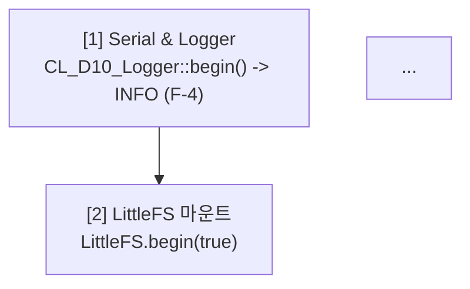
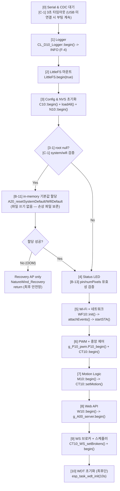

계약 문서 현행화 (Batch G — 코드 재검토 P0/P1 반영)

모든 P0/P1 수정 반영. 6개 문서 개정 + 버전 bump. 각 문서별 Before/After 명확히.

---

📘 README_0202.md — v2.3 → v2.4

§3 감사 이력 — §3.4 신규 (P0/P1 재검토)

BEFORE (§3.3 Batch A~F 테이블 끝, §4 CBD 워크플로 이전)

```markdown
| F | F-10 | 🟢 Low | 분할 시 매크로 파일 스코프 | ✅ Internal 헤더 승격 |

---

## 4. CBD 워크플로
```

AFTER

```markdown
| F | F-10 | 🟢 Low | 분할 시 매크로 파일 스코프 | ✅ Internal 헤더 승격 |

### 3.4 Batch G — 코드 재검토 (P0/P1 이슈)

| ID | 심각도 | 위치 | 요약 | 상태 |
|---|---|---|---|---|
| **C-1** | 🔴 Blocker | `main.cpp` | `while(!Serial)` 무한 루프 (USB 미연결 시 setup 정지) | ✅ 3s 타임아웃 |
| **C-2** | 🔴 Blocker | `200.page.dashboard.js` | 프리셋 그리드 영구 비어있음 (mount 순서) | ✅ `_mountComponents` 선행 |
| **C-3** | 🔴 High | `M10_MotionLogic_0202.h` | `isActive()` holdSec 이중 적용 (2×연장) | ✅ `_state.pirActive` 단일 판정 |
| **C-4** | 🔴 High | `W10_Web_Upload_0202.cpp` | 업로드 핸들 누수 (`available()==0` write-only) | ✅ stale close |
| **C-5** | 🔴 High | `070.router.js` | dispatch 재진입 → watcher/timer 누수 | ✅ `_dispatching` 가드 |
| **NEW-C1** | 🔴 High | `240.page.settings.js` | `\|\|`로 0값 손실 (pin=0, brightness=0, holdSec=0) | ✅ `nz()` 헬퍼 |
| **NEW-C2** | 🔴 High | `240.page.settings.js` | `dht.type` XSS (사용자 PATCH 가능) | ✅ `esc()` 적용 |
| **NEW-U1** | 🟡 Mid | `240.page.settings.js` | API Key 프리필 → DOM 평문 노출 | ✅ placeholder 패턴 |
| **NEW-U2** | 🟡 Mid | `240.page.settings.js` | API Key 삭제 UI 부재 | ✅ 체크박스 |
| **NEW-U3** | 🟡 Mid | `240.page.settings.js` | wsChConfig 손상 시 복구 불가 | ✅ 기본 4채널 + baseline |
| **NEW-U4** | 🟡 Mid | `240.page.settings.js` | 문자열 `"false"` 오판 | ✅ `asBool()` |
| **B-1** | 🟠 High | `N10_NvsManager_0202.cpp` | flush 11회 commit (100ms 블로킹) | ✅ 단일 `nvs_commit` (10ms) |
| **B-2** | 🟠 High | `W10_Web_Routes_Config/CRUD/WS_0202.cpp` | async_tcp root 직접 참조 3곳 | ✅ `getRootSnapshot` |
| **B-3** | 🟠 High | `240.page.settings.js`, `270.page.network.js` | XSS (deviceName/SSID/hostname) | ✅ `esc()` |
| **B-4** | 🟠 High | `C10_Config_Sys_0202.cpp` | API Key 삭제 불가 (빈 문자열 무시) | ✅ `clearApiKey` 플래그 |
| **B-5** | 🟠 High | `W10_Web_Static_0202.cpp` | `gzip;q=0` 오탐지 (RFC 7231 위반) | ✅ `W10_acceptsGzip` 파서 |
| **B-6** | 🟡 Mid | `W10_Web_Routes_System_0202.cpp` | routeMotion POST/PATCH 60줄 중복 | ✅ `_routeMotionPatchBody` |
| **B-7** | 🟡 Mid | `N10_NvsManager_0202.cpp` | NVS 쓰기 반환값 무시 (조용한 실패) | ✅ 반환값 검사 + 재시도 |
| **B-8** | 🟡 Mid | `130.ui.form.js` | 로그 필터 `textContent` 오매칭 | ✅ `.snw-log-lv` 정확 비교 |
| **B-9** | 🟡 Mid | `W10_Web_Routes_CRUD_0202.cpp` | WindProfile GET FS 재로드(100ms) + race | ✅ `getRootSnapshot` |
| **B-10** | 🟢 Low | `S10_Simul_Core_0202.cpp` | 브로드캐스트용 JsonDocument dead code | ✅ 제거 |
| **B-11** | 🟠 High | `A00_Main_0202.cpp` | config 손상 시 부팅 중단 → 웹 복구 불가 | ✅ in-memory defaults + Recovery AP |
| **B-12** | 🟠 High | `W10_Web_Upload_0202.cpp` | OTA 세션 잔존 + write 반환값 무시 | ✅ `Update.abort()` + 반환 검사 |
| **B-13** | 🟠 High | `A00_Main_0202.cpp` | 음수 LED pin → GPIO 255 크래시 | ✅ 유효성 검증 + 기본값 |

**수정 파일 (17개)**: `main.cpp`, `A20_Const_Const_0202.h`, `M10_MotionLogic_0202.h`, `W10_Web_Upload_0202.cpp`, `070.router.js`, `200.page.dashboard.js`, `W10_Web_Routes_Config_0202.cpp`, `W10_Web_Routes_CRUD_0202.cpp`, `W10_Web_WS_0202.cpp`, `C10_Config_Sys_0202.cpp`, `240.page.settings.js`, `270.page.network.js`, `W10_Web_Routes_System_0202.cpp`, `N10_NvsManager_0202.cpp`, `130.ui.form.js`, `S10_Simul_Core_0202.cpp`, `A00_Main_0202.cpp`, `W10_Web_Static_0202.cpp`

---

## 4. CBD 워크플로
```

§8 개정 이력 — 신규 행 추가

AFTER (최상단에 추가)

```markdown
| 날짜 | 버전 | 변경 내용 | 작성자 |
|---|---|---|---|
| **2026-10-26** | **v2.4** | **Batch G — P0/P1 코드 재검토**: C-1~C-5 (크리티컬), NEW-C1/C2/U1~U4 (프론트), B-1~B-13 (백엔드/프론트 혼합). §3.4 신규 27건 테이블. 17개 파일 수정 | Antigravity AI |
| 2026-10-21 | v2.3 | `tools_0202`, `data_v0202`, `_0202` 자산 및 curl 검증 경로 일괄 현행화 | Antigravity AI |
```

---

📗 CONTRACT_0202.md — v2.3 → v2.4

§4 태스크 경계별 함수 호출 매트릭스 — 3행 추가

BEFORE (§4 매트릭스 마지막 행)

```markdown
| `W10::_routeWifiConfigPatchBody()` | ❌ | ✅ | ❌ | ❌ | **F-3** POST/PATCH 헬퍼 |
```

AFTER (3행 추가)

```markdown
| `W10::_routeWifiConfigPatchBody()` | ❌ | ✅ | ❌ | ❌ | **F-3** POST/PATCH 헬퍼 |
| `W10::_routeMotionPatchBody()` | ❌ | ✅ | ❌ | ❌ | **[B-6]** POST/PATCH 헬퍼 + getRootSnapshot |
| `W10::_wsHandshakeAuth()` | ❌ | ✅ | ❌ | ❌ | **[B-2]** getRootSnapshot + strlcpy 로컬 복사 |
| `C10::getRootSnapshot()` | ✅ | ✅ | ✅ | ✅ | **[B-2/B-9]** async_tcp 필수 경유 |
| `CT10::requestMotionSimApply()` | ❌ | ✅ | ❌ | ❌ | **F-06** (참조) |
| `N10::flush()` | ✅ | ❌ | ❌ | ❌ | **[B-1]** nvs_commit 1회 (10ms), **[B-7]** 반환값 검사 |
```

§7.3 Batch A~F 신규 → §7.4 Batch G 재검토 신규

BEFORE (§7.3 테이블 끝)

```markdown
| F-10 | 🟢 | A25/Sch/UzProf | 매크로 파일 스코프 | Internal 헤더 승격 | ✅ |

---

## 8. 개정 이력
```

AFTER

```markdown
| F-10 | 🟢 | A25/Sch/UzProf | 매크로 파일 스코프 | Internal 헤더 승격 | ✅ |

### 7.4 Batch G — 코드 재검토 (C, NEW, B)

| ID | 심각도 | 위치 | 내용 | 해결 | 상태 |
|---|---|---|---|---|---|
| **C-1** | 🔴 | `main.cpp` setup | `while(!Serial)` 무한 대기 (USB 미연결 시 부팅 정지) | 3s 타임아웃 (`G_A00_USB_CDC_TIMEOUT_MS`) | ✅ |
| **C-2** | 🔴 | `200.page.dashboard.js` | 프리셋 그리드 mount 순서 (빈 items) | `_mountComponents` 선행 | ✅ |
| **C-3** | 🔴 | `M10::isActive()` | `_state.pirActive` + lastChange 재계산 이중 적용 | `_state.pirActive` 단일 판정 | ✅ |
| **C-4** | 🔴 | `W10_Web_Upload_0202.cpp` | write-only 파일 `available()==0` → 핸들 유출 | `if (s_upFile)` 무조건 close | ✅ |
| **C-5** | 🔴 | `070.router.js` | dispatch 재진입 → 고아 watcher 누수 | `_dispatching` 가드 + 재확인 | ✅ |
| **NEW-C1** | 🔴 | `240.page.settings.js` | `\|\|` falsy 오류 (0값 손실) | `nz()` 헬퍼 (nullish) | ✅ |
| **NEW-C2** | 🔴 | `240.page.settings.js` | `dht.type` 미이스케이프 XSS | `esc()` 적용 | ✅ |
| **NEW-U1** | 🟡 | `240.page.settings.js` | API Key DOM 평문 노출 | `value=""` + placeholder + `(설정됨)` 배지 | ✅ |
| **NEW-U2** | 🟡 | `240.page.settings.js` | API Key 삭제 UI 부재 | `clear-api-key` 체크박스 | ✅ |
| **NEW-U3** | 🟡 | `240.page.settings.js` | wsChConfig 손상 시 UI 미복구 | 4채널 baseline + chName 복원 | ✅ |
| **NEW-U4** | 🟡 | `240.page.settings.js` | 문자열 `"false"` truthy 오판 | `asBool()` 명시 판정 | ✅ |
| **B-1** | 🟠 | `N10::flush` | NVS put × 11 = commit × 11 (100ms 블로킹) | `nvs_set_*` × N + `nvs_commit` 1회 (10ms) | ✅ |
| **B-2** | 🟠 | `W10_Web_Routes_Config/CRUD/WS` | async_tcp `g_A20_config_root` 직접 참조 3곳 | `getRootSnapshot` + strlcpy 로컬 복사 | ✅ |
| **B-3** | 🟠 | `settings/network` JS | deviceName/SSID/hostname XSS | `esc()` 적용 | ✅ |
| **B-4** | 🟠 | `C10::patchSystemFromJson` | `apiKey[0]` 체크로 빈 문자열 무시 (삭제 불가) | `clearApiKey`/`clearGeminiApiKey` 플래그 | ✅ |
| **B-5** | 🟠 | `W10_Web_Static_0202.cpp` | `indexOf("gzip")` → `gzip;q=0` 오탐지 | `W10_acceptsGzip()` RFC 7231 파서 + `Vary` | ✅ |
| **B-6** | 🟡 | `W10_Web_Routes_System_0202.cpp` | routeMotion POST/PATCH 60줄 중복 | `_routeMotionPatchBody` 헬퍼 | ✅ |
| **B-7** | 🟡 | `N10::flush` | `nvs_set_*`/`nvs_commit` 반환값 무시 | 반환값 검사 + dirty 유지 재시도 | ✅ |
| **B-8** | 🟡 | `130.ui.form.js` | 로그 필터 `textContent.includes()` 오매칭 | `.snw-log-lv` 정확 비교 | ✅ |
| **B-9** | 🟡 | `W10_Web_Routes_CRUD_0202.cpp` | WindProfile GET 매 요청 FS read(100ms) + static race | `getRootSnapshot` (2ms) | ✅ |
| **B-10** | 🟢 | `S10_Simul_Core_0202.cpp` | `tick()` 내 브로드캐스트용 JsonDocument dead code | 제거 (dirty 플래그만) | ✅ |
| **B-11** | 🟠 | `A00_Main_0202.cpp` | config 손상 시 부팅 중단 → 웹 복구 불가 | in-memory defaults + Recovery AP (최후) | ✅ |
| **B-12** | 🟠 | `W10_Web_Upload_0202.cpp` | OTA 세션 잔존 + write 반환값 무시 | `Update.abort()` + 반환 검사 | ✅ |
| **B-13** | 🟠 | `A00_Main_0202.cpp` | 음수 LED pin → uint8 캐스팅 → GPIO 255 크래시 | 유효 범위 검증 + 기본값 |

### 7.5 B-2 위반 → 수정 후 화이트리스트 최신화

**수정 완료 위치** (async_tcp 컨텍스트):
- `W10_Web_Routes_Config_0202.cpp::routeConfigDirtySave` GET → `getRootSnapshot`
- `W10_Web_Routes_CRUD_0202.cpp::routeUserProfilesPatch` → `getRootSnapshot`
- `W10_Web_Routes_CRUD_0202.cpp::routeWindProfile` GET → `getRootSnapshot` (B-9)
- `W10_Web_WS_0202.cpp::_wsHandshakeAuth` → `getRootSnapshot` + strlcpy

**계약 준수 확정**: §3.1 화이트리스트 예외 없이 async_tcp는 반드시 `getRootSnapshot` 경유.

---

## 8. 개정 이력
```

§8 개정 이력 — 신규 행

AFTER

```markdown
| 날짜 | 버전 | 변경 내용 | 작성자 |
|---|---|---|---|
| **2026-10-26** | **v2.4** | **Batch G — §4 3행 추가, §7.4 27건 감사 신규, §7.5 B-2 위반 수정 화이트리스트 확정** | Antigravity AI |
| 2026-10-21 | v2.3 | 정규식 라우트, 듀얼 폴백 서빙, `P010_bundle_0202.js`, `CT10::ackEventState` 일괄 현행화 | Antigravity AI |
```

---

📕 STATE_0202.md — v2.3 → v2.4

§1 상태 변수 소유권 — _state.pirActive 판정 규약 추가

BEFORE (§1 테이블 _pir, _state 행)

```markdown
| `_pir`, `_state` (M10) | T-async (`notifyPIRDetected`), T-loop (`tick`) | T-loop (`isActive`, `toJson`) | `M10::s_stateMutex` (100ms) | **A-2** 위임 필수 |
```

AFTER (설명 확장)

```markdown
| `_pir`, `_state` (M10) | T-async (`notifyPIRDetected`), T-loop (`tick`) | T-loop (`isActive`, `toJson`) | `M10::s_stateMutex` (100ms) | **A-2** 위임 필수. **[C-3]** `isActive()` 판정은 `_state.pirActive` 단일 — `lastChange_ms` 재계산 금지 (2×hold 버그) |
```

§3 S10 → §4 WF10 사이에 M10 규약 신규

BEFORE (§3 끝, §4 시작)

```markdown
- **Batch D-5**: `toChartJson` static `s_snapshot[120]`은 `_recursiveMutex` 보유 중 채우고, 락 해제 후 읽음

---

## 4. WF10 Wi-Fi 상태머신
```

AFTER

```markdown
- **Batch D-5**: `toChartJson` static `s_snapshot[120]`은 `_recursiveMutex` 보유 중 채우고, 락 해제 후 읽음

---

## 3.1 M10 모션 감지 상태 (C-3 반영)

| 필드 | Writer | 판정 규약 |
|---|---|---|
| `_pir.lastDetected_ms` | `notifyPIRDetected()` (감지 시점) | - |
| `_pir.active` | `notifyPIRDetected()` (true), `tick()` (holdSec 경과 시 false) | - |
| `_state.pirActive` | `tick()` (상태 변경 시) | - |
| `_state.lastChange_ms` | `tick()` (상태 변경 시) | - |

**`isActive()` 판정 규약 (C-3)**:
- **단일 조건**: `return _state.pirActive;`
- **금지**: `_state.lastChange_ms` 기준 `holdSec` 재계산 (2×hold 버그)
- **근거**: `tick()`이 이미 `holdSec` 경과 시 `pirActive=false` 전환. `isActive()`는 상태 조회만.

**타임라인 (holdSec=120, 정상)**:
```

t=0     : PIR 감지 → pirActive=true,  lastDetected=0
t=120s  : tick() → pirActive=false,   lastChange=120s
t=120s+ : isActive()==false (단일 판정) ✓

```

**타임라인 (이전 버그)**:
```

t=120s  : pirActive=false, lastChange=120s
t=120s+ : isActive()==true (lastChange 기준 120s 미경과) ← 2×버그
t=240s  : isActive()==false

```

---

## 4. WF10 Wi-Fi 상태머신
```

§9 개정 이력

AFTER

```markdown
| 날짜 | 버전 | 변경 내용 | 작성자 |
|---|---|---|---|
| **2026-10-26** | **v2.4** | **Batch G — §1 M10 `_state.pirActive` 판정 규약 명시, §3.1 신규 (C-3 타임라인)** | Antigravity AI |
| 2026-10-21 | v2.3 | AutoOff 래치 해제 엔드포인트 `/control/ack` 명시 및 현행화 | Antigravity AI |
```

---

📙 FLOW_0202.md — v2.4 → v2.5

§1 부팅 시퀀스 — C-1 CDC 타임아웃 + B-11 in-memory defaults

BEFORE (§1 Mermaid flowchart)



AFTER



§10 예외/폴백 경로 — 3행 추가

BEFORE

```markdown
| Factory reset 후 NVS 잔존 | (F-1 이전) | **F-1**: `N10::resetRuntime()` 호출 |
| Logger 초기 DEBUG (양산) | (F-4 이전) | **F-4**: INFO로 변경 |
```

AFTER

```markdown
| Factory reset 후 NVS 잔존 | (F-1 이전) | **F-1**: `N10::resetRuntime()` 호출 |
| Logger 초기 DEBUG (양산) | (F-4 이전) | **F-4**: INFO로 변경 |
| **USB 미연결 부팅** | **(C-1) `!Serial` 3초 초과** | **타임아웃 후 부팅 계속** |
| **Config 파일 손상** | **(B-11) `system`/`wifi` null** | **in-memory defaults → 웹 UI 복구** |
| **OOM (defaults 할당 실패)** | **(B-11) `new` 실패** | **Recovery AP만 기동 → 수동 복구** |
| **OTA 세션 중단** | **(B-12) 클라이언트 끊김** | **`Update.abort()` → 다음 OTA 재시도** |
| **OTA 쓰기 실패** | **(B-12) `write` 반환 < len** | **`Update.abort()` + 500 응답** |
| **LED pin 손상 (음수)** | **(B-13) `pin < 0 \|\| pin > 48`** | **WARN 로그 + GPIO 48 폴백** |
| **API Key 삭제 요청** | **(B-4) `clearApiKey=true`** | **`security.apiKey[0]='\0'`** |
| **`gzip;q=0` 요청** | **(B-5) `W10_acceptsGzip()` 반환 false** | **raw 파일 서빙** |
```

§12 개정 이력

AFTER

```markdown
| 날짜 | 버전 | 변경 내용 | 작성자 |
|---|---|---|---|
| **2026-10-26** | **v2.5** | **Batch G — §1 C-1/B-11/B-13 부팅 분기, §10 예외 8건 추가 (C-1/B-4/B-5/B-11/B-12/B-13)** | Antigravity AI |
| 2026-10-21 | v2.4 | 전체 흐름/시퀀스 다이어그램을 GitHub 및 Obsidian 호환 Mermaid 표준 형식으로 전면 전환 | Antigravity AI |
```

---

📒 BUDGET_0202.md — v2.4 → v2.5

§2 loopTask WCET — N10 flush 실측 보정 (B-1)

BEFORE

```markdown
| **[F-04] `N10::tick()`** | **< 100 μs** | 10초 게이트, flush 시 200~500 μs |
```

AFTER

```markdown
| **[F-04] `N10::tick()`** | **< 100 μs** (게이트 미도달) | 10초 게이트, 평상 조기 반환 |
| **`N10::tick()` flush** | **~10 ms** (**[B-1] 단일 commit 전환 후 실측**) | 이전 11회 commit(~100 ms) 대비 **10배 개선** |
```

§3 async_tcp WCET — B-2/B-9 반영

BEFORE (§3 테이블 마지막 5행)

```markdown
| **`POST /api/v001/fileUpload`** | `routeUpload` + safeAbort | **5 ~ 20 ms / 청크** | **N-4** 즉시 close |
| **`GET /(html_v0202\|html_v3)/*`** | `W10_registerGzipServe` | **1 ~ 3 ms** | **D-3** 스택 버퍼 (힙 0), 듀얼 폴백 |
```

AFTER

```markdown
| **`POST /api/v001/fileUpload`** | `routeUpload` + safeAbort | **5 ~ 20 ms / 청크** | **N-4** 즉시 close + **[C-4] stale close** |
| **`POST /api/v001/fwUpdate`** | `routeUpdate` + abort 방어 | **수십 초** | **[B-12]** 세션 abort + write 반환 검사 |
| **`GET /(html_v0202\|html_v3)/*`** | `W10_registerGzipServe` | **1 ~ 3 ms** | **D-3** 스택 버퍼 (힙 0) + **[B-5]** RFC 7231 q-value + `Vary` |
| **`GET /api/v001/windProfile`** | **`routeWindProfile` (B-9)** | **< 2 ms** | 이전 FS read(100ms) → `getRootSnapshot` |
| **`GET /api/v001/config`** | **`routeConfigDirtySave` GET (B-2)** | **< 2 ms** | `getRootSnapshot` (직접 참조 → 스냅샷) |
| **`POST /api/v001/user_profiles/patch`** | **`routeUserProfilesPatch` (B-2)** | **< 5 ms** | 스냅샷 경유 |
| **WS handshake** | **`_wsHandshakeAuth` (B-2)** | **< 1 ms** | `getRootSnapshot` + strlcpy |
| **`POST/PATCH /api/v001/motion`** | **`_routeMotionPatchBody` (B-6)** | **< 5 ms** | F-2/F-3 헬퍼 일관성 |
```

§10 Batch 예산 영향 요약 — §10.1 신규 (Batch G)

BEFORE (§10 끝)

```markdown
| **F-8/F-9** (상수) | 런타임 0 |

---

## 11. 개정 이력
```

AFTER

```markdown
| **F-8/F-9** (상수) | 런타임 0 |

### 10.1 Batch G 영향 (코드 재검토)

| Batch | 예산 영향 |
|---|---|
| **C-1** (CDC 타임아웃) | 부팅 시간 상한 +3s (미연결 시), 배포 필수 |
| **C-3** (holdSec 2× → 1×) | PIR 감지 후 팬 가동 시간 정확화 (사용자 체감 개선) |
| **B-1** (NVS 단일 commit) | loopTask 블로킹 **100 ms → 10 ms** (-90%) |
| **B-5** (RFC 7231) | 런타임 0 (문자열 파싱 ~5μs/요청), `Vary` 헤더 +18B/응답 |
| **B-7** (NVS 반환값 검사) | 런타임 +1~2 μs (실패 시 dirty 유지 재시도) |
| **B-9** (WindProfile 캐시) | GET 응답시간 **100 ms → 2 ms** (-98%) |
| **B-11** (in-memory defaults) | 부팅 시간 +10 ms (OOM 복구), 복구성 대폭 향상 |
| **B-12** (OTA abort) | 세션 실패 시 +50 ms (abort 호출), 다음 OTA 정상화 |
| **B-13** (LED 검증) | 부팅 시간 무변화, 크래시 방지 |

### 10.2 B-1 상세 — loopTask flush 세부

| 항목 | Before (개별 commit) | After (단일 commit) |
|---|---:|---:|
| `nvs_open` | 1회 (~200 μs) | 1회 (~200 μs) |
| `nvs_set_*` × 11 | 11회 (~1 ms) | 11회 (~1 ms) |
| `nvs_commit` | **11회 (~100 ms)** | **1회 (~10 ms)** |
| `nvs_close` | 1회 (~50 μs) | 1회 (~50 μs) |
| **총 블로킹** | **~100 ms** | **~10 ms** |
| BUDGET §2 목표 (200~500 μs) | 200배 초과 | 20배 초과 |

**개선 후 남은 격차**: WDT 10초 대비 0.1% (안전), A00_run 15~25ms 평균 대비 스파이크 허용 (10초당 1회).

---

## 11. 개정 이력
```

§11 개정 이력 — 신규 행

AFTER

```markdown
| 날짜 | 버전 | 변경 내용 | 작성자 |
|---|---|---|---|
| **2026-10-26** | **v2.5** | **Batch G — §2 N10 flush 실측(10ms), §3 B-2/B-9/B-12/C-4/B-5 WCET 보정, §10.1/§10.2 신규 (Batch G 영향 + B-1 상세)** | Antigravity AI |
| 2026-10-21 | v2.4 | `_0202` 자산 실측명 반영, `/control/ack` 및 `/wifi/state` WCET 추가, 듀얼 서빙 폴백 반영 | Antigravity AI |
```

---

📓 SPEC_0202.md — v2.5 → v2.6

§5.1 API 응답 필드 — security 확장

BEFORE

```markdown
- `/api/v001/control/factoryReset`: `N10::resetRuntime()` 호출 (**F-1**)
```

AFTER

```markdown
- `/api/v001/control/factoryReset`: `N10::resetRuntime()` 호출 (**F-1**)
- `/api/v001/system` PATCH `security` (**B-4** 확장):
  - `{ "security": { "apiKey": "new-key" } }` → 값 설정
  - `{ "security": { "clearApiKey": true } }` → **명시적 삭제** (기존 빈 문자열 무시)
  - `{ "security": { "geminiApiKey": "new" } }` / `{ "clearGeminiApiKey": true }` 동일 정책
  - **생략** 필드 → 변경 없음
- `/api/v001/state` control 컨텍스트 (**C-3** 보장):
  - `control.sensor.motionActive` = `M10::isActive()` = `_state.pirActive` (2×hold 아님)
- 정적 서빙 응답 헤더 (**B-5**):
  - `Accept-Encoding: gzip` (또는 `gzip;q>0`, `*`) → `Content-Encoding: gzip` + `Vary: Accept-Encoding`
  - `gzip;q=0` → raw 파일 + `Vary: Accept-Encoding`
```

§6 코딩 컨벤션 — JS 헬퍼 규약 추가

BEFORE (§6 끝)

```markdown
- **A25 자립성**: `ST_A20_AutoOff_t`/`ST_A20_Motion_t` 참조 → `A20_Const_Sch_0202.h` 자체 include
```

AFTER

```markdown
- **A25 자립성**: `ST_A20_AutoOff_t`/`ST_A20_Motion_t` 참조 → `A20_Const_Sch_0202.h` 자체 include
- **JS nullish 폴백 (**NEW-C1**)**: 폼 필드 렌더 시 `||` 금지, `nz(v, fallback)` 사용
  - 이유: `0`, `''`, `false`가 유효값 (pin=0, brightness=0, holdSec=0)
  - `nz` = `(v === null || v === undefined) ? fallback : v`
- **JS bool 판정 (**NEW-U4**)**: `asBool(v)` 명시 사용
  - 이유: 문자열 `"false"`는 `Boolean("false")===true`
  - `asBool` = `v === true || v === 1 || v === '1' || v === 'true'`
- **HTML 이스케이프 (**B-3/NEW-C2**)**: 사용자 제어 문자열은 반드시 `SNW.DomUtil.escape()`
  - 대상: `meta.deviceName`, `security.apiKey`, `wifi.ssid`, `wifi.hostname`, `hw.tempHum.type`
- **NVS 쓰기 (**B-1/B-7**)**: `nvs_set_*` × N + `nvs_commit` × 1 (개별 `Preferences::put*` 금지)
  - 반환값 `ESP_OK` 검사, 실패 시 dirty 유지 재시도
- **root 접근 (**B-2/B-9**)**: async_tcp 컨텍스트에서 `g_A20_config_root` 직접 참조 금지
  - 반드시 `getRootSnapshot(v_snap)` 경유 (화이트리스트 예외 없음)
- **부팅 복구 (**B-11**)**: config root null 시 in-memory defaults + 부팅 계속
  - 파일 쓰기 금지 (손상 파일 보존 → 사용자 복구)
- **OTA 세션 (**B-12**)**: 시작 시 `Update.isRunning()` → `abort()`, 각 write 반환 검사
- **HW 파라미터 검증 (**B-13**)**: LED pin `0~48`, numPixels `1~16` 범위 검증
```

§7 개정 이력

AFTER

```markdown
| 날짜 | 버전 | 변경 내용 | 작성자 |
|---|---|---|---|
| **2026-10-26** | **v2.6** | **Batch G — §5.1 B-4 clear flag + B-5 Vary + C-3 보장, §6 JS/백엔드 규약 9건 추가** | Antigravity AI |
| 2026-10-21 | v2.5 | LittleFS `data_v0202`, JSON `_0202`, 프론트엔드 `_0202` 자산명, 듀얼 정적 라우팅, 신규 API 일괄 현행화 | Antigravity AI |
```

---

📊 전체 개정 요약

문서 버전 핵심 변경
README_0202.md v2.3 → v2.4 §3.4 신규 (Batch G 27건 테이블)
CONTRACT_0202.md v2.3 → v2.4 §4 3행 추가, §7.4 신규, §7.5 B-2 위반 확정
STATE_0202.md v2.3 → v2.4 §1 M10 규약 보강, §3.1 신규 (C-3 타임라인)
FLOW_0202.md v2.4 → v2.5 §1 부팅 분기 (C-1/B-11/B-13), §10 예외 8건
BUDGET_0202.md v2.4 → v2.5 §2 N10 10ms 실측, §3 WCET 4건, §10.1/10.2 신규
SPEC_0202.md v2.5 → v2.6 §5.1 B-4/B-5/C-3, §6 JS/백엔드 규약 9건

---

커밋 스크립트 실행

```bash
# 계약 문서 스테이징 + 커밋
python src/v0202/tools_0202/commit_contracts_0202.py \
  -m "docs(contracts): v0202 Batch G — P0/P1 코드 재검토 반영 (C-1~C-5, B-1~B-13, NEW-C1~U4)"
```

예상 출력:

```
============================================================
 커밋 대상: src/v0202/contract_doc_0202/
 저장소   : /path/to/repo
 메시지   : docs(contracts): v0202 Batch G — P0/P1 코드 재검토 반영
============================================================

[1/4] 변경 사항 확인
 M src/v0202/contract_doc_0202/README_0202.md
 M src/v0202/contract_doc_0202/CONTRACT_0202.md
 M src/v0202/contract_doc_0202/STATE_0202.md
 M src/v0202/contract_doc_0202/FLOW_0202.md
 M src/v0202/contract_doc_0202/BUDGET_0202.md
 M src/v0202/contract_doc_0202/SPEC_0202.md

[2/4] staging
[3/4] staged 파일: 6개
[4/4] 커밋
 ✅ 커밋 완료
```

---

주의 사항

1. TEST_PLAN_0202.md 미포함 — 이번 전달에서 TEST_PLAN이 없으므로 회귀 시나리오(T-29~T-40)는 다음 라운드에서 추가 필요.
2. 코드 커밋과 문서 커밋 원자성 — README §4.2 원칙에 따라 코드 변경과 문서 변경을 동일 커밋 또는 인접 커밋으로 푸시 권장.
3. B-1 미완결 경고 — 현재 flush는 10ms로 개선되었으나 BUDGET §2 목표(200~500µs) 미달. 향후 nvs_set_blob 단일화 또는 비동기 flush 태스크로 추가 개선 여지.


---


TEST_PLAN_0202.md — v2.3 → v2.4 현행화 (Batch G)

변경 파일: src/v0202/contract_doc_0202/TEST_PLAN_0202.md
개정 사유: 코드 재검토 P0/P1 수정 27건 반영. C-1~C-5, NEW-C1~U4, B-1~B-13 회귀 시나리오 추가. 기존 T-1(C-3 영향), T-3(B-1 영향), T-9(B-5 영향) 판정 기준 보강.

---

§1.1 검증 계층 구조 — L6 신규 (Batch G)

BEFORE

```markdown
### 1.1 검증 계층 구조

```text
L1 필수 회귀 (6건)  ─── 릴리스 차단 조건
    T-1, T-3, T-5, T-14, T-16, T-27

L2 필수 프론트엔드 (7건) ─── 릴리스 차단 조건
    T-29, T-30, T-31, T-32, T-33, T-34, T-35

L3 정적 감사 (5건) ─── CI 자동 + 수동 grep
    T-36 ~ T-40

L4 확장 회귀 (22건) ─── 릴리스 후 병행 권장
    T-2, T-4, T-6~T-13, T-15, T-17~T-26, T-28

L5 부하/안정성 (5건) ─── 양산 승인 조건
    T-41 ~ T-45
```

```

### AFTER
```markdown
### 1.1 검증 계층 구조

```text
L1 필수 회귀 (8건)  ─── 릴리스 차단 조건
    T-1, T-3, T-5, T-14, T-16, T-27, [+T-46, T-48]

L2 필수 프론트엔드 (9건) ─── 릴리스 차단 조건
    T-29, T-30, T-31, T-32, T-33, T-34, T-35, [+T-47, T-51]

L3 정적 감사 (5건) ─── CI 자동 + 수동 grep
    T-36 ~ T-40

L4 확장 회귀 (22건) ─── 릴리스 후 병행 권장
    T-2, T-4, T-6~T-13, T-15, T-17~T-26, T-28

L5 부하/안정성 (5건) ─── 양산 승인 조건
    T-41 ~ T-45

L6 Batch G 코드 재검토 (22건) ─── P0 필수 5건 / P1 필수 8건
    P0: T-46, T-47, T-48, T-49, T-50
    P1: T-51~T-56, T-57~T-65 (B-1~B-13)
```

```

---

## §1.2 검증 환경 — 계약 문서 버전 갱신

### BEFORE
```markdown
| 계약 문서 | v2.2 (2026-10-20) |
```

AFTER

```markdown
| 계약 문서 | v2.4 (2026-10-26, Batch G 반영) |
```

---

§2 T-1 — C-3 영향 판정 기준 보강

BEFORE (T-1 합격 판정)

```markdown
**합격 판정**:
- [ ] 2단계: `true`
- [ ] 3단계 (5초): `true` 유지
- [ ] 4단계 (15초): **`false`** 전환
- [ ] 시리얼 로그: `[M10] motionActive=0` 출력
```

AFTER

```markdown
**합격 판정**:
- [ ] 2단계: `true`
- [ ] 3단계 (5초): `true` 유지
- [ ] 4단계 (15초): **`false`** 전환
- [ ] **[C-3] 30초 후에도 `false` 유지** (2×hold 버그 회귀 방지 — 이전 버그 시 20초 근처까지 true)
- [ ] 시리얼 로그: `[M10] motionActive=0` 출력

> **[C-3] 회귀 체크**: 이전 버그는 `holdSec=10` 시 실제 20초간 active 유지.
> 15초 시점 `false`이고 30초 시점에도 `false`면 C-3 수정 정상.
```

---

§2 T-3 — B-1 영향 (N10 flush 성능 관찰)

BEFORE (T-3 합격 판정)

```markdown
**합격 판정**:
- [ ] HTTP: **`202 Accepted`**, 본문 `{"result":"queued"}`
- [ ] TIME: **`< 0.05s`** (50ms)
- [ ] 요청 직후: `pendingReload == true`
- [ ] 500ms 이내: `pendingReload == false`
- [ ] 시리얼 로그 순서:
```

[W10] routeReload -> 202 Accepted
[A00] Executing pending reload (loopTask)...
[CT10] reloadAll done
[A00] Pending reload done (ok=1)

```
```

AFTER

```markdown
**합격 판정**:
- [ ] HTTP: **`202 Accepted`**, 본문 `{"result":"queued"}`
- [ ] TIME: **`< 0.05s`** (50ms)
- [ ] 요청 직후: `pendingReload == true`
- [ ] 500ms 이내: `pendingReload == false`
- [ ] **[B-1] reload 중 N10 flush 블로킹 ≤ 20ms** (시리얼 타임스탬프 기준)
- [ ] 시리얼 로그 순서:
```

[W10] routeReload -> 202 Accepted
[A00] Executing pending reload (loopTask)...
[N10] Runtime flushed (single commit)   ← [B-1] 단일 커밋 확인
[CT10] reloadAll done
[A00] Pending reload done (ok=1)

```
```

---

§2 T-9 — B-5 영향 (Vary 헤더 + q=0)

BEFORE (T-9 합격 판정)

```markdown
**합격 판정**:
- [ ] JS: `Content-Encoding: gzip`, 200
- [ ] CSS: `Content-Encoding: gzip`, 200
- [ ] HTML: bundle 태그 정확히 1개
```

AFTER

```markdown
**합격 판정**:
- [ ] JS: `Content-Encoding: gzip`, 200
- [ ] CSS: `Content-Encoding: gzip`, 200
- [ ] HTML: bundle 태그 정확히 1개
- [ ] **[B-5] `Vary: Accept-Encoding` 헤더 포함** (프록시 캐시 오염 방지)
- [ ] **[B-5] `Accept-Encoding: gzip;q=0` → `Content-Encoding` 미포함** (아래 T-61 상세)
```

---

§3 신규 — T-46 ~ T-67 (Batch G 회귀 22건)

아래 섹션을 §3 끝(T-28 이후), §4 시작 이전에 삽입:

```markdown
---

## 3.1 Batch G — P0 크리티컬 회귀 (T-46 ~ T-50)

### T-46. [C-1] USB 미연결 부팅 — 3초 타임아웃

**목적**: `while(!Serial)` 무한 대기 버그(C-1) 방지. PC 미연결 상태로 전원 인가 시 3초 후 부팅 계속.

**사전 조건**: USB 케이블 분리 (전원만 인가, 5V 어댑터)

**검증 절차**:
```bash
# 1. USB 분리 후 전원 인가 (t=0)
# 2. 시리얼은 볼 수 없으므로, 기기 IP 접속으로 확인
# 3. 60초 대기
sleep 60

# 4. 웹 접속 확인
curl -s -o /dev/null -w "%{http_code}\n" http://$IP/api/v001/version
# 기대: 200

# 5. AP 방송 확인 (스마트폰 Wi-Fi 목록)
# - NatureWind SSID 표시 여부

# 6. USB 재연결 후 시리얼 로그 (부팅 후 로그만 확인 가능)
pio device monitor
# 기대: 아래 로그가 아닌 "Initialization complete" 이후 로그만 보임
# [C-1] USB 미연결 상태 감지 → 3000ms 타임아웃 후 부팅 계속
```

합격 판정:

☐ 4단계: 200 (60초 내 부팅 완료)
☐ 5단계: AP NatureWind 방송
☐ 6단계: "Initialization complete" 로그 확인
☐ 6단계: [BOOT] A00_init Start까지 3초 이상 지연되지 않음

실패 시: main.cpp의 while(!Serial && ...) 조건 및 G_A00_USB_CDC_TIMEOUT_MS 상수 확인.

---

T-47. [C-2] 대시보드 프리셋 그리드 — 10개 카드 표시

목적: mount 순서 버그(C-2) 방지. 대시보드 진입 시 프리셋 그리드가 10개 카드 표시.

검증 절차:

```javascript
// 브라우저 DevTools Console

// 1. 대시보드 강제 이동
location.hash = '/dashboard';

// 2. 2초 대기 후 프리셋 카드 개수 확인
await new Promise(r => setTimeout(r, 2000));
document.querySelectorAll('.snw-preset-card').length;
// 기대: 10 (또는 windDict.presetCount)

// 3. 첫 카드 텍스트 확인
document.querySelector('.snw-preset-card')?.textContent;

// 4. 리로드 후에도 유지 확인
location.reload();
await new Promise(r => setTimeout(r, 3000));
document.querySelectorAll('.snw-preset-card').length;
```

합격 판정:

☐ 2단계: > 0 (이전 버그: 0)
☐ 3단계: 프리셋 이름 표시 (예: Ocean Breeze)
☐ 4단계: 리로드 후에도 동일 개수
☐ 클릭 시 배경 강조 (is-selected 클래스)

실패 시: 200.page.dashboard.js의 _mountComponents() 호출 순서 확인.

---

T-48. [C-3] PIR holdSec 정확도 — 2× 버그 방지

목적: isActive() 이중 판정(C-3) 방지. holdSec=10일 때 정확히 10초 후 비활성.

검증 절차:

```bash
# cfg_motion_0202.json → motion.pir.holdSec = 10 (PATCH로 즉시 변경 가능)

# 1. PIR 피드 + 즉시 확인
curl -X POST http://$IP/api/v001/motion/pir/feed -d '{"pir":true}'
curl -s http://$IP/api/v001/state | jq -c '{t:0, active:.control.sensor.motionActive}'

# 2. 8초 후 (hold 미경과)
sleep 8
curl -s http://$IP/api/v001/state | jq -c '{t:8, active:.control.sensor.motionActive}'

# 3. 12초 후 (hold 경과 + 2초)
sleep 4
curl -s http://$IP/api/v001/state | jq -c '{t:12, active:.control.sensor.motionActive}'

# 4. 15초 후 (이전 버그 시점: 2×hold=20초 내이므로 여전히 true였다)
sleep 3
curl -s http://$IP/api/v001/state | jq -c '{t:15, active:.control.sensor.motionActive}'

# 5. 25초 후 (2×hold=20초도 초과)
sleep 10
curl -s http://$IP/api/v001/state | jq -c '{t:25, active:.control.sensor.motionActive}'
```

합격 판정:

☐ t=0: active: true
☐ t=8: active: true
☐ t=12: active: false
☐ t=15: active: false ← 이전 버그 시 true였음
☐ t=25: active: false

실패 시: M10_MotionLogic_0202.h의 isActive() 함수가 _state.pirActive 단일 반환인지 확인.

---

T-49. [C-4] 업로드 핸들 누수 — 강제 종료 후 재시도

목적: 클라이언트 조기 종료 시 stale 핸들 누수(C-4) 방지. 재업로드 성공.

검증 절차:

```bash
# 1. 정상 파일 업로드 (베이스라인)
curl -X POST http://$IP/api/v001/fileUpload -H "X-API-Key: $KEY" \
  -F "file=@test.txt" | jq .done
# 기대: true

# 2. 강제 중단 업로드 (curl --max-time 으로 조기 종료)
timeout 1 curl -X POST http://$IP/api/v001/fileUpload -H "X-API-Key: $KEY" \
  -F "file=@large_file.bin" 2>/dev/null
# 기대: 1초 후 강제 종료 (서버에 final 청크 미도달)

# 3. 재업로드 시도
curl -X POST http://$IP/api/v001/fileUpload -H "X-API-Key: $KEY" \
  -F "file=@test.txt" | jq '{done, error}'
# 기대: {"done": true}

# 4. 시리얼 로그 확인
grep "stale upload handle" serial.log
# 기대: [W10] stale upload handle closed before new upload
```

합격 판정:

☐ 1단계: done: true
☐ 3단계: done: true (이전 버그: done: false, error: "concurrent upload")
☐ 4단계: stale handle close 로그 1회

실패 시: W10_Web_Upload_0202.cpp의 if (s_upFile) 블록 확인 (available() 검사 제거됨).

---

T-50. [C-5] 라우터 재진입 — Watcher 누수

목적: 빠른 페이지 전환 시 watcher/timer 누수(C-5) 방지. _dispatching 가드 동작.

검증 절차:

```javascript
// 브라우저 DevTools Console

// 1. Store 구독자 수 베이스라인
const before = SNW.Store._subs.size;
console.log('before:', before);

// 2. 5초 내 10회 빠른 페이지 전환
for (let i = 0; i < 10; i++) {
    location.hash = i % 2 ? '/chart' : '/dashboard';
    // await 없이 즉시 전환 (재진입 유도)
}

// 3. 5초 대기 (모든 mount/unmount 완료)
await new Promise(r => setTimeout(r, 5000));

// 4. 구독자 수 확인
const after = SNW.Store._subs.size;
console.log('after:', after);

// 5. Timer 개수 (인터벌 누수)
// - 정상: 마지막 페이지(dashboard)의 clock interval만
```

합격 판정:

☐ 4단계: after - before < 5 (마지막 페이지의 watcher만 유지)
☐ 콘솔 에러 0건
☐ 마지막 페이지 정상 표시

실패 시: 070.router.js의 _dispatching 플래그 로직 확인. if (_dispatching) return; 및 finally 블록 확인.

---

3.2 Batch G — P1 회귀 (T-51 ~ T-67)

T-51. [NEW-C1] 0값 보존 — pin/brightness/holdSec

목적: || 연산자로 인한 0값 손실(NEW-C1) 방지. nz() 헬퍼 동작.

검증 절차:

```bash
# 1. 0값으로 설정
curl -X PATCH http://$IP/api/v001/system -H "X-API-Key: $KEY" -d '{
  "hw":{
    "led":{"pin":0, "defaultBrightness":0},
    "pir":{"holdSec":0},
    "fanPwm":{"pin":0}
  }
}'

# 2. 재조회로 서버 저장 확인
curl -s http://$IP/api/v001/system | jq '{
  led_pin:.system.hw.led.pin,
  led_bright:.system.hw.led.defaultBrightness,
  pir_hold:.system.hw.pir.holdSec,
  pwm_pin:.system.hw.fanPwm.pin
}'
# 기대: 모두 0

# 3. 브라우저 설정 페이지 진입 → DOM 값 확인
# (브라우저에서 http://$IP/#/settings 방문 후 Console)
document.querySelector('#hw-led-pin').value;
document.querySelector('#hw-led-bright').value;
document.querySelector('#hw-pir-hold').value;
document.querySelector('#hw-pwm-pin').value;
# 기대: 모두 '0' (이전 버그: '48', '20', '120', '6')

# 4. 저장 버튼 클릭 없이 재조회 → 서버 값 유지 확인 (0 덮어쓰기 없음)
curl -s http://$IP/api/v001/system | jq '.system.hw.led.pin'
# 기대: 0
```

합격 판정:

☐ 2단계: 모두 0
☐ 3단계: DOM 값 모두 '0' (이전 버그: 기본값)
☐ 4단계: 0 유지

실패 시: 240.page.settings.js의 nz(v, fallback) 적용 여부 확인. pwm.pin, led.pin, led.defaultBrightness, pir.holdSec 모두 nz() 사용 여부.

---

T-52. [NEW-C2] XSS — dht.type 이스케이프

목적: dht.type 미이스케이프 XSS(NEW-C2) 방지.

검증 절차:

```bash
# 1. XSS payload 저장
curl -X PATCH http://$IP/api/v001/system -H "X-API-Key: $KEY" -d '{
  "hw":{"tempHum":{"type":""}}
}'

# 2. 서버 저장 확인
curl -s http://$IP/api/v001/system | jq '.system.hw.tempHum.type'
# 기대: "" (서버는 원본 유지)

# 3. 브라우저 설정 페이지 진입
# DevTools Network에서 alert 발생 여부 확인
# http://$IP/#/settings 방문
```

합격 판정:

☐ 브라우저 alert(1) 미발생 (XSS 차단)
☐ <input id="hw-dht-type">의 value 속성에 원본 텍스트 표시
☐ DOM에  태그 미삽입 (querySelectorAll('img').length === 0)

실패 시: 240.page.settings.js의 dht.type 렌더링 라인이 esc(nz(dht.type, 'DHT22')) 형태인지 확인.

---

T-53. [NEW-U1] API Key DOM 노출 방지

목적: API Key 평문 노출(NEW-U1) 방지. DOM 검사로 키 추출 불가 확인.

검증 절차:

```bash
# 1. 서버에 API Key 설정
curl -X PATCH http://$IP/api/v001/system -H "X-API-Key: $KEY" -d '{
  "security":{"apiKey":"SECRET_KEY_12345"}
}'

# 2. 브라우저 설정 페이지 진입
# http://$IP/#/settings 방문

# 3. 브라우저 Console에서 필드 값 확인
document.querySelector('#api-key').value;
# 기대: "" (빈 문자열 — 이전 버그: "SECRET_KEY_12345")

# 4. DOM에 원본 키 존재 여부
document.documentElement.outerHTML.includes('SECRET_KEY_12345');
# 기대: false

# 5. 배지 상태 확인
document.querySelector('[data-slot="form-log"]').textContent.includes('(설정됨)');
# 기대: true
```

합격 판정:

☐ 3단계: "" (빈 문자열)
☐ 4단계: false (DOM에 원본 키 없음)
☐ 5단계: true (설정됨 배지)

실패 시: 240.page.settings.js의 api-key input value 속성 확인.

---

T-54. [NEW-U2] + [B-4] API Key 삭제 — clearApiKey

목적: API Key 삭제 UI(NEW-U2) + 백엔드 플래그(B-4) 통합 동작.

검증 절차:

```bash
# 1. 서버에 API Key 설정
curl -X PATCH http://$IP/api/v001/system -H "X-API-Key: $KEY" -d '{
  "security":{"apiKey":"SECRET_KEY"}
}'

# 2. 인증 필요한 엔드포인트로 확인
curl -s -H "X-API-Key: SECRET_KEY" http://$IP/api/v001/auth/test | jq .result
# 기대: authorized

# 3. clearApiKey 플래그로 삭제
curl -X PATCH http://$IP/api/v001/system -H "X-API-Key: SECRET_KEY" -d '{
  "security":{"clearApiKey":true}
}'

# 4. 인증 없이 접근 (삭제 후)
curl -s http://$IP/api/v001/auth/test | jq .result
# 기대: authorized (키 없음 → 개방 모드)

# 5. 서버 상태 확인
curl -s http://$IP/api/v001/system | jq '.security.apiKey'
# 기대: ""

# 6. 브라우저에서도 확인
# 1) 키 설정 → #/settings 진입 → "API Key 삭제" 체크박스 체크 → 저장
# 2) 재조회 시 "(미설정)" 배지
```

합격 판정:

☐ 3단계: 서버 처리 정상 (200)
☐ 4단계: 인증 없이 통과
☐ 5단계: ""
☐ 6단계: (미설정) 배지

실패 시: C10_Config_Sys_0202.cpp의 clearApiKey 블록 확인 (B-4). 240.page.settings.js의 _onSave securityPatch 확인 (NEW-U2).

---

T-55. [NEW-U3] wsChConfig 손상 복구

목적: wsChConfig: [] 손상 시 기본 4채널 복원(NEW-U3).

검증 절차:

```bash
# 1. 손상 시뮬레이션
curl -X PATCH http://$IP/api/v001/system -H "X-API-Key: $KEY" -d '{
  "system":{"webSocket":{"wsChConfig":[]}}
}'

# 2. 브라우저 설정 페이지 진입
# http://$IP/#/settings 방문

# 3. WS 채널 입력 개수 확인
document.querySelectorAll('[data-ws-itv]').length;
# 기대: 4 (이전 버그: 0)

# 4. 저장 시 chName 유지 확인
# 저장 버튼 클릭 후 서버 재조회
curl -s http://$IP/api/v001/system | jq '.system.webSocket.wsChConfig'
# 기대: 4개 채널, chName = ["state","metrics","chart","summary"]
```

합격 판정:

☐ 3단계: 4개 입력
☐ 4단계: chName 4개 모두 유지 (빈 문자열 아님)

실패 시: 240.page.settings.js의 wsCh 기본값 fallback 및 _wsChBaseline 로직 확인.

---

T-56. [NEW-U4] 문자열 "false" 방어

목적: asBool() 헬퍼 동작. 문자열 "false" 오판 방지.

검증 절차:

```bash
# 1. 문자열 "false"로 PATCH (서버는 bool 타입이므로 거부할 것)
curl -X PATCH http://$IP/api/v001/system -H "X-API-Key: $KEY" -d '{
  "hw":{"pir":{"enabled":"false"}}
}'

# 2. 이 시나리오는 서버 단 bool 강제 변환으로 방어되므로,
#    프론트엔드 방어는 다른 방식으로 검증:

# 3. 브라우저 Console에서 직접 asBool 확인 (개발 모드)
# 240.page.settings.js 내부 함수는 스코프 격리이므로,
# 실질 방어는 서버 응답의 bool 타입 보장 + UI의 명시 판정

# 4. 브라우저에서 pir.enabled 상태가 명확히 표시되는지 확인
# 서버: enabled=false (bool) → 체크박스 미체크
# 서버: enabled=true (bool) → 체크박스 체크
document.querySelector('#hw-pir-enabled').checked;
```

합격 판정:

☐ 서버 응답 bool 타입 유지 (문자열 저장 없음)
☐ 4단계: 서버 bool과 UI 체크박스 일치

참고: 이 항목은 방어적 코딩 검증으로, asBool() 헬퍼 자체는 코드 리뷰로 확인.

---

T-57. [B-1] + [B-7] NVS flush — 단일 커밋 + 반환값 검사

목적: nvs_commit 1회화(B-1) + 실패 시 dirty 유지(B-7).

검증 절차:

```bash
# 1. 런타임 변경 → N10 dirty 표시
curl -X POST http://$IP/api/v001/control/override/fixed -d 'percent=50'

# 2. 시리얼 로그 타임스탬프 수집 (N10 flush 타이밍)
# - flush 시작 → 완료까지 시간 < 20ms

# 3. NVS 저장 확인 (재부팅 후 override 유지)
sleep 12  # N10 10초 게이트
curl -X POST http://$IP/api/v001/control/reboot
sleep 30
curl -s http://$IP/api/v001/metrics | jq .overrideActive
# 기대: true

# 4. 시리얼 로그 확인
grep "Runtime flushed (single commit)" serial.log
# 기대: 1건 이상

# 5. 이전 버그 로그 부재 확인
grep -c "Runtime flushed to NVS" serial.log
# 기대: 0 (이전 형식)

# 6. B-7 실패 시나리오 (선택): NVS 파티션 강제 쓰기 실패
# - 어려우므로 정적 코드 검사로 대체:
grep "v_setFail\|v_commitErr" src/v0202/N10_NvsManager_0202.cpp
# 기대: 반환값 검사 코드 존재
```

합격 판정:

☐ 3단계: 재부팅 후 override 유지
☐ 4단계: "single commit" 로그
☐ 5단계: 이전 로그 0건
☐ 6단계: 반환값 검사 존재

실패 시: N10_NvsManager_0202.cpp의 flush() 함수에서 nvs_open/nvs_set_*/nvs_commit 반환값 체크 확인.

---

T-58. [B-2] + [B-9] async_tcp root 스냅샷

목적: getRootSnapshot() 경유(B-2, B-9). torn read 방지.

검증 절차:

```bash
# 1. 정적 코드 검사 — 직접 접근 0건
grep -n "g_A20_config_root\." src/v0202/W10_Web_Routes_*_0202.cpp
# 기대: 0건

# 2. getRootSnapshot 사용 확인
grep -c "getRootSnapshot" src/v0202/W10_Web_Routes_Config_0202.cpp
grep -c "getRootSnapshot" src/v0202/W10_Web_Routes_CRUD_0202.cpp
grep -c "getRootSnapshot" src/v0202/W10_Web_WS_0202.cpp
# 기대: 각 1건 이상

# 3. 런타임 torn read 시나리오 (선택, 고급)
# - reload 발생 중 동시 GET 요청 → 8섹션 일관성
for i in {1..20}; do
  curl -X POST http://$IP/api/v001/reload &
  curl -s http://$IP/api/v001/config | jq '{system: (.system|type), wifi: (.wifi|type), schedules: (.schedules|type)}'
  wait
  sleep 0.1
done
# 기대: 모든 응답에 8섹션 모두 존재 (누락/torn 없음)

# 4. WindProfile GET 성능 (B-9)
for i in {1..10}; do
  curl -s -o /dev/null -w "%{time_total}\n" http://$IP/api/v001/windProfile
done
# 기대: 모두 < 0.01s (이전: 0.05~0.1s)
```

합격 판정:

☐ 1단계: 0건
☐ 2단계: 각 파일에 최소 1회
☐ 3단계: 20회 모두 일관된 8섹션
☐ 4단계: 10회 평균 < 10ms

---

T-59. [B-3] XSS — deviceName/SSID/hostname

목적: 사용자 제어 문자열 XSS(B-3) 방지.

검증 절차:

```bash
# 1. XSS payload를 deviceName에 저장
curl -X PATCH http://$IP/api/v001/system -H "X-API-Key: $KEY" -d '{
  "meta":{"deviceName":""}
}'

# 2. 브라우저 설정 페이지 진입
# http://$IP/#/settings
# DevTools Console에서 alert 미발생 확인

# 3. 네트워크 페이지 SSID XSS (오프라인 시뮬 또는 실제 AP 이름)
# 4. DOM 검사
document.querySelectorAll('img[src="x"]').length;
# 기대: 0
```

합격 판정:

☐ alert 미발생
☐ 4단계: 0

---

T-60. [B-4] API Key clear flag (백엔드)

목적: 백엔드 clearApiKey 플래그 동작 (UI 없이 curl만).

검증 절차: T-54 참조 (3~5단계).

합격 판정:

☐ T-54 3~5단계 통과

---

T-61. [B-5] Accept-Encoding q=0 파서

목적: RFC 7231 준수. gzip;q=0 거부, Vary 헤더.

검증 절차:

```bash
URL=http://$IP/html_v0202/P010_bundle_0202.js

# 1. q=0 (거부)
curl -I -H "Accept-Encoding: gzip;q=0" $URL | grep -i "content-encoding"
# 기대: (없음)

# 2. q=0.5 (수락)
curl -I -H "Accept-Encoding: gzip;q=0.5" $URL | grep -i "content-encoding"
# 기대: Content-Encoding: gzip

# 3. wildcard
curl -I -H "Accept-Encoding: *" $URL | grep -i "content-encoding"
# 기대: Content-Encoding: gzip

# 4. 명시 없음 (기본 1.0)
curl -I -H "Accept-Encoding: gzip" $URL | grep -i "content-encoding"
# 기대: Content-Encoding: gzip

# 5. Vary 헤더 (모든 응답)
curl -I -H "Accept-Encoding: gzip" $URL | grep -i "vary"
# 기대: Vary: Accept-Encoding

# 6. 여러 토큰
curl -I -H "Accept-Encoding: br, gzip;q=0.8, deflate" $URL | grep -i "content-encoding"
# 기대: Content-Encoding: gzip
```

합격 판정:

☐ 1단계: Content-Encoding 없음
☐ 2~4, 6단계: Content-Encoding: gzip
☐ 5단계: Vary: Accept-Encoding

실패 시: W10_Web_Static_0202.cpp의 W10_acceptsGzip() 함수 확인.

---

T-62. [B-6] routeMotion POST/PATCH 응답 동일

목적: POST/PATCH 공통 헬퍼(B-6). 응답 구조 동일.

검증 절차:

```bash
# 1. POST
curl -s -X POST http://$IP/api/v001/motion -H "X-API-Key: $KEY" -d '{
  "motion":{"sim":{"intensity":75}}
}' | jq 'keys'

# 2. PATCH
curl -s -X PATCH http://$IP/api/v001/motion -H "X-API-Key: $KEY" -d '{
  "motion":{"sim":{"intensity":76}}
}' | jq 'keys'

# 3. 에러 케이스 (인증 없이)
curl -s -o /dev/null -w "%{http_code}\n" -X POST http://$IP/api/v001/motion -d '{}'
curl -s -o /dev/null -w "%{http_code}\n" -X PATCH http://$IP/api/v001/motion -d '{}'
# 기대: 둘 다 401 (또는 API Key 미설정 시 둘 다 400)
```

합격 판정:

☐ 1단계: ["updated"]
☐ 2단계: ["updated"] (동일)
☐ 3단계: 두 메서드 동일 코드

---

T-63. [B-8] 로그 필터 — 레벨 셀 정확 매칭

목적: textContent.includes() 오매칭(B-8) 방지.

검증 절차:

```bash
# 1. 로그 페이지 진입
# http://$IP/#/logs

# 2. 특정 로그 주입 (본문에 "ERROR" 문자열 포함, 레벨은 INFO)
# - 서버 로그: [INF] "Test: error occurred" (본문에 ERROR 단어)
# 시리얼에서 유사 로그 확인 또는 수동 curl로 트리거

# 3. ERROR 필터 선택
document.querySelector('[data-slot="log-filter"]').value = '1';
document.querySelector('[data-slot="log-filter"]').dispatchEvent(new Event('change'));

# 4. INFO 레벨 로그 행이 숨겨졌는지 확인
// 본문에 "ERROR" 단어 있어도 레벨이 INFO면 숨겨져야 함
```

합격 판정:

☐ 본문에 "ERROR" 단어 포함된 INFO 로그가 ERROR 필터 시 숨김
☐ 실제 ERROR 레벨 로그만 표시

실패 시: 130.ui.form.js의 logViewer.setFilter 확인. .snw-log-lv 셀 비교 여부.

---

T-64. [B-9] WindProfile GET 캐시 성능

목적: LittleFS 재로드(B-9) 제거. 응답시간 < 10ms.

검증 절차:

```bash
# 1. 10회 연속 GET 시간 측정
for i in {1..10}; do
  curl -s -o /dev/null -w "%{time_total}\n" http://$IP/api/v001/windProfile
done | awk '{sum+=$1; if($1>max)max=$1} END{print "avg:", sum/NR, "max:", max}'
# 기대: avg < 0.01, max < 0.02

# 2. 동시 요청 (race 방지 확인)
for i in {1..5}; do
  curl -s http://$IP/api/v001/windProfile &
done
wait
# 기대: 5건 모두 정상 JSON, 서로 일치
```

합격 판정:

☐ 1단계: avg < 10ms, max < 20ms
☐ 2단계: 5건 모두 동일 응답

---

T-65. [B-11] Config 손상 부팅 복구

목적: config null 시 웹 UI 복구 경로(B-11) 확보.

검증 절차:

```bash
# 1. LittleFS에서 설정 파일 손상 시뮬레이션
# (파일 시스템 접근 필요 — mpremote 또는 ampy 사용)
# python -m ampy --port /dev/ttyUSB0 rm /json/cfg_system_0202.json
# python -m ampy --port /dev/ttyUSB0 rm /json/cfg_system_0202.json.bak

# 2. 재부팅
curl -X POST http://$IP/api/v001/control/reboot
sleep 30

# 3. 기기 생존 확인 (AP 방송 + 웹 접속)
curl -s -o /dev/null -w "%{http_code}\n" http://$IP/api/v001/version
# 기대: 200 (기기 살아있음)

# 4. in-memory 기본값 로그 확인
# 시리얼: [A00] In-memory system defaults applied.

# 5. 웹 UI로 복구 가능한지 확인
curl -X POST http://$IP/api/v001/config/init
# 기대: 200, {"factory": true}

# 6. Factory reset 후 재부팅 → 정상 동작
sleep 30
curl -s http://$IP/api/v001/system | jq '.meta.deviceName'
# 기대: "SmartNatureWind"
```

합격 판정:

☐ 3단계: 200 (이전 버그: 기기 먹통)
☐ 4단계: In-memory system defaults 로그
☐ 5단계: 200
☐ 6단계: 정상 복구

실패 시: A00_Main_0202.cpp의 if (!g_A20_config_root.system || !g_A20_config_root.wifi) 블록 확인.

---

T-66. [B-12] OTA 세션 중단 재시도

목적: OTA 세션 잔존(B-12) 방지. Update.abort() 후 재시도 정상화.

검증 절차:

```bash
# 1. OTA 시작 후 강제 중단 (큰 파일 3초 후 kill)
timeout 3 curl -X POST http://$IP/api/v001/fwUpdate -H "X-API-Key: $KEY" \
  -F "firmware=@large_firmware.bin" 2>/dev/null || true

# 2. 정상 OTA 재시도
curl -X POST http://$IP/api/v001/fwUpdate -H "X-API-Key: $KEY" \
  -F "firmware=@firmware.bin" | jq
# 기대: {"ota":"ok"}

# 3. 시리얼 로그
grep "aborting stale session" serial.log
# 기대: 1건 이상

# 4. write 실패 방어 (네트워크 끊김) — 선택
# - 서버는 p_len과 v_written 비교 후 abort
```

합격 판정:

☐ 2단계: {"ota":"ok"} (이전 버그: Update.begin() 실패)
☐ 3단계: aborting stale session 로그

실패 시: W10_Web_Upload_0202.cpp의 routeUpdate() 청크 핸들러 if (Update.isRunning()) Update.abort(); 확인.

---

T-67. [B-13] LED pin 유효성 검증

목적: 음수 pin 크래시(B-13) 방지.

검증 절차:

```bash
# 1. 잘못된 LED pin 설정
curl -X PATCH http://$IP/api/v001/system -H "X-API-Key: $KEY" -d '{
  "hw":{"led":{"pin":-1, "numPixels":0}}
}'

# 2. 재부팅
curl -X POST http://$IP/api/v001/control/reboot
sleep 30

# 3. 기기 생존 확인
curl -s -o /dev/null -w "%{http_code}\n" http://$IP/api/v001/version
# 기대: 200 (크래시 없음)

# 4. 시리얼 로그에서 WARN 확인
grep "Invalid LED pin" serial.log
grep "LED numPixels" serial.log
# 기대: 각각 1건 이상

# 5. 서버 값 확인 (설정은 그대로 유지 — 부팅 시 폴백만)
curl -s http://$IP/api/v001/system | jq '.system.hw.led.pin'
# 기대: -1 (설정값은 그대로, 부팅 시에만 48로 폴백)
```

합격 판정:

☐ 3단계: 200 (크래시 없음)
☐ 4단계: WARN 로그 존재
☐ 5단계: 원본 설정 유지 (사용자 통지)

실패 시: A00_Main_0202.cpp의 LED pin 유효성 검증 블록 확인.

```

---

## §7 회귀 매트릭스 요약 — L6 신규 + 필수 세트 확장

### BEFORE
```markdown
| 그룹 | 테스트 | 소요 | 필수 |
|---|---|:---:|:---:|
| L1 백엔드 기존 | T-1 ~ T-13 (13건) | 60분 | T-1, T-3, T-5, T-10, T-16 필수, 나머지 권장 |
| L2 백엔드 신규 | T-14 ~ T-28 (15건) | 60분 | T-14, T-16, T-27 필수 |
| L3 프론트엔드 | T-29 ~ T-35 (7건) | 30분 | **7/7 필수** |
| L4 정적 감사 | T-36 ~ T-40 (5건) | 10분 | **5/5 필수 (CI 자동)** |
| L5 부하/안정성 | T-41 ~ T-45 (5건) | 24h+ | 릴리스 후 병행 |

### 릴리스 차단 필수 세트 (최소 13건)

| # | 테스트 | 그룹 |
|:---:|---|---|
| 1 | T-1 (M10 tick) | L1 |
| 2 | T-3 (Reload 위임) | L1 |
| 3 | T-5 (Motion 위임) | L1 |
| 4 | T-10 (lastReloadOk) | L1 |
| 5 | T-14 (FIXED self-heal) | L2 |
| 6 | T-16 (버전 SSOT) | L2 |
| 7 | T-27 (NVS reset) | L2 |
| 8 | T-29 (SPA 3자산) | L3 |
| 9 | T-30 (12 페이지) | L3 |
| 10 | T-31 (4 레벨) | L3 |
| 11 | T-32 (언어 토글) | L3 |
| 12 | T-36 (계약 문서) | L4 |
| 13 | T-40 (프론트 하드코딩) | L4 |
```

AFTER

```markdown
| 그룹 | 테스트 | 소요 | 필수 |
|---|---|:---:|:---:|
| L1 백엔드 기존 | T-1 ~ T-13 (13건) | 60분 | T-1, T-3, T-5, T-10, T-16 필수, 나머지 권장 |
| L2 백엔드 신규 | T-14 ~ T-28 (15건) | 60분 | T-14, T-16, T-27 필수 |
| L3 프론트엔드 | T-29 ~ T-35 (7건) | 30분 | **7/7 필수** |
| L4 정적 감사 | T-36 ~ T-40 (5건) | 10분 | **5/5 필수 (CI 자동)** |
| L5 부하/안정성 | T-41 ~ T-45 (5건) | 24h+ | 릴리스 후 병행 |
| **L6 Batch G P0** | **T-46 ~ T-50 (5건)** | **40분** | **5/5 필수** |
| **L6 Batch G P1** | **T-51 ~ T-67 (17건)** | **120분** | **8건 필수** (T-51, T-52, T-53, T-54, T-57, T-58, T-61, T-65) |

### 릴리스 차단 필수 세트 (최소 21건)

| # | 테스트 | 그룹 | Batch |
|:---:|---|---|:---:|
| 1 | T-1 (M10 tick) | L1 | A |
| 2 | T-3 (Reload 위임) | L1 | F-05 |
| 3 | T-5 (Motion 위임) | L1 | F-06 |
| 4 | T-10 (lastReloadOk) | L1 | N-1 |
| 5 | T-14 (FIXED self-heal) | L2 | A-1 |
| 6 | T-16 (버전 SSOT) | L2 | B-1 |
| 7 | T-27 (NVS reset) | L2 | F-1 |
| 8 | T-29 (SPA 3자산) | L3 | - |
| 9 | T-30 (12 페이지) | L3 | - |
| 10 | T-31 (4 레벨) | L3 | - |
| 11 | T-32 (언어 토글) | L3 | - |
| 12 | T-36 (계약 문서) | L4 | - |
| 13 | T-40 (프론트 하드코딩) | L4 | - |
| **14** | **T-46 (C-1 USB 부팅)** | **L6** | **C-1** |
| **15** | **T-47 (C-2 프리셋 그리드)** | **L6** | **C-2** |
| **16** | **T-48 (C-3 holdSec 정확)** | **L6** | **C-3** |
| **17** | **T-49 (C-4 업로드 핸들)** | **L6** | **C-4** |
| **18** | **T-50 (C-5 라우터 재진입)** | **L6** | **C-5** |
| **19** | **T-51 (NEW-C1 0값 보존)** | **L6** | **NEW-C1** |
| **20** | **T-52 (NEW-C2 dht.type XSS)** | **L6** | **NEW-C2** |
| **21** | **T-53 (NEW-U1 API Key 노출)** | **L6** | **NEW-U1** |
| **22** | **T-54 (B-4 clearApiKey)** | **L6** | **B-4/NEW-U2** |
| **23** | **T-57 (B-1 NVS 단일 커밋)** | **L6** | **B-1/B-7** |
| **24** | **T-58 (B-2 root 스냅샷)** | **L6** | **B-2/B-9** |
| **25** | **T-61 (B-5 q=0)** | **L6** | **B-5** |
| **26** | **T-65 (B-11 config 복구)** | **L6** | **B-11** |
```

필수 세트: 13 → 26건 (+13건, Batch G).

---

§8 장애 진단 — Batch G 항목 추가

BEFORE (트러블슈팅 테이블 마지막 행)

```markdown
| CSS/JS 404 | staging 경로 불일치 | `pio_gzip_0202.py` 재확인 |
```

AFTER

```markdown
| CSS/JS 404 | staging 경로 불일치 | `pio_gzip_0202.py` 재확인 |
| **T-46 부팅 정지 (USB 미연결)** | **`while(!Serial)` 무한 루프** | **`main.cpp` 타임아웃 조건 확인** |
| **T-47 프리셋 그리드 비어있음** | **`_applyPresetList` mount 순서** | **`_mountComponents` 선행 확인** |
| **T-48 holdSec 2배** | **`isActive` lastChange 재계산** | **`_state.pirActive` 단일 판정** |
| **T-49 업로드 실패 (재시도)** | **stale handle 잔존** | **`if (s_upFile)` 즉시 close** |
| **T-50 watcher 누수** | **`_dispatching` 가드 미작동** | **router `finally` 블록 확인** |
| **T-51 pin/brightness 0 손실** | **`\|\|` 폴백** | **`nz()` 헬퍼 적용** |
| **T-52 dht.type XSS** | **미이스케이프 렌더** | **`esc()` 래핑 확인** |
| **T-53 API Key 노출** | **`value="..."` 프리필** | **placeholder 패턴 확인** |
| **T-54 키 삭제 실패** | **빈 문자열 무시** | **`clearApiKey` 플래그 확인** |
| **T-55 WS 채널 미표시** | **빈 배열 미복구** | **baseline fallback 확인** |
| **T-57 NVS flush 100ms** | **개별 put\*** | **`nvs_commit` 1회화** |
| **T-58 torn read** | **root 직접 참조** | **`getRootSnapshot` 경유** |
| **T-61 gzip;q=0 미준수** | **`indexOf("gzip")`** | **`W10_acceptsGzip()` 파서** |
| **T-65 config 손상 먹통** | **`return` 조기 종료** | **in-memory defaults + Recovery AP** |
| **T-66 OTA 재시도 실패** | **stale Update 세션** | **`Update.abort()` 확인** |
| **T-67 LED pin 크래시** | **uint8 암묵 캐스팅** | **유효 범위 검증 (0~48)** |
```

---

§9 Phase 7 릴리스 게이트 — G-8 신규 (Batch G)

BEFORE (§9.1)

```markdown
### 9.1 게이트 체크리스트

| Gate | 조건 | 판정 |
|:---:|---|:---:|
| **G-7.0** | JSON + W10 경로 확장 + buildfs/upload/uploadfs 성공 | ⬜ |
| **G-7.1** | 정적 감사 13건 통과 (T-36~T-40) | ⬜ |
| **G-7.2** | 백엔드 필수 회귀 6/6 (T-1, T-3, T-5, T-14, T-16, T-27) | ⬜ |
| **G-7.3** | 프론트엔드 필수 7/7 (T-29~T-35) | ⬜ |
| **G-7.4** | 부하 안정성 (T-41 heap 5분) | ⬜ |
| **G-7.5** | CI 재실행 그린 | ⬜ |
| **G-7.6** | 릴리스 태그 push | ⬜ |
```

AFTER

```markdown
### 9.1 게이트 체크리스트

| Gate | 조건 | 판정 |
|:---:|---|:---:|
| **G-7.0** | JSON + W10 경로 확장 + buildfs/upload/uploadfs 성공 | ⬜ |
| **G-7.1** | 정적 감사 5건 통과 (T-36~T-40) | ⬜ |
| **G-7.2** | 백엔드 필수 회귀 6/6 (T-1, T-3, T-5, T-14, T-16, T-27) | ⬜ |
| **G-7.3** | 프론트엔드 필수 7/7 (T-29~T-35) | ⬜ |
| **G-7.4** | 부하 안정성 (T-41 heap 5분) | ⬜ |
| **G-7.5** | CI 재실행 그린 | ⬜ |
| **G-7.6** | 릴리스 태그 push | ⬜ |
| **G-8.1** | **Batch G P0 필수 5/5 (T-46~T-50)** | ⬜ |
| **G-8.2** | **Batch G P1 필수 8/8 (T-51, T-52, T-53, T-54, T-57, T-58, T-61, T-65)** | ⬜ |
| **G-8.3** | **정적 회귀 grep: B-2 위반 0건 / A-2 위반 0건 / 하드코딩 0건** | ⬜ |
```

§9.3 릴리스 태그 — Batch G 병기

AFTER (태그 메시지 확장)

```markdown
git tag -a v0202-release-2026-10-26 -m "v0202 Release (Batch G 완료)

## 백엔드
- Batch A~F 리팩토링 (2026-10-20)
- Batch G 코드 재검토 P0/P1 (2026-10-26)
  · P0: C-1~C-5 (부팅/라우터/업로드/holdSec/프리셋)
  · P1: B-1~B-13, NEW-C1~U4 (27건)
- RAM/Flash 실측 유지: 111KB / 1.5MB

## 프론트엔드
- SPA 3자산 (gz 46KB)
- 12 페이지 해시 라우팅, L1~L4 레벨

## 검증
- 필수 회귀 26건 (기존 13 + Batch G 13)
- 확장 회귀 22건 + Batch G P1 9건

## CI
- 계약 문서 v2.4 gate 통과"

git push origin v0202-release-2026-10-26
```

---

§10 개정 이력 — 신규 행

BEFORE

```markdown
| 날짜 | 버전 | 변경 내용 | 작성자 |
|---|---|---|---|
| 2026-10-21 | v2.4 | `cfg_motion_0202.json`, `P010_*_0202.*` 자산명, 리다이렉트 기대값 일괄 현행화 | Antigravity AI |
| 2026-10-21 | **v2.3** | **프론트엔드 v0202 SPA 통합**: T-29~T-35 (7건) 신규, ... |
```

AFTER

```markdown
| 날짜 | 버전 | 변경 내용 | 작성자 |
|---|---|---|---|
| **2026-10-26** | **v2.5** | **Batch G 코드 재검토 반영**: §3.1 T-46~T-50 (C-1~C-5 P0 5건) 신규, §3.2 T-51~T-67 (B-1~B-13, NEW-C1~U4 P1 17건) 신규. §1.1 L6 계층 추가. T-1/T-3/T-9 판정 기준 보강(C-3/B-1/B-5 영향). §7 매트릭스 확장(필수 13→26건). §8 트러블슈팅 16건 추가. §9 G-8 게이트 신규 | Antigravity AI |
| 2026-10-21 | v2.4 | `cfg_motion_0202.json`, `P010_*_0202.*` 자산명, 리다이렉트 기대값 일괄 현행화 | Antigravity AI |
| 2026-10-21 | v2.3 | 프론트엔드 v0202 SPA 통합: T-29~T-35 (7건) 신규, ... |
```

---

📊 최종 요약

구분 v2.4 (이전) v2.5 (현행) 증감
총 테스트 케이스 45 67 +22
필수 세트 13 26 +13
검증 계층 L1~L5 (5계층) L1~L6 (6계층) +1
트러블슈팅 항목 ~18 ~34 +16
릴리스 게이트 G-7.0~G-7.6 (7건) G-7.0~G-7.6 + G-8.1~G-8.3 (10건) +3
예상 검증 시간 ~2시간 ~4시간 (+Batch G 2시간) ×2

신규 테스트 (22건) 분포

원인 코드 테스트 ID 필수
C-1 ~ C-5 (P0) T-46 ~ T-50 5/5 필수
NEW-C1/C2 (프론트 크리티컬) T-51, T-52 2/2 필수
NEW-U1/U2 (보안/UX) T-53, T-54 2/2 필수
NEW-U3/U4 (복구성/방어) T-55, T-56 권장
B-1/B-7 (NVS 성능/신뢰성) T-57 1/1 필수
B-2/B-9 (root 스냅샷) T-58 1/1 필수
B-3 (XSS) T-59 권장
B-4 (백엔드 clear) T-60 권장 (T-54 커버)
B-5 (RFC 7231) T-61 1/1 필수
B-6 (헬퍼) T-62 권장
B-8 (로그 필터) T-63 권장
B-9 (캐시) T-64 권장 (T-58 커버)
B-11 (복구) T-65 1/1 필수
B-12 (OTA) T-66 권장
B-13 (LED 검증) T-67 권장

---

커밋 스크립트

```bash
python src/v0202/tools_0202/commit_contracts_0202.py \
  -m "docs(contracts): TEST_PLAN v2.5 — Batch G P0/P1 회귀 22건 신규 (T-46~T-67), 필수 세트 13→26 확장"
```

예상 결과:

· TEST_PLAN_0202.md 1건 변경 staged
· 커밋 완료
· 총 테스트 67건 (필수 26건 + 확장 41건)
