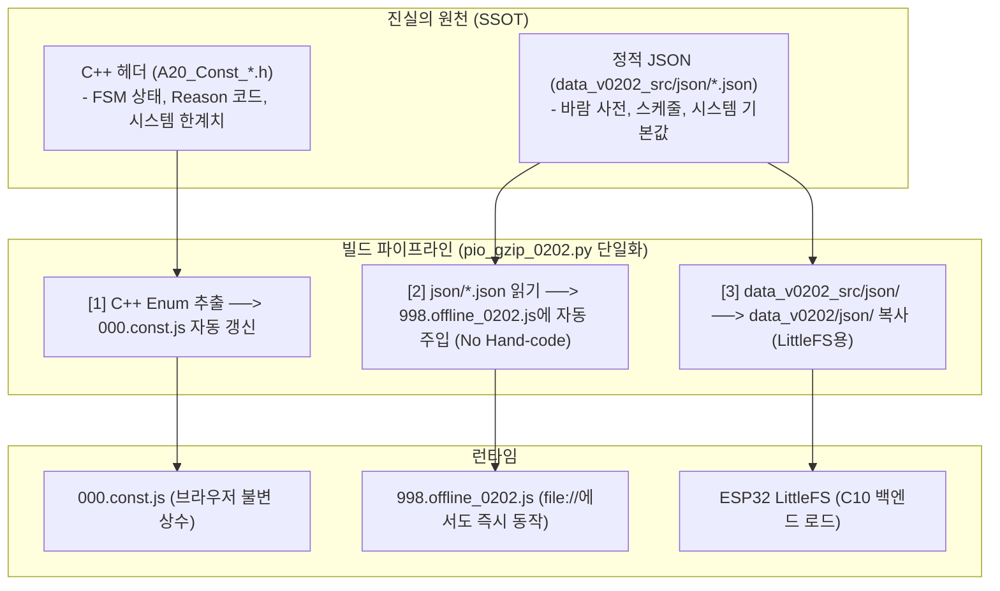

# [0202_008_개선요구] 온/오프라인 프론트엔드-백엔드 간 상수·설정·JSON 공유 방안 검토 (개정판)

> **문서 상태**: 검토 완료 및 실용적 최적안 확정  
> **구현 설계 연계**: [0202_008_구현설계.md](./0202_008_구현설계.md)  
> **목적**: 프론트엔드(온라인, 오프라인 모드)와 백엔드(ESP32 C++) 간에 **상수, 설정값, JSON 파일 등을 일관되고 경제적으로 공유**하기 위한 최적 아키텍처 도출

---

### 1. 현황 및 문제점 분석 (v0202 기준)

현재 코드베이스는 C++ 백엔드(ESP32 FreeRTOS)와 SPA 프론트엔드(Vanilla JS)로 구성되어 있으며, 데이터가 4곳에 분산되어 있습니다.

```
[백엔드 C++ 헤더]       [설정 JSON 파일]           [프론트엔드 JS]            [오프라인 모크]
A20_Const_*.h  <--불일치 위험--> cfg_*.json <--불일치 위험--> 000.const.js <--불일치 위험--> 998.offline_0202.js
                                                    010.config.js
```

1. **4중 분산 및 데이터 드리프트(Drift) 위험**:
   - FSM 상태(`FSM_STATE`), Reason 코드(`FSM_REASON`), 바람 프리셋(10종) 등이 C++ 헤더, JSON 파일, 프론트 JS 상수, 오프라인 모크 4곳에 중복 선언되어 휴먼 에러 발생 가능.
2. **오프라인 모드의 무거운 하드코딩 (500줄 인라인 Mock)**:
   - [998.offline_0202.js](../data_v0202_src/html_v0202/js/998.offline_0202.js)에 백엔드 설정값과 똑같은 JSON 구조가 500줄 가까이 하드코딩 복제되어 유지보수 부담 가중.
   - 근본 원인: 브라우저에서 `file:///index.html`로 직접 열 때 Same-Origin 정책(CORS)으로 인해 로컬 파일 `fetch()`가 차단되므로, 부득이하게 인라인 하드코딩 객체를 유지해 옴.
3. **ESP32 메모리/저장공간 제약**:
   - ESP32는 Flash(LittleFS)와 RAM이 제한적이므로, 모든 상수를 런타임 JSON API로 동적 파싱해 내려주기에는 오버헤드가 발생함.

---

### 2. 초기 설계안의 맹점 및 비판적 재검토

초기 검토안인 **"제3의 공용 JSON 스펙을 정의하고 C++ 헤더와 JS를 양방향 자동 생성(Full Codegen)"**하는 방식은 이상적이나, 임베디드 실무 환경에서 다음과 같은 치명적 부작용이 발견되었습니다:

1. **C++ 개발 워크플로우 마찰 (Over-engineering)**:
   - 백엔드는 이미 [A20_Const_0202.h](../A20_Const_0202.h) 등 7개 이상의 C++ 헤더에 엄격한 C++ 네이밍 규칙(`EN_A20_`, `ST_A20_`)과 주석 체계가 완성되어 있음.
   - 외부 JSON 스펙을 SSOT로 두면 C++ 개발자가 헤더를 직접 못 고치고 매번 JSON을 고친 뒤 파이썬 스크립트를 거쳐야 하는 심각한 개발 생산성 저하 발생.
2. **오프라인 모드 `fetch()`의 치명적 결함**:
   - 인라인 객체를 없애고 순수 `fetch('../json/*.json')`로만 전환하면, 로컬 HTTP 웹서버 없이 더블클릭(`file://`)으로 구동하는 오프라인 환경에서 100% 보안 에러로 동작 불가.
3. **불필요한 삼중 관리**:
   - 이미 존재하는 정적 JSON(`cfg_*.json`) 외에 또 다른 메타 JSON을 추가하게 되어 관리 포인트만 증가.

---

### 3. 실용적 최적안 (Pragmatic Optimum 3-Pillar) 확정

백엔드 개발 방식을 100% 보존하면서 프론트엔드 온/오프라인 데이터 일관성을 완벽히 달성하는 3대 실용 원칙을 확정합니다.



#### 기둥 1. 상수는 C++ 헤더에서 프론트엔드로 단방향 자동 동기화
- **진실의 원천**: 백엔드 C++ 헤더(`A20_Const_*.h`).
- **방식**: [pio_gzip_0202.py](../tools_0202/pio_gzip_0202.py) 번들링 시 C++의 `enum` 및 상수를 정규식으로 추출하여 [000.const.js](../data_v0202_src/html_v0202/js/core/000.const.js)의 상수 블록을 자동 업데이트.
- **효과**: C++ 개발자는 평소처럼 헤더를 작성하면 되고, 프론트엔드 상수는 자동 동기화되어 불일치 0% 달성.

#### 기둥 2. 설정값/사전 데이터는 `data_v0202_src/json/`이 유일한 원천
- **진실의 원천**: [data_v0202_src/json/](../data_v0202_src/json/) 하위 8개 JSON 파일.
- **방식**: 
  - 백엔드: LittleFS 마운트 시 `/json/cfg_*.json`을 C10 모듈이 읽어 NVS 및 메모리에 적재.
  - 프론트 온라인: REST API(`GET /config`, `GET /windProfile` 등)를 통해 조회.

#### 기둥 3. 오프라인 모드는 "빌드 타임 JSON 자동 주입" 적용
- **방식**: [pio_gzip_0202.py](../tools_0202/pio_gzip_0202.py) 실행 시 `data_v0202_src/json/*.json` 파일들을 읽어, [998.offline_0202.js](../data_v0202_src/html_v0202/js/998.offline_0202.js)의 기본 캐시 플레이스홀더에 최신 JSON 데이터를 **자동 인젝션(Code Injection)**.
- **효과**:
  - 개발자가 500줄짜리 더미 객체를 손으로 타이핑/복제할 필요 완전 소멸.
  - 브라우저에서 `file:///index.html`을 더블클릭해도 CORS 에러 없이 100% 즉시 구동.
  - 오프라인 모드에서 수정한 설정은 `localStorage`에 dirty 캐시되어 새로고침 시에도 유지.

---

### 4. 핵심 장단점 및 도입 효과 비교

| 구분 | 레거시 방식 (Before) | 제안된 실용적 최적안 (After) |
|---|---|---|
| **상수 관리** | C++ 헤더와 JS 상수를 수동으로 따로 타이핑 | C++ 헤더 수정 시 빌드 스크립트가 JS 상수를 자동 동기화 |
| **설정 JSON 관리** | C++ 백엔드용 JSON과 오프라인 mock 객체 분리 관리 | `data_v0202_src/json/*.json` 파일 1곳만 수정하면 LittleFS와 오프라인 mock에 자동 반영 |
| **오프라인 구동** | 500줄 인라인 하드코딩 수동 유지보수 | 빌드 타임 자동 주입으로 수동 작업 0건 + `file://` 직접 실행 완벽 지원 |
| **백엔드 영향도** | 불필요한 스펙 파일과 역생성 헤더 추가 | **기존 C++ 백엔드 코드 영향도 0% (무수정 호환)** |

---

### 5. 결론 및 다음 단계

검토 결과 도출된 **실용적 최적안(Pragmatic Optimum)**은 개발 공수를 최소화하면서도 온/오프라인 환경 전반의 데이터 일관성을 완벽히 보장합니다.

상세한 파일별 정규식 추출 규칙, 인젝션 플레이스홀더 설계, `pio_gzip_0202.py` 수정 명세는 **[0202_008_구현설계.md](./0202_008_구현설계.md)**를 참조하십시오.