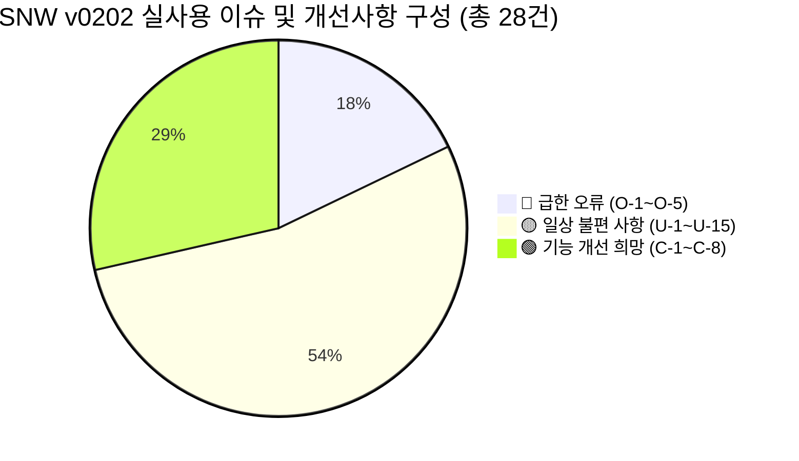

# 📑 [Part 4.2] 실사용자 관점 이슈/개선사항 및 종합 해결방안 명세서
> **문서 식별자**: `Req_ImplPlan_0202 / 0202_009_4.2.md`  
> **프로젝트**: Smart Nature Wind v0202 (Batch K / 사후 안정화 및 기능 고도화)  
> **문서 연계**:
> - **[0202_009_4.md](0202_009_4.md)**: 3개월 실사용자 관점 결함 진단 및 S10/S20 파이프라인 근본 재설계서
> - **[0202_009_4.2.md] (본 문서)**: `0202_009_4.md`의 전체 28대 이슈/개선사항(O-1~O-5, U-1~U-15, C-1~C-8)을 **[현상 및 문제점 ➔ 원인 분석 ➔ 구체적 해결방안 ➔ 영향 파일 및 구현 명세]** 형태로 일목요연하게 체계화한 단일 진실 공급원(SSOT) 명세서

---

## 📌 문서 목차 (Table of Contents)

1. [개요 및 전체 분류 체계](#1-개요-및-전체-분류-체계)
2. [🔴 급한 오류 (Critical Errors: O-1 ~ O-5) 해결방안](#2--급한-오류-critical-errors-o-1--o-5-해결방안)
3. [🟡 일상 불편 사항 (Daily Inconveniences: U-1 ~ U-15) 해결방안](#3--일상-불편-사항-daily-inconveniences-u-1--u-15-해결방안)
4. [🟢 기능 개선 희망 (Feature Improvements: C-1 ~ C-8) 해결방안](#4--기능-개선-희망-feature-improvements-c-1--c-8-해결방안)
5. [종합 구현 우선순위 및 로드맵 매트릭스](#5-종합-구현-우선순위-및-로드맵-매트릭스)

---

## 1. 개요 및 전체 분류 체계

`0202_009_4.md`에서 3개월 실사용자 페르소나를 통해 도출된 **총 28건의 이슈 및 개선 요구사항**을 체계적으로 분류하고, 기존에 해결방안이 누락되었거나 미흡했던 항목(U-7, U-9, U-10, U-14 및 C-1~C-8 전체)에 대해 **임베디드 백엔드(ESP32-S3)와 SPA 웹 프론트엔드 관점의 구체적인 구현 솔루션**을 수립하여 수록합니다.

---

## 2. 🔴 급한 오류 (Critical Errors: O-1 ~ O-5) 해결방안

### 🔴 O-1. 강도/변동성/돌풍 슬라이더 조작 무효화 (3초 후 원복)
* **현상 및 문제점**:
  - 프리셋(예: OCEAN, 기본 강도 70%) 선택 후 대시보드 슬라이더를 40%로 내려도, 1~3초 뒤 WebSocket 브로드캐스트를 수신하면 슬라이더와 실제 모터 출력이 70%로 되돌아감. 사용자가 바람 세기를 미세 조절할 수 없는 치명적 결함.
* **원인 분석**:
  - `S10_Simul_IO_0202.cpp`의 `patchFromJson()` [4]번 블록이 `override` 유무와 무관하게 무조건 `S20_resolveWindParams(..., nullptr, ...)`를 호출하여 프리셋 기본값으로 덮어씀.
  - 프론트엔드는 이를 우회하기 위해 `_pendingIntensity` 1초 낙관적 잠금을 걸어두었으나, 1초 만료 후 백엔드 브로드캐스트에 의해 원복됨.
* **해결방안 (백엔드 근본 분기 A>B>C 도입 및 프론트 간소화)**:
  1. **백엔드 (`S10_Simul_IO_0202.cpp`)**:
     - **분기 A (최우선)**: `presetCode` 또는 `styleCode`가 실제 문자열 변경된 경우에만 `S20_resolveWindParams(override=null)` 호출 (프리셋 기본값 복원).
     - **분기 B**: `override` 객체가 명시된 경우 `S20_resolveWindParams(override)` 호출.
     - **분기 C (슬라이더 단독 조작)**: `preset/style/override` 변경 없이 `intensity`, `variability`, `gustFreq`만 전달된 경우, S20 resolve를 우회하고 해당 필드만 직접 반영 (`fanLimit`, `turb*` 등 프리셋 고유 파생값 유지).
  2. **프론트엔드 (`200.page.dashboard.js`)**:
     - `_resolvePresetParams` 중복 계산 및 `_pendingIntensity` 낙관적 잠금 완전 삭제.
     - 슬라이더 조작 시 `patchSim({ intensity: v })`만 간결하게 전송.
* **영향 파일**: `S10_Simul_IO_0202.cpp`, `200.page.dashboard.js`, `CONTRACT_0202.md` (§7.10 PHY-3), `TEST_PLAN_0202.md` (T-74, T-75)

---

### 🔴 O-2. 재부팅 후 마지막 운전 상태 및 프리셋 유실
* **현상 및 문제점**:
  - 정전, 펌웨어 재부팅 후 어제 작동 중이던 프로필/스케줄/프리셋이 사라지고 무조건 `IDLE` 상태로 부팅되어 매번 다시 켜야 함.
* **원인 분석**:
  - `CT10_Ctl_Ctl_0202.cpp` 부팅 시 `CL_N10_NvsManager::resetRuntime()`을 호출하여 NVS에 저장된 `lastScheduleNo`, `lastUserProfileNo`, `lastPresetCode`를 의도적으로 초기화함 (안전 부팅 설계).
* **해결방안 (사용자 선택형 마지막 상태 복원 옵션)**:
  1. `cfg_system_0202.json`의 `control` 섹션에 `"restoreLastStateOnBoot": false` (기본값 OFF, 안전 우선) 설정 추가.
  2. 설정 페이지(`240.page.settings.js`)에 "재부팅 시 이전 작동 상태 복원" 토글 스위치 제공.
  3. `CT10::begin()` 시 해당 플래그가 `true`이면 NVS에서 마지막 `run_mode` 및 `presetCode`를 읽어 안전 상태 점검(PIR 감지 등) 후 자동 재개. 단, 안전을 위해 세그먼트 Override는 기본값으로 복귀.
* **영향 파일**: `cfg_system_0202.json`, `CT10_Ctl_Basic_0202.cpp`, `240.page.settings.js`, `SPEC_0202.md`

---

### 🔴 O-3. AutoOff 자동 정지 후 페이지 이동 시 알림 소실
* **현상 및 문제점**:
  - 타이머나 온도 조건으로 선풍기가 꺼졌을 때, 로그나 설정 페이지를 보다가 대시보드로 돌아오면 꺼진 사유(AutoOff 배너)가 사라져 있어 고장으로 오인함.
* **원인 분석**:
  - `_updateBanner` 핸들러가 `200.page.dashboard.js`의 내부 `store.watch('control')`에만 바인딩되어 있어, 대시보드 언마운트(다른 페이지 이동) 시 이벤트 리스너가 해제되고 배너가 파기됨.
* **해결방안 (전역 배너 관리 및 브라우저 알림 연동)**:
  1. 배너 수명주기 관리를 페이지 컴포넌트에서 최상위 앱 컨트롤러([`999.app.js`](file:///C:/Users/A003comlhsd/.gemini/antigravity/worktrees/SmartNatureWind_v002/verify_implementation_plans_0202/src/v0202/data_v0202_src/html_v0202/js/app/999.app.js))로 이전.
  2. `SNW.Store.watch('control')`을 `999.app.js`에서 상시 구독하여, 어느 화면에 있더라도 헤더 상단 고정 알림바로 AutoOff 정지 사유 유지.
  3. 사용자가 "확인(ACK)" 버튼을 누르기 전까지는 배너가 닫히지 않도록 영속화.
* **영향 파일**: `999.app.js`, `200.page.dashboard.js`, `_components.css`

---

### 🔴 O-4. AutoOff / PIR 미감지 상태에서 전원 토글 무반응
* **현상 및 문제점**:
  - 인체 미감지 또는 타이머로 꺼진 상태에서 대시보드 전원 토글을 누르면 선풍기가 켜지지 않고 이전 상태로 스위치가 튕김. "고장인가?" 의심 유발.
* **원인 분석**:
  - `_onPowerToggle()` 내부에 `if (ctl.stateCode === 4 || ctl.sensor?.motionActive === false)` 조건이 걸려 있어, AutoOff 래치가 걸려 있거나 PIR이 비활성일 때 단순히 `ToastUtil.warn()`만 띄우고 명령을 전송하지 않음.
* **해결방안 (명시적 강제 켜기 다이얼로그 및 ACK 자동화)**:
  1. 인체 미감지 상태에서 사용자가 전원 토글을 켜면 단순 차단 대신 확인 모달 팝업:  
     `"현재 주변에 움직임이 감지되지 않습니다. 그래도 작동을 시작할까요? [강제 시작] [취소]"`
  2. 사용자가 `[강제 시작]` 선택 시, 프론트엔드가 자동으로 `SNW.Api.ackEvent()`를 호출하여 AutoOff 래치를 해제한 직후 `SNW.Api.overrideFixed(intensity, 0, true)`를 순차 실행.
* **영향 파일**: `200.page.dashboard.js`, `020.i18n.js`

---

### 🔴 O-5. A/B 비교 클릭 시 Uncaught TypeError 발생 및 기능 먹통
* **현상 및 문제점**:
  - 대시보드 프리셋 카드 상단의 `⚖ A/B 비교` 버튼을 클릭하면 아무 반응이 없고, 브라우저 콘솔에 `Uncaught TypeError: this._onCompareClick is not a function` 발생.
* **원인 분석**:
  - `200.page.dashboard.js`의 `_mountComponents()`에서 `⚖ A/B 비교`(`_onCompareClick`), `🎬 투어`(`_onTastingTour`), `🌙 수면모드`(`_onSleepMode`) 버튼 엘리먼트와 핸들러를 헤더에 생성했으나, 해당 클래스 메서드 본체 구현부가 누락됨.
* **해결방안 (모달 및 스파크라인 드로잉 메서드 정식 실장)**:
  1. `200.page.dashboard.js`에 `_onCompareClick()` 실장: A 프리셋과 B 프리셋 선택 select 박스, 듀얼 캔버스 스파크라인 렌더링, `toFeelings` 3대 체감 지표(시원함/부드러움/역동성) 모달 구현.
  2. 스파크라인 드로잉 헬퍼 `_drawSpark(canvas, points, w, h)` 실장.
  3. `_onTastingTour()` (5대 프리셋 10초 순환 재생) 및 `_onSleepMode()` (수면 프로필 즉시 진입) 실장.
  4. `python src/v0202/tools_0202/pio_gzip_0202.py` 실행하여 번들 동기화.
* **영향 파일**: `200.page.dashboard.js`, `P010_bundle_0202.js`

---

## 3. 🟡 일상 불편 사항 (Daily Inconveniences: U-1 ~ U-15) 해결방안

### 🟡 U-1. 프리셋 카드 10개 중 8개만 노출 (2개 잘림)
* **문제점**: CSS 그리드가 `repeat(4, 1fr)`로 고정되어 4+4+2 배열이 되면서, 하단의 `DESERT_NIGHT`, `TROPICAL_RAIN`이 스크롤 아래로 숨겨짐.
* **해결방안**: 
  - 데스크톱/태블릿에서는 `repeat(5, 1fr)`로 변경하여 **5열 2행(5×2)의 완벽한 대칭 그리드** 구현.
  - 모바일(<768px)에서는 `repeat(2, 1fr)`로 2열 5행 반응형 레이아웃 적용.
* **영향 파일**: `_dashboard.css`, `_responsive.css`

---

### 🟡 U-2. PIR 센서 미감지 시 조작 먹통 안내 부족
* **문제점**: AutoOff 후 사용자가 들어와도 PIR 감지 갱신이 지연되면 조작 불가.
* **해결방안**: 대시보드 상단 상태 영역에 PIR 상태 칩을 명시하고, 미감지 시 `[인체 감지 대기 중 - 터치하여 즉시 해제]` 인터랙티브 뱃지 제공. 클릭 시 모션 센서 위임 플래그 즉시 초기화.
* **영향 파일**: `200.page.dashboard.js`, `100.ui.badge.js`

---

### 🟡 U-3. 온습도 센서(DHT22) 실패 시 24.0°C 조용한 폴백
* **문제점**: DHT22 하드웨어 에러 시 24.0°C를 반환하여, 26°C 자동 꺼짐 설정을 해둔 사용자가 왜 안 꺼지는지 알 수 없음.
* **해결방안**:
  - 백엔드 `CT10`: 센서 실패 시 `sensor.tempValid = false` 플래그를 `/api/v001/state`에 노출.
  - 프론트엔드: `tempValid === false`이거나 연속 10회 동일 기본값(24.0°C) 수신 시 온도 게이지 옆에 `⚠️ 센서 점검 필요` 경고 뱃지 점등.
* **영향 파일**: `CT10_Ctl_Basic_0202.cpp`, `200.page.dashboard.js`, `SPEC_0202.md`

---

### 🟡 U-4. DHT22 읽기 주기 설정(`intervalSec`) 무시 현상
* **문제점**: `cfg_system_0202.json`에 `intervalSec: 30`으로 설정해도 코드상 2초 고정으로 읽어 센서 수명 저하 및 에러 로그 증가.
* **해결방안**:
  - `CT10_Ctl_Basic_0202.cpp`의 캐시 만료 검사를 하드코딩된 `2000UL` 대신 시스템 설정값 `g_A20_config_root.system->hw.tempHum.intervalSec * 1000UL`로 동적 바인딩 (최소 2초 하한 보호 포함).
* **영향 파일**: `CT10_Ctl_Basic_0202.cpp`, `CONTRACT_0202.md`

---

### 🟡 U-5. 프로필 모드 전환 시 빈 프로필 예외 처리 부족
* **문제점**: 프로필 스위치를 켰을 때 등록된 프로필이 없으면 토스트만 뜨고 스위치가 다시 꺼져 사용자가 혼란스러움.
* **해결방안**:
  - 프로필이 없을 경우 스위치를 끄는 대신, `"생성된 사용자 프로필이 없습니다. 나만의 바람 프로필을 만드시겠습니까? [생성하기]"` 안내 모달을 띄우고 즉시 프로필 생성 화면(`#/profiles`)으로 라우팅.
* **영향 파일**: `200.page.dashboard.js`, `230.page.profiles.js`

---

### 🟡 U-6. 세그먼트 편집 모달의 과도한 스크롤
* **문제점**: 기본 설정, 복수 세그먼트, AutoOff, PIR 설정이 한 화면에 펼쳐져 모바일에서 스크롤이 매우 김.
* **해결방안**:
  - 세그먼트 모달을 **탭(Tab) 또는 아코디언(Accordion)** 구조로 개편.
  - 1단계: 세그먼트 시간/프리셋/바람 세기 (기본), 2단계: AutoOff 및 인체 감지 연동 (고급 설정으로 기본 접힘 처리).
* **영향 파일**: `220.page.schedule.js`, `230.page.profiles.js`, `_components.css`

---

### 🟡 U-7. 시스템 로그 검색 및 필터링 기능 부재
* **문제점**: 로그 페이지(`#/logs`)에 로그 레벨 필터만 있어 특정 에러나 과거 이벤트를 찾기 어려움.
* **해결방안**:
  1. 상단에 **키워드 실시간 텍스트 검색 입력창** 추가 (메시지 내용 필터링).
  2. 타임스탬프 필터(최근 1시간, 6시간, 24시간, 전체) 드롭다운 추가.
  3. 프론트엔드 메모리 배열 검색으로 기기 부하 없이 즉시 반응형 필터링 구현.
* **영향 파일**: `280.page.logs.js`, `032.util.log.js`

---

### 🟡 U-8. 재부팅 후 어제 프리셋 망각 (O-2 파생)
* **해결방안**: O-2의 NVS `restoreLastStateOnBoot` 설정 적용 시 함께 해소됨.

---

### 🟡 U-9. 모니터링 시계열 조회 기간 제한 (최대 1시간)
* **문제점**: 어제 밤 수면 중의 풍속 변화나 온습도 추이를 보고 싶어도 1시간 링버퍼만 있어 확인 불가.
* **해결방안**:
  1. `CT10_Monitor_0202.cpp`의 LittleFS 콜드 스토리지 로깅 주기(기본 1분 평균)를 활용하여, `/api/v001/monitor/history?hours=24` 엔드포인트 신설.
  2. 프론트엔드 모니터링 페이지(`#/monitor`)에 "24시간 추이" 탭을 추가하고, CSV 내보내기 버튼 눈에 띄게 배치.
* **영향 파일**: `CT10_Monitor_0202.cpp`, `W10_Web_Routes_Monitor_0202.cpp`, `260.page.monitor.js`

---

### 🟡 U-10. 슬라이더/프리셋/스타일 50가지 조합의 선택 피로
* **문제점**: 10개 프리셋 × 5개 스타일 = 50개 조합이 너무 많아 실제로는 3~4개만 쓰고 방치됨.
* **해결방안**:
  1. **"최근 사용한 프리셋" (Recently Used)** 3개를 대시보드 상단에 칩 형태로 자동 고정.
  2. "인기 조합 베스트 3" (예: 🌙 꿀잠 수면풍 = FOREST + SLEEP, 🌊 한낮 청량풍 = OCEAN + ACTIVE) 추천 태그 배지 부착.
* **영향 파일**: `200.page.dashboard.js`, `060.store.js` (LocalStorage 캐싱)

---

### 🟡 U-11. 오프라인 데모 시뮬레이터의 프리셋 스키마 불일치
* **문제점**: `998.offline_0202.js`가 `target?.params?.windIntensity`를 참조하여 오프라인 모드에서 프리셋 클릭 시 기본값(50/40/30)으로 오동작.
* **해결방안**:
  - `target?.factors` 스키마로 정정하고, 백엔드와 동일하게 우선순위 분기 A>B>C를 이식하여 완벽한 오프라인 시뮬레이션 지원.
* **영향 파일**: `998.offline_0202.js`

---

### 🟡 U-12. 정보 페이지의 펌웨어 버전 불일치 ("FW_2.0.1")
* **문제점**: 기기 펌웨어 상수는 `FW_Ver_2.0.2`이나 JSON 배포 기본값이 구버전으로 남아있어 정보창에 혼선 발생.
* **해결방안**:
  - `cfg_system_0202.json`의 `meta.version`을 `"FW_Ver_2.0.2"`로 현행화하고, `300.page.info.js`에서 백엔드 빌드 상수와 일치하도록 표기.
* **영향 파일**: `cfg_system_0202.json`, `300.page.info.js`

---

### 🟡 U-13. AutoOff 정지 사유의 상세 수치 정보 부족
* **문제점**: "자동 꺼짐 - 온도"로만 표시되어 몇 도에서 꺼졌는지 모름.
* **해결방안**:
  - 정지 이벤트 발생 시 트리거 당시의 실제 온도 수치를 함께 스냅샷:  
    `"🌡️ 설정 온도(26.0℃) 도달로 자동 정지됨 (정지 시 측정온도: 25.8℃, 04:12)"`
  - i18n 파라미터 보간을 강화하여 구체적 상황 표시.
* **영향 파일**: `CT10_Ctl_Ctl_Seg_0202.cpp`, `200.page.dashboard.js`, `020.i18n.js`

---

### 🟡 U-14. 새 펌웨어 확인 기능의 하드코딩
* **문제점**: `routeFirmwareCheck`가 `latest_semver = "2.0.2"`로 고정되어 있어 신버전 안내 불가.
* **해결방안**:
  1. 기기가 인터넷(공유기 STA 모드)에 연결되어 있을 때 GitHub Releases API 또는 공식 버전 서버를 백그라운드로 쿼리하도록 C++ 백엔드 헬퍼 보강.
  2. 오프라인/AP 모드일 때는 "로컬 OTA 파일 직접 업로드" 안내를 기본으로 표기.
* **영향 파일**: `W10_Web_Routes_0202.cpp`, `260.page.firmware.js`

---

### 🟡 U-15. 기본 설정 시 API Key 미설정 (동일 Wi-Fi 보안 무방비)
* **문제점**: 초기 부팅 시 API 인증이 비활성화되어 있어 동일 공유기 접속자 누구나 팬을 제어할 수 있음.
* **해결방안**:
  - 최초 방문 온보딩 가이드 3단계에서 **"기기 관리자 비밀번호(API Key) 설정"** 단계를 포함하여 자연스럽게 보안을 설정하도록 유도.
* **영향 파일**: `999.app.js`, `240.page.settings.js`

---

## 4. 🟢 기능 개선 희망 (Feature Improvements: C-1 ~ C-8) 해결방안

### 🟢 C-1. 나만의 프리셋 저장 기능 ("My Custom Preset")
* **요구사항**: 슬라이더를 섬세하게 조정한 나만의 바람 조합을 이름 붙여 저장하고 재사용하고 싶음.
* **해결방안**:
  1. 대시보드 슬라이더 영역 하단에 `[⭐ 현재 설정을 나만의 프리셋으로 저장]` 버튼 배치.
  2. 클릭 시 프리셋 이름과 아이콘을 입력받아 브라우저 `LocalStorage`에 저장.
  3. 프리셋 카드 그리드 끝에 "+ 나만의 프리셋" 카드가 동적으로 추가되어 원클릭으로 호출 가능.
* **영향 파일**: `200.page.dashboard.js`, `060.store.js`

---

### 🟢 C-2. 최근 사용 프리셋 상단 고정
* **요구사항**: 자주 쓰는 2~3개 프리셋을 찾기 위해 매번 10개 카드를 뒤적이지 않게 해줄 것.
* **해결방안**:
  - 프리셋 선택 시마다 `LocalStorage`의 `recentPresets` 큐(최대 3개)를 갱신하고, 대시보드 메인 배너 바로 아래에 빠른 실행 알약 칩(`Pill Button`)으로 렌더링.
* **영향 파일**: `200.page.dashboard.js`

---

### 🟢 C-3. 계절/날씨 자동 프리셋 제안
* **요구사항**: 계절에 맞는 최적의 바람(예: 10월 가을엔 부드러운 COUNTRY_BREEZE)을 추천.
* **해결방안**:
  - `TM10`에서 제공하는 현재 월(Month) 정보를 기반으로 스마트 추천 배너 노출:
    - 6~8월(여름): `🌊 OCEAN (시원한 바다바람)` 추천
    - 9~10월(가을): `🏡 COUNTRY_BREEZE (선선한 들바람)` 추천
    - 11~3월(환기): `🌾 PLAINS (부드러운 실내 환기풍)` 추천
* **영향 파일**: `200.page.dashboard.js`, `035.util.feedback.js`

---

### 🟢 C-4. 사용 패턴 기반 스케줄 자동 제안
* **요구사항**: 매일 저녁 8시마다 수동으로 켜는 사용자에게 맞춤 스케줄 제안.
* **해결방안**:
  - 모니터링 이벤트 로그를 분석하여 동일 시간대 수동 ON 이력이 3일 이상 반복되면, `"자주 켜시는 저녁 8시 자동 스케줄을 등록할까요? [1초 등록]"` 팁 배너 노출.
* **영향 파일**: `260.page.monitor.js`, `220.page.schedule.js`

---

### 🟢 C-5. 온습도 24시간 시계열 차트 제공
* **요구사항**: 단순히 현재 온도뿐만 아니라 방 안의 밤사이 온습도 변화 그래프 확인 희망.
* **해결방안**:
  - `CT10_Monitor`의 Cold 이력 버퍼(`sensor_history.bin`) 데이터를 Chart.js 캔버스를 통해 듀얼 축(좌측 온도 ℃, 우측 습도 %) 시계열 차트로 렌더링.
* **영향 파일**: `260.page.monitor.js`, `120.ui.chart.js`

---

### 🟢 C-6. 폭염 시 강도 자동 부스트 (온도 연동 스마트 바람)
* **요구사항**: 실내 온도가 28°C 이상으로 올라가면 선풍기가 알아서 더 시원하게 돌았으면 좋겠음.
* **해결방안**:
  - `cfg_motion_0202.json`에 `tempBoost: { enabled: true, triggerTemp: 28.0, minIntensity: 65 }` 스키마 추가.
  - S10 물리 루프에서 현재 온도가 28°C를 초과하면 사용자가 설정한 intensity가 낮더라도 65% 하한을 보장하도록 동적 보정.
* **영향 파일**: `S10_Simul_Physic_0202.cpp`, `cfg_motion_0202.json`

---

### 🟢 C-7. 가족 구성원별 사용자 프로필 확장
* **요구사항**: 아빠(강한 바람 선호), 아이(부드러운 미풍 선호) 등 가족별 원클릭 프로필.
* **해결방안**:
  - 프로필 관리 화면(`#/profiles`)에 아바타 아이콘(아빠/엄마/아이)을 지정할 수 있게 하고, 대시보드 상단에 사용자 스위처 드롭다운 배치.
* **영향 파일**: `230.page.profiles.js`, `200.page.dashboard.js`

---

### 🟢 C-8. 하드웨어 물리 버튼 (비상 조작)
* **요구사항**: 스마트폰이 없거나 Wi-Fi가 끊겼을 때 선풍기 본체에서 최소한 켜고 끌 수 있어야 함.
* **해결방안**:
  - 하드웨어 GPIO 핀(예: GPIO 0 Boot 버튼 활용)에 단축 조작 인터럽트 할당:
    - 1회 짧게 누름: 전원 ON/OFF 토글
    - 2회 연속 누름: 프리셋 순환 변경 (바다 ➔ 산 ➔ 숲)
    - 5초 길게 누름: Wi-Fi 설정 초기화 (AP 모드 진입)
* **영향 파일**: `A00_Main_0202.cpp`, `P10_PWM_ctrl_0202.h`, `SPEC_0202.md`

---

## 5. 종합 구현 우선순위 및 로드맵 매트릭스

| 단계 | 우선순위 | 해결 대상 항목 | 핵심 작업 내용 및 기대효과 |
|:---:|:---:|:---|:---|
| **Phase 0** | **P0 (긴급 차단)** | **O-1, O-5** | • S10 `patchFromJson` 우선순위 분기 A>B>C 구현 (슬라이더 원복 해결) • `_onCompareClick`, `_drawSpark` 실장 (A/B 비교 콘솔 에러 해결) |
| **Phase 1** | **P0 ~ P1 (안정화)** | **O-3, O-4, U-1, U-3, U-4, U-11** | • 전역 배너 수명주기 이전 (알림 소실 방지) • PIR 미감지 강제 시작 모달 • 프리셋 5×2 대칭 그리드 개편 • DHT22 에러 뱃지 및 동적 주기 적용 |
| **Phase 2** | **P2 (UX 고도화)** | **O-2, U-2, U-5, U-6, U-7, U-10, U-12, U-15** | • 재부팅 시 마지막 상태 복원 옵션 • 세그먼트 아코디언 모달 • 로그 키워드 검색기 • 최근 프리셋 상단 고정 및 FW_2.0.2 표기 정합 |
| **Phase 3** | **P3 (스마트 확장)** | **C-1, C-2, C-3, C-5, C-6, U-9, U-13, U-14** | • 나만의 프리셋 저장 (LocalStorage) • 24시간 온습도 시계열 차트 • 계절/폭염 자동 제안 및 정지 사유 수치 병기 |
| **Phase 4** | **HW/장기 과제** | **C-7, C-8** | • 가족별 아바타 프로필 스위처 • 본체 물리 버튼 단축 제어 (GPIO 인터럽트) |

---
*본 문서는 Smart Nature Wind v0202 프로젝트의 이슈 해결 및 지속적 개선을 위한 단일 진실 공급원(SSOT) 기술 사양서입니다.*

