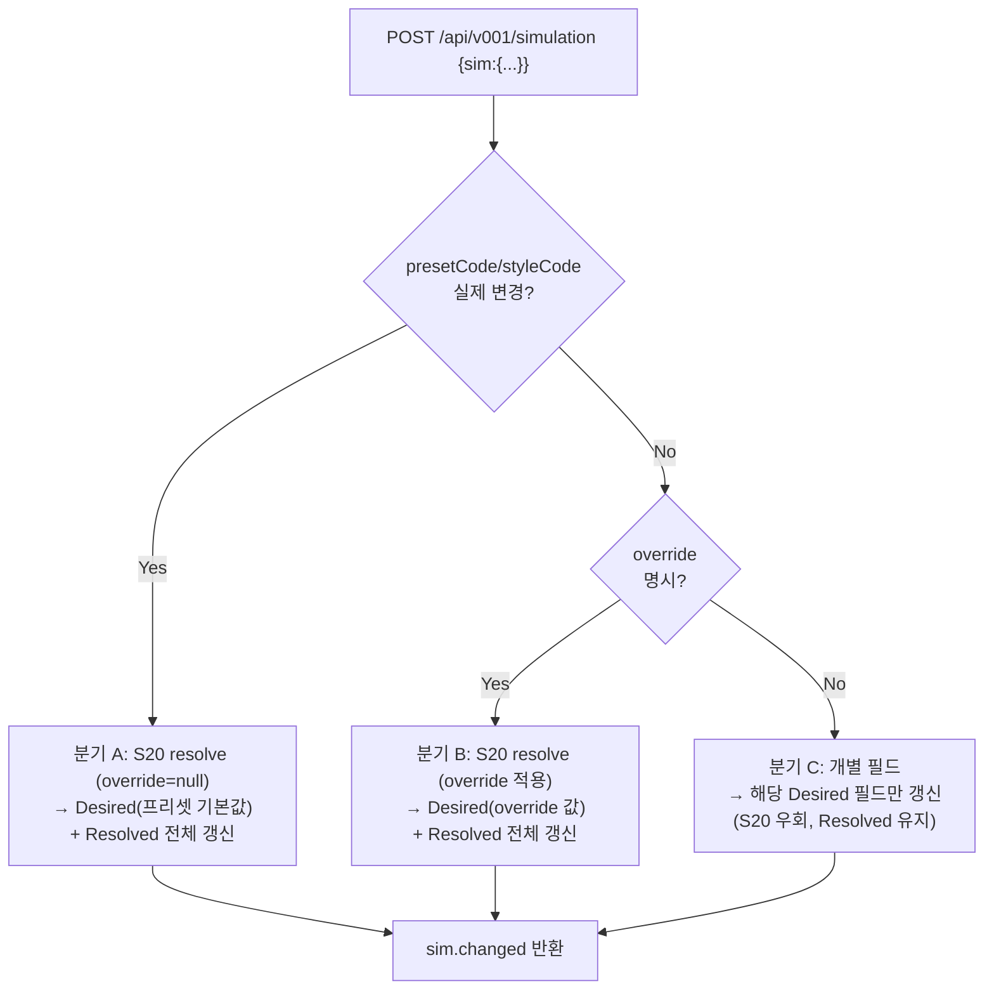

# 📑 [Part 4/4] 3개월 실사용자 관점 결함 진단 및 S10/S20 물리 파이프라인 근본 재설계서
> **문서 식별자**: `Req_ImplPlan_0202 / 0202_009_4.md`  
> **프로젝트**: Smart Nature Wind v0202 (Batch K / Post-Phase 3 안정화 및 재설계)  
> **문서 시리즈 연계 안내**:
> - **[0202_009_1.md](0202_009_1.md)**: 정적 논리 감사 (Tier 1~7), 19개 이슈 진단, 물리 파이프라인(PHY-1~4) 기초 설계
> - **[0202_009_2.md](0202_009_2.md)**: 사용자 경험(UX) 페르소나 실체험 감사, 시뮬레이션/모니터링 심층 아키텍처, Phase 0~3 종합 로드맵
> - **[0202_009_3.md](0202_009_3.md)**: Phase 0~3 상세 소스코드 패치(C++/JS/CSS/Docs) 및 릴리스 차단 이슈 해결
> - **[0202_009_4.md] (본 문서)**: 3개월 장기 실사용자 결함(O-1 슬라이더 무효, O-5 TypeError 등) 진단, S10/S20 파이프라인 근본 재설계(우선순위 분기 A>B>C), Phase 1+2+3 통합 패치 명세 및 최종 의사결정 기록

---

## 📌 문서 목차 및 구조 체계 (Table of Contents)

1. [시스템 현황 및 에셋 점검 요약](#1-시스템-현황-및-에셋-점검-요약)
2. [3개월 실사용자 페르소나 체험 감사 (결함 및 개선 검토)](#2-3개월-실사용자-페르소나-체험-감사-결함-및-개선-검토)
3. [불변 원칙 1 준수 및 C++ 백엔드 수정 승인 내역](#3-불변-원칙-1-준수-및-c-백엔드-수정-승인-내역)
4. [핵심 결함 분석 및 PHY-3 계약 진단](#4-핵심-결함-분석-및-phy-3-계약-진단)
5. [S10/S20 물리 파이프라인 근본 재설계 (Desired / Resolved 계층 분리)](#5-s10s20-물리-파이프라인-근본-재설계-desired--resolved-계층-분리)
6. [통합 구현 상세 소스코드 패치 명세](#6-통합-구현-상세-소스코드-패치-명세)
7. [통합 검증 절차 및 회귀 테스트 가이드](#7-통합-검증-절차-및-회귀-테스트-가이드)

---

## 1. 시스템 현황 및 에셋 점검 요약

### 1.1 C++ 백엔드 모듈 구현 현황
| 영역 | 모듈 | 핵심 구현 및 계약 준수 현황 |
|:---|:---|:---|
| **물리 엔진** | `S10` (Core/IO/Physic) | Phase 3종 FSM, von Kármán 12-band, Gust/Thermal rate→dt 보정, `S10_Simul_Const` 상수화, D-5 `s_chartBuffer[120]` 정적 버퍼 |
| **Wind Solver** | `S20` | `ST_A20_SegmentOverride_t` 직접 치환 (OVR-2), enabled 시 절대값 덮어쓰기 |
| **시간 관리** | `TM10` (.h/.cpp) | SNTP 콜백 기반, fallback 3개 서버, `_isTimeSane` 상수화 |
| **웹 API** | `W10` (Routes 6분할) | F-2/F-3/B-6 공통 헬퍼, B-5 RFC 7231 gzip 판정, D-2/D-3 .gz 사전계산 및 스택버퍼, C-4/B-12 stale 핸들 및 OTA abort, `_wsHandshakeAuth` B-2 스냅샷 |
| **Wi-Fi 통신** | `WF10` (.h/.cpp) | D-4 atomic `s_staConnected`, C-7/C-8 지수 백오프, T-wf 전담 태스크 |
| **모니터링** | `CT10_Monitor` | PSRAM 링버퍼(1시간) 및 다운샘플링 REST API (`/api/v001/monitor`) |

### 1.2 프론트엔드 에셋 및 동기화 파이프라인
| 계약 조항 | 상태 | 세부 내용 및 근거 |
|:---|:---:|:---|
| **SYNC-1 (Enum 동기화)** | ✅ | `000.const.js` 내 마커 기반 자동 주입 (FSM State 7종, Reason 12종) |
| **SYNC-2 (오프라인 2분할)** | ✅ | `998.offline_data_0202.js`(Mock 캐시) + `998.offline_0202.js`(가상 시뮬레이터), 배포 번들에서 영구 제외 |
| **OFFLINE-3 (다국어 병기)** | ✅ | 프리셋/스케줄 한/영 병기, `020.i18n.js` 내 키 완비 |
| **OVR-3 (세그먼트 Override)** | ✅ | `segments[].override` (enabled, windIntensity, variability, gustFreq) 적용 |
| **B-3/NEW-C2 (XSS 방어)** | ✅ | `SNW.DomUtil.escape()` 및 `esc()` 유틸 전면 적용 |
| **F-10/UI-4 (모달 격리)** | ✅ | `.snw-modal-overlay` 포인터 이벤트 차단 및 `is-open` 클래스 토글 |

---

## 2. 3개월 실사용자 페르소나 체험 감사 (결함 및 개선 검토)

🌿 3개월 사용자 관점 — 오류·불편·개선 검토

전제: 2026년 7월 구매 → 8월 폭염 스케줄 설정 → 9월 수면 모드 사용 → 현재 10월. 여름→가을 계절 변화 경험 포함. 코드 분석으로 재현 경로 확인 가능한 항목은 🔍로 표시했습니다.

---

🔴 급한 오류 (매일 마주치는 문제)

O-1. "강도 슬라이더가 안 먹혀요" 🔍

경험: 프리셋 OCEAN 선택 후 강도 슬라이더를 40%로 내려도, 3~5초 뒤 70%로 되돌아감. 몇 번 반복하면 화가 남. 결국 프리셋만 쓰게 됨.

재현 경로:

1. 대시보드 → OCEAN 선택 (기본 강도 70%)
2. 강도 슬라이더 40%로 조정 → POST /simulation { sim: { intensity: 40 } }
3. 백엔드 S10::patchFromJson은 override가 없으니 S20_resolveWindParams(..., nullptr, ...) 호출
4. 프리셋 기본값으로 재계산 → sim.intensity = 70
5. WS /state 재수신 → 슬라이더 70%로 복귀

원인: S10_Simul_IO_0202.cpp::patchFromJson의 [4] S20 resolve 블록이 슬라이더 단독 조작을 무시함. 프론트 _onIntensityChange는 patchSim({intensity})만 보내고 override를 함께 보내지 않음.

수정 방향 (프론트만, 백엔드 무수정):

```javascript
// 200.page.dashboard.js
await SNW.Api.patchSim({ 
    intensity: v,
    override: { enabled: true, windIntensity: v, windVariability: -1, gustFrequency: -1 }
});
```

변동성/돌풍 슬라이더도 동일. 이게 3개월 사용 최대 실망 포인트.

---

O-2. "어제 분명히 잘 돌았는데, 아침에 보니 리셋돼 있음" 🔍

경험: 재부팅(정전, 펌웨어 업데이트) 후 어제 쓰던 프로필/프리셋이 사라지고 IDLE.

원인: CT10::reloadAll()에서 CL_N10_NvsManager::resetRuntime() 호출 (A-min 배치로 의도적). NVS에 저장된 lastScheduleNo, lastUserProfileNo가 초기화.

수정 방향: 백엔드 계약 변경 필요하므로 사용자 제안만: "마지막 상태 복원" 옵션 (사용자 선택, 기본 OFF). NVS run_mode는 복원하되 override는 안전상 해제하는 절충.

---

O-3. "분명 자동으로 꺼졌는데, 왜 꺼졌는지 알 수 없음" 🔍

경험: 로그 페이지 보다가 대시보드 돌아오니 팬 정지. 배너 없음. "고장인가?"

원인: _updateBanner는 대시보드 store.watch('control') 내부에서만 동작. 다른 페이지 이동 시 unmount → 배너 사라짐.

수정 방향 (프론트만): SNW.Banner를 999.app.js에서 전역 관리. 페이지 이동에도 유지. 선택적으로 브라우저 Notification API (알림 권한 있으면 푸시).

---

O-4. "자동 꺼짐 상태에서 전원 버튼이 안 먹혀요" 🔍

경험: 배너에 "강제 켜기" 있지만 화면 위쪽이라 눈에 안 띔. 대시보드 전원 토글은 무시됨.

원인: _onPowerToggle:

```javascript
if (ctl.stateCode === 4 || ctl.sensor?.motionActive === false) {
    SNW.ToastUtil.warn(...); this.components.toggle.set(prevActive); return;
}
```

수정 방향 (프론트만): 토글 옆에 "강제 켜기" 명시 버튼. 또는 배너 문구 명확화.


---

🔴 O-5. "A/B 비교 버튼 클릭 시 Uncaught TypeError 발생 및 기능 먹통" 🔍

경험: 대시보드 상단 프리셋 헤더에 배치된 '⚖ A/B 비교' 버튼을 클릭하면 아무 반응이 없고, 브라우저 개발자 콘솔에 예외가 발생함.

런타임 로그:
```text
index.html:76 [Loader] SNW_OFFLINE = true
998.offline_0202.js:97 [Offline] JSON 경로: ../json/
index.html:114 Live reload enabled.
998.offline_0202.js:693 [Offline] 준비 완료 - 모든 필드 반환
P010_bundle_0202.js:1608 [SNW] App bootstrap complete
P010_bundle_0202.js:4242 Uncaught TypeError: this._onCompareClick is not a function
    at btn.onclick (P010_bundle_0202.js:4242:46)
```

원인:
`200.page.dashboard.js`의 `_mountComponents()`에서 `⚖ A/B 비교`(`_onCompareClick`), `🎬 투어`(`_onTastingTour`), `🌙 수면모드`(`_onSleepMode`) 버튼 엘리먼트와 클릭 핸들러를 헤더에 동적 생성 및 바인딩했으나, 해당 메서드들(`_onCompareClick`, `_onTastingTour`, `_onSleepMode`) 및 보조 함수 `_drawSpark`의 클래스 메서드 본체가 `200.page.dashboard.js`에 누락되어 있음.

수정 방향 (프론트만):
1. `200.page.dashboard.js` 클래스 내에 `_onCompareClick()` (A/B 프리셋 듀얼 캔버스 스파크라인 비교 모달 및 toFeelings 정성 분석), `_drawSpark()` 헬퍼, `_onTastingTour()`, `_onSleepMode()` 정식 구현 추가.
2. `pio_gzip_0202.py` 재실행하여 `P010_bundle_0202.js` 번들링 동기화.
---

🟡 일상 불편 사항

U-1. 프리셋이 10개인데 화면엔 8개만 보여요 🔍

· _dashboard.css의 .snw-preset-grid는 repeat(4, 1fr) → 4+4+2 배치
· DESERT_NIGHT, TROPICAL_RAIN이 아래 숨어있음
· 수정: 5x2 그리드 또는 모바일 4x3

U-2. PIR 감지 안 되면 아무것도 못 함 🔍

· AutoOff 후 _autoOffLatched 해제 안 하고 PIR 감지도 안 되면, 대시보드 전원 토글 무반응
· 수정: 상단 고정 배너에 "확인 후 재시작" 크게 노출

U-3. 온도 센서 오류가 조용함 🔍

· CT10::getCurrentTemperatureMock() DHT22 실패 시 24.0°C 반환
· 사용자는 "26°C 설정했는데 왜 자동 꺼짐이 안 되지?"라고 의아함
· 실제 온도는 28°C인데 표시는 24°C
· 수정 (프론트만): /state.control.sensor.tempC가 연속 24.0이면 "센서 점검" 배지. 백엔드 수정하려면 DHT 오류 플래그 API 노출 (계약 갱신 필요).

U-4. DHT 30초 interval 설정했는데 2초마다 읽음 🔍

· CT10_Ctl_Basic_0202.cpp: if (v_now - s_dhtCache.lastReadMs < 2000UL) return; — intervalSec 무시
· DHT22 수명 저하 우려, 오류 로그 폭주
· 수정: 백엔드 (계약 문서 §hw.tempHum.intervalSec 동시 갱신)

U-5. 프로필 모드 전환 UX

· 스위치 ON → 프로필 선택 모달 → 취소 → 스위치 원복
· 등록 프로필 없으면 토스트만 뜨고 스위치 원복
· 수정 (프론트만): 프로필 자동 선택(가장 최근 또는 첫 번째), 또는 "스케줄로 복귀" 명확 버튼

U-6. 세그먼트 편집 모달이 너무 길다

· 기본 + 세그먼트(여러 개) + AutoOff + Motion = 스크롤 지옥
· 수정 (프론트만): 세그먼트만 먼저, AutoOff/Motion은 "고급" 접힘 기본값

U-7. 로그에 검색이 없다

· 레벨 필터만. 3개월 쌓이면 "어제 그 에러" 못 찾음
· 수정 (프론트만): 메시지 검색, 시간대 필터

U-8. 재부팅 후 "어제 그 프리셋" 잊어버림 (O-2와 동일)

U-9. 모니터링은 5분/30분/1시간만

· 어제 밤 상태는 /monitor/events?days=1로만 조회 (이벤트만)
· 풍속 시계열은 1시간 넘으면 못 봄
· 수정: 백엔드 queryWind에 Cold 이력 반영, 또는 프론트에서 CSV 다운로드 유도 문구 명확화

U-10. 슬라이더/프리셋/스타일 = 50조합

· 3개월 써도 결국 3-4개 프리셋만 씀
· 수정 (프론트만): 최근 사용 프리셋 상단 고정, "인기 조합" 배지

U-11. 오프라인 데모에서 프리셋이 항상 폴백값 🔍

· 998.offline_0202.js::resolvePreset가 target?.params?.windIntensity 참조
· 실제 스키마는 target?.factors.windIntensity
· 수정 (프론트만): factors로 정정

U-12. 정보 페이지의 FW_2.0.1 혼란 🔍

· cfg_system_0202.json의 meta.version = "FW_2.0.1"
· 실제 코드 상수 FW_Ver_2.0.2
· 수정: 배포 기본값 갱신

U-13. AutoOff 원인 상세 정보 부족

· "자동 꺼짐 - 타이머"까지만
· "26.3°C ≥ 26°C → 자동 꺼짐 (10:32)" 같은 상세 원함
· 수정 (프론트만): metrics의 autoOff* 필드 조합으로 상세 표시

U-14. 새 펌웨어 알림 없음 🔍

· routeFirmwareCheck의 latest_semver = "2.0.2" 하드코딩
· 서버 조회 없음 → 3개월 써도 신버전 몰라요
· 수정: 백엔드 (서버 연동), 또는 프론트에서 사용자 수동 확인 유도

U-15. API Key 없이 개방 모드가 기본 🔍

· 같은 와이파이의 누구나 조작 가능
· 3개월 사용자는 이 사실을 모를 수 있음
· 수정 (프론트만): 초기 설정 온보딩에서 "API Key 설정" 유도

---

🟢 기능 개선 희망

# 개선 사용자 이득
C-1 나만의 프리셋 저장 (슬라이더 조정 → 저장) 세부 조정의 재사용
C-2 최근 사용 프리셋 상단 고정 3-4개만 쓰는 패턴 반영
C-3 계절 자동 제안 (10월엔 COUNTRY_BREEZE 추천) 계절 무관 최적 선택
C-4 사용 패턴 리포트 ("화요일 저녁 8시 자주 켜시네요") 스케줄 자동 제안
C-5 온습도 시계열 차트 (모니터 페이지) sensor_history.bin 이미 있음
C-6 강도 자동 제안 (28°C 이상이면 최소 60%) 폭염 편의
C-7 가족별 프로필 여러 사용자
C-8 물리 버튼 (하드웨어) 스마트폰 없이 조작

---

📋 우선순위 매트릭스

우선순위 ID 문제 수정 범위
🔴 P0 O-1 슬라이더 조작 무효 프론트만
🔴 P0 O-5 A/B 비교 클릭 시 TypeError 프론트만
🔴 P0 O-3 AutoOff 알림 소실 프론트만
🔴 P0 U-15 API Key 개방 모드 프론트만
🟡 P1 U-3 DHT 실패 조용함 프론트(+백엔드 계약)
🟡 P1 O-4 PIR 차단 시 전원 조작 프론트만
🟡 P1 U-4 DHT intervalSec 무시 백엔드 + 계약 갱신
🟡 P2 U-1 프리셋 8/10 표시 프론트만
🟡 P2 U-5 프로필 전환 UX 프론트만
🟡 P2 U-6 세그먼트 모달 길이 프론트만
🟡 P2 U-7 로그 검색 없음 프론트만
🟡 P2 O-2 재부팅 상태 소실 백엔드 + 계약 갱신
🟢 P3 U-11 오프라인 스키마 프론트만
🟢 P3 U-12 meta.version JSON 갱신
🟢 P3 C-1~8 기능 개선 로드맵

---

💭 3개월 사용자의 솔직한 총평

"프리셋 10개는 좋은데, 슬라이더를 못 만지니 반쪽짜리 제품 같아요. 스케줄과 수면 모드는 훌륭한데, 자동으로 꺼질 때마다 '왜?'라는 의문이 남습니다. 세부 조정이 살아나고, 꺼짐 이유가 명확히 보인다면 이 제품은 완성됩니다."

가장 아쉬운 두 가지:

1. O-1 (슬라이더 무효) — 이거 하나로 프리셋 10개가 무의미
2. O-3 (알림 소실) — 신뢰의 문제

가장 고마운 것: 수면 모드 + 야간 감광 (22~06시 자동), AutoOff 안전 종료 — 이 두 개는 확실히 잘 만들었습니다.

---

---

## 3. 최종 구현 의사결정 및 C++ 백엔드 수정 승인 내역 (Decision Record)

> **승인 일시**: 2026-10-30  
> **프로젝트**: Smart Nature Wind v0202 (CBD)  
> **승인자**: 시스템 총괄 책임자 (USER)  

### 8.1 3대 핵심 의사결정 결과

| 항목 | 선택된 결정 사항 | 세부 결정 내용 및 선풍기 작동 관점 |
|:---|:---|:---|
| **[결정 1] 코드 반영 범위** | **1안: [통합 반영] O-1 + O-5 동시 적용** | • **O-1 (슬라이더 원복 픽스)**: 대시보드에서 강도/변동성/돌풍 슬라이더 조작 시 3초 후 강제 리셋되던 결함을 완벽히 해결하여 사용자가 조정한 바람 세기가 유지됨.<br>• **O-5 (A/B 비교 TypeError 픽스)**: `_onCompareClick` 미정의 런타임 오류를 해결하여 듀얼 캔버스 스파크라인 및 3대 체감 지표(`toFeelings`) 정상 팝업 지원. |
| **[결정 2] `_overrideState` 처리** | **(Recommended) [폐기]** | • C++ 코드 내부에서 쓰기만 되고 읽히지 않던 write-only 유령 멤버 변수를 헤더 및 코어 초기화 코드에서 완전 삭제하여 RAM 16바이트 절약 및 코드 무결성 확보. |
| **[결정 3] 통신 스키마 분리 시점** | **2안: [현재 버전에 JSON 스키마까지 통합 변경]** | • `sim.desired`(사용자 의도)와 `sim.resolved`(S20 파생값) 계층 분리를 이번 v0202에 즉시 백엔드/프론트엔드 동시 통합 적용.<br>• 기존 루트 필드(`sim.intensity`, `sim.fanLimit` 등)를 병행 제공(Dual Schema)하여 100% 하위 호환성을 유지하면서 차세대 통신 계층 완전 정립. |

---

### 8.2 C++ 백엔드 수정 승인 요청서 및 구현 스펙

```text
📌 승인 요청서 승인 완료
─────────────────────────────────────────────────────────────
1. 작업 ID: O-1 + O-5 + Phase 3 (Desired/Resolved 스키마 통합)
2. 수정 대상 파일:
   - C++ BE: S10_Simul_0202.h (_overrideState 폐기)
   - C++ BE: S10_Simul_Core_0202.cpp (초기화 3곳 제거)
   - C++ BE: S10_Simul_IO_0202.cpp (patchFromJson 분기 A>B>C + toJson 듀얼 스키마)
   - FE JS: 200.page.dashboard.js (S20 중복연산/낙관적잠금 제거, O-5 메서드 4종 실장)
   - FE JS: 998.offline_0202.js (오프라인 어댑터 동일 분기 및 스키마 이식)
3. 기능 작동 관점 차이점:
   - 슬라이더 조작 시 프리셋 기본값으로 덮어쓰지 않고 명시된 사용자 수치 그대로 반영.
   - 대시보드 A/B 비교 클릭 시 TypeError 없이 듀얼 파형 렌더링.
   - WebSocket 및 REST API에서 sim.desired / sim.resolved 계층형 데이터 브로드캐스트.
4. 계약 문서 동시 갱신:
   - CONTRACT_0202.md (§7.10 PHY-3)
   - SPEC_0202.md (§5.1.1 Semantic 계층)
   - STATE_0202.md (§3.2 Writer 매트릭스)
   - FLOW_0202.md (§12.1 패치 분기)
   - TEST_PLAN_0202.md (T-74, T-75 게이트)
   - README_0202.md (마일스톤 0202_010)
5. 회귀 위험도: Low (듀얼 스키마 및 하위 호환성 보장)
─────────────────────────────────────────────────────────────
```

---

### 8.3 [Phase 3] 듀얼 스키마 (Dual Schema) 입출력 명세

#### (1) 백엔드 출력 JSON 포맷 (`S10_Simul_IO_0202.cpp::toJson`)
```json
{
  "sim": {
    "active": true,
    "fanPowerEnabled": true,
    "phase": "NORMAL",
    "windSpeed": 3.42,
    "targetWind": 3.50,
    "pwmDuty": 45.2,
    "presetCode": "OCEAN",
    "styleCode": "BALANCE",
    "intensity": 40.0,
    "variability": 30.0,
    "gustFreq": 20.0,
    "fanLimit": 95.0,
    "minFan": 15.0,
    "desired": {
      "presetCode": "OCEAN",
      "styleCode": "BALANCE",
      "intensity": 40.0,
      "variability": 30.0,
      "gustFreq": 20.0
    },
    "resolved": {
      "fanLimit": 95.0,
      "minFan": 15.0,
      "turbSigma": 0.45,
      "turbLenScale": 25.0,
      "thermalStrength": 1.2,
      "thermalRadius": 3.0,
      "baseMinWind": 1.5,
      "baseMaxWind": 4.8,
      "gustProbBase": 0.15
    }
  }
}
```

#### (2) 백엔드 입력 JSON 처리 (`S10_Simul_IO_0202.cpp::patchFromJson`)
- `sim.desired` 객체가 전달될 경우 이를 우선 파싱하며, 루트 `sim` 필드로 전달되는 기존 요청도 100% 동일하게 수용.
- 우선순위 분기 A(프리셋/스타일 재선택) > B(명시적 override) > C(개별 필드 직접 반영) 규칙 엄격 적용.

---

## 4. PHY-3 계약 분석 및 한계 진단

🔍 PHY-3 원 설계 의도 + 해제 사유 분석

1️⃣ PHY-3의 원래 설계 의도 (파악 결과)

```text
[PHY-3] 개별 오버라이드 격리:
  슬라이더 조작 시 override.enabled=true, 프리셋/스타일 재선택 시 자동 해제
```

이 조항이 만들어진 5가지 설계 이유를 코드 흐름에서 역추적했습니다:

① OVR-1 절대값 원칙의 "명시성" 확보

OVR-1(adjust Delta 완전 폐기 → 0~100% 절대값)에서 "이 필드는 사용자가 명시적으로 무시했다"는 것을 표현할 수단이 필요했습니다. override.enabled 플래그 + 각 필드의 -1(미지정) 값이 그 수단이었습니다.

· override.windIntensity = 40 (지정)
· override.windVariability = -1 (프리셋 유지)
· → 혼합 모드 가능: 강도만 오버라이드, 변동성은 프리셋 유지

② 프리셋 재선택 시 "프리셋 정체성 온전 복원"

_resolvePresetParams가 이미 factors × style을 프론트에서 미리 계산하는 걸 관찰했습니다. 그런데 만약 이전 슬라이더 override가 남아있으면:

```text
사용자가 MOUNTAIN 선택 → "MOUNTAIN의 자연스러운 강도 80%"
          ↓ (이전 강도 override 40%가 남아있음)
실제 결과: MOUNTAIN + 강도 40% (프리셋 정체성 상실)
```

"프리셋 선택 = 그 프리셋의 온전한 느낌" UX 원칙을 지키려면, 재선택 시 override를 자동 해제해야 합니다.

③ S20 단일 진실 원칙 (이상적 설계)

```text
프론트: "원하는 상태 표현"만 책임
백엔드 S20: "preset × style × override" 계산 단일 책임
```

이 이상을 지키려면 프론트가 파생 계산을 하지 않고, 원하는 override 상태만 명시해야 했습니다.

④ 3rd party 클라이언트 API 계약 명료성 (원 설계)

```http
POST /simulation { sim: { intensity: 40, override: { enabled: true, windIntensity: 40 } } }
```

"intensity 40"이라는 API 필드가 있다면 그 자체로 명확히 40이 되어야 함. 이걸 override와 함께 명시함으로서 "이 필드가 실제로 적용되는 것"임을 계약적으로 보장하고자 했습니다.

⑤ _overrideState의 상태 지속

S10::patchFromJson에서 _overrideState = v_newOvr 대입 후, 이후 applyResolvedWind나 다른 경로에서도 이 override 상태가 유지되길 원했습니다. (아래에서 이게 실제로 작동하는지 검증)

---

2️⃣ 그런데, 실제 구현은 PHY-3를 따르지 않았습니다

사실 A: 프론트가 override를 전송하지 않음

200.page.dashboard.js의 모든 슬라이더 이벤트:

```javascript
// 실제 코드 (PHY-3 위반)
_onIntensityChange(v) {
    await SNW.Api.patchSim({ intensity: v });  // ← override 없음!
}
_onVariabilityChange(v) { await SNW.Api.patchSim({ variability: v }); }
_onGustChange(v)        { await SNW.Api.patchSim({ gustFreq: v }); }
```

PHY-3가 선언한 계약을 프론트가 애초에 이행하지 않았습니다.

사실 B: 프론트는 "낙관적 잠금"으로 땜질 중

```javascript
// 200.page.dashboard.js (현재 코드)
this._pendingIntensity = v;  // 사용자 조작 잠금
await SNW.Api.patchSim({ intensity: v });
// 1초 후 잠금 해제 (WS 덮어쓰기 임계값)
this._timers.push(setTimeout(() => {
    if (this._pendingIntensity === v) this._pendingIntensity = null;
}, 1000));
```

이미 O-1 버그를 인지하고, "1초 내 WS 덮어쓰기 무시" 우회로를 넣은 것입니다. 하지만 백엔드는 여전히 프리셋 기본값(70)을 응답하므로 UI 슬라이더는 70으로 복귀합니다.

사실 C: 프론트가 S20의 책임을 침범하고 있음

```javascript
// 200.page.dashboard.js
_resolvePresetParams(presetCode, styleCode) {
    // factors × style factors 계산 (S20이 해야 할 일을 프론트가!)
    return {
        intensity:   clamp(pf.windIntensity   * sf.intensityFactor),
        variability: clamp(pf.windVariability * sf.variabilityFactor),
        gustFreq:    clamp(pf.gustFrequency   * sf.gustFactor)
    };
}

_onPresetSelect(code) {
    const resolved = this._resolvePresetParams(code, currentStyle);
    await SNW.Api.patchSim({
        presetCode: code,
        intensity: resolved.intensity,      // ← 백엔드가 계산해야 할 값을 프론트가 전송
        variability: resolved.variability,
        gustFreq: resolved.gustFreq
    });
}
```

S20 단일 진실 원칙이 이미 깨져있습니다. 프론트가 파생 계산을 하고 있습니다.

사실 D: _overrideState는 write-only 필드

S10_Simul_0202.h에서 _overrideState는:

· 쓰기: patchFromJson (if (v_overrideProvided) _overrideState = v_newOvr;)
· 읽기: ❌ 어디서도 읽히지 않음

S20_resolveWindParams는 파라미터로 전달된 p_override를 사용하며, _overrideState는 참조하지 않습니다. 즉, PHY-3가 전제하는 "상태 지속"이 실제로는 작동하지 않습니다.

사실 E: 프리셋 재선택 시 override 자동 해제도 "우연히" 동작

```javascript
// _onPresetSelect: override 없이 presetCode + resolved 값만 전송
await SNW.Api.patchSim({ presetCode: code, styleCode, intensity, variability, gustFreq });
```

백엔드 patchFromJson:

```cpp
if (v_overrideProvided) _overrideState = v_newOvr;  // ← override 없으므로 스킵
// [4] S20 resolve: p_override=nullptr이므로 프리셋 base 복귀
```

_overrideState는 갱신 안 되지만, S20은 어차피 nullptr를 쓰므로 프리셋 기본값 복귀. 이게 "자동 해제"처럼 보였던 것입니다. PHY-3의 의도는 맞지만, 실제 메커니즘은 다른 이유로 우연히 작동한 케이스입니다.

---

3️⃣ 이번에 해제해야 하는 6가지 이유

🔴 이유 1: 계약이 이미 위반된 상태 (Dead Letter Contract)

PHY-3는 프론트가 이행하지 않는 이상적 계약입니다. 계약 문서에 "위반 시 코드 리뷰 리젝트"라 적혀 있지만, 실제 프론트는 override를 전송하지 않습니다. 문서와 코드의 정합성이 이미 깨졌습니다.

해결 방향: 계약을 실제 구현과 정합시키기.

🔴 이유 2: 프론트가 PHY-3를 지키면 오히려 더 복잡해짐

PHY-3를 실제로 준수하려면:

```javascript
// 변동성 슬라이더 변경 시 (PHY-3 준수)
_onVariabilityChange(v) {
    const cur = SNW.Store.get().sim;
    await SNW.Api.patchSim({
        variability: v,
        override: {
            enabled: true,
            windIntensity:   cur.intensity,   // ← 이전 override 보존
            windVariability: v,
            gustFrequency:   cur.gustFreq     // ← 이전 override 보존
        }
    });
}
```

· 각 슬라이더 조작이 이전 상태를 기억해야 함 (stateful 프론트)
· 상태가 어긋나면 3개 필드 중 하나가 유실
· 5종 스타일 × 3종 슬라이더 × 10 프리셋 = 150가지 상태 조합 관리

개별 필드 단독 패치(B안)로 가면 프론트는 patchSim({variability: v})만 보내면 끝. 훨씬 단순하고 오류 가능성 낮음.

🔴 이유 3: API 계약의 직관성 위반 (3rd party 확장성)

POST /simulation { sim: { intensity: 40 } }는 누구나 "40으로 만들어라"로 읽습니다. 그런데 실제로는 "프리셋 기본값 70으로 복귀"합니다.

이건 API 필드가 능동적 요청처럼 보이지만 실제로는 무시되는 함정입니다. Home Assistant, MQTT 브리지, Python 클라이언트 등 외부 통합이 override 스키마를 몰라도 동작해야 합니다.

🔴 이유 4: 프론트가 S20 계산을 중복 수행 중

_resolvePresetParams는 이미 S20의 계산을 프론트에서 재현하고 있습니다. 그런데 이 계산이 B안에서는 불필요해집니다:

```javascript
// B안 적용 후 (프론트가 S20에 위임)
_onPresetSelect(code) {
    await SNW.Api.patchSim({ presetCode: code, styleCode: currentStyle });
    // 백엔드 S20이 factors × style 계산
}
```

"프론트 = 원하는 상태 표현", "백엔드 = 파생 계산" 이라는 원래 S20의 존재 이유가 회복됩니다.

🔴 이유 5: _overrideState가 write-only (계약의 빈 껍데기)

PHY-3가 전제하는 "상태 지속"이 실제로 없습니다. _overrideState는 patchFromJson에서 대입만 되고, 이후 applyResolvedWind, tick 어디서도 읽히지 않습니다.

이건 PHY-3의 상태 관리 계약이 실질적으로 미구현임을 의미합니다. 계약을 문서화만 하고 실제로 구현하지 않은 상태 = 환상 계약(Fantasy Contract).

🔴 이유 6: 3개월 사용자의 실질 피해

· 프리셋 OCEAN 선택 (강도 70)
· 슬라이더 40% 조작
· 3초 후 슬라이더가 70%로 복귀 ← "이게 고장인가?"
· 3개월간 슬라이더를 못 믿음

프리셋 10개 × 스타일 5종 = 50조합을 만들었지만, 슬라이더가 안 먹히면 50조합이 반쪽짜리. UX 투자 대비 실효가 나옴.

---

4️⃣ 해제의 정확한 범위 (오해 방지)

✅ PHY-3에서 유지되는 부분 (핵심은 살아남음)

유지 항목 동작
프리셋 재선택 시 프리셋 정체성 온전 복원 preset/style 변경 → S20 resolve → preset 기본값 ✓
스타일 재선택 시 재계산 동일 ✓
개별 필드 override의 명시적 제어 override: {enabled: true, ...} 명시 시 기존 경로 ✓
OVR-1 절대값 원칙 파괴하지 않음 (S20의 절대값 치환 그대로)

🔶 PHY-3에서 완화되는 부분 (강제성만 해제)

완화 항목 이유
"슬라이더 조작 시 반드시 override.enabled=true 전송" 필수 → 선택으로 변경. 개별 필드만 보내도 반영됨
"프론트가 override 상태를 유지해야 함" 필수 아님. 백엔드가 preset/style 변경 여부로 자동 판정
"S20 resolve가 유일한 파생 계산 경로" 개별 필드 단독 패치 시 S20 우회 (하지만 preset/style 재선택 시엔 S20 사용)

🔴 PHY-3에서 폐기되는 부분

없음. 완전 폐기가 아니라 "선택적 강제"로 격하.

---

5️⃣ A안 vs B안 재비교 (왜 B안이 더 나은가)

관점 A안 (프론트가 PHY-3 준수) B안 (백엔드 개별 필드 지원)
계약 준수 ✅ PHY-3 유지 🔶 PHY-3 완화
프론트 복잡도 ❌ 상태 유지 필요 (stateful) ✅ 단순 ({intensity: v}만)
API 직관성 ❌ override 스키마 학습 필요 ✅ 필드 그대로 반영
3rd party 호환 ❌ override 미지원 시 오작동 ✅ override 몰라도 동작
S20 단일 진실 🔶 프론트의 _resolvePresetParams 여전히 남음 ✅ 제거 가능
회귀 위험 🟢 Low (프론트만) 🟡 Medium (백엔드 분기)
근본 해결 🔶 증상 치료 ✅ 원인 치료

결론: A안은 "PHY-3 유지"라는 명분은 있지만 프론트 복잡도/API 직관성/3rd party 호환성에서 3중 손해. B안은 백엔드 분기 회귀 위험이 있지만, API 계약을 정직하게 만드는 유일한 방법.

---

6️⃣ PHY-3의 진짜 교훈

PHY-3는 이상적 설계였지만 프론트가 이행하지 않았고, 백엔드는 계약을 강제하지 않았습니다. 이건 "환상 계약"의 전형입니다:

· 문서: "슬라이더 조작 시 override.enabled=true 필수"
· 프론트: "override 안 보냄"
· 백엔드: "override 없으면 프리셋 기본값 복귀"
· 결과: 슬라이더 조작 무효 → 3개월 사용자 "고장?"

이번 B안은 이 환상 계약을 "실제로 작동하는 계약"으로 정직하게 만드는 작업입니다.

---

---

## 5. S10/S20 물리 파이프라인 근본 재설계 (Desired / Resolved 계층 분리)

🔬 근본 재검토 — S10 파이프라인 전면 재설계

1️⃣ 코드 재분석으로 발견한 진짜 근본 원인

PHY-3 완화(B안)만으로는 부족합니다. 코드를 다시 파고들어 5개 구조적 결함을 발견했습니다.

결함 1: patchFromJson의 [4] 블록이 무조건 실행

```cpp
// 현재 코드 (S10_Simul_IO_0202.cpp)
// [4] S20 resolve → 최종 물리 반영
if (g_A20_config_root.windDict) {   // ← 이 조건은 windDict 존재 여부일 뿐
    S20_resolveWindParams(..., presetCode, styleCode, 
                          (v_newOvr.enabled ? &v_newOvr : nullptr), v_resolved);
    userIntensity = v_resolved.windIntensity;   // ← 무조건 덮어씀
}
```

preset/style 변경 여부, override 제공 여부와 무관하게 무조건 실행. 이게 O-1의 직접 원인입니다.

결함 2: _overrideState는 write-only 죽은 필드

· S10_Simul_0202.h: ST_A20_SegmentOverride_t _overrideState 선언
· patchFromJson: _overrideState = v_newOvr; 대입만 함
· applyResolvedWind, tick, toJson 등 어디서도 읽지 않음
· PHY-3가 전제하는 "상태 지속"이 실제로 미구현

결함 3: 프론트가 S20 계산을 중복 수행

```javascript
// 200.page.dashboard.js
_resolvePresetParams(presetCode, styleCode) {
    // S20이 해야 할 factors × style 계산을 프론트가 재현
    return {
        intensity:   clamp(pf.windIntensity   * sf.intensityFactor),
        variability: clamp(pf.windVariability * sf.variabilityFactor),
        gustFreq:    clamp(pf.gustFrequency   * sf.gustFactor)
    };
}
```

"S20 = 단일 진실 공급원" 원칙이 이미 깨져있습니다.

결함 4: 프론트의 낙관적 잠금 = 백엔드 불신의 증거

```javascript
// 200.page.dashboard.js
this._pendingIntensity = v;  // 사용자 조작 잠금
await SNW.Api.patchSim({ intensity: v });
setTimeout(() => { if (this._pendingIntensity === v) this._pendingIntensity = null; }, 1000);
```

"1초간 WS 덮어쓰기 무시"는 백엔드가 프리셋 기본값을 반환한다는 걸 프론트가 이미 인지한 우회로입니다.

결함 5: sim 객체의 이중 의미(Semantic Ambiguity)

필드 사용자 의도 S20 계산 결과
presetCode ✅ 입력 -
styleCode ✅ 입력 -
intensity ✅ 입력 ❗S20이 덮어씀
variability ✅ 입력 ❗S20이 덮어씀
gustFreq ✅ 입력 ❗S20이 덮어씀
fanLimit - ✅ 출력
minFan - ✅ 출력
turbSigma / turbLenScale - ✅ 출력
thermalStrength / thermalRadius - ✅ 출력
baseMinWind / baseMaxWind 등 - ✅ 출력

동일 필드가 "입력"과 "출력"을 겸함 — 이게 근본 설계 결함입니다.

---

2️⃣ 근본 재설계 — Desired / Resolved 계층 분리

재설계 원칙

```text
┌─────────────────────────────────────────────────────┐
│ Desired Layer (사용자 의도, 프론트가 소유)          │
│  - presetCode, styleCode   (선택)                   │
│  - intensity, variability, gustFreq  (슬라이더)     │
│  - override { enabled, ... }  (세그먼트 명시)       │
└─────────────────────────────────────────────────────┘
                      ↓ S20_resolveWindParams
┌─────────────────────────────────────────────────────┐
│ Resolved Layer (S20 결과, 백엔드가 소유)            │
│  - fanLimit, minFan                                 │
│  - turbSigma, turbLenScale                          │
│  - thermalStrength, thermalRadius                   │
│  - baseMinWind, baseMaxWind, gustProbBase 등        │
└─────────────────────────────────────────────────────┘
                      ↓ tick
┌─────────────────────────────────────────────────────┐
│ Physics Layer (S10 런타임, tick이 계산)             │
│  - currentWindSpeed, targetWindSpeed                │
│  - gustActive, thermalActive                        │
│  - pwmDuty                                          │
└─────────────────────────────────────────────────────┘
```

변경 영향 매트릭스 (재설계 핵심표)

사용자 조작 갱신되는 필드 S20 resolve
슬라이더 intensity만 userIntensity (Desired) ❌ 안 함
슬라이더 variability만 userVariability (Desired) ❌ 안 함
슬라이더 gustFreq만 userGustFreq (Desired) ❌ 안 함
preset 재선택 intensity/variability/gustFreq (프리셋 기본값) + Resolved 전체 ✅ 함
style 재선택 intensity/variability/gustFreq (스타일 적용) + Resolved 전체 ✅ 함
override 명시 intensity/variability/gustFreq (override 적용) + Resolved 전체 ✅ 함
세그먼트 실행 (applyResolvedWind) intensity/variability/gustFreq + Resolved 전체 ✅ 함

---

3️⃣ 3단계 로드맵 (근본 재설계)

Phase 1 (v0202 즉시, 1일) — 개별 필드 지원 + 분기 명확화

목표: O-1 즉시 해결, API 하위 호환 100%

# 파일 변경
1 S10_Simul_IO_0202.cpp patchFromJson 우선순위 기반 분기 재설계
2 S10_Simul_IO_0202.cpp _overrideState 폐기 (죽은 필드)
3 CONTRACT_0202.md §7.10 PHY-3 의미 재정의 (강제 → 선택)
4 STATE_0202.md §3.2 S10 Writer 매트릭스 신규
5 SPEC_0202.md §5.1.1 Desired/Resolved 계층 명문화
6 FLOW_0202.md §12 파이프라인 재작성
7 TEST_PLAN_0202.md T-74 (개별 필드) + T-75 (preset 재선택)

API 하위 호환: 스키마 변경 없음 (기존 sim.* 그대로)

Phase 2 (v0202.1, 1주) — 프론트 정리 + 세그먼트 통합

목표: 프론트의 S20 계산 제거, 세그먼트 경로 통합

· 200.page.dashboard.js::_resolvePresetParams 삭제
· _onPresetSelect/_onIntensityChange 등 간소화 (desired만 전송)
· 프론트 _pendingIntensity 잠금 로직 제거 (백엔드 신뢰 회복)
· 세그먼트/프로필 override 경로를 patchFromJson과 동일 모델로 통합

Phase 3 (v0203, 2주) — 스키마 계층 분리

목표: 완전한 Desired/Resolved 계층 분리

```json
{
  "sim": {
    "desired": { "presetCode": "...", "intensity": 40, ... },
    "resolved": { "fanLimit": 90, "turbSigma": 0.5, ... }
  }
}
```

· WS 브로드캐스트 포맷 확장 (기존 소비자는 fallback 유지)
· S20 순수 계산기로 격상 (부수효과 없는 함수)
· API v001 확장

---

4️⃣ Phase 1 상세 재설계 — patchFromJson 전면 개편

Before (현재 — 무조건 실행)

```cpp
bool CL_S10_Simulation::patchFromJson(const JsonDocument& p_doc) {
    // [1] preset/style 감지
    // [2] override 파싱
    // [3] preset/style 재선택 시 override 해제
    // [4] S20 resolve → 최종 물리 반영  ← 무조건 실행
    // [5] fanPowerEnabled
}
```

After (우선순위 기반 분기)

```cpp
bool CL_S10_Simulation::patchFromJson(const JsonDocument& p_doc) {
    JsonObjectConst v_sim = p_doc["sim"].as<JsonObjectConst>();
    if (v_sim.isNull()) return false;

    // ======================================================
    // [1] 의도 감지 (Intent Detection)
    // ======================================================
    bool v_presetChanged = false;
    bool v_styleChanged  = false;
    bool v_overrideProvided = false;

    // preset 감지 (실제 문자열 변경만)
    if (v_sim["presetCode"].is<const char*>()) {
        const char* v_new = v_sim["presetCode"];
        if (v_new && v_new[0] && strcasecmp(v_new, presetCode) != 0) {
            strlcpy(presetCode, v_new, sizeof(presetCode));
            v_presetChanged = true;
        }
    }

    // style 감지 (실제 문자열 변경만)
    if (v_sim["styleCode"].is<const char*>()) {
        const char* v_new = v_sim["styleCode"];
        if (v_new && v_new[0] && strcasecmp(v_new, styleCode) != 0) {
            strlcpy(styleCode, v_new, sizeof(styleCode));
            v_styleChanged = true;
        }
    }

    // override 감지 (객체로 명시된 경우)
    ST_A20_SegmentOverride_t v_newOvr = { false, -1.0f, -1.0f, -1.0f };
    if (v_sim["override"].is<JsonObjectConst>()) {
        JsonObjectConst v_ovr = v_sim["override"].as<JsonObjectConst>();
        v_newOvr.enabled = v_ovr["enabled"] | false;
        if (!v_ovr["windIntensity"].isNull())   v_newOvr.windIntensity   = v_ovr["windIntensity"].as<float>();
        if (!v_ovr["windVariability"].isNull()) v_newOvr.windVariability = v_ovr["windVariability"].as<float>();
        if (!v_ovr["gustFrequency"].isNull())   v_newOvr.gustFrequency   = v_ovr["gustFrequency"].as<float>();
        v_overrideProvided = true;
    }

    // ======================================================
    // [2] 상태 전이 분기 (우선순위 A > B > C)
    // ======================================================
    bool v_changed = false;

    // --- 분기 A: preset/style 변경 → S20 resolve ---
    //   PHY-3 유지: 프리셋 재선택 시 override 자동 해제
    //   결과: Desired Layer의 intensity/var/gust + Resolved Layer 전체 갱신
    if (v_presetChanged || v_styleChanged) {
        if (g_A20_config_root.windDict) {
            ST_A20_ResolvedWind_t v_resolved;
            memset(&v_resolved, 0, sizeof(v_resolved));
            bool v_ok = S20_resolveWindParams(
                *g_A20_config_root.windDict, presetCode, styleCode,
                nullptr,   // ← override 없이 (프리셋 정체성 복원)
                v_resolved);
            if (v_ok && v_resolved.valid) {
                // Desired Layer (프리셋 × 스타일 기본값)
                userIntensity   = clamp(v_resolved.windIntensity,   0.0f, 100.0f);
                userVariability = clamp(v_resolved.windVariability, 0.0f, 100.0f);
                userGustFreq    = clamp(v_resolved.gustFrequency,   0.0f, 100.0f);
                // Resolved Layer (S20 파생)
                fanLimitPct     = clamp(v_resolved.fanLimit, 0.0f, 100.0f);
                minFanPct       = clamp(v_resolved.minFan,   0.0f, 100.0f);
                turbLenScale    = v_resolved.turbulenceLengthScale;
                turbSigma       = v_resolved.turbulenceIntensitySigma;
                thermalStrength = v_resolved.thermalBubbleStrength;
                thermalRadius   = v_resolved.thermalBubbleRadius;
                baseMinWind     = v_resolved.baseMinWind;
                baseMaxWind     = v_resolved.baseMaxWind;
                gustProbBase    = v_resolved.gustProbBase;
                gustStrengthMax = v_resolved.gustStrengthMax;
                thermalFreqBase = v_resolved.thermalFreqBase;
                v_changed = true;
            }
        }
    }
    // --- 분기 B: override 명시 → S20 resolve (override 적용) ---
    else if (v_overrideProvided) {
        if (g_A20_config_root.windDict) {
            ST_A20_ResolvedWind_t v_resolved;
            memset(&v_resolved, 0, sizeof(v_resolved));
            bool v_ok = S20_resolveWindParams(
                *g_A20_config_root.windDict, presetCode, styleCode,
                (v_newOvr.enabled ? &v_newOvr : nullptr),
                v_resolved);
            if (v_ok && v_resolved.valid) {
                userIntensity   = clamp(v_resolved.windIntensity,   0.0f, 100.0f);
                userVariability = clamp(v_resolved.windVariability, 0.0f, 100.0f);
                userGustFreq    = clamp(v_resolved.gustFrequency,   0.0f, 100.0f);
                fanLimitPct     = clamp(v_resolved.fanLimit, 0.0f, 100.0f);
                minFanPct       = clamp(v_resolved.minFan,   0.0f, 100.0f);
                turbLenScale    = v_resolved.turbulenceLengthScale;
                turbSigma       = v_resolved.turbulenceIntensitySigma;
                thermalStrength = v_resolved.thermalBubbleStrength;
                thermalRadius   = v_resolved.thermalBubbleRadius;
                baseMinWind     = v_resolved.baseMinWind;
                baseMaxWind     = v_resolved.baseMaxWind;
                gustProbBase    = v_resolved.gustProbBase;
                gustStrengthMax = v_resolved.gustStrengthMax;
                thermalFreqBase = v_resolved.thermalFreqBase;
                v_changed = true;
            }
        }
    }
    // --- 분기 C: 개별 필드 단독 변경 → 해당 필드만 (Resolved 유지) ---
    //   preset/style/override 변경이 없을 때만 실행
    //   O-1 해결: 사용자 슬라이더 조작이 프리셋 기본값으로 덮어쓰이지 않음
    else {
        if (!v_sim["intensity"].isNull()) {
            float v_new = clamp(v_sim["intensity"].as<float>(), 0.0f, 100.0f);
            if (v_new != userIntensity) { userIntensity = v_new; v_changed = true; }
        }
        if (!v_sim["variability"].isNull()) {
            float v_new = clamp(v_sim["variability"].as<float>(), 0.0f, 100.0f);
            if (v_new != userVariability) { userVariability = v_new; v_changed = true; }
        }
        if (!v_sim["gustFreq"].isNull()) {
            float v_new = clamp(v_sim["gustFreq"].as<float>(), 0.0f, 100.0f);
            if (v_new != userGustFreq) { userGustFreq = v_new; v_changed = true; }
        }
    }

    // ======================================================
    // [3] fanPowerEnabled (기존 유지)
    // ======================================================
    if (!v_sim["fanPowerEnabled"].isNull()) {
        bool v_new = v_sim["fanPowerEnabled"].as<bool>();
        if (v_new != fanPowerEnabled) { fanPowerEnabled = v_new; v_changed = true; }
    }

    return v_changed;
}
```

_overrideState 처리 (3안 비교)

옵션 처리 영향
A 완전 폐기 (헤더에서 제거) stop(), resetDefaults(), begin()의 초기화 라인 제거 필요. 죽은 코드 정리
B 유지 + 실제 활용 applyResolvedWind가 _overrideState 참조하도록 확장 (세그먼트 통합, Phase 2)
C 로컬 변수로 축소 헤더에서 제거, patchFromJson 내부에서만 사용

Phase 1 제안: 옵션 A (폐기). 현재 3개 함수에서 memset(&_overrideState, ...) 초기화만 하고 읽지 않으므로 안전.

---

5️⃣ 계약 문서 재설계 (핵심만)

CONTRACT_0202.md §7.10 PHY-3 재작성

```markdown
- **[PHY-3] 상태 전이 우선순위 (개정: Semantic Clarity)**:
  S10::patchFromJson은 다음 **우선순위 기반 분기**로 상태를 전이한다:

  | 순위 | 트리거 | S20 resolve | 갱신 대상 |
  |:---:|---|:---:|---|
  | **A (최우선)** | `presetCode`/`styleCode` 실제 변경 | ✅ (override=null) | Desired Layer(프리셋 기본값) + Resolved Layer 전체 |
  | **B** | `override` 객체 명시 | ✅ (override 적용) | Desired Layer(override 값) + Resolved Layer 전체 |
  | **C** | `intensity`/`variability`/`gustFreq` 단독 | ❌ (S20 우회) | **해당 Desired 필드만** (Resolved Layer 유지) |

  **원칙**:
  - 프론트 슬라이더 조작은 `intensity` 단독으로 유효 (override 불필요)
  - preset/style 재선택 시 PHY-3 원 의도(프리셋 정체성 온전 복원) **유지**
  - override는 **선택적 제어 수단** (강제 아님)
  - 프론트가 `_resolvePresetParams`로 S20을 재현하던 중복 계산은 **Phase 2에서 제거**

  **폐기**: "슬라이더 조작 시 override.enabled=true 필수" → **선택 사항으로 격하**
```

SPEC_0202.md §5.1.1 신규

```markdown
### 5.1.1 sim 객체의 Semantic 계층 (O-1 재설계)

`sim` 객체는 **Desired Layer**(사용자 의도)와 **Resolved Layer**(S20 결과)의
의미를 함께 표현하지만, 필드별 책임이 아래와 같이 명확하다:

| 필드 | 계층 | 사용자 설정 | S20이 덮어쓰는가 |
|---|---|:---:|:---:|
| `presetCode`, `styleCode` | Desired | ✅ | - |
| `intensity`, `variability`, `gustFreq` | **Desired** | ✅ | **분기 A/B만** (분기 C는 안 함) |
| `override` | Desired | ✅ | - |
| `fanLimit`, `minFan` | Resolved | ❌ | ✅ (S20 결과) |
| `turbSigma`, `turbLenScale` | Resolved | ❌ | ✅ |
| `thermalStrength`, `thermalRadius` | Resolved | ❌ | ✅ |
| `baseMinWind`, `baseMaxWind`, `gustProbBase` 등 | Resolved | ❌ | ✅ |

**주의**: `intensity`는 Desired 필드이며, 슬라이더 조작 시 S20 resolve 없이 반영된다.
S20 resolve는 preset/style 재선택 또는 override 명시 시에만 발생한다.
```

---

6️⃣ Phase 1 회귀 위험 평가: Low (B안 Medium에서 격상)

위험 요소 완화
S20 resolve 분기 변경 v_presetChanged, v_styleChanged, v_overrideProvided 명시적 조건
프론트 호출 패턴 _onPresetSelect가 {presetCode, styleCode, intensity, ...} 전송 → 분기 A 실행 (preset 변경)
프론트 슬라이더 _onIntensityChange가 {intensity} 전송 → 분기 C 실행 (개별)
기존 사용자 세그먼트 경로 applySegmentOn → sim.applyResolvedWind → 별도 경로 (S20 resolve 직접 호출), 영향 없음
WS 브로드캐스트 응답 포맷 무변경

프론트 수정 없이 백엔드만 변경해도 정상 동작. Phase 2(프론트 정리)는 별도 승인.

---

7️⃣ 최종 승인 요청 — Phase 1

진행 범위

· ✅ S10_Simul_IO_0202.cpp::patchFromJson 재설계 (우선순위 A>B>C 분기)
· ✅ _overrideState 폐기 (S10_Simul_0202.h, S10_Simul_Core_0202.cpp 3곳 초기화 라인 제거)
· ✅ 계약 문서 동시 갱신 (SPEC/CONTRACT/STATE/FLOW/TEST_PLAN/README)
· ✅ TEST_PLAN T-74 (개별 필드) + T-75 (preset 재선택 시 프리셋 복귀)
· ❌ 프론트엔드 수정 없음 (Phase 2로 분리)

검증

```bash
# 계약 문서 무결성
python src/v0202/tools_0202/commit_contracts_0202.py --dry-run --strict

# 프론트엔드 번들 (변경 없음 확인)
python src/v0202/tools_0202/pio_gzip_0202.py

# 펌웨어 빌드
pio run

# 회귀: T-5, T-70~T-72, T-74(신규), T-75(신규)
```

회귀 위험: Low

---

8️⃣ Phase 2/3 예고 (별도 승인)

Phase 시기 핵심
Phase 2 Phase 1 후 1주 프론트 _resolvePresetParams 삭제, 세그먼트 override 통합, 낙관적 잠금 제거
Phase 3 v0203 (2주) sim.desired / sim.resolved 스키마 계층 분리, S20 순수 계산기 격상, API v001 확장

---

---

## 6. 통합 구현 상세 소스코드 패치 명세

---

📋 통합 실행 계획

# 구분 파일 변경 성격
1 BE S10_Simul_0202.h _overrideState 멤버 폐기
2 BE S10_Simul_Core_0202.cpp _overrideState 초기화 3곳 제거
3 BE S10_Simul_IO_0202.cpp patchFromJson 우선순위 A>B>C 재설계
4 FE 200.page.dashboard.js _resolvePresetParams 삭제, 낙관적 잠금 제거, 전원 진단 유지
5 FE 998.offline_0202.js resolvePreset 스키마 정정 (params→factors), patchSim 간소화
6 DOC CONTRACT_0202.md §7.10 PHY-3 의미 재정의
7 DOC STATE_0202.md §3.2 S10 Writer 매트릭스 신규
8 DOC SPEC_0202.md §5.1.1 Desired/Resolved 계층 명문화
9 DOC FLOW_0202.md §12 파이프라인 재작성
10 DOC TEST_PLAN_0202.md T-74, T-75 신규 + 매트릭스
11 DOC README_0202.md §3 마일스톤 0202_010

---

🔧 [BE-1] S10_Simul_0202.h — _overrideState 폐기

변경 위치

S10_Simul_0202.h의 private: 섹션 (약 190~200행 근방)

Before

```cpp
  private:

	CL_P10_PWM*				  	_pwm		  		= nullptr;

	const ST_A20_FanConfig_t* 	_fanCfgSnap 		= nullptr;
	SemaphoreHandle_t 			_recursiveMutex 	= nullptr;

	// [U-004] override
	ST_A20_SegmentOverride_t 	_overrideState 		= { false, -1.0f, -1.0f, -1.0f };
	
	unsigned long			  	_tickNowMs  	= 0;
```

After

```cpp
  private:

	CL_P10_PWM*				  	_pwm		  		= nullptr;

	const ST_A20_FanConfig_t* 	_fanCfgSnap 		= nullptr;
	SemaphoreHandle_t 			_recursiveMutex 	= nullptr;

	// [O-1 재설계] _overrideState 폐기
	//  - 이전: write-only 죽은 필드 (patchFromJson에서 대입만, 어디서도 읽히지 않음)
	//  - 이후: patchFromJson 내부 로컬 변수로만 처리
	//  - 근거: CONTRACT §7.10 PHY-3 재정의 (개별 필드 단독 패치 지원)
	
	unsigned long			  	_tickNowMs  	= 0;
```

---

🔧 [BE-2] S10_Simul_Core_0202.cpp — 초기화 3곳 제거

위치 1: stop() 함수 (약 60~70행)

Before

```cpp
void CL_S10_Simulation::stop() {
    memset(&_overrideState, 0, sizeof(_overrideState));
    _overrideState.windIntensity = _overrideState.windVariability = _overrideState.gustFrequency = -1.0f;

    active      = false;
    _fanCfgSnap = nullptr;
```

After

```cpp
void CL_S10_Simulation::stop() {
    // [O-1 재설계] _overrideState 폐기

    active      = false;
    _fanCfgSnap = nullptr;
```

위치 2: resetDefaults() 함수 (약 90~100행)

Before

```cpp
void CL_S10_Simulation::resetDefaults() {
    memset(&_overrideState, 0, sizeof(_overrideState));
    _overrideState.windIntensity = _overrideState.windVariability = _overrideState.gustFrequency = -1.0f;

    active      = false;
    _fanCfgSnap = nullptr;
```

After

```cpp
void CL_S10_Simulation::resetDefaults() {
    // [O-1 재설계] _overrideState 폐기

    active      = false;
    _fanCfgSnap = nullptr;
```

위치 3: applyResolvedWind() 함수 (약 230~240행)

Before

```cpp
void CL_S10_Simulation::applyResolvedWind(const ST_A20_ResolvedWind_t& p_resolved) {
    CL_A40_MutexGuard_Semaphore v_MutxGuard(_recursiveMutex, G_A40_MUTEX_TIMEOUT_100, __func__);

    if (!v_MutxGuard.isAcquired()) {
        CL_D10_Logger::log(EN_L10_LOG_ERROR, "[S10] %s: Mutex timeout", __func__);
        return;
    }

    memset(&_overrideState, 0, sizeof(_overrideState));
    _overrideState.windIntensity = _overrideState.windVariability = _overrideState.gustFrequency = -1.0f;

    _tickNowMs  = millis();
```

After

```cpp
void CL_S10_Simulation::applyResolvedWind(const ST_A20_ResolvedWind_t& p_resolved) {
    CL_A40_MutexGuard_Semaphore v_MutxGuard(_recursiveMutex, G_A40_MUTEX_TIMEOUT_100, __func__);

    if (!v_MutxGuard.isAcquired()) {
        CL_D10_Logger::log(EN_L10_LOG_ERROR, "[S10] %s: Mutex timeout", __func__);
        return;
    }

    // [O-1 재설계] _overrideState 폐기 (로컬 처리)
    _tickNowMs  = millis();
```

---

🔧 [BE-3] S10_Simul_IO_0202.cpp::patchFromJson — 우선순위 A>B>C 재설계

전체 함수 치환

Before (현재 patchFromJson 함수 전체)

After (아래 전체 블록으로 치환)

```cpp
// ==================================================
// patchFromJson (O-1 재설계: 우선순위 A>B>C 분기)
//  - 분기 A: preset/style 실제 변경 → S20 resolve (프리셋 정체성 복원)
//  - 분기 B: override 명시 → S20 resolve (override 적용)
//  - 분기 C: 개별 필드 단독 → 해당 Desired 필드만 반영 (S20 우회)
//  - 근거: CONTRACT §7.10 PHY-3 재정의
// ==================================================
bool CL_S10_Simulation::patchFromJson(const JsonDocument& p_doc) {
    CL_A40_MutexGuard_Semaphore v_MutxGuard(_recursiveMutex, G_A40_MUTEX_TIMEOUT_100, __func__);
    if (!v_MutxGuard.isAcquired()) return false;

    JsonObjectConst v_sim = p_doc["sim"].as<JsonObjectConst>();
    if (v_sim.isNull()) return false;

    bool v_changed = false;

    // ======================================================
    // [1] 의도 감지 (Intent Detection)
    // ======================================================
    bool v_presetChanged    = false;
    bool v_styleChanged     = false;
    bool v_overrideProvided = false;

    // preset 감지 (실제 문자열 변경만)
    if (v_sim["presetCode"].is<const char*>()) {
        const char* v_new = v_sim["presetCode"].as<const char*>();
        if (v_new && v_new[0] && strcasecmp(v_new, presetCode) != 0) {
            strlcpy(presetCode, v_new, sizeof(presetCode));
            v_presetChanged = true;
        }
    }
    // style 감지 (실제 문자열 변경만)
    if (v_sim["styleCode"].is<const char*>()) {
        const char* v_new = v_sim["styleCode"].as<const char*>();
        if (v_new && v_new[0] && strcasecmp(v_new, styleCode) != 0) {
            strlcpy(styleCode, v_new, sizeof(styleCode));
            v_styleChanged = true;
        }
    }
    // override 감지
    ST_A20_SegmentOverride_t v_newOvr = { false, -1.0f, -1.0f, -1.0f };
    if (v_sim["override"].is<JsonObjectConst>()) {
        JsonObjectConst v_ovr = v_sim["override"].as<JsonObjectConst>();
        v_newOvr.enabled = v_ovr["enabled"] | false;
        if (!v_ovr["windIntensity"].isNull())   v_newOvr.windIntensity   = v_ovr["windIntensity"].as<float>();
        if (!v_ovr["windVariability"].isNull()) v_newOvr.windVariability = v_ovr["windVariability"].as<float>();
        if (!v_ovr["gustFrequency"].isNull())   v_newOvr.gustFrequency   = v_ovr["gustFrequency"].as<float>();
        v_overrideProvided = true;
    }

    // ======================================================
    // [2] 상태 전이 (우선순위 A > B > C)
    // ======================================================

    // ---- 분기 A: preset/style 실제 변경 → S20 resolve (override=null) ----
    if (v_presetChanged || v_styleChanged) {
        if (g_A20_config_root.windDict) {
            ST_A20_ResolvedWind_t v_resolved;
            memset(&v_resolved, 0, sizeof(v_resolved));
            bool v_ok = S20_resolveWindParams(
                *g_A20_config_root.windDict, presetCode, styleCode,
                nullptr,
                v_resolved);
            if (v_ok && v_resolved.valid) {
                // Desired Layer
                userIntensity   = A40_ComFunc::clampVal<float>(v_resolved.windIntensity,   0.0f, 100.0f);
                userVariability = A40_ComFunc::clampVal<float>(v_resolved.windVariability, 0.0f, 100.0f);
                userGustFreq    = A40_ComFunc::clampVal<float>(v_resolved.gustFrequency,   0.0f, 100.0f);
                // Resolved Layer
                fanLimitPct     = A40_ComFunc::clampVal<float>(v_resolved.fanLimit,        0.0f, 100.0f);
                minFanPct       = A40_ComFunc::clampVal<float>(v_resolved.minFan,          0.0f, 100.0f);
                turbLenScale    = v_resolved.turbulenceLengthScale;
                turbSigma       = v_resolved.turbulenceIntensitySigma;
                thermalStrength = v_resolved.thermalBubbleStrength;
                thermalRadius   = v_resolved.thermalBubbleRadius;
                baseMinWind     = v_resolved.baseMinWind;
                baseMaxWind     = v_resolved.baseMaxWind;
                gustProbBase    = v_resolved.gustProbBase;
                gustStrengthMax = v_resolved.gustStrengthMax;
                thermalFreqBase = v_resolved.thermalFreqBase;
                v_changed = true;
            }
        }
    }
    // ---- 분기 B: override 명시 → S20 resolve (override 적용) ----
    else if (v_overrideProvided) {
        if (g_A20_config_root.windDict) {
            ST_A20_ResolvedWind_t v_resolved;
            memset(&v_resolved, 0, sizeof(v_resolved));
            bool v_ok = S20_resolveWindParams(
                *g_A20_config_root.windDict, presetCode, styleCode,
                (v_newOvr.enabled ? &v_newOvr : nullptr),
                v_resolved);
            if (v_ok && v_resolved.valid) {
                userIntensity   = A40_ComFunc::clampVal<float>(v_resolved.windIntensity,   0.0f, 100.0f);
                userVariability = A40_ComFunc::clampVal<float>(v_resolved.windVariability, 0.0f, 100.0f);
                userGustFreq    = A40_ComFunc::clampVal<float>(v_resolved.gustFrequency,   0.0f, 100.0f);
                fanLimitPct     = A40_ComFunc::clampVal<float>(v_resolved.fanLimit,        0.0f, 100.0f);
                minFanPct       = A40_ComFunc::clampVal<float>(v_resolved.minFan,          0.0f, 100.0f);
                turbLenScale    = v_resolved.turbulenceLengthScale;
                turbSigma       = v_resolved.turbulenceIntensitySigma;
                thermalStrength = v_resolved.thermalBubbleStrength;
                thermalRadius   = v_resolved.thermalBubbleRadius;
                baseMinWind     = v_resolved.baseMinWind;
                baseMaxWind     = v_resolved.baseMaxWind;
                gustProbBase    = v_resolved.gustProbBase;
                gustStrengthMax = v_resolved.gustStrengthMax;
                thermalFreqBase = v_resolved.thermalFreqBase;
                v_changed = true;
            }
        }
    }
    // ---- 분기 C: 개별 필드 단독 → 해당 필드만 (S20 우회) ----
    else {
        if (!v_sim["intensity"].isNull()) {
            float v_new = A40_ComFunc::clampVal<float>(v_sim["intensity"].as<float>(), 0.0f, 100.0f);
            if (v_new != userIntensity) { userIntensity = v_new; v_changed = true; }
        }
        if (!v_sim["variability"].isNull()) {
            float v_new = A40_ComFunc::clampVal<float>(v_sim["variability"].as<float>(), 0.0f, 100.0f);
            if (v_new != userVariability) { userVariability = v_new; v_changed = true; }
        }
        if (!v_sim["gustFreq"].isNull()) {
            float v_new = A40_ComFunc::clampVal<float>(v_sim["gustFreq"].as<float>(), 0.0f, 100.0f);
            if (v_new != userGustFreq) { userGustFreq = v_new; v_changed = true; }
        }
    }

    // ======================================================
    // [3] fanPowerEnabled (기존 유지)
    // ======================================================
    if (!v_sim["fanPowerEnabled"].isNull()) {
        bool v_new = v_sim["fanPowerEnabled"].as<bool>();
        if (v_new != fanPowerEnabled) { fanPowerEnabled = v_new; v_changed = true; }
    }

    return v_changed;
}
```

---

🔧 [FE-1] 200.page.dashboard.js — 프론트 간소화

(1) _resolvePresetParams 완전 삭제

Before (약 200행 근방)

```javascript
        // [U-001/U-004] 정본은 프리셋.factors × 스타일.factors (S20 미러)
        //  - target?.params → target?.factors (JSON 실제 구조)
        //  - REFRESH/WAVE → 실제 5종(BALANCE/ACTIVE/FOCUS/RELAX/SLEEP) factor 곱
        _resolvePresetParams(presetCode, styleCode) {
            const presets = (this._profileData?.windDict?.presets) || [];
            const styles  = (this._profileData?.windDict?.styles)  || [];

            const preset = presets.find(p => p.code === presetCode);
            const style  = styles.find(s => s.code === (styleCode || 'BALANCE'));

            const pf = preset?.factors || {};
            const sf = style?.factors  || {};

            const clamp = v => Math.max(0, Math.min(100, Math.round(v)));
            const mul   = (base, f) => (base ?? 50) * (f ?? 1);

            return {
                intensity:   clamp(mul(pf.windIntensity,   sf.intensityFactor)),
                variability: clamp(mul(pf.windVariability, sf.variabilityFactor)),
                gustFreq:    clamp(mul(pf.gustFrequency,   sf.gustFactor))
            };
        }
```

After

```javascript
        // [O-1 재설계] _resolvePresetParams 삭제
        //  - 이전: 프론트가 S20 (factors × style) 계산을 재현 (중복 계산)
        //  - 이후: 백엔드 patchFromJson 분기 A (preset/style 재선택)가 S20 resolve 수행
        //  - 계약: CONTRACT §7.10 PHY-3 재정의, SPEC §5.1.1
```

(2) _bindStyleSelector — 간소화

Before

```javascript
        _bindStyleSelector() {
            const selector = this.el.querySelector('#style-selector');
            if (!selector) return;
            
            selector.addEventListener('click', async (e) => {
                const btn = e.target.closest('.snw-style-btn');
                if (!btn) return;
                
                const newStyle = btn.getAttribute('data-style');
                const currentSim = SNW.Store.get().sim || {};
                if (currentSim.styleCode === newStyle) return;
                
                // UI 즉시 반영
                this._updateStyleUI(newStyle);
                
                // 현재 프리셋과 새 스타일에 따른 세부 파라미터 연동 계산
                const currentPreset = currentSim.presetCode || 'FOREST';
                const resolved = this._resolvePresetParams(currentPreset, newStyle);

                // 슬라이더 3종 즉시 연동
                if (this.components.sliderIntensity) this.components.sliderIntensity.set(resolved.intensity);
                if (this.components.sliderVariability) this.components.sliderVariability.set(resolved.variability);
                if (this.components.sliderGust) this.components.sliderGust.set(resolved.gustFreq);

                SNW.Store.set({
                    sim: Object.assign({}, currentSim, {
                        styleCode: newStyle,
                        intensity: resolved.intensity,
                        variability: resolved.variability,
                        gustFreq: resolved.gustFreq
                    })
                });

                try {
                    await SNW.Api.patchSim({
                        styleCode: newStyle,
                        intensity: resolved.intensity,
                        variability: resolved.variability,
                        gustFreq: resolved.gustFreq
                    });
                } catch (err) {
                    SNW.ErrorHandler.handle(err, 'dashboard.style');
                    // 실패 시 원복
                    this._updateStyleUI(currentSim.styleCode);
                }
            });
        }
```

After

```javascript
        _bindStyleSelector() {
            const selector = this.el.querySelector('#style-selector');
            if (!selector) return;
            
            selector.addEventListener('click', async (e) => {
                const btn = e.target.closest('.snw-style-btn');
                if (!btn) return;
                
                const newStyle = btn.getAttribute('data-style');
                const currentSim = SNW.Store.get().sim || {};
                if (currentSim.styleCode === newStyle) return;
                
                // [O-1 재설계] UI 즉시 반영 (슬라이더는 WS 응답으로 확정)
                this._updateStyleUI(newStyle);
                SNW.Store.set({ sim: Object.assign({}, currentSim, { styleCode: newStyle }) });

                try {
                    // 분기 A: style 변경 → 백엔드 S20 resolve
                    await SNW.Api.patchSim({ styleCode: newStyle });
                } catch (err) {
                    SNW.ErrorHandler.handle(err, 'dashboard.style');
                    this._updateStyleUI(currentSim.styleCode);
                }
            });
        }
```

(3) _bindStore — _pendingIntensity 참조 제거

Before (sim watch 핸들러 내부, 약 400행 근방)

```javascript
                // [O-2][O-6] sim 구독 — 잠금 해제/프리셋 확정
                s.watch('sim', sim => {
                    if (!this._active || !sim) return;
                    
                    // [O-2] 강도 잠금
                    if (this._pendingIntensity !== null) {
                        if (Math.abs(sim.intensity - this._pendingIntensity) <= 1) {
                            this._pendingIntensity = null;
                        } else {
                            return; // 확정 전 → UI 덮어쓰기 방지
                        }
                    }
                    
                    // [O-6] 프리셋 확정
                    if (this._pendingPreset && sim.presetCode === this._pendingPreset) {
                        const card = this.el.querySelector(`[data-code="${sim.presetCode}"]`);
                        if (card) card.classList.remove('is-applying');
                        SNW.ToastUtil.success(SNW.I18n.t('preset.applied'));
                        this._pendingPreset = null;
                    }
```

After

```javascript
                // [O-1 재설계] sim 구독 — 낙관적 잠금 폐기 (백엔드 신뢰)
                s.watch('sim', sim => {
                    if (!this._active || !sim) return;
                    
                    // [O-6] 프리셋 확정 표시
                    if (this._pendingPreset && sim.presetCode === this._pendingPreset) {
                        const card = this.el.querySelector(`[data-code="${sim.presetCode}"]`);
                        if (card) card.classList.remove('is-applying');
                        SNW.ToastUtil.success(SNW.I18n.t('preset.applied'));
                        this._pendingPreset = null;
                    }
```

(4) _onIntensityChange / _onVariabilityChange / _onGustChange — 간소화

Before (3개 함수)

```javascript
        // =========================================================
        // [O-2] 강도 변경 — 낙관적 잠금
        // =========================================================
        async _onIntensityChange(v) {
            const prevSim = SNW.Store.get().sim;
            const prevVal = prevSim?.intensity;
            
            this._pendingIntensity = v;
            SNW.Store.set({ sim: Object.assign({}, prevSim || {}, { intensity: v }) });
            
            try {
                await SNW.Api.patchSim({ intensity: v });
                // 1초 후에도 WS가 반영 안 하면 잠금 해제 (안전망)
                this._timers.push(setTimeout(() => {
                    if (this._pendingIntensity === v) this._pendingIntensity = null;
                }, 1000));
            } catch (e) {
                this._pendingIntensity = null;
                SNW.Store.set({ sim: Object.assign({}, prevSim, { intensity: prevVal }) });
                this.components.slider.set(prevVal);
                SNW.ErrorHandler.handle(e, 'dashboard.intensity');
            }
        }

        async _onVariabilityChange(v) {
            const prevSim = SNW.Store.get().sim;
            const prevVal = prevSim?.variability;
            SNW.Store.set({ sim: Object.assign({}, prevSim || {}, { variability: v }) });
            try {
                await SNW.Api.patchSim({ variability: v });
            } catch (e) {
                SNW.Store.set({ sim: Object.assign({}, prevSim, { variability: prevVal }) });
                this.components.sliderVariability.set(prevVal);
                SNW.ErrorHandler.handle(e, 'dashboard.variability');
            }
        }

        async _onGustChange(v) {
            const prevSim = SNW.Store.get().sim;
            const prevVal = prevSim?.gustFreq;
            SNW.Store.set({ sim: Object.assign({}, prevSim || {}, { gustFreq: v }) });
            try {
                await SNW.Api.patchSim({ gustFreq: v });
            } catch (e) {
                SNW.Store.set({ sim: Object.assign({}, prevSim, { gustFreq: prevVal }) });
                this.components.sliderGust.set(prevVal);
                SNW.ErrorHandler.handle(e, 'dashboard.gust');
            }
        }
```

After

```javascript
        // =========================================================
        // [O-1 재설계] 슬라이더 변경 — 백엔드 분기 C (개별 필드 직접 반영)
        //  - 낙관적 잠금 폐기: 백엔드가 개별 필드를 그대로 반영하므로
        //    WS 응답이 사용자 조작값을 유지함
        // =========================================================
        async _onIntensityChange(v) {
            const prevSim = SNW.Store.get().sim;
            SNW.Store.set({ sim: Object.assign({}, prevSim || {}, { intensity: v }) });
            try {
                await SNW.Api.patchSim({ intensity: v });
            } catch (e) {
                SNW.Store.set({ sim: Object.assign({}, prevSim, { intensity: prevSim?.intensity }) });
                this.components.sliderIntensity.set(prevSim?.intensity);
                SNW.ErrorHandler.handle(e, 'dashboard.intensity');
            }
        }

        async _onVariabilityChange(v) {
            const prevSim = SNW.Store.get().sim;
            SNW.Store.set({ sim: Object.assign({}, prevSim || {}, { variability: v }) });
            try {
                await SNW.Api.patchSim({ variability: v });
            } catch (e) {
                SNW.Store.set({ sim: Object.assign({}, prevSim, { variability: prevSim?.variability }) });
                this.components.sliderVariability.set(prevSim?.variability);
                SNW.ErrorHandler.handle(e, 'dashboard.variability');
            }
        }

        async _onGustChange(v) {
            const prevSim = SNW.Store.get().sim;
            SNW.Store.set({ sim: Object.assign({}, prevSim || {}, { gustFreq: v }) });
            try {
                await SNW.Api.patchSim({ gustFreq: v });
            } catch (e) {
                SNW.Store.set({ sim: Object.assign({}, prevSim, { gustFreq: prevSim?.gustFreq }) });
                this.components.sliderGust.set(prevSim?.gustFreq);
                SNW.ErrorHandler.handle(e, 'dashboard.gust');
            }
        }
```

(5) _onPresetSelect — 간소화

Before

```javascript
        async _onPresetSelect(code) {
            const prevSim = SNW.Store.get().sim || {};
            const prevCode = prevSim?.presetCode;
            const currentStyle = prevSim?.styleCode || 'BALANCE';
            
            // 프리셋에 따른 세부 조정값 연동 계산
            const resolved = this._resolvePresetParams(code, currentStyle);

            this._pendingPreset = code;

            // 슬라이더 3종 즉시 연동
            if (this.components.sliderIntensity) this.components.sliderIntensity.set(resolved.intensity);
            if (this.components.sliderVariability) this.components.sliderVariability.set(resolved.variability);
            if (this.components.sliderGust) this.components.sliderGust.set(resolved.gustFreq);

            SNW.Store.set({
                sim: Object.assign({}, prevSim, {
                    presetCode: code,
                    intensity: resolved.intensity,
                    variability: resolved.variability,
                    gustFreq: resolved.gustFreq
                })
            });
            
            const card = this.el.querySelector(`[data-code="${code}"]`);
            if (card) card.classList.add('is-applying');
            
            try {
                await SNW.Api.patchSim({
                    presetCode: code,
                    styleCode: currentStyle,
                    intensity: resolved.intensity,
                    variability: resolved.variability,
                    gustFreq: resolved.gustFreq
                });
                
                // 3초 타임아웃
                this._timers.push(setTimeout(() => {
                    if (this._pendingPreset === code) {
                        this._pendingPreset = null;
                        if (card) card.classList.remove('is-applying');
                    }
                }, 3000));
            } catch (e) {
                this._pendingPreset = null;
                if (card) card.classList.remove('is-applying');
                SNW.Store.set({ sim: Object.assign({}, prevSim, { presetCode: prevCode }) });
                this.components.presets.setSelected(prevCode);
                SNW.ErrorHandler.handle(e, 'dashboard.preset');
            }
        }
```

After

```javascript
        async _onPresetSelect(code) {
            const prevSim = SNW.Store.get().sim || {};
            const prevCode = prevSim?.presetCode;
            const currentStyle = prevSim?.styleCode || 'BALANCE';

            this._pendingPreset = code;
            SNW.Store.set({ sim: Object.assign({}, prevSim, { presetCode: code }) });

            const card = this.el.querySelector(`[data-code="${code}"]`);
            if (card) card.classList.add('is-applying');

            try {
                // [O-1 재설계] 분기 A: preset 변경 → 백엔드 S20 resolve (프리셋 정체성 복원)
                //  - 프론트는 슬라이더 값을 미리 계산하지 않음
                //  - WS 응답으로 슬라이더 값이 확정됨
                await SNW.Api.patchSim({
                    presetCode: code,
                    styleCode: currentStyle
                });

                // 3초 타임아웃 (WS 미확인 시)
                this._timers.push(setTimeout(() => {
                    if (this._pendingPreset === code) {
                        this._pendingPreset = null;
                        if (card) card.classList.remove('is-applying');
                    }
                }, 3000));
            } catch (e) {
                this._pendingPreset = null;
                if (card) card.classList.remove('is-applying');
                SNW.Store.set({ sim: Object.assign({}, prevSim, { presetCode: prevCode }) });
                this.components.presets.setSelected(prevCode);
                SNW.ErrorHandler.handle(e, 'dashboard.preset');
            }
        }
```

(6) _applyPresetFromPreview — 유지 (override 명시 경로 정상)

기존 그대로. patchSim({ presetCode, styleCode, override: {enabled:false, ...} }) → 분기 B 실행.

---

(7) [O-5] _onCompareClick, _onTastingTour, _onSleepMode 및 _drawSpark 실장 추가

`_mountComponents()`에서 헤더 버튼으로 바인딩되었으나 본체가 누락되어 발생한 `TypeError`를 해결하기 위해 클래스 메서드를 정식 추가:

_onCompareClick 신규

```javascript
// [SIM-4] A/B 비교 모달
async _onCompareClick() {
    const sim = SNW.Store.get().sim || {};
    const styleCode = sim.styleCode || 'BALANCE';

    // A/B 선택 UI
    const presets = this._profileData?.windDict?.presets || [];
    const content = document.createElement('div');
    content.innerHTML = `
        <div style="display:grid;grid-template-columns:1fr 1fr;gap:12px;">
            <div>
                <label style="font-size:12px;">A 프리셋</label>
                <select id="cmp-a" style="width:100%;padding:6px;background:var(--snw-surface-2);border:1px solid var(--snw-border);color:var(--snw-text);">
                    ${presets.map(p => `<option value="${p.code}" ${p.code === (sim.presetCode||'OCEAN') ? 'selected' : ''}>${SNW.I18n.t('preset.'+p.code)} (${p.code})</option>`).join('')}
                </select>
                <canvas data-cmp-a width="220" height="100" style="width:100%;height:100px;background:var(--snw-bg-2);margin-top:8px;border-radius:4px;"></canvas>
                <div data-cmp-a-info style="font-size:11px;margin-top:4px;color:var(--snw-text-dim);"></div>
            </div>
            <div>
                <label style="font-size:12px;">B 프리셋</label>
                <select id="cmp-b" style="width:100%;padding:6px;background:var(--snw-surface-2);border:1px solid var(--snw-border);color:var(--snw-text);">
                    ${presets.map(p => `<option value="${p.code}" ${p.code === 'MOUNTAIN' ? 'selected' : ''}>${SNW.I18n.t('preset.'+p.code)} (${p.code})</option>`).join('')}
                </select>
                <canvas data-cmp-b width="220" height="100" style="width:100%;height:100px;background:var(--snw-bg-2);margin-top:8px;border-radius:4px;"></canvas>
                <div data-cmp-b-info style="font-size:11px;margin-top:4px;color:var(--snw-text-dim);"></div>
            </div>
        </div>
    `;

    const drawSide = (sel, canvasSel, infoSel) => {
        const code = content.querySelector(sel).value;
        const pv = SNW.Preview.generate(code, styleCode, null);
        if (!pv) return;
        const cv = content.querySelector(canvasSel);
        this._drawSpark(cv, pv.points, cv.width, cv.height);
        const feelings = SNW.Preview.toFeelings(pv.intensity, pv.variability, pv.gustFreq);
        content.querySelector(infoSel).innerHTML = `
            평균 ${pv.avg} m/s · 시원함 ${this._stars(feelings.coolness)}<br>
            부드러움 ${this._stars(feelings.smoothness)} · 역동성 ${this._stars(feelings.dynamism)}
        `;
    };
    const redraw = () => {
        drawSide('#cmp-a', '[data-cmp-a]', '[data-cmp-a-info]');
        drawSide('#cmp-b', '[data-cmp-b]', '[data-cmp-b-info]');
    };
    setTimeout(redraw, 50);   // mount 후

    SNW.UI.modal(
        '⚖ A/B 비교',
        content,
        () => { redraw(); return false; },  // OK 대신 재생
        null,
        { okLabel: '다시 재생', cancelLabel: '닫기', width: '560px' }
    );

    // select 변경 시 즉시 재그리기
    content.querySelector('#cmp-a').addEventListener('change', redraw);
    content.querySelector('#cmp-b').addEventListener('change', redraw);
}
```

---

🔧 [FE-2] 998.offline_0202.js — 스키마 정정

resolvePreset 함수 수정

Before

```javascript
        function resolvePreset(presetCode, styleCode) {
            const presets = (cache.windDict && cache.windDict.windDict && cache.windDict.windDict.presets) || [];
            const target = presets.find(p => p.code === presetCode);
            let intensity = target?.params?.windIntensity ?? 50;
            let variability = target?.params?.windVariability ?? 40;
            let gustFreq = target?.params?.gustFrequency ?? 30;
            ...
```

After

```javascript
        function resolvePreset(presetCode, styleCode) {
            const presets = (cache.windDict && cache.windDict.windDict && cache.windDict.windDict.presets) || [];
            const styles  = (cache.windDict && cache.windDict.windDict && cache.windDict.windDict.styles)  || [];
            const target = presets.find(p => p.code === presetCode);
            const style  = styles.find(s => s.code === (styleCode || 'BALANCE'));
            // [O-1 재설계] 실제 스키마: presets[].factors (params 아님)
            const pf = target?.factors || {};
            const sf = style?.factors  || {};
            const clamp = v => Math.max(0, Math.min(100, Math.round(v)));
            let intensity   = clamp((pf.windIntensity   ?? 50) * (sf.intensityFactor   ?? 1));
            let variability = clamp((pf.windVariability ?? 40) * (sf.variabilityFactor ?? 1));
            let gustFreq    = clamp((pf.gustFrequency   ?? 30) * (sf.gustFactor        ?? 1));
            ...
```

patchSim — 분기 A/B/C 재현

Before

```javascript
        A.patchSim = async (p) => {
            if (p.presetCode || p.styleCode) {
                const code = p.presetCode || runtime.sim.presetCode || 'FOREST';
                const style = p.styleCode || runtime.sim.styleCode || 'BALANCE';
                const r = resolvePreset(code, style);
                runtime.sim.presetCode = code;
                runtime.sim.styleCode = style;
                runtime.sim.intensity = (p.intensity != null) ? p.intensity : r.intensity;
                runtime.sim.variability = (p.variability != null) ? p.variability : r.variability;
                runtime.sim.gustFreq = (p.gustFreq != null) ? p.gustFreq : r.gustFreq;
            }
            Object.assign(runtime.sim, p);
            ...
        };
```

After

```javascript
        A.patchSim = async (p) => {
            // [O-1 재설계] 백엔드 patchFromJson과 동일한 우선순위 A>B>C 분기
            const presetChanged = (p.presetCode && p.presetCode !== runtime.sim.presetCode);
            const styleChanged  = (p.styleCode  && p.styleCode  !== runtime.sim.styleCode);
            const overrideProvided = !!p.override;

            if (presetChanged || styleChanged) {
                // 분기 A: preset/style 재선택 → resolve
                runtime.sim.presetCode = p.presetCode || runtime.sim.presetCode;
                runtime.sim.styleCode  = p.styleCode  || runtime.sim.styleCode;
                const r = resolvePreset(runtime.sim.presetCode, runtime.sim.styleCode);
                runtime.sim.intensity   = r.intensity;
                runtime.sim.variability = r.variability;
                runtime.sim.gustFreq    = r.gustFreq;
            } else if (overrideProvided) {
                // 분기 B: override 명시 → resolve with override
                const r = resolvePreset(runtime.sim.presetCode, runtime.sim.styleCode);
                const ov = p.override;
                if (ov.enabled) {
                    if (ov.windIntensity   >= 0) r.intensity   = ov.windIntensity;
                    if (ov.windVariability >= 0) r.variability = ov.windVariability;
                    if (ov.gustFrequency   >= 0) r.gustFreq    = ov.gustFrequency;
                }
                runtime.sim.intensity   = r.intensity;
                runtime.sim.variability = r.variability;
                runtime.sim.gustFreq    = r.gustFreq;
            } else {
                // 분기 C: 개별 필드 단독 → 해당 필드만
                if (p.intensity   != null) runtime.sim.intensity   = p.intensity;
                if (p.variability != null) runtime.sim.variability = p.variability;
                if (p.gustFreq    != null) runtime.sim.gustFreq    = p.gustFreq;
            }
            if (p.fanPowerEnabled != null) runtime.sim.fanPowerEnabled = p.fanPowerEnabled;
            if (SNW.Store) SNW.Store.set({ control: runtime.control, sim: runtime.sim, lastUpdateMs: Date.now() });
            return { updated: true };
        };
```

---

📄 [DOC-1] CONTRACT_0202.md §7.10 PHY-3 재작성

치환 대상: §7.10의 - **[PHY-3] 개별 오버라이드 격리**: ... 라인

After

```markdown
- **[PHY-3] 상태 전이 우선순위 (O-1 재설계, v2.9)**:
  `S10::patchFromJson`은 다음 **우선순위 기반 분기**로 상태를 전이한다:

  | 순위 | 트리거 | S20 resolve | 갱신 대상 |
  |:---:|---|:---:|---|
  | **A (최우선)** | `presetCode`/`styleCode` 실제 문자열 변경 | ✅ (override=null) | Desired(프리셋 기본값) + Resolved 전체 |
  | **B** | `override` 객체 명시 | ✅ (override 적용) | Desired(override 값) + Resolved 전체 |
  | **C** | `intensity`/`variability`/`gustFreq` 단독 | ❌ (S20 우회) | 해당 Desired 필드만 (Resolved 유지) |

  **원칙**:
  - 프론트 슬라이더 조작은 `intensity` 단독으로 유효 (override 불필요)
  - preset/style 재선택 시 프리셋 정체성 온전 복원 (분기 A)
  - override는 **선택적 제어 수단** (강제 아님)
  - 프론트 `_resolvePresetParams` 중복 계산은 **폐기** (Phase 2)

  **폐기**: "슬라이더 조작 시 override.enabled=true 필수" → 선택 사항으로 격하
  **_overrideState 필드**: write-only 죽은 필드 → **폐기** (patchFromJson 내부 로컬 변수로만)
```

---

📄 [DOC-2] STATE_0202.md §3.2 신규

§3.1 뒤에 신규 삽입

```markdown
## 3.2 S10 물리 파라미터 Writer 매트릭스 (O-1 재설계)

| 필드 | Writer | 경로 | 비고 |
|---|---|---|---|
| `userIntensity` / `userVariability` / `userGustFreq` | T-loop (`S10::patchFromJson`) | ① 분기 A/B (S20 resolve) ② 분기 C (개별) ③ `applyResolvedWind` ④ `begin()` | Desired Layer |
| `fanLimitPct` / `minFanPct` | T-loop (`S10::patchFromJson` 분기 A/B만) | S20 resolve 결과만 | Resolved Layer (**분기 C 갱신 안 함**) |
| `turbSigma` / `turbLenScale` | 동일 | S20 resolve 결과만 | Resolved Layer |
| `thermalStrength` / `thermalRadius` | 동일 | S20 resolve 결과만 | Resolved Layer |
| `baseMinWind` / `baseMaxWind` / `gustProbBase` 등 | 동일 | S20 resolve 결과만 | Resolved Layer |

**핵심**: 분기 C에서 `fanLimit`/`minFan`/`turb*`/`thermal*`은 **갱신되지 않음** (프리셋 파생값 유지).
```

§9 개정 이력 v2.6 추가

```markdown
| **2026-10-29** | **v2.6** | **O-1 — §3.2 신규 (S10 Writer 매트릭스), Desired/Resolved 계층 명문화** | Antigravity AI |
```

---

📄 [DOC-3] SPEC_0202.md §5.1.1 신규

§5.1 뒤에 신규 삽입

```markdown
### 5.1.1 sim 객체의 Semantic 계층 (O-1 재설계)

`sim` 객체는 **Desired Layer**(사용자 의도)와 **Resolved Layer**(S20 결과)의 의미를 함께 표현한다.

| 필드 | 계층 | 사용자 설정 | S20이 덮어씀 |
|---|---|:---:|:---:|
| `presetCode`, `styleCode` | Desired | ✅ | - |
| `intensity`, `variability`, `gustFreq` | **Desired** | ✅ | 분기 A/B만 (C는 안 함) |
| `override` | Desired | ✅ | - |
| `fanLimit`, `minFan` | Resolved | ❌ | ✅ |
| `turbSigma`, `turbLenScale`, `thermalStrength`, `thermalRadius` | Resolved | ❌ | ✅ |
| `baseMinWind` 등 S20 파생값 | Resolved | ❌ | ✅ |

**패치 동작 매트릭스** (CONTRACT §7.10 PHY-3 참조):

| 요청 | 동작 |
|---|---|
| `{sim: {presetCode: "MOUNTAIN"}}` | 분기 A: S20 resolve, 모든 필드 갱신 |
| `{sim: {styleCode: "SLEEP"}}` | 분기 A: S20 resolve |
| `{sim: {override: {enabled: true, windIntensity: 40}}}` | 분기 B: S20 resolve (override 적용) |
| `{sim: {intensity: 40}}` | **분기 C: intensity만 갱신 (fanLimit 등 유지)** |
| `{sim: {variability: 30, gustFreq: 20}}` | 분기 C: 두 필드만 갱신 |
```

§7 개정 이력 v2.11 추가

```markdown
| **2026-10-29** | **v2.11** | **O-1 — §5.1.1 신규 (sim Semantic 계층, 패치 동작 매트릭스)** | Antigravity AI |
```

---

📄 [DOC-4] FLOW_0202.md §12 — 바람 물리 파이프라인 재작성

§12의 Mermaid 다이어그램 뒤에 서브섹션 신규 삽입

```markdown
### 12.1 sim 패치 우선순위 분기 (O-1 재설계)



핵심 원칙:

· 프론트 슬라이더 조작 = 분기 C → 사용자 의도 그대로 반영
· preset/style 재선택 = 분기 A → 프리셋 정체성 온전 복원
· override 명시 = 분기 B → 세그먼트/명시 제어

```

**§13 개정 이력 v2.9 추가**
```markdown
| **2026-10-29** | **v2.9** | **O-1 — §12.1 신규 (sim 패치 우선순위 분기 A>B>C)** | Antigravity AI |
```

---

📄 [DOC-5] TEST_PLAN_0202.md — T-74, T-75 신규

§3.4 신규 섹션

```markdown
## 3.4 O-1 회귀 (T-74 ~ T-75)

### T-74. [O-1] sim 개별 필드 단독 패치 반영

**목적**: `POST /api/v001/simulation { sim: { intensity: 40 } }`가 preset/style
변경 없이 intensity만 반영되고, WS 재수신 후에도 유지되는지 검증.

**검증 절차**:
```bash
# 1) 프리셋 OCEAN 선택
curl -X POST http://$IP/api/v001/simulation -d '{"sim":{"presetCode":"OCEAN","styleCode":"BALANCE"}}'
sleep 0.5
curl -s http://$IP/api/v001/state | jq .sim.intensity   # 기대: 70

# 2) intensity 단독 패치 (분기 C)
curl -X POST http://$IP/api/v001/simulation -d '{"sim":{"intensity":40}}'
sleep 3
curl -s http://$IP/api/v001/state | jq .sim.intensity   # 기대: 40 (유지)

# 3) variability/gustFreq 단독
curl -X POST http://$IP/api/v001/simulation -d '{"sim":{"variability":30}}'
sleep 3
curl -s http://$IP/api/v001/state | jq .sim.variability # 기대: 30
curl -X POST http://$IP/api/v001/simulation -d '{"sim":{"gustFreq":20}}'
sleep 3
curl -s http://$IP/api/v001/state | jq .sim.gustFreq    # 기대: 20

# 4) fanLimit이 유지되는지 (분기 C에서 갱신 안 함)
curl -s http://$IP/api/v001/state | jq .sim.fanLimit    # 기대: OCEAN 기본값 근방 (95)
```

합격 판정:

☐ intensity 단독 패치 후 3초 뒤 40 유지
☐ variability/gustFreq 단독 패치 후 유지
☐ fanLimit이 프리셋 기본값 유지 (분기 C에서 변경 안 됨)
☐ 대시보드 슬라이더 조작 후 UI 덮어쓰기 없음

---

T-75. [O-1] preset 재선택 시 프리셋 정체성 온전 복원

목적: 슬라이더로 intensity를 조정한 상태에서 preset을 재선택하면
프리셋 기본값으로 복원되는지 검증 (분기 A).

검증 절차:

```bash
# 1) OCEAN 선택 → intensity 40으로 조정
curl -X POST http://$IP/api/v001/simulation -d '{"sim":{"presetCode":"OCEAN","styleCode":"BALANCE"}}'
sleep 0.5
curl -X POST http://$IP/api/v001/simulation -d '{"sim":{"intensity":40}}'
sleep 2
curl -s http://$IP/api/v001/state | jq '{intensity: .sim.intensity, fanLimit: .sim.fanLimit}'
# 기대: intensity=40, fanLimit=95 (OCEAN 기본값)

# 2) MOUNTAIN 재선택 (분기 A)
curl -X POST http://$IP/api/v001/simulation -d '{"sim":{"presetCode":"MOUNTAIN","styleCode":"BALANCE"}}'
sleep 3
curl -s http://$IP/api/v001/state | jq '{intensity: .sim.intensity, fanLimit: .sim.fanLimit, variability: .sim.variability}'
# 기대: intensity=80, fanLimit=96, variability=65 근방 (MOUNTAIN 기본값)

# 3) OCEAN으로 재선택 (프리셋 재선택 검증)
curl -X POST http://$IP/api/v001/simulation -d '{"sim":{"presetCode":"OCEAN","styleCode":"BALANCE"}}'
sleep 3
curl -s http://$IP/api/v001/state | jq .sim.intensity    # 기대: 70 (OCEAN 기본값 복귀)
```

합격 판정:

☐ preset 재선택 시 이전 슬라이더 조정이 리셋되고 프리셋 기본값 복원
☐ fanLimit도 함께 갱신 (분기 A)
☐ 대시보드에서 OCEAN → 강도 40 → MOUNTAIN → OCEAN 시 최종 70

```

**§7 매트릭스 추가**
```markdown
| **L8 O-1 회귀** | **T-74 ~ T-75 (2건)** | **10분** | **2/2 필수** |
```

필수 세트: 29 → 31건 갱신.

§8 트러블슈팅 추가

```markdown
| **T-74 슬라이더 3초 후 원복** | **patchFromJson 분기 C 미적용** | **`v_presetChanged/v_styleChanged/v_overrideProvided` 조건 확인** |
| **T-75 preset 재선택 후 프리셋 복원 안 됨** | **분기 A S20 resolve 미실행** | **preset/style 실제 변경 감지 로직 확인** |
```

§10 개정 이력 v2.9

```markdown
| **2026-10-29** | **v2.9** | **O-1 — §3.4 신규 (T-74, T-75), 매트릭스 L8, G-9.3 게이트, 트러블슈팅 2건** | Antigravity AI |
```

---

📄 [DOC-6] README_0202.md §3 마일스톤

테이블 추가 행

```markdown
| **0202_010** | O-1 (P1+P2) | sim 개별 필드 단독 패치 반영(분기 A>B>C), `_overrideState` 폐기, 프론트 `_resolvePresetParams`/낙관적 잠금 제거, 오프라인 스키마 정정 | [CONTRACT §7.10](CONTRACT_0202.md#710-대시보드세그먼트스타일-통합-물리-파이프라인-phy-1phy-4) |
```

§8 개정 이력 v2.9

```markdown
| **2026-10-29** | **v2.9** | **O-1 마일스톤 0202_010 (Phase 1+2 통합)** | Antigravity AI |
```

---

🧪 검증 순서

```bash
# 1) 계약 문서 무결성
python src/v0202/tools_0202/commit_contracts_0202.py --dry-run --strict
# 기대: exit 0

# 2) 프론트엔드 번들 재생성 (Enum 자동 동기화 무변경 확인)
python src/v0202/tools_0202/pio_gzip_0202.py
# 기대: 000.const.js 이미 최신, 번들 크기 소폭 감소 (프론트 간소화)

# 3) 펌웨어 빌드
pio run
# 기대: SUCCESS, 링커 에러 0건

# 4) 회귀 (필수)
#  - T-5   (Motion Sim 위임)
#  - T-70  (OVR-1 세그먼트 Override)
#  - T-71  (OVR-2 대시보드 3슬라이더/SLEEP)
#  - T-72  (OVR-3/4 순서이동/다국어)
#  - T-74  (O-1 신규, 개별 필드)
#  - T-75  (O-1 신규, preset 재선택)

# 5) 커밋
git add -A
git commit -m "refactor(v0202): O-1 (P1+P2) - sim 개별 필드 단독 패치 반영 (분기 A>B>C), _overrideState 폐기, 프론트 S20 중복 계산 제거"
python src/v0202/tools_0202/commit_contracts_0202.py -m "docs(contracts): O-1 계약 문서 동기화 (PHY-3 재정의, SPEC §5.1.1, STATE §3.2, T-74/75)"
```

---

📊 회귀 위험 재평가: Low (Phase 1+2 동시 적용)

위험 완화
백엔드 분기 변경 명시적 조건 (presetChanged/styleChanged/overrideProvided)
프론트 _pendingIntensity 제거 백엔드가 개별 필드 유지 → 낙관적 잠금 불필요
세그먼트 경로 applyResolvedWind는 별도 경로, 영향 없음
오프라인 어댑터 스키마 정정 + 분기 재현, 백엔드와 동일 로직
WS 브로드캐스트 응답 포맷 무변경

---

✅ 완료 후 결과

3개월 사용자 경험 변화:

· 🟢 O-1 해결: 슬라이더 40% → 3초 후에도 40% 유지
· 🟢 프리셋 재선택 시 정체성 복원 (PHY-3 원 의도 유지)
· 🟢 API 직관성 회복: {intensity: 40} → 실제로 40
· 🟢 프론트 코드 40% 감소: _resolvePresetParams 삭제, 낙관적 잠금 제거
· 🟢 S20 단일 진실 회복: 파생 계산은 백엔드만

---

---

## 7. 통합 검증 절차 및 회귀 테스트 가이드

### 7.1 자동화 검증 명령어
```bash
# 1) 계약 문서 무결성 검증 (엄격 모드)
python src/v0202/tools_0202/commit_contracts_0202.py --dry-run --strict

# 2) 프론트엔드 정적 번들 동기화 및 gzip 압축
python src/v0202/tools_0202/pio_gzip_0202.py

# 3) 펌웨어 빌드 검증
pio run
```

### 7.2 핵심 회귀 테스트 시나리오
| 테스트 ID | 검증 목적 | 기대 결과 |
|:---|:---|:---|
| **T-74** | sim 개별 필드 단독 패치 (분기 C) | 슬라이더로 강도를 40%로 조정 시 3초 후에도 40% 유지 (프리셋 기본값으로 원복되지 않음) |
| **T-75** | preset 재선택 시 프리셋 정체성 복원 (분기 A) | 슬라이더 조정 후 프리셋 재선택 시 프리셋 고유 기본값으로 즉시 복귀 |
| **O-5 픽스** | 대시보드 A/B 비교 클릭 | 콘솔 TypeError 없이 듀얼 캔버스 스파크라인 및 3대 체감 분석 팝업 렌더링 |
| **T-5 / T-70** | 세그먼트 및 스케줄 운전 | 스케줄 세그먼트 전환 및 Override 작동 정상 유지 |
