# FLOW_0202.md — 데이터 흐름 및 시퀀스 명세

> **목적**: v0202의 부팅 초기화, 메인 루프 파이프라인, 태스크 간 비동기 위임 시퀀스 및 예외 복구 흐름을 명세.  
> T-loop (`loopTask`), T-async (`async_tcp`), T-wf (`WF10_Reconnect`), T-sys_evt (`esp_event_loop`) 협력 구조.  
> F-01~F-10, I-1~I-6, N-1~N-4, A-1~A-3, B-1~B-6, C-1~C-8, D-1~D-5, E-1~E-10, E-2.1~E-2.7, F-1~F-10, Batch G (C-1~C-5, B-1~B-13) 반영.  
> **파일명 정책**: 계약 문서 `_0202.md` 유지, 코드 참조 `_0202` 접미사.

---

## 1. 부팅 시퀀스 (`A00_init()`)

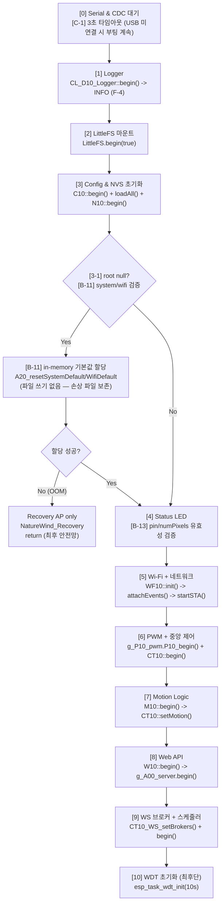

> **가드**: WDT는 반드시 `A00_init()` 맨 마지막. Wi-Fi 재시도 등 블로킹 회피.

---

## 2. 메인 루프 파이프라인 (`A00_run()`)

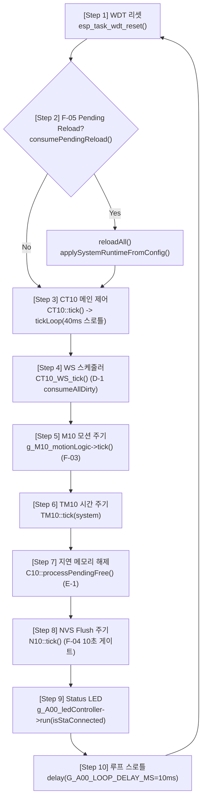

---

## 3. 설정 재로드(Reload) 위임 시퀀스 (F-05)

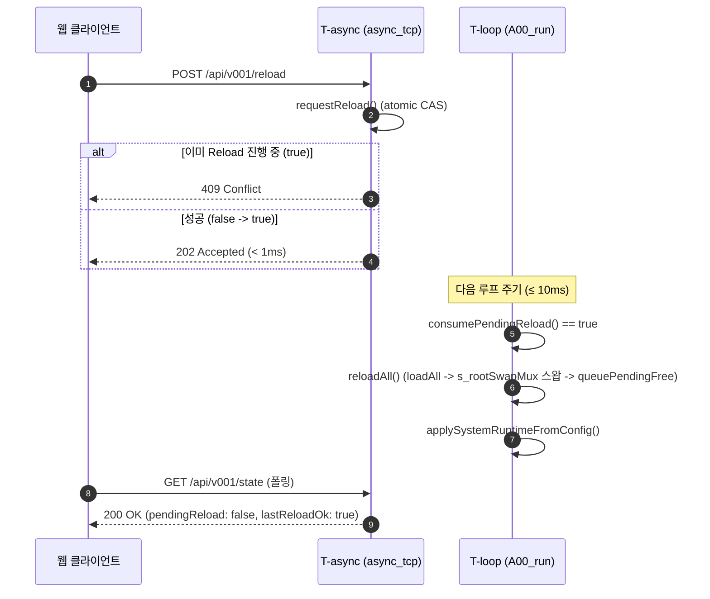

---

## 4. Motion Patch 위임 시퀀스 (F-06)

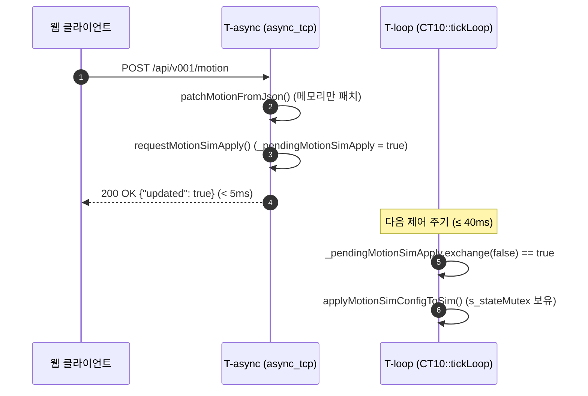

---

## 5. Wi-Fi 연결/재연결 (F-01, F-02)

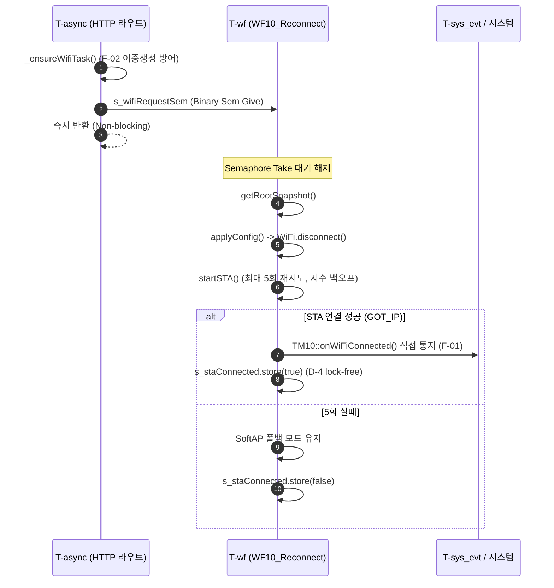

---

## 6. 시간 동기화 (SNTP 콜백 + 다중 경로)

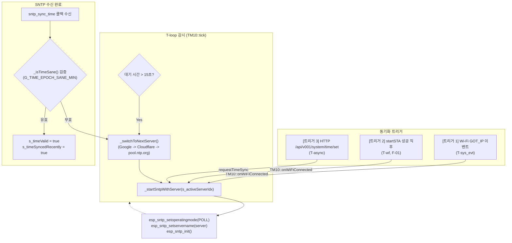

---

## 7. PIR 모션 센서 피드/감쇠 (F-03, A-2)

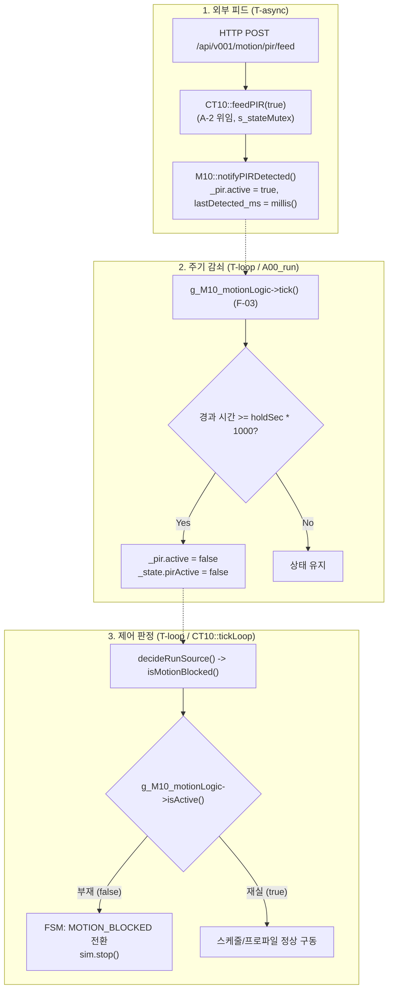

---

## 8. 배치 A-2 캡슐화 위임 흐름

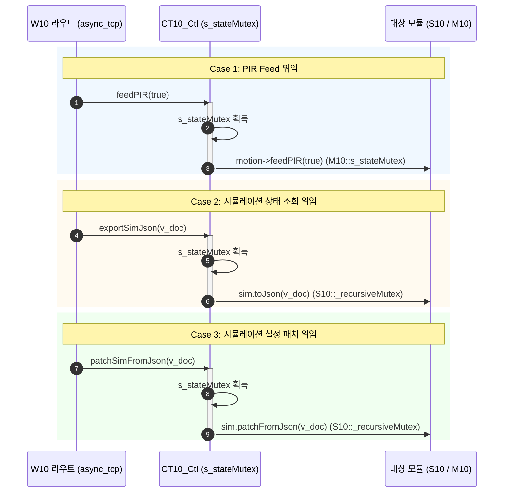

> **락 순서**: CT10 `s_stateMutex` → M10/S10 mutex (CONTRACT §5 준수). 역방향 금지.

---

## 9. 배치 F-2/F-3 POST/PATCH 공통 헬퍼 흐름

```mermaid
flowchart TD
    subgraph System ["/api/v001/system"]
        S_POST["POST /api/v001/system"] --> H_SYS["_routeSystemPatchBody()"]
        S_PATCH["PATCH /api/v001/system"] --> H_SYS
        H_SYS --> H_SYS_1["1. checkApiKey() 검증"]
        H_SYS_1 --> H_SYS_2["2. parseJsonBody() 파싱"]
        H_SYS_2 --> H_SYS_3["3. patchSystemFromJson() 적용"]
        H_SYS_3 --> H_SYS_4["4. applySystemRuntimeFromConfig() 갱신"]
        H_SYS_4 --> H_SYS_5["5. sendJson() 동일 응답 반환"]
    end

    subgraph WiFi ["/api/v001/wifi/config"]
        W_POST["POST /api/v001/wifi/config"] --> H_WIFI["_routeWifiConfigPatchBody()"]
        W_PATCH["PATCH /api/v001/wifi/config"] --> H_WIFI
        H_WIFI --> H_WIFI_1["1. checkApiKey() 검증"]
        H_WIFI_1 --> H_WIFI_2["2. parseJsonBody() 파싱"]
        H_WIFI_2 --> H_WIFI_3["3. patchWifiFromJson() 적용"]
        H_WIFI_3 --> H_WIFI_4["4. saveDirtyConfigs() 플래그 설정"]
        H_WIFI_4 --> H_WIFI_5["5. WF10::requestReconnect() 비동기 위임"]
        H_WIFI_5 --> H_WIFI_6["6. sendJson() 동일 응답 반환"]
    end
```

---

## 10. 예외/폴백 경로

| 장애 유형 | 감지 지점 | 폴백/복구 |
|---|---|---|
| Wi-Fi STA 접속 불가 | startSTA 5회 실패 | SoftAP 폴백 |
| GOT_IP 이벤트 mutex 경합 | `isAcquired()==false` | startSTA 성공 시 명시 통지 (F-01) |
| NTP 타임아웃 | 15초 콜백 미수신 | Google → Cloudflare → pool.ntp.org |
| 설정 JSON 손상 | LittleFS 파싱 실패 | `.bak` 자동 복구 (`A40_Com_Utils_IO_0202.cpp`) |
| 중복 Reload | requestReload CAS 실패 | 409 Conflict |
| 재실자 부재 | PIR holdSec 만료 | MOTION_BLOCKED + 팬 정지 |
| AutoOff 조건 | 타이머/시간/온도 | `_autoOffLatched=true` + 팬 안전 정지 |
| Gzip 파일 부재 | `exists(uri+".gz")==false` | raw 폴백 |
| 정적 에셋 요청 | `/html_v0202` 자산 부재 | 404 진단 메시지 반환 (레거시 제거) |
| Factory reset 후 NVS 잔존 | (F-1 이전) | **F-1**: `N10::resetRuntime()` 호출 |
| Logger 초기 DEBUG (양산) | (F-4 이전) | **F-4**: INFO로 변경 |
| **USB 미연결 부팅** | **(C-1) `!Serial` 3초 초과** | **타임아웃 후 부팅 계속** |
| **Config 파일 손상** | **(B-11) `system`/`wifi` null** | **in-memory defaults → 웹 UI 복구** |
| **OOM (defaults 할당 실패)** | **(B-11) `new` 실패** | **Recovery AP만 기동 → 수동 복구** |
| **OTA 세션 중단** | **(B-12) 클라이언트 끊김** | **`Update.abort()` → 다음 OTA 재시도** |
| **OTA 쓰기 실패** | **(B-12) `write` 반환 < len** | **`Update.abort()` + 500 응답** |
| **LED pin 손상 (음수)** | **(B-13) `pin < 0 \|\| pin > 48`** | **WARN 로그 + GPIO 48 폴백** |
| **API Key 삭제 요청** | **(B-4) `clearApiKey=true`** | **`security.apiKey[0]='\0'`** |
| **`gzip;q=0` 요청** | **(B-5) `W10_acceptsGzip()` 반환 false** | **raw 파일 서빙** |

---

## 11. 웹 에셋 빌드/서빙 파이프라인

### 11.1 빌드 전처리 (`pio_gzip_0202.py`)

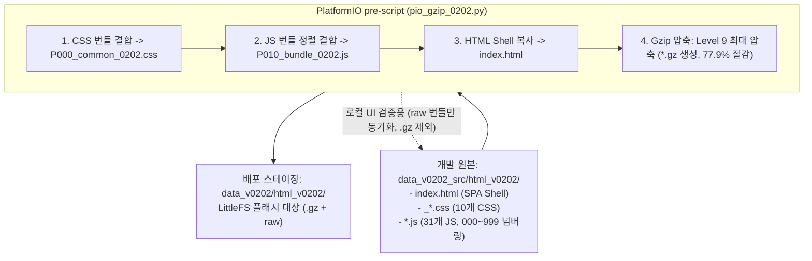

### 11.2 런타임 정적 서빙 (`W10_Web_Static_0202.cpp`)

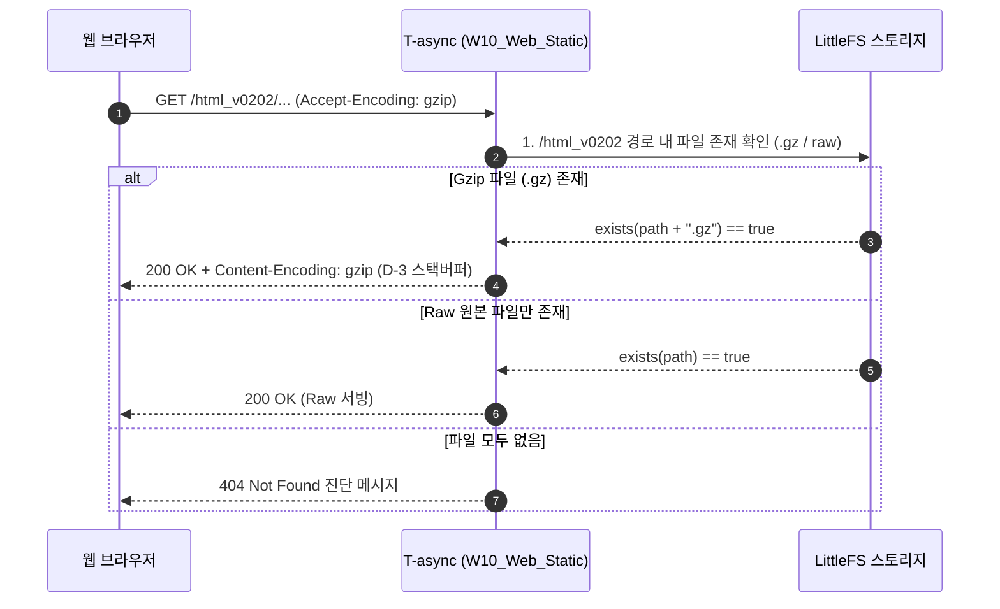

---

## 12. 개정 이력

| 날짜 | 버전 | 변경 내용 | 작성자 |
|---|---|---|---|
| **2026-10-26** | **v2.5** | **Batch G — §1 C-1/B-11/B-13 부팅 분기, §10 예외 8건 추가 (C-1/B-4/B-5/B-11/B-12/B-13)** | Antigravity AI |
| 2026-10-21 | v2.4 | 전체 흐름/시퀀스 다이어그램을 GitHub 및 Obsidian 호환 Mermaid 표준 형식으로 전면 전환 | Antigravity AI |
| 2026-10-21 | v2.3 | `pio_gzip_0202.py`, `data_v0202` 경로, 듀얼 서빙 폴백 시퀀스, `_0202` 자산 일괄 현행화 | Antigravity AI |
| 2026-10-20 | v2.2 | Batch A~F 반영: §8 A-2 위임 흐름 신규, §9 F-2/F-3 헬퍼 신규, §2 Step2/3/5/8/10 F-03~F-06/C-5 반영, §10 예외 F-1/F-4 추가, §11 D-2/D-3 정적 서빙 | Antigravity AI |
| 2026-10-19 | v2.1 | N-1 state 폴링, G-2/G-4 regex 서빙, root 404 차단 | Antigravity AI |
| 2026-10-19 | v2.0 | v0202 승격 + (v1.2의 빌드 파이프라인 흐름 유지) | Antigravity AI |
| 2026-10-19 | v1.2 | 빌드 파이프라인 + Gzip 서빙 흐름 | Antigravity AI |
| 2026-10-19 | v1.1 | A00_init/A00_run 순서 동기화 | Antigravity AI |
| (초기) | v1.0 | 최초 정적 감사 기반 흐름도 | 개발팀 |
