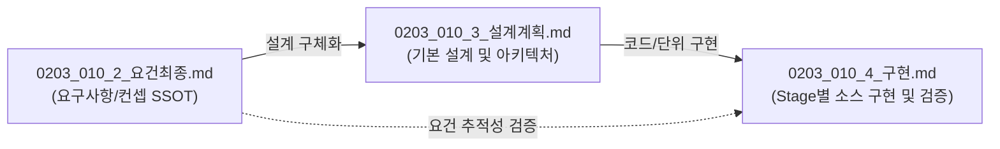

# 컨샙 (0203_010_2.md)
  - wind design studio로 바람을 작곡하다
  - wind play list 로 플레이하다(스포티파이 처럼)
  - 일반 선풍기 기능 도 제공 

  - manual 과 overrider 통폐합

---

# Smart Nature Wind — Concept 확정 및 요구사항 v1.1

> **개정 요약 (v1.0 → v1.1)**  
> ① 3대 개념 확정 (Wind Design Studio / Wind Playlist / Normal Fan)  
> ② Manual + Override 통폐합 → **Playback Session** 단일 모델  
> ③ FSM 7-state → **5-state** 단순화

---

## 🔗 문서 간 참조 관계 (Document Traceability Matrix)

본 문서는 **기획/요구사항 정의서(Requirement SSOT)**로서 하위 기본 설계 및 단계별 구현 문서와 상호 유기적으로 연결됩니다.



| 참조 문서 구분 | 대상 문서 경로 | 핵심 참조 및 연계 내용 |
|:---|:---|:---|
| **상위 검토 배경** | [0203_010_1_요건검토1.md](src/v0203/Req_ImplPlan_0203/0203_010/0203_010_1_요건검토1.md) | 사용자 관점 재설계 검토 배경 및 요구사항 도출 과정 |
| **현재 문서** | **[0203_010_2_요건최종.md](src/v0203/Req_ImplPlan_0203/0203_010/0203_010_2_요건최종.md)** | **[SSOT]** 3대 핵심 개념, Playback Session 모델, 5-State FSM, UI/UX 최종 요구사항 |
| **하위 기본 설계** | [0203_010_3_설계계획.md](src/v0203/Req_ImplPlan_0203/0203_010/0203_010_3_설계계획.md) | 본 요구사항을 바탕으로 한 3-Layer 아키텍처, C10/CT10 클래스 다이어그램, REST API(`/api/v001/*`) 상세 명세 |
| **하위 소스 구현** | [0203_010_4_구현.md](src/v0203/Req_ImplPlan_0203/0203_010/0203_010_4_구현.md) | Stage 1~7 실제 C++ 소스 코드, 프론트엔드 번들링 자산, 단위/통합 테스트 코드 |
| **시스템 최상위 계약** | [SPEC_0203.md](src/v0203/contract_doc_0203/SPEC_0203.md) | MCU(ESP32-S3), LittleFS, 25kHz PWM 등 전사 최상위 하드웨어/소프트웨어 엔지니어링 계약 |

---

# Part 1. 3대 핵심 개념 확정

## 1.1 개념 지도 (Spotify 비유)

| Spotify | Smart Nature Wind | 사용자 역할 |
|---|---|---|
| 🎼 스튜디오 (작곡) | **Wind Design Studio** | 바람 작곡가 (1%) |
| 📚 라이브러리 / 플레이리스트 | **Wind Playlist** | 바람 감상자 (90%) |
| 🔉 볼륨 다이얼 | **Normal Fan** | 급한 사용자 (누구나) |

**핵심 원칙**: 세 개념은 **대체 관계가 아닌 병존**. 각 사용자 세그먼트에 대응하며, 상호 참조.

---

## 1.2 🎨 Wind Design Studio — 바람을 작곡하다

**정의**: Step과 Profile을 편집해 나만의 바람 시나리오를 창작하는 도구.

### 역할
- **Step 편집**: 원자적 바람 블록 조합 ("바다 20분 + 휴지 5분 + 숲속 30분")
- **Profile 저장**: 완성된 시나리오를 라이브러리에 등록
- **미리보기**: Simulation 모달로 작곡 중 체험

### 접근 경로
- ⏰ 자동화 > **Studio 탭** (신규)
- 🌬️ 바람 화면의 [🎨 Studio에서 편집] 버튼 (고급)

### UI 예시
```
┌────────────────────────────────────┐
│  🎨 Wind Design Studio              │
├────────────────────────────────────┤
│  내 프로필 편집: 아침 시원함         │
│                                    │
│  ┌─ Step 1 ────────────────────┐   │
│  │ 🌊 바다 · 보통 · 20분        │   │
│  │ [🎬] [▲▼] [🗑]              │   │
│  └──────────────────────────────┘   │
│              ↓                     │
│  ┌─ Step 2 ────────────────────┐   │
│  │ ⏸ 휴지 · 5분                 │   │
│  └──────────────────────────────┘   │
│              ↓                     │
│  ┌─ Step 3 ────────────────────┐   │
│  │ 🌲 숲속 · 수면 · 30분        │   │
│  └──────────────────────────────┘   │
│                                    │
│  [+ Step 추가]                     │
│                                    │
│  [🎬 전체 시나리오 체험]            │
│                        [저장][취소] │
└────────────────────────────────────┘
```

---

## 1.3 🎵 Wind Playlist — 바람을 재생하다

**정의**: Studio에서 작곡한 Profile 목록. Spotify 플레이리스트처럼 재생.

### 역할
- **재생** (MANUAL): 지금 이 프로필을 틀어줘
- **자동 재생** (SCHEDULE): 정해진 시간에 이 프로필을 틀어줘
- **관리**: 작곡한 프로필 목록 표시, 참조 스케줄 확인

### 접근 경로
- 🏠 홈의 "재생할 플레이리스트" 카드 (원터치)
- ⏰ 자동화 > **Playlist 탭**

### UI 예시
```
┌────────────────────────────────────┐
│  🎵 Wind Playlist                  │
├────────────────────────────────────┤
│  ┌──────────────────────────────┐  │
│  │ 📋 아침 시원함       [▶ 재생] │  │
│  │ 바다 20분 → 휴지 5분 → 숲속 30분│  │
│  │ 사용 스케줄: 평일 아침 (1)     │  │
│  ├──────────────────────────────┤  │
│  │ 📋 수면 리듬         [▶ 재생] │  │
│  │ 숲속 30분 → 숲속 45분 → 숲속 60분│
│  │ 사용 스케줄: 매일 취침 (1)     │  │
│  └──────────────────────────────┘  │
│  [🎨 Studio에서 새로 작곡]          │
└────────────────────────────────────┘
```

---

## 1.4 🌀 Normal Fan — 일반 선풍기

**정의**: 급할 때 쓰는 단순 제어. 1~5단 같은 즉각적 PWM 조절.

### 역할
- **1-2-3-4-5단 버튼** (또는 슬라이더)
- 프리셋/스타일 개념 없이 **즉시 PWM 고정**
- "그냥 선풍기로 쓸래" 사용자 대응

### 접근 경로
- 🏠 홈 하단 "일반 선풍기" 섹션 (**명시적, 숨기지 않음**)

### UI 예시
```
┌────────────────────────────────────┐
│  🌀 일반 선풍기                     │
│  [1단][2단][3단][4단][5단]         │
│  (20%) (40%) (60%) (80%)(100%)     │
│                                    │
│  또는 [────●────] 60%              │
└────────────────────────────────────┘
```

---

# Part 2. Manual + Override 통폐합 → Session 모델 ★핵심

## 2.1 문제 인식

### 기존 개념의 혼란
| 기존 개념 | 정의 | 실제 |
|---|---|---|
| **Manual** | 프로필 재생 (제안) | 여러 Step을 시간에 따라 |
| **Override** | 강제 제어 (v0203) | 즉시 PWM/프리셋 강제 |

**두 개념의 본질은 같음**: "사용자가 지금 뭔가 실행하라고 명령함"

차이는 **payload의 형태** 뿐:
- Manual = Step 시퀀스 (Playlist)
- Override = 단일 강제 (프리셋 or PWM 고정)

## 2.2 통합 모델 — **Playback Session**

```
┌─────────────────────────────────────────────────────┐
│  PLAYBACK SESSION (세션)                            │
│  "지금 무언가 실행 중인 상태"                        │
│                                                     │
│  ┌──────────────────────────────────────────────┐  │
│  │ trigger: MANUAL | SCHEDULE                   │  │
│  │    ↳ 언제 시작? (사용자 명령 vs 시간)        │  │
│  ├──────────────────────────────────────────────┤  │
│  │ type: PLAYLIST | PRESET | FIXED              │  │
│  │    ↳ 무엇을 실행?                            │  │
│  ├──────────────────────────────────────────────┤  │
│  │ payload: (type별 상이)                        │  │
│  │    PLAYLIST: { profileId }                   │  │
│  │    PRESET:   { presetCode, styleCode, ovr }  │  │
│  │    FIXED:    { percent }                     │  │
│  ├──────────────────────────────────────────────┤  │
│  │ startedAt, endsAt, autoOff                   │  │
│  └──────────────────────────────────────────────┘  │
└─────────────────────────────────────────────────────┘
```

**핵심**: 기존 `Manual`과 `Override`가 Session의 **type**과 **trigger**로 흡수됨.

## 2.3 Session Type 3종

| Type | 정의 | 사용자 인지 | UI 진입점 |
|---|---|---|---|
| **PLAYLIST** | Profile 재생 (Step 시퀀스) | "재생" | 홈 카드, Playlist 탭 |
| **PRESET** | 프리셋 1개 즉시 실행 | "이 바람으로" | 바람 화면 카드 |
| **FIXED** | PWM 고정 (일반 선풍기) | "1-2-3-4-5단" | 홈 일반 선풍기 |

## 2.4 Session Trigger 2종

| Trigger | 정의 | 우선순위 |
|---|---|---|
| **MANUAL** | 사용자 명령 ("▶", "1단") | 1순위 (Schedule 압도) |
| **SCHEDULE** | 시간 윈도우 진입 | 2순위 (Manual 없을 때) |

**스케줄 지원 범위 (Phase 1)**:
- ✅ `SCHEDULE + PLAYLIST` (프로필 자동 실행)
- ⚠️ `SCHEDULE + PRESET` / `SCHEDULE + FIXED` — Phase 2로 미룸 (UI 복잡도)

## 2.5 Session Lifecycle

### 시작
```
UI 액션 → startSession({trigger, type, payload})
         ↓
N10 NVS 저장 (PLAYLIST일 때만, 재부팅 복원용)
         ↓
runCtx 갱신 → 다음 tick에서 실행 시작
```

### 종료 (4가지)
| 조건 | 처리 |
|---|---|
| Session 자체 완료 (Step 끝, repeatCount 소진) | 자동 종료 → IDLE |
| 사용자 [⏹ 정지] | 명시 종료 |
| AutoOff 발동 | AUTOOFF_STOPPED 래치 |
| 다른 Session 시작 | 이전 Session 자동 종료 |

### 재부팅 복원 정책
| Type | 복원 여부 | 근거 |
|---|---|---|
| **PLAYLIST** | ✅ 복원 | 사용자 선택 보호 (재생 재개) |
| **PRESET** | ❌ IDLE로 | 안전 (강제 유지 위험) |
| **FIXED** | ❌ IDLE로 | 안전 (재부팅 시 팬 자동 가동 위험) |

→ NVS에는 **PLAYLIST Session만** 기록 (`man_prof` 키).

## 2.6 기존 API → Session API 매핑

| 기존 함수 | Session API |
|---|---|
| `startOverrideFixed(pct)` | `startSession(MANUAL, FIXED, {pct})` |
| `startOverridePreset(p, s, o)` | `startSession(MANUAL, PRESET, {p,s,o})` |
| `applyManualResolved(w)` | `startSession(MANUAL, PRESET, {resolved})` |
| `startProfileManual(id)` (v1.0 제안) | `startSession(MANUAL, PLAYLIST, {id})` |
| `clearManual()` / `stopOverride()` | **`stopSession()`** (통합) |
| `setProfileMode(bool)` | **폐기** (Session model로 대체) |
| `EN_CT10_RUN_NONE/SCHEDULE/USER_PROFILE` | **폐기** → `runCtx.trigger` |

**효과**: 진입점 API **8개 → 2개** (`startSession` / `stopSession`)

## 2.7 사용자 액션 매트릭스

| UI 액션 | Session Type | Trigger |
|---|---|---|
| 홈 전원 버튼 ON | 마지막 타입 (기본 FIXED 50%) | MANUAL |
| 홈 프로필 카드 탭 | PLAYLIST | MANUAL |
| 홈 [1단]~[5단] | FIXED | MANUAL |
| 바람 프리셋 카드 탭 | PRESET | MANUAL |
| 자동화 > Playlist [▶ 재생] | PLAYLIST | MANUAL |
| 스케줄 시간 진입 | PLAYLIST | SCHEDULE |
| 홈 [⏹ 정지] | **stopSession()** | - |

---

# Part 3. FSM 단순화 (7 → 5-state)

## 3.1 새 FSM

| 기존 (7) | 재설계 (5) | 매핑 |
|---|---|---|
| `IDLE` | **IDLE** | 유지 |
| `OVERRIDE` | **RUNNING** | 통합 |
| `PROFILE_RUN` | **RUNNING** | 통합 |
| `SCHEDULE_RUN` | **RUNNING** | 통합 |
| `MOTION_BLOCKED` | MOTION_BLOCKED | 유지 |
| `AUTOOFF_STOPPED` | AUTOOFF_STOPPED | 유지 |
| `TIME_INVALID` | TIME_INVALID | 유지 |

**원칙**: FSM은 **"실행 중이냐"** 만 표현. 세부는 `runCtx.trigger` + `runCtx.sessionType`으로.

## 3.2 Run Context 재정의

```cpp
typedef enum : uint8_t {
    EN_CT10_STATE_IDLE            = 0,
    EN_CT10_STATE_RUNNING         = 1,   // ← 모든 실행 통합
    EN_CT10_STATE_MOTION_BLOCKED  = 2,
    EN_CT10_STATE_AUTOOFF_STOPPED = 3,
    EN_CT10_STATE_TIME_INVALID    = 4,
} EN_CT10_state_t;

typedef enum : uint8_t {
    EN_CT10_TRIGGER_NONE     = 0,
    EN_CT10_TRIGGER_MANUAL   = 1,
    EN_CT10_TRIGGER_SCHEDULE = 2,
} EN_CT10_trigger_t;

typedef enum : uint8_t {
    EN_CT10_SESSION_NONE     = 0,
    EN_CT10_SESSION_PLAYLIST = 1,
    EN_CT10_SESSION_PRESET   = 2,
    EN_CT10_SESSION_FIXED    = 3,
} EN_CT10_session_type_t;

struct ST_CT10_RunContext_t {
    EN_CT10_state_t         state;
    EN_CT10_reason_t        reason;
    EN_CT10_trigger_t       trigger;       // ★
    EN_CT10_session_type_t  sessionType;   // ★
    
    // Session payload (통합)
    union {
        struct { uint8_t profileId; uint16_t profileNo; } playlist;
        struct { char presetCode[24]; char styleCode[24]; } preset;
        struct { float percent; } fixed;
    } payload;
    
    // 스케줄 참조 (SCHEDULE일 때만)
    uint8_t  activeSchId;
    uint16_t activeSchNo;
    
    // 진행 상태 (PLAYLIST 전용)
    uint8_t  currentStepNo;
    uint8_t  totalSteps;
    uint32_t currentStepStartMs;
    
    // 기존
    uint32_t lastDecisionMs;
    uint32_t lastStateChangeMs;
    // ...
};
```

## 3.3 실행 엔진 통합

| 기존 | 재설계 |
|---|---|
| `tickOverride()` | **`tickSession()`** (통합) |
| `tickSchedule()` | ↑ 위로 통합 |
| `tickUserProfile()` | ↑ 위로 통합 |
| `tickSegmentSequence()` × 2 | **`tickStepSequence()`** × 1 |

```cpp
bool CL_CT10_ControlManager::tickSession() {
    // [보완] 세션이 PAUSED 상태인 경우 모터 0% 정지 유지 및 경과시간 홀드
    if (runCtx.sessionState == EN_SESSION_PAUSED) {
        CL_P10_PwmDriver::setDutyPercent(0.0f);
        return true;
    }

    switch (runCtx.sessionType) {
        case EN_CT10_SESSION_PLAYLIST:
            return tickPlaylist();   // Step 시퀀스 재생
        case EN_CT10_SESSION_PRESET:
            return tickPreset();     // sim.applyResolvedWind 유지
        case EN_CT10_SESSION_FIXED:
            return tickFixed();      // pwm.setDutyPercent 유지
        default:
            return false;
    }
}
```

## 3.4 `decideRunSource()` 재작성

```cpp
ST_CT10_Decision_t decideRunSource() {
    // 1) AUTOOFF 래치 (최우선 안전 정지 - 활성 세션 자동 종료)
    if (_autoOffLatched) return { .state = AUTOOFF_STOPPED };

    // 2) PIR 모션 감지 판정 (부재 시 일시 중지 - 세션 잔여 시간 자동 홀드)
    if (runCtx.sessionState == EN_SESSION_ACTIVE && !M10_MotionManager::isActive()) {
        return { .state = MOTION_BLOCKED };
    }
    
    // 3) MANUAL Session (스케줄 압도)
    if (manualSession.active) {
        // ... type별 처리 (sessionState가 PAUSED인 경우도 RUNNING 상태 유지하되 tickSession에서 모터 0% 정지)
        return { .state = RUNNING, .trigger = MANUAL, .sessionType = manualSession.type };
    }
    
    // 4) SCHEDULE Session
    if (!timeValid) return { .state = TIME_INVALID };
    int schIdx = findActiveScheduleIndex(...);
    if (schIdx >= 0) {
        return { .state = RUNNING, .trigger = SCHEDULE, 
                 .sessionType = EN_CT10_SESSION_PLAYLIST };
    }
    
    // 5) IDLE
    return { .state = IDLE };
}
```

**효과**: 결정 로직 **5단 우선순위** 그대로, 세부 분기는 Session type 내부로.

---

# Part 4. UI 재편 (3개념 + Session 반영)

## 4.1 최종 정보구조 (IA) — 5 페이지 유지, 내부 재편

```
[하단 탭 바]
🏠 홈  🌬️ 바람  ⏰ 자동화  📊 모니터  ⚙️ 설정
```

| 페이지 | 주요 개념 매핑 |
|---|---|
| **🏠 홈** | 🎵 Playlist 진입 + 🌀 Normal Fan |
| **🌬️ 바람** | 🎨 Studio 진입 (악기 선택) |
| **⏰ 자동화** | 🎨 Studio + 🎵 Playlist 관리 + 스케줄 |
| **📊 모니터** | Session 회고 |
| **⚙️ 설정** | 시스템 |

## 4.2 🏠 홈 — Playlist 재생 + Normal Fan

```
┌──────────────────────────────────────────┐
│  🍃 Smart Nature Wind          [🌐] [⚙️]│
├──────────────────────────────────────────┤
│         ┌──────────────────────┐         │
│         │      ⏻               │         │
│         │  ▶ Wind Playlist     │         │  ← 개념 명시
│         │   🌊 아침 시원함     │         │
│         │   Step 1/3 · 16분    │         │
│         │   ✋ 수동 재생 중     │         │
│         └──────────────────────┘         │
│                                          │
│  [⏹ 정지]  [⏭ 다음 Step]  [🎬 미리보기] │
│                                          │
├──────────────────────────────────────────┤
│  🎵 재생할 플레이리스트 (원터치)          │
│  ┌─────────┬─────────┬─────────┬───────┐│
│  │🌅 아침   │🌙 수면   │🌲 숲속   │+ 작곡 ││
│  └─────────┴─────────┴─────────┴───────┘│
│                                          │
├──────────────────────────────────────────┤
│  🌀 일반 선풍기                           │  ← Normal Fan 승격
│  [1단][2단][3단][4단][5단]               │
│  (20%) (40%) (60%) (80%)(100%)           │
│                                          │
├──────────────────────────────────────────┤
│  ⏰ 다음 자동: 평일 08:00 · 📋 아침 시원함│
│  🌡️ 24.5°C  💧 55%  👤 재실              │
└──────────────────────────────────────────┘
```

**핵심 결정:**
- **Wind Playlist / 일반 선풍기 레이블 명시** (개념 노출)
- **일반 선풍기 = 홈 하단 승격** (숨기지 않음, 발견성 ↑)
- + 작곡 버튼 = Studio 진입

## 4.3 🌬️ 바람 — Studio의 악기 선택 도구

**개념 재정의**: 이 화면은 "프리셋(=악기) + 스타일(=연주법)" 선택 도구.

```
┌──────────────────────────────────────────┐
│  🌬️ 바람 — 악기 선택                      │
├──────────────────────────────────────────┤
│  1️⃣ 프리셋 (악기)                        │
│  ┌─────────┬─────────┐                    │
│  │🌊 바다   │🏡 시골   │                    │
│  │...      │...      │                    │
│  └─────────┴─────────┘                    │
│                                          │
│  2️⃣ 스타일 (연주법)                      │
│  [⚖ 균형][⚡ 활동][🎯 집중][🍃 휴식][🌙 수면]│
│                                          │
│  💡 잔잔하고 부드러운 바람                │
│                                          │
│  [🎬 미리보기]  [✓ 이 바람으로 재생]      │  ← PRESET Session
│                                          │
│  [🎨 Studio에서 프로필 작곡]              │  ← Studio 진입
│                                          │
│  [고급 물리 파라미터 ∨]                   │
└──────────────────────────────────────────┘
```

**변화:**
- [✓ 이 바람으로 재생] = `startSession(MANUAL, PRESET, ...)`
- [🎨 Studio에서 프로필 작곡] = Studio 탭 이동

## 4.4 ⏰ 자동화 — Studio + Playlist + 스케줄 + 타이머

**4탭 구성:**

```
┌──────────────────────────────────────────────┐
│  ⏰ 자동화                                    │
├──────────────────────────────────────────────┤
│  [🎨 Studio] [🎵 Playlist] [⏰ 스케줄] [⏱️ 타이머]│
└──────────────────────────────────────────────┘
```

### 🎨 Studio 탭 (작곡 도구)

```
┌────────────────────────────────────────┐
│  🎨 Wind Design Studio — 작곡 중         │
│                                        │
│  프로필: 아침 시원함                     │
│  반복: ×2회                             │
│                                        │
│  ┌─ Step 1 ──────────────────────┐     │
│  │ 🌊 바다 · 보통 · 20분         │     │
│  │ [🎬 체험] [▲▼] [🗑]           │     │
│  └────────────────────────────────┘     │
│         ↓                              │
│  ┌─ Step 2 ──────────────────────┐     │
│  │ ⏸ 휴지 · 5분                  │     │
│  └────────────────────────────────┘     │
│         ↓                              │
│  ┌─ Step 3 ──────────────────────┐     │
│  │ 🌲 숲속 · 수면 · 30분         │     │
│  └────────────────────────────────┘     │
│                                        │
│  [+ Step 추가]                          │
│  [🎬 전체 시나리오 체험]                │
│                        [저장][취소]    │
└────────────────────────────────────────┘
```

### 🎵 Playlist 탭 (재생 목록)

```
┌────────────────────────────────────────┐
│  🎵 Wind Playlist                      │
│  ┌──────────────────────────────────┐  │
│  │ 📋 아침 시원함           [▶ 재생] │  │
│  │ 바다 20분 → 휴지 5분 → 숲속 30분 │  │
│  │ 사용 스케줄: 평일 아침 (1)        │  │
│  │ [✏️ Studio에서 편집] [🗑]         │  │
│  ├──────────────────────────────────┤  │
│  │ 📋 수면 리듬             [▶ 재생] │  │
│  └──────────────────────────────────┘  │
│  [🎨 Studio에서 새로 작곡]              │
└────────────────────────────────────────┘
```

### ⏰ 스케줄 탭 (Playlist 자동 재생)

```
┌────────────────────────────────────────┐
│  ⏰ 스케줄                              │
│  ┌──────────────────────────────────┐  │
│  │ 🌅 평일 아침                      │  │
│  │   월~금 08:00~12:00              │  │
│  │   🎵 실행: 📋 아침 시원함  [ON]  │  │
│  └──────────────────────────────────┘  │
│  [+ 새 스케줄]                          │
│                                        │
│  ※ 스케줄은 Playlist를 자동 재생합니다.│
│     새 프로필은 [🎨 Studio] 탭에서.    │
└────────────────────────────────────────┘
```

### ⏱️ 타이머 탭 (Session 자동 종료)

```
┌────────────────────────────────────────┐
│  ⏱️ 세션 타이머                        │
├────────────────────────────────────────┤
│  현재 실행 중인 세션 자동 종료 예약     │
│                                        │
│  [ 15분 ] [ 30분 ] [ 1시간 ] [ 2시간 ] │
│  [           끄기 (OFF)              ] │
│                                        │
│  직접 설정 (슬라이더):                  │
│  [────●──────────] 45분 (5~180분)      │
│                                        │
│  ┌─ 활성 상태 ──────────────────────┐  │
│  │ ⏱️ 남은 시간: 00:44:12            │  │
│  │ [██████████████░░░░░░░░░░] 73%   │  │
│  │ 종료 예정: 15:45 (세션 자동 STOP) │  │
│  └──────────────────────────────────┘  │
└────────────────────────────────────────┘
```

**타이머 핵심 기능 (SNW.TimerPanel & SNW.TimerManager):**
- **원터치 퀵 프리셋**: 15분, 30분, 60분, 120분, 끄기(OFF) 즉시 적용
- **미세 조절 슬라이더**: 5분 ~ 180분(3시간) 범위, 5분 단위 스냅
- **실시간 카운트다운**: 1초 단위 `HH:MM:SS` 디지털 디스플레이 및 프로그레스 바 렌더링
- **Now Playing Bar 연동**: 하단 미니 플레이어에 `⏱️ 44m` 배지 실시간 표시 및 클릭 시 `#/automation/timer` 즉시 이동
- **자동 세션 종료**: 타이머 만료 시 `SNW.Api.Session.stop()` 호출 및 토스트 알림
- **상태 영속화**: 브라우저 새로고침/탭 이동 시에도 `localStorage` 기반 타이머 종료 시각 유지

**4탭의 관계:**
- **Studio** = 창작 (원본 데이터 생성: Step 편집, 시나리오 작곡)
- **Playlist** = 재생 목록 (원본 데이터 조회/실행, 원터치 재생)
- **스케줄** = 자동 재생 (트리거: 요일/시간 윈도우 + profileId 단일 참조)
- **타이머** = 현재 세션 종료 예약 (카운트다운 만료 시 자동 세션 정지)

## 4.5 📊 모니터 — Session 회고

```
┌────────────────────────────────────────┐
│  현재 Session                           │
│  🌊 아침 시원함 (PLAYLIST · ✋MANUAL)   │  ← Session type/trigger 노출
│  Step 1/3 · 16분 남음                  │
│                                        │
│  회고 탭:                              │
│  · 08:00~09:30 📋 아침 시원함 (⏰자동)  │
│  · 09:30~      📋 아침 시원함 (✋수동)  │  ← 세션 이력
│  · 10:15~10:20 🌀 일반 3단 (✋수동)     │
└────────────────────────────────────────┘
```

**세션 이력 표시로 "언제 무엇을 썼는지" 완전 투명화.**

---

# Part 5. 데이터 모델 최종 확정

## 5.1 정적 데이터 (JSON)

```
[Step]
  stepNo, durationMin, type, presetCode, styleCode, fixedSpeed, override

[Profile]
  profileId, profileNo, name, enabled,
  stepCount, steps[], repeat, repeatCount,
  autoOff, motion

[Schedule] (하위 호환성 전면 배제 단일 규격)
  schId, schNo, name, enabled,
  period{days[], startTime, endTime},
  profileId ← 참조만 유지

  ※ 삭제 필드 (v0203 단일화):
  - segments[] 완전 삭제
  - repeatSegments, repeatCount 삭제
  - autoOff, motion 삭제 (참조된 UserProfile 설정 상속)
```

## 5.2 런타임 (NVS)

| 키 | 타입 | 값 |
|---|---|---|
| `man_prof` | int16 | 수동 재생 중인 Profile No (0=없음) |
| `man_active` | uint8 | 수동 재생 활성 (0/1) |

**PRESET/FIXED Session은 NVS 저장 안 함** (안전 원칙).

## 5.3 Session 실행 파라미터 (메모리)

```cpp
struct ST_CT10_ManualSession_t {
    bool                    active;
    EN_CT10_session_type_t  type;
    union {
        struct { uint8_t profileId; uint16_t profileNo; } playlist;
        struct { char presetCode[24]; char styleCode[24]; ST_A20_SegmentOverride_t ovr; } preset;
        struct { float percent; } fixed;
    } payload;
    uint32_t startedAt;
    uint32_t endsAt;  // 0=무한
};
```

---

# Part 6. 기존 요구사항 대비 변경점

## 6.1 v1.0 → v1.1 변경표

| 항목 | v1.0 | v1.1 |
|---|---|---|
| **개념 명시** | Step/Profile/Schedule | + Wind Design Studio / Wind Playlist / Normal Fan |
| **Manual 재생** | 별도 개념 | **Session type=PLAYLIST** |
| **Override** | 별도 FSM 상태 | **Session type=PRESET/FIXED** |
| **FSM** | 6-state (PROFILE_RUN 통합) | **5-state (RUNNING 통합)** |
| **API 진입점** | 8개 | **2개** (`startSession`/`stopSession`) |
| **일반 선풍기** | 홈 하단 아코디언 | **홈 승격** (명시 섹션) |
| **자동화 탭** | 3탭 (스케줄/프로필/타이머) | **4탭** (Studio/Playlist/스케줄/타이머) |
| **바람 화면** | 프리셋 + 스타일 | 프리셋 + 스타일 + **Studio 진입** |
| **NVS 복원** | PLAYLIST만 | PLAYLIST만 (변경 없음) |

## 6.2 영향받는 파일 (구현 관점)

### 백엔드 C++
| 파일 | 변경 |
|---|---|
| `CT10_Ctl_0203.h` | FSM 재정의 (5-state), `ST_CT10_ManualSession_t` 신설 |
| `CT10_Ctl_Ctl_0203.cpp` | `startSession/stopSession` 신설, `tickOverride` → `tickSession` 통합 |
| `CT10_Ctl_Ctl_Ovr_0203.cpp` | **삭제** (Session에 흡수) |
| `CT10_Ctl_Ctl_Mode_0203.cpp` | **삭제** (Session에 흡수) |
| `CT10_Ctl_StMG_0203.cpp` | `decideRunSource` 재작성 |
| `CT10_Ctl_Ctl_Seg_0203.cpp` | `tickSegmentSequence` × 2 → `tickStepSequence` × 1 |
| `N10_NvsManager_0203.h/.cpp` | `man_prof` / `man_active` 키 추가 |
| `A20_Const_Sch_0203.h` | `ST_A20_SegmentOverride_t` 명칭 유지 (Step 내 override) |
| `C10_Config_Sch_*.cpp` | Schedule 스키마: `profileId` 참조, steps 삭제 |
| `C10_Config_UzProf_*.cpp` | `segments` → `steps` 명칭 변경 |
| JSON 스키마 검증 | v0203 최초 부팅 시 LittleFS 스키마 유효성 검증 및 기본값 로드 (마이그레이션 배제) |

### 프론트엔드 JS
| 파일 | 변경 |
|---|---|
| `200.page.dashboard.js` | Wind Playlist 카드 + Normal Fan 섹션 |
| `210.page.chart.js` | Session type/trigger 표시 |
| `220.page.schedule.js` | `SNW.SchedulePanel` 위임 경량 파사드 (구버전 39KB 세그먼트 편집기 대체) |
| `230.page.profiles.js` | `SNW.Playlist` 위임 경량 파사드 (구버전 35KB 프로파일 편집기 대체) |
| `240.page.settings.js` | 변화 없음 (고급 탭 유지) |
| `260.page.monitor.js` | Session 이력 표시 (64개 링 버퍼 타임라인) |
| `290.page.automation.js` | 자동화 4탭(Studio / Playlist / 스케줄 / 타이머) 단일 진입점 허브 |
| `291.schedule.js` | 스케줄 카드 목록, 추가/편집 모달 (profileId 단일 라디오 매핑) |
| `292.playlist.js` | Wind Playlist 카드 목록, 원터치 재생/삭제 |
| `293.studio.js` | Wind Design Studio 작곡 에디터 (Step 추가/삭제/순서변경/사운드 시뮬) |
| **신규** `294.timer_panel.js` | **`SNW.TimerPanel` & `SNW.TimerManager`**: 퀵 프리셋(15/30/60/120분/OFF), 5~180분 슬라이더, 카운트다운/프로그레스바, 만료 시 세션 자동 Stop |
| `999a.nowplaying.js` | Now Playing Bar 타이머 활성화 시 실시간 `⏱️ 남은분` 배지 노출 및 클릭 연동 |

---

# Part 7. 최종 확정 요약

## 7.1 3대 개념 → Session 모델 매핑

```
┌─────────────────────────────────────────────────┐
│  3대 개념                                        │
│  ┌──────────┐  ┌──────────┐  ┌──────────────┐  │
│  │🎨 Studio │  │🎵Playlist│  │🌀Normal Fan  │  │
│  │ (작곡)   │  │ (재생)   │  │ (일반선풍기) │  │
│  └────┬─────┘  └────┬─────┘  └──────┬───────┘  │
│       │             │               │          │
│       │ (생성)      │ (선택)        │ (선택)   │
│       ▼             ▼               ▼          │
│  ┌──────────────────────────────────────────┐  │
│  │       PLAYBACK SESSION (통합)             │  │
│  │                                           │  │
│  │  trigger:  MANUAL | SCHEDULE              │  │
│  │  type:     PLAYLIST | PRESET | FIXED      │  │
│  └──────────────────────────────────────────┘  │
│                     │                          │
│                     ▼                          │
│  ┌──────────────────────────────────────────┐  │
│  │       FSM 5-state (단순화)                │  │
│  │  IDLE / RUNNING / MOTION_BLOCKED          │  │
│  │  / AUTOOFF_STOPPED / TIME_INVALID         │  │
│  └──────────────────────────────────────────┘  │
└─────────────────────────────────────────────────┘
```

## 7.2 최종 원칙 10개

### 개념
1. **Studio = 작곡 도구** (Step/Profile 창작)
2. **Playlist = 재생 목록** (Profile 선택 실행)
3. **Normal Fan = 급할 때** (1~5단 PWM 고정)

### Session
4. **Manual + Override = Session** (통합 모델)
5. **Session Type 3종**: PLAYLIST / PRESET / FIXED
6. **Session Trigger 2종**: MANUAL / SCHEDULE
7. **MANUAL > SCHEDULE** (사용자 개입 우선)

### FSM
8. **7-state → 5-state** (RUNNING 통합)

### Persistence
9. **PLAYLIST만 재부팅 복원** (안전 원칙)
10. **PRESET/FIXED는 IDLE로** (재부팅 시 팬 자동 가동 금지)

## 7.3 다음 단계 (구현 준비)

1. **본 v1.1 요구사항 확정** ← 현재
2. JSON 스키마 0203 확정 (Step/Profile/Schedule)
3. C10 Config 스키마 검증 및 기본값 주입 로직 설계
4. CT10 리팩터 (Session model)
5. UI 와이어프레임 (Figma)
6. 7-Stage 순차 구현 착수 (0203_010_4 기준)

---

**이 문서가 v1.1 최종 SSOT입니다.**  
**Manual/Override 통폐합으로 API는 8→2개로, FSM은 7→5-state로, UI 페이지는 그대로 5개 유지하되 개념이 명확해졌습니다.**  
**"바람을 작곡하고, 재생하고, 급할 땐 일반 선풍기로" — 이 3문장이 제품의 전부입니다.**


--- ---

v1.1 추가 요구사항 검토 → v1.2 확정

검토 대상: 6개 요구사항 (미니 플레이어, Resume 정책, Wind Visualizer, 접근성, Context-Aware, 스케줄 충돌)
결론: 전건 채택, 단 Resume 정책은 4개 옵션 검토 후 하이브리드 모델로 확정

---

Part 1. 검토 결과 요약

# 요구사항 판정 핵심 결정
R1 전역 미니 플레이어 ✅ 채택 (P0) 하단 탭 바 직상, 48px 고정 바
R2 일시정지/재개 정책 ✅ 채택 (P0) Pause/Stop 구분 + 스마트 Resume
R3 Wind Visualizer ✅ 채택 (P1) 이퀄라이저 애니메이션 + Sparkline
R4 접근성 & 햅틱 ✅ 채택 (P0) Snap 슬라이더 + navigator.vibrate
R5 Context-Aware 센서 ✅ 채택 (P1) DI(불쾌지수) + 숏컷 카드
R6 스케줄 충돌 알림 ✅ 채택 (P0) 미니 플레이어에 ⏰ strike + 토스트

공통 원칙: 이 6개는 모두 "Session이 제품의 중심"이라는 v1.1 개념을 강화합니다. 특히 R1·R2·R6은 Session 라이프사이클의 필수 인프라이므로 P0로 승격.

---

Part 2. 상세 설계

R1. 전역 미니 플레이어 (Now Playing) 【P0】

2.1.1 개념

음악 앱의 "Now Playing" 패턴 차용. 어느 탭에 있든 Session 상태를 확인·제어.

2.1.2 UI — 위치 및 레이아웃

```
┌──────────────────────────────────────────┐
│  [현재 탭 콘텐츠]                         │
│                                          │
│                                          │
├──────────────────────────────────────────┤ ← 고정 48px
│ ▶ 🌊 아침 시원함 · Step 1/3 · 16:24  ⏸ ⏹│ ← Now Playing Bar
├──────────────────────────────────────────┤
│  🏠   🌬️   ⏰   📊   ⚙️                  │ ← 하단 탭 (60px)
└──────────────────────────────────────────┘
                                      ┌───┐
                                      │🤖 │ ← AI FAB (플로팅, 좌상단 이동)
                                      └───┘
```

2.1.3 3가지 상태

상태 좌측 아이콘 표시
재생 중 ▶ (파형 애니메이션) "🌊 아침 시원함 · Step 1/3 · 16:24"
일시정지 ⏸ "🌊 아침 시원함 · 일시정지 (Step 1 · 12:30 남음)"
스케줄 대기 ⏰ "다음: 평일 08:00 · 📋 아침 시원함"

미니 플레이어가 숨겨지는 조건:

· IDLE + 대기 스케줄 없음
· 홈 탭에서 이미 큰 Now Playing 카드 노출 중 (중복 방지)

2.1.4 우측 컨트롤

버튼 동작
⏸ (일시정지) pauseSession() — Resume 대기
▶ (재개) resumeSession() — R2 정책 적용
⏹ (정지) stopSession() — 즉시 종료 (확인 없음)

탭 (좌측 영역 클릭): 현재 Session 상세로 이동

· PLAYLIST → 🎵 Playlist 탭
· PRESET → 🌬️ 바람 화면
· FIXED → 🏠 홈 (일반 선풍기 섹션으로 스크롤)

2.1.5 FAB 충돌 해결

AI FAB 위치 변경:

· 기존: 우하단
· 신규: 우상단 (Header 내) 또는 미니 플레이어 좌측

결정: Header 내 아이콘으로 이동 (우하단은 미니 플레이어가 차지)

2.1.6 요구사항

· 모든 페이지에서 렌더 (SPA Shell 레벨, 999.app.js에서 관리)
· WS state 수신 시 자동 갱신
· 애니메이션 파형 (CSS keyframes, 저부하)
· 오프라인 모드에서도 표시 (Mock Session)

---

R2. 일시정지 / 재개 정책 【P0】

2.2.1 핵심 — Pause와 Stop의 의미 분리

동작 의미 Session 데이터 재개 시
일시정지 (Pause) 잠시 멈춤 보존 남은 시간부터
정지 (Stop) 종료 폐기 처음부터

UI 원칙:

· ⏸ = Pause (덮어쓰지 않음)
· ⏹ = Stop (확인 없이 즉시, 다음 재생 시 처음부터)

2.2.2 Session 상태 확장

```cpp
typedef enum : uint8_t {
    EN_SESSION_ACTIVE    = 0,   // 재생 중
    EN_SESSION_PAUSED    = 1,   // 일시정지 (Resume 대기)
    EN_SESSION_COMPLETED = 2,   // 자연 완료
} EN_SESSION_runtime_t;
```

runCtx.sessionState 추가:

```cpp
struct {
    EN_CT10_state_t         state;
    EN_SESSION_runtime_t    sessionState;  // ★ 신규
    EN_CT10_trigger_t       trigger;
    EN_CT10_session_type_t  sessionType;
    ... (payload, 진행 상태)
} runCtx;
```

2.2.3 Pause 시 시간 처리

중요: Step의 남은 시간을 보존해야 함

```cpp
// PLAYLIST Session일 때
struct {
    uint32_t currentStepStartMs;      // 원래 시작
    uint32_t pausedAtMs;              // 일시정지 시점
    uint32_t pausedAccumMs;           // 누적 일시정지 시간 (재개 시 리셋)
    
    // 남은 시간 = (현재 - 시작) - pausedAccumMs
} scheduleStepRt;
```

Pause 시:

```
pausedAtMs = millis()
markDirty("state")
```

Resume 시:

```
pausedAccumMs += (millis() - pausedAtMs)
pausedAtMs = 0
markDirty("state")
```

Session 종료 판정은 (millis() - pausedAccumMs) 기준 — 일시정지 시간은 카운트 안 됨.

2.2.4 Resume 정책 — 4가지 옵션 검토

정책 장점 단점
A. 항상 처음부터 단순 잠깐 멈췄다 다시 틀어도 처음부터 (불편)
B. 항상 이어서 편함 몇 시간 후 재개하면 "Step 중간" 이상함
C. 사용자 선택 유연 매번 모달 (귀찮음)
D. 스마트 (하이브리드) 자동 + 안전 정책 학습 필요

2.2.5 ✅ 확정: 정책 D (스마트 하이브리드)

Pause 경과 시간 재개 시 동작 근거
< 5분 이어서 재생 (남은 시간) "잠깐 화장실 다녀옴" 수준
5분 ~ 30분 현재 Step 처음부터 Step 중간 이상 방지
> 30분 Playlist 처음부터 Context 완전히 바뀜
재부팅 Playlist 처음부터 안전 원칙 (v1.1 유지)

사용자 선택 옵션 병존 (모달 생략):

· Pause 후 [재개] 버튼 길게 누르면 "처음부터 재시작" 옵션 툴팁

2.2.6 Resume 우선순위 규칙

Pause 중인 Session이 있을 때 다른 액션:

액션 처리
다른 Profile [▶ 재생] Pause Session 폐기 + 새 Session 시작
다른 스케줄 시간 진입 Pause Session 폐기 + 스케줄 Session 시작 (경고 토스트)
재부팅 Pause Session 폐기 (NVS 저장 안 함)

원칙: Pause는 "임시" — NVS 저장 안 함, 재부팅 시 소실.

2.2.7 FIXED/PRESET Session의 Pause

· FIXED: Pause = PWM 0% (팬 정지). Resume = 이전 % 복원.
· PRESET: Pause = sim.stop(). Resume = sim.applyResolvedWind() 재호출.

PLAYLIST와 시간 처리 방식 동일 (Step 개념 없으므로 Pause 시간만 정지).

2.2.8 신규 API

```cpp
// CT10_Ctl_0203.h
static bool pauseSession();
static bool resumeSession();
static bool stopSession();     // 기존 유지
```

미니 플레이어 버튼 매핑:

· ▶/⏸ 토글 → pauseSession() / resumeSession()
· ⏹ → stopSession()

---

R3. Wind Visualizer (시각적 바람 피드백) 【P1】

2.3.1 두 가지 시각화

위치 목적 기술
홈 큰 카드 지금 이 순간의 바람 실시간 이퀄라이저 (파형 애니메이션)
Profile 카드 (Playlist/Studio) 이 프로필의 전체 리듬 정적 Sparkline (미리보기)

2.3.2 홈 카드 — 실시간 이퀄라이저

개념: 음악 앱의 이퀄라이저처럼, 실제 S10 물리 엔진의 풍속 파형을 실시간 표시.

UI 목업:

```
┌──────────────────────────────────────────┐
│         ┌──────────────────────┐         │
│         │   ▁▂▄▆█▆▄▂▁▂▄▆█▆▄▂▁  │         │ ← 파형 애니메이션
│         │   ▁▃▅▇█▇▅▃▁▃▅▇█▇▅▃▁  │         │   (실시간 100ms)
│         │                      │         │
│         │   🌊 아침 시원함      │         │
│         │   Step 1/3 · 16분     │         │
│         └──────────────────────┘         │
└──────────────────────────────────────────┘
```

구현 방식:

· Canvas 2D, 60fps (requestAnimationFrame)
· 12-24개 막대 (풍속 히스토리 버퍼 5초)
· 색상 매핑:
  · 잔잔 (0~3 m/s): 🟢 파란색 계열
  · 보통 (3~6 m/s): 🟡 청록색 계열
  · 강함 (6~11 m/s): 🔴 주황색 계열
· 파형 출렁임: 실제 풍속 변화를 그대로 반영 (S10의 gust/thermal 파동)

데이터 소스: /ws/chart 채널 (기존 유지) — chart[].wind 최근 20개

2.3.3 Profile 카드 — Sparkline

개념: 30초 예상 파형의 정적 썸네일 (Simulation 미리 생성).

UI:

```
┌────────────────────────────────┐
│ 📋 아침 시원함        [▶ 재생] │
│ ╭─╮    ╭──╮     ╭─╮           │ ← Sparkline
│ ─╯ ╰────╯  ╰─────╯ ╰──        │   (곡선 미니그래프)
│ 바다 20분 → 휴지 5분 → 숲속 30분│
│ 사용 스케줄: 평일 아침 (1)     │
└────────────────────────────────┘
```

생성 방식:

· SNW.Preview.generate() 재활용 (기존 코드)
· 3초 압축된 파형을 SVG path로 정적 렌더
· 캐시: 프로필 편집 시 1회 생성 후 저장 (localStorage)

2.3.4 재생 중 미니 인디케이터

Playlist 편집/Playlist 탭 내 현재 재생 중인 프로필:

· 카드 배경에 파형 스트라이프 애니메이션 (CSS)
· 현재 Step 위치 강조

2.3.5 요구사항

· 이퀄라이저는 저부하 (Canvas 12~24 막대, 5초 버퍼)
· 저전력 모드 시 프레임 30fps로 감소 (prefers-reduced-motion)
· 접근성: aria-label로 "풍속 그래프, 현재 4.2 m/s"

---

R4. 접근성 & 오터치 방지 (Thumb Zone + Snap + Haptic) 【P0】

2.4.1 Thumb Zone 레이아웃

원칙: 한 손 조작 시 엄지 반경 내 주요 버튼 배치.

홈 화면 재배치:

```
┌────────────────────────────────────┐
│  Header (상단)                     │ ← 정보 표시용
├────────────────────────────────────┤
│                                    │
│  Now Playing Card                  │ ← 엄지 닿지 않음 (OK)
│  (읽기 전용 큰 카드)               │    세부 조작은 미니 플레이어
│                                    │
├────────────────────────────────────┤
│  🎵 재생할 플레이리스트             │ ← 엄지 OK
│  [🌅][🌙][🌲][+ 작곡]              │
│                                    │
├────────────────────────────────────┤
│  🌀 일반 선풍기                     │ ← 엄지 최적 위치
│  [1단][2단][3단][4단][5단]         │ ← 하단 (최접근성)
│                                    │
├────────────────────────────────────┤
│  Now Playing Bar (48px)            │
├────────────────────────────────────┤
│  하단 탭 (60px)                    │
└────────────────────────────────────┘
```

핵심 이동:

· 일반 선풍기 = 홈 최하단 (v1.1에서 "하단 승격" → "최하단" 확정)
· Now Playing = 상단 (큰 카드, 읽기 전용)
· 재생 조작(⏸/⏹) = 미니 플레이어 (하단 고정)

2.4.2 Snap 슬라이더 (일반 선풍기)

문제: 일반 슬라이더는 3단 근처에서 손가락 떼면 62% 같은 미세 오차.

해결:

· Snap 지점: 20, 40, 60, 80, 100 (5단계)
· Snap 반경: ±8% (18~22%는 20%로 흡수)
· UI: 슬라이더 위에 5개 마커 표시

```
[─────●─────] 60%
     ▲  ▲  ▲  ▲ ▲
     20 40 60 80 100   ← 스냅 마커 (자석)
```

CSS 구현 (의사):

```js
onPointerUp: (rawValue) => {
    const snapped = Math.round(rawValue / 20) * 20;
    return clamped(snapped, 0, 100);
}
```

2.4.3 햅틱 피드백

API: navigator.vibrate() (Android Chrome 지원, iOS Safari 미지원 → 무음 통과)

진동 패턴 3종:

시나리오 패턴 체감
단계 Snap (20→40) [10ms] 가벼운 톡
1단 ↔ 0단 (팬 시작/정지) [30ms] 확실한 톡
Playlist Step 전환 [10, 20, 10] 이중 리듬

구현:

```js
function hapticSnap() {
    if ('vibrate' in navigator) navigator.vibrate(10);
}
function hapticStepChange() {
    if ('vibrate' in navigator) navigator.vibrate([10, 20, 10]);
}
```

Playlist Step 전환 시 진동: 미니 플레이어도 진동 → "Step이 넘어갔구나" 인지.

2.4.4 버튼 크기 & 터치 영역

요소 최소 크기 권장
홈 즐겨찾기 카드 56×56px 80×80px
1~5단 버튼 48×48px 60×60px
미니 플레이어 버튼 44×44px 48×48px
하단 탭 아이콘 44×44px 60×60px (기존 유지)

WCAG 2.1 AA 준수 (44×44 권장, 최소 24×24 허용).

2.4.5 접근성 (a11y)

· 스크린 리더: Now Playing에 aria-live="polite"
· 키보드: Tab 순회 + Enter/Space 활성화
· 색상 대비: WCAG AA (4.5:1)
· prefers-reduced-motion: 애니메이션 감속 (이퀄라이저 정적화)

---

R5. Context-Aware 센서 활용 (능동적 제안) 【P1】

2.5.1 개념

수동 표시(24.5°C, 55%)에 머물지 않고, "지금 이 상황에 맞는 플레이리스트 추천" 숏컷 제공.

2.5.2 쾌적 지수 (DI, Discomfort Index)

공식 (일본 기상청 표준):

```
DI = 0.81T + 0.01H × (0.99T - 14.3) + 46.3
T = 온도(°C), H = 상대습도(%)
```

판정 구간:

DI 상태 색상 감성 문구
< 68 쾌적 🟢 "상쾌한 날씨"
68 ~ 75 약간 불쾌 🟡 "조금 덥네요"
75 ~ 80 불쾌 🟠 "끈적이는 날씨"
> 80 매우 불쾌 🔴 "숨이 막혀요"

2.5.3 홈 하단 센서 카드 재설계

기존 (v1.1):

```
🌡️ 24.5°C  💧 55%  👤 재실 감지됨
```

신규 (v1.2):

```
┌────────────────────────────────────────┐
│ 🌡️ 29.0°C  💧 75%  ·  🟠 끈적이는 날씨 │
│                                        │
│ 💡 이 날씨엔 "강한 계곡풍"이 시원해요   │
│ [▶ 지금 재생]                          │ ← 원터치 숏컷
└────────────────────────────────────────┘
```

2.5.4 추천 규칙 (Context Rules)

Phase 1 (간단): DI 기반 4개 프리셋 숏컷

DI 구간 추천 Profile 근거
< 68 (쾌적) "숲속 산책" (FOREST + RELAX) 부드러운 자연 리듬
68~75 (약간) "산들바람" (COUNTRY + BALANCE) 표준
75~80 (불쾌) "바다 돌풍" (OCEAN + ACTIVE) 강한 시원함
80 (매우) "계곡 강풍" (MOUNTAIN + ACTIVE) 최대 냉각

Phase 2 (추후): 시간대 + 요일 + 사용 이력 기반 학습

2.5.5 추가 규칙 (선택)

조건 추천
밤 22시 이후 🌙 "수면 리듬" 자동 제안
재실 미감지 3분+ "자동 정지 예정 (PIR 3분 후)" 배너
온도 급변 (5분 내 3°C+) "환기 모드" 제안 토스트
습도 80%+ (비 예상) "제습 환기" (PLAINS + FOCUS)

규칙의 우선순위: DI 먼저 → 시간대 → 이력 (Phase 1은 DI + 시간대만).

2.5.6 프로필 자동 생성 vs 참조

결정: 참조 (기존 Profile 재활용)

· 추천 = 기존 Playlist 중 하나를 선택
· 존재하지 않으면 "추천 시나리오" 자동 생성 (1회, Playlist에 추가)
· 사용자가 편집 가능

이유: Profile 난립 방지.

2.5.7 백엔드 요구사항

```cpp
// CT10_Ctl_Basic_0203.cpp 확장
float getDiscomfortIndex();  // DI 계산
EN_CT10_comfort_t getComfortLevel();  // 4구간
```

```cpp
// 신규 API
GET /api/v001/comfort  → { di, level, recommendedProfileId }
```

2.5.8 프론트엔드

· 홈 하단 카드 렌더 시 getComfortLevel() 기반 색상/문구 선택
· [▶ 지금 재생] 탭 → startSession(MANUAL, PLAYLIST, {recommendedId})
· 끄기 옵션: 설정 > 일반 > "날씨 추천 표시" 토글

---

R6. 스케줄 충돌 인지 알림 【P0】

2.6.1 문제 정의

MANUAL 우선 정책의 부작용:

· 사용자가 일반 선풍기 3단을 켜둠
· 08:00 "평일 아침" 스케줄 진입 예정
· Schedule이 묻힘 (사용자는 모름)

해결: 수동 Session 시작 시 "다음 스케줄 비활성"을 명확히 알림.

2.6.2 알림 3단계

① 즉시 토스트 (Manual 시작 시)

```
┌──────────────────────────────────────────┐
│ ⏰ 수동 재생 중에는 평일 08:00 "아침 시원함"│
│    스케줄이 실행되지 않습니다.      [알겠어요]│
└──────────────────────────────────────────┘
```

· 3초 자동 소멸
· 최초 1회만 표시 (localStorage snw.dismissedScheduleWarning)
· 이후엔 미니 플레이어의 ⏰ 아이콘 strike로만 표시

② 미니 플레이어 지속 표시

```
┌──────────────────────────────────────────┐
│ ▶ 🌊 아침 시원함 · Step 1/3  ⏰̶8:00  ⏸ ⏹│
└──────────────────────────────────────────┘
                                  ↑
                          strike-through
```

· 우측에 ⏰̶ 08:00 (취소선)
· 탭하면 툴팁: "수동 재생 중 · 스케줄은 수동 종료 후 재개"
· 길게 탭: 옵션 모달

③ 수동 종료 시 안내

```
┌──────────────────────────────────────────┐
│ ⏰ 수동 재생을 종료했습니다.               │
│    08:00 "평일 아침" 스케줄이 재개됩니다. │
└──────────────────────────────────────────┘
```

· 3초 자동 소멸
· 수동 종료가 스케줄 시간 내일 때만 표시

2.6.3 옵션 모달 (길게 탭 시)

```
┌────────────────────────────────────────┐
│ ⏰ 스케줄 충돌 안내                     │
├────────────────────────────────────────┤
│ 지금 수동 재생 중입니다.                │
│ 다음 스케줄:                            │
│   평일 08:00 · 📋 아침 시원함           │
│                                        │
│ 어떻게 하시겠어요?                      │
│                                        │
│ [⏹ 수동 정지하고 스케줄 대기]           │
│ [🔒 스케줄 무시하고 수동 계속]          │
│ [⚙️ 설정에서 자동 정책 변경]            │
│                                        │
│                        [취소]          │
└────────────────────────────────────────┘
```

2.6.4 사용자 선택 저장

"🔒 스케줄 무시하고 수동 계속" 선택 시:

· N10에 manualOverrideSchedule = true 저장
· 해당 Manual Session 완료까지 스케줄 실행 안 함
· 수동 종료 시 자동 리셋

"⏹ 수동 정지하고 스케줄 대기" 선택 시:

· stopSession()
· 스케줄 시간 진입 시 자동 시작

2.6.5 설정 > 일반 > 스케줄 정책

Phase 1 (기본): 자동 정책 (Manual 우선)
Phase 2 (고급): 사용자 선택 가능

```
⚙️ 설정 > 일반 > 스케줄 정책
  ⦿ 수동 재생 시 스케줄 일시 무시 (기본)
  ○ 수동 재생 중에도 스케줄 강제 실행
  ○ 스케줄 시간에는 수동 시작 금지
```

Phase 1엔 첫 번째만 구현, 나머지는 Phase 2.

2.6.6 백엔드 요구사항

```cpp
// N10에 추가
static constexpr const char* G_N10_KEY_MANUAL_OVERRIDE_SCHED = "man_ovr_sch";  // bool

// decideRunSource 로직 확장
if (manualSession.active) {
    // 스케줄 대기 여부를 runCtx에 기록
    runCtx.pendingSchId = findNextScheduleWithin(30분);
}
```

2.6.7 프론트엔드

· 미니 플레이어에 ⏰̶ HH:MM 배지 조건부 렌더
· 토스트는 SNW.ToastUtil.warn()

---

Part 3. v1.1 → v1.2 개정 사항 종합

3.1 FSM 확장 (5-state 유지)

state는 그대로 5개, sessionState 추가:

```cpp
EN_CT10_state_t        state;         // 5-state (IDLE/RUNNING/MOTION_BLOCKED/AUTOOFF_STOPPED/TIME_INVALID)
EN_SESSION_runtime_t   sessionState;  // ★ 신규 (ACTIVE/PAUSED/COMPLETED)
```

3.2 신규 API

```cpp
// CT10
static bool pauseSession();
static bool resumeSession();
// stopSession은 기존 유지

// DI 센서
static float getDiscomfortIndex();
static EN_CT10_comfort_t getComfortLevel();
```

3.3 NVS 확장

키 타입 목적
man_prof int16 수동 재생 중 Profile (v1.1)
man_ovr_sch uint8 스케줄 무시 플래그 (v1.2 신규)

3.4 UI 정보구조 변경

페이지 v1.1 v1.2
홈 Now Playing Card + Playlist + 일반 선풍기 (하단 승격) + 일반 선풍기 = 최하단 + Context 추천 카드
전역 없음 미니 플레이어 (48px)
AI FAB 우하단 Header 내 이동 (미니 플레이어와 충돌 회피)
모든 페이지 - Pause 버튼 통합

3.5 신규 컴포넌트

컴포넌트 위치 기술
Now Playing Bar 하단 탭 직상 SPA Shell (전역)
Wind Visualizer (이퀄라이저) 홈 큰 카드 Canvas 2D, 60fps
Sparkline Profile 카드 SVG, 정적 (캐시)
Context 추천 카드 홈 하단 DI 계산 + 원터치
Snap 슬라이더 일반 선풍기 Pointer 이벤트 + 햅틱

3.6 KPI 추가

지표 목표
Pause 기능 사용률 20% (주 1회 이상 사용자)
Resume 후 Session 완료율 70% (이어서 재생 시)
미니 플레이어 노출 → 정지 탭 40% (발견성 검증)
Snap 슬라이더 오터치율 < 5% (오차 ±8% 이내 진입)
Context 추천 수락률 25% (추천 카드 → 재생 탭)
스케줄 충돌 알림 확인율 60% (토스트 → 확인 탭)

---

Part 4. 구현 단계 로드맵 (0203_010_4 구현 기준 7-Stage 정합)

0203_010_4_구현.md의 실제 구현 실행 체계에 맞추어, 7단계 순차 진행 로드맵(총 8주)으로 구현 우선순위를 일원화합니다.

| Stage | 기간 | 핵심 목표 (0203_010_4 기준) | 산출물 및 주요 변경 파일 | 우선순위 |
|:---|:---:|:---|:---|:---:|
| **Stage 1** | 1주 | 데이터 모델 + Config CRUD | A20_Const_Sch_0203.h, C10_Config_Profile/Sch/Step_0203.cpp | **P0** |
| **Stage 2** | 1.5주 | Session 엔진 (start/pause/resume/stop) | CT10_Ctl_Ctl_0203.cpp, CT10_Ctl_StMG_0203.cpp, N10_NvsManager_0203 | **P0** |
| **Stage 3** | 1주 | REST API + Now Playing Bar | W10_Web_Routes_Session_0203.cpp, 999a.nowplaying.js, 전역 미니 플레이어 | **P0** |
| **Stage 4** | 1.5주 | Studio + Playlist | 300.page.studio.js, 285.page.playlist.js, Step 빌더 UI | **P0** |
| **Stage 5** | 1주 | Schedule 자동화 | 220.page.schedule.js, 스케줄 충돌 방어(⏰ strike) | **P0** |
| **Stage 6** | 1.5주 | Visualizer + Context | 115.ui.eq.js (이퀄라이저), DI 계산(CT10_Ctl_Basic_0203.cpp), 햅틱 피드백 | **P1** |
| **Stage 7** | 1.5주 | Simulation + Chart + 통합 검증 | 245.page.simulation.js, 210.page.chart.js, E2E 회귀 테스트 | **P1** |

> **총 개발 기간**: 8주 (마이그레이션 배제 및 7 Stage 순차 완료 조건 엄격 검증)

---

Part 5. 최종 확정 요약

5.1 v1.2의 핵심 3문장

1. "어디에 있든 Session을 제어한다" — Now Playing Bar
2. "Pause와 Stop은 다르다" — 5분/30분 스마트 Resume
3. "보고, 느끼고, 제안받는다" — 이퀄라이저 + DI 추천

5.2 v1.2 최종 원칙 15개

개념 (v1.1 유지)

1. Studio = 작곡 도구
2. Playlist = 재생 목록
3. Normal Fan = 급할 때
4. Manual + Override = Session
5. Session Type 3종 (PLAYLIST/PRESET/FIXED)
6. Session Trigger 2종 (MANUAL/SCHEDULE)
7. MANUAL > SCHEDULE

Session 라이프사이클 (v1.2 신규)

8. Pause ≠ Stop (Pause는 남은 시간, Stop은 처음부터)
9. 5분/30분 스마트 Resume (자동 정책)
10. PLAYLIST만 NVS 복원 (Pause는 복원 안 함)

UX (v1.2 신규)

11. 전역 미니 플레이어 (모든 페이지)
12. 스마트폰 Thumb Zone (일반 선풍기 = 최하단)
13. Snap 슬라이더 + 햅틱 (5단 자석)
14. Wind Visualizer (이퀄라이저 + Sparkline)
15. Context-Aware 추천 (DI + 원터치 숏컷) + 스케줄 충돌 인지 (⏰ strike)

5.3 v1.2 파일 영향도 추가

파일 v1.2 신규 변경
CT10_Ctl_0203.h pauseSession/resumeSession, sessionState, getDiscomfortIndex
CT10_Ctl_Ctl_0203.cpp tickSession 내 pause 처리
CT10_Ctl_Basic_0203.cpp DI 계산 함수
N10_NvsManager_0203.h/.cpp man_ovr_sch 키
신규 W10_Web_Routes_Comfort_0203.cpp /api/v001/comfort
신규 999a.nowplaying.js (프론트) 미니 플레이어
200.page.dashboard.js 이퀄라이저 + Context 카드 + 일반 선풍기 최하단
신규 115.ui.eq.js 이퀄라이저 캔버스
135.util.preview.js Sparkline 생성 (캐시)

---

v1.2 최종 확정.
"바람을 작곡하고, 재생하고, 필요하면 급히 3단으로 — 어디에 있든 미니 플레이어로 보고, 잠깐 멈추고, 다시 이어서"
이 여정이 이 제품의 완성된 UX입니다.

