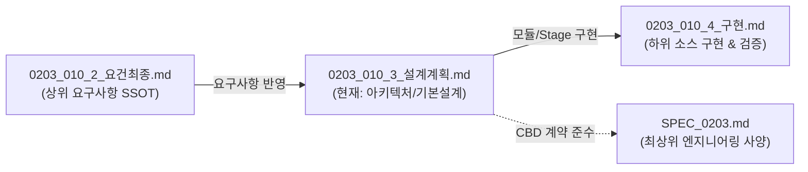

Smart Nature Wind v1.2 — 기본 설계 및 구현 계획서

문서 ID: DESIGN_IMPL_v1.2
기준: v1.2 요구사항 확정서 (2026-11-03)
목적: 실제 소스 구현 착수 가능한 수준의 설계 SSOT
전제: v1.1 데이터 모델 + v1.2 UX 개선 통합

---

## 🔗 문서 간 참조 관계 (Document Traceability Matrix)

본 문서는 **기본 설계 및 아키텍처 명세서(Architecture Design SSOT)**로서 상위 요구사항을 시스템 구조로 구체화하고, 하위 실제 소스 구현 단계로 연결하는 중심 가교 문서입니다.



| 참조 문서 구분 | 대상 문서 경로 | 핵심 참조 및 연계 내용 |
|:---|:---|:---|
| **상위 요구사항** | [0203_010_2_요건최종.md](src/v0203/Req_ImplPlan_0203/0203_010/0203_010_2_요건최종.md) | **[상위 SSOT]** 3대 개념(Studio/Playlist/Normal Fan), Playback Session 3종/2트리거, 5-State FSM 요구사항 정의 |
| **현재 문서** | **[0203_010_3_설계계획.md](src/v0203/Req_ImplPlan_0203/0203_010/0203_010_3_설계계획.md)** | **[설계 SSOT]** 3-Layer 아키텍처, C++ 클래스 설계(C10/CT10), REST API(`/api/v001/*`), LittleFS 스키마 안전 로드, 7-Stage 로드맵 |
| **하위 소스 구현** | [0203_010_4_구현.md](src/v0203/Req_ImplPlan_0203/0203_010/0203_010_4_구현.md) | 본 설계의 Stage 1~7을 실제 C++ 파일(`.h`, `.cpp`) 및 프론트엔드 번들 코드로 100% 완전 구현한 상세 명세 |
| **시스템 최상위 계약** | [SPEC_0203.md](src/v0203/contract_doc_0203/SPEC_0203.md) | ESP32-S3 하드웨어 핀맵, 25kHz PWM 주파수, REST/WS 공통 규격, FreeRTOS 태스크 경계 준수 |
| **상태 및 계약 규약** | [STATE_0203.md](src/v0203/contract_doc_0203/STATE_0203.md) / [CONTRACT_0203.md](src/v0203/contract_doc_0203/CONTRACT_0203.md) | 상태 변수 Writer/Reader 매트릭스, Mutex 잠금 시간(100ms) 및 데드락 방지 계약 |

---

Part 1. 아키텍처 개요

1.1 3-Layer 구조

```
┌─────────────────────────────────────────────────────────┐
│  L3: UI Layer (프론트엔드 SPA)                          │
│  ┌───────────────────────────────────────────────────┐ │
│  │ 5 Pages (홈/바람/자동화/모니터/설정)               │ │
│  │ + 전역: Now Playing Bar, AI FAB(Header)           │ │
│  │ + 모달: Wind Studio, Simulation                    │ │
│  └───────────────────────────────────────────────────┘ │
├─────────────────────────────────────────────────────────┤
│  L2: Session Runtime (CT10) ★중심                        │
│  ┌───────────────────────────────────────────────────┐ │
│  │ Playback Session Model                            │ │
│  │  - Type: PLAYLIST | PRESET | FIXED                │ │
│  │  - Trigger: MANUAL | SCHEDULE                     │ │
│  │  - State: ACTIVE | PAUSED | COMPLETED             │ │
│  │ FSM 5-state: IDLE/RUNNING/BLOCKED/AUTOOFF/TIME   │ │
│  └───────────────────────────────────────────────────┘ │
├─────────────────────────────────────────────────────────┤
│  L1: Data & Physics                                     │
│  ┌──────────────┬──────────────┬────────────────────┐  │
│  │ C10 Config   │ S10 Physics  │ M10 Motion         │  │
│  │ (Step/Prof/  │ (WindSolver) │ (PIR)              │  │
│  │  Sch CRUD)   │              │                    │  │
│  │ N10 NVS      │ P10 PWM      │ D10 Logger         │  │
│  └──────────────┴──────────────┴────────────────────┘  │
└─────────────────────────────────────────────────────────┘
```

1.2 개념 → 모듈 매핑

개념 백엔드 프론트엔드
🎨 Studio C10 Profile/Step CRUD 300.page.studio.js
🎵 Playlist CT10 Playlist 재생 285.page.playlist.js
🌀 Normal Fan CT10 FIXED Session 200.page.dashboard.js (일반 선풍기 섹션)
⏰ Schedule C10 Schedule CRUD + CT10 자동 트리거 220.page.schedule.js
▶ Session CT10 Session Runtime 999a.nowplaying.js (전역)
🎬 Simulation S20 WindSolver (미리보기) 135.util.preview.js
📊 회고 CT10 Monitor + 이벤트 260.page.monitor.js
💡 Context CT10 DI 계산 200.page.dashboard.js (추천 카드)

---

Part 2. 데이터 모델 설계 (확정)

2.1 Static Data (JSON) — v0203 스키마

2.1.1 Step (원자)

```json
{
  "stepNo": 1,
  "durationMin": 20,
  "type": "PRESET",           // PRESET | FIXED | REST
  "presetCode": "OCEAN",
  "styleCode": "BALANCE",
  "fixedSpeed": 0,
  "override": {
    "enabled": false,
    "windIntensity": -1.0,
    "windVariability": -1.0,
    "gustFrequency": -1.0
  }
}
```

REST type 규칙: type=REST → 팬 정지, presetCode/styleCode 무시.

2.1.2 Profile (재생 가능한 플레이리스트)

```json
{
  "profileId": 1,
  "profileNo": 10,
  "name": "아침 시원함",
  "enabled": true,
  "repeat": true,
  "repeatCount": 2,
  "stepCount": 3,
  "steps": [ /* Step[] */ ],
  "autoOff": {
    "timer": { "enabled": false, "minutes": 0 },
    "offTime": { "enabled": false, "time": "00:00" },
    "offTemp": { "enabled": false, "temp": 0.0 }
  },
  "motion": {
    "pir": { "enabled": true, "holdSec": 120 }
  }
}
```

2.1.3 Schedule (트리거만)

```json
{
  "schId": 1,
  "schNo": 10,
  "name": "평일 아침",
  "enabled": true,
  "period": {
    "days": [1,1,1,1,1,0,0],
    "startTime": "08:00",
    "endTime": "12:00"
  },
  "profileId": 1              // ← 참조만
}
```

변경점 (v0203 → v0203):

· ❌ segments[] 완전 삭제
· ❌ repeatSegments, repeatCount, autoOff, motion 삭제
· ✅ profileId 참조만 유지

2.2 Runtime Data (NVS)

키 타입 값 목적
man_prof int16 0 or profileNo Manual 재생 중 Profile
man_active uint8 0/1 Manual 활성
man_ovr_sch uint8 0/1 스케줄 무시 플래그 (v1.2)

PRESET/FIXED Session은 NVS 저장 안 함 (재부팅 시 IDLE).

2.3 Runtime (메모리)

2.3.1 Session Context

```cpp
struct ST_CT10_SessionContext_t {
    EN_CT10_session_type_t  type;      // NONE/PLAYLIST/PRESET/FIXED
    EN_CT10_trigger_t       trigger;   // NONE/MANUAL/SCHEDULE
    EN_SESSION_runtime_t    state;     // ACTIVE/PAUSED/COMPLETED
    
    union {
        struct {
            uint8_t  profileId;
            uint16_t profileNo;
            // 진행 상태
            uint8_t  currentStepIdx;
            uint8_t  totalSteps;
            uint8_t  loopCount;
        } playlist;
        struct {
            char     presetCode[24];
            char     styleCode[24];
            ST_A20_SegmentOverride_t override;
        } preset;
        struct {
            float    percent;
        } fixed;
    } payload;
    
    // 시간 관리
    uint32_t startedAt;        // millis()
    uint32_t pausedAtMs;       // Pause 시작 시각 (0=활성)
    uint32_t pausedAccumMs;    // 누적 Pause 시간
    uint32_t endsAt;           // 0=무한, >0=절대 종료 시각
    uint32_t currentStepStartMs;
    
    // Schedule 참조
    uint8_t  activeSchId;
    uint16_t activeSchNo;
};
```

2.3.2 DI (Discomfort Index) 계산

```cpp
struct ST_CT10_Comfort_t {
    float    di;           // 0~100
    uint8_t  level;        // 0=쾌적, 1=약간, 2=불쾌, 3=매우
    uint8_t  recommendedProfileId;
};
```

---

Part 3. 백엔드 모듈 설계

3.1 파일 구조 (C++ 최종 확정 아키텍처)

> **아키텍처 확정 원칙 (ADR-1 & C10 4단 분할 보존)**:
> 초기 설계안의 단일 파일 통합 대신, 검증된 4단 분할(`_CRUD`, `_JSON`, `_LoadSave`, `_Util`)을 100% 보존하여 ArduinoJson v7 메모리 격리와 FreeRTOS 안정성을 극대화하였습니다.
> 또한 Session은 기존 7-State FSM을 파괴하지 않고 상위 위임 계층(ADR-1)으로 안착시켰습니다.

```
src/v0203/
├── A00_Main_0203.h/.cpp               [수정] 부팅 시퀀스 & LittleFS 에셋 서빙
├── A20_Const_0203.h                   [수정] 상수 추가
├── A20_Const_Sch_0203.h               [수정] Step(ST_A20_Step_t) / Profile(steps[]) / Schedule(profileId 단일참조)
├── A20_Const_Const_0203.h             [수정] v0203 상수 정의
├── A22_Com_Lookup_0203.h              [수정] Session type/trigger 문자열 룩업
├── A23_Com_ResetCfg_0203.h            [수정] Step/Profile/Schedule 슬림화 기본값 초기화
│
├── C10_Config_0203.h                  [수정] Config Manager 마스터 헤더
├── C10_Config_Core_0203.cpp           [수정] 로드/저장/기본값 주입
├── C10_Config_Sys_0203.cpp            [유지] 시스템 설정
├── C10_Config_Extras_0203.cpp         [유지] 기타 보조 설정
│
├── C10_Config_Sch_CRUD_0203.cpp       [수정] Schedule 생성/수정/삭제 (profileId 단일 규격)
├── C10_Config_Sch_JSON_0203.cpp       [수정] Schedule JSON export/patch (segments/autoOff/motion 완전 배제)
├── C10_Config_Sch_LoadSave_0203.cpp   [수정] Schedule 파일 저장/로드 슬림화
├── C10_Config_Sch_Util_0203.cpp       [수정] Schedule 무결성 검증 (profileId 참조 검증)
│
├── C10_Config_UzProf_CRUD_0203.cpp    [수정] UserProfile Step 기반 CRUD
├── C10_Config_UzProf_JSON_0203.cpp    [수정] UserProfile steps[] JSON 입출력
├── C10_Config_UzProf_LoadSave_0203.cpp[수정] UserProfile 파일 저장/로드
├── C10_Config_UzProf_Util_0203.cpp    [수정] Step 유효성 검증
│
├── CT10_Ctl_0203.h                    [수정] Session 3-State + FSM 7-State 이중 모델 (ADR-1)
├── CT10_Ctl_Ctl_0203.cpp              [수정] startSession/pauseSession/resumeSession/stopSession (위임 실행)
├── CT10_Ctl_Ctl_Seg_0203.cpp          [수정] tickUserProfile / tickSchedule (profileId 단일 참조 틱 실행)
├── CT10_Ctl_StMG_0203.cpp             [수정] decideRunSource & applyDecision (Profile motion/autoOff 상속)
├── CT10_Ctl_Basic_0203.cpp            [수정] AutoOff 런타임 제어 & Profile autoOff 상속 초기화
├── CT10_Ctl_Comfort_0203.cpp          [신규] 일본 기상청 공식 DI 계산 + 최적 프로파일 매칭
├── CT10_Ctl_Ctl_Ovr_0203.cpp          [수정] 물리 Override 틱 제어
├── CT10_Ctl_Ctl_Mode_0203.cpp         [유지] 작동 모드 전환
├── CT10_Ctl_IOWS_0203.cpp             [수정] Session/AutoOff/Sensor 실시간 브로드캐스트
├── CT10_Monitor_0203.cpp              [신규] 64-이벤트 타임라인 링버퍼 세션 회고
│
├── N10_NvsManager_0203.h/.cpp         [수정] Session 복원 플래그 및 NVS 탑레벨 스냅샷
│
├── W10_Web_0203.h                     [수정] REST 라우트 마스터
├── W10_Web_Routes_Session_0203.cpp    [신규] /api/v001/session/* (start/pause/resume/stop/current/schedule-override)
├── W10_Web_Routes_CRUD_0203.cpp       [수정] /api/v001/profiles, /api/v001/schedules (단일 규격)
├── W10_Web_Routes_Comfort_0203.cpp    [신규] /api/v001/comfort (DI 및 추천 프로파일 조회)
├── W10_Web_Routes_Control_0203.cpp    [수정] /api/v001/control/* 제어 엔드포인트
├── W10_Web_Routes_Monitor_0203.cpp    [신규] /api/v001/monitor/* 회고 데이터 엔드포인트
│
└── [이하 기존 하드웨어 구동 모듈]     D10/M10/P10/S10/S20/TM10/WF10
```

3.2 CT10 Session 실행 엔진 (핵심)

3.2.1 decideSession() — 5단 우선순위

```cpp
ST_CT10_Decision_t CL_CT10_ControlManager::decideSession() {
    ST_CT10_Decision_t d = {};
    
    // [1] OVERRIDE 없음 (Session으로 흡수됨, 미사용)
    
    // [2] AUTOOFF 래치
    if (_autoOffLatched) {
        d.state = EN_CT10_STATE_AUTOOFF_STOPPED;
        return d;
    }
    
    // [3] MANUAL Session (최우선)
    if (_manualSession.type != EN_CT10_SESSION_NONE) {
        if (isMotionBlocked()) {
            d.state = EN_CT10_STATE_MOTION_BLOCKED;
            d.session = _manualSession;
            return d;
        }
        d.state   = EN_CT10_STATE_RUNNING;
        d.session = _manualSession;
        return d;
    }
    
    // [4] SCHEDULE
    if (!CL_TM10_TimeManager::isTimeValid()) {
        d.state = EN_CT10_STATE_TIME_INVALID;
        return d;
    }
    
    int schIdx = findActiveScheduleIndex(*schedules, false);
    if (schIdx >= 0) {
        const auto& sch  = schedules->items[schIdx];
        int profIdx = findProfileById(sch.profileId);
        if (profIdx < 0) {
            // 참조 깨짐: 경고 + IDLE
            log(EN_L10_LOG_ERROR, "Profile %u not found", sch.profileId);
            d.state = EN_CT10_STATE_IDLE;
            return d;
        }
        const auto& prof = profiles->items[profIdx];
        if (!prof.enabled) {
            d.state = EN_CT10_STATE_IDLE;
            return d;
        }
        if (isMotionBlocked(prof.motion)) {
            d.state = EN_CT10_STATE_MOTION_BLOCKED;
            d.schedule = { sch.schId, sch.schNo, prof.profileId };
            return d;
        }
        d.state = EN_CT10_STATE_RUNNING;
        d.session.type = EN_CT10_SESSION_PLAYLIST;
        d.session.trigger = EN_CT10_TRIGGER_SCHEDULE;
        d.session.payload.playlist.profileId = prof.profileId;
        d.schedule = { sch.schId, sch.schNo, prof.profileId };
        return d;
    }
    
    // [5] IDLE
    d.state = EN_CT10_STATE_IDLE;
    return d;
}
```

3.2.2 tickSession() — Session type별 분기

```cpp
void CL_CT10_ControlManager::tickSession() {
    // Pause 상태면 시간 진행 정지
    if (_activeSession.state == EN_SESSION_PAUSED) {
        return;  // AutoOff/Motion 검사도 스킵
    }
    
    switch (_activeSession.type) {
        case EN_CT10_SESSION_PLAYLIST:
            tickPlaylist();
            break;
        case EN_CT10_SESSION_PRESET:
            tickPreset();
            break;
        case EN_CT10_SESSION_FIXED:
            tickFixed();
            break;
        default: break;
    }
}
```

3.2.3 tickPlaylist() — Step 시퀀스

```cpp
void CL_CT10_ControlManager::tickPlaylist() {
    auto& s = _activeSession;
    const auto& prof = findProfile(s.payload.playlist.profileId);
    if (!prof.valid || prof.stepCount == 0) {
        stopSession();
        return;
    }
    
    // AutoOff 검사 (Pause 중엔 스킵)
    EN_CT10_reason_t reason;
    if (checkAutoOff(&reason)) {
        onAutoOffTriggered(reason);
        return;
    }
    
    // Step 시퀀스 진행
    uint32_t elapsed = sessionElapsedMs();  // pauseAccumMs 반영
    uint32_t stepElapsed = elapsed - 
        (s.currentStepStartMs - s.startedAt - s.pausedAccumMs);
    
    const auto& step = prof.steps[s.payload.playlist.currentStepIdx];
    uint32_t stepDurMs = step.durationMin * 60000UL;
    
    if (s.payload.playlist.currentStepIdx == 0 && s.currentStepStartMs == 0) {
        // 첫 Step 시작
        applyStep(step);
        s.currentStepStartMs = millis();
        emitStepChange();
        return;
    }
    
    if (stepElapsed >= stepDurMs) {
        // 다음 Step
        s.payload.playlist.currentStepIdx++;
        if (s.payload.playlist.currentStepIdx >= prof.stepCount) {
            // 루프 처리
            if (prof.repeat && (prof.repeatCount == 0 || 
                ++s.payload.playlist.loopCount < prof.repeatCount)) {
                s.payload.playlist.currentStepIdx = 0;
            } else {
                // 완료
                onSessionCompleted();
                return;
            }
        }
        applyStep(prof.steps[s.payload.playlist.currentStepIdx]);
        s.currentStepStartMs = millis();
        emitStepChange();
    }
}
```

3.2.4 Pause/Resume 시간 처리

```cpp
// Pause
bool CL_CT10_ControlManager::pauseSession() {
    if (_activeSession.state != EN_SESSION_ACTIVE) return false;
    _activeSession.state      = EN_SESSION_PAUSED;
    _activeSession.pausedAtMs = millis();
    
    // 팬 정지 (안전)
    if (pwm) pwm->setDutyPercent(0);
    if (sim.active) sim.stop();
    
    markDirty("state");
    markDirty("summary");
    return true;
}

// Resume (스마트 정책)
bool CL_CT10_ControlManager::resumeSession() {
    if (_activeSession.state != EN_SESSION_PAUSED) return false;
    
    uint32_t pauseDurMs = millis() - _activeSession.pausedAtMs;
    
    if (pauseDurMs < 5UL * 60000UL) {
        // < 5분: 이어서
        _activeSession.pausedAccumMs += pauseDurMs;
        _activeSession.state = EN_SESSION_ACTIVE;
    } else if (pauseDurMs < 30UL * 60000UL) {
        // 5~30분: 현재 Step 처음부터
        _activeSession.pausedAccumMs += pauseDurMs;
        _activeSession.currentStepStartMs = millis();
        _activeSession.state = EN_SESSION_ACTIVE;
        applyStep(currentStep());
    } else {
        // > 30분: Playlist 처음부터
        _activeSession.pausedAccumMs = 0;
        _activeSession.payload.playlist.currentStepIdx = 0;
        _activeSession.payload.playlist.loopCount = 0;
        _activeSession.currentStepStartMs = millis();
        _activeSession.startedAt = millis();
        _activeSession.state = EN_SESSION_ACTIVE;
        applyStep(prof.steps[0]);
    }
    
    _activeSession.pausedAtMs = 0;
    markDirty("state");
    markDirty("summary");
    return true;
}
```

3.3 DI 계산 (CT10_Ctl_Comfort_0203.cpp)

```cpp
float CL_CT10_ControlManager::getDiscomfortIndex() {
    float t = getCurrentTemperatureMock();
    float h = getCurrentHumidityMock();
    
    // 일본 기상청 DI 공식
    return 0.81f * t + 0.01f * h * (0.99f * t - 14.3f) + 46.3f;
}

EN_CT10_comfort_t CL_CT10_ControlManager::getComfortLevel() {
    float di = getDiscomfortIndex();
    if (di < 68.0f) return EN_CT10_COMFORT_COMFORTABLE;  // 쾌적
    if (di < 75.0f) return EN_CT10_COMFORT_SLIGHT;       // 약간 불쾌
    if (di < 80.0f) return EN_CT10_COMFORT_UNCOMFORT;    // 불쾌
    return EN_CT10_COMFORT_SEVERE;                       // 매우 불쾌
}

uint8_t CL_CT10_ControlManager::getRecommendedProfileId() {
    // 기본 추천 규칙 (Phase 1)
    auto level = getComfortLevel();
    switch (level) {
        case EN_CT10_COMFORT_COMFORTABLE: return findProfileByTag("FOREST_RELAX");
        case EN_CT10_COMFORT_SLIGHT:      return findProfileByTag("COUNTRY_BALANCE");
        case EN_CT10_COMFORT_UNCOMFORT:   return findProfileByTag("OCEAN_ACTIVE");
        case EN_CT10_COMFORT_SEVERE:      return findProfileByTag("MOUNTAIN_ACTIVE");
    }
    return 0;
}
```

---

Part 4. API 설계 (REST)

4.1 엔드포인트 매트릭스

4.1.1 Session (신규)

Method Endpoint Body 응답
POST /api/v001/session/start {type, trigger?, payload} {sessionId}
POST /api/v001/session/pause - {paused: true}
POST /api/v001/session/resume - {resumed: true, mode: "resume\|step\|restart"}
POST /api/v001/session/stop - {stopped: true}
GET /api/v001/session/current - Session 전체 상태

Session Start Body 예시:

```json
{
  "type": "PLAYLIST",
  "payload": { "profileId": 1 }
}
// 또는
{
  "type": "FIXED",
  "payload": { "percent": 60 }
}
// 또는
{
  "type": "PRESET",
  "payload": { "presetCode": "OCEAN", "styleCode": "BALANCE" }
}
```

4.1.2 Profile (Studio)

Method Endpoint Body
GET /api/v001/profiles -
POST /api/v001/profiles {profile: {...}}
GET /api/v001/profiles/:id -
PUT /api/v001/profiles/:id {profile: {...}}
DELETE /api/v001/profiles/:id -
POST /api/v001/profiles/:id/play - (Manual Session 시작)
POST /api/v001/profiles/:id/preview {steps?} → 30초 파형

4.1.3 Schedule (참조)

Method Endpoint Body
GET /api/v001/schedules -
POST /api/v001/schedules {schedule: {schNo, name, period, profileId}}
PUT /api/v001/schedules/:id {schedule: {...}}
DELETE /api/v001/schedules/:id -

4.1.4 Comfort (신규)

Method Endpoint 응답
GET /api/v001/comfort {di, level, recommendedProfileId}

4.1.5 State 확장

GET /api/v001/state 응답 (control 확장):

```json
{
  "control": {
    "state": "RUNNING",
    "stateCode": 1,
    "reason": "MANUAL_ACTIVE",
    "reasonCode": 3,
    "session": {
      "type": "PLAYLIST",
      "trigger": "MANUAL",
      "state": "ACTIVE",
      "profileId": 1,
      "profileName": "아침 시원함",
      "currentStep": 1,
      "totalSteps": 3,
      "stepRemainSec": 984,
      "loopCount": 0,
      "startedAt": 1698888000000,
      "pausedAccumMs": 0
    },
    "pendingSchedule": {
      "schId": 1,
      "schNo": 10,
      "name": "평일 아침",
      "startTime": "08:00",
      "inactiveDueToManual": true
    },
    // ... 기존 필드 유지
  },
  "comfort": {
    "di": 76.2,
    "level": 2,
    "recommendedProfileId": 3
  }
}
```

4.1.6 마이그레이션 API

Method Endpoint 목적
POST /api/v001/migrate/preview 변환 미리보기 (dry-run)
POST /api/v001/migrate/apply 실제 마이그레이션
GET /api/v001/migrate/status 마이그레이션 상태

---

Part 5. 프론트엔드 설계

5.1 파일 구조 (프론트엔드 최종 확정 아키텍처)

> **아키텍처 확정 원칙 (자동화 4탭 통합 허브 & 위임 파사드)**:
> 초기 설계안의 산발적인 페이지 분리 대신, `290.page.automation.js`를 부모 허브로 두고 하위에 4개 컴포넌트(`291.studio.js`, `292.playlist.js`, `293.schedule_panel.js`, `294.timer_panel.js`)를 통합 배치하여 완벽한 상태 공유와 일관된 UX를 달성했습니다.
> 구버전 라우트(`220`, `230`)는 신규 컴포넌트로 위임하는 경량 파사드로 전환하여 약 75KB의 잉여 코드를 제거하였습니다.

```
src/v0203/data_v0203_src/html_v0203/
├── index.html                        [수정] Now Playing Bar 마크업 + 타이머/스케줄 충돌 배지 슬롯
├── css/
│   ├── _variables.css                [수정] 테마 색상 및 CSS 변수
│   ├── _layout.css                   [수정] 하단 Bar 및 모바일 탭 배치
│   ├── _components.css               [수정] 타이머 뱃지/카드, 모달 및 폼 공통 스타일
│   ├── _nowplaying.css               [신규] 48px 플로팅 미니 플레이어 전용
│   ├── _eq.css                       [신규] 20바 이퀄라이저 애니메이션
│   ├── _player.css                   [신규] Playlist 카드 그리드
│   ├── _studio.css                   [신규] Studio 8스텝 작곡기 편집기
│   ├── _comfort.css                  [신규] DI 불쾌지수 컨텍스트 추천 카드
│   ├── _monitor.css                  [신규] 세션 회고 및 타임라인 차트
│   └── [기타 반응형 및 리셋 CSS 9종]
│
└── js/
    ├── 000.const.js                  [동기화] C++ Enum 자동 동기화
    ├── 010.config.js                 [수정] API 엔드포인트 및 LS 키
    ├── 020.i18n.js                   [수정] KO/EN 완전 다국어 (495개 키 100% 매핑)
    │
    ├── 100~135 [UI/시각화 컴포넌트]   [유지/확장]
    ├── 110.ui.slider.js              [수정] 20% 단위 자석 스냅 + 햅틱
    ├── 115.ui.eq.js                  [신규] 실시간 20바 Canvas EQ
    ├── 116.ui.sparkline.js           [신규] SVG 스파크라인
    ├── 117.ui.haptic.js              [신규] Web Vibration API 햅틱 래퍼
    ├── 135.util.preview.js           [신규] S20 물리 미러링 프리뷰 파사드
    ├── 140.ui.simulation.js          [신규] 5축 감성 레이더 및 A/B 시뮬레이션 모달
    │
    ├── 200.page.dashboard.js         [수정] 실시간 EQ + 일반선풍기 Snap 슬라이더 + DI Context 카드
    ├── 210.page.chart.js             [수정] 실시간 풍속/온습도 차트
    ├── 220.page.schedule.js          [수정] SNW.SchedulePanel 위임 경량 파사드 (1.2KB)
    ├── 230.page.profiles.js          [수정] SNW.Playlist 위임 경량 파사드 (1.2KB)
    ├── 240.page.settings.js          [수정] 고급 설정 탭
    ├── 250.page.diagnostics.js       [수정] Session/Runtime(NVS) 상태 진단
    ├── 260.page.monitor.js           [신규] 24시간/7일 세션 회고 + CSV 내보내기
    ├── 270.page.network.js           [유지] Wi-Fi 및 AP 관리
    ├── 280.page.logs.js              [유지] 시스템 로그 뷰어
    ├── 290.page.ai.js                [유지] Gemini AI 비서 페이지
    │
    ├── 290.page.automation.js        [신규] 자동화 통합 4탭 허브 (Studio/Playlist/스케줄/타이머)
    ├── 291.studio.js                 [신규] 🎨 Wind Design Studio (8스텝 작곡기)
    ├── 292.playlist.js               [신규] 🎵 Wind Playlist (프로필 카드 재생/삭제/연동)
    ├── 293.schedule_panel.js         [신규] ⏰ 스케줄 관리 패널 (profileId 단일 참조)
    ├── 294.timer_panel.js            [신규] ⏱️ 세션 자동종료 타이머 (SNW.TimerManager)
    │
    ├── 998.onboarding.js             [신규] 첫 방문 4단계 온보딩 모달
    ├── 999.app.js                    [수정] SPA 부트스트랩 및 네비게이션
    └── 999a.nowplaying.js            [신규] 전역 Now Playing Bar & 충돌/타이머 배지
```

5.2 Now Playing Bar 설계

5.2.1 DOM 구조

```html
<!-- index.html 최하단, 하단 탭 위 -->
<div id="now-playing-bar" class="snw-nowplaying" hidden>
  <div class="snw-nowplaying__left" data-action="expand">
    <canvas class="snw-nowplaying__eq" width="24" height="16"></canvas>
    <div class="snw-nowplaying__info">
      <div class="snw-nowplaying__title">🌊 아침 시원함</div>
      <div class="snw-nowplaying__sub">
        <span class="snw-nowplaying__step">Step 1/3</span>
        <span class="snw-nowplaying__time">16:24</span>
      </div>
    </div>
    <div class="snw-nowplaying__badge" data-slot="pending-schedule" hidden>
      <span class="strike">⏰ 08:00</span>
    </div>
  </div>
  <div class="snw-nowplaying__controls">
    <button data-action="pause" aria-label="일시정지">⏸</button>
    <button data-action="stop" aria-label="정지">⏹</button>
  </div>
</div>
```

5.2.2 상태 매트릭스

Session 상태 EQ 표시 제목 서브 버튼
PLAYBACK ACTIVE 애니메이션 프로필명 Step N/M · mm:ss ⏸ ⏹
PLAYBACK PAUSED 정지 (회색) 프로필명 일시정지 (남은 mm:ss) ▶ ⏹
PRESET ACTIVE 애니메이션 프리셋·스타일 재생 중 ⏸ ⏹
FIXED ACTIVE 애니메이션 일반 선풍기 N단 60% ⏸ ⏹
SCHEDULE 대기 숨김 - - -
없음 (IDLE) 숨김 - - -

5.2.3 Pending Schedule 배지

```js
// WS state 수신 시
if (state.control.pendingSchedule?.inactiveDueToManual) {
  badge.textContent = `⏰̶ ${state.control.pendingSchedule.startTime}`;
  badge.hidden = false;
}
```

5.3 Wind Design Studio (300.page.studio.js)

5.3.1 레이아웃

```
┌──────────────────────────────────────────┐
│  🎨 Wind Design Studio                   │
├──────────────────────────────────────────┤
│  프로필: [아침 시원함____]               │
│  반복: [×2회]                            │
│                                          │
│  ┌─ Step 1 ────────────────────────┐    │
│  │ [🌊 프리셋 ∨] [보통 ∨] [20]분   │    │
│  │  ╭─ Sparkline (실시간 갱신) ─╮   │    │
│  │  ╰───────────────────────────╯   │    │
│  │  [🎬] [▲] [▼] [🗑]               │    │
│  └──────────────────────────────────┘    │
│         ↓                                │
│  ┌─ Step 2 ────────────────────────┐    │
│  │ [⏸ 휴지] [5]분                  │    │
│  │  [🎬] [▲] [▼] [🗑]               │    │
│  └──────────────────────────────────┘    │
│                                          │
│  [+ Step 추가]                           │
│                                          │
│  ─── 안전 종료 (접힘) ───               │
│  ─── PIR 재실 (접힘) ───                │
│                                          │
│  [🎬 전체 시나리오 체험]                 │
│  [💾 저장] [❌ 취소]                    │
└──────────────────────────────────────────┘
```

5.3.2 Step 편집기 — 타입별 UI

PRESET type:

```html
<select data-step="preset">10 프리셋</select>
<select data-step="style">5 스타일</select>
<input type="number" data-step="duration" min="1" max="1440">
<div data-slot="sparkline"></div>
```

FIXED type:

```html
<input type="range" data-step="fixedSpeed" min="0" max="100" step="20">
<span data-step="fixedLabel">60%</span>
<input type="number" data-step="duration">
```

REST type:

```html
<span>휴지 (팬 정지)</span>
<input type="number" data-step="duration">
```

5.3.3 Sparkline 실시간 갱신

```js
// Step 입력 변경 시 300ms debounce
onStepChange: debounce(() => {
  const preview = SNW.Preview.generateStep(step);
  SNW.UI.sparkline.render(sparkSlot, preview.points, {
    width: 200, height: 40,
    color: step.override.enabled ? '#f0883e' : '#4a9eff'
  });
}, 300)
```

5.4 Wind Playlist (285.page.playlist.js)

```
┌──────────────────────────────────────────┐
│  🎵 Wind Playlist                        │
├──────────────────────────────────────────┤
│  ┌────────────────────────────────────┐  │
│  │ 📋 아침 시원함                     │  │
│  │ ╭─ Sparkline ─╮                    │  │
│  │ ─╯ ╰──╮ ╭──╯                       │  │
│  │ 바다 20분 → 휴지 5분 → 숲속 30분   │  │
│  │ 사용 스케줄: 평일 아침 (1)          │  │
│  │ [▶ 재생] [✏️ Studio] [🗑]           │  │
│  └────────────────────────────────────┘  │
│                                          │
│  [🎨 Studio에서 새로 작곡]               │
└──────────────────────────────────────────┘
```

5.5 Snap 슬라이더 + 햅틱 (110.ui.slider.js 수정)

```js
// 기존 slider 컴포넌트 확장
function createSlider(opts) {
  const { snapPoints = null, hapticOn = null, ...rest } = opts;
  
  // Snap 로직
  const snap = (raw) => {
    if (!snapPoints) return raw;
    const nearest = snapPoints.reduce((a, b) => 
      Math.abs(b - raw) < Math.abs(a - raw) ? b : a);
    if (Math.abs(nearest - raw) < 8) {
      hapticOn?.(nearest, raw);
      return nearest;
    }
    return raw;
  };
  
  // Pointer up 시 snap 적용
  input.addEventListener('pointerup', () => {
    const snapped = snap(Number(input.value));
    input.value = snapped;
    onChange(snapped);
  });
}
```

일반 선풍기 사용처:

```js
SNW.UI.slider({
  min: 0, max: 100,
  snapPoints: [0, 20, 40, 60, 80, 100],
  hapticOn: (newVal, oldVal) => {
    if (Math.abs(newVal - oldVal) >= 20) {
      SNW.Haptic.snap();
    }
  },
  onChange: (v) => {
    if (v === 0) SNW.Api.stopSession();
    else SNW.Api.startSession({type: 'FIXED', payload: {percent: v}});
  }
});
```

5.6 이퀄라이저 (115.ui.eq.js)

```js
SNW.UI.eq = function(canvas, opts = {}) {
  const { bars = 16, fps = 60, bufferSize = 50 } = opts;
  const buffer = [];  // 최근 풍속 50개 (5초 @ 100ms)
  let rafId;
  
  function push(windSpeed) {
    buffer.push(windSpeed);
    if (buffer.length > bufferSize) buffer.shift();
  }
  
  function render() {
    const ctx = canvas.getContext('2d');
    ctx.clearRect(0, 0, canvas.width, canvas.height);
    
    // 최근 16개를 막대로
    const step = Math.max(1, Math.floor(buffer.length / bars));
    for (let i = 0; i < bars; i++) {
      const val = buffer[i * step] || 0;
      const h = (val / 11) * canvas.height;  // 0~11 m/s 정규화
      const color = val > 6 ? '#f0883e' : val > 3 ? '#3fb950' : '#4a9eff';
      ctx.fillStyle = color;
      ctx.fillRect(i * (canvas.width / bars), canvas.height - h, 
                   canvas.width / bars - 1, h);
    }
    rafId = requestAnimationFrame(render);
  }
  
  return { push, start: render, stop: () => cancelAnimationFrame(rafId) };
};
```

5.7 Context 추천 카드 (dashboard 확장)

```js
// 홈 하단 렌더
async function renderComfortCard() {
  const { di, level, recommendedProfileId } = await SNW.Api.getComfort();
  const profile = profiles.find(p => p.profileId === recommendedProfileId);
  
  const card = document.createElement('div');
  card.className = 'snw-comfort-card';
  card.innerHTML = `
    <div class="snw-comfort-card__header">
      🌡️ ${tempC}°C  💧 ${humidity}%  ·  ${levelIcon} ${levelLabel}
    </div>
    <div class="snw-comfort-card__body">
      💡 이 날씨엔 "${profile.name}"이 시원해요
    </div>
    <button class="snw-comfort-card__play" data-profile-id="${profile.profileId}">
      ▶ 지금 재생
    </button>
  `;
  card.querySelector('button').onclick = () => {
    SNW.Api.startSession({type: 'PLAYLIST', payload: {profileId: profile.profileId}});
  };
  return card;
}
```

---

Part 6. LittleFS 초기 스키마 검증 및 안전 로드 설계 (마이그레이션 없음)

6.1 원칙
- 본 v0203 펌웨어는 단일 버전 독립 아키텍처로 구버전 마이그레이션을 수행하지 않음.
- LittleFS 내 cfg_userProfile_0203.json, cfg_schedules_0203.json 파일이 없거나 손상된 경우 기본값(Default)을 즉시 자동 주입.
- Step/Profile/Schedule의 모든 입출력은 v0203 신규 규격으로 직접 읽고 씀.

6.2 C10 Config 로드 검증 플로우
1. LittleFS 마운트 시 10_cfg_jsonFile.json 조회
2. 파일 부재 또는 JSON 파싱 실패 시:
   - A20_resetUserProfileDefault() / A20_resetScheduleDefault() 호출
   - 기본 프리셋/스케줄 즉시 메모리 로드 및 신규 파일 생성 저장
3. 필드 유효성 검사 (Step 개수 1~8개, durationMin 1~1440분 등 범위 초과 시 자동 클램핑)

6.3 안전장치
- JSON 파일 손상 시 비정상 종료 없이 팩토리 기본 프로필로 자체 치유(Self-Healing).
- 복구 시 CL_D10_Logger::log(EN_L10_LOG_WARN, ...) 로깅.


Part 7. 7-Stage 순차 구현 및 검증 계획 (마이그레이션 제외 / 0203_010_4 SSOT 정합)

개정 사항
① 마이그레이션 전면 제외 — v0203은 신규 스키마로 시작 (기존 사용자 데이터 없음 전제)
② 7단계 순차 진행 — 각 Stage는 독립적으로 동작 검증 후 다음으로
③ 총 8주 (마이그레이션 제외로 -2주)
④ Stage별 "완료 조건" 명확화 — 검증 없이 다음 단계 진입 금지

---

개요 — 7 Stage 로드맵

```
Stage 1  데이터 모델 + Config CRUD          [1주]   ← 기반
   ↓
Stage 2  Session 엔진 (start/pause/resume/stop) [1.5주] ← 심장
   ↓
Stage 3  REST API + Now Playing Bar          [1주]   ← 가시화
   ↓
Stage 4  Studio + Playlist                   [1.5주] ← 작곡
   ↓
Stage 5  Schedule 자동화                     [1주]   ← 자동 실행
   ↓
Stage 6  Visualizer + Context                [1.5주] ← 감성
   ↓
Stage 7  Simulation + Chart + 마무리         [1.5주] ← 회고

총 8주 (Stage별 완료 검증 포함)
```

원칙:

· 각 Stage는 동작하는 제품이어야 함 (부분 기능이라도)
· 이전 Stage의 회귀 없이 다음 Stage 진행
· Stage 3부터 실제 조작 가능 → 사용자 피드백 수집 시작

---

Stage 1 — 데이터 모델 + Config CRUD 【1주】

1.1 목표

· v0203 JSON 스키마 확정
· C10 Config CRUD 동작
· UI 없이 API로만 검증 (Postman/curl)

1.2 산출물

1.2.1 파일 (백엔드)

파일 상태 내용
A20_Const_Sch_0203.h 신규 Step/Profile/Schedule 구조체
A20_Const_Const_0203.h 수정 FW_VERSION 2.0.3
A20_Const_0203.h 수정 ConfigRoot 구조
A23_Com_ResetCfg_0203.h 수정 신규 reset 함수
C10_Config_0203.h 수정 Config Manager API
C10_Config_Core_0203.cpp 수정 로드/저장 (스키마 검증 및 기본값 복원)
C10_Config_Profile_0203.cpp 신규 Profile CRUD
C10_Config_Sch_0203.cpp 신규 Schedule CRUD (profileId 참조만)
C10_Config_Step_0203.cpp 신규 Step 검증
C10_Config_Sys_0203.cpp 수정 명칭만

1.2.2 JSON 스키마 (신규 확정)

cfg_schedules_0203.json:

```json
{
  "version": "0203",
  "schedules": [
    {
      "schId": 1,
      "schNo": 10,
      "name": "평일 아침",
      "enabled": true,
      "period": {
        "days": [1,1,1,1,1,0,0],
        "startTime": "08:00",
        "endTime": "12:00"
      },
      "profileId": 1
    }
  ]
}
```

cfg_userProfile_0203.json:

```json
{
  "version": "0203",
  "profiles": [
    {
      "profileId": 1,
      "profileNo": 10,
      "name": "아침 시원함",
      "enabled": true,
      "repeat": true,
      "repeatCount": 2,
      "stepCount": 3,
      "steps": [
        { "stepNo": 1, "durationMin": 20, "type": "PRESET",
          "presetCode": "OCEAN", "styleCode": "BALANCE" },
        { "stepNo": 2, "durationMin": 5, "type": "REST" },
        { "stepNo": 3, "durationMin": 30, "type": "PRESET",
          "presetCode": "FOREST_CANOPY", "styleCode": "SLEEP" }
      ],
      "autoOff": {
        "timer": { "enabled": false, "minutes": 0 },
        "offTime": { "enabled": false, "time": "00:00" },
        "offTemp": { "enabled": false, "temp": 0.0 }
      },
      "motion": { "pir": { "enabled": true, "holdSec": 120 } }
    }
  ]
}
```

1.3 Task 목록

Day Task 검증
D1 Step/Profile/Schedule 구조체 정의 컴파일
D2 Profile CRUD (add/update/delete) 유닛 테스트
D3 Schedule CRUD (profileId 참조 검증) 유닛 테스트
D4 Step 검증 (durationMin 1~1440, type별 필드) 유닛 테스트
D5 참조 무결성 (Profile 삭제 시 Schedule enabled=false) 시나리오

1.4 ✅ 완료 조건 (Stage 1 Done)

☐ 컴파일 성공 (경고 0건)
☐ JSON 스키마 확정 (data_v0203_src/json/에 배치)
☐ 유닛 테스트 100%:
  · Profile CRUD 4종 정상
  · Schedule CRUD 4종 정상
  · Profile 삭제 시 참조 Schedule enabled=false 자동
  · 중복 profileNo/schNo 거부
☐ 파일 I/O 정상:
  · LittleFS 저장 후 재부팅 → 동일 데이터 복원
  · .bak 자동 백업 동작
☐ API 없이 curl로만 검증 완료

1.5 위험 및 대응

위험 대응
Step type별 필드 검증 누락 각 type별 필수/금지 필드 명세 후 유닛 테스트
참조 무결성 누락 Profile 삭제 시 Schedule 순회 검증

---

Stage 2 — Session 엔진 (핵심) 【1.5주】

2.1 목표

· CT10 Session Model 완성
· start/pause/resume/stop 라이프사이클 동작
· UI 없이 CLI/Serial로 검증

2.2 산출물

2.2.1 파일 (백엔드)

파일 상태 내용
CT10_Ctl_0203.h 수정 Session Context + FSM 5-state
CT10_Ctl_Core_0203.cpp 수정 startSession/stopSession
CT10_Ctl_Session_0203.cpp 신규 tickSession + tickPlaylist/Preset/Fixed
CT10_Ctl_FSM_0203.cpp 신규 decideSession (5단 우선순위)
CT10_Ctl_Pause_0203.cpp 신규 pauseSession/resumeSession (5/30분 정책)
CT10_Ctl_AutoOff_0203.cpp 수정 Session 통합
CT10_Ctl_Seg_0203.cpp 수정 tickStepSequence × 1
CT10_Ctl_Override_0203.cpp 삭제 Session으로 흡수
CT10_Ctl_Mode_0203.cpp 삭제 Session으로 흡수
N10_NvsManager_0203.h/.cpp 수정 man_prof/man_active/man_ovr_sch

2.2.2 핵심 구현

Session Context:

```cpp
typedef enum : uint8_t {
    EN_CT10_SESSION_NONE     = 0,
    EN_CT10_SESSION_PLAYLIST = 1,
    EN_CT10_SESSION_PRESET   = 2,
    EN_CT10_SESSION_FIXED    = 3,
} EN_CT10_session_type_t;

typedef enum : uint8_t {
    EN_SESSION_ACTIVE    = 0,
    EN_SESSION_PAUSED    = 1,
    EN_SESSION_COMPLETED = 2,
} EN_SESSION_runtime_t;

struct ST_CT10_SessionContext_t {
    EN_CT10_session_type_t  type;
    EN_CT10_trigger_t       trigger;    // NONE/MANUAL/SCHEDULE
    EN_SESSION_runtime_t    state;
    
    union {
        struct { uint8_t profileId; uint16_t profileNo; 
                 uint8_t currentStepIdx; uint8_t totalSteps; 
                 uint8_t loopCount; } playlist;
        struct { char presetCode[24]; char styleCode[24]; 
                 ST_A20_SegmentOverride_t override; } preset;
        struct { float percent; } fixed;
    } payload;
    
    uint32_t startedAt;
    uint32_t pausedAtMs;
    uint32_t pausedAccumMs;
    uint32_t currentStepStartMs;
    uint32_t endsAt;
};
```

Pause/Resume 스마트 정책:

```cpp
bool resumeSession() {
    uint32_t pauseDurMs = millis() - _activeSession.pausedAtMs;
    
    if (pauseDurMs < 5 * 60000UL) {
        // < 5분: 이어서
        _activeSession.pausedAccumMs += pauseDurMs;
    } else if (pauseDurMs < 30 * 60000UL) {
        // 5~30분: 현재 Step 처음부터
        _activeSession.pausedAccumMs += pauseDurMs;
        _activeSession.currentStepStartMs = millis();
        applyStep(currentStep());
    } else {
        // > 30분: Playlist 처음부터
        _activeSession.pausedAccumMs = 0;
        _activeSession.payload.playlist.currentStepIdx = 0;
        _activeSession.payload.playlist.loopCount = 0;
        _activeSession.startedAt = millis();
        _activeSession.currentStepStartMs = millis();
        applyStep(firstStep());
    }
    _activeSession.state = EN_SESSION_ACTIVE;
    _activeSession.pausedAtMs = 0;
    return true;
}
```

2.3 Task 목록

Day Task 검증
D1 Session Context + FSM 5-state 헤더 컴파일
D2 startSession() (3 type) 유닛
D3 stopSession() (모든 type) 유닛
D4 tickSession + tickPlaylist 통합
D5 tickPreset + tickFixed 통합
D6 decideSession (5단 우선순위) 유닛
D7 pauseSession 유닛
D8 resumeSession (3구간 정책) 시나리오
D9 NVS 영속화 (man_prof/man_active) 재부팅 검증
D10 AutoOff 통합 시나리오

2.4 ✅ 완료 조건 (Stage 2 Done)

☐ Serial CLI로 Session 제어 가능:
  ```
  > session start playlist 1
  > session pause
  > session resume
  > session stop
  > session status
  ```
☐ Manual Session 재생:
  · Playlist 3개 Step 순서대로 실행
  · repeatCount 동작 (0=무한, N=반복)
  · Step 전환 시 applyStep() 호출 확인 (로그)
☐ Pause/Resume 정책 검증:
  · Pause 3분 → Resume: Step 남은 시간부터
  · Pause 10분 → Resume: Step 처음부터
  · Pause 40분 → Resume: Playlist 처음부터
☐ 재부팅 영속화:
  · PLAYLIST Manual Session만 man_prof 저장
  · PRESET/FIXED는 저장 안 함 (IDLE로)
☐ AutoOff:
  · Timer 발동 시 Session 정지 + 래치
  · offTime / offTemp 동작
☐ 회귀 테스트:
  · Stage 1의 CRUD 여전히 정상

2.5 위험 및 대응

위험 대응
Session 상태 경합 CT10 mutex 유지, atomic 최소화
Pause 시간 계산 오차 millis 기준, pausedAccumMs 정확히
Step 전환 로직 복잡 유닛 테스트로 각 시나리오 커버
AutoOff 래치 오작동 명시적 해제 경로 (ackEvent, startSession)

---

Stage 3 — REST API + Now Playing Bar 【1주】

3.1 목표

· API 완성 → 웹에서 Session 제어 가능
· Now Playing Bar (전역) → 어디서든 상태 확인/제어

3.2 산출물

3.2.1 파일 (백엔드)

파일 상태 내용
W10_Web_Routes_Session_0203.cpp 신규 /api/v001/session/*
W10_Web_Routes_Profile_0203.cpp 신규 /api/v001/profiles/*
W10_Web_Routes_Schedule_0203.cpp 신규 /api/v001/schedules/*
W10_Web_0203.h 수정 라우트 등록
CT10_Ctl_IOWS_0203.cpp 수정 Session 상태 export

3.2.2 파일 (프론트엔드)

파일 상태 내용
999a.nowplaying.js 신규 전역 Now Playing Bar
_nowplaying.css 신규 Bar 스타일
index.html 수정 Bar 마크업
010.config.js 수정 API 경로
200.page.dashboard.js 신규 최소 홈 (Now Playing + 일반 선풍기)
_dashboard.css 수정 홈 레이아웃

3.2.3 API 확정

Method Endpoint Body
POST /api/v001/session/start {type, payload}
POST /api/v001/session/pause -
POST /api/v001/session/resume -
POST /api/v001/session/stop -
GET /api/v001/session/current -
GET /api/v001/profiles -
POST /api/v001/profiles {profile}
PUT /api/v001/profiles/:id {profile}
DELETE /api/v001/profiles/:id -
GET /api/v001/schedules -
POST /api/v001/schedules {schedule}

3.2.4 Now Playing Bar UI

```
┌──────────────────────────────────────────┐
│  [현재 탭 콘텐츠]                         │
├──────────────────────────────────────────┤ ← 48px 고정
│ ▶ 🌊 아침 시원함 · Step 1/3 · 16:24  ⏸ ⏹│
├──────────────────────────────────────────┤
│  🏠   🌬️   ⏰   📊   ⚙️                  │
└──────────────────────────────────────────┘
```

상태 매트릭스:

Session 상태 EQ 제목 서브 버튼
PLAYLIST ACTIVE ● 프로필명 Step N/M · mm:ss ⏸ ⏹
PLAYLIST PAUSED ○ 프로필명 일시정지 (남은 mm:ss) ▶ ⏹
PRESET ACTIVE ● 프리셋·스타일 재생 중 ⏸ ⏹
FIXED ACTIVE ● 일반 선풍기 N단 60% ⏸ ⏹
IDLE 숨김 - - -

3.3 Task 목록

Day Task 검증
D1 Session API 4종 (start/pause/resume/stop) Postman
D2 Profile CRUD API Postman
D3 Schedule CRUD API Postman
D4 exportStateJson 확장 (Session 필드) curl
D5 999a.nowplaying.js DOM + 렌더 브라우저
D6 Pause/Stop 버튼 연동 브라우저
D7 홈 최소 (Now Playing Card + 일반 선풍기) 브라우저

3.4 ✅ 완료 조건 (Stage 3 Done)

☐ 모든 API Postman 통과 (20개 엔드포인트)
☐ 브라우저에서 Session 제어 가능:
  · 홈의 [1단] 탭 → 팬 즉시 20% 구동
  · Now Playing Bar에 "일반 선풍기 1단" 표시
  · Bar의 ⏸ 탭 → 팬 정지, Bar에 "일시정지" 표시
  · Bar의 ▶ 탭 → 재개
  · Bar의 ⏹ 탭 → Session 종료, Bar 숨김
☐ 모든 페이지에서 Now Playing Bar 노출 (최소 홈만 있어도)
☐ WS state 채널 연동 (Bar 자동 갱신)
☐ 회귀 테스트: Stage 1·2 여전히 정상

3.5 데모 가능성

Stage 3 완료 시점에서 실제 시연 가능:

· 스마트폰으로 접속 → 홈에서 1~5단 조작
· Now Playing Bar에서 상태 확인
· 브라우저 다른 탭 이동해도 Bar 유지

이 시점에서 사용자 피드백 수집 시작 (가장 중요).

---

Stage 4 — Studio + Playlist 【1.5주】

4.1 목표

· Wind Design Studio (작곡)
· Wind Playlist (재생 목록)
· Profile을 만들고 재생할 수 있음

4.2 산출물

4.2.1 파일 (프론트엔드)

파일 상태 내용
300.page.studio.js 신규 Step 편집기
_studio.css 신규 Studio 레이아웃
285.page.playlist.js 신규 Playlist 목록
_player.css 신규 Playlist 카드
116.ui.sparkline.js 신규 Sparkline (SVG)
135.util.preview.js 수정 Sparkline 생성
070.router.js 수정 자동화 4탭 (Studio/Playlist/스케줄/타이머)

4.2.2 Studio 레이아웃

```
┌──────────────────────────────────────────┐
│  🎨 Wind Design Studio                   │
├──────────────────────────────────────────┤
│  프로필: [아침 시원함____]  반복: [×2회] │
│                                          │
│  ┌─ Step 1 ─────────────────────────┐   │
│  │ [🌊 바다] [⚖ 균형] [20]분        │   │
│  │  ╭─ Sparkline ─╮                 │   │
│  │  ─╯ ╰─╮ ╭──╯                     │   │
│  │  [🎬] [▲] [▼] [🗑]                │   │
│  └────────────────────────────────────┘   │
│           ↓                              │
│  ┌─ Step 2 ─────────────────────────┐   │
│  │ [⏸ 휴지] [5]분                   │   │
│  └────────────────────────────────────┘   │
│                                          │
│  [+ Step 추가]                           │
│  [🎬 전체 시나리오 체험]                  │
│  [💾 저장] [❌ 취소]                     │
└──────────────────────────────────────────┘
```

4.2.3 Playlist 레이아웃

```
┌──────────────────────────────────────────┐
│  🎵 Wind Playlist                        │
├──────────────────────────────────────────┤
│  ┌───────────────────────────────────┐   │
│  │ 📋 아침 시원함                     │   │
│  │ ╭─ Sparkline ─╮                    │   │
│  │ ─╯ ╰─╮ ╭──╯                       │   │
│  │ 바다 20분 → 휴지 5분 → 숲속 30분  │   │
│  │ [▶ 재생] [✏️ Studio] [🗑]          │   │
│  └───────────────────────────────────┘   │
│  [🎨 Studio에서 새로 작곡]               │
└──────────────────────────────────────────┘
```

4.3 Task 목록

Day Task 검증
D1 116.ui.sparkline.js (SVG 렌더) 브라우저
D2 135.util.preview.js Sparkline 생성 유닛
D3 Studio UI — Step 편집기 (PRESET/FIXED/REST) 브라우저
D4 Step 추가/삭제/순서 이동 브라우저
D5 Sparkline 실시간 갱신 (300ms debounce) 브라우저
D6 Studio 저장 → Profile 생성 통합
D7 Playlist 카드 렌더 브라우저
D8 [▶ 재생] → startSession(PLAYLIST) 통합
D9 자동화 탭 (Studio/Playlist) 라우팅 브라우저

4.4 ✅ 완료 조건 (Stage 4 Done)

☐ Studio에서 Profile 작곡:
  · Step 3개 (바다 → 휴지 → 숲속) 편집
  · 각 Step에 Sparkline 정상 렌더
  · 저장 → Playlist에 카드 표시
☐ Playlist에서 재생:
  · [▶ 재생] 탭 → Manual Session 시작
  · Now Playing Bar에 "Step 1/3" 표시
  · Step 전환 시 자동 진행
☐ Studio ↔ Playlist 연동:
  · Playlist의 [✏️ Studio] → Studio 탭 이동 + 해당 Profile 로드
  · Studio 저장 → Playlist 즉시 갱신
☐ Sparkline 정확도:
  · Step의 프리셋/스타일에 따라 파형 다름
  · PRESET vs FIXED 명확히 구분
☐ 회귀 테스트: Stage 3 여전히 정상

4.5 데모 시나리오

이 시점에서 사용자가 스스로 할 수 있는 것:

1. Studio 탭 → 새 프로필 "테스트" 만들기
2. Step 1: 바다·균형·10분 추가
3. Step 2: 숲속·수면·20분 추가
4. 저장 → Playlist에 "테스트" 카드 확인
5. [▶ 재생] → Now Playing Bar에 진행 표시
6. 다른 탭 이동해도 Bar 유지

여기까지가 "바람을 작곡하고 재생"할 수 있는 최소 제품.

---

Stage 5 — Schedule 자동화 【1주】

5.1 목표

· Schedule 편집 (Profile 참조 방식)
· Manual 우선 정책 (스케줄 충돌 인지)
· Playlist의 완전한 재사용

5.2 산출물

5.2.1 파일 (프론트엔드)

파일 상태 내용
220.page.schedule.js 수정 Profile 선택 라디오 (Step 편집 제거)
_schedule.css 수정 참조 표시
999a.nowplaying.js 수정 ⏰ strike 배지
200.page.dashboard.js 수정 "다음 자동" 표시
020.i18n.js 수정 스케줄 충돌 i18n

5.2.2 Schedule 편집 UI

```
┌────────────────────────────────────────┐
│ 스케줄 편집                              │
├────────────────────────────────────────┤
│ 이름: [평일 아침__________]              │
│ 요일: [월][화][수][목][금][토][일]       │
│ 시간: [08:00] ~ [12:00]                 │
│                                        │
│ 🎵 실행할 플레이리스트 (라디오):         │
│  ⦿ 📋 아침 시원함 (Step 3개, 55분)       │
│  ○ 📋 수면 리듬 (Step 3개, 135분)        │
│  ○ 📋 커스텀 시나리오 3                 │
│                                        │
│  💡 Step 편집은 Studio 탭에서 하세요.    │
│                                        │
│  [🎬 이 플레이리스트 체험]               │
│                    [저장] [취소]        │
└────────────────────────────────────────┘
```

5.2.3 스케줄 충돌 알림

Manual 시작 시 토스트:

```
┌────────────────────────────────────────┐
│ ⏰ 수동 재생 중에는 평일 08:00 "아침   │
│    시원함" 스케줄이 실행되지 않습니다.  │
│                            [알겠어요]  │
└────────────────────────────────────────┘
```

Now Playing Bar 배지:

```
▶ 🌊 아침 시원함 · Step 1/3 · 16:24  ⏰̶08:00  ⏸ ⏹
                                     ↑ 취소선
```

5.3 Task 목록

Day Task 검증
D1 Schedule 편집 UI — Profile 라디오 브라우저
D2 저장 → POST API 통합
D3 수동 재생 시 스케줄 충돌 감지 (CT10) 유닛
D4 토스트 + ⏰ strike 배지 브라우저
D5 수동 종료 → 스케줄 재개 토스트 브라우저
D6 홈 "다음 자동" 표시 브라우저

5.4 ✅ 완료 조건 (Stage 5 Done)

☐ Schedule 편집기:
  · Profile 선택 라디오만 존재 (Step 편집 UI 부재)
  · Studio 안내 문구 표시
  · 저장 → API 호출 → 재부팅 후 복원
☐ 자동 실행:
  · 시간 도달 시 자동 재생 (Schedule)
  · Now Playing Bar에 "⏰ 자동 실행 중" 표시
☐ Manual 우선 정책:
  · Manual Session 중 스케줄 시간 진입 → 스케줄 대기
  · ⏰ strike 배지 표시
  · Manual 종료 → 스케줄 재개 (토스트 안내)
☐ 참조 무결성:
  · Profile 삭제 시 참조 Schedule enabled=false
  · 삭제 확인 모달 (참조 N개 표시)
☐ 회귀 테스트: Stage 4 여전히 정상

5.5 데모 시나리오

이 시점의 완전한 사용자 여정:

1. Studio에서 "아침 시원함" 작곡
2. Schedule에서 "평일 08:00~12:00 → 아침 시원함" 등록
3. (시뮬레이션 시간) 08:00 → 자동 재생
4. 도중에 사용자가 다른 프로필 수동 시작
5. → Now Playing에 ⏰ strike (스케줄 무시됨)
6. 수동 종료 → 08:00 스케줄 자동 재개

여기까지가 "자동화"까지 완성된 제품.

---

Stage 6 — Visualizer + Context 【1.5주】

6.1 목표

· 실시간 이퀄라이저 (홈 큰 카드)
· Snap 슬라이더 + 햅틱 (일반 선풍기)
· Context-Aware 추천 (DI 기반)

6.2 산출물

6.2.1 파일 (백엔드)

파일 상태 내용
CT10_Ctl_Comfort_0203.cpp 신규 DI 계산 + 추천 규칙
W10_Web_Routes_Comfort_0203.cpp 신규 /api/v001/comfort

6.2.2 파일 (프론트엔드)

파일 상태 내용
115.ui.eq.js 신규 이퀄라이저 캔버스
_eq.css 신규 이퀄라이저 스타일
117.ui.haptic.js 신규 햅틱 래퍼
110.ui.slider.js 수정 Snap + Haptic
200.page.dashboard.js 수정 이퀄라이저 + Context 추천 카드
_comfort.css 신규 추천 카드 스타일

6.2.3 홈 화면 (최종 레이아웃)

```
┌──────────────────────────────────────────┐
│         ┌──────────────────────┐         │
│         │  ▁▂▄▆█▆▄▂▁▂▄▆█▆▄▂▁  │         │ ← 이퀄라이저
│         │  🌊 아침 시원함      │         │
│         │  Step 1/3 · 16분     │         │
│         │  ✋ 수동 재생 중      │         │
│         └──────────────────────┘         │
│                                          │
│  [⏸ 일시정지]  [⏭ 다음 Step]            │
│                                          │
├──────────────────────────────────────────┤
│  🎵 재생할 플레이리스트 (원터치)          │
│  [🌅 아침][🌙 수면][🌲 숲속][+ 작곡]     │
│                                          │
├──────────────────────────────────────────┤
│  🌡️ 29.0°C 💧 75% · 🟠 끈적이는 날씨     │ ← Context
│  💡 "강한 계곡풍"이 시원해요              │
│  [▶ 지금 재생]                            │
│                                          │
├──────────────────────────────────────────┤
│  🌀 일반 선풍기                           │
│  [1단][2단][3단][4단][5단]               │
│  Snap + Haptic                            │
└──────────────────────────────────────────┘
```

6.2.4 DI 계산 및 추천

```cpp
float CL_CT10_ControlManager::getDiscomfortIndex() {
    float t = getCurrentTemperatureMock();
    float h = getCurrentHumidityMock();
    return 0.81f * t + 0.01f * h * (0.99f * t - 14.3f) + 46.3f;
}

uint8_t CL_CT10_ControlManager::getRecommendedProfileId() {
    // 추천 규칙 (프로필 이름 태그 기반)
    float di = getDiscomfortIndex();
    if (di < 68.0f)  return findProfileByTag("FOREST_RELAX");
    if (di < 75.0f)  return findProfileByTag("COUNTRY_BALANCE");
    if (di < 80.0f)  return findProfileByTag("OCEAN_ACTIVE");
    return findProfileByTag("MOUNTAIN_ACTIVE");
}
```

6.2.5 Snap 슬라이더

```js
SNW.UI.slider({
  min: 0, max: 100,
  snapPoints: [0, 20, 40, 60, 80, 100],
  hapticOn: (newVal, oldVal) => SNW.Haptic.snap(),
  onChange: (v) => v === 0 ? stopSession() : startSession({type:'FIXED', payload:{percent:v}})
});
```

6.3 Task 목록

Day Task 검증
D1 DI 계산 함수 + 유닛 테스트 유닛
D2 /api/v001/comfort API Postman
D3 115.ui.eq.js 이퀄라이저 브라우저
D4 홈 큰 카드 이퀄라이저 통합 브라우저
D5 117.ui.haptic.js 브라우저
D6 Snap 슬라이더 (일반 선풍기) 브라우저
D7 Context 추천 카드 브라우저
D8 prefers-reduced-motion 대응 브라우저

6.4 ✅ 완료 조건 (Stage 6 Done)

☐ 이퀄라이저:
  · 60fps 유지 (5초 이상)
  · 색상 실제 풍속 반영 (파랑/초록/주황)
  · reduced-motion 시 정적화
☐ Snap 슬라이더:
  · 20↔40 경계에서 ±8% 흡수
  · 햅틱 진동 (Android Chrome)
☐ Context 추천:
  · DI 29°C/75% → level=2 (🟠)
  · 추천 프로필 자동 선택
  · [▶ 지금 재생] → Session 시작
☐ DI 정확도:
  · 일본 기상청 공식 100% 일치 (유닛 테스트)
☐ 회귀 테스트: Stage 5 여전히 정상

---

Stage 7 — Simulation + Chart + 마무리 【1.5주】

7.1 목표

· Simulation 모달 (실행 전 상상)
· Chart 회고 (실행 후 검증)
· 온보딩 + 언어 전환 마무리

7.2 산출물

7.2.1 파일 (백엔드)

파일 상태 내용
CT10_Monitor_0203.cpp/.h 수정 이벤트 확장 (Step 전환, Manual 개입)
W10_Web_Routes_Monitor_0203.cpp 수정 회고 API

7.2.2 파일 (프론트엔드)

파일 상태 내용
135.util.preview.js 확장 5축 레이더 + A/B
140.ui.simulation-modal.js 신규 Simulation 모달
_simulation.css 신규 모달 스타일
260.page.monitor.js 재작성 회고 탭 (요약 + 오버레이 + 마커)
210.page.chart.js 삭제 → 통합 회고 탭 흡수
_monitor.css 신규 회고 스타일
020.i18n.js 수정 시뮬레이션/회고 i18n
999.app.js 수정 온보딩 통합
_onboarding.css 신규 온보딩 스타일

7.2.3 Simulation 모달

```
┌────────────────────────────────────────┐
│  🎬 바람 스튜디오                  [×] │
├────────────────────────────────────────┤
│  [설정 A] 🌊 바다 × ⚖ 균형            │
│  ┌──────────────────────────────────┐  │
│  │  ╭─╮    ╭──╮                     │  │
│  │ ─╯ ╰────╯  ╰─                    │  │
│  │ [▶ 체험]  [A/B 비교]             │  │
│  └──────────────────────────────────┘  │
│                                        │
│  5축 레이더:                           │
│      시원함 ★★★★                       │
│  차분함 ─┼─ 역동성                     │
│      부드러움 ★★                        │
│                                        │
│  [설정 B] 🌲 숲속 × 🍃 휴식           │
│  ┌──────────────────────────────────┐  │
│  │  ╭─╮    ╭──╮                     │  │
│  │ ─╯ ╰────╯  ╰─                    │  │
│  └──────────────────────────────────┘  │
│                                        │
│              [닫기]  [✓ A로 적용]      │
└────────────────────────────────────────┘
```

7.2.4 회고 탭

```
┌────────────────────────────────────────┐
│  오늘 첫 세션 (08:00~10:24, 2h 24m)    │
│  · 평균 4.1 m/s · 최고 6.8 m/s        │
│                                        │
│  의도 vs 실제 (오버레이)                │
│  ┌──────────────────────────────────┐  │
│  │  7 ┤╭────╮                        │  │
│  │  4 ┤─╯    ╰──────╮               │  │
│  │    └────────────────              │  │
│  └──────────────────────────────────┘  │
│                                        │
│  이벤트 마커:                          │
│  · 08:00 ▶ 시작                       │
│  · 08:20 ⏸ Step 1→2 전환              │
│  · 09:15 💨 돌풍 피크                 │
│  · 09:30 ✋ 수동 개입 (강도 85%)      │
│  · 10:24 ⏹ 종료                       │
│                                        │
│  편차 리포트:                          │
│  ✅ Step 1: 의도 4.2 / 실제 4.1 (Δ2%) │
│  ⚠️ 수동 개입 1회                     │
└────────────────────────────────────────┘
```

7.2.5 온보딩 (4단계)

단계 내용
1 언어 선택 (한/영)
2 WiFi 연결 (자동 감지)
3 첫 바람 선택 (큐레이션 3개)
4 "지금 켜시겠어요?" → 예

7.3 Task 목록

Day Task 검증
D1 CT10 Monitor 이벤트 확장 (Step 전환, Manual 개입) 유닛
D2 세션 경계 자동 감지 (시작/종료 시각) 유닛
D3 Simulation 모달 (파형 + 레이더) 브라우저
D4 A/B 비교 (오버레이) 브라우저
D5 회고 탭 — 세션 요약 브라우저
D6 회고 탭 — 이벤트 마커 + 편차 브라우저
D7 온보딩 4단계 브라우저
D8 언어 전환 전체 검증 브라우저

7.4 ✅ 완료 조건 (Stage 7 Done)

☐ Simulation:
  · Studio 편집 중 [🎬] → 모달 열림
  · A/B 비교 파형 + 레이더 오버레이
  · [✓ 적용] → Session 시작
☐ 회고 탭:
  · 세션 이력 표시 (최근 24시간)
  · 이벤트 마커 (Step 전환/Manual 개입/돌풍)
  · 편차 리포트 (✅/⚠️)
☐ 온보딩:
  · 첫 방문 시 자동 실행
  · 30초 이내 첫 바람 (KPI 달성)
  · 스킵 가능 (localStorage)
☐ 언어 전환:
  · 모든 텍스트 즉시 갱신 (한↔영)
  · Session 중에도 안전
☐ 전체 회귀:
  · Stage 1~7 모든 기능 정상
  · 첫 바람 < 30초 (온보딩 로그)

---

최종 요약

총 8주 로드맵

Stage 기간 핵심 산출물 데모 가능성
1 1주 데이터 모델 + CRUD ❌ (내부 검증)
2 1.5주 Session 엔진 ⚠️ Serial CLI
3 1주 API + Now Playing ✅ 최초 웹 조작
4 1.5주 Studio + Playlist ✅ 작곡 가능
5 1주 Schedule 자동화 ✅ 자동 실행
6 1.5주 Visualizer + Context ✅ 감성 체험
7 1.5주 Simulation + Chart ✅ 완전한 제품
합 8주  

Stage별 리스크 최소화 전략

Stage 완료 조건 검증 필수 다음 단계 진입 금지 사유
1 → 2 CRUD 유닛 테스트 100% 데이터 모델 흔들리면 전체 재작업
2 → 3 Serial CLI로 Session 라이프사이클 완전 동작 엔진 결함은 UX로 못 가림
3 → 4 최초 웹 데모 성공 + 사용자 피드백 수집 UX 방향 재검토 기회
4 → 5 Studio→Playlist 흐름 완전 자동화는 재생의 확장
5 → 6 Manual 우선 정책 검증 시각화 전 정책 안정 필수
6 → 7 Snap/Haptic/이퀄라이저 성능 안정 시뮬레이션 전 감성 검증
7 온보딩 30초 + 전체 회귀 최종

Stage별 데모 시나리오 (사용자 피드백용)

Stage 데모 내용
3 완료 시 스마트폰으로 1~5단 조작, 미니 플레이어 확인
4 완료 시 Studio에서 프로필 작곡 → Playlist 재생
5 완료 시 스케줄 등록 → (가상 시간) 자동 실행
6 완료 시 이퀄라이저 애니메이션, Snap 슬라이더, DI 추천
7 완료 시 Simulation 미리보기 → 적용 → 회고 확인 (전체 여정)

핵심 원칙 재확인

1. 각 Stage는 독립적으로 동작하는 제품 (부분 기능이라도)
2. 이전 Stage 회귀 없이 다음 진행
3. Stage 3부터 실사용 시작 → 피드백 기반 조정
4. 완료 조건 미충족 시 다음 Stage 진입 금지
5. 마이그레이션 없음 → 신규 스키마로 깨끗하게 시작

---

본 v1.2 단계별 계획이 최종 확정입니다.
Stage 1 → Stage 7 순차 진행으로 8주 후 "바람을 작곡하고, 재생하고, 어디서든 제어하는" 제품 완성.
각 Stage 완료 시 사용자 피드백을 반영해 다음 Stage를 조정할 수 있는 유연성 확보.
