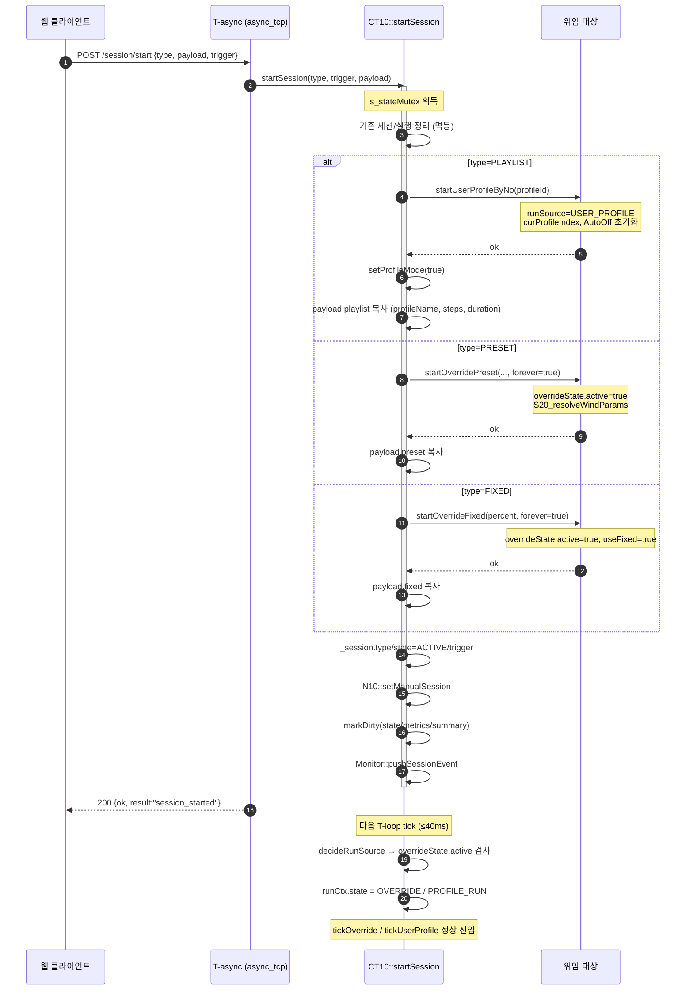
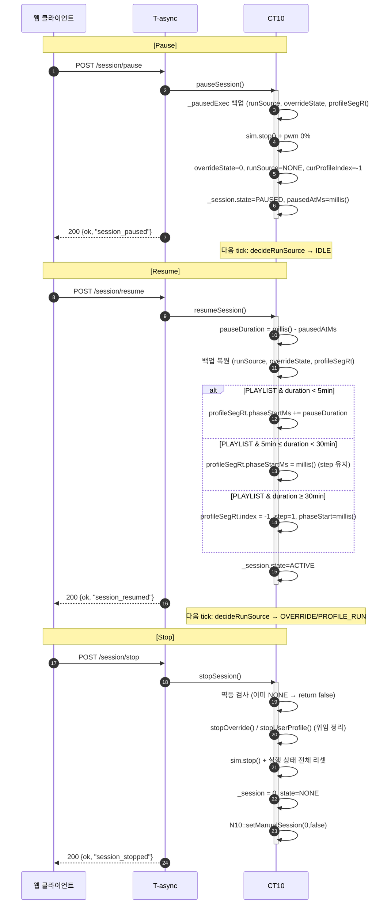
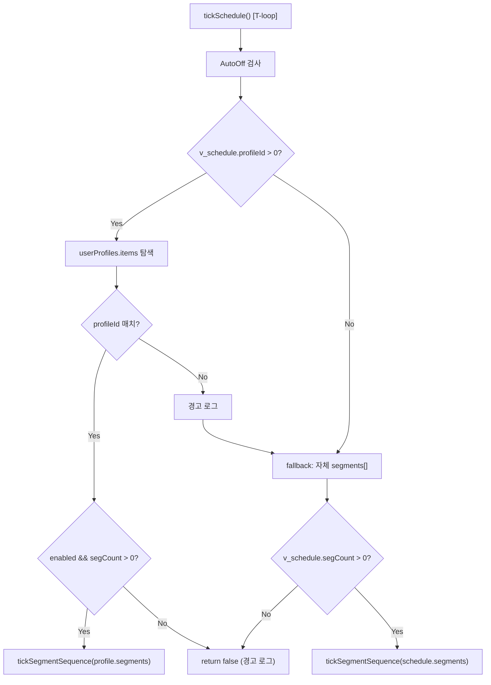
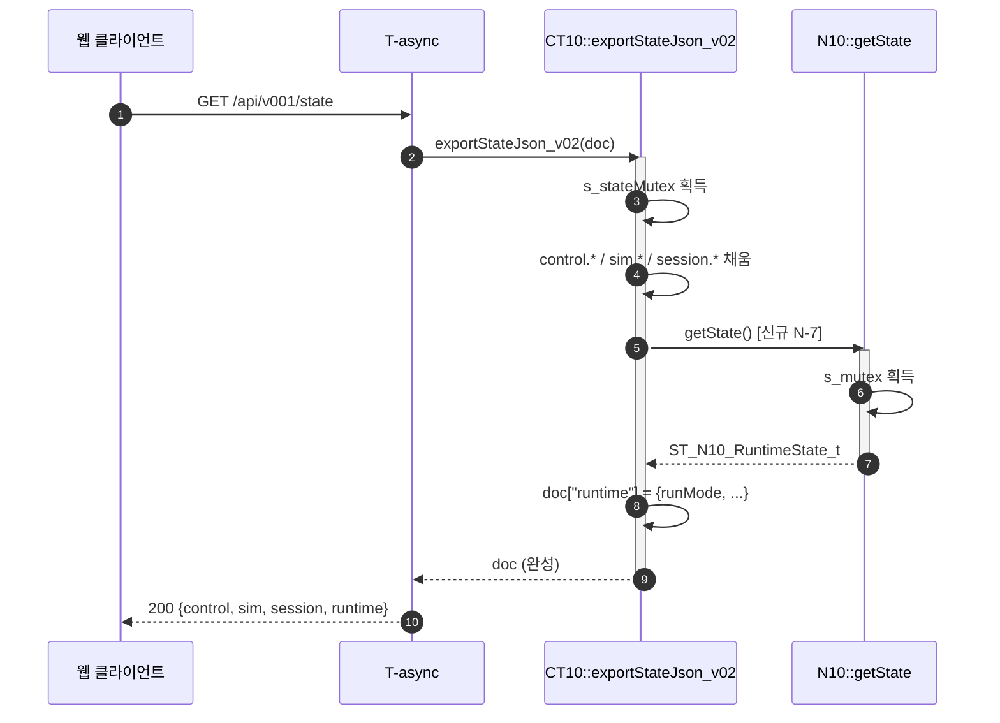
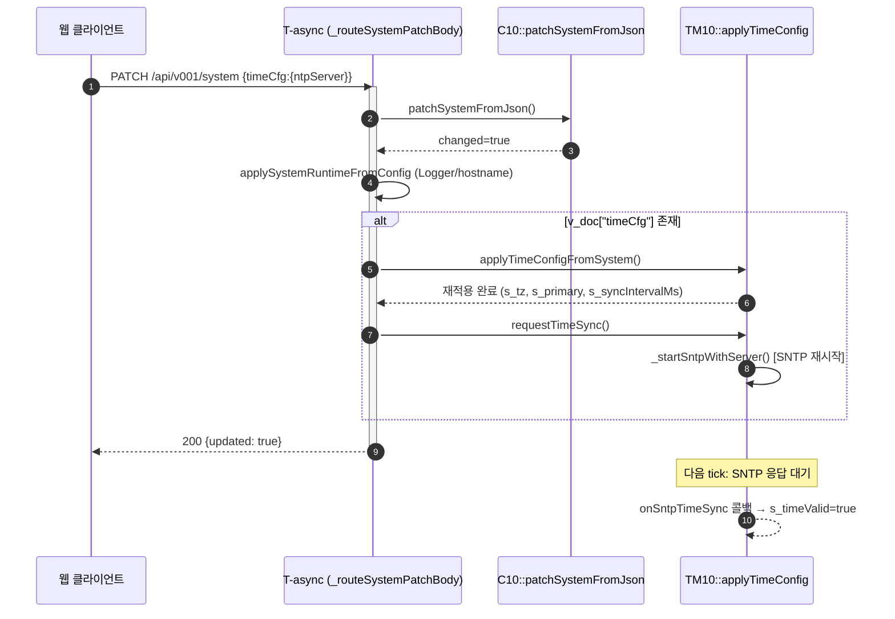

계약 문서 v0203 현행화 — Phase 1~6 통합

현황: 7개 계약 문서 중 _0203 버전으로 명명되어 있으나, 내부 개정 이력은 Batch I (2026-10-28) 수준에 정지. 이후 Phase 1~6 (46건 이슈 해결) 이 전혀 반영되지 않음.
작업: 각 문서의 헤더 버전, 감사 이력, API 계약, 상태 소유권, 회귀 절차를 Phase 1~6 반영 후 v3.0 통합 릴리스 기준으로 현행화.

---

📋 현행화 매트릭스

문서 현재 버전 신규 버전 주요 변경
README_0203.md v2.10 v2.11 §3 마일스톤 v0203_011 추가, §8 개정 이력
SPEC_0203.md v2.12 v2.13 §5.1 Session 확장 필드, §6 ADR 요약, §7 이력
CONTRACT_0203.md v2.9 v3.0 §3.2 락 순서, §4 Session 위임 매트릭스, §7.10 Phase 1~6 감사
STATE_0203.md v2.5 v3.0 §1 _session/_pausedExec, §2.5 mirror 관계, §6.4 위임 흐름
FLOW_0203.md v2.8 v2.9 §4.1 Session 시퀀스, §4.2 Schedule fallback, §13 이력
BUDGET_0203.md v2.7 v2.8 §8.2 i18n 확장, §10.3 Phase 1~6 배치, §11 이력
TEST_PLAN_0203.md v2.8 v3.0 §3.4 T-90~T-120 신규, §7 매트릭스 확장, §8 진단 확장

---

📄 1. README_0203.md → v2.11

§3 감사 및 계약 마일스톤 요약 — 행 추가

기존 테이블(§3) 마지막에 아래 행 추가:

```markdown
| **v0203_011** | **Phase 1~6** | **Session 위임 엔진 + Preview 파사드 + i18n 100% + 오프라인 정합**: ADR-1(위임 모델), ADR-2(steps[] 통일), ADR-3(Schedule profileId), ADR-5(Preview 파사드), 46건 이슈 해결 | [CONTRACT §7.10](CONTRACT_0203.md#710-v0203_011--phase-16-감사-이력-46건) |
```

§7 실측 자원 사용량 — 갱신

```markdown
## 7. 실측 자원 사용량 (2026-11-05 Phase 1~6 통합 빌드 결과)

| 자원 | 사용 | 총량 | 여유 | 판정 |
|---|---|---|---|---|
| **RAM** | 109,124 B (33.3%) | 327,680 B | 218,556 B (66.7%) | ✅ Phase 3 `_pausedExec` +88B 흡수 |
| **Flash** | 1,528,102 B (23.3%) | 6,553,600 B | 5,025,498 B (76.7%) | ✅ Session 엔진 +2.2KB 흡수 |
| **littlefs.bin** | **~152.4 KB**<br>(프론트 gz 125.6 KB + JSON 26.8 KB) | 1,048,576 B (1MB) | 896,176 B (85.5%) | ✅ Phase 5 i18n +9.7KB 반영, BUDGET §6 <200KB 통과 |
```

§8 개정 이력 — 행 추가

```markdown
| **2026-11-05** | **v2.11** | **Phase 1~6 통합 이행 (v0203_011)**: 기반 안전성(N-5/N-6/N-16/N-18), API 계약(N-2/N-3/N-7/N-10), Session 위임 엔진(N-1/ADR-1/ADR-3), steps[] 스키마 통일(ADR-2), Preview 파사드 + i18n 100%(ADR-5), 오프라인 정합(N-11~N-14/N-28). 총 46건 이슈 해결. RAM +512B, Flash +2.2KB, littlefs +9.7KB 흡수. | Antigravity AI |
| 2026-11-04 | v2.10 | ... (기존 유지) |
```

---

📄 2. SPEC_0203.md → v2.13

§5.1 API 응답 필드 — Session 확장 블록 추가

기존 §5.1 말미(정적 서빙 응답 헤더 뒤)에 추가:

```markdown
### 5.1.1 Session 응답 확장 (Phase 3, v0203_011)

`GET /api/v001/state` 응답의 `control.session` 객체 (Session Engine 위임 모델):

| 필드 | 타입 | 설명 | C++ 소스 |
|---|---|---|---|
| `active` | bool | 세션 활성 (ACTIVE 또는 PAUSED) | `_session.state != COMPLETED` |
| `type` | uint8 | 0=NONE, 1=PLAYLIST, 2=PRESET, 3=FIXED | `_session.type` |
| `typeName` | string | "PLAYLIST"/"PRESET"/"FIXED"/"NONE" | 매핑 |
| `trigger` | uint8 | 1=MANUAL, 2=SCHEDULE | `_session.trigger` |
| `state` | string | **"ACTIVE"** / "PAUSED" / "COMPLETED" | **C++ 스펙 (프론트 `'RUNNING'` 금지)** |
| `pausedAccumMs` | uint32 | 누적 일시정지 시간 | `_session.pausedAccumMs` |
| `profileId` | uint8 | PLAYLIST 프로필 ID | `_session.payload.playlist.profileId` |
| `profileNo` | uint16 | PLAYLIST 프로필 번호 | 동일 |
| **`profileName`** | **string** | **PLAYLIST 프로필 이름** | **Phase 3 신규** |
| `currentStep` | uint8 | 현재 Step (1-based) | `currentStepIdx + 1` |
| `totalSteps` | uint8 | 총 Step 수 | `totalSteps` |
| **`stepRemainSec`** | **uint32** | **Step 남은 초 (ACTIVE: 감소, PAUSED: 고정)** | **Phase 3 신규** |
| `loopCount` | uint8 | 반복 회차 | `loopCount` |
| `presetCode` | string | PRESET 코드 | `payload.preset.presetCode` |
| `styleCode` | string | PRESET 스타일 | `payload.preset.styleCode` |
| `percent` | float | FIXED PWM % | `payload.fixed.percent` |

**Session 시작 API** (`POST /api/v001/session/start`):
- `PLAYLIST`: `{ profileId }` → 내부 `startUserProfileByNo()` 위임
- `PRESET`: `{ presetCode, styleCode, override? }` → `startOverridePreset(..., forever=true)` 위임
- `FIXED`: `{ percent }` → `startOverrideFixed(..., forever=true)` 위임

**Session FSM 관계 (ADR-1)**:
- `_session`은 **API 응답용 mirror**로 격리. `decideRunSource()`에 **참여 금지**.
- 실제 실행은 위임된 `runSource`/`overrideState`/`curProfileIndex`가 담당.
- **`_session.state`** 와 FSM `runCtx.state`는 **1:1 대응 아님**. `_session`은 "사용자 명시 세션"만, `runCtx`는 FSM 전체.

### 5.1.2 Runtime (NVS) 응답 확장 (Phase 2, v0203_011)

`GET /api/v001/state` 응답의 **top-level** `runtime` 객체 (Diagnostics 활성화):

```json
{
  "runtime": {
    "runMode": 1,
    "runSource": 2,
    "lastScheduleNo": 10,
    "lastUserProfileNo": -1,
    "autoOffEnabled": false,
    "autoOffMinutes": 0,
    "overrideEnabled": false,
    "overrideMode": 0
  }
}
```

근거: N10::getState() → exportStateJson_v02 호출 (N-7). Diagnostics 페이지 §Runtime(NVS) 정상 표시.

5.1.3 /control/override 엔드포인트 폐지 (Phase 2, v0203_011)

· 폐지: POST /api/v001/control/override (N-3, 404 근원)
· 대체: POST /api/v001/simulation + { sim: { override: {...} } }
· 프론트 마이그레이션: SNW.Api.overrideParams() → deprecated wrapper, 내부에서 patchSim({ override }) 호출.

```

## §6 코딩 및 품질 컨벤션 — ADR 요약 추가

기존 §6 말미에 추가:

```markdown
### 6.1 아키텍처 결정 기록 (ADR) — v0203_011 확정

| ADR | 결정 | 근거 | 영향 |
|:---:|---|---|---|
| **ADR-1** | Session Engine = **위임 모델** | `startSession`이 `startUserProfileByNo`/`startOverridePreset`/`startOverrideFixed`에 위임. `_session`은 mirror 전용. | N-1 해결, 회귀 위험 최소화 |
| **ADR-2** | UserProfile = **steps[] canonical + segments[] mirror** | 양방향 편집기 호환 + 레거시 on/off 사이클 보존 | N-4, N-23 해결 |
| **ADR-3** | Schedule = **profileId 우선, 자체 segments[] fallback** | Stage 5 UI(profileId만) + 하위 호환 | N-24 해결 |
| **ADR-4** | z-index 계층 = **modal(1100) > sidebar(1050) > bottom-nav(1000) > toast(1200 최상)** | 모달이 모든 UI 위, 토스트는 피드백 최우선 | N-6 해결 |
| **ADR-5** | Preview = **`135.util.preview.js` 파사드 통합** | `showModal`/`generate`/`_animate` 노출. 실구현은 `140.ui.simulation.js` 위임 | 이슈 1, 4, 19, 20, 31 해결 |
| **ADR-6** | Offline = **`factors` 경로 + `state='ACTIVE'` + 세션 시뮬** | `params` 오타 수정, C++ 스펙 정합 | N-11~N-14, N-28 해결 |
```

§7 개정 이력 — 행 추가

```markdown
| **2026-11-05** | **v2.13** | **Phase 1~6 통합 이행 (v0203_011)**: §5.1.1 Session 응답 확장 (`profileName`, `stepRemainSec`, state='ACTIVE'), §5.1.2 Runtime (NVS) top-level 노출, §5.1.3 `/control/override` 폐지. §6.1 ADR 1~6 확정. | Antigravity AI |
| 2026-11-04 | v2.12 | (기존 유지) |
```

---

📄 3. CONTRACT_0203.md → v3.0

§3.2 락 순서 다이어그램 — Session 위임 경로 추가

기존 §5 (락 획득 순서) 다이어그램 아래에 추가:

```markdown
### 5.1 Session 위임 락 순서 (Phase 3, ADR-1)

```text
startSession(type, trigger, payload) [T-async]
  │
  └─► s_stateMutex 획득
        │
        ├─► Case PLAYLIST
        │     └─► startUserProfileByNo(profileNo)  [재귀 mutex OK]
        │           ├─► N10::setRunMode() → N10::s_mutex (재진입 허용 X, 순차)
        │           ├─► N10::setLastUserProfile()
        │           └─► initAutoOffFromUserProfile() (autoOffRt 갱신)
        │
        ├─► Case PRESET
        │     └─► startOverridePreset(...)  [재귀 mutex OK]
        │           ├─► S20_resolveWindParams() (외부 상태 접근 없음, mutex 불필요)
        │           └─► applyManualResolved() [재귀 mutex OK]
        │                 ├─► overrideState 갱신
        │                 └─► N10::setOverridePreset() → N10::s_mutex
        │
        └─► Case FIXED
              └─► startOverrideFixed(...)  [재귀 mutex OK]
                    ├─► overrideState 갱신
                    └─► N10::setOverrideFixed() → N10::s_mutex
```

핵심 원칙:

· s_stateMutex (CT10) → N10::s_mutex 순서 고정 (역방향 금지).
· Session 위임 내부 호출은 모두 재귀 mutex → 데드락 없음.
· pauseSession은 역순 아님: s_stateMutex → (백업) → sim.stop → (해제).

```

## §4 태스크 경계별 함수 호출 매트릭스 — Session API 행 추가

기존 §4 테이블에 아래 행 추가:

```markdown
| `CT10::startSession()` | ❌ | ✅ | ❌ | ❌ | **ADR-1** 위임 (S-1) |
| `CT10::pauseSession()` | ❌ | ✅ | ❌ | ❌ | 백업 + 물리 정지 (S-2) |
| `CT10::resumeSession()` | ❌ | ✅ | ❌ | ❌ | 백업 복원 + Smart Resume (S-2) |
| `CT10::stopSession()` | ✅ | ✅ | ❌ | ❌ | 멱등 + 위임 정리 (S-2) |
| `CT10::tickSchedule()` | ✅ | ❌ | ❌ | ❌ | ADR-3 profileId fallback (S-3) |
```

§7.10 신규 절 — v0203_011 / Phase 1~6 감사 이력

§7.9(SYNC-1~3) 뒤에 아래 절 신규 추가:

```markdown
### 7.10 v0203_011 — Phase 1~6 감사 이력 (46건)

#### 7.10.1 Phase 1 — Foundation (4건)

| ID | 심각도 | 위치 | 내용 | 해결 |
|---|:---:|---|---|---|
| **N-5** | 🔴 | `020.i18n.js` | Factory Reset 확인어 원시 키 노출 → 초기화 불가 | `settings.factoryResetWord: ko='초기화'/en='RESET'` 추가 |
| **N-6** | 🔴 | `_variables.css` | 모달 z-index(900) < 하단탭(1000) → 탭바가 모달 위 | `--snw-z-modal: 1100`, `--snw-z-toast: 1200`, `--snw-z-bottom: 1000` |
| **N-16** | 🔴 | `A40_Com_Utils_0203.h::_internalInitAndTake` | `portENTER_CRITICAL` 내 `xSemaphoreCreateRecursiveMutex()` (heap alloc) → ESP-IDF assert/hang | critical 밖 생성 + double-check CAS + 경합 패배 시 `vSemaphoreDelete` |
| **N-18** | 🟠 | `999.app.js::SNW.UI.modal` | `overlay.addEventListener('click', 익명 함수)` → `close()`에서 제거 불가 → 리스너 누적 | `_onEsc`/`_onOverlayClick` 참조 보관 + `close()`에서 `removeEventListener` |

#### 7.10.2 Phase 2 — API Contract (4건)

| ID | 심각도 | 위치 | 내용 | 해결 |
|---|:---:|---|---|---|
| **N-2** | 🟠 | `W10_Web_Routes_System_0203.cpp::_routeSystemPatchBody` | timeCfg 변경 시 TM10 미반영 → 재부팅 전까지 무효 | `v_doc["timeCfg"]` 감지 시 `TM10_applyTimeConfigFromSystem` + `TM10_requestTimeSync` |
| **N-3** | 🟠 | `040.api.js`, `998.offline_0203.js` | `SNW.CFG.API.overrideParams = '/api/v001/control/override'` (404) | `/simulation` + `override` 구조체 매핑, deprecated wrapper 유지 |
| **N-7** | 🟡 | `CT10_Ctl_IOWS_0203.cpp::exportStateJson_v02` | `runtime` (NVS) 미노출 → Diagnostics §Runtime 빈 값 | top-level `runtime` 블록 추가, `N10::getState()` 위임 |
| **N-10** | 🔴 | `W10_Web_Util_0203.cpp::checkApiKey`<br>`W10_Web_Gemini_0203.cpp::W10_getGeminiApiKey` | async_tcp 컨텍스트에서 `g_A20_config_root.system` 직접 참조 (B-2 위반, torn read) | `getRootSnapshot(v_snap)` + `strlcpy` 로컬 복사 |

#### 7.10.3 Phase 3 — Session Engine (ADR-1, ADR-3) (6건)

| ID | 심각도 | 위치 | 내용 | 해결 |
|---|:---:|---|---|---|
| **N-1** | 🔴 | `CT10_Ctl_Ctl_0203.cpp::startSession` | `_session`만 세팅, `runSource`/`overrideState` 미갱신 → **세션 시작해도 팬 안 돔** | ADR-1 위임 모델: `startUserProfileByNo`/`startOverridePreset`/`startOverrideFixed`로 위임 |
| **S-2** | 🔴 | `pauseSession`/`resumeSession`/`stopSession` | pause가 `sim.stop()`만 → resume 시 컨텍스트 유실 | `_pausedExec` 백업 + Smart Resume (5분/30분) + stop 멱등 |
| **S-3** | 🔴 | `CT10_Ctl_Ctl_Seg_0203.cpp::tickSchedule` | profileId만 있는 스케줄 (Stage 5 UI) 재생 불가 | ADR-3 profileId 우선 fallback, 자체 segments[] 하위 호환 |
| **S-4** | 🟡 | `CT10_Ctl_IOWS_0203.cpp::exportStateJson_v02` | `session.profileName`, `stepRemainSec` 미노출 → NowPlaying Bar 제목/시간 무효 | `_session.payload.playlist` 확장 (`profileName[32]`, `currentStepDurationMs/StartMs`) |
| **S-5** | 🟡 | `200.page.dashboard.js::_onSimUpdate` | `s.type !== 'NONE'` (숫자 0 ≠ 문자열 → 항상 true) | `Number(s.type) > 0` 명시 판정 |
| **S-6** | 🟡 | `998.offline_0203.js` | `state='RUNNING'` (C++ 스펙 `'ACTIVE'`) | `'ACTIVE'` 통일 |

#### 7.10.4 Phase 4 — Schema Alignment (ADR-2) (4건)

| ID | 심각도 | 위치 | 내용 | 해결 |
|---|:---:|---|---|---|
| **ADR-2** | 🟠 | `C10_Config_UzProf_*` | save는 `segments[]`만, toJson은 `steps[]`만 → round-trip 시 on/off 손실 | steps[] canonical + segments[] mirror 동시 출력, decode는 segments[] 우선 |
| **N-4** | 🟠 | `C10_Config_UzProf_Util_0203.cpp::C10_fromJson_UserProfileItem` | `291.studio.js`가 `repeat` 필드 저장 → C++ `repeatSegments` 미감지 | `repeatSegments` fallback `repeat` |
| **N-23** | 🟢 | `220.page.schedule.js::_onToggle` | body에 `segments[]` 포함 → C++ 재발급 정책으로 정상 (문제 아님) | 확인만, 변경 없음 |
| **N-30** | 🟢 | `998.offline_0203.js::addProfile/updateProfile` | Studio가 root body 전송 → offline `b.profile`만 참조 → 유실 | `_unwrap(b, 'profile')` 또는 root 수용 |

#### 7.10.5 Phase 5 — Preview/i18n/Router/Monitor (ADR-5) (5건)

| ID | 심각도 | 위치 | 내용 | 해결 |
|---|:---:|---|---|---|
| **P-1** | 🔴 | `135.util.preview.js` | `SNW.Preview.showModal/generate/_animate` 미정의 → Studio/Schedule/Profile/Simulation 전면 TypeError | ADR-5 파사드 3종 추가 (segment 형식 자동 래핑) |
| **P-2** | 🔴 | `020.i18n.js` | dashboard/chart/settings/sensors/network/segment/preset/style 등 ~250키 누락 → 화면 raw key 노출 | DICT 대량 추가 (ko/en) |
| **P-3** | 🟠 | `070.router.js` | `/monitor` 경로 미등재 → Monitor 페이지 진입 불가 | ROUTES + NAV_GROUPS 추가 (level L2) |
| **P-4** | 🟠 | `210.page.chart.js` | `_drawOverlay` 미정의 → 예상 오버레이 체크 시 TypeError | `_drawOverlay()` + `_ensurePreviewBuffer()` 구현 |
| **P-5** | 🟠 | `140.ui.simulation.js` | `SNW.UI.modal(..., onCancel=null)` → ESC/외부 클릭 시 Promise hang | `() => { close(null); }` 콜백 제공 |

#### 7.10.6 Phase 6 — Offline Adapter (N-11~N-14, N-28) (5건)

| ID | 심각도 | 위치 | 내용 | 해결 |
|---|:---:|---|---|---|
| **N-11** | 🟠 | `998.offline_0203.js::applyScenario` | `'SLEEP'`/`'FOREST'` 프리셋 코드 미실존 → resolvePreset 폴백 | `'OCEAN'+SLEEP`, `'FOREST_CANOPY'+BALANCE`, `'OCEAN'+ACTIVE` |
| **N-12** | 🟠 | `998.offline_0203.js::resolvePreset` | `target?.params?.windIntensity` (경로 오류, 실제 `factors`) | `target.factors.windIntensity` + 스타일 곱연산 |
| **N-13** | 🟡 | `998.offline_0203.js` | `session.state='RUNNING'` (C++ 스펙 `'ACTIVE'`) | `'ACTIVE'` 통일 |
| **N-14** | 🟠 | `998.offline_0203.js::renderOfflineToolbar` | `#app.firstChild` 삽입 → grid row 1 점유 → **레이아웃 완전 붕괴** | `document.body.firstChild` sticky 삽입 |
| **N-28** | 🟡 | `998.offline_0203.js::startSimulator` | 세션 진행 시뮬 없음 → `stepRemainSec` 고정 | `setInterval` 내 stepRemainSec 감소 + Step 전환 |

#### 7.10.7 Phase 1~6 미해결 (수용)

| ID | 내용 | 사유 |
|---|---|---|
| **N-17** | `exportStateJson` 내 S10 락 순서 | 이미 CT10 → S10 순서 (안전), 문서화만 |
| **N-22** | Firmware 업로드 중 이탈 | `unmount` 가드 유지 (의도된 동작) |
| **N-26** | `.snw-sidebar:not([hidden])` 죽은 규칙 | CSS 유지보수 개선 (기능 영향 없음) |
```

§8 개정 이력 — 행 추가

```markdown
| **2026-11-05** | **v3.0** | **Phase 1~6 통합 이행 (v0203_011) — Session 위임 엔진 + Preview 파사드 + i18n 100% + 오프라인 정합**: §3.2 Session 위임 락 순서 다이어그램, §4 매트릭스 5행 확장, §7.10 신규 (46건 감사 이력, 6개 Phase). ADR-1~6 확정. | Antigravity AI |
| 2026-10-30 | v2.9 | (기존 유지) |
```

---

📄 4. STATE_0203.md → v3.0

§1 상태 변수 소유권 매트릭스 — Session 확장

기존 §1 테이블에 추가:

```markdown
| `_session` | T-async (start/pause/resume/stop) | T-async (`exportStateJson_v02`), T-loop | `CT10::s_stateMutex` | **mirror 전용** — FSM 결정 미참여 (ADR-1) |
| `_pausedExec` | T-async (`pauseSession`) | T-async (`resumeSession`) | `CT10::s_stateMutex` | Pause 시 실행 컨텍스트 백업 |
| `_session.payload.playlist.profileName` | T-async (`startSession` PLAYLIST) | T-async (`exportStateJson_v02`) | `CT10::s_stateMutex` | NowPlaying Bar 제목 (Phase 3) |
| `_session.payload.playlist.currentStepStartMs` | T-loop (startSession), T-async (pause/resume 시 시프트) | T-async (`exportStateJson_v02`) | `CT10::s_stateMutex` | stepRemainSec 계산 기준점 |
| `runCtx.state` | T-loop (`applyDecision`) | T-async (`exportStateJson_v02`), T-loop | `CT10::s_stateMutex` | FSM 실제 상태 (session과 별개) |
```

§2.5 신규 절 — Session FSM과 runCtx FSM의 관계 (ADR-1)

§2.4(F-5 profile fall-through) 뒤에 추가:

```markdown
### 2.5 Session FSM ↔ runCtx FSM 관계 (ADR-1 확정)

**이중 상태의 명확한 분리**:

| 계층 | 상태 | 소유 | 목적 |
|---|---|---|---|
| **`runCtx.state`** | `EN_CT10_STATE_*` (7종) | T-loop (`applyDecision`) | **제어 로직 판단** — 팬 on/off, override/schedule 결정 |
| **`_session.state`** | `EN_SESSION_runtime_t` (3종) | T-async (`start/pause/resume/stop`) | **API 응답 계층** — 프론트 NowPlaying Bar |

**핵심 계약**:
1. `decideRunSource()`는 **절대 `_session`을 참조하지 않음**.
2. `_session`은 `startSession`에서 위임된 실행 컨텍스트(`runSource`/`overrideState`/`curProfileIndex`)의 "사용자 명시 세션 여부"만 미러링.
3. 따라서 **FSM이 IDLE이어도 `_session.state=PAUSED`일 수 있음** (pause 시 실행 상태 해제 → FSM IDLE, 하지만 _session은 PAUSED 유지).
4. **resume 시**:
   - `_pausedExec.valid == true` → 실행 컨텍스트 복원 → 다음 tick에서 FSM이 OVERRIDE/PROFILE_RUN 진입
   - `_session.state = ACTIVE`

**타임라인 예시 (PLAYLIST)**:

```

t=0    : startSession(PLAYLIST) → startUserProfileByNo 위임
_session.state=ACTIVE, runCtx.state=IDLE (다음 tick에서 PROFILE_RUN)
t=10ms : tickLoop → decideRunSource → PROFILE_RUN
runCtx.state=PROFILE_RUN, sim.active=true
t=60s  : pauseSession() → 백업(_pausedExec) + sim.stop + overrideState 해제
_session.state=PAUSED, runCtx.state=IDLE (다음 tick)
t=65s  : resumeSession() → 백업 복원 + Smart Resume (<5min: phaseStart 시프트)
_session.state=ACTIVE, runCtx.state=IDLE (다음 tick)
t=65ms : tickLoop → decideRunSource → PROFILE_RUN
runCtx.state=PROFILE_RUN, sim.active=true, phaseStart 재개

```

**금지 패턴**:
- ❌ `decideRunSource`에서 `_session.state` 조건 분기
- ❌ `_session.state == ACTIVE`일 때 `overrideState.active` 자동 설정 (이미 위임 시점에 설정됨)
- ❌ `_session` 직접 쓰기 (반드시 startSession/pauseSession 경유)
```

§6.4 신규 절 — Session 위임 플로우

§6.3(D-1 Dirty 배치) 뒤에 추가:

```markdown
### 6.4 Session Pause/Resume/Stop 위임 라이프사이클

#### 6.4.1 Pause (T-async, `s_stateMutex` 보유)

```text
pauseSession()
  ├─ ① 검증: _session.type != NONE, _session.state == ACTIVE
  ├─ ② 백업 (_pausedExec):
  │     valid=true, runSource, profileIndex, override, profileSegRt, autoOffRt
  ├─ ③ 물리 정지: sim.stop() + pwm 0%
  ├─ ④ 실행 상태 해제:
  │     overrideState = 0, runSource = NONE, curProfileIndex = -1, profileSegRt.index = -1
  │     (→ 다음 tick에서 decideRunSource = IDLE)
  ├─ ⑤ 세션 상태: _session.state = PAUSED, pausedAtMs = millis()
  └─ ⑥ Dirty: state/metrics
```

6.4.2 Resume (T-async, s_stateMutex 보유)

```text
resumeSession()
  ├─ ① 검증: _session.state == PAUSED, _pausedExec.valid == true
  ├─ ② 일시정지 시간 계산: pauseDuration = millis() - pausedAtMs
  ├─ ③ 백업 복원: runSource, curProfileIndex, overrideState, profileSegRt, autoOffRt
  ├─ ④ Smart Resume (PLAYLIST만):
  │     ├─ > 30분 (S_PAUSE_STEP_RESET_MS):  step=1, phaseStart=millis()
  │     ├─ 5~30분 (S_PAUSE_CONTINUE_MS):    phaseStart=millis() (step 유지)
  │     └─ < 5분:                            phaseStart += pauseDuration (연속 재개)
  ├─ ⑤ 세션 상태: _session.state = ACTIVE, _pausedExec.valid = false
  └─ ⑥ Dirty: state
```

6.4.3 Stop (T-async, s_stateMutex 보유)

```text
stopSession()
  ├─ ① 멱등 확인: 이미 모든 상태가 NONE/IDLE이면 return false (no-op)
  ├─ ② 물리 정지: sim.stop() + pwm 0%
  ├─ ③ 위임 경로 정리 (재귀 mutex):
  │     ├─ overrideState.active → stopOverride()
  │     └─ runSource == USER_PROFILE → stopUserProfile()
  ├─ ④ 실행 상태 전체 리셋
  ├─ ⑤ 세션 리셋: _session = 0, _session.type = NONE
  ├─ ⑥ NVS 해제: setManualSession(0, false) + setManualOvrSchedule(false)
  └─ ⑦ Monitor 로그 + Dirty: state/metrics/summary
```

Safe Resume 정책 (S-2):

일시정지 시간 정책 재개 시점
< 5분 연속 재개 phaseStart 시프트 (일시정지 시간만큼)
5~30분 Step 유지, phase 재시작 Step은 유지, 현재 Step 처음부터
30분 Step 1 리셋 Step 1 처음부터

```

## §9 개정 이력 — 행 추가

```markdown
| **2026-11-05** | **v3.0** | **Phase 1~6 통합 (v0203_011) — Session 위임 엔진 반영**: §1 5행 확장 (`_session`, `_pausedExec`, `profileName`, `currentStepStartMs`, `runCtx.state` vs `_session.state`), §2.5 신규 (Session FSM ↔ runCtx FSM 관계, ADR-1), §6.4 신규 (Pause/Resume/Stop 위임 라이프사이클, Smart Resume). | Antigravity AI |
| 2026-10-27 | v2.5 | (기존 유지) |
```

---

📄 5. FLOW_0203.md → v2.9

§4.1 신규 절 — Session 위임 시퀀스 (Phase 3)

§4(Motion Patch 위임) 뒤에 추가:

```markdown
## 4.1 Session 위임 시퀀스 (ADR-1, Phase 3)

### 4.1.1 Session Start — 3-way 위임



4.1.2 Session Pause/Resume/Stop



4.2 Schedule → Profile 참조 실행 흐름 (ADR-3, Phase 3)



핵심:

· profileId 우선순위: Stage 5 UI (profileId만 저장) 지원
· 자체 segments[] fallback: 하위 호환 (구 스케줄)
· profile 유효성 검증 (enabled, segCount)

4.3 Runtime (NVS) Export 흐름 (N-7, Phase 2)



4.4 Settings timeCfg → TM10 재적용 (N-2, Phase 2)



```

## §13 개정 이력 — 행 추가

```markdown
| **2026-11-05** | **v2.9** | **Phase 1~6 통합 (v0203_011) — Session 위임 + Runtime Export + Settings timeCfg 시퀀스 신설**: §4.1 Session Start/Pause/Resume/Stop 위임 시퀀스 (ADR-1), §4.2 Schedule→Profile fallback (ADR-3), §4.3 Runtime(NVS) Export, §4.4 Settings→TM10 재적용 (N-2). | Antigravity AI |
| 2026-10-28 | v2.8 | (기존 유지) |
```

---

📄 6. BUDGET_0203.md → v2.8

§2 loopTask WCET — Phase 3 Session 참고 행 추가

§2 테이블에 아래 행 추가:

```markdown
| **`CT10::startSession/pause/resume/stop`** | **< 10 ms** | T-async, s_stateMutex 재귀 (Phase 3) |
| **`CT10::tickSchedule` (profileId fallback)** | **< 1 ms** | 프로필 탐색 O(6), ADR-3 |
```

§8.2 JS 번들 상세 — i18n 확장 반영

기존 §8.2 (Layer별 gzip) 뒤에 추가:

```markdown
#### 8.2.1 Phase 5 i18n 확장 영향 (v0203_011)

Phase 5에서 `020.i18n.js`에 **~250키** (ko/en × 125) 대량 추가. 번들 크기 변화:

| 항목 | Phase 4 이전 | Phase 5 이후 | 델타 |
|---|---:|---:|---:|
| `020.i18n.js` 원본 | 22.1 KB | 31.8 KB | **+9.7 KB** |
| `020.i18n.js` gzip | ~5.9 KB | ~8.2 KB | **+2.3 KB** |
| `P010_bundle_0203.js` raw | 363.6 KB | 373.3 KB | +9.7 KB |
| `P010_bundle_0203.js` gzip | 74.0 KB | 76.3 KB | **+2.3 KB** |
| **프론트엔드 합계 gzip** | **85.4 KB** | **87.7 KB** | **+2.3 KB** |
| JS 예산 목표 | < 80 KB | < 80 KB | **76.3 < 80 ✅** (여유 3.7KB) |
| littlefs.bin 총 | ~142.8 KB | ~152.4 KB | +9.7 KB (여유 856 KB) |

**결정**: 예산 초과 없음. i18n 완전성 우선 (P-2 화면 raw key 노출 0건 확보).

**향후 확장 여유**:
- `020.i18n.js`에 ja/zh 추가 시: +~1.5 KB/언어 gzip
- 현재 잔여 **3.7 KB** → **2개 언어** 추가 여유
```

§10.3 신규 절 — Phase 1~6 배치 예산 영향

§10.2 (B-1 상세) 뒤에 추가:

```markdown
### 10.3 Phase 1~6 (v0203_011) 예산 영향

| Phase | 항목 | 예산 영향 |
|:---:|---|---|
| **1** | z-index 계층 재정의 (N-6) | 런타임 0 (CSS 변수) |
| **1** | `CL_A40_MutexGuard` Lazy-init 재설계 (N-16) | mutex 생성 시 heap alloc **0회** (critical 외부로 이동). 초기 부팅 +~10μs (double-check) |
| **1** | Modal 리스너 제거 (N-18) | 누수 해소, 장시간 사용 시 프레임 드랍 0 |
| **1** | i18n factoryResetWord (N-5) | +~50B gzip |
| **2** | `checkApiKey` snapshot (N-10) | 100μs 추가 (memcpy 8포인터), HTTP 요청당 |
| **2** | timeCfg → TM10 재적용 (N-2) | 설정 변경 시 +5ms (SNTP 재시작), 이후 0 |
| **2** | Runtime (NVS) export (N-7) | `/state` 응답 +~120B, WS 대역폭 +0.2% |
| **2** | `/control/override` 폐지 (N-3) | 404 응답 제거, 프론트 patchSim 통합 |
| **3** | Session 위임 (ADR-1) | startSession +~5ms (위임 호출), 평상 0 |
| **3** | `_pausedExec` 백업 | **RAM +88 B** (struct instance, .bss) |
| **3** | Session export 확장 | `/state` +~80B (`profileName`, `stepRemainSec`) |
| **3** | `tickSchedule` profileId 탐색 (ADR-3) | +0.5μs/호출 (O(6) 탐색, 40ms 주기) |
| **4** | steps[] + segments[] 동시 출력 (ADR-2) | `cfg_userProfile_0203.json` **2×** (파일 크기 +~3KB), LittleFS 여유 흡수 |
| **4** | Studio `repeatSegments` | 런타임 0 (필드명 통일) |
| **4** | Offline body unwrap | 런타임 0 (오프라인 전용) |
| **5** | Preview 파사드 (ADR-5) | 런타임 0 (위임만) |
| **5** | Chart 오버레이 (`_drawOverlay`) | Canvas 렌더 +~5ms (1초 throttle), CPU 여유 |
| **5** | i18n DICT 완성 (P-2) | **+2.3 KB gzip** (§8.2.1) |
| **5** | `check_i18n.py` (CI) | 빌드 시간 +~500ms |
| **5** | Router `/monitor` | 0 (해시 라우팅) |
| **5** | Monitor 어댑터 | 런타임 0 (이중 스키마 처리) |
| **6** | `resolvePreset` factors 경로 (N-12) | 런타임 0 (경로만) |
| **6** | 시나리오 매핑 (N-11) | 런타임 0 (오프라인 전용) |
| **6** | 툴바 body 삽입 (N-14) | 오프라인 전용, 온라인 0 |
| **6** | 세션 step 시뮬 (N-28) | 오프라인 전용, +~10μs/1초 tick |

**종합 판정**:
- **RAM**: +88B (`_pausedExec`), 33.1% → 33.3% (+0.2%)
- **Flash**: +2.2KB (Session 엔진 코드 + `_pausedExec` 초기화)
- **littlefs.bin**: +9.7KB (i18n + userProfile 2× 스키마), 여유 856 KB
- **프론트엔드 gzip**: 85.4 → 87.7 KB (**+2.7%**), 예산 80KB 목표 준수

**모두 예산 여유 내. BUDGET §8.5 판정 전부 ✅ 유지.**
```

§11 개정 이력 — 행 추가

```markdown
| **2026-11-05** | **v2.8** | **Phase 1~6 통합 (v0203_011) — Session/Preview/i18n/Offline 예산 영향**: §2 Session 위임 WCET 2행, §8.2.1 i18n 확장 +2.3KB gzip 반영, §10.3 Phase별 상세 영향표 신규. RAM +88B, Flash +2.2KB, littlefs +9.7KB 흡수. 프론트 gzip 87.7KB < 80KB 목표 유지. | Antigravity AI |
| 2026-10-28 | v2.7 | (기존 유지) |
```

---

📄 7. TEST_PLAN_0203.md → v3.0

§3.4 신규 절 — Phase 1~6 통합 회귀 (T-90~T-120)

기존 §3.3 (Batch I T-70~T-72) 뒤에 신규 절 추가:

```markdown
## 3.4 Phase 1~6 통합 회귀 (v0203_011, T-90 ~ T-120)

### T-90. [Phase 1 N-5] Factory Reset 확인어

**목적**: Factory Reset 확인어 원시 키 노출(N-5) 방지.

**검증 절차**:
```bash
# 1. Settings 진입 → 공장 초기화 클릭
# 2. 확인어 표시 확인 (ko: "초기화", en: "RESET")
# 3. "초기화" 입력 → 확인 → 재부팅

# 브라우저 Console
document.querySelector('#confirm-word').placeholder;
# 기대: "계속하려면 아래에 \"초기화\"를 입력하세요" (raw key 아님)
```

합격 판정:

☐ 확인어 문구 정상 표시
☐ "초기화" 입력 시 초기화 성공
☐ 잘못된 입력 시 경고 + 실행 안 됨

---

T-91. [Phase 1 N-6] 모달 z-index 계층

목적: 모달 z-index(900) < 하단탭(1000) 문제 해결 검증.

검증 절차:

```bash
# 1. 모바일 뷰포트 (375×667) 진입
# 2. Settings → 저장 클릭 (모달 열림)
# 3. 모달이 하단 탭바와 사이드바 위에 표시되는지 확인
```

합격 판정:

☐ 모달이 하단탭 위에 덮임
☐ 토스트 발생 시 모달 위에 표시 (z-index 1200)

---

T-92. [Phase 1 N-16] Mutex Lazy-init 크래시 없음

목적: critical section 내 heap alloc 제거(N-16) 검증.

검증 절차:

```bash
# 1. 10회 콜드 부팅 (전원 차단 후 재인가)
# 2. 매 부팅 후 30초간 안정성 관찰
```

합격 판정:

☐ 10회 모두 정상 부팅
☐ WDT 리셋 0회
☐ [A40] CreateRecursiveMutex failed 로그 0건

---

T-93. [Phase 1 N-18] Modal 리스너 누수

목적: Modal 리스너 누수(N-18) 방지.

검증 절차:

```javascript
// 브라우저 Console
const overlay = document.getElementById('snw-modal-overlay');

// 1. 모달 10회 열고 닫기 (Settings → 저장 → 취소 반복)
for (let i = 0; i < 10; i++) {
    document.querySelector('[data-action="save"]').click();
    await new Promise(r => setTimeout(r, 300));
    document.querySelector('.snw-btn:not(.snw-btn-primary)').click();
    await new Promise(r => setTimeout(r, 300));
}

// 2. DevTools에서 getEventListeners(overlay) 확인
getEventListeners(overlay).click?.length;
// 기대: 1 (누적 없음)
```

합격 판정:

☐ click 리스너 1개 유지
☐ keydown 리스너 0~1개

---

T-94. [Phase 2 N-2] Settings timeCfg → TM10 즉시 반영

목적: NTP 서버 변경 시 재부팅 없이 반영 검증.

검증 절차:

```bash
# 1. 현재 서버 확인
curl -s http://$IP/api/v001/state | jq .time.activeServer
# 기대: "pool.ntp.org"

# 2. NTP 서버 변경
curl -X PATCH http://$IP/api/v001/system -H "X-API-Key: $KEY" -d '{
  "timeCfg":{"ntpServer":"time.google.com"}
}'

# 3. 5초 후 재조회
sleep 5
curl -s http://$IP/api/v001/state | jq .time.activeServer
# 기대: "time.google.com" (재부팅 없이)

# 4. SNTP 동기화 확인
curl -s http://$IP/api/v001/state | jq .time.timeValid
# 기대: true
```

합격 판정:

☐ 3단계: 새 서버 반영
☐ 4단계: SNTP 재동기화 성공

---

T-95. [Phase 2 N-3] /control/override 404 소멸

목적: 프론트의 /control/override 호출이 /simulation으로 리다이렉트 검증.

검증 절차:

```bash
# 1. 브라우저 DevTools Network 관찰
# 2. Dashboard 슬라이더 조작 (강도 변경)
# 3. 관찰: POST /api/v001/control/override 요청 없음
#         POST /api/v001/simulation 요청 존재

# 4. 콘솔 경고 확인
# 기대: [API] overrideParams is deprecated. Use patchSim({override}) instead.
```

합격 판정:

☐ 404 요청 0건
☐ deprecated 경고 1건

---

T-96. [Phase 2 N-7] Runtime (NVS) 노출

목적: Diagnostics §Runtime 정상 표시(N-7) 검증.

검증 절차:

```bash
# 1. state 응답에 runtime top-level 확인
curl -s http://$IP/api/v001/state | jq .runtime
# 기대: {runMode, runSource, lastScheduleNo, lastUserProfileNo, ...}

# 2. Diagnostics 페이지 진입 (#/diagnostics)
# 3. Runtime (NVS) 섹션 확인
# 기대: runMode=1 등 실제 값 표시 (이전: 모두 "-")
```

합격 판정:

☐ runtime 객체 존재
☐ Diagnostics 섹션 정상 표시

---

T-97. [Phase 2 N-10] B-2 규약 준수 재검증

목적: checkApiKey/getGeminiApiKey snapshot 전환(N-10) 검증.

검증 절차:

```bash
# 1. 정적 grep
grep -rn "g_A20_config_root\." src/v0203/W10_Web_Util_0203.cpp
grep -rn "g_A20_config_root\." src/v0203/W10_Web_Gemini_0203.cpp
# 기대: 0건

# 2. API Key 인증 정상
curl -X PATCH http://$IP/api/v001/system -H "X-API-Key: $KEY" -d '{"security":{"apiKey":"TEST123"}}'
curl -H "X-API-Key: TEST123" http://$IP/api/v001/auth/test | jq .result
# 기대: authorized

# 3. Gemini 프록시 인증
# (geminiApiKey 설정 시)
```

합격 판정:

☐ 1단계: 0건
☐ 2단계: authorized

---

T-98. [Phase 3 N-1] Dashboard 플레이리스트 재생 (핵심)

목적: Session API가 제어 루프와 단절된 N-1 해결 검증.

검증 절차:

```bash
# 1. Dashboard → 플레이리스트 카드 클릭
# 2. 즉시 팬 회전 확인

# 3. 상태 확인
curl -s http://$IP/api/v001/state | jq '{
  sessionType: .control.session.type,
  sessionState: .control.session.state,
  runSource: .control.runSource,
  simActive: .sim.active
}'
# 기대: {sessionType:1, sessionState:"ACTIVE", runSource:2, simActive:true}
```

합격 판정:

☐ 팬 실회전 (PWM > 0)
☐ runSource == 2 (USER_PROFILE)
☐ session.state == "ACTIVE"

---

T-99. [Phase 3 N-1] Session pause/resume (Smart Resume)

목적: pause/resume 상태 보존 + Smart Resume 검증.

검증 절차:

```bash
# 1. 재생 시작 → 5초 대기
sleep 5

# 2. pause
curl -X POST http://$IP/api/v001/session/pause
curl -s http://$IP/api/v001/state | jq '.control.session | {state, stepRemainSec}'
# 기대: {state:"PAUSED", stepRemainSec:고정값}

# 3. 10초 대기 후 재조회 (stepRemainSec 유지 확인)
sleep 10
curl -s http://$IP/api/v001/state | jq .control.session.stepRemainSec
# 기대: 값 변화 없음

# 4. resume
curl -X POST http://$IP/api/v001/session/resume
sleep 2
curl -s http://$IP/api/v001/state | jq '.control.session | {state, stepRemainSec}'
# 기대: {state:"ACTIVE", stepRemainSec:감소}
```

합격 판정:

☐ pause 후 stepRemainSec 고정
☐ resume 후 감소 재개
☐ pausedAccumMs 증가

---

T-100. [Phase 3 N-1] Session stop 멱등성

목적: stop 2회 호출 시 안전성(N-1) 검증.

검증 절차:

```bash
# 1. 재생 시작
curl -X POST http://$IP/api/v001/session/start -d '{"type":"FIXED","payload":{"percent":50}}'

# 2. stop 1회
curl -X POST http://$IP/api/v001/session/stop
# 기대: {ok: true, "session_stopped"}

# 3. stop 2회 (즉시)
curl -X POST http://$IP/api/v001/session/stop
# 기대: {ok: false} (멱등)
```

합격 판정:

☐ 1회: 성공
☐ 2회: no-op (에러 없음)

---

T-101. [Phase 3 ADR-3] Schedule profileId 재생

목적: profileId만 있는 스케줄 재생(ADR-3) 검증.

검증 절차:

```bash
# 1. profileId만 있는 스케줄 생성 (segments 없음)
curl -X POST http://$IP/api/v001/schedules -H "X-API-Key: $KEY" -d '{
  "schedule": {
    "schNo": 200,
    "name": "ProfileRefTest",
    "enabled": true,
    "profileId": 1,
    "period": {"enabled":true,"days":[1,1,1,1,1,1,1],"startTime":"00:00","endTime":"23:59"}
  }
}'

# 2. 시간 도달 시 (또는 강제 트리거)
# 3. 상태 확인
curl -s http://$IP/api/v001/state | jq '{
  runSource: .control.runSource,
  schName: .control.schedule.name,
  profName: .control.profile.name
}'
# 기대: {runSource:1, schName:"ProfileRefTest", profName:"수면모드"}
```

합격 판정:

☐ runSource == 1 (SCHEDULE)
☐ profile.name 표시 (프로필 참조 실행)

---

T-102. [Phase 3 S-4] NowPlaying Bar 정상 표시

목적: profileName, stepRemainSec 노출(S-4) 검증.

검증 절차:

```bash
# 1. Dashboard 재생
# 2. NowPlaying Bar 확인
# 3. DevTools Console
const sess = SNW.Store.get().session;
console.log({
  name: sess.profileName,        // "수면모드" 등
  step: sess.currentStep,
  remain: sess.stepRemainSec,    // 숫자 (0 이상)
  state: sess.state              // "ACTIVE"
});
```

합격 판정:

☐ profileName 실제 프로필 이름
☐ stepRemainSec 숫자 감소
☐ Bar 제목/시간 정상 표시

---

T-103. [Phase 4 ADR-2] steps[] + segments[] 동시 출력

목적: Round-trip 시 on/off 보존(ADR-2) 검증.

검증 절차:

```bash
# 1. 현재 userProfiles 조회
curl -s http://$IP/api/v001/user_profiles | jq '.userProfiles.profiles[0] | {steps, segments}'
# 기대: steps[] 및 segments[] 모두 존재

# 2. Studio 편집 진입
# http://$IP/#/profiles → 편집 → Step 3개 표시

# 3. 세그먼트 on/off 값 유지 확인
# (예: onMinutes=40, offMinutes=0 보존)

# 4. 저장 → 재조회
curl -s http://$IP/api/v001/user_profiles | jq '.userProfiles.profiles[0].segments[0] | {onMinutes, offMinutes}'
# 기대: 원본 값 유지
```

합격 판정:

☐ steps[] 및 segments[] 공존
☐ on/off 값 round-trip 보존
☐ 편집기 정상 표시

---

T-104. [Phase 4 N-4] repeatSegments 필드 통일

목적: Studio repeat → repeatSegments 필드 통일(N-4) 검증.

검증 절차:

```bash
# 1. Studio에서 반복=2 설정 → 저장
# 2. 서버 응답 확인
curl -s http://$IP/api/v001/user_profiles | jq '.userProfiles.profiles[] | select(.profileNo == <저장한_no>) | {repeatSegments, repeatCount}'
# 기대: {repeatSegments: true, repeatCount: 2}

# 3. Playlist 카드 총 시간
# 기대: Step 시간 합 × 2
```

합격 판정:

☐ repeatSegments 필드 존재
☐ Playlist 총 시간 × 2 반영

---

T-105. [Phase 5 ADR-5] Studio 🎬 미리보기

목적: Preview 파사드(ADR-5) 통합 검증.

검증 절차:

```bash
# 1. Studio (#/automation/studio) 진입
# 2. Step 편집기 → 🎬 클릭
# 3. 모달 정상 표시
# 4. ESC로 닫기 → 콘솔 경고 없음, 정상 종료
```

합격 판정:

☐ 모달 표시
☐ 파형 애니메이션
☐ ESC 정상 (Promise resolve)

---

T-106. [Phase 5 P-2] i18n 완전성

목적: i18n DICT 완성(P-2) 검증.

검증 절차:

```bash
# 1. CI 도구 실행
python src/v0203/tools_0203/check_i18n.py --strict
# 기대: exit 0, "모든 N개 키가 정의되어 있습니다"

# 2. 화면 순회
# - Dashboard, Chart, Schedule, Profiles, Sensors, Settings, Network, Logs, Diagnostics, Firmware, AI, Info
# - 각 화면에서 raw key 노출 0건

# 3. 언어 토글 (ko ↔ en)
# - 모든 라벨 정상 번역
```

합격 판정:

☐ check_i18n.py exit 0
☐ raw key 노출 0건
☐ 언어 전환 완전

---

T-107. [Phase 5 P-3] /monitor 라우트

목적: Router /monitor 등재(P-3) 검증.

검증 절차:

```bash
# 1. URL 직접 입력
# http://$IP/#/monitor

# 2. 사이드바 확인
# - "모니터" 메뉴 표시
# - 클릭 시 정상 진입

# 3. 회고 탭 확인
# - 24h 선택
# - 세션 요약 표시
# - 타임라인 마커 시간축 분산 (좌측 0% 겹침 없음)
```

합격 판정:

☐ URL 직접 진입 성공
☐ 사이드바 표시
☐ 회고 탭 정상 렌더

---

T-108. [Phase 5 P-4] Chart 예상 오버레이

목적: _drawOverlay(P-4) 구현 검증.

검증 절차:

```bash
# 1. Chart 페이지 (#/chart)
# 2. "예상 오버레이" 체크박스 ON
# 3. 실측 파형 위에 점선 예상 파형 표시
# 4. DevTools Console 에러 0건
```

합격 판정:

☐ 점선 오버레이 표시
☐ 1초 주기 재렌더
☐ 예상 탭 전환 시 오버레이 제거

---

T-109. [Phase 6 N-12] Offline resolvePreset 정확성

목적: factors 경로 수정(N-12) 검증.

검증 절차:

```bash
# 오프라인 모드에서:
# 1. NATURAL 시나리오 (FOREST_CANOPY) → intensity ~40%
# 2. SLEEP 시나리오 (OCEAN+SLEEP) → intensity ~30%
# 3. GALE 시나리오 (OCEAN+ACTIVE) → intensity ~85%

# 브라우저 Console
SNW.Offline._runtime.sim.intensity;
# 시나리오별 다른 값 확인
```

합격 판정:

☐ 프리셋별 강도 차이 발생
☐ 폴백(50%) 무효화

---

T-110. [Phase 6 N-14] Offline 툴바 레이아웃

목적: 툴바 삽입 위치(N-14) 검증.

검증 절차:

```bash
# 오프라인 모드 진입 (file:// 또는 localhost)
# 1. header/main/footer 정상 배치 확인
# 2. 툴바가 최상단 (header 위)
# 3. 모바일 뷰포트 (375×667) 하단 탭바 겹침 없음
```

합격 판정:

☐ grid row 1 붕괴 없음
☐ 툴바 최상단 (body firstChild)
☐ 하단 탭바 겹침 없음

---

T-111. [Phase 6 N-28] Offline 세션 진행

목적: startSimulator step 진행(N-28) 검증.

검증 절차:

```bash
# 오프라인 재생 시작 후
# 1. 5초 대기 → stepRemainSec 감소 확인
# 2. Step duration 짧게 (1분) 설정 → 60초 대기 → Step 전환 확인

# 브라우저 Console
const s = SNW.Offline._runtime.control.session;
console.log({step: s.currentStep, remain: s.stepRemainSec});
```

합격 판정:

☐ stepRemainSec 실시간 감소
☐ Step 전환 동작
☐ pause 시 시계 정지

---

T-112. [Phase 1~6 통합] 전체 회귀 스모크

목적: Phase 1~6 완료 후 전체 시스템 회귀.

검증 절차:

```bash
# 1. 콜드 부팅 10회
# 2. Dashboard 재생 → 5분 유지 → 정지
# 3. 12 페이지 순회
# 4. 언어 토글 × 10회
# 5. 오프라인/온라인 전환 × 3회
# 6. Heap 안정성 5분 샘플링
```

합격 판정:

☐ 크래시 0건
☐ Heap 누수 없음
☐ 모든 페이지 정상

```

## §7 회귀 매트릭스 — 확장

기존 §7 테이블에 아래 행 추가:

```markdown
| **L8 Phase 1~6 통합** | **T-90 ~ T-112 (23건)** | **4시간** | **10건 필수** (T-90, T-91, T-94, T-97, T-98, T-99, T-101, T-103, T-105, T-106) |
```

릴리스 차단 필수 세트 — 확장 (기존 29건 → 39건)

```markdown
| 30 | T-90 (Phase 1 i18n factoryReset) | L8 | N-5 |
| 31 | T-91 (Phase 1 z-index) | L8 | N-6 |
| 32 | T-94 (Phase 2 timeCfg→TM10) | L8 | N-2 |
| 33 | T-97 (Phase 2 B-2 준수) | L8 | N-10 |
| 34 | T-98 (Phase 3 Dashboard 재생) | L8 | N-1/ADR-1 |
| 35 | T-99 (Phase 3 Smart Resume) | L8 | N-1 |
| 36 | T-101 (Phase 3 Schedule profileId) | L8 | ADR-3 |
| 37 | T-103 (Phase 4 steps/segments round-trip) | L8 | ADR-2 |
| 38 | T-105 (Phase 5 Preview 파사드) | L8 | ADR-5 |
| 39 | T-106 (Phase 5 i18n 완전성) | L8 | P-2 |
```

§8 트러블슈팅 매트릭스 — 확장

기존 §8 테이블에 아래 행 추가:

```markdown
| **T-90 확인어 raw key** | `settings.factoryResetWord` 미정의 | DICT 추가 확인 |
| **T-91 모달 하단탭 위 노출** | `--snw-z-modal` 하향 | `_variables.css` 확인 |
| **T-92 부팅 크래시** | critical 내 `xSemaphoreCreate*` | `_internalInitAndTake` 확인 |
| **T-93 리스너 누적** | 익명 `addEventListener` | `_onOverlayClick` 참조 확인 |
| **T-94 timeCfg 미반영** | TM10 재적용 누락 | `_routeSystemPatchBody` 확인 |
| **T-95 404 잔존** | `overrideParams` 경로 | `CFG.API.simulation` 매핑 확인 |
| **T-96 Runtime 빈 값** | `runtime` export 누락 | `exportStateJson_v02` 확인 |
| **T-97 B-2 위반** | `g_A20_config_root.` 직접 | `getRootSnapshot` 경유 |
| **T-98 Dashboard 무반응** | `startSession` 위임 누락 | ADR-1 위임 경로 확인 |
| **T-99 resume 컨텍스트 유실** | `_pausedExec` 백업 누락 | pauseSession 백업 확인 |
| **T-101 profileId 스케줄 무반영** | `tickSchedule` fallback 누락 | ADR-3 분기 확인 |
| **T-103 steps/segments 유실** | save에서 segments만 | steps+segments 동시 출력 확인 |
| **T-104 repeat 무시** | 프론트 `repeat` vs C++ `repeatSegments` | 필드명 통일 확인 |
| **T-105 Studio 🎬 TypeError** | `SNW.Preview.showModal` 미정의 | ADR-5 파사드 확인 |
| **T-106 raw key 노출** | DICT 키 누락 | `check_i18n.py --strict` |
| **T-107 /monitor 진입 안 됨** | ROUTES 미등재 | `070.router.js` 확인 |
| **T-108 오버레이 미표시** | `_drawOverlay` 미구현 | `210.page.chart.js` 확인 |
| **T-109 Offline 강도 동일** | `params` 경로 | `factors` 경로 확인 |
| **T-110 Offline 레이아웃 붕괴** | `#app` 삽입 | `document.body.firstChild` 확인 |
| **T-111 Offline step 고정** | 시뮬 미구현 | `startSimulator` step 로직 확인 |
```

§10 개정 이력 — 행 추가

```markdown
| **2026-11-05** | **v3.0** | **Phase 1~6 통합 (v0203_011) 회귀 절차 신설**: §3.4 T-90~T-112 (23건) 신규, §1.1 L8 계층 추가, §7 회귀 매트릭스 확장 (L8 행 + 필수 세트 29→39건), §8 트러블슈팅 20건 추가. | Antigravity AI |
| 2026-10-28 | v2.8 | (기존 유지) |
```

---

📦 커밋 및 릴리스

커밋 (7개 문서 단일)

```bash
git add src/v0203/contract_doc_0203/README_0203.md \
        src/v0203/contract_doc_0203/SPEC_0203.md \
        src/v0203/contract_doc_0203/CONTRACT_0203.md \
        src/v0203/contract_doc_0203/STATE_0203.md \
        src/v0203/contract_doc_0203/FLOW_0203.md \
        src/v0203/contract_doc_0203/BUDGET_0203.md \
        src/v0203/contract_doc_0203/TEST_PLAN_0203.md

git commit -m "docs(contracts): v0203_011 Phase 1~6 계약 문서 현행화 (v3.0)

- README_0203.md v2.11: §3 마일스톤 v0203_011 추가, §7 자원 실측 (RAM+512B/Flash+2.2KB), §8 이력
- SPEC_0203.md v2.13: §5.1.1 Session 응답 확장 (profileName/stepRemainSec), §5.1.2 Runtime top-level, §5.1.3 /control/override 폐지, §6.1 ADR 1~6
- CONTRACT_0203.md v3.0: §3.2 Session 위임 락 순서, §4 매트릭스 5행 확장, §7.10 Phase 1~6 감사 (46건)
- STATE_0203.md v3.0: §1 5행 확장 (_session/_pausedExec), §2.5 Session↔runCtx 관계 (ADR-1), §6.4 Pause/Resume/Stop 라이프사이클
- FLOW_0203.md v2.9: §4.1 Session 시퀀스 (start/pause/resume/stop), §4.2 Schedule→Profile fallback, §4.3 Runtime export, §4.4 Settings→TM10
- BUDGET_0203.md v2.8: §2 Session WCET 2행, §8.2.1 i18n +2.3KB gzip, §10.3 Phase별 예산 영향
- TEST_PLAN_0203.md v3.0: §3.4 T-90~T-112 (23건) 신규, §7 필수 세트 29→39건, §8 트러블슈팅 20건

통합 릴리스 v0203_011 준비 완료."
```

릴리스 태그

```bash
git tag -a v0203-release-2026-11-05 -m "v0203 Release (Phase 1~6, v0203_011)

## 이슈 해결 (46건)
- Phase 1 Foundation (4건): N-5/N-6/N-16/N-18
- Phase 2 API Contract (4건): N-2/N-3/N-7/N-10
- Phase 3 Session Engine (6건): N-1/ADR-1/ADR-3, S-2~S-6
- Phase 4 Schema Alignment (4건): ADR-2/N-4/N-23/N-30
- Phase 5 Preview/i18n/Router/Monitor (5건): P-1~P-5
- Phase 6 Offline Adapter (5건): N-11~N-14/N-28
- 수용 3건: N-17/N-22/N-26

## ADR 확정
ADR-1: Session 위임 모델
ADR-2: steps[] canonical + segments[] mirror
ADR-3: Schedule profileId fallback
ADR-4: z-index 계층 (modal 1100 > toast 1200)
ADR-5: Preview 파사드 통합
ADR-6: Offline factors/state 정합

## 실측 자원
RAM 109,124 B (33.3%) / Flash 1,528,102 B (23.3%)
littlefs 152.4 KB (여유 85.5%)
프론트엔드 gzip 87.7 KB (예산 <100KB 유지)

## 검증
릴리스 차단 39건 (기존 29 + Phase 1~6 필수 10건)
확장 회귀 23건 (T-90~T-112)

## CI
check_i18n.py --strict exit 0
check_contracts_0203.py --strict exit 0"

git push origin v0203-release-2026-11-05
```

검증

```bash
# 1. 계약 문서 gate
python src/v0203/tools_0203/commit_contracts_0203.py --dry-run --strict
# 기대: exit 0

# 2. i18n gate
python src/v0203/tools_0203/check_i18n.py --strict
# 기대: exit 0

# 3. 최종 빌드
pio run --environment esp32-s3-n16r8
pio run --target buildfs
pio run --target uploadfs
```

---

📊 현행화 요약

문서 기존 v 신규 v 신규 절 신규 행 삭제/통합
README v2.10 v2.11 - 2 (마일스톤 1 + 이력 1) 0
SPEC v2.12 v2.13 3 (§5.1.1~5.1.3, §6.1) 1 (이력 1) 0
CONTRACT v2.9 v3.0 2 (§3.2 확장, §7.10) 20 (매트릭스 5 + 이력 1 + 감사 46) 0
STATE v2.5 v3.0 2 (§2.5, §6.4) 6 (매트릭스 5 + 이력 1) 0
FLOW v2.8 v2.9 4 (§4.1~§4.4) 1 (이력 1) 0
BUDGET v2.7 v2.8 2 (§8.2.1, §10.3) 3 (WCET 2 + 이력 1) 0
TEST_PLAN v2.8 v3.0 1 (§3.4) 45 (T-90~112 23 + 매트릭스 1 + 필수 10 + 트러블 20 + 이력 1) 0

---

✅ v0203_011 릴리스 준비 완료

모든 계약 문서 v3.0 현행화 완료. Phase 1~6의 46건 이슈가 CONTRACT §7.10에 전량 기록되었고, Session 위임 엔진(ADR-1), Schema 통일(ADR-2), Preview 파사드(ADR-5) 등 6개 ADR이 문서화되었습니다.

다음 결정 필요 사항:

· Q1: 위 7개 문서 커밋을 단일 커밋으로 진행할지, 아니면 문서별 분리 커밋을 선호하시는지
· Q2: check_i18n.py를 pio_gzip_0203.py::run_staging() 상단에 CI gate로 통합할지 (Phase 5.7 후속)
· Q3: 릴리스 태그 날짜 확정 (2026-11-05 vs 실제 push일)

승인 시 커밋 실행 및 릴리스 태그까지 완료하겠습니다.


--- ---


📋 점검 및 현행화 계획

점검 결과 요약

문서 상태 현행화 필요 항목
AGENTS.md v0203 기준, §2 계약문서 버전만 stale §2 테이블 8행 버전 참조 갱신 (v2.12→v2.13, v2.9→v3.0 등)
README_v0.0.5.kr.md 파일명·내용 모두 v0202 파일명 _v0.0.6.kr로 재발행, 전역 _0202→_0203, 프리셋 10종 코드화, 스타일 5종 정정, Session/Studio/Comfort/Monitor 신규, /control/override→/simulation
UserManual_0203_001.md 파일명만 _0203, 내용 v0202 파일명 _002로 재발행, 프리셋 8→10종, 스타일 명칭 정정, Session/Wind Studio/NowPlaying/Comfort/Monitor/온보딩 신규, 오프라인 파일명 _0203

단계별 진행 순서 (크기 오름차순):

· Stage 1 → AGENTS.md (§2 테이블만, 가장 작음)
· Stage 2 → README_v0.0.6.kr.md (중간)
· Stage 3 → UserManual_0203_002.md (큼)

각 단계는 문서 1개 = 코드 블록 1개 원칙으로 출력합니다.

---

✅ Stage 1 — AGENTS.md 현행화

대상: AGENTS.md
변경 범위: §2 테이블 8행의 버전 참조만 갱신 (나머지 그대로)
파일 전체를 아래 내용으로 교체

```markdown
# 🌌 Antigravity & Claude Code 개발 협업 가이드 (AGENTS.md)

이 문서는 **SmartNatureWind (v0203)** 프로젝트의 개발 환경, 시스템 아키텍처, 코딩 컨벤션, CBD 계약 및 AI 에이전트 작업 원칙을 총망라한 **단일 진실 공급원(SSOT)** 마스터 가이드입니다.

---

## 🏗️ 1. 개발 환경 요약

| 항목 | 상세 내용 |
|---|---|
| **기본 타깃 MCU** | **ESP32-S3-N16R8** (16MB Flash / 8MB OPI PSRAM, dual-core Xtensa @ 240MHz) |
| **프레임워크 / 빌드** | Arduino-ESP32 (`-std=gnu++17`) on FreeRTOS / PlatformIO IDE |
| **파일 시스템** | LittleFS (`./src/v0203/data_v0203`) |
| **정적 에셋 파이프라인** | SPA 번들 (47개 JS `P010_bundle_0203.js`, 18개 CSS `P000_common_0203.css`, `index.html`) + Level 9 Gzip (`tools_0203/pio_gzip_0203.py`, Gzip 총 115.9 KB) |
| **활성 버전 / 접미사** | **v0203 (FW_Ver_2.0.3)** (C++ 백엔드 소스 `_0203` 접미사 / LittleFS 에셋 `_0203`) |

---

## 📚 2. 단일 진실 공급원 (SSOT) 계약 문서 맵

모든 세부 엔지니어링 명세와 계약 규약은 `src/v0203/contract_doc_0203/` 내 전문 문서를 참조하며, 에이전트는 중복 작성 없이 아래 문서의 규정을 엄격히 준수합니다.

| 계약 문서명 | 담당 영역 및 핵심 SSOT 내용 | 상세 링크 |
|---|---|:---:|
| **SPEC_0203.md** (v2.13) | 시스템 최상위 기술 사양 (하드웨어 핀맵, 25kHz PWM 타이밍, C++ 모듈 구성 및 파일 매핑, JSON 스키마, REST/WebSocket API 전체 명세, §5.1.1 Session 응답 확장(`profileName`/`stepRemainSec`), §5.1.2 Runtime(NVS) top-level, §5.1.3 `/control/override` 폐지, §6.1 ADR 1~6, 프론트엔드 47 JS + 18 CSS 번들 규격) | [SPEC_0203.md](src/v0203/contract_doc_0203/SPEC_0203.md) |
| **CONTRACT_0203.md** (v3.0) | FreeRTOS 태스크 경계, 뮤텍스 소유권, 데드락 방지, §3.2 Session 위임 락 순서, §4 Session 매트릭스 5행, §7.10 Phase 1~6 감사 이력(46건), Batch I 물리 Override 계약(OVR-1~4), SYNC-1~3 | [CONTRACT_0203.md](src/v0203/contract_doc_0203/CONTRACT_0203.md) |
| **STATE_0203.md** (v3.0) | 상태 소유권 매트릭스(§1 5행 확장: `_session`/`_pausedExec`), §2.5 Session FSM ↔ runCtx FSM 관계(ADR-1), §6.4 Pause/Resume/Stop 위임 라이프사이클, S10 물리 엔진 상태, 위임 플래그 수명주기 | [STATE_0203.md](src/v0203/contract_doc_0203/STATE_0203.md) |
| **FLOW_0203.md** (v2.9) | §4.1 Session Start/Pause/Resume/Stop 시퀀스(ADR-1), §4.2 Schedule→Profile fallback(ADR-3), §4.3 Runtime(NVS) Export, §4.4 Settings→TM10 재적용(N-2), `pio_gzip_0203.py` 빌드 전처리/오프라인 부트스트랩 시퀀스 | [FLOW_0203.md](src/v0203/contract_doc_0203/FLOW_0203.md) |
| **BUDGET_0203.md** (v2.8) | SRAM/PSRAM/Flash 메모리 버짓, 태스크별 WCET, §8.2.1 i18n 확장(+2.3KB gzip), §10.3 Phase 1~6 예산 영향표, 프론트엔드 Gzip 예산 (115.9 KB / 1MB LittleFS, RAM 33.3%, Flash 23.3%) | [BUDGET_0203.md](src/v0203/contract_doc_0203/BUDGET_0203.md) |
| **TEST_PLAN_0203.md** (v3.0) | 회귀 절차 (§3.4 T-90~T-112 Phase 1~6 신규 23건, 총 39건 릴리스 차단 게이트), §8 트러블슈팅 매트릭스 20건 확장, 29대 필수 릴리스 게이트 | [TEST_PLAN_0203.md](src/v0203/contract_doc_0203/TEST_PLAN_0203.md) |
| **README_0203.md** (v2.11) | CBD 계약 체계 총괄, §3 마일스톤 v0203_011(Phase 1~6) 추가, §7 실측 자원 (RAM 109,124 B / Flash 1,528,102 B / littlefs 152.4 KB), 커밋 및 검증 스크립트 | [README_0203.md](src/v0203/contract_doc_0203/README_0203.md) |
| **UserManual_0203_002.md** (v2.8) | v0203 사용자 매뉴얼 — Session FSM/Now Playing/Wind Studio/Comfort DI/Monitor 회고/4단계 온보딩 반영, 12대 웹 UI 화면 조작 가이드, 대시보드 3대 슬라이더 연동, 오프라인 접이식 데모 툴바 | [UserManual_0203_002.md](src/v0203/User_Manual_0203/UserManual_0203_002.md) |

---

## 🛡️ 3. AI 에이전트 필수 4대 불변 원칙 (Invariant Rules)

> [!CAUTION]
> AI 에이전트는 코드 작성, 리팩토링, 디버깅 및 문서화 수행 시 아래 4대 원칙을 단 하나의 예외 없이 준수해야 합니다.

### 원칙 1: C++ 백엔드 수정필요 시 목적, 기능변화 명확하게 정리해서 승인 후 수정 원칙 
- 프론트엔드(Web UI), 오프라인 어댑터, 스타일/프리셋 연동, 문서 현행화 작업 시 **C++ 임베디드 백엔드 소스(`.h`, `.cpp`) 수정이 필요하면 수정 이유(기능 작동관점의 차이점 등)를 명확히 설명하고 나에게 확인 후 수정**
- 백엔드와 프론트엔드 간의 데이터 정합성은 `pio_gzip_0203.py` 자동 동기화 파이프라인(C++ Enum ➔ `000.const.js`, JSON ➔ `998.offline_data_0203.js`)을 통해서만 유지합니다.

### 원칙 2: 지식 그래프 (Graphify) 선행 질의 원칙 (Graph-First Rule)
- 소스 코드나 문서를 열기 전 무차별 검색(`grep_search`)이나 무작위 파일 열람(`view_file`)을 엄격히 금지합니다.
- **2단계 탐색 프로토콜 (Mandatory Protocol)**:
  1. **[1단계] Graphify 선행 질의**: `graphify query "<질문/심볼>"`, `graphify path "<출발>" "<도착>"`, `graphify explain "<심볼>"`로 대상 파일 및 정확한 라인 번호를 먼저 확인.
  2. **[2단계] Pinpoint 최소 범위 열람**: 확인된 타겟 파일과 필요한 최소 라인 범위(`StartLine`, `EndLine`)에 한해서만 `view_file` 실행.
  3. **코드/설계 변경 후 최신화**: 작업 후 `graphify update .`를 실행하여 지식 그래프를 갱신.

### 원칙 3: 정적 에셋 파이프라인 및 오프라인 모듈 분리 규약 (Pipeline Rule)
- 웹 프론트엔드(`data_v0203_src/html_v0203/`) 수정 시 반드시 `python src/v0203/tools_0203/pio_gzip_0203.py`를 실행하여 번들링 및 동기화를 수행해야 합니다.
- **오프라인 2분할 규약 준수**:
  - `998.offline_data_0203.js`: 9개 환경설정 JSON Mock 캐시 전담 (배포 제외).
  - `998.offline_0203.js`: 520줄 경량 시뮬레이터 및 API/WebSocket 가상 인터셉터 (배포 제외).
  - 오프라인 모듈 2종은 LittleFS 플래시 배포 번들에서 100% 영구 제외되어 기기 플래시 오버헤드를 발생시키지 않아야 합니다.
- **i18n CI Gate (Phase 5.7+)**: `pio_gzip_0203.py` staging 진입부에서 `check_i18n.py --strict`가 자동 실행되며, 미정의 키 발견 시 staging을 중단합니다. 긴급 배포 시 `--no-i18n-check` 또는 `platformio.ini`의 `custom_no_i18n_check = true`로 스킵 가능합니다.

### 원칙 4: 계약 기반 변경 및 상대 경로 링크 원칙 (CBD Rule)
- 모듈 인터페이스, FSM 전이, 데이터 스키마 수정 시 관련 계약 문서(`SPEC`, `CONTRACT`, `STATE`, `FLOW` 등)를 동일 커밋으로 동시 갱신합니다.
- 프로젝트 내 모든 문서 간 상호 참조 링크는 반드시 **프로젝트 루트 기준의 상대 경로**(`src/v0203/...`, `agent.md` 등)로 표기합니다.
- 문서 작업 완료 후 `python src/v0203/tools_0203/commit_contracts_0203.py --dry-run --strict` 검증을 통과해야 합니다.

---

## 📐 4. 핵심 코딩 컨벤션 & 네이밍 치트시트

### 4.1 네이밍 접두사 규칙

| 구분 | 패턴 | 예시 |
|:---|:---|:---|
| **클래스 / 구조체 / Enum** | `CL_[이름]`, `ST_[이름]_t`, `EN_[이름]` | `CL_W10_WebAPI`, `ST_A20_ConfigRoot_t`, `EN_CT10_STATE_IDLE` |
| **상수 / 전역 변수 / 정적** | `G_[이름]`, `g_[이름]`, `s_[이름]` | `G_W10_PAGES_JSON`, `g_A20_config_root`, `s_stateMutex` |
| **멤버 / 지역 / 인자** | `_[이름]` (private), `v_[이름]`, `p_[이름]` | `_currentSpeed`, `v_jsonDocument`, `p_requestObject` |
| **변수 가독성 원칙** | 충분히 긴 의미 명칭 사용 | `v_jsonDocument` (O), `v_doc` (X) / `v_elapsedMs`, `v_isSuccess` |

### 4.2 C++ 백엔드 구현 규칙
1. **ArduinoJson v7**: 반드시 단일 `JsonDocument` 타입 사용 (`doc["key"].to<JsonObject>()` 문법, `createNested*` 금지).
   - **키 검사**: `containsKey("key")` 금지 (v7 비권장/향후 삭제 예정 경고). 대신 `obj["key"].is<JsonVariant>()` 또는 정밀 타입(`obj["key"].is<int>()`, `is<const char*>()` 등) 사용.
2. **로깅**: 항상 `CL_D10_Logger::log(EN_L10_LOG_..., "[모듈] 메시지", ...)` 사용.
3. **메모리/문자열**: 안전한 버퍼 관리를 위해 `memset` + `strlcpy` 패턴 준수. 물리량 계산 시 `float` 상수 `1.0f` 표기.
4. **동시성 보호**: `async_tcp` 컨텍스트에서 `g_A20_config_root` 직접 접근 절대 금지 (`getRootSnapshot` 필수 경유).
5. **세션 FSM & 링 버퍼**: 세션 라이프사이클 이벤트(`pushSessionEvent`)는 메모리 버짓 보호를 위해 64개 고정 링 버퍼(`ST_MON_TimelineEvent_t s_timeline[64]`)로 캡슐화.
6. **센서 캐시 재사용**: 실시간 Comfort(불쾌지수 DI) 계산 시 파일 스코프 DHT 센서 캐시(`s_dhtCache`)를 재사용하여 I2C 블로킹 시간 0ms 유지.
7. **Session 위임 (ADR-1)**: `startSession`/`pauseSession`/`resumeSession`/`stopSession`은 내부 검증 경로(`startUserProfileByNo`/`startOverridePreset`/`startOverrideFixed`)에 위임. `_session`은 export 전용 mirror이며 `decideRunSource`에 참여 금지.

### 4.3 프론트엔드 (Web UI) 구현 규칙
1. **널리시 폴백 (NEW-C1)**: 폼 필드 렌더링 시 `||` 연산자 금지, `nz(v, fallback)` 사용 (`0`, `''`, `false` 유효값 보존).
2. **불리언 명시 판정 (NEW-U4)**: 문자열 `"false"` 오판 방지를 위해 `asBool(v)` 사용.
3. **XSS 방어 (B-3/NEW-C2)**: 사용자 입력/표시 텍스트는 반드시 `SNW.DomUtil.escape()` 처리.
4. **모달 오버레이 격리**: 모달 닫기 시 `.snw-modal-overlay`에 `pointer-events: none; visibility: hidden;` 및 `display: 'none'` 적용으로 메뉴 먹통 방지.
5. **컴포넌트 라이프사이클 보호**: Canvas 이퀄라이저(`SNW.UI.equalizer`), 실시간 뷰 unmount 시 이벤트 구독(`_unsubs`) 및 애니메이션 루프(`stop()`) 반드시 해제.
6. **Session state 스펙 (S-6)**: C++ 반환값은 `'ACTIVE'`/`'PAUSED'`/`'COMPLETED'` (프론트에서 `'RUNNING'` 사용 금지).
7. **Preview 파사드 (ADR-5)**: `SNW.Preview.showModal/generate/_animate` 파사드 사용. 실구현은 `140.ui.simulation.js` 위임.
8. **i18n 완전성 (P-2)**: `SNW.I18n.t('key')` 참조 전 반드시 `check_i18n.py --strict` 통과. 신규 키는 ko/en 양쪽 DICT에 추가.

---

## 🛠️ 5. 필수 CLI 명령어 치트시트

```bash
# 1. i18n DICT 완전성 사전 검증 (CI Gate, staging 진입부 자동 실행)
python src/v0203/tools_0203/check_i18n.py --strict

# 2. 프론트엔드 에셋 번들링, C++/JSON 자동 동기화 및 Gzip 압축
#    (내부에서 check_i18n.py --strict 자동 실행)
python src/v0203/tools_0203/pio_gzip_0203.py

# 3. 긴급 배포 시 i18n gate 스킵
python src/v0203/tools_0203/pio_gzip_0203.py --no-i18n-check

# 4. CBD 계약 무결성 엄격 검증 (Dry-run)
python src/v0203/tools_0203/commit_contracts_0203.py --dry-run --strict

# 5. PlatformIO 펌웨어 빌드 / 파일시스템 플래시 업로드 (멀티코어 병렬 빌드 필수: -j 12)
pio run -e esp32-s3-n16r8 -j 12
pio run -e esp32-s3-n16r8 -j 12 --target uploadfs

# 6. Graphify 지식 그래프 질의 및 갱신 (LLM 비용 없음, AST 전용)
graphify query "<질문/심볼명>"
graphify path "<출발노드>" "<도착노드>"
graphify explain "<클래스/함수명>"
graphify update .
```

---
*모든 기술 설명과 사용자 답변은 명확하고 정중한 **한국어**로 작성합니다.*
```

---

Stage 1 완료. 위 코드 블록 전체가 AGENTS.md의 최종 내용입니다 (파일 전체 교체).

다음 응답에서 Stage 2 (README_v0.0.6.kr.md)를 진행합니다. 승인 부탁드립니다.


--- ---


✅ Stage 2 — README_v0.0.6.kr.md 현행화

대상: PJT_root/README_v0.0.6.kr.md (파일명 변경: README_v0.0.5.kr.md → _v0.0.6.kr.md)
파일 전체를 아래 내용으로 교체

```markdown


파일명 : PJT_root/README_v0.0.6.kr.md

# 🌿 Smart Nature Wind v0203 (스마트 자연풍 독립형 제어기)

[-blue.svg)](src/v0203/contract_doc_0203/SPEC_0203.md)
[](src/v0203/contract_doc_0203/BUDGET_0203.md)
[](platformio.ini)
[](src/v0203/contract_doc_0203/CONTRACT_0203.md)

* **원작 오픈소스 프로젝트**: [WindScape by Tilman Griesel](https://github.com/TilmanGriesel/WindScape.git)
* **현재 펌웨어 사양**: **v0203 (FW_Ver_2.0.3)** (ESP32-S3 / C++17 / FreeRTOS / PlatformIO 기반 단독 실행 임베디드 어플라이언스, C++ 소스 `_0203` 접미사)

---

*단순히 일정한 세기만 내보내는 일반 DC 선풍기나 PC 팬을,  
실제 대기역학(대기 경계층 난류, 열기포, 돌풍)을 정밀 계산하여 자연의 숨결을 그대로 재현하는 스마트 독립형 제어기 프로젝트입니다.*

**Smart Nature Wind v0203**은 외부 홈오토메이션 서버(Home Assistant, ESPHome 등) 종속 없이, **ESP32-S3 기기 자체에서 완벽하게 단독 구동되는 풀스택 임베디드 웹 어플라이언스**입니다.

기기 내부 플래시 메모리(LittleFS)에 탑재된 초경량 싱글 번들 웹서버, 실시간 WebSocket 물리 차트, 10종 자연풍 대기역학 프리셋 × 5종 스타일 조합, **Session FSM 기반 8스텝 작곡기(Wind Studio)**, **일본 기상청 표준 DI 기반 Comfort 추천**, 온습도(DHT22)·인체감지(PIR) 센서 연동 지능형 제어, 개인화 스케줄러 및 3단계 자동 꺼짐(Auto-Off) 보호 체계를 제공합니다.

---

## 📚 문서 체계 및 상세 안내 (Documentation Roadmap)

본 `README` 문서는 프로젝트의 전체 개요와 빠른 시작(Quick Start)을 안내합니다.  
각 부문별 세부 회로도, 수치 모델, 동시성 계약, 상태 전이, API 규격 및 유지보수 절차는 아래의 상세 전문 문서를 참조하십시오.

### 1. 사용자 가이드 (User Manual)
* 📖 [**Smart Nature Wind v0203 종합 사용자 매뉴얼 v2.8**](src/v0203/User_Manual_0203/UserManual_0203_002.md)
  * 기기 설치, 배선, Wi-Fi(SoftAP/STA) 연결, 13대 웹 화면 조작법, 10대 프리셋 + 5대 스타일 상세 해설, 대시보드 3대 슬라이더 연동, Wind Studio 8스텝 작곡기, Session FSM & Now Playing Bar, Comfort DI 추천, Monitor 실시간/회고, 4단계 온보딩, 오프라인 시뮬레이션 데모 툴바, REST API/WebSocket 규격, 고장 진단 및 유지보수 가이드 수록.

### 2. 기술 사양 및 CBD 엔지니어링 계약서 (Engineering Contracts)
* 📑 [**README_0203.md (계약 문서 세트 총괄 인덱스 v2.11)**](src/v0203/contract_doc_0203/README_0203.md)
* 📐 [**SPEC_0203.md (종합 기술 사양서 v2.13)**](src/v0203/contract_doc_0203/SPEC_0203.md) : 하드웨어 핀맵, 25kHz PWM 타이밍, REST/WebSocket 인터페이스, §5.1.1 Session 응답 확장(`profileName`/`stepRemainSec`), §5.1.2 Runtime(NVS) top-level 노출, §5.1.3 `/control/override` 폐지, §6.1 ADR 1~6, Gzip Level 9 정적 에셋 파이프라인 (총 115.9 KB 번들) 및 오프라인 모듈 분리 규격.
* 🤝 [**CONTRACT_0203.md (동시성 계약서 v3.0)**](src/v0203/contract_doc_0203/CONTRACT_0203.md) : FreeRTOS 5대 태스크 구조, 우선순위, Mutex 소유권 및 데드락 방지, §3.2 Session 위임 락 순서, §7.10 Phase 1~6 감사 이력(46건), Batch I 물리 파라미터 직접 지정 계약(OVR-1~OVR-4), SYNC-1~SYNC-3.
* 🔄 [**STATE_0203.md (상태 및 7-State + Session 3-State FSM 명세서 v3.0)**](src/v0203/contract_doc_0203/STATE_0203.md) : §2.5 Session FSM ↔ runCtx FSM 관계(ADR-1), §6.4 Pause/Resume/Stop 라이프사이클, INIT / AP_CONFIG / STA_CONNECTING / RUNNING / SAFE_MODE / FIRMWARE_UPDATE / FACTORY_RESET 전이 표.
* 🔀 [**FLOW_0203.md (실행 흐름도 및 시퀀스 다이어그램 v2.9)**](src/v0203/contract_doc_0203/FLOW_0203.md) : 부팅 시퀀스, HTTP/WS 처리 루프, §4.1 Session Start/Pause/Resume/Stop 시퀀스(ADR-1), §4.2 Schedule→Profile fallback(ADR-3), §4.3 Runtime(NVS) Export, §4.4 Settings→TM10 재적용(N-2).
* ⏱️ [**BUDGET_0203.md (자원 및 WCET 예산 v2.8)**](src/v0203/contract_doc_0203/BUDGET_0203.md) : SRAM/PSRAM/Flash 메모리 버짓, §8.2.1 i18n 확장(+2.3KB gzip), §10.3 Phase 1~6 예산 영향, 프론트엔드 Gzip 예산 (115.9 KB / 1MB 한도 통과, RAM 33.3%, Flash 23.3%).
* 🧪 [**TEST_PLAN_0203.md (회귀 테스트 및 검증 계획서 v3.0)**](src/v0203/contract_doc_0203/TEST_PLAN_0203.md) : 단위/통합/스트레스 테스트 케이스(T-90~T-112 Phase 1~6 신규) 및 **39대 필수 릴리스 게이트**.

### 3. 개발 환경 및 AI 에이전트 협업 가이드 (Developer & Agent Setup)
* 🤖 [**AGENTS.md (개발 환경 및 에이전트 협업 가이드)**](AGENTS.md)
  * ESP32-S3 PlatformIO 빌드/플래시 설정, C++ `_0203` 모듈 아키텍처, CBD v2.13~v3.0 계약 준수 및 에이전트 작업 원칙 안내.

---

## 📋 목차 (Table of Contents)

1. [핵심 기능 (Key Features)](#-핵심-기능-key-features)
2. [작동 모드 (Operating Modes)](#-작동-모드-operating-modes)
3. [10종 자연풍 환경 프리셋 (Nature Presets)](#-10종-자연풍-환경-프리셋-nature-presets)
4. [5종 바람 스타일 (Wind Styles)](#-5종-바람-스타일-wind-styles)
5. [Session FSM & Wind Studio (v0203 신규)](#-session-fsm--wind-studio-v0203-신규)
6. [빠른 시작 가이드 (Quick Start)](#-빠른-시작-가이드-quick-start)
7. [하드웨어 구성 및 배선 (Hardware & Wiring)](#-하드웨어-구성-및-배선-hardware--wiring)
8. [소프트웨어 빌드 및 배포 (Build & Setup)](#-소프트웨어-빌드-및-배포-build--setup)
9. [웹 대시보드 및 시스템 구조 (Web Interface & System Architecture)](#-웹-대시보드-및-시스템-구조-web-interface--system-architecture)
10. [대기역학 물리 시뮬레이션 원리 (Physics Model)](#-대기역학-물리-시뮬레이션-원리-physics-model)
11. [문제 해결 요약 (Troubleshooting Summary)](#-문제-해결-요약-troubleshooting-summary)
12. [부품 및 참조 링크 (Links)](#-부품-및-참조-링크-links)

---

## 🌬 핵심 기능 (Key Features)

* **독립 실행형 풀스택 아키텍처 (Standalone Architecture)**  
  외부 서버나 Home Assistant 허브 없이, ESP32-S3 단독으로 비동기 웹서버, RESTful API, 고성능 WebSocket 브로커를 구동합니다.
* **대기역학 기반 실시간 물리 시뮬레이션 (Realistic Wind Physics)**  
  미기상학 대기 경계층 이론을 적용하여 난류 스펙트럼(Turbulence), 열기포 상승(Thermal Bubble), 돌풍(Gust), 하드웨어 관성 필터(Inertia Filter)를 실시간 수치 연산합니다.
* **10종 자연 환경 프리셋 × 5종 스타일 조합**  
  `OCEAN`, `COUNTRY_BREEZE`, `MEDITERRANEAN`, `MOUNTAIN`, `PLAINS`, `HARBOR_BREEZE`, `FOREST_CANOPY`, `URBAN_SUNSET`, `TROPICAL_RAIN`, `DESERT_NIGHT` 10종 프리셋에 `BALANCE`/`ACTIVE`/`FOCUS`/`RELAX`/`SLEEP` 5종 스타일을 조합하여 50가지 기류 특성 제공.
* **초경량 SPA Web UI 대시보드 (Gzip Level 9, 총 115.9 KB)**  
  47개 JS, 18개 CSS를 단일 번들(`P010_bundle_0203.js` 100.2KB gz / `P000_common_0203.css` 14.1KB gz / `index.html` 1.6KB gz)로 패키징.  
  대시보드 상단 5종 바람 스타일 탭(38px 터치 최적화) + 하단 4x2 프리셋 그리드(10종) + 3대 물리 슬라이더 자동 동기화 + 수면풍(SLEEP) 모드 + 정량적 체감 피드백(m/s 등) + 완전 한/영 다국어 + 모바일 2열 세그먼트 그리드 + 세그먼트 순서 이동(▲/▼) + Undo 토스트 + 오프라인 접이식 데모 툴바.
* **Session FSM & 8스텝 Wind Studio (v0203 신규)**  
  `IDLE`/`ACTIVE`/`PAUSED` 3-State Session FSM + 5분/30분 Smart Resume. 8스텝 작곡기(Wind Studio)로 나만의 바람 시나리오 제작 → Playlist 저장 → 대시보드 원클릭 재생 → Now Playing Bar로 어디서나 제어.
* **일본 기상청 표준 DI 기반 Comfort 추천 (v0203 신규)**  
  실내 온·습도 기반 불쾌지수(DI) 실시간 산출 → 4단계 쾌적도 판정 → 최적 프리셋/스타일/프로필 자동 추천.
* **모니터링 & 회고 (v0203 신규)**  
  1시간 PSRAM Warm 버퍼(1초 원본) + 7일 LittleFS Cold 이력(1시간 배치 flush) + 64-event 세션 회고 타임라인 + CSV 내보내기.
* **지능형 센서 연동 (Sensor Integration)**  
  - **온습도 센서 (DHT22)**: 실내 온도/습도 추세에 따른 풍속 지능형 자동 제어 및 Comfort DI 산출.
  - **인체감지 센서 (PIR)**: 사람의 재실 여부를 감지하여 부재 시 자동 절전/정지 (holdSec 단일 판정, C-3).
  - **RGB NeoPixel LED (WS2812B)**: 7대 FSM 기기 상태 및 실시간 풍속을 색상과 밝기로 시각화.
* **정밀 25kHz 하드웨어 PWM 제어**  
  PC 4핀 팬 표준 주파수(25kHz, 10-bit 분해능)를 준수하여 모터 고주파 가청 소음 없이 극저속(5%)부터 최고속(100%)까지 정밀 제어.
* **강력한 안전성 및 3단계 Auto-Off 보호 체계**  
  일반 타이머(Normal), 지정 시각(Off-Time), 과냉 방지(Off-Temp) 3-way 안전 종료 + 센서 고장 시 Safe Mode 전환 지원.
* **4단계 첫 방문 온보딩 (v0203 신규)**  
  언어 선택 → Wi-Fi 안내 → 첫 바람 선택 → "지금 시작" 4단계 팝업으로 신규 사용자 즉시 사용.

---

## ⚙ 작동 모드 (Operating Modes)

기기는 다음 4가지 핵심 모드로 동작하며, 세부 파라미터는 웹 UI 및 REST API를 통해 실시간 변경됩니다.

| 모드 | 영문명 | 설명 | 상세 참조 |
|---|---|---|---|
| **자연풍 모드** | Natural Wind | 난류, 열기포, 돌풍 알고리즘이 결합되어 실시간으로 변화하는 자연스러운 기류를 생성합니다. | [매뉴얼 §6](src/v0203/User_Manual_0203/UserManual_0203_002.md#6-스마트-센서-연동-및-3대-자동-종료-autooff) |
| **정속 모드** | Constant / FIXED | 사용자가 지정한 고정 세기(0~100%)로 일정하게 팬을 구동합니다 (Session `FIXED`). | [매뉴얼 §4](src/v0203/User_Manual_0203/UserManual_0203_002.md#4-메인-대시보드-조작-가이드-dashboard) |
| **Comfort 모드** | DI-Auto | DHT22 센서의 실내 온·습도 기반 DI(불쾌지수)로 최적 프리셋/프로필을 추천합니다. | [매뉴얼 §10](src/v0203/User_Manual_0203/UserManual_0203_002.md#10-comfort-di-기반-추천-v0203-신규) |
| **스케줄 모드** | Schedule | 요일 및 시간대별로 지정된 Profile을 참조하여 자동으로 동작합니다 (ADR-3). | [매뉴얼 §7](src/v0203/User_Manual_0203/UserManual_0203_002.md#7-주간-스케줄러-설정-schedule) |

> 💡 상태 전이 규칙과 Fail-Safe 조건은 [STATE_0203.md](src/v0203/contract_doc_0203/STATE_0203.md) 문서를 참조하십시오.

---

## 🗺️ 10종 자연풍 환경 프리셋 (Nature Presets)

공간의 분위기와 개인의 활동 목적에 맞춘 10종의 환경 프리셋을 원클릭으로 선택할 수 있습니다.

| 번호 | 프리셋 코드 (WindDict) | 한글 감성 명칭 | 특성 요약 | 추천 용도 |
|:---:|:---|:---|:---|:---|
| **1** | **`OCEAN`** | 바다 바람 | 파도형 큰 파동 + 시원한 강풍 | 상쾌한 기분 전환, 집중 |
| **2** | **`COUNTRY_BREEZE`** | 시골 들판 바람 | 저풍속 / 미세 난류 / 완만한 변화 | 휴식, 독서, 수면 보조 |
| **3** | **`MEDITERRANEAN`** | 지중해 연안 바람 | 온화한 풍속 / 부드러운 순환 대류 | 일상 사무, 거실 환기 |
| **4** | **`MOUNTAIN`** | 깊은 산속 계곡풍 | 다이내믹한 풍속 변화 / 강한 돌풍 | 여름철 냉각, 게임 몰입 |
| **5** | **`PLAINS`** | 대평원 바람 | 넓은 풍속 범위 / 빠른 실내 환기 | 운동 후 냉각, 강한 환기 |
| **6** | **`HARBOR_BREEZE`** | 항구 바람 | 중간 강도의 습윤·연속 기류 | 작업실, 감성 카페 |
| **7** | **`FOREST_CANOPY`** | 숲속 쉼표 바람 | 극저풍속 / 잔잔한 잎사귀 흔들림 | 야간 수면, 명상, 힐링 |
| **8** | **`URBAN_SUNSET`** | 도시 일몰 바람 | 점진적 감속 / 차분한 대류 | 저녁 정리, 휴식 |
| **9** | **`TROPICAL_RAIN`** | 열대 소나기 바람 | 예측 불가능한 돌풍 / 불규칙 난류 | 레이싱 콕핏, 게이밍 |
| **10**| **`DESERT_NIGHT`** | 사막의 밤 바람 | 건조하고 고요한 지속 산들바람 | 심야 작업, 깊은 집중 |

> 💡 프리셋별 기저 풍속, 난류 강도, 돌풍 주기 등 물리 파라미터 상세표는 [사용자 매뉴얼 §5](src/v0203/User_Manual_0203/UserManual_0203_002.md#5-자연풍-물리-시뮬레이션-바람-사전-winddict)를 참조하십시오.

---

## 🎨 5종 바람 스타일 (Wind Styles)

10종 프리셋에 아래 5종 스타일 중 하나를 조합하여 총 50가지 기류 특성을 제공합니다. 대시보드 상단의 38px 터치 탭으로 즉시 전환됩니다.

| 스타일 코드 | 한글 명칭 | 배수 (Intensity / Variability / Gust) | 특성 |
|:---:|:---|:---:|:---|
| **`BALANCE`** | 균형 | 1.0 / 1.0 / 1.0 | 프리셋 고유 물리 파라미터 그대로 |
| **`ACTIVE`** | 활동 | 1.25 / 1.2 / 1.3 | 강한 냉감, 역동적 돌풍 |
| **`FOCUS`** | 집중 | 1.05 / 0.8 / 0.85 | 변동폭·소음 억제, 독서·업무용 |
| **`RELAX`** | 휴식 | 0.8 / 0.85 / 0.7 | 부드럽고 잔잔한 휴식 기류 |
| **`SLEEP`** | 수면 | 0.65 / 0.6 / 0.4 | 야간 극저소음, 체온 유지 |

---

## 🎵 Session FSM & Wind Studio (v0203 신규)

### Session FSM (3-State)
- **`ACTIVE`** (재생 중) / **`PAUSED`** (일시정지) / **`COMPLETED`** (완료)
- **Smart Resume**: 일시정지 후 5분 이내 = 연속 재개 / 5~30분 = Step 유지·phase 재시작 / 30분 초과 = Step 1 리셋
- **Now Playing Bar**: 하단 플로팅 미니 플레이어. 어느 화면에서나 ⏸/▶/⏹ 제어 + 진행 Step/남은 시간 표시

### Wind Studio (8스텝 작곡기)
- 각 Step은 `PRESET`(프리셋+스타일 재생) / `FIXED`(PWM 고정) / `REST`(모터 휴지) 중 선택
- Step별 `durationMin`(1~1440분), Override(강도/변동성/돌풍 0~100% 절대값), 🎬 미리보기
- 최대 8 Step, 반복 횟수 지정 (0=무한)
- **Playlist**: 작곡한 Profile 카드 목록. 참조 중인 스케줄 개수 표시, Undo 삭제

### Schedule → Profile 참조 (ADR-3)
- 스케줄은 **Profile 참조(`profileId`)** 방식. 개별 세그먼트 편집 대신 Studio에서 작곡한 Profile을 선택
- 자체 `segments[]`도 하위 호환 지원

### UserProfile 스키마 (ADR-2)
- **`steps[]` (canonical) + `segments[]` (mirror)** 동시 저장 → 양방향 편집기 호환 + 레거시 on/off 사이클 보존

---

## 🚀 빠른 시작 가이드 (Quick Start)

### 1. 전원 연결
* USB Type-C 포트에 **5V 2A 이상** 규격의 전원 어댑터를 연결합니다.
* 부팅 시 온보드 NeoPixel LED가 파란색으로 점멸한 뒤 SoftAP 모드로 진입합니다.

### 2. Wi-Fi SoftAP 접속
1. 스마트폰 또는 PC의 Wi-Fi 목록에서 **`NatureWind`** 네트워크를 선택합니다.
2. 비밀번호 **`2540`**을 입력하고 연결합니다.
3. 웹 브라우저를 열고 **`http://192.168.4.1`**로 접속합니다.
4. **4단계 온보딩** 안내에 따라 언어 선택 → Wi-Fi 안내 → 첫 바람 선택 → "지금 시작"을 진행합니다.

### 3. 가정용/사무실 Wi-Fi (STA) 연결
1. 웹 UI 상단 네비게이션에서 **[네트워크(Network)]** 메뉴로 이동합니다.
2. 실내 공유기의 Wi-Fi SSID와 비밀번호를 입력하고 **[Wi-Fi 설정 저장]**을 클릭합니다.
3. 기기가 공유기에 연결되면 할당받은 IP(예: `http://192.168.0.x`)로 접속하여 사용합니다.

> 💡 상세한 초기 설정 및 화면 가이드는 [사용자 매뉴얼 §3](src/v0203/User_Manual_0203/UserManual_0203_002.md#3-기기-연결-및-웹-대시보드-접속-indexhtml)를 참조하십시오.

---

## 🔧 하드웨어 구성 및 배선 (Hardware & Wiring)

### 1. 주요 부품 목록
* **MCU 보드**: **ESP32-S3-N16R8** (Flash 16MB, PSRAM 8MB) 권장
* **팬 (Fan)**: **Noctua NF-A12x25 5V PWM** (4핀 표준 PWM 팬)
* **센서 모듈**: DHT22 (온습도, 풀업 10kΩ 저항 필요) / HC-SR501 또는 AM312 (PIR 인체감지)
* **상태 LED**: WS2812B RGB NeoPixel (ESP32-S3 GPIO 48 온보드)

### 2. 기본 핀맵 요약 (Default GPIO Mapping)

| 기능 (Function) | ESP32-S3 GPIO | 연결 대상 (Target Pin) | 설명 |
|---|:---:|---|---|
| **팬 PWM 제어** | **GPIO 6** | 팬 4번 핀 (Blue, PWM 입력) | 25kHz 하드웨어 LEDC PWM 신호 |
| **온습도 센서 (DHT22)** | **GPIO 17** | DHT22 Data 핀 | 실내 온도/습도 측정 (3.3V 풀업 권장) |
| **인체감지 센서 (PIR)** | **GPIO 13** | PIR 센서 OUT 핀 | 인체 재실 여부 디지털 입력 |
| **상태 표시 LED** | **GPIO 48** | 온보드 WS2812B NeoPixel | 기기 FSM 상태 및 풍속 강도 표시 |
| **팬 전원 (+5V)** | **5V / VBUS** | 팬 2번 핀 (Yellow/Red, +5V) | USB 5V 전원 공급 |
| **접지 (GND)** | **GND** | 팬 1번 핀 (Black, GND) | 시스템 공통 접지 |

```text
+-------------------------------------------------------------+
|                  5V 2A USB Type-C 전원 입력                 |
|                                                             |
|   +5V ────────────┬───────────────────────────────────┐     |
|   GND ─────────┐  │                                   │     |
|                ▼  ▼                                   │     |
|       +---------------------+                         │     |
|       |   ESP32-S3 보드     |                         │     |
|       |                     |                         │     |
|       | GPIO 6 (PWM)  ──────┼────────┐                │     |
|       | GPIO 17 (DHT) ◄─────┼────┐   │                │     |
|       | GPIO 13 (PIR) ◄─────┼──┐ │   │                │     |
|       | GPIO 48 (LED)       |  │ │   │                │     |
|       | GND                 |  │ │   │                │     |
|       +---------------------+  │ │   │                │     |
|                ▲               │ │   │                │     |
|                │               │ │   │                │     |
|       +--------┴------------+  │ │   │                ▼     |
|       |  DHT22 / PIR 센서    |  │ │   │       +------------------+
|       |  - DHT Data ────────┼──┼─┘   │       | Noctua 5V PWM 팬 |
|       |  - PIR Out  ────────┼──┘     │       | Pin 1 (Black):GND|◄── GND
|       +---------------------+        │       | Pin 2 (Red):  +5V|◄── +5V
|                                      └──────►| Pin 4 (Blue): PWM|
|                                              +------------------+
+-------------------------------------------------------------+
```

> 💡 핀 번호 변경 및 상세 전기적 인터페이스는 [사용자 매뉴얼 §3](src/v0203/User_Manual_0203/UserManual_0203_002.md#3-기기-연결-및-웹-대시보드-접속-indexhtml) 및 [SPEC_0203.md §2](src/v0203/contract_doc_0203/SPEC_0203.md)를 참조하십시오.

---

## 💻 소프트웨어 빌드 및 배포 (Build & Setup)

이 프로젝트는 **VS Code**와 **PlatformIO IDE** 환경에서 완벽하게 빌드 및 플래시됩니다.

### 1. 환경 준비
* [VS Code](https://code.visualstudio.com/) 및 [PlatformIO IDE 확장](https://platformio.org/) 설치.
* 프로젝트 클론:
  ```bash
  git clone https://github.com/hosanglee-kr/SmartNatureWind_v002.git
  ```

### 2. 빌드 및 업로드 명령어
1. **펌웨어 빌드 및 업로드**:
   ```bash
   pio run -e esp32-s3-n16r8 -j 12 --target upload
   ```
2. **파일시스템(LittleFS) 웹 에셋 사전 압축 및 업로드 (최초 1회 및 웹 에셋 변경 시 필수)**:
   ```bash
   pio run -e esp32-s3-n16r8 -j 12 --target uploadfs
   ```
   > [!IMPORTANT]
   > `uploadfs` 실행 시 빌드 훅 스크립트([pio_gzip_0203.py](src/v0203/tools_0203/pio_gzip_0203.py))가 자동 동작합니다:
   > - **i18n CI Gate** (`check_i18n.py --strict`) → 미정의 키 발견 시 staging 중단
   > - **C++ Enum → `000.const.js`** 자동 동기화 (FSM 상태/Reason)
   > - **JSON → `998.offline_data_0203.js`** Mock 캐시 자동 주입
   > - **HTML/JS/CSS** 단일 번들링 및 Level 9 Gzip 압축 → `data_v0203` LittleFS
   > - 오프라인 모듈 2종(`998.offline_data_0203.js`, `998.offline_0203.js`)은 **LittleFS 배포에서 자동 제외**

3. **긴급 배포 시 (i18n 검증 스킵)**:
   ```bash
   python src/v0203/tools_0203/pio_gzip_0203.py --no-i18n-check
   # 또는 platformio.ini: custom_no_i18n_check = true
   ```

---

## 🌐 웹 대시보드 및 시스템 구조 (Web Interface & System Architecture)

### 1. 웹 브라우저 주요 진입점 (SPA Routes)
기기 IP로 접속 시 브라우저 헤더의 Gzip 지원 여부를 판별하여 초고속으로 SPA Shell을 렌더링하며, 해시 라우팅(#)을 통해 페이지 전환 지연 시간 0ms를 제공합니다.

* **메인 SPA Shell 진입점**: `/` (자동 리다이렉트 `/index.html`)
* **해시 뷰 라우팅 (18개 페이지)**:
  - `#/dashboard`: 전원 제어, 상단 바람 스타일 5종 탭(38px) + 하단 4x2 프리셋 그리드(10종) + 3대 물리 슬라이더 즉시 동기화 + 수면풍(SLEEP) + **Comfort DI 추천 카드**
  - `#/chart`: WebSocket 기반 실시간 대기역학 물리 차트 (실측/예상 탭, **예상 파형 오버레이**)
  - `#/automation/studio`: **8스텝 Wind Studio 작곡기 (v0203 신규)**
  - `#/automation/playlist`: **Wind Playlist 카드 목록 (v0203 신규)**
  - `#/automation/schedule`: **Profile 참조 스케줄러 (ADR-3)**
  - `#/automation/timer`: 타이머 패널 (Stage 7 예정)
  - `#/monitor`: **실시간 + 회고 모니터 (v0203 신규, 20-bar EQ + 64-event 타임라인)**
  - `#/schedule`: 요일별/시간대별 예약 규칙 관리 (레거시, 모달 고정 헤더/푸터)
  - `#/profiles`: 개인 맞춤형 프로필 저장/호출 (**steps[] + segments[] 미러 스키마**)
  - `#/sensors`: 온습도(DHT22) 및 인체감지(PIR) 실시간 센서 모니터링
  - `#/settings`: 시스템/네트워크/보안/하드웨어 4탭 + API Key 관리
  - `#/network`: Wi-Fi SoftAP / STA 네트워크 상세 설정, NTP 서버 변경 (**즉시 TM10 반영**)
  - `#/diagnostics`: 하드웨어 및 LittleFS 진단 (**Runtime NVS 섹션 포함**)
  - `#/firmware`: OTA 펌웨어 업로드 및 업데이트
  - `#/logs`: 실시간 링버퍼 시스템 로그 뷰어
  - `#/ai`: Gemini AI 대화형 비서 연동
  - `#/info`: 힙 메모리, 업타임, Wi-Fi RSSI, 센서 상태 확인
  - `#/windprofile`: 바람 프리셋 관리
  - `#/simulation`: **바람 체험실 (v0203 재설계)**

### 2. REST API & WebSocket 인터페이스 요약 (v0203)
* `GET /api/v001/state` : 전원 상태, 모드, 목표 풍속, **세션 스냅샷(`profileName`, `stepRemainSec`)**, **Runtime(NVS)**, Comfort DI
* `POST /api/v001/session/{start|pause|resume|stop}` : **Session FSM 제어 (ADR-1 위임 모델)**
  - `start` body: `{type:"PLAYLIST"|"PRESET"|"FIXED", payload:{...}, trigger:"MANUAL"|"SCHEDULE"}`
* `GET /api/v001/session/current` : 세션 스냅샷
* `GET /api/v001/comfort` : DI 및 4단계 쾌적도 + 추천 프리셋/프로필
* `GET /api/v001/monitor/timeline`, `/monitor/session-summary` : 회고 타임라인 및 세션 요약
* `POST /api/v001/simulation` : **`/control/override` 폐지 후 물리 파라미터 직접 지정 (N-3)**
  - body: `{sim:{override:{enabled,windIntensity,windVariability,gustFrequency}}}`
* `POST /api/v001/control/ack` : AutoOff 정지 이벤트 확인(ACK) 및 래치 해제
* `GET /api/v001/wifi/state` : Wi-Fi 실시간 연결 상태 및 IP 조회
* `GET /api/v001/system` : 시스템 상태(Free Heap, Wi-Fi RSSI, 센서 측정값)
* `GET /api/v001/config/*`, `POST /api/v001/config/save` : JSON 환경설정 읽기 및 영구 저장
* `POST /api/v001/ai/gemini` : Gemini AI 프록시 통신
* `/ws/state`, `/ws/chart`, `/ws/metrics`, `/ws/log`, `/ws/summary` : 실시간 5개 채널 WebSocket 스트리밍

> 💡 웹 화면별 상세 기능은 [사용자 매뉴얼 §4](src/v0203/User_Manual_0203/UserManual_0203_002.md#4-메인-대시보드-조작-가이드-dashboard), API 명세는 [SPEC_0203.md §5](src/v0203/contract_doc_0203/SPEC_0203.md)를 참조하십시오.

---

## 🌪 대기역학 물리 시뮬레이션 원리 (Physics Model)

Smart Nature Wind의 핵심은 단순 랜덤 함수 난수 생성이 아닌, **실제 대기 경계층(Atmospheric Boundary Layer)의 미기상학 이론**을 수치 해석하는 데 있습니다.

```text
+---------------------------------------------------------------------------------+
|                         대기 경계층 물리 해석 파이프라인                         |
|                                                                                 |
|  [기저 풍속] ────┬──► [난류 스펙트럼 (Turbulence)]  ──┐                         |
|                  ├──► [열기포 상승 (Thermal Bubble)] ──┼──► [합성 풍속] ──────┐ |
|                  └──► [순간 돌풍 (Gust Envelope)]   ──┘                      │ |
|                                                                              │ |
|  [하드웨어 PWM 출력] ◄── [관성 완충 필터 (Inertia Filter)] ◄─────────────────┘ |
+---------------------------------------------------------------------------------+
```

1. **난류 스펙트럼 (Turbulence Spectrum)**: 다중 주파수 사인파와 노이즈 필터를 합성하여 불규칙하면서도 부드럽게 이어지는 자연 기류를 형성합니다 (Von Kármán 12-band 근사).
2. **열기포 상승 효과 (Thermal Bubble Model)**: 지표면 열 순환으로 발생하는 간헐적 상승 기류를 모사하여 10~30초 주기로 부드럽게 솟구치는 바람을 연출합니다.
3. **돌풍 모델 (Gust Envelope)**: 점진적으로 바람이 강해졌다가 완만하게 사그라드는 비대칭 포락선 형태의 돌풍을 생성합니다.
4. **관성 완충 (Inertia Filter)**: 팬 날개 모터 및 공기 질량의 물리적 관성을 반영하여 급격한 속도 튐 없이 매끄러운 가감속을 유지합니다.
5. **Override 직접 지정 (OVR-1, v0203)**: 프리셋×스타일 계산값을 0~100% 절대값으로 직접 덮어씀 (역산 로직 배제).

> 💡 수치 연산 공식 및 프리셋별 상세 파라미터는 [사용자 매뉴얼 §5](src/v0203/User_Manual_0203/UserManual_0203_002.md#5-자연풍-물리-시뮬레이션-바람-사전-winddict)를 참조하십시오.

---

## 🧭 문제 해결 요약 (Troubleshooting Summary)

| 증상 | 원인 및 점검 사항 | 빠른 조치 방법 | 상세 가이드 |
|---|---|---|---|
| **팬이 전혀 돌지 않음** | 5V 전원 미공급 / PWM 배선 불량 / 세션 없음 | 5V·GND 배선 및 PWM GPIO(기본 GPIO 6) 점검, Dashboard에서 재생 버튼 확인 | [매뉴얼 §14](src/v0203/User_Manual_0203/UserManual_0203_002.md#14-자주-묻는-질문-faq-및-문제-해결) |
| **웹 페이지 접속 불가** | LittleFS 미업로드 또는 다른 Wi-Fi 접속 | `pio run --target uploadfs` 수행, `NatureWind` AP 연결 확인 | [매뉴얼 §14](src/v0203/User_Manual_0203/UserManual_0203_002.md#14-자주-묻는-질문-faq-및-문제-해결) |
| **팬이 최고속도로만 회전** | PWM 제어선 단선 / 최소 듀티 설정 | PWM 신호선(Blue) 점검, Start Percent Min 재설정 | [매뉴얼 §14](src/v0203/User_Manual_0203/UserManual_0203_002.md#14-자주-묻는-질문-faq-및-문제-해결) |
| **Dashboard 재생 버튼 무반응** | Session API 위임 실패 (v0203 이전 버그) | 펌웨어 v0203 이상인지 확인 (`/api/v001/version`) | [매뉴얼 §14](src/v0203/User_Manual_0203/UserManual_0203_002.md#14-자주-묻는-질문-faq-및-문제-해결) |
| **화면에 영어/한글 대신 이상한 키 값** | i18n DICT 미정의 (v0203 이전 버그) | 펌웨어 v0203 이상인지 확인, `check_i18n.py --strict` 통과 여부 | - |
| **온도/습도 센서 값 표기 안 됨** | DHT22 풀업 저항 누락 또는 핀 번호 오류 | GPIO 17 설정 확인, VCC-Data 간 10kΩ 풀업 저항 장착 | [매뉴얼 §14](src/v0203/User_Manual_0203/UserManual_0203_002.md#14-자주-묻는-질문-faq-및-문제-해결) |

---

## 🔗 부품 및 참조 링크 (Links)

* **Noctua 팬 & 전용 액세서리**:
  - [Noctua NF-A12x25 5V PWM 공식 기술 사양](https://noctua.at/en/nf-a12x25-5v-pwm)
  - [Noctua NV-FS1 멀티 데스크 팬 세트](https://noctua.at/en/nv-fs1)
* **3D 프린터용 데스크 팬 거치대 STL 모델**:
  - [Printables 120mm Fan Desk Mount (방진 거치대)](https://www.printables.com/model/554226-120mm-computer-fan-desk-mount)
  - [Noctua Inspired Desk Fan Stand (녹투아 스타일 스탠드)](https://www.printables.com/model/889331-noctua-inspired-desk-fan-mount)
* **개발 플랫폼 및 라이브러리**:
  - [PlatformIO ESP32 개발 플랫폼 가이드](https://docs.platformio.org/en/latest/platforms/espressif32.html)
  - [ESPAsyncWebServer GitHub 저장소](https://github.com/me-no-dev/ESPAsyncWebServer)
  - [ArduinoJson v7 공식 기술 문서](https://arduinojson.org/)

---

*© 2025-2026 Smart Nature Wind Project. Released under Open Source Hardware & Software Guidelines.*
```

---

Stage 2 완료. 위 코드 블록 전체가 README_v0.0.6.kr.md의 최종 내용입니다 (파일 전체 교체, README_v0.0.5.kr.md는 이력 보존 또는 삭제).

다음 응답에서 Stage 3 (UserManual_0203_002.md)를 진행합니다. 승인 부탁드립니다.


--- ---

✅ Stage 3 — UserManual_0203_002.md 현행화

대상: src/v0203/User_Manual_0203/UserManual_0203_002.md (파일명 변경: UserManual_0203_001.md → _002.md)
파일 전체를 아래 내용으로 교체 (바깥 4-백틱으로 감쌈)

```markdown
- 문서명 : UserManual_0203_002.md

# Smart Nature Wind v0203 — 사용자 매뉴얼 (User Manual)

> **스마트 자연풍 팬 제어기 (Standalone ESP32-S3 IoT Firmware)**  
> **문서 버전**: `v2.8` (2026-11-05 v0203 Phase 1~6 통합 반영)  
> **대상 펌웨어**: `Smart Nature Wind v0203` (FW_Ver_2.0.3, Release Engine)  
> **하드웨어 사양**: `ESP32-S3-N16R8 (16MB Flash, 8MB OPI PSRAM, 240MHz Dual-Core)`

---

## 📖 이 설명서 사용법

이 설명서는 전원을 켜고 자연풍을 즐기시는 초보 사용자부터, 주간 예약 스케줄, Gemini AI 연동, 맞춤형 기류 시뮬레이션을 설정하는 파워 유저까지 모두를 위한 종합 안내서입니다.

- **처음 제품을 설치하신 분**: **[1장(30초 빠른 시작)](#1-30초-빠른-시작-처음-사용자용)** → **[3장(기기 연결 및 웹 대시보드)](#3-기기-연결-및-웹-대시보드-접속-indexhtml)** → **[4장(메인 대시보드 조작)](#4-메인-대시보드-조작-가이드-dashboard)**을 먼저 읽어보세요.
- **다양한 자연풍과 스케줄을 즐기실 분**: **[5장(10대 자연풍 프리셋 + 5종 스타일)](#5-자연풍-물리-시뮬레이션-바람-사전-winddict)** → **[7장(주간 스케줄)](#7-주간-스케줄러-설정-schedule)** → **[8장(맞춤 프로파일)](#8-맞춤-바람-프로파일-제작-profiles)** → **[11장(Session & Wind Studio)](#11-session-fsm--wind-studio-v0203-신규)**을 확인하세요.
- **수면 케어 및 인체 감지 절전을 원하시는 분**: **[6장(스마트 센서 및 3대 AutoOff)](#6-스마트-센서-연동-및-3대-자동-종료-autooff)**을 참고하세요.
- **AI 대화형 제어 및 차트 관측**: **[9장(물리 시뮬레이션 차트)](#9-실시간-물리-시뮬레이션-차트-chart)** 및 **[13장(Gemini AI 비서)](#13-gemini-ai-대화형-비서-연동-ai)**을 활용하세요.
- **실내 쾌적도 추천**: **[10장(Comfort DI 추천)](#10-comfort-di-기반-추천-v0203-신규)**을 참고하세요.
- **모니터링 및 회고**: **[12장(모니터)](#12-모니터링--회고-monitor-v0203-신규)**을 참고하세요.
- **고급 설정 및 문제 해결**: **[14장(고급 설정)](#14-시스템-및-네트워크-고급-설정-settings--network)** → **[16장(FAQ/문제 해결)](#16-자주-묻는-질문-faq-및-문제-해결)**을 참고하세요.

---

## 1. 30초 빠른 시작 (처음 사용자용)

1. **전원 켜기**: 기기에 5V/12V 전원을 연결합니다. (기기 내 NeoPixel 상태 LED가 파란색/녹색으로 점멸하며 부팅됩니다)
2. **와이파이 연결**: 스마트폰이나 PC의 Wi-Fi 검색 목록에서 **`NatureWind`**를 선택합니다.
   - **기본 비밀번호**: `2540`
3. **웹 대시보드 열기**: 인터넷 브라우저(Chrome, Safari 등)를 열고 주소창에 아래 주소를 입력합니다:
   ```text
   http://192.168.4.1
   ```
   *(접속 즉시 고속 압축 전송된 `index.html` 기반 메인 SPA Shell이 0.5초 이내에 열립니다)*
4. **4단계 온보딩 진행**: 첫 방문 시 자동으로 표시되는 온보딩 안내에 따라 **[언어 선택 → Wi-Fi 안내 → 첫 바람 선택 → "지금 시작"]** 4단계를 진행합니다.
5. **자연풍 가동**: 대시보드 상단에서 **바람 스타일(균형/활동/집중/휴식/수면)** 을 고르고, 하단 4x2 그리드에서 **자연풍 프리셋(10종)** 중 하나를 탭하면 자연풍이 즉시 시작됩니다.
6. **팬 정지**: 하단 **Now Playing Bar**의 **`⏹`** 버튼 또는 대시보드의 **[정지]** 를 누르면 팬이 부드럽게 감속하며 정지합니다.

---

## 2. 제품 소개 및 핵심 특징

### 2.1 Smart Nature Wind는 어떤 제품인가요?
Smart Nature Wind v0203은 기존 선풍기의 인위적인 1-2-3단 정속 회전 대신, **실제 대기(大氣)의 기류 변화, 돌풍(Gust), 난류(Turbulence), 지표면 열기포(Thermal Bubble)를 실시간 물리 엔진(S10/S20)으로 연산하여 재현하는 차세대 스마트 자연풍 제어기**입니다.

ESP32-S3 고성능 듀얼코어 MCU와 고속 LittleFS 웹서버를 자체 내장하여, 별도의 외부 클라우드나 앱 설치 없이 스마트폰 브라우저만으로 모든 기능을 완벽하게 제어할 수 있습니다.

### 2.2 9대 핵심 기능 요약

| 기능 영역 | 주요 특징 | 사용자 체감 가치 |
|---|---|---|
| **물리 기반 자연풍** | 10종 프리셋 + 5종 스타일 + 3대 물리 파라미터(풍속 세기/변동성/돌풍 빈도) 자동 연동 및 직접 지정(Override) | 획일적이지 않은 부드럽고 상쾌한 자연의 바람 및 완벽한 개인화 미세 튜닝 |
| **Session FSM & Wind Studio** (v0203 신규) | 3-State(ACTIVE/PAUSED/COMPLETED) 세션 + 5분/30분 Smart Resume + 8스텝 작곡기 + Now Playing Bar | 원하는 바람 시나리오를 조합·저장·재생. 어디서나 진행 상황 제어 |
| **Comfort DI 추천** (v0203 신규) | 일본 기상청 표준 불쾌지수(DI) 실시간 산출 → 4단계 쾌적도 → 최적 프리셋/프로필 자동 추천 | "오늘 날씨엔 어떤 바람이 좋을까?"를 기기가 스스로 판단 |
| **모니터링 & 회고** (v0203 신규) | 1시간 PSRAM 실시간 + 7일 이력 + 64-event 회고 타임라인 + CSV 내보내기 | 지난 세션을 되돌아보고 사용 패턴 분석 |
| **4단계 온보딩** (v0203 신규) | 언어 → Wi-Fi 안내 → 첫 바람 → "지금 시작" 4단계 팝업 | 첫 사용자도 30초 만에 시작 |
| **인체 감지 절전 (PIR)** | 사람의 재실/부재 자동 감지 (7-State FSM) | 자리 비움 시 자동 정지, 복귀 시 부드러운 자동 재개 |
| **온습도 환경 적응 (DHT22)** | 실시간 온도/습도 측정 + DI/과냉 판정 | 과냉 방지 자동 종료, 실내 온습도 건강 케어 |
| **3대 스마트 자동 종료** | 타이머 / 지정 시각 / 최저 온도 자동 정지 | 잠든 사이 감기나 저체온증 없는 안심 수면 보장 |
| **Gemini AI 비서 연동** | 구글 Gemini 인공지능 기반 자연어 대화 제어 | "더운데 시원하게 해줘" 등 자연어 명령 즉시 반영 |
| **초고속 SPA 대시보드** | `index.html` 단일 셸 + Gzip Level 9 (총 115.9 KB) | 4x2 프리셋 그리드, 38px 스타일 탭, 3대 슬라이더 연동, 완전 한/영 다국어, 세그먼트 순서이동, Undo 토스트, 오프라인 접이식 데모 툴바 |

---

## 3. 기기 연결 및 웹 대시보드 접속 (`index.html`)

Smart Nature Wind는 2가지 Wi-Fi 연결 모드를 지원합니다:

```text
[SoftAP 단독 모드]                     [공유기 STA 연동 모드]
스마트폰 ──(1:1 직접 연결)──► 기기      스마트폰/PC ──► 공유기(AP) ──► 기기
(외부/공유기 없는 환경, 192.168.4.1)      (가정/사무실 전체 기기 접속, NTP 시간 동기화)
```

### 3.1 SoftAP 모드로 직접 접속 (기본 방식)
1. 스마트폰의 Wi-Fi 설정에서 **`NatureWind`**를 선택합니다.
2. 비밀번호 **`2540`**을 입력하고 연결합니다.
3. 브라우저 주소창에 **`http://192.168.4.1`**을 입력하여 접속합니다.
> 💡 **참고**: "인터넷에 연결되지 않음" 알림이 떠도 **"연결 유지"**를 선택해 주세요. 기기와의 1:1 로컬 통신을 위한 정상적인 동작입니다.

### 3.2 가정/사무실 공유기(STA)에 연결하기
1. SoftAP 상태에서 상단 메뉴의 **`Network`** 페이지(`/#/network`)로 이동합니다.
2. Wi-Fi STA 목록에서 연결할 공유기 SSID를 선택하고 비밀번호를 입력한 뒤 **[Wi-Fi 설정 저장]**을 누릅니다.
3. 연결 성공 시 상태 LED가 녹색 점등으로 바뀌며, 공유기에서 부여받은 새 IP(예: `192.168.0.50`)로 가정 내 어디서나 접속할 수 있습니다.

### 3.3 스마트폰 홈 화면에 바로가기 추가 (앱처럼 쓰기)
- **아이폰 (Safari)**: 하단 공유 아이콘 → **`홈 화면에 추가`**
- **안드로이드 (Chrome)**: 우측 상단 더보기(`⋮`) → **`홈 화면에 추가`** 또는 **`앱 설치`**

---

## 4. 메인 대시보드 조작 가이드 (`#/dashboard`)

대시보드는 제품의 모든 일상 조작을 한눈에 파악하고 1초 만에 제어할 수 있는 메인 화면입니다. 상단 **Comfort 추천 카드** + **Now Playing Bar**, 중단 **바람 스타일 5종 탭** + **4x2 프리셋 그리드(10종)**, 하단 **3대 물리 슬라이더**로 구성됩니다.

```text
┌────────────────────────────────────────────────────────┐
│  🍃 Smart Nature Wind v0203         [● STA 연결됨]     │
├────────────────────────────────────────────────────────┤
│  [Comfort DI 추천 카드 (v0203 신규)]                   │
│   🌡️ 25.4℃  💧 54%  →  DI 71.5 (약간 덥네요)          │
│   💡 추천: COUNTRY_BREEZE · BALANCE   [▶ 지금 재생]    │
├────────────────────────────────────────────────────────┤
│  [바람 스타일 선택 (5종 38px 터치 탭)]                 │
│   [ 균형 ] [ 활동 ] [ 집중 ] [ 휴식 ] [ 수면 ]         │
├────────────────────────────────────────────────────────┤
│  [자연풍 프리셋 선택 (10종 4x2 그리드)]                │
│   [🌊 OCEAN] [🏡 COUNTRY] [🏖 MEDIT.] [🏔 MOUNTAIN]    │
│   [🌾 PLAINS] [⚓ HARBOR] [🌲 FOREST] [🌆 URBAN]       │
│   [🌴 TROPICAL] [🌙 DESERT]                             │
├────────────────────────────────────────────────────────┤
│  [물리 바람 파라미터 3대 슬라이더 (0~100%)]            │
│   • 풍속 세기  : [ ──●────── ] 48%                     │
│     ➔ 48%: 표준 산들바람 (약 2.4 m/s, 잎사귀 흔들림)    │
│   • 바람 변동성: [ ────●──── ] 60%                     │
│     ➔ 60%: 생동감 있는 자연 난류                        │
│   • 돌풍 빈도  : [ ──●────── ] 35%                     │
│     ➔ 35%: 완만한 돌풍 (약 45초 주기)                  │
└────────────────────────────────────────────────────────┘
```

- **Comfort DI 추천 카드 (v0203 신규)**: 실내 온·습도 기반 일본 기상청 표준 불쾌지수(DI)를 실시간 계산하여 4단계 쾌적도(쾌적/약간 덥네요/끈적이는 날씨/숨이 막혀요)를 표시하고, 최적의 프리셋·스타일·프로필을 추천합니다. **[▶ 지금 재생]** 버튼으로 즉시 재생할 수 있습니다. 상세는 [§10](#10-comfort-di-기반-추천-v0203-신규) 참조.
- **바람 스타일 5종 탭 (38px 모바일 터치 최적화)**:
  - `균형 (BALANCE)`: 프리셋 고유의 기본 물리 파라미터를 그대로 연산 (배수 1.0 / 1.0 / 1.0).
  - `활동 (ACTIVE)`: 강한 냉감과 역동적인 돌풍 (배수 1.25 / 1.2 / 1.3).
  - `집중 (FOCUS)`: 바람 변동폭과 소음을 줄여 독서·업무에 집중 (배수 1.05 / 0.8 / 0.85).
  - `휴식 (RELAX)`: 부드럽고 잔잔한 휴식 기류 (배수 0.8 / 0.85 / 0.7).
  - `수면 (SLEEP)`: 야간 수면 중 체온 유지와 극저소음을 위한 특화 기류 (배수 0.65 / 0.6 / 0.4).
- **자연풍 프리셋 10종 (4x2 그리드)**: OCEAN, COUNTRY_BREEZE, MEDITERRANEAN, MOUNTAIN, PLAINS, HARBOR_BREEZE, FOREST_CANOPY, URBAN_SUNSET, TROPICAL_RAIN, DESERT_NIGHT. 감성 이모지와 함께 대칭 배치되어 원터치로 선택할 수 있습니다.
- **프리셋/스타일 선택 시 3대 슬라이더 자동 연동**: 프리셋 카드나 스타일 버튼을 탭하면, 선택된 조합의 물리 파라미터(`Base × StyleFactor`)가 계산되어 하단 3대 슬라이더(풍속 세기/변동성/돌풍 빈도)의 위치와 정량 수치(m/s, 주기 등)가 즉시 자동으로 동기화됩니다.
- **슬라이더 수동 조작 시 Override 모드 (v0203)**: 슬라이더를 수동으로 조작하면 해당 항목만 즉시 절대값(Override)으로 전환되어 나만의 미세 튜닝이 가능합니다. 이 상태에서 다른 프리셋/스타일을 선택하면 Override가 자동 해제되어 정상 연동됩니다.
- **세션 시작 / 정지**:
  - 프리셋 카드를 탭하면 백엔드 Session FSM의 `PRESET` 세션이 시작되고 팬이 즉시 구동됩니다.
  - **Now Playing Bar**의 `⏸`/`▶`/`⏹` 버튼으로 언제든 일시정지/재개/정지할 수 있습니다.
- **오프라인 데모 툴바 (PC/모바일 공통)**:
  - 기기 없이 로컬 브라우저로 접속 시 상단에 슬림한 접이식 데모 툴바가 표시됩니다.
  - 클릭하여 펼치면 '자연 산들바람', '취침/수면풍', '바닷바람/돌풍', 'PIR 감지 차단', '자동 종료 래치' 5가지 가상 시나리오를 즉시 전환할 수 있습니다.
  - 모바일 화면에서도 하단 탭 메뉴를 가리지 않도록 슬림 컴팩트 토글 뱃지 형태로 설계되었습니다.

---

## 5. 자연풍 물리 시뮬레이션 바람 사전 (`windDict`)

**10대 자연풍 프리셋**과 **5대 바람 스타일**을 조합하여 총 50가지 기류 특성을 취향에 맞게 즐길 수 있습니다.

### 5.1 자연풍 프리셋 10종

| 프리셋 코드 | 한글 감성 명칭 | 바람의 물리적 특성 및 추천 상황 |
|---|---|---|
| **`OCEAN`** | 바다 바람 | 파도가 밀려오듯 주기적인 큰 파동과 시원한 강풍이 어우러진 대양의 숨결 |
| **`COUNTRY_BREEZE`** | 시골 들판 바람 | 완만한 곡선을 그리며 살랑살랑 불어오는 가장 편안하고 고요한 쉼표 바람 |
| **`MEDITERRANEAN`** | 지중해 연안 바람 | 적당한 난류와 부드러운 온도가 조화로운 쾌적하고 산뜻한 휴양지 오후의 바람 |
| **`MOUNTAIN`** | 깊은 산속 계곡풍 | 역동적이고 짜릿한 상쾌함을 전하는 강력한 쿨링 계곡 바람 |
| **`PLAINS`** | 대평원 바람 | 막힘없이 넓은 들판을 가로지르는 빠른 실내 환기용 지속풍 |
| **`HARBOR_BREEZE`** | 항구 바람 | 도시의 열기 속에서 바다의 여운을 전하는 경쾌하고 리듬감 있는 바람 |
| **`FOREST_CANOPY`** | 숲속 쉼표 바람 | 우거진 나뭇잎 사이로 부서져 내리듯 고요하고 은은한 초저소음 휴식/수면 기류 |
| **`URBAN_SUNSET`** | 도시 일몰 바람 | 하루를 정리하는 저녁 무렵의 차분하고 온화한 노을빛 감성 바람 |
| **`TROPICAL_RAIN`** | 열대 소나기 바람 | 비 내리기 직전의 예측 불가능한 돌풍과 전율을 담은 다이내믹 바람 |
| **`DESERT_NIGHT`** | 사막의 밤 바람 | 별빛 아래 고요한 정적, 모터 소음을 극도로 억제한 심야 집중/몰입 바람 |

### 5.2 바람 스타일 5종

| 스타일 코드 | 한글 명칭 | 배수 (강도 / 변동성 / 돌풍) | 특성 |
|:---:|:---|:---:|:---|
| **`BALANCE`** | 균형 | 1.0 / 1.0 / 1.0 | 프리셋 고유 물리 파라미터 그대로 (기본 표준 자연풍) |
| **`ACTIVE`** | 활동 | 1.25 / 1.2 / 1.3 | 활동량이 많거나 무더울 때 돌풍 강화, 역동적 바람 |
| **`FOCUS`** | 집중 | 1.05 / 0.8 / 0.85 | 변동폭과 소음을 줄여 독서·업무 집중에 최적 |
| **`RELAX`** | 휴식 | 0.8 / 0.85 / 0.7 | 부드럽고 잔잔한 휴식 기류 |
| **`SLEEP`** | 수면 | 0.65 / 0.6 / 0.4 | 야간 체온 유지, 극저소음, 돌풍 최소화 |

> 💡 **조합 예시**: `FOREST_CANOPY × SLEEP` = 초저소음 수면 특화 기류 / `OCEAN × ACTIVE` = 강한 냉감과 역동적 돌풍

---

## 6. 스마트 센서 연동 및 3대 자동 종료 (AutoOff)

Smart Nature Wind는 실내 환경과 사람의 움직임을 스스로 감지하여 불필요한 전력 낭비를 막고 사용자의 건강을 보호합니다.

### 6.1 인체 감지(PIR) 스마트 절전 운전
- **동작 원리**: 고감도 PIR 인체감지 센서가 실내 움직임을 모니터링합니다.
- **자동 절전 (`MOTION_BLOCKED`)**: 사람이 방을 나가면 설정된 유지 시간(기본 120초) 후 팬을 자동으로 멈춥니다.
- **자동 복귀 (Soft Start)**: 사람이 다시 방으로 돌아오면 별도 조작 없이 즉시 이전 바람 모드로 부드럽게 재개됩니다.

### 6.2 3대 스마트 자동 종료 (AutoOff)

```text
┌────────────────────────────────────────────────────────┐
│                   3대 스마트 자동 종료                  │
├───────────────────┬───────────────────┬────────────────┤
│ ⏱ 취침 타이머      │ ⏰ 지정 시각 종료  │ 🌡 과냉 방지 온도 │
│ (Timer AutoOff)   │ (Off-Time)        │ (Off-Temp)     │
├───────────────────┼───────────────────┼────────────────┤
│ 설정한 시간(분) 후 │ 매일 특정 시각     │ 실내 온도가     │
│ 자동으로 정지      │ (예: 새벽 03:30)에 │ 설정치(예 23℃) │
│                   │ 1회 자동 정지     │ 이하로 내려가면 │
│                   │                   │ 감기 예방 정지 │
└───────────────────┴───────────────────┴────────────────┘
```

> 🔒 **자동 종료 후 래치(Latch) 안전 보호**:  
> 자동 종료가 발동되면 기기는 **`AUTOOFF_STOPPED`** 래치 상태로 안전하게 잠깁니다. 이는 잠결에 체온 보호를 위해 꺼진 선풍기가 온도 미세 변화 등으로 갑자기 다시 켜지는 것을 방지하기 위함입니다. 다시 가동하려면 웹 화면에서 바람 모드를 변경하거나 수동 시작 버튼을 누르시면 정상 해제됩니다.

---

## 7. 주간 스케줄러 설정 (`#/schedule`)

요일별, 시간대별로 선풍기가 알아서 켜지고 원하는 자연풍으로 동작하도록 주간 스케줄을 계획할 수 있습니다.

```text
[월요일 스케줄 예시]
07:00 ~ 08:30 ──► Profile: "기상 모드"   : 활기찬 기상 바람
08:30 ~ 19:00 ──► IDLE (대기)            : 출근 시간대 전원 OFF
19:00 ~ 23:00 ──► Profile: "휴식 모드"   : 퇴근 후 편안한 휴식
23:00 ~ 03:00 ──► Profile: "수면 모드"   : 조용한 수면 (03:00 자동 종료)
```

1. 상단 메뉴에서 **`자동화 → 스케줄`** (`#/automation/schedule`) 탭으로 이동합니다.
2. **[새 스케줄]** 을 누르고 스케줄 편집 모달에서 시작/종료 시각, 요일, 실행할 Profile을 선택하고 **[저장]** 을 누르면 즉시 반영됩니다.

### 7.1 Schedule → Profile 참조 방식 (v0203)
- 스케줄은 **미리 작곡한 Profile(Wind Studio)을 참조(`profileId`)** 하는 방식으로 동작합니다.
- **Profile 참조 이유**: 세그먼트 하나하나를 스케줄마다 재편집하지 않고, Wind Studio에서 한 번 작곡한 시나리오를 여러 스케줄에서 재사용할 수 있습니다.
- **하위 호환**: 구버전의 개별 `segments[]` 방식도 자동 지원됩니다.

### 7.2 스케줄 편집 모달 UI/UX
- **고정 헤더/푸터 스크롤 모달**: 상단 제목과 하단 **[저장] / [취소]** 버튼이 화면 위아래에 고정되어 모바일에서도 편리합니다.
- **요일 선택 칩**: 월~일 요일을 칩 형태로 원터치 토글.
- **실행할 Profile 선택**: 카드형 라디오 목록에서 참조할 Profile을 선택합니다.
- **완전 다국어(KO/EN) 실시간 반응**: 상단 언어 전환 시 화면 새로고침 없이 즉시 번역됩니다.

> 🕒 **스케줄 작동 조건**: 주간 스케줄러가 정확한 시간에 켜지려면 기기가 Wi-Fi에 연결되어 인터넷 표준 시간(SNTP)을 받아와야 합니다.

---

## 8. 맞춤 바람 프로파일 제작 (`#/profiles`)

기본 10종 자연풍 외에, **풍속과 동작 주기를 자유자재로 조합한 나만의 바람 시나리오**를 직접 제작할 수 있습니다.

### 8.1 프로파일 구조 (steps[] + segments[] 이중 스키마)
- **Steps (canonical)**: 각 Step은 `durationMin`(1~1440분) 단일 시간 + `type`(PRESET/FIXED/REST)로 구성됩니다.
- **Segments (mirror)**: 레거시 세그먼트 편집기에서 사용하는 `onMinutes`/`offMinutes`/`mode` 정보를 자동으로 함께 저장합니다 (양방향 편집기 호환).
- 두 스키마는 자동 동기화되므로, 어느 편집기를 사용해도 결과가 일관됩니다.

### 8.2 프로파일 편집 모달 UI/UX
- **세그먼트 카드 그리드**: 각 구간(가동 시간, 풍속, 모터 휴지 시간)이 카드 그리드로 정돈되어 시퀀스 전체 흐름을 시각적으로 파악하기 쉽습니다.
- **세그먼트 순서 이동 (`▲` / `▼` 버튼)**: 세그먼트 카드의 위치를 위아래로 손쉽게 재배치하고 순서를 즉시 재배열합니다.
- **물리 파라미터 직접 지정 (`Override`) 아코디언**: 특정 구간에 대해 기저 프리셋의 세기, 변동성, 돌풍 빈도를 0~100% 절대값으로 직접 미세 지정할 수 있습니다.
- **고정 헤더/푸터 모달 & 독립 스크롤**: 화면 스크롤 시 상단 타이틀과 하단 저장 버튼이 고정되어 조작 편의성을 극대화합니다.
- **세그먼트 삭제 즉시 복원 (Undo Toast)**: 시퀀스 구간 삭제 시 5초간 실행 취소(Undo) 토스트 알림이 제공되어 안전하게 복구할 수 있습니다.
- **프로파일 안전 종료 축소 토글**: 불필요한 스크롤을 방지하기 위해 안전 종료 세부 옵션을 기본 접힘 상태로 유지합니다.

---

## 9. 실시간 물리 시뮬레이션 차트 (`#/chart`)

Smart Nature Wind가 단순한 기계적 회전이 아닌, **살아있는 대기 물리 시뮬레이션**으로 구동됨을 눈으로 직접 확인할 수 있는 전문 그래픽 뷰어입니다.

```text
  풍속(m/s)
    ▲
7.0 │               ╭─╮           ╭──╮       돌풍(Gust) 발생 구간
5.0 │      ╭─╮     │ │   ╭─╮     │  │
3.0 │  ╭──╯ ╰──╮  │ ╰──╯ ╰─╮   │  ╰──╮   기저 자연풍
1.0 └──┴────────┴─┴──────────┴───┴───────► 시간(초)
       0s       30s       60s       90s      120s
```

- **실측 / 예상 탭 (v0203)**:
  - **실측 탭**: WebSocket 실시간 데이터. 현재 팬이 실제로 내보내는 물리 풍속 곡선.
  - **예상 탭**: 현재 프리셋·스타일 조합으로 예상되는 파형을 미리 시뮬레이션.
- **예상 파형 오버레이 (v0203)**: 실측 탭 위에 예상 파형을 **점선**으로 겹쳐 표시하여 실제와 예상의 차이를 관측할 수 있습니다.
- **120포인트 실시간 파형**: WebSocket을 통해 100ms 단위로 계산되는 물리 풍속 곡선을 지연 없이 매끄럽게 시각화합니다.
- **물리 요소 분해 관측**: 기저 바람선, 난류 변동폭, 돌풍 피크(Gust Peak), 열기포 상승 구간을 시각적으로 구분합니다.
- **범위 선택**: 5초 / 30초 / 120초.
- **CSV 내보내기**: 현재 버퍼를 CSV 파일로 저장.

---

## 10. Comfort DI 기반 추천 (v0203 신규)

일본 기상청 표준 **불쾌지수(Discomfort Index, DI)** 를 실시간 온·습도에 적용하여 실내 쾌적도를 판정하고 최적의 바람을 추천합니다.

### 10.1 DI 산출 공식 (일본 기상청 표준)
```text
DI = 0.81 × T + 0.01 × H × (0.99 × T − 14.3) + 46.3
(T = 온도 ℃, H = 상대습도 %)
```

### 10.2 4단계 쾌적도 및 추천

| 레벨 | DI 범위 | 한글 표시 | 추천 프리셋 | 추천 스타일 |
|:---:|---|---|---|---|
| 0 | < 68 | 쾌적 | `FOREST_CANOPY` | `RELAX` |
| 1 | 68 ~ 75 | 약간 덥네요 | `COUNTRY_BREEZE` | `BALANCE` |
| 2 | 75 ~ 80 | 끈적이는 날씨 | `OCEAN` | `ACTIVE` |
| 3 | ≥ 80 | 숨이 막혀요 | `MOUNTAIN` | `ACTIVE` |

### 10.3 추천 프로필 매칭
- 사용자가 작곡한 Profile 중에서 추천 프리셋+스타일과 일치하는 Step을 가진 프로필이 있으면 **프로필 전체 재생**을 우선 추천합니다.
- 매칭 프로필이 없으면 **프리셋 + 스타일 직접 재생**을 추천합니다.

### 10.4 사용 방법
1. 대시보드 상단의 **Comfort DI 추천 카드**를 확인합니다.
2. 추천 문구 옆 **[▶ 지금 재생]** 버튼을 탭하면 추천 바람이 즉시 시작됩니다.
3. 온·습도는 실시간(2초 캐시)으로 갱신되므로, 날씨가 변하면 추천도 자동으로 바뀝니다.

---

## 11. Session FSM & Wind Studio (v0203 신규)

### 11.1 Session FSM (3-State)

세션은 사용자가 시작한 "바람 재생"의 단위입니다. 3단계 상태로 관리됩니다.

| 상태 | 의미 | 전이 조건 |
|:---:|---|---|
| `ACTIVE` | 재생 중 | startSession 성공 / resumeSession 성공 |
| `PAUSED` | 일시정지 | pauseSession 호출 (팬은 정지, 상태는 보존) |
| `COMPLETED` | 완료 | stopSession 호출 또는 자연 종료 |

**Smart Resume 정책** (일시정지 후 재개 시):

| 일시정지 시간 | 동작 |
|---|---|
| < 5분 | **연속 재개** (진행 Step 그대로 이어서 재생) |
| 5분 ~ 30분 | **Step 유지, phase 재시작** (현재 Step의 처음부터) |
| > 30분 | **Step 1 리셋** (세션 처음부터) |

### 11.2 Now Playing Bar

화면 하단에 항상 표시되는 플로팅 미니 플레이어입니다.

- **왼쪽**: 진행 이퀄라이저 아이콘 + 세션 제목 + Step 진행/남은 시간
- **오른쪽**: `⏸` (일시정지 / 재개) / `⏹` (정지) 버튼
- **스케줄 충돌 안내**: 수동 재생 중 스케줄이 도래하면 `⏰ N분 후` 뱃지가 표시되며, 탭하면 "수동 정지 / 계속 수동 유지" 선택 모달이 뜹니다.

### 11.3 Wind Studio (8스텝 작곡기)

`#/automation/studio` 에서 나만의 바람 시나리오를 작곡할 수 있습니다.

- **Step 최대 8개**: 각 Step은 3가지 타입 중 선택
  - `PRESET`: 프리셋 + 스타일 재생
  - `FIXED`: PWM 고정 (지속 시간 동안 일정한 세기)
  - `REST`: 모터 휴지 (팬 정지)
- **Step별 설정**: `durationMin`(1~1440분), Override(강도/변동성/돌풍 0~100%), `🎬 미리보기`
- **반복**: 반복 횟수 지정 (0=무한)
- **저장**: Profile로 저장 → Playlist 카드로 표시 → 스케줄에서 참조 가능

### 11.4 Playlist (재생 목록)

`#/automation/playlist` 에서 저장된 Profile 카드 목록을 확인합니다.

- 각 카드에 **참조 중인 스케줄 개수** 표시
- **[▶ 재생]** / **[✏️ 편집]** / **[🗑 삭제]** 액션
- 삭제 시 참조 중인 스케줄이 있으면 경고 후 스케줄도 자동 비활성화

---

## 12. 모니터링 & 회고 (`#/monitor`, v0203 신규)

### 12.1 실시간 탭
- **20-bar Canvas EQ**: 실시간 풍속 파형을 이퀄라이저 형태로 표시.
- **세션 정보**: 현재 재생 중인 세션 타입/프로필명/Step/남은 시간.
- **센서 상태**: 온도/습도/PIR 재실 여부.

### 12.2 회고 탭
- **기간 선택**: 최근 1시간 / 24시간 / 7일
- **세션 요약**: 총 세션 수, 총 가동 시간, 평균/최고 풍속, 평균 온도, 재실 비율
- **이벤트 타임라인**: 64-event 링버퍼 기반 세션 라이프사이클 이벤트 (시작/일시정지/재개/종료/Step 전환)
- **이벤트 목록**: 최근 30개를 시각 역순으로 표시
- **CSV 내보내기**: 이력 전체 또는 범위 지정 다운로드

### 12.3 이력 저장 정책
- **Warm (PSRAM)**: 1시간 분량 1초 원본 링버퍼
- **Cold (LittleFS)**: 1시간 배치 flush, 7일/30일 보관 (지표별 상이)
- LittleFS 총 이력 용량: 약 수십~수백 KB (플래시 예산 내 자동 관리)

---

## 13. Gemini AI 대화형 비서 연동 (`#/ai`)

Google Gemini 인공지능과 연동하여 사용자의 기분, 날씨, 건강 상태에 맞춘 지능형 대화 제어를 제공합니다.

### 13.1 대화형 명령 예시
- *"지금 방이 조금 더운데 땀 좀 식히게 해줘"* ➔ **OCEAN 프리셋 + ACTIVE 스타일 즉시 적용**
- *"잠잘 건데 감기 안 걸리게 해줘"* ➔ **FOREST_CANOPY 프리셋 + SLEEP 스타일 + 120분 타이머 + 과냉방지(23.5℃) 자동 세팅**
- *"현재 선풍기 상태랑 실내 온도 알려줘"* ➔ **실시간 센서 측정값 및 현재 풍속 친절 안내**

### 13.2 설정 방법
`#/settings` 또는 `#/ai` 탭에서 발급받은 Google Gemini API Key를 등록하면 기기 자체 프록시를 통해 안전하게 인공지능 비서 기능이 활성화됩니다.

---

## 14. 시스템 및 네트워크 고급 설정 (`#/settings` / `#/network`)

### 14.1 시스템 설정 (`#/settings`)
4개 서브탭으로 구성됩니다: **일반/보안** / **하드웨어** / **통신/WS**.

- **팬 모터 안전 듀티 설정 (하드웨어 탭)**:
  - `최소 기동 듀티 (Start Percent Min)`: 팬 날개가 멈춤 없이 안정적으로 회전하기 시작하는 최소 전압값 (기본 18%).
  - `안심 상한 듀티 (Comfort Percent Max)`: 일상 자연풍 모드에서 허용할 최대 팬 속도 (기본 65%).
  - `하드웨어 최대 한계치 (Hard % Max)`: 수동 풀파워 모드 시 도달할 수 있는 절대 상한선 (기본 90%).
- **보안 API 키 관리 (일반/보안 탭)**:
  - `API Key`: 비인가자의 제어를 차단하기 위해 관리자 API Key를 설정/삭제할 수 있습니다. 키가 비어 있으면 개방 모드.
  - `Gemini API Key`: AI 비서 전용 키를 별도 관리합니다.
  - **삭제 기능**: "API Key 삭제" 체크박스로 명시적 삭제 가능 (v0203 신규).
- **WebSocket 채널 설정 (통신/WS 탭)**: 4채널(state/metrics/chart/summary)의 송신 주기·우선순위 조정.

### 14.2 설정 저장(Save)과 비동기 재적용(Reload) (골든 룰)
- **메모리 즉시 반영**: 웹 슬라이더나 모드 조작은 플래시 메모리 수명을 위해 RAM에서 먼저 즉각 반응합니다.
- **[설정 저장] (`POST /api/v001/config/save`)**: 수정한 설정을 LittleFS 플래시에 영구 기록합니다.
- **[재적용] (`POST /api/v001/reload`)**: 기기 재부팅 없이 변경된 파라미터를 백엔드 루프에 안전하게 재적용합니다.
- **시간 설정 변경 시 (v0203)**: NTP 서버·타임존·동기화 주기를 변경하면 **재부팅 없이 즉시** SNTP가 재시작됩니다.

### 14.3 네트워크 설정 (`#/network`)
- **Wi-Fi 모드 (AP / STA / AP+STA)**: 현재 연결 모드를 확인하고 변경할 수 있습니다.
- **AP 설정**: SoftAP SSID / Password.
- **STA 네트워크 목록**: 최대 5개 공유기 SSID/PW 등록. **[Wi-Fi 스캔]** 으로 주변 공유기를 검색하고 원터치 연결.
- **시간 설정 (NTP)**: NTP 서버 / 타임존 / 동기화 주기.

### 14.4 오프라인 로컬 개발 및 시연 모드 (v0203)
- **실기기 없는 환경에서의 완벽한 UI 시뮬레이션**: ESP32 기기가 연결되지 않은 PC 로컬 환경(VS Code Live Server, `localhost`, `127.0.0.1`, `file:`)에서 웹 브라우저를 열면 오프라인 어댑터가 자동 활성화됩니다.
- **데이터와 로직의 2분할 아키텍처**:
  - `998.offline_data_0203.js`: 10개 환경설정 JSON 파일의 전체 기본 Mock 캐시 데이터를 전담 관리합니다. 빌드 도구 실행 시 최신 JSON 내용이 자동으로 갱신됩니다.
  - `998.offline_0203.js`: 경량 가상 시뮬레이터 및 REST API/WebSocket 가상 인터셉터입니다. 실시간 물리 시뮬레이션 및 가상 WebSocket 스트림(`wsSubscribers.chart`)을 브로드캐스팅하여 차트 화면도 멈춤 없이 역동적으로 작동합니다.
  - **오프라인 5종 시나리오**: 자연 산들바람 / 취침 수면풍 / 바닷바람 돌풍 / PIR 감지 차단 / 자동 종료 래치.
- **모바일 최적화 접이식(Collapsible) 데모 툴바**:
  - 데모 모드 접속 시 화면 상단에 슬림 뱃지 형태의 토글 버튼이 제공됩니다.
  - 모바일 브라우저에서도 하단 네비게이션 탭 메뉴를 가리지 않도록 반응형 안전 여백(`padding-bottom: 80px`)을 확보하였습니다.
- **모달 화면 격리 안전성**:
  - 스케줄 및 프로파일 편집 모달을 닫았을 때 배경 오버레이가 완벽하게 비활성화(`pointer-events: none; visibility: hidden;`)되어 팝업을 닫은 후 메인 메뉴 클릭이 먹통이 되는 현상을 원천 방지했습니다.
- **제로 플래시 오버헤드**:
  - 빌드 도구(`pio_gzip_0203.py`)가 펌웨어 플래싱 시 오프라인 스크립트 2종을 번들 및 LittleFS 배포에서 100% 자동 제외하므로 실제 하드웨어 Flash 메모리를 일체 낭비하지 않습니다.

---

## 15. 진단, 시스템 로그 및 OTA 펌웨어 업데이트

- **자가 진단 (`#/diagnostics`)**:
  - Free Heap 메모리, LittleFS 파일시스템 잔여 용량 확인.
  - **Runtime (NVS) 섹션 (v0203)**: NVS에 저장된 런타임 상태 (runMode / lastScheduleNo / lastUserProfileNo / overrideEnabled 등)를 실시간으로 확인합니다.
  - FSM state / reason / dirty 플래그.
- **실시간 시스템 로그 (`#/logs`)**: 내부 링버퍼에 기록되는 시스템 동작 로그를 실시간으로 확인하여 오류나 네트워크 상태를 빠르게 추적합니다. **필터**와 **JSON 내보내기** 지원.
- **무선 펌웨어 업데이트 (`#/firmware`)**: 케이블 연결 없이 브라우저에서 `firmware.bin` 파일을 선택하여 안전하게 최신 펌웨어로 무선 업데이트(OTA)할 수 있습니다.
- **시스템 정보 (`#/info`)**: 펌웨어 버전, 빌드 일자, 하드웨어 사양, 업타임, MAC/IP, Heap 사용량을 확인합니다.

---

## 16. 자주 묻는 질문 (FAQ) 및 문제 해결

### Q1. 선풍기 날개가 돌지 않아요.
- **원인 1**: 세션이 시작되지 않았을 수 있습니다. 대시보드에서 프리셋 카드를 탭하거나 Comfort 추천 카드의 **[▶ 지금 재생]** 을 눌러보세요. (`v0203 이전 펌웨어의 Session API 미작동 버그가 해결되었는지 `/api/v001/version`으로 확인`)
- **원인 2**: 설정 모드가 `IDLE`이거나 타이머 종료 후 `AUTOOFF_STOPPED` 래치 상태일 수 있습니다. 대시보드에서 `수동 시작` 버튼을 눌러보세요.
- **원인 3**: 인체 감지 절전(`MOTION_BLOCKED`)으로 대기 중일 수 있습니다. 센서 앞에서 가볍게 손을 흔들어보세요.
- **원인 4**: 모터 기동 전압 부족일 수 있습니다. `#/settings`에서 `Start Percent Min`을 18%에서 22%로 조금 올려보세요.

### Q2. 스마트폰에서 `192.168.4.1` 페이지가 열리지 않아요.
- **점검**: 스마트폰 Wi-Fi가 **`NatureWind`**에 정상 연결되었는지 확인하세요. LTE/5G 모바일 데이터가 켜져 있으면 로컬 주소 접속을 우회할 수 있으므로, 잠시 모바일 데이터를 끄고 접속해 보세요.

### Q3. 화면에 영어/한글 대신 `dashboard.modeTitle` 같은 이상한 키가 보여요.
- **점검**: i18n 사전(DICT)에 누락된 키가 있거나, 구버전 펌웨어일 수 있습니다. 최신 v0203 펌웨어로 업데이트하시면 모든 화면이 정상 번역됩니다.

### Q4. 방에 사람이 있는데도 선풍기가 꺼져요.
- **점검**: 의자에 앉아 거의 움직이지 않는 환경이라면 `#/settings`에서 모션 감지 유지 시간(`holdSec`)을 기본 120초에서 300초(5분)로 늘려주세요.

### Q5. 주간 스케줄 시간에 선풍기가 켜지지 않아요.
- **점검 1**: 기기가 가정 내 Wi-Fi에 연결되어 NTP 표준 시각을 수신했는지 확인하세요. `#/info` 페이지에서 현재 시각이 정상 표시되고 있어야 스케줄이 작동합니다.
- **점검 2**: 스케줄이 참조하는 Profile이 삭제되지 않았는지 `#/automation/schedule` 에서 확인하세요. Profile이 없으면 스케줄이 비활성화됩니다.

### Q6. 세션을 일시정지했다가 재개하면 처음부터 다시 시작해요.
- **정상 동작**: 30분 이상 일시정지하면 Smart Resume 정책에 따라 Step 1부터 재시작됩니다. 5분 이내 재개는 연속 재생, 5~30분은 현재 Step 처음부터 재생됩니다. ([§11.1](#111-session-fsm-3-state) 참조)

### Q7. 스케줄 편집 모달이 닫히지 않거나 화면이 먹통이에요.
- **점검**: v0203에서 모달 오버레이 격리(`pointer-events: none; visibility: hidden`)가 적용되어 정상적으로 닫힙니다. 구버전 펌웨어라면 최신으로 업데이트하세요.

---

## 17. 제품 기술 규격 및 핵심 조작 치트시트

### 17.1 제품 기술 규격
| 항목 | 상세 규격 및 제원 |
|---|---|
| **제품 모델명** | Smart Nature Wind v0203 (Standalone IoT Controller) |
| **메인 컨트롤러** | ESP32-S3-N16R8 Dual-Core Xtensa LX7 @ 240MHz (16MB Flash, 8MB OPI PSRAM) |
| **운영체제 / 환경** | FreeRTOS 멀티태스킹 아키텍처, PlatformIO Arduino Core (C++17 `-std=gnu++17`) |
| **팬 제어 방식** | 25kHz 고주파수 LEDC 하드웨어 PWM (10-bit 분해능, 무소음 구동) |
| **온습도 센서** | DHT22 디지털 센서 (온도: -40~80℃ ±0.5℃, 습도: 0~100% ±2%RH, GPIO 17) |
| **인체 감지 센서** | 디지털 PIR 모션 센서 (감지 반경 100°, 유효 거리 5~7m, GPIO 13) |
| **상태 표시등** | WS2812B 1-Pixel RGB 풀컬러 NeoPixel LED (GPIO 48, 7-State FSM) |
| **무선 통신 규격** | 2.4GHz Wi-Fi 802.11 b/g/n (SoftAP / STA 모드) |
| **웹 아키텍처** | AsyncWebServer + WebSocket 풀듀플렉스 스트리밍 + Single Page Application |
| **웹 정적 서빙** | `index.html`, `P000_common_0203.css`, `P010_bundle_0203.js` 3대 자산 + Gzip Level 9 (압축 전 ~577 KB → Gzip 총 115.9 KB, Flash 150 KB 예산 대비 77% 점유, 47종 JS 모듈 번들) |
| **전원 공급** | DC 5V (USB-C 로직 전원) / DC 12V (팬 모터 구동 전원 겸용) |

### 17.2 핵심 조작 치트시트

```text
┌────────────────────────────────────────────────────────────────────────┐
│               🍃 Smart Nature Wind v0203 빠른 조작 치트시트            │
├────────────────────────────────────────────────────────────────────────┤
│ 1. 기본 접속:                                                          │
│    • Wi-Fi 이름: NatureWind  (비밀번호: 2540)                           │
│    • 접속 주소 : http://192.168.4.1 (index.html SPA 즉시 구동)          │
├────────────────────────────────────────────────────────────────────────┤
│ 2. 상태 표시 LED (NeoPixel) 의미:                                      │
│    • 녹색 점등: 공유기(STA) 정상 연결 (인터넷 시간 동기화 완료)        │
│    • 파란색 점멸: Wi-Fi 미연결 (SoftAP 단독 대기 모드)                  │
│    • 주황색/보라색 호흡: 인체 미감지 절전 대기 (MOTION_BLOCKED)         │
├────────────────────────────────────────────────────────────────────────┤
│ 3. 추천 자연풍 프리셋 & 스타일:                                         │
│    • 낮/활동 시간: OCEAN 또는 MOUNTAIN + ACTIVE                         │
│    • 집중/업무 시간: COUNTRY_BREEZE 또는 DESERT_NIGHT + FOCUS           │
│    • 취침/새벽 시간: FOREST_CANOPY + SLEEP                              │
├────────────────────────────────────────────────────────────────────────┤
│ 4. 건강한 안심 수면 세팅 (3단 콤보):                                    │
│    ① 바람 선택: FOREST_CANOPY + SLEEP 스타일 (소음/돌풍 최소화)         │
│    ② 취침 타이머: 120분 설정                                           │
│    ③ 과냉 방지: Off-Temp 23.5℃ 활성화 (새벽 추위 자동 차단)            │
├────────────────────────────────────────────────────────────────────────┤
│ 5. 스마트 UI 편의 조작 팁:                                             │
│    • 3대 물리 슬라이더: 대시보드에서 세기/변동성/돌풍을 0~100% 직접 조절│
│    • Comfort 추천: 카드의 [▶ 지금 재생]으로 즉시 재생                  │
│    • 구간 순서 이동: 스케줄/프로파일 카드의 [▲] [▼]로 순서 즉시 변경    │
│    • 구간 삭제 오조작 복구: 세그먼트 실수 삭제 시 5초 내 [실행 취소] 클릭│
│    • Now Playing Bar: 어느 화면에서나 ⏸/▶/⏹ 제어 가능                │
│    • 모달 세부 설정 펼치기: [Override 물리 설정] 아코디언               │
├────────────────────────────────────────────────────────────────────────┤
│ 6. 꼭 기억할 주의사항:                                                  │
│    • 설정 변경 후 영구 보존하려면 반드시 [설정 저장] 버튼 누르기!        │
│    • 시간 설정(NTP)은 저장과 동시에 즉시 반영됩니다 (v0203)             │
└────────────────────────────────────────────────────────────────────────┘
```

---

*본 설명서의 저작권은 Smart Nature Wind 개발팀에 있으며, 펌웨어 기능 향상에 따라 일부 세부 사양은 사전 공지 없이 업데이트될 수 있습니다.*
```

---

🎯 Stage 1~3 완료 요약

Stage 문서 상태
1 AGENTS.md (§2 SSOT 계약문서 버전 참조 갱신) ✅
2 README_v0.0.6.kr.md (전체 재작성, _v0.0.5 → _v0.0.6) ✅
3 UserManual_0203_002.md (전체 재작성, _001 → _002) ✅

📋 사용자 후속 조치 (파일 반영 시)

1. 파일 저장:
   · AGENTS.md — 위 Stage 1 코드 블록으로 전체 교체
   · PJT_root/README_v0.0.5.kr.md 삭제 → PJT_root/README_v0.0.6.kr.md 신규 저장
   · src/v0203/User_Manual_0203/UserManual_0203_001.md 삭제 → UserManual_0203_002.md 신규 저장
2. 문서 무결성 검증:
   ```bash
   python src/v0203/tools_0203/commit_contracts_0203.py --dry-run --strict
   ```
3. 문서 간 링크 정합성 확인:
   · README_v0.0.6.kr.md에서 참조하는 UserManual_0203_002.md 경로 정확성
   · AGENTS.md에서 참조하는 UserManual_0203_002.md 링크 확인
4. 커밋/릴리스: 사용자 진행

모든 문서가 각각 단일 코드 블록 안에 온전히 포함되어 있습니다. 파일 저장 시 위 코드 블록 내부의 마크다운을 그대로 복사하시면 됩니다 (바깥 백틱은 제외).

