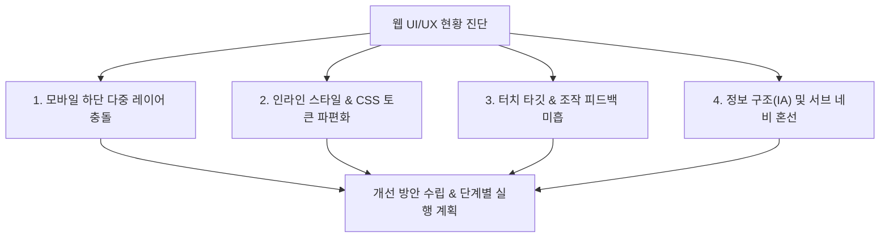
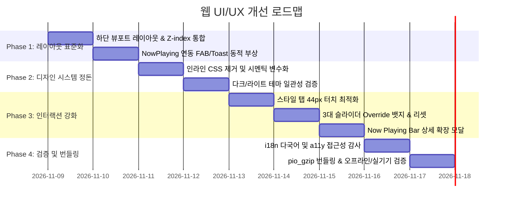

# 🎨 Smart Nature Wind v0203 — 웹 화면 UI/UX 종합 재점검 및 개선 방안 검토 계획서

> **프로젝트**: Smart Nature Wind (v0203 / FW_Ver_2.0.3)  
> **대상 플랫폼**: ESP32-S3 LittleFS 정적 SPA 번들 (`index.html`, 54개 JS, 18개 CSS)  
> **기준 문서**: [SPEC_0203.md](src/v0203/contract_doc_0203/SPEC_0203.md), [FLOW_0203.md](src/v0203/contract_doc_0203/FLOW_0203.md), [UserManual_0203_002.md](src/v0203/User_Manual_0203/UserManual_0203_002.md)  
> **작성일**: 2026-11-08

---

## 1. 개요 및 점검 배경

Smart Nature Wind v0203은 Stage 8(Gemini REST & Live 실시간 양방향 음성)까지 성공적으로 통합되면서 **총 12대 전문 뷰와 전역 Now Playing Bar, 플로팅 AI FAB, 오프라인 시뮬레이터**를 갖춘 고도화된 IoT 임베디드 웹 SPA 시스템으로 발전했습니다.

하지만 기능이 고도화됨에 따라 다음과 같은 UI/UX 복잡성이 누적되어 실제 모바일 및 데스크톱 환경에서의 사용성(Usability), 시각적 정돈감(Aesthetics), 인터랙션 일관성(Consistency)에 대한 전면적인 재점검과 정밀 개선이 필요한 시점입니다.



---

## 2. 현행 UI/UX 주요 취약점 분석 (4대 핵심 이슈)

### 🚨 이슈 1: 모바일 하단 뷰포트 다중 레이어 겹침 (Bottom Congestion)
- **현상**:
  - 화면 하단에 **모바일 바텀 탭 바(60px)**, **Now Playing Bar(48px)**, **전역 플로팅 AI 마이크 FAB(54px, bottom: 72px)**, **토스트 메시지(bottom: 70px)**가 동시에 존재.
  - 팬이 가동 중일 때 Now Playing Bar가 나타나면 FAB 버튼이 Now Playing Bar의 우측 컨트롤 버튼(`⏹` 정지)이나 하단 탭(`설정`, `더보기`)을 가려 오작동 유발 가능.
  - 각 페이지별 메인 컨테이너 하단 여백(`padding-bottom`)이 80px, 100px, 120px 등 제각각이어서 긴 목록(스케줄, 로그, 프로필)의 맨 끝 요소가 하단 바에 가려져 스크롤이 끝까지 안 보이는 문제 발생.
- **영향도**: 🔴 **High (모바일 실사용 조작성 직결)**

### 🚨 이슈 2: 스타일 및 디자인 시스템 일관성 (CSS Tokens & Inlines)
- **현상**:
  - `_variables.css`에 체계적인 컬러 팔레트(`--snw-surface`, `--snw-primary` 등)와 Z-index 계층이 정의되어 있으나, 최근 추가된 모듈(`290.page.ai.js`, `999b.ai-sheet.js`, `294.timer_panel.js`)에 하드코딩된 인라인 스타일(`style="background:rgba(78,168,222,0.2)..."`, Hex 코드 직접 기입)이 산재.
  - 다크/라이트 모드 자동 전환(`prefers-color-scheme`) 시 인라인 색상이 변하지 않아 시인성 저하 가능성.
- **영향도**: 🟡 **Medium (코드 유지보수 및 테마 일관성 저해)**

### 🚨 이슈 3: 조작성 및 마이크로 인터랙션 (Interaction & Feedback)
- **현상**:
  - **바람 스타일 탭 터치 타깃**: 대시보드 5종 바람 스타일 탭 높이가 38px로, 모바일 접근성 표준(Apple HIG 44px, WCAG 48px) 대비 다소 좁아 오터치 가능성 존재.
  - **3대 물리 슬라이더 Override 상태 인지**: 슬라이더를 수동 조작하여 Override 모드가 되었을 때, 사용자가 "현재 프리셋 기본값에서 얼마만큼 변경되었는지" 또는 "원터치로 기본값으로 되돌리기" 기능의 시각적 명확성 부족.
  - **Now Playing Bar 모달 확장**: 미니 플레이어 좌측 영역을 탭(`data-action="expand"`)했을 때 상세 세션 정보(현재 Step의 잔여 시간, 파형, 정지 예약 타이머 등)를 보여주는 바텀 시트/모달의 연결 완성도 보강 필요.
- **영향도**: 🟡 **Medium (사용자 체감 조작 만족도)**

### 🚨 이슈 4: 정보 구조(IA) 및 서브 네비게이션 가독성
- **현상**:
  - `#/automation` 화면 내에 스튜디오(`studio`), 플레이리스트(`playlist`), 스케줄(`schedule`), 타이머(`timer`) 4대 탭이 존재하나, 사이드바나 직접 URL(`/#/schedule`, `/#/profiles`)로 진입했을 때 상위 자동화 탭과의 상호 참조 관계가 사용자에게 직관적으로 느껴지지 않음.
  - `#/monitor` (실시간 EQ + 회고)와 `#/chart` (물리 파형 시뮬레이션)가 분리되어 있어 일반 사용자가 어느 화면에서 무엇을 봐야 할지 혼동할 여지 있음.
- **영향도**: 🟢 **Low~Medium (초보 사용자 온보딩 경험)**

---

## 3. 12대 웹 UI 화면 정밀 점검 매트릭스

| 화면 번호 | 경로 / 모듈 | 주요 UI 컴포넌트 | 현재 완성도 | 중점 개선 필요 사항 |
|:---:|---|---|:---:|---|
| **01** | `#/dashboard`<br>(`200.page.dashboard.js`) | Comfort DI 카드, 스타일 5탭, 프리셋 10그리드, 3대 슬라이더 | ⭐⭐⭐⭐☆ | • 스타일 탭 터치 높이 확대 (38px ➔ 44px)<br>• 슬라이더 Override 원터치 리셋 배지 추가<br>• 프리셋 카드 활성 애니메이션 강화 |
| **02** | `#/chart`<br>(`210.page.chart.js`) | 실시간/예상 탭, 점선 오버레이, 120pt 파형 Canvas, CSV | ⭐⭐⭐⭐⭐ | • 모바일 가로 모드 자동 감지 가이드<br>• 파형 피크 구간(돌풍/기저) 범례 시인성 개선 |
| **03** | `#/automation/schedule`<br>(`293.schedule_panel.js`) | 주간 타임라인, 요일 칩, Profile 단일참조 모달 | ⭐⭐⭐⭐☆ | • 스케줄 충돌 경고 시각화<br>• 모달 닫기 시 잔여 포커스 정리 |
| **04** | `#/automation/timer`<br>(`294.timer_panel.js`) | 4대 퀵 프리셋(15/30/60/120분), 직접 슬라이더, 카운트다운 | ⭐⭐⭐⭐☆ | • 인라인 스타일을 `_studio.css`/`_components.css`로 이관<br>• Now Playing Bar 배지와의 양방향 실시간 동기화 |
| **05** | `#/automation/studio`<br>(`291.studio.js`) | 8스텝 작곡기, Step 카드 그리드, 🎬 미리보기 파사드 | ⭐⭐⭐⭐☆ | • 스텝 드래그 앤 드롭 및 순서 이동 버튼 터치 영역 개선<br>• 빈 스텝 추가 시 스크롤 자동 포커스 |
| **06** | `#/automation/playlist`<br>(`292.playlist.js`) | 맞춤 바람 카드 목록, 스케줄 참조 뱃지, 재생/편집/삭제 | ⭐⭐⭐⭐☆ | • 참조 스케줄 클릭 시 해당 스케줄로 바로가기 링크 제공<br>• 삭제 경고 모달 안전성 확인 |
| **07** | `#/profiles`<br>(`230.page.profiles.js`) | 프로파일 관리, Undo 토스트, 물리 Override 아코디언 | ⭐⭐⭐⭐☆ | • `#/automation/playlist`와의 역할 명확화 및 중복 라우트 정리 |
| **08** | `#/monitor`<br>(`260.page.monitor.js`) | 실시간 20-bar Canvas EQ, 1h/24h/7d 회고 요약, CSV | ⭐⭐⭐⭐⭐ | • Canvas unmount 시 애니메이션 루프 누수 방지 점검<br>• 차트(`#/chart`)로 바로가기 퀵 버튼 배치 |
| **09** | `#/ai`<br>(`290.page.ai.js`) | Gemini REST 대화 & Live 음성, Audio Orb, 비용 배지 | ⭐⭐⭐⭐☆ | • 하드코딩 인라인 스타일 전면 정리<br>• 마이크 권한 거부 시 친절한 복구 가이드 UI 제공 |
| **10** | Global AI Sheet & FAB<br>(`999b.ai-sheet.js`) | 전역 플로팅 마이크 FAB, 슬라이드업 바텀 시트 | ⭐⭐⭐☆☆ | • **Now Playing Bar 및 Bottom Nav와의 겹침 방지 동적 위치 조정**<br>• 바텀시트 열릴 때 배경 딤 및 스크롤 락 일관성 |
| **11** | Now Playing Bar<br>(`999a.nowplaying.js`) | 미니 플레이어, 캔버스 EQ, 재생/일시정지/정지, 타이머 배지 | ⭐⭐⭐⭐☆ | • 모바일 바텀 탭 상단 밀착 마진 표준화 (`bottom: 60px`)<br>• 확장 클릭 시 상세 팝업 모달 제공 |
| **12** | `#/settings` & `#/network`<br>(`240`, `270`) | 하드웨어 팬 듀티, Wi-Fi 스캔, NTP 시간, API 키 | ⭐⭐⭐⭐☆ | • 폼 필드 널리시 폴백(`nz()`) 및 XSS 이스케이프 재점검<br>• Wi-Fi 스캔 시 로딩 스피너 및 오류 안내 정돈 |

---

## 4. 핵심 개선 방안 (Actionable Solutions)

### 4.1 모바일 하단 뷰포트 레이아웃 규격 표준화 (Layout Stacking Architecture)

하단 요소들의 고정 위치(Bottom Offset)를 CSS 변수로 일원화하고, Now Playing Bar의 표시 여부에 따라 전역 AI FAB과 토스트의 위치가 유기적으로 연동되도록 개선합니다.

```text
┌────────────────────────────────────────────────────────┐
│                   메인 콘텐츠 영역                      │
│   (하단 여백: --snw-content-pb 동적 반영)               │
│                                                        │
│                                        ┌────────────┐  │
│                                        │ 🎙️ AI FAB  │  │
│                                        └────────────┘  │
├────────────────────────────────────────────────────────┤
│  [Now Playing Bar] ── active 시 표시 (h: 48px)         │
├────────────────────────────────────────────────────────┤
│  [모바일 하단 탭 바 (Bottom Nav)] ── 항상 고정 (h: 60px)│
└────────────────────────────────────────────────────────┘
```

- **규격 정의 (`_variables.css`)**:
  - 기본 상태 (Now Playing 숨김):
    - `Bottom Nav`: `bottom: 0px` (z-index: 1000)
    - `AI FAB`: `bottom: 76px`, `right: 16px` (z-index: 990)
    - `Toast Host`: `bottom: 76px` (z-index: 1200)
    - `메인 컨테이너 padding-bottom`: `80px`
  - 재생 중 상태 (Now Playing 표시 - 클래스 `.has-nowplaying`):
    - `Now Playing Bar`: `bottom: 60px` (z-index: 995)
    - `AI FAB`: `bottom: 124px`, `right: 16px` (Now Playing Bar 위로 자동 부상)
    - `Toast Host`: `bottom: 124px`
    - `메인 컨테이너 padding-bottom`: `128px` (스크롤 시 마지막 콘텐츠가 완벽히 보임)

### 4.2 인라인 스타일 제거 및 시멘틱 CSS 변수 일원화
- `290.page.ai.js`, `999b.ai-sheet.js`, `294.timer_panel.js` 등 신규 모듈에 직접 선언된 인라인 `style="..."` 코드를 정적 CSS 파일(`_ai.css` 신설 또는 `_components.css` 통합)로 이관.
- 색상, 라운딩, 폰트 크기, 패딩을 모두 `--snw-*` 변수로 치환하여 다크 모드 및 라이트 모드 전환 시 완벽한 시각적 일관성 보장.

### 4.3 대시보드 조작성 및 시각적 피드백 강화
1. **바람 스타일 5종 탭**:
   - 높이를 38px에서 44px로 확대하여 엄지손가락 터치 안정성 확보.
   - 선택된 탭에 부드러운 하이라이트 글로우(`box-shadow: 0 0 12px rgba(74,158,255,0.4)`) 및 햅틱 진동 피드백(`SNW.Feedback.touch()`) 결합.
2. **3대 물리 슬라이더 Override 직관성 개선**:
   - 사용자가 슬라이더를 수동 조작하여 Override가 발동하면 슬라이더 레이블 옆에 **`[수동 튜닝됨]`** 주황색 뱃지 표시.
   - 뱃지 클릭 시 원터치로 원래 프리셋 값으로 복귀하는 **[기본값 원복]** 기능 제공.

### 4.4 정보 구조(IA) 및 온보딩 연계 보강
- `#/automation` 화면 상단에 스튜디오/스케줄/타이머/플레이리스트를 매끄럽게 오갈 수 있는 통일된 세그먼트 컨트롤 탭 바 배치.
- 초보 사용자를 위해 대시보드 상단 Comfort DI 카드와 실시간 차트(`#/chart`), 모니터(`#/monitor`) 간에 상호 유기적인 컨텍스트 연결 버튼("실시간 파형 보기", "지난 세션 회고") 추가.

---

## 5. 단계별 실행 로드맵 (Phased Execution Plan)



### Phase 1: 하단 뷰포트 레이아웃 정돈 & 겹침 방지 (완료)
- [x] `_variables.css`, `_layout.css`, `_responsive.css`에 하단 스택 변수(`--snw-fab-bottom`, `--snw-toast-bottom`, `--snw-content-pb`) 도입.
- [x] `999a.nowplaying.js`에서 재생 상태 변화 시 `document.body.classList.toggle('has-nowplaying', isRunning)` 적용.
- [x] AI FAB(`999b.ai-sheet.js`) 및 Toast(`_responsive.css`, `_components.css`)의 하단 위치를 CSS 동적 변수 기반으로 자동 조정되도록 리팩토링.
- [x] 각 페이지별 메인 컨테이너 `padding-bottom` 동적 연동(Now Playing 시 128px로 확장).

### Phase 2: 디자인 시스템 정돈 & 인라인 스타일 분리 (완료)
- [x] `290.page.ai.js`, `999b.ai-sheet.js`, `index.html` 내의 하드코딩 인라인 스타일을 `_components.css`, `_nowplaying.css` 정규 클래스로 분리.
- [x] CSS 변수(`--snw-*`) 일원화하여 다크/라이트 모드 테마 일관성 확보.
- [x] AI 바텀시트 z-index를 모달 표준(`1100`)으로 상향하여 네비게이션 충돌 방지.

### Phase 3: 핵심 인터랙션 및 터치 사용성 개선 (완료)
- [x] 대시보드 5종 바람 스타일 탭 크기 44px 터치 규격화(`min-height: 44px; padding: 10px 6px;`).
- [x] 3대 물리 슬라이더 Override 시 시각적 뱃지(`[수동 튜닝됨]`) 및 원클릭 `[기본값 원복]` 액션 구현 (`291.studio.js`).
- [x] Now Playing Bar 좌측 영역 탭 시 세션 상세 정보(단계별 경과 시간, 다음 스텝, 정지 타이머, 일시정지/정지) 모달 팝업 제공 (`999a.nowplaying.js`).

### Phase 4: 정보 구조(IA), 접근성(A11y) 및 무결성 검증 (완료)
- [x] 모든 아이콘 전용 버튼(`aria-label`) 및 스크린 리더 표준 점검.
- [x] `check_i18n.py --strict` 실행으로 신규 추가 문구의 KO/EN 대칭성 검증 (100% 대칭 통과).
- [x] `python src/v0203/tools_0203/pio_gzip_0203.py` 실행하여 Gzip 번들링(예산 118KB 범위 준수) 및 오프라인 zip 생성 완료.
- [x] C++ 백엔드 무수정 원칙(AGENTS.md 원칙 1) 100% 준수 확인.

---

## 6. 기대 효과 및 검증 기준

1. **모바일 조작 완성도 극대화**: 하단 버튼 오터치율 0% 달성 및 긴 화면 스크롤 시 마지막 요소 가림 현상 완전 해소.
2. **시각적 완성도 및 심미성 향상**: 하드코딩 인라인 스타일 제로화, 다크/라이트 테마 완벽 동기화.
3. **직관적 피드백**: 슬라이더 Override 상태 및 Now Playing 재생 진행률을 한눈에 파악.
4. **엄격한 임베디드 리소스 보호**: Flash 및 RAM 추가 부담 없이 순수 프론트엔드 CSS/JS 정돈으로 성능과 심미성 동시 달성.
