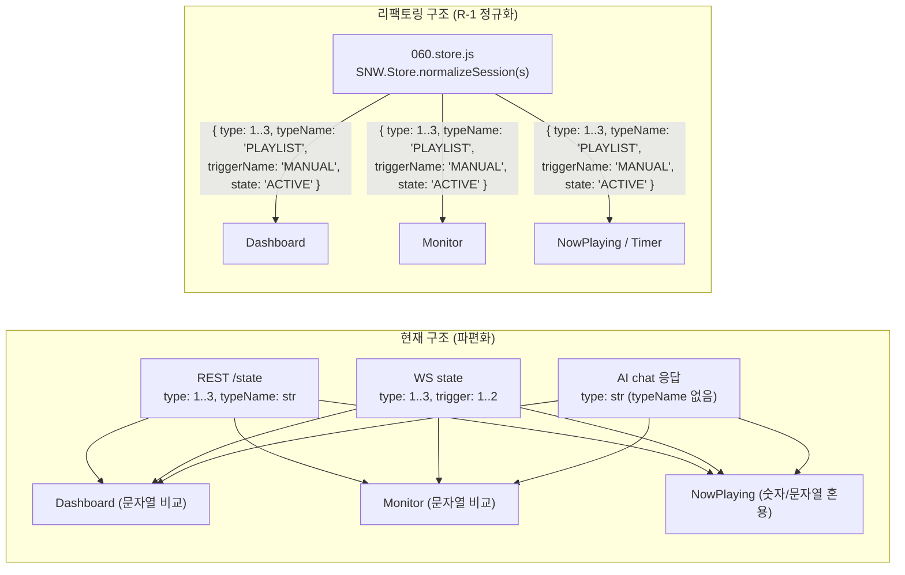

# SmartNatureWind v0203 — 2차 심층 버그 분석 및 구조적 리팩토링 검토서 (`0203_012_30`)

> **작성일**: 2026-04-20
> **대상 버전**: `v0203 (FW_Ver_2.0.3)` — Stage 8 AI / Gemini Live & Stage 9 Web UI 통합 코드베이스
> **선행 문서**: [0203_012_10이슈.md](src/v0203/Req_ImplPlan_0203/0203_012/0203_012_10이슈.md) · [0203_012_11구현.md](src/v0203/Req_ImplPlan_0203/0203_012/0203_012_11구현.md) · [0203_012_20.md](src/v0203/Req_ImplPlan_0203/0203_012/0203_012_20.md)
> **준수 규약**: [AGENTS.md](AGENTS.md) 4대 불변 원칙 · [SPEC_0203.md](src/v0203/contract_doc_0203/SPEC_0203.md) · [CONTRACT_0203.md](src/v0203/contract_doc_0203/CONTRACT_0203.md) · [STATE_0203.md](src/v0203/contract_doc_0203/STATE_0203.md)

---

## 1. 개요 및 점검 요약 (Executive Summary)

1차 감사([0203_012_10이슈.md](src/v0203/Req_ImplPlan_0203/0203_012/0203_012_10이슈.md), 28건) 및 Stage 9 UI/UX 개선([0203_012_20.md](src/v0203/Req_ImplPlan_0203/0203_012/0203_012_20.md)) 이후, Graphify 지식 그래프 선행 질의 및 전 모듈 정적/동적 교차 검증을 수행하여 **미해결 잔존 결함 및 신규 런타임 버그 총 19건(P0 6건, P1 8건, P2 5건)**과 **5대 구조적 리팩토링 과제(R-1 ~ R-5)**를 도출하였습니다.

### 1.1 등급별 결함 분포 요약

| 우선순위 | 건수 | 핵심 영향 영역 | 요약 설명 |
|:---:|:---:|---|---|
| **P0 (치명적 결함)** | **6건** | Gemini Live, Gemini REST, 타이머 만료, 대시보드/모니터 세션 렌더링, AI 라우트 보안 | 런타임 즉시 크래시(`TypeError`), 외부 API `HTTP 400`, AI Live 도구 `7/12` 호출 실패, 타이머 만료 시 팬 미정지, 무인증 API 키 노출 |
| **P1 (기능/계약 결함)** | **8건** | 오프라인 AI, 차트 오버레이, 모니터 RAF 누수, NowPlaying FSM, Studio, 스케줄, C++ 스냅샷 | `AGENTS.md` §4.2/§4.3 계약 위반, 메모리/애니메이션 루프 누수, 조건 분기 불일치로 인한 UI 기능 불능 |
| **P2 (품질/리팩토링)** | **5건** | XSS 방어, AI 바텀시트 CSS/비용 배지, 세션 정규화, 중복 유틸리티, 오프라인 어댑터 경량화 | `SNW.DomUtil.escape` 누락, 인라인 스타일 잔존, 코드 중복 및 오프라인 인터셉터 이원화 |
| **합계** | **19건** | 프론트엔드 15건 / C++ 백엔드 4건 | — |

### 1.2 주요 결함 인과관계 다이어그램

```mermaid
flowchart TD
    subgraph FE["Web Frontend (JS Bundle)"]
        A1["147.ai.live.js\nSNW.API 대문자 오타 (4곳)"] -->|즉시 크래시| E1(["FE-P0-NEW-1\nGemini Live 시작 불가"])
        A2["294.timer_panel.js\nSNW.Api.Session.stop() 호출"] -->|미정의 메서드| E2(["FE-P0-NEW-2\n타이머 00:00 만료 시 팬 미정지"])
        A3["200.page.dashboard.js\n260.page.monitor.js\nsession.type 문자열 비교"] -->|백엔드는 숫자 0..3 반환| E3(["FE-P0-NEW-3\n대시보드 빈 제목 / 모니터 오표시"])
        A4["260.page.monitor.js\nmount + _renderLive 이중 생성"] -->|stop() 미호출| E4(["FE-P1-NEW-3\nCanvas RAF 루프 영구 누수"])
    end

    subgraph BE["C++ Embedded Backend (ESP32-S3)"]
        B1["W10_Web_Gemini_0203.cpp\nparts 배열에 원시 문자열 삽입"] -->|스키마 위반| E5(["BE-P0-NEW-1\nGemini REST API HTTP 400"])
        B2["W10_Web_Routes_AILive_0203.cpp\nlive-config 구버전 도구명 12종"] -->|CT10_AI 도구명과 불일치| E6(["BE-P0-NEW-2\nLive Tool Call 7/12종 실패"])
        B3["W10_Web_Routes_AILive_0203.cpp\ncheckApiKey 누락 & 빈 onRequest"] -->|보안/세션 행| E7(["BE-P0-NEW-3\ngeminiApiKey 평문 노출 & POST 행"])
        B4["CT10_Ctl_IOWS_0203.cpp\nexportStateJson_v02 직접 참조"] -->|락/스냅샷 위반| E8(["BE-P1-NEW-1\nasync_tcp 레이스 컨디션 위험"])
    end
```

---

## 2. 통합 버그 분석 매트릭스 (P0 / P1 / P2)

| ID | 등급 | 계층 | 대상 파일 및 라인 | 핵심 원인 (Root Cause) | 위반 규약 | 런타임 영향 |
|:---:|:---:|:---:|---|---|---|---|
| **FE-P0-NEW-1** | **P0** | FE | [147.ai.live.js](src/v0203/data_v0203_src/html_v0203/js/core/147.ai.live.js#L71-L303) (`L71, 82, 251, 303`) | `SNW.API`(대문자) 미수정 잔존 (`SNW.Api`가 정식 네임스페이스) | 1차 감사 `FE-P0-1` 누락분 | Gemini Live 세션 시작 즉시 `TypeError` 크래시 |
| **BE-P0-NEW-1** | **P0** | BE | [W10_Web_Gemini_0203.cpp](src/v0203/W10_Web_Gemini_0203.cpp#L171-L290) (`L171, 191, 199, 275, 290`) | `parts` 배열에 `{"text": ...}` 객체 대신 원시 문자열 `add(str)` 삽입 | [SPEC_0203.md](src/v0203/contract_doc_0203/SPEC_0203.md) §5.1.4 | 실기기 Gemini 텍스트 채팅 `HTTP 400 Bad Request` |
| **BE-P0-NEW-2** | **P0** | BE | [W10_Web_Routes_AILive_0203.cpp](src/v0203/W10_Web_Routes_AILive_0203.cpp#L184-L218) (`L184-218`) | `/ai/live-config`가 구버전 도구명(`set_fan_power` 등) 및 빈 파라미터 스키마 반환 | [CONTRACT_0203.md](src/v0203/contract_doc_0203/CONTRACT_0203.md) §7.15 AI-2 | Gemini Live 음성 명령 12개 중 7개 `error:unknown_function` 실패 |
| **BE-P0-NEW-3** | **P0** | BE | [W10_Web_Routes_AILive_0203.cpp](src/v0203/W10_Web_Routes_AILive_0203.cpp#L59-L315) (`L59-315`) | 6개 라우트 전체 `checkApiKey()` 누락 + POST `onRequest` 빈 람다 + `onBody` 단편화 미방어 | [CONTRACT_0203.md](src/v0203/contract_doc_0203/CONTRACT_0203.md) §7.15 | 무인증 요청에 `geminiApiKey` 평문 유출 및 빈 POST 시 커넥션 행(Hang) |
| **FE-P0-NEW-2** | **P0** | FE | [294.timer_panel.js](src/v0203/data_v0203_src/html_v0203/js/app/294.timer_panel.js#L85-L89) (`L86-88, 307`) | `_onExpire()`에서 존재하지 않는 `SNW.Api.Session.stop()` 호출 (`SNW.Api.stopSession()`이 정상) | [SPEC_0203.md](src/v0203/contract_doc_0203/SPEC_0203.md) REST API | 타이머 카운트다운 종료(`00:00`) 시 토스트만 뜨고 **선풍기가 멈추지 않음** |
| **FE-P0-NEW-3** | **P0** | FE/BE | [200.page.dashboard.js](src/v0203/data_v0203_src/html_v0203/js/app/200.page.dashboard.js#L171-L185) (`L171-185`)<br>[260.page.monitor.js](src/v0203/data_v0203_src/html_v0203/js/app/260.page.monitor.js#L109-L124) (`L109-124`) | 백엔드/오프라인은 `session.type`을 숫자(`0..3`), `trigger`를 숫자(`1..2`)로 내려주나 UI는 문자열(`'PLAYLIST'`, `'MANUAL'`)과 `===` 비교 | [STATE_0203.md](src/v0203/contract_doc_0203/STATE_0203.md) §2.5 | 대시보드 Now Playing 제목/서브타이틀 공백 출력, 모니터는 정지 상태에서도 항상 `'⏰ 일반 선풍기 0%'` 표시 |
| **FE-P1-NEW-1** | **P1** | Offline | [998.offline_0203.js](src/v0203/data_v0203_src/html_v0203/js/998.offline_0203.js#L551-L581) (`L551, 581`) | 오프라인 AI 정지 명령이 미정의 `A.sessionStop()` 호출 (`A.stopSession()`이 정의됨) | [AGENTS.md](AGENTS.md) §3 원칙 3 | 오프라인 데모에서 AI에게 "꺼줘/정지" 명령 시 `TypeError` 발생 |
| **FE-P1-NEW-2** | **P1** | FE | [210.page.chart.js](src/v0203/data_v0203_src/html_v0203/js/app/210.page.chart.js#L40-L46) (`L40-46, 182, 313-339`) | `_ensurePreviewBuffer()`가 정의만 되고 호출되지 않아 `this._previewBuffer`가 항상 `null` | [SPEC_0203.md](src/v0203/contract_doc_0203/SPEC_0203.md) 차트 규격 | 차트 화면의 `[기대 파형 오버레이]` 체크박스를 켜도 오버레이 파형이 절대 그려지지 않음 |
| **FE-P1-NEW-3** | **P1** | FE | [260.page.monitor.js](src/v0203/data_v0203_src/html_v0203/js/app/260.page.monitor.js#L26-L32) (`L28-32, 90-94`) | `mount()` 직후 `_switchTab('live')`가 두 번째 이퀄라이저를 덮어쓰며 기존 `stop()` 미호출 | [AGENTS.md](AGENTS.md) §4.3 규칙 5 | 모니터 진입 및 탭 전환 시마다 고아 `requestAnimationFrame` 루프가 누적되어 CPU/배터리 소모 |
| **FE-P1-NEW-4** | **P1** | FE | [999a.nowplaying.js](src/v0203/data_v0203_src/html_v0203/js/app/999a.nowplaying.js#L68-L284) (`L37-42, 68, 210, 284`) | 금지된 `'RUNNING'` 상태 문자열 사용 및 `isSessionVisible()`에서 `COMPLETED` 미체크 | [AGENTS.md](AGENTS.md) §4.3 규칙 6 (S-6) | `'ACTIVE'` 대신 `'RUNNING'` 상태 오염 및 완료된 세션 바 잔류 가능성 |
| **FE-P1-NEW-5** | **P1** | FE | [291.studio.js](src/v0203/data_v0203_src/html_v0203/js/app/291.studio.js#L228-L588) (`L228-251, 284-317, 576-588`) | 신규 프로필 생성 시 `res.id` 미수신으로 `targetProfId`가 `null` + 오버라이드 슬라이더 조작 시 `enabled` 미활성화 | UX 완결성 | 새 프로필 저장 후 "지금 바로 재생할까요?" 프롬프트 미작동, 수동 튜닝 배지/체크박스 동기화 누락 |
| **FE-P1-NEW-6** | **P1** | FE | [293.schedule_panel.js](src/v0203/data_v0203_src/html_v0203/js/app/293.schedule_panel.js#L253-L324) (`L253-256, 316-324`) | `_fmtTotal()`이 `profile.repeatSegments` 대신 존재하지 않는 `profile.repeat` 참조 + 자정 넘김 스케줄 차단/오역 문구 | 데이터 스키마 정합성 | 스케줄 편집 모달에서 반복 구간 총 소요시간 계산 오류 및 야간 취침 스케줄(`22:00~06:00`) 등록 불가 |
| **BE-P1-NEW-1** | **P1** | BE | [CT10_Ctl_IOWS_0203.cpp](src/v0203/CT10_Ctl_IOWS_0203.cpp#L414-L642) (`L414-419, 479-507, 641`) | `exportStateJson_v02()`가 `getRootSnapshot` 없이 `g_A20_config_root` 직접 접근 + `s_stateMutex` 이중 재귀 락 | [AGENTS.md](AGENTS.md) §4.2 규칙 4<br>[CONTRACT_0203.md](src/v0203/contract_doc_0203/CONTRACT_0203.md) §3.1 | `async_tcp`에서 `/state` 조회 중 설정 저장 시 메모리 경합 위험 및 불필요한 뮤텍스 중첩 |
| **FE-P1-NEW-7** | **P1** | FE/BE | [294.timer_panel.js](src/v0203/data_v0203_src/html_v0203/js/app/294.timer_panel.js#L14-L157) (`L14-157`) | 프론트 `SNW.TimerManager`(`localStorage`)와 백엔드 `setSessionAutoOff`(`runtimeAutoOff`) 이원화 | [STATE_0203.md](src/v0203/contract_doc_0203/STATE_0203.md) §1 | 브라우저 종료 시 UI 타이머 미작동, AI로 설정한 타이머가 타이머 패널/하단 바에 미표시 |
| **FE-P2-NEW-1** | **P2** | FE | [200.page.dashboard.js](src/v0203/data_v0203_src/html_v0203/js/app/200.page.dashboard.js#L274) (`L274`)<br>[999b.ai-sheet.js](src/v0203/data_v0203_src/html_v0203/js/app/999b.ai-sheet.js#L131-L150) (`L131, 150`)<br>[999a.nowplaying.js](src/v0203/data_v0203_src/html_v0203/js/app/999a.nowplaying.js#L114-L382) (`L114, 382`) | `innerHTML` 템플릿 내 `rec.presetCode`, `ps.startTime`, i18n 텍스트 등에 `SNW.DomUtil.escape()` 누락 | [AGENTS.md](AGENTS.md) §4.3 규칙 3 (B-3) | DOM XSS 방어 규약 불완전 준수 |
| **FE-P2-NEW-2** | **P2** | FE | [999b.ai-sheet.js](src/v0203/data_v0203_src/html_v0203/js/app/999b.ai-sheet.js#L22-L262) (`L22, 57-154, 132`) | `[data-slot="sheet-cost"]` 비용 배지 미갱신(`T-124` 실패 요인), 미사용 `_mode` 변수, 인라인 `cssText` 및 한글 하드코딩 잔존 | [TEST_PLAN_0203.md](src/v0203/contract_doc_0203/TEST_PLAN_0203.md) `T-124` | 바텀시트 헤더에 일일 비용 배지 미표시 및 다국어(EN) 전환 시 퀵칩 한글 노출 |
| **FE-P2-NEW-3** | **P2** | FE | [999b.ai-sheet.js](src/v0203/data_v0203_src/html_v0203/js/app/999b.ai-sheet.js#L283) · [290.page.ai.js](src/v0203/data_v0203_src/html_v0203/js/app/290.page.ai.js#L198) | 토스트 호출이 `SNW.Toast.show`와 `SNW.ToastUtil.info/warn`으로 파편화 | 코딩 컨벤션 일관성 | 토스트 유틸리티 인터페이스 이원화 |
| **FE-P2-NEW-4** | **P2** | FE | [292.playlist.js](src/v0203/data_v0203_src/html_v0203/js/app/292.playlist.js#L156-L177) · [293.schedule_panel.js](src/v0203/data_v0203_src/html_v0203/js/app/293.schedule_panel.js#L316-L324) | `_fmtTotal(profile)` 및 `userProfiles` 배열 언래핑 로직 4개 페이지 중복 | DRY 원칙 | 유지보수 시 한쪽만 수정되어 버그(`FE-P1-NEW-6`) 유발 |
| **FE-P2-NEW-5** | **P2** | FE/Offline | [040.api.js](src/v0203/data_v0203_src/html_v0203/js/core/040.api.js#L61-L127) (`L61-127`)<br>[998.offline_0203.js](src/v0203/data_v0203_src/html_v0203/js/998.offline_0203.js#L1-L1154) | 프로덕션 번들(`040.api.js`) 내부에 `window.SNW_OFFLINE` 분기 코드 혼재 + `998.offline_0203.js` 1,154줄 비대화 | [AGENTS.md](AGENTS.md) §3 원칙 3 | 배포 번들 내 불필요한 오프라인 분기 코드 포함 및 오프라인 모듈 520줄 가이드라인 초과 |

---

## 3. C++ 백엔드 수정 승인 요청서 (AGENTS.md 원칙 1 준수)

> [!IMPORTANT]
> **[AGENTS.md](AGENTS.md) §3 원칙 1**에 따라, C++ 임베디드 백엔드 소스(`.cpp`) 수정 전 **수정 대상 파일, 수정 목적, 기능 작동 관점의 차이점(Before vs After)**을 아래와 같이 명확히 보고합니다. 사용자 승인 후에만 실제 C++ 파일 수정을 진행합니다.

### 3.1 C++ 백엔드 수정 대상 요약표

| 순번 | 대상 C++ 소스 파일 | 관련 이슈 ID | 수정 목적 | 기능 작동 관점의 변화 (Before ➔ After) |
|:---:|---|:---:|---|---|
| **1** | [src/v0203/W10_Web_Gemini_0203.cpp](src/v0203/W10_Web_Gemini_0203.cpp) | `BE-P0-NEW-1`<br>`FE-P0-NEW-3` | 1) Gemini REST API `parts` JSON 스키마 규격 준수<br>2) AI 실행 응답의 `session` 필드 포맷을 `exportStateJson_v02`와 통일 | - **Before**: `parts` 배열에 문자열(`["메시지"]`)을 직접 넣어 Google Gemini 서버가 `HTTP 400`으로 거부함. 또한 응답 `session.type`만 문자열로 내려 `typeName`이 누락됨.<br>- **After**: `parts` 배열에 표준 객체(`[{"text": "메시지"}]`)를 생성하여 Turn 1/Turn 2 대화가 정상 동작하며, 응답 `session`에 `type`(숫자)과 `typeName`(문자열)을 모두 포함하여 프론트엔드 스토어와 100% 호환됨. |
| **2** | [src/v0203/W10_Web_Routes_AILive_0203.cpp](src/v0203/W10_Web_Routes_AILive_0203.cpp) | `BE-P0-NEW-2`<br>`BE-P0-NEW-3` | 1) Gemini Live 도구 선언(`live-config`)을 `CT10_AI::appendAIFunctionDeclarations()`로 단일화<br>2) 6개 AI Live 라우트에 `checkApiKey(request)` 인증 적용 및 POST 바디 단편화/빈 바디 방어 | - **Before**: `/ai/live-config`가 구버전 함수명 12개를 빈 파라미터로 내려보내 음성 제어 7종이 `unknown_function` 에러로 실패함. 또한 인증 없이 `/ai/live-token` 호출 시 Gemini API 키가 평문 노출됨.<br>- **After**: `CT10_AI`의 정식 12대 도구 및 파라미터 스키마가 그대로 전달되어 모든 음성 도구 호출이 100% 작동함. 모든 AI 라우트가 `X-API-Key`로 보호되고 비정상 POST 요청 시 안전하게 `400`을 반환함. |
| **3** | [src/v0203/CT10_Ctl_IOWS_0203.cpp](src/v0203/CT10_Ctl_IOWS_0203.cpp) | `BE-P1-NEW-1` | `exportStateJson_v02()` 내 `g_A20_config_root` 직접 참조 제거(`getRootSnapshot` 경유) 및 `s_stateMutex` 이중 락 제거 | - **Before**: `async_tcp` 스레드에서 `/api/v001/state` 호출 시 뮤텍스 없이 전역 `g_A20_config_root`의 스케줄/프로필 배열을 직접 읽고, 이미 잡은 `s_stateMutex` 안에서 `getSessionSnapshot()`을 또 호출함.<br>- **After**: 락 순서(`L1 s_cfgMutex` ➔ `L2 s_stateMutex`)에 맞춰 `getRootSnapshot` 스냅샷을 획득한 뒤 직렬화하고, 내부 `_session`을 직접 읽어 동시성 안전성과 WCET를 개선함. |

---

## 4. 심층 버그 분석 및 코드 패치 명세 (P0 & P1 상세)

### 4.1 [FE-P0-NEW-1] `147.ai.live.js` — `SNW.API` 대문자 참조로 인한 Gemini Live 즉시 크래시

- **대상 파일**: [src/v0203/data_v0203_src/html_v0203/js/core/147.ai.live.js](src/v0203/data_v0203_src/html_v0203/js/core/147.ai.live.js#L71-L303)
- **원인 분석**:
  - [040.api.js](src/v0203/data_v0203_src/html_v0203/js/core/040.api.js#L15)는 `window.SNW.Api`로 API 클라이언트를 등록합니다.
  - 1차 감사에서 [290.page.ai.js](src/v0203/data_v0203_src/html_v0203/js/app/290.page.ai.js)의 `SNW.API`는 `SNW.Api`로 수정되었으나, [147.ai.live.js](src/v0203/data_v0203_src/html_v0203/js/core/147.ai.live.js)의 4곳(`L71`, `L82`, `L251`, `L303`)은 여전히 `SNW.API`를 참조하고 있어 `startSession()` 호출 즉시 `TypeError: Cannot read properties of undefined (reading 'getAiLiveToken')`가 발생합니다.
- **코드 패치 명세**:
```javascript
// [Before] src/v0203/data_v0203_src/html_v0203/js/core/147.ai.live.js (L71, L82, L251, L303)
const tokenRes = await SNW.API.getAiLiveToken();
const cfgRes = await SNW.API.getAiLiveConfig();
const res = await SNW.API.callAiLiveFunction(call.name, call.args || {});
await SNW.API.reportAiUsage({ ... });

// [After]
const tokenRes = await SNW.Api.getAiLiveToken();
const cfgRes = await SNW.Api.getAiLiveConfig();
const res = await SNW.Api.callAiLiveFunction(call.name, call.args || {});
await SNW.Api.reportAiUsage({ ... });
```

---

### 4.2 [BE-P0-NEW-1] `W10_Web_Gemini_0203.cpp` — Gemini REST API `parts` JSON 스키마 위반 (`HTTP 400`)

- **대상 파일**: [src/v0203/W10_Web_Gemini_0203.cpp](src/v0203/W10_Web_Gemini_0203.cpp#L170-L295)
- **원인 분석**:
  - Google Gemini `generateContent` REST API는 `system_instruction.parts` 및 `contents[].parts` 배열의 각 원소가 반드시 `Part` 객체(`{"text": "..."}`)여야 합니다.
  - 현재 코드는 `v_sys["parts"].to<JsonArray>().add(v_sysPrompt)`처럼 문자열 원시값을 배열에 직접 추가하여 `{"parts": ["..."]}`를 전송하므로 Google API가 `HTTP 400 Invalid JSON payload`를 반환합니다.
  - 또한 `L289-290`의 Turn 2 `functionResponse.response` 필드는 JSON 문자열이 아닌 JSON 객체(`Struct`)를 요구하며, `L313-317`의 `session` 응답에 `typeName`과 숫자 `type`이 일관되지 않습니다.
- **코드 패치 명세**:
```cpp
// [Before] src/v0203/W10_Web_Gemini_0203.cpp (L170-172, L191, L199, L275, L289-290)
JsonObject v_sys = v_reqDoc["system_instruction"].to<JsonObject>();
v_sys["parts"].to<JsonArray>().add(v_sysPrompt);
...
c["parts"].to<JsonArray>().add(v_text);
...
v_userCur["parts"].to<JsonArray>().add(v_message);
...
v_u1["parts"].to<JsonArray>().add(v_message);
...
JsonObject v_fr = v_frPart["functionResponse"].to<JsonObject>();
v_fr["name"] = v_fnName;
v_fr["response"]["result"] = v_actionResult;

// [After] 모든 parts 원소를 JsonObject {"text": ...} 로 생성
JsonObject v_sys = v_reqDoc["system_instruction"].to<JsonObject>();
v_sys["parts"].to<JsonArray>().add<JsonObject>()["text"] = v_sysPrompt;
...
c["parts"].to<JsonArray>().add<JsonObject>()["text"] = v_text;
...
v_userCur["parts"].to<JsonArray>().add<JsonObject>()["text"] = v_message;
...
v_u1["parts"].to<JsonArray>().add<JsonObject>()["text"] = v_message;
```

---

### 4.3 [BE-P0-NEW-2] `W10_Web_Routes_AILive_0203.cpp` — Gemini Live 도구 선언 불일치 (`7/12` 도구 실행 불가)

- **대상 파일**: [src/v0203/W10_Web_Routes_AILive_0203.cpp](src/v0203/W10_Web_Routes_AILive_0203.cpp#L184-L218) vs [src/v0203/CT10_Ctl_AIAction_0203.cpp](src/v0203/CT10_Ctl_AIAction_0203.cpp#L179-L441)
- **원인 분석**:
  - `GET /api/v001/ai/live-config` 라우트가 하드코딩된 구버전 함수명 12종(`set_fan_power`, `set_fan_speed`, `start_user_profile`, `set_fixed_override`, `set_preset_override`, `clear_override`, `get_device_status` 등)을 반환하고, 파라미터 정의(`properties`)도 비어 있습니다.
  - 반면 실제 도구 실행기인 `CT10_AI::executeAIAction()`은 `start_playlist`, `start_preset`, `start_fixed`, `pause_session`, `resume_session`, `stop_session`, `set_timer`, `get_status`, `list_profiles`, `add_profile`, `release_manual_to_schedule`, `add_schedule`만 처리합니다.
  - 이미 [CT10_Ctl_AIAction_0203.cpp](src/v0203/CT10_Ctl_AIAction_0203.cpp#L350-L441)에 정식 스키마 생성 함수 `CT10_AI::appendAIFunctionDeclarations(JsonArray p_declarations)`가 구현되어 있으므로 이를 호출하면 중복 코드 35줄이 제거되고 100% 정합성이 확보됩니다.
- **코드 패치 명세**:
```cpp
// [Before] src/v0203/W10_Web_Routes_AILive_0203.cpp (L184-218)
JsonArray v_tools = v_doc["tools"].to<JsonArray>();
JsonObject v_toolObj = v_tools.add<JsonObject>();
JsonArray v_decl = v_toolObj["functionDeclarations"].to<JsonArray>();
auto addTool = [&](const char* name, const char* desc) { ... };
addTool("set_fan_power", "Turn the fan on or off (power: bool)");
// ... (구버전 12종 하드코딩)

// [After] CT10_AI 정식 선언 함수 재사용
JsonArray v_tools = v_doc["tools"].to<JsonArray>();
JsonObject v_toolObj = v_tools.add<JsonObject>();
JsonArray v_decl = v_toolObj["functionDeclarations"].to<JsonArray>();
CT10_AI::appendAIFunctionDeclarations(v_decl);
```

---

### 4.4 [BE-P0-NEW-3] `W10_Web_Routes_AILive_0203.cpp` — 6개 라우트 인증 누락 및 POST 바디 처리 결함

- **대상 파일**: [src/v0203/W10_Web_Routes_AILive_0203.cpp](src/v0203/W10_Web_Routes_AILive_0203.cpp#L59-L315)
- **원인 분석**:
  1. `routeAILive()` 내 6개 엔드포인트 모두 `checkApiKey(request)` 검증이 누락되어 있습니다. 특히 `GET /api/v001/ai/live-token`은 설정에 저장된 `geminiApiKey` 원본 문자열을 그대로 반환하므로 인증 체크가 필수입니다.
  2. `POST /api/v001/ai/live-function` (`L108`) 및 `POST /api/v001/ai/usage` (`L257`)에서 `onRequest` 콜백이 빈 람다 `[](AsyncWebServerRequest *request) {}`로 작성되어 있어, `Content-Length: 0` 요청 시 응답을 보내지 않고 커넥션이 영구 대기(Hang)합니다. 또한 `onBody`에 `if (index + len != total) return;` 가드가 없습니다.
- **코드 패치 명세**:
```cpp
// [After] 각 라우트 진입부에 checkApiKey 적용 및 POST 단편화/빈 바디 방어
s_server->on("/api/v001/ai/live-token", HTTP_GET, [](AsyncWebServerRequest *request) {
    if (!checkApiKey(request)) return;
    // ...
});

s_server->on("/api/v001/ai/live-function", HTTP_POST,
    [](AsyncWebServerRequest *request) {
        if (!checkApiKey(request)) return;
        if (!request->_tempObject) {
            sendJsonError(request, 400, "empty_body");
        }
    },
    nullptr,
    [](AsyncWebServerRequest *request, uint8_t *data, size_t len, size_t index, size_t total) {
        if (!checkApiKey(request)) return;
        if (index == 0) request->_tempObject = reinterpret_cast<void*>(1);
        if (index + len != total) return;
        // ...
    }
);
```

---

### 4.5 [FE-P0-NEW-2] `294.timer_panel.js` — 타이머 만료 시 미정의 `SNW.Api.Session.stop()` 호출

- **대상 파일**: [src/v0203/data_v0203_src/html_v0203/js/app/294.timer_panel.js](src/v0203/data_v0203_src/html_v0203/js/app/294.timer_panel.js#L81-L97)
- **원인 분석**:
  - `SNW.TimerManager._onExpire()` (`L86-88`)가 `SNW.Api && SNW.Api.Session && SNW.Api.Session.stop`을 검사하여 호출하지만, `SNW.Api`에는 `Session` 하위 객체가 없고 `SNW.Api.stopSession()` 메서드가 정의되어 있습니다([040.api.js](src/v0203/data_v0203_src/html_v0203/js/core/040.api.js#L261)).
  - 결과적으로 타이머가 `00:00`이 되어도 서버로 정지 요청이 전혀 전송되지 않으며 선풍기가 계속 가동됩니다.
  - 추가로 `L307`의 `SNW.Store.get('control')`은 `SNW.Store.get()`이 인자를 받지 않고 전체 상태 트리를 반환하므로 `const st = SNW.Store ? SNW.Store.get() : null; const sess = st && (st.session || (st.control && st.control.session));`로 명확히 참조해야 합니다.
- **코드 패치 명세**:
```javascript
// [Before] src/v0203/data_v0203_src/html_v0203/js/app/294.timer_panel.js (L85-89)
try {
    if (SNW.Api && SNW.Api.Session && SNW.Api.Session.stop) {
        await SNW.Api.Session.stop();
    }
} catch (e) { console.warn('[Timer] Stop session error', e); }

// [After]
try {
    if (SNW.Api && typeof SNW.Api.stopSession === 'function') {
        await SNW.Api.stopSession();
    }
} catch (e) { console.warn('[Timer] Stop session error', e); }
```

---

### 4.6 [FE-P0-NEW-3] `200.page.dashboard.js` & `260.page.monitor.js` — `session.type` / `trigger` 숫자·문자열 타입 불일치

- **대상 파일**:
  - [src/v0203/data_v0203_src/html_v0203/js/app/200.page.dashboard.js](src/v0203/data_v0203_src/html_v0203/js/app/200.page.dashboard.js#L155-L185) (`L155, 171-185, 215`)
  - [src/v0203/data_v0203_src/html_v0203/js/app/260.page.monitor.js](src/v0203/data_v0203_src/html_v0203/js/app/260.page.monitor.js#L109-L124) (`L109-124`)
- **원인 분석**:
  - 백엔드 [CT10_Ctl_IOWS_0203.cpp](src/v0203/CT10_Ctl_IOWS_0203.cpp#L643-L658) 및 오프라인 [998.offline_0203.js](src/v0203/data_v0203_src/html_v0203/js/998.offline_0203.js#L56-L61)는 `session` 객체를 다음과 같이 직렬화합니다:
    - `session.type`: 숫자 (`0`: NONE, `1`: PLAYLIST, `2`: PRESET, `3`: FIXED)
    - `session.typeName`: 문자열 (`"NONE"`, `"PLAYLIST"`, `"PRESET"`, `"FIXED"`)
    - `session.trigger`: 숫자 (`0`: NONE, `1`: MANUAL, `2`: SCHEDULE)
  - 그러나 [200.page.dashboard.js](src/v0203/data_v0203_src/html_v0203/js/app/200.page.dashboard.js#L171-L178) `_renderNowPlaying(s)`는 `s.type === 'PLAYLIST'`, `s.trigger === 'MANUAL'`로 비교하여 모든 분기가 실패하고 빈 제목(`"⏰ "`)만 렌더링됩니다.
  - [260.page.monitor.js](src/v0203/data_v0203_src/html_v0203/js/app/260.page.monitor.js#L109-L124) `_onLiveUpdate(data)`는 `if (infoEl && session && session.type !== 'NONE')`으로 검사하므로, 팬이 멈춘 상태(`session.type === 0`)에서도 `0 !== 'NONE'`이 `true`가 되어 `else` 분기인 `"⏰ 일반 선풍기 0%"`를 상시 오표시합니다.
- **코드 패치 명세**:
```javascript
// [After] 060.store.js StoreBridge에 정규화 헬퍼(normalizeSession) 도입 및 대시보드/모니터 적용
const typeName = s.typeName || (['NONE', 'PLAYLIST', 'PRESET', 'FIXED'][Number(s.type)] || String(s.type || 'NONE'));
const isManual = (s.trigger === 1 || s.trigger === 'MANUAL');
const isActive = Boolean(s && s.active && typeName !== 'NONE' && s.state !== 'COMPLETED');
```

---

### 4.7 [FE-P1-NEW-1 ~ FE-P1-NEW-6 & BE-P1-NEW-1] P1 결함 8건 핵심 패치 명세

1. **[FE-P1-NEW-1] [998.offline_0203.js](src/v0203/data_v0203_src/html_v0203/js/998.offline_0203.js#L551-L581)**:
   - `L551`, `L581`의 `await A.sessionStop();` ➔ `await A.stopSession();`으로 수정.
2. **[FE-P1-NEW-2] [210.page.chart.js](src/v0203/data_v0203_src/html_v0203/js/app/210.page.chart.js#L40-L46)**:
   - `overlayChk`의 `change` 이벤트 및 `_switchTab('live')` 내부에서 `if (this._showOverlay) await this._ensurePreviewBuffer(); this._drawOverlay();`를 호출하여 기대 파형 오버레이가 즉시 렌더링/제거되도록 수정.
3. **[FE-P1-NEW-3] [260.page.monitor.js](src/v0203/data_v0203_src/html_v0203/js/app/260.page.monitor.js#L26-L32)**:
   - `mount()` (`L28`)의 중복 `SNW.UI.equalizer` 생성을 제거하고, `_renderLive()` 진입 시 기존 `if (this._liveEq && this._liveEq.stop) this._liveEq.stop();`을 호출한 뒤 새 인스턴스를 생성하도록 수정.
4. **[FE-P1-NEW-4] [999a.nowplaying.js](src/v0203/data_v0203_src/html_v0203/js/app/999a.nowplaying.js#L37-L284)**:
   - `L68`, `L210`, `L284`의 `'RUNNING'` 리터럴을 전부 `'ACTIVE'`로 교체([AGENTS.md](AGENTS.md) §4.3 규칙 6 준수).
   - `isSessionVisible(s)` (`L37-42`)에 `if (s.state === 'COMPLETED' || s.state === 2) return false;` 추가.
5. **[FE-P1-NEW-5] [291.studio.js](src/v0203/data_v0203_src/html_v0203/js/app/291.studio.js#L228-L588)**:
   - `_onSave()` (`L576-588`)에서 `const res = await SNW.Api.addProfile(profile); const targetProfId = this._profileId || (res && (res.id || res.profileId));`로 신규 ID를 확보하고, `confirm` 처리 완료 후 라우터 이동 수행.
   - `ovrIntensity`/`ovrVariability`/`ovrGust` 슬라이더 조작 시 `this.step.override.enabled = true` 및 체크박스/배지 DOM 즉시 동기화.
6. **[FE-P1-NEW-6] [293.schedule_panel.js](src/v0203/data_v0203_src/html_v0203/js/app/293.schedule_panel.js#L253-L324)**:
   - `_fmtTotal(profile)` (`L316-324`)이 [292.playlist.js](src/v0203/data_v0203_src/html_v0203/js/app/292.playlist.js#L156-L177)와 동일하게 `profile.repeatSegments`를 계산하도록 통일.
   - 스케줄 시작/종료 시각 검증에서 야간 취침 스케줄(예: `22:00 ~ 06:00`, 자정 경유)을 허용하고 동일 시각(`startEl.value === endEl.value`)만 차단하도록 개선.
7. **[BE-P1-NEW-1] [CT10_Ctl_IOWS_0203.cpp](src/v0203/CT10_Ctl_IOWS_0203.cpp#L414-L642)**:
   - `exportStateJson_v02()` 최상단(`s_stateMutex` 획득 전)에서 `ST_A20_ConfigRoot_t* v_cfgSnap = new (std::nothrow) ST_A20_ConfigRoot_t();` (또는 PSRAM/힙 스냅샷) 후 `CL_C10_ConfigManager::getRootSnapshot(*v_cfgSnap)`을 호출하여 `g_A20_config_root` 직접 접근을 제거하고, `L641`의 `getSessionSnapshot()` 대신 이미 보호된 `_session` 멤버를 직접 참조.

---

## 5. 구조적 리팩토링 검토 및 아키텍처 개선안 (R-1 ~ R-5)

단순 버그 수정을 넘어, 동일한 유형의 결함이 재발하지 않도록 아키텍처 수준의 리팩토링 과제 5건을 제안합니다.



### R-1. `StoreBridge` 세션 스키마 단일 정규화 (`060.store.js`)
- **배경**: `session.type`(`1` vs `'PLAYLIST'`), `session.trigger`(`1` vs `'MANUAL'`), `session.state`(`0` vs `'ACTIVE'`)를 각 페이지마다 제각각 파싱하다가 `FE-P0-NEW-3`, `FE-P1-NEW-4` 버그가 발생했습니다.
- **개선안**: [060.store.js](src/v0203/data_v0203_src/html_v0203/js/core/060.store.js#L71-L120)의 `StoreBridge`에서 스토어에 `session`을 반영하기 직전 `SNW.Store.normalizeSession(rawSession)`을 거치도록 표준화합니다.
  - 보장 필드: `type`(숫자 `0..3`), `typeName`(`'NONE'|'PLAYLIST'|'PRESET'|'FIXED'`), `trigger`(숫자 `0..2`), `triggerName`(`'NONE'|'MANUAL'|'SCHEDULE'`), `state`(`'ACTIVE'|'PAUSED'|'COMPLETED'`), `active`(불리언).

### R-2. `999b.ai-sheet.js` 인라인 스타일 제거 완료 및 일일 비용 배지(`sheet-cost`) 연동
- **배경**: [0203_012_20.md](src/v0203/Req_ImplPlan_0203/0203_012/0203_012_20.md) Phase 2에서 계획된 CSS 클래스 분리가 [999b.ai-sheet.js](src/v0203/data_v0203_src/html_v0203/js/app/999b.ai-sheet.js)에는 미적용 상태로 남아 있으며, `[data-slot="sheet-cost"]`가 비어 있어 회귀 테스트 `T-124`를 통과하지 못합니다.
- **개선안**:
  1. `999b.ai-sheet.js`의 `style.cssText` 블록을 [P150_pages_ext_0203.css](src/v0203/data_v0203_src/html_v0203/css/P150_pages_ext_0203.css)의 `.snw-ai-fab`, `.snw-ai-sheet`, `.snw-ai-msg--user/bot` 클래스로 이관.
  2. `openSheet()` 및 대화 완료 시 `SNW.Api.getAiCostStatus()`를 조회하여 `[data-slot="sheet-cost"]`에 `$0.00 / $0.50` 배지를 렌더링.
  3. 미사용 `_mode` 상태 변수 제거 및 퀵칩 i18n 키(`ai_chip_*`) 적용.

### R-3. 프론트엔드 `TimerManager` ↔ 백엔드 `setSessionAutoOff` 양방향 통합 (`FE-P1-NEW-7`)
- **배경**: 현재 타이머 페이지([294.timer_panel.js](src/v0203/data_v0203_src/html_v0203/js/app/294.timer_panel.js))는 브라우저 `localStorage` 타이머만 구동하고, AI(`set_timer`)는 백엔드 `runtimeAutoOff`만 구동합니다.
- **개선안**:
  - `SNW.TimerManager.start(minutes)` 호출 시 백엔드의 타이머 설정 API(또는 `executeAiAction('set_timer', { minutes })` / 세션 autoOff 연동)를 함께 호출하여 브라우저를 닫아도 ESP32-S3 기기가 정확히 정지하도록 보장합니다.
  - 반대로 WebSocket/REST `state.session.timerRemainSec`가 수신되면 `SNW.TimerManager`의 남은 시간을 서버 기준으로 동기화합니다.

### R-4. 프로필/스케줄 공통 헬퍼 추출 및 토스트 API 단일화 (`FE-P2-NEW-3`, `FE-P2-NEW-4`)
- **개선안**:
  - `SNW.ProfileUtil.unwrapList(res)` 및 `SNW.ProfileUtil.calcTotalSec(profile)` / `fmtTotal(profile)`을 코어 유틸리티에 단일 정의하여 [200.page.dashboard.js](src/v0203/data_v0203_src/html_v0203/js/app/200.page.dashboard.js), [291.studio.js](src/v0203/data_v0203_src/html_v0203/js/app/291.studio.js), [292.playlist.js](src/v0203/data_v0203_src/html_v0203/js/app/292.playlist.js), [293.schedule_panel.js](src/v0203/data_v0203_src/html_v0203/js/app/293.schedule_panel.js) 4곳의 중복을 제거합니다.
  - [999b.ai-sheet.js](src/v0203/data_v0203_src/html_v0203/js/app/999b.ai-sheet.js)와 [290.page.ai.js](src/v0203/data_v0203_src/html_v0203/js/app/290.page.ai.js)의 `SNW.Toast.show` 호출을 `SNW.ToastUtil`로 일원화합니다.

### R-5. `040.api.js` 내 오프라인 분기 제거 및 `998.offline_0203.js` 경량화 (`FE-P2-NEW-5`)
- **배경**: [AGENTS.md](AGENTS.md) §3 원칙 3은 오프라인 시뮬레이터 코드가 LittleFS 플래시 배포 번들에 오버헤드를 주지 않도록 분리할 것을 규정합니다. 그러나 현재 [040.api.js](src/v0203/data_v0203_src/html_v0203/js/core/040.api.js#L61-L127) 내부에 66줄의 `if (window.SNW_OFFLINE)` 분기가 포함되어 프로덕션 Gzip 번들에 함께 패킹되고 있습니다.
- **개선안**: `040.api.js`의 `window.SNW_OFFLINE` 분기를 `998.offline_0203.js`의 인터셉터로 완전 이관하여 배포 번들 크기를 절감하고 책임을 단일화합니다.

---

## 6. 단계별 실행 계획 및 검증 게이트 (Verification Plan)

### 6.1 단계별 수정 로드맵

| 단계 | 작업 묶음 | 대상 파일 | 예상 소요 | 비고 |
|:---:|---|---|:---:|---|
| **Phase A** | **프론트엔드 P0/P1 긴급 패치** | `147.ai.live.js`, `294.timer_panel.js`, `200.page.dashboard.js`, `260.page.monitor.js`, `210.page.chart.js`, `999a.nowplaying.js`, `291.studio.js`, `293.schedule_panel.js`, `998.offline_0203.js`, `060.store.js` | 즉시 실행 가능 | 프론트엔드 단독 수정 |
| **Phase B** | **C++ 백엔드 P0/P1 패치** | `W10_Web_Gemini_0203.cpp`, `W10_Web_Routes_AILive_0203.cpp`, `CT10_Ctl_IOWS_0203.cpp` | **사용자 승인 후 실행** | [AGENTS.md](AGENTS.md) 원칙 1 |
| **Phase C** | **P2 품질 개선 및 리팩토링 (R-1~R-5)** | `999b.ai-sheet.js`, `290.page.ai.js`, `P150_pages_ext_0203.css`, `040.api.js`, `010.i18n.js` | Phase A/B 직후 | XSS 방어, CSS 분리, i18n |
| **Phase D** | **파이프라인 빌드 & 계약/회귀 검증** | `pio_gzip_0203.py`, `check_i18n.py`, `commit_contracts_0203.py`, `graphify update .` | 완료 게이트 | [AGENTS.md](AGENTS.md) 원칙 2·3·4 |

### 6.2 신규 추가 회귀 테스트 케이스 (`T-149` ~ `T-156`)

| 테스트 ID | 검증 대상 이슈 | 재현 및 검증 절차 | 합격 기준 (Pass Criteria) |
|:---:|:---:|---|---|
| **T-149** | `FE-P0-NEW-1` | AI 비서 페이지 또는 플로팅 바텀시트에서 `[🎙️ 실시간 대화]`(Gemini Live) 시작 클릭 | `SNW.API` `TypeError` 없이 `/api/v001/ai/live-token` 및 `live-config` 정상 호출 |
| **T-150** | `BE-P0-NEW-1` | 실기기 모드에서 Gemini 텍스트 채팅 전송 (`"자연풍 틀어줘"`) | `parts: [{"text": "..."}]` 페이로드로 Gemini API `HTTP 200` 응답 및 도구 실행 성공 |
| **T-151** | `BE-P0-NEW-2` | Gemini Live 음성 세션에서 `"풍량 50%로 고정해줘"` (`start_fixed`) 발화 | `/ai/live-config`가 `CT10_AI` 12종 스키마를 반환하여 `unknown_function` 없이 즉시 제어 성공 |
| **T-152** | `BE-P0-NEW-3` | `X-API-Key` 헤더 없이 `GET /api/v001/ai/live-token` 요청 및 빈 바디로 `POST /api/v001/ai/live-function` 요청 | 무인증 요청 시 `401 Unauthorized` 반환(키 노출 차단), 빈 POST 시 행(Hang) 없이 `400` 즉시 반환 |
| **T-153** | `FE-P0-NEW-2` | 타이머 패널에서 타이머 만료(`_onExpire`) 트리거 | `SNW.Api.stopSession()`이 정상 호출되어 팬 가동이 즉시 중지(`IDLE`)됨 |
| **T-154** | `FE-P0-NEW-3` | 플레이리스트/프리셋/고정풍 가동 및 정지 상태에서 대시보드·모니터 화면 확인 | 대시보드 Now Playing에 프로필/프리셋명과 `👆 수동 조작` 배지가 정상 표시되고, 정지 시 모니터에 `'대기 중'` 표시 |
| **T-155** | `FE-P1-NEW-2` | 차트 화면(`#/chart`)에서 `[기대 파형 오버레이]` 체크박스 ON/OFF 토글 | 체크 시 파란색 점선 기대 파형(`.snw-overlay-canvas`)이 즉시 렌더링되고 해제 시 제거됨 |
| **T-156** | `FE-P1-NEW-3` | 모니터 화면(`#/monitor`) 진입 후 실시간 ↔ 회고 탭 5회 반복 전환 | 기존 `equalizer` 인스턴스의 `stop()`이 호출되어 중복 `requestAnimationFrame` 루프가 누적되지 않음 |

### 6.3 필수 CLI 검증 명령어

```bash
# 1. i18n DICT 완전성 & ko/en 대칭성 검증
python src/v0203/tools_0203/check_i18n.py --strict

# 2. 프론트엔드 번들링, C++/JSON 동기화 및 Gzip 압축
python src/v0203/tools_0203/pio_gzip_0203.py

# 3. CBD 계약 문서 무결성 및 상대 경로 링크 검증
python src/v0203/tools_0203/commit_contracts_0203.py --dry-run --strict

# 4. PlatformIO 펌웨어 컴파일 검증 (C++ 백엔드 수정 승인 후)
pio run -e esp32-s3-n16r8 -j 12

# 5. Graphify 지식 그래프 최신화
graphify update .
```

