# SmartNatureWind v0203 — 2차 감사 19건 및 구조적 리팩토링 단계별 구현 및 검증 가이드 (`0203_012_31구현`)

> **작성일**: 2026-11-08  
> **대상 버전**: `v0203 (FW_Ver_2.0.3)` — Stage 8 AI / Gemini Live & Stage 9 Web UI 통합 코드베이스  
> **선행 분석 문서**: [0203_012_30이슈.md](0203_012_30이슈.md) (2차 심층 분석 및 19대 결함/리팩토링 보고서)  
> **참조 문서**: [0203_012_10이슈.md](0203_012_10이슈.md) · [0203_012_11구현.md](0203_012_11구현.md) · [0203_012_20.md](0203_012_20.md)  
> **준수 규약**: [AGENTS.md](../../../AGENTS.md) 4대 불변 원칙 · [SPEC_0203.md](../contract_doc_0203/SPEC_0203.md) · [CONTRACT_0203.md](../contract_doc_0203/CONTRACT_0203.md) · [STATE_0203.md](../contract_doc_0203/STATE_0203.md) · [TEST_PLAN_0203.md](../contract_doc_0203/TEST_PLAN_0203.md)

---

## 1. 구현 로드맵 및 Phase 개요

본 문서는 `0203_012_30이슈.md`에서 식별된 **19건의 결함(P0 6건, P1 8건, P2 5건)**과 **5대 구조적 리팩토링(R-1~R-5)**을 안전하고 체계적으로 해결하기 위한 **상세 구현 및 단계별 회귀 검증 명세서**입니다.

### 1.1 Phase별 구성 및 게이트웨이

```mermaid
flowchart TD
    subgraph PhaseA["Phase A: 프론트엔드 긴급 패치 (P0/P1)"]
        A1["147.ai.live.js (FE-P0-NEW-1)"]
        A2["294.timer_panel.js (FE-P0-NEW-2)"]
        A3["060.store.js 세션 정규화 (R-1 / FE-P0-NEW-3)"]
        A4["200.page.dashboard.js & 260.page.monitor.js"]
        A5["999a.nowplaying.js (FE-P1-NEW-4)"]
        A6["210.page.chart.js & 260.page.monitor.js (FE-P1-NEW-2,3)"]
        A7["291.studio.js & 293.schedule_panel.js (FE-P1-NEW-5,6)"]
        A8["998.offline_0203.js (FE-P1-NEW-1)"]
    end

    subgraph GateA["Gate A: UI 무결성 및 기본 회귀"]
        GA["T-149, T-153, T-154, T-155, T-156 통과"]
    end

    subgraph PhaseB["Phase B: C++ 백엔드 결함 해소 (P0/P1)"]
        B1["W10_Web_Gemini_0203.cpp (BE-P0-NEW-1)"]
        B2["W10_Web_Routes_AILive_0203.cpp (BE-P0-NEW-2,3)"]
        B3["CT10_Ctl_IOWS_0203.cpp (BE-P1-NEW-1)"]
    end

    subgraph GateB["Gate B: 빌드 및 기기 보안/통신 검증"]
        GB["pio run 컴파일 + T-150, T-151, T-152 통과"]
    end

    subgraph PhaseC["Phase C: 품질 강화 및 구조적 리팩토링 (P2 & R-2~R-5)"]
        C1["DOM XSS 탈출 강화 (FE-P2-NEW-1)"]
        C2["999b.ai-sheet.js CSS 분리 & 비용 배지 연동 (R-2 / FE-P2-NEW-2)"]
        C3["타이머 양방향 동기화 (R-3 / FE-P1-NEW-7)"]
        C4["공통 헬퍼 추출 및 토스트 단일화 (R-4 / FE-P2-NEW-3,4)"]
        C5["040.api.js 배포 번들 내 오프라인 분기 제거 (R-5 / FE-P2-NEW-5)"]
    end

    subgraph PhaseD["Phase D: 파이프라인 번들링 및 계약 검증"]
        D1["check_i18n.py --strict"]
        D2["pio_gzip_0203.py 번들링"]
        D3["commit_contracts_0203.py --dry-run --strict"]
        D4["graphify update ."]
    end

    PhaseA --> GateA
    GateA --> PhaseB
    PhaseB --> GateB
    GateB --> PhaseC
    PhaseC --> PhaseD
```



---

## 2. Phase A: 프론트엔드 긴급 패치 (P0/P1)

### 2.1 [FE-P0-NEW-1] `147.ai.live.js` — `SNW.API` 네임스페이스 오타 치환
- **대상 파일**: [src/v0203/data_v0203_src/html_v0203/js/core/147.ai.live.js](../../data_v0203_src/html_v0203/js/core/147.ai.live.js)
- **작업 내용**: 대문자 `SNW.API` 4건을 소문자 카멜케이스 `SNW.Api`로 치환.
- **Before**:
  ```javascript
  // L71
  const tokenRes = await SNW.API.getAiLiveToken();
  // L82
  const cfgRes = await SNW.API.getAiLiveConfig();
  // L251
  const res = await SNW.API.callAiLiveFunction(call.name, call.args || {});
  // L303
  await SNW.API.reportAiUsage({ ... });
  ```
- **After**:
  ```javascript
  // L71
  const tokenRes = await SNW.Api.getAiLiveToken();
  // L82
  const cfgRes = await SNW.Api.getAiLiveConfig();
  // L251
  const res = await SNW.Api.callAiLiveFunction(call.name, call.args || {});
  // L303
  await SNW.Api.reportAiUsage({ ... });
  ```
- **검증**: `grep -n "SNW\.API\." src/v0203/data_v0203_src/html_v0203/js/core/147.ai.live.js` 결과 0건 확인 (`T-149`).

---

### 2.2 [FE-P0-NEW-2] `294.timer_panel.js` — 타이머 만료 시 정지 API 수정
- **대상 파일**: [src/v0203/data_v0203_src/html_v0203/js/app/294.timer_panel.js](../../data_v0203_src/html_v0203/js/app/294.timer_panel.js)
- **작업 내용**: 존재하지 않는 `SNW.Api.Session.stop()` 대신 `SNW.Api.stopSession()` 호출. 또한 `L307`의 스토어 접근 로직을 안전하게 수정.
- **Before**:
  ```javascript
  // L86-88
  if (SNW.Api && SNW.Api.Session && SNW.Api.Session.stop) {
      await SNW.Api.Session.stop();
  }
  // L307
  const ctl = SNW.Store ? SNW.Store.get('control') : null;
  ```
- **After**:
  ```javascript
  // L86-88
  if (SNW.Api && typeof SNW.Api.stopSession === 'function') {
      await SNW.Api.stopSession();
  }
  // L307
  const st = SNW.Store ? SNW.Store.get() : null;
  const sess = st ? (st.session || (st.control && st.control.session)) : null;
  ```
- **검증**: 타이머 카운트다운 0초 도달 시 `POST /api/v001/control/session/stop`이 전송되고 팬이 멈추는지 확인 (`T-153`).

---

### 2.3 [R-1 / FE-P0-NEW-3] `060.store.js` 세션 정규화 및 대시보드/모니터/NowPlaying 통합

#### 2.3.1 `060.store.js` 세션 정규화 헬퍼 추가
- **대상 파일**: [src/v0203/data_v0203_src/html_v0203/js/core/060.store.js](../../data_v0203_src/html_v0203/js/core/060.store.js)
- **작업 내용**: `StoreBridge` 내에서 `session` 갱신 시 `type`, `typeName`, `trigger`, `triggerName`, `state`, `active`를 표준 형태로 일관되게 정규화.
- **구현 명세**:
  ```javascript
  const TYPE_NAMES = ['NONE', 'PLAYLIST', 'PRESET', 'FIXED'];
  const TRIGGER_NAMES = ['NONE', 'MANUAL', 'SCHEDULE'];

  function normalizeSession(s) {
      if (!s || typeof s !== 'object') {
          return {
              type: 0,
              typeName: 'NONE',
              trigger: 0,
              triggerName: 'NONE',
              state: 'IDLE',
              active: false,
              name: '',
              presetCode: '',
              styleCode: '',
              elapsedSec: 0,
              remainSec: 0,
              totalSec: 0
          };
      }

      let typeNum = 0;
      let typeName = 'NONE';
      if (typeof s.type === 'number') {
          typeNum = s.type;
          typeName = TYPE_NAMES[typeNum] || (s.typeName || 'NONE');
      } else if (typeof s.type === 'string') {
          typeName = s.type.toUpperCase();
          typeNum = TYPE_NAMES.indexOf(typeName);
          if (typeNum < 0) typeNum = 0;
      } else if (s.typeName) {
          typeName = String(s.typeName).toUpperCase();
          typeNum = TYPE_NAMES.indexOf(typeName);
          if (typeNum < 0) typeNum = 0;
      }

      let trigNum = 0;
      let trigName = 'NONE';
      if (typeof s.trigger === 'number') {
          trigNum = s.trigger;
          trigName = TRIGGER_NAMES[trigNum] || 'NONE';
      } else if (typeof s.trigger === 'string') {
          trigName = s.trigger.toUpperCase();
          trigNum = TRIGGER_NAMES.indexOf(trigName);
          if (trigNum < 0) trigNum = 0;
      }

      let stateStr = 'IDLE';
      if (typeof s.state === 'string') {
          stateStr = s.state.toUpperCase() === 'RUNNING' ? 'ACTIVE' : s.state.toUpperCase();
      } else if (typeof s.state === 'number') {
          stateStr = s.state === 1 ? 'PAUSED' : (s.state === 2 ? 'COMPLETED' : 'ACTIVE');
      }

      const activeBool = Boolean(s.active && typeName !== 'NONE' && stateStr !== 'COMPLETED');

      return {
          ...s,
          type: typeNum,
          typeName: typeName,
          trigger: trigNum,
          triggerName: trigName,
          state: stateStr,
          active: activeBool
      };
  }
  ```

#### 2.3.2 `200.page.dashboard.js` 수정
- **대상 파일**: [src/v0203/data_v0203_src/html_v0203/js/app/200.page.dashboard.js](../../data_v0203_src/html_v0203/js/app/200.page.dashboard.js)
- **작업 내용**: `_renderNowPlaying(s)`에서 `s.typeName`과 `s.triggerName` 기준으로 분기하도록 수정.
- **Before**:
  ```javascript
  // L171-185
  if (s.type === 'PLAYLIST') {
      title = s.name || `프로필 #${s.profileNo || ''}`;
      sub = `단계 ${s.stepNo || 1}/${s.totalSteps || 1}`;
  } else if (s.type === 'PRESET') {
      title = `${s.presetCode || ''} · ${s.styleCode || ''}`;
      sub = s.durationSec ? `${Math.round(s.durationSec / 60)}분 설정` : '연속 재생';
  } else if (s.type === 'FIXED') {
      title = `고정 풍량 ${s.fixedSpeed || 0}%`;
      sub = s.durationSec ? `${Math.round(s.durationSec / 60)}분 설정` : '연속 재생';
  }
  const trigBadge = (s.trigger === 'MANUAL') ? '👆 수동 조작' : '⏰ 스케줄';
  ```
- **After**:
  ```javascript
  const typeName = s.typeName || (['NONE','PLAYLIST','PRESET','FIXED'][s.type] || String(s.type || 'NONE'));
  if (typeName === 'PLAYLIST') {
      title = s.name || `프로필 #${s.profileNo || ''}`;
      sub = `단계 ${s.stepNo || 1}/${s.totalSteps || 1}`;
  } else if (typeName === 'PRESET') {
      title = `${s.presetCode || ''} · ${s.styleCode || ''}`;
      sub = s.durationSec ? `${Math.round(s.durationSec / 60)}분 설정` : '연속 재생';
  } else if (typeName === 'FIXED') {
      title = `고정 풍량 ${s.fixedSpeed || 0}%`;
      sub = s.durationSec ? `${Math.round(s.durationSec / 60)}분 설정` : '연속 재생';
  }
  const isManual = (s.trigger === 1 || s.triggerName === 'MANUAL' || s.trigger === 'MANUAL');
  const trigBadge = isManual ? '👆 수동 조작' : '⏰ 스케줄';
  ```

#### 2.3.3 `260.page.monitor.js` 수정
- **대상 파일**: [src/v0203/data_v0203_src/html_v0203/js/app/260.page.monitor.js](../../data_v0203_src/html_v0203/js/app/260.page.monitor.js)
- **작업 내용**: `_onLiveUpdate()`에서 `session.active` 및 `typeName !== 'NONE'` 여부를 판정하여 정지 상태에서 올바르게 대기 상태를 표시.
- **Before**:
  ```javascript
  // L109-124
  if (infoEl && session && session.type !== 'NONE') {
      let title = '';
      if (session.type === 'PLAYLIST') title = session.name || `프로필 #${session.profileNo || ''}`;
      else if (session.type === 'PRESET') title = `${session.presetCode || ''} · ${session.styleCode || ''}`;
      else title = `일반 선풍기 ${(session.speed || 0)}%`;
      ...
  ```
- **After**:
  ```javascript
  const typeName = session ? (session.typeName || ['NONE','PLAYLIST','PRESET','FIXED'][session.type] || 'NONE') : 'NONE';
  const isActive = Boolean(session && session.active && typeName !== 'NONE');
  if (infoEl && isActive) {
      let title = '';
      if (typeName === 'PLAYLIST') title = session.name || `프로필 #${session.profileNo || ''}`;
      else if (typeName === 'PRESET') title = `${session.presetCode || ''} · ${session.styleCode || ''}`;
      else title = `일반 선풍기 ${(session.speed || 0)}%`;
      ...
  } else if (infoEl) {
      infoEl.innerHTML = '<span class="snw-chip">대기 중</span>';
  }
  ```

---

### 2.4 [FE-P1-NEW-4] `999a.nowplaying.js` — 금지된 `'RUNNING'` 제거 및 세션 표시 가드
- **대상 파일**: [src/v0203/data_v0203_src/html_v0203/js/app/999a.nowplaying.js](../../data_v0203_src/html_v0203/js/app/999a.nowplaying.js)
- **작업 내용**:
  1. `L68, 210, 284`의 `'RUNNING'` 문자열을 `'ACTIVE'`로 교체.
  2. `isSessionVisible(s)`에서 `s.state === 'COMPLETED'` 검사 추가.
- **코드 수정**:
  ```javascript
  // L37-42
  function isSessionVisible(s) {
      if (!s) return false;
      if (s.state === 'COMPLETED') return false;
      const type = s.typeName || s.type;
      return (type !== 0 && type !== 'NONE' && s.active !== false);
  }
  // L68, 210, 284
  const stateStr = (s.state === 1 || s.state === 'PAUSED') ? 'PAUSED' : 'ACTIVE';
  ```

---

### 2.5 [FE-P1-NEW-2] `210.page.chart.js` — 기대 파형 오버레이 버퍼 생성 및 토글
- **대상 파일**: [src/v0203/data_v0203_src/html_v0203/js/app/210.page.chart.js](../../data_v0203_src/html_v0203/js/app/210.page.chart.js)
- **작업 내용**:
  1. `overlayChk` 변경 리스너와 `_switchTab('live')` 진입 시 `_ensurePreviewBuffer()`를 호출하여 `this._previewBuffer`가 항상 적재되도록 보장.
  2. 체크 해제 시 오버레이 캔버스를 확실히 제거하도록 `_drawOverlay()` 보강.
- **코드 수정**:
  ```javascript
  // L40-46
  overlayChk.addEventListener('change', async (e) => {
      this._showOverlay = e.target.checked;
      if (this._showOverlay) {
          await this._ensurePreviewBuffer();
      }
      this._drawOverlay();
  });
  ```

---

### 2.6 [FE-P1-NEW-3] `260.page.monitor.js` — 이퀄라이저 RAF 중복 생성 및 누수 제거
- **대상 파일**: [src/v0203/data_v0203_src/html_v0203/js/app/260.page.monitor.js](../../data_v0203_src/html_v0203/js/app/260.page.monitor.js)
- **작업 내용**:
  1. `mount()` (`L28`)의 중복 `SNW.UI.equalizer()` 초기화 제거.
  2. `_renderLive()` 진입 및 탭 전환(`_switchTab`) 시 기존 `this._liveEq.stop()` 안전 호출.
  3. `unmount()` 시 `if (this._liveEq) this._liveEq.stop();` 확인.
- **코드 수정**:
  ```javascript
  // mount() 내부 L28 부근
  // (제거) this._liveEq = SNW.UI.equalizer(...)  <-- _renderLive에서 전담 생성

  // _renderLive() L75 부근
  if (this._liveEq && typeof this._liveEq.stop === 'function') {
      this._liveEq.stop();
      this._liveEq = null;
  }
  const eqCanvas = slot.querySelector('.snw-monitor-eq');
  if (eqCanvas && SNW.UI && SNW.UI.equalizer) {
      this._liveEq = SNW.UI.equalizer(eqCanvas);
  }
  ```

---

### 2.7 [FE-P1-NEW-5] `291.studio.js` — 신규 프로필 생성 후 즉시 재생 및 오버라이드 동기화
- **대상 파일**: [src/v0203/data_v0203_src/html_v0203/js/app/291.studio.js](../../data_v0203_src/html_v0203/js/app/291.studio.js)
- **작업 내용**:
  1. `_onSave()`에서 신규 등록 API 응답으로부터 새로 발급된 `profileId`(`res.id` 또는 `res.profileId`)를 받아와 즉시 재생 `confirm` 대화창이 열리도록 수정.
  2. 슬라이더(`ovrIntensity` 등) 조작 시 `this.step.override.enabled = true` 처리 및 UI 체크박스/배지 동기화.
- **코드 수정**:
  ```javascript
  // L576-588
  const res = await SNW.Api.addProfile(payload);
  const targetProfId = this._profileId || (res && (res.id || res.profileId || res.profileNo));
  if (targetProfId && confirm('프로필이 저장되었습니다. 지금 바로 재생할까요?')) {
      await SNW.Api.startProfile(targetProfId);
  }
  SNW.Router.navigate('/automation/playlist');
  ```

---

### 2.8 [FE-P1-NEW-6] `293.schedule_panel.js` — `_fmtTotal` 필드 정정 및 야간 스케줄 허용
- **대상 파일**: [src/v0203/data_v0203_src/html_v0203/js/app/293.schedule_panel.js](../../data_v0203_src/html_v0203/js/app/293.schedule_panel.js)
- **작업 내용**:
  1. `_fmtTotal(profile)`에서 `profile.repeat` 대신 `profile.repeatSegments`를 검사하도록 수정 (`292.playlist.js`와 통일).
  2. `startEl.value >= endEl.value` 검사에서 시작과 종료가 같은 경우만 오류 처리하고, 시작이 종료보다 큰 야간 취침 스케줄(`22:00 ~ 06:00`)은 익일 종료로 허용.
- **코드 수정**:
  ```javascript
  // L253-256
  if (startEl.value === endEl.value) {
      SNW.ToastUtil.warn('시작 시각과 종료 시각이 같을 수 없습니다.');
      return;
  }
  // L316-324
  let totalMin = 0;
  if (profile.steps) {
      profile.steps.forEach(st => { totalMin += (st.durationMin || 0); });
  }
  if (profile.repeatSegments && (profile.repeatCount || 0) > 0) {
      totalMin *= profile.repeatCount;
  }
  ```

---

### 2.9 [FE-P1-NEW-1] `998.offline_0203.js` — AI stop 커맨드 메서드명 수정
- **대상 파일**: [src/v0203/data_v0203_src/html_v0203/js/998.offline_0203.js](../../data_v0203_src/html_v0203/js/998.offline_0203.js)
- **작업 내용**: `L551`, `L581`의 `await A.sessionStop();` ➔ `await A.stopSession();`으로 수정.

---

## 3. Phase B: C++ 백엔드 결함 해소 (P0/P1)

> [!CAUTION]
> 본 Phase는 `AGENTS.md` §3 원칙 1에 따른 사용자 사전 승인 대상 파일 3종에 대한 실제 코드 수정 명세입니다.

### 3.1 [BE-P0-NEW-1] `W10_Web_Gemini_0203.cpp` — Gemini REST API JSON 스키마 규격 준수
- **대상 파일**: [src/v0203/W10_Web_Gemini_0203.cpp](../../W10_Web_Gemini_0203.cpp)
- **목적**: Gemini REST API의 `parts` 배열에 `Part` 객체(`{"text": "..."}`)를 올바르게 삽입하여 `HTTP 400 Bad Request` 에러를 해소하고 대화 응답의 `session` 포맷을 정규화.
- **수정 명세**:
  ```cpp
  // 1. system_instruction parts 생성 (L170-172)
  JsonObject v_sys = v_reqDoc["system_instruction"].to<JsonObject>();
  v_sys["role"] = "system";
  v_sys["parts"].to<JsonArray>().add<JsonObject>()["text"] = v_sysPrompt;

  // 2. 히스토리 contents parts 생성 (L190-192)
  JsonObject c = v_contents.add<JsonObject>();
  c["role"] = v_role;
  c["parts"].to<JsonArray>().add<JsonObject>()["text"] = v_text;

  // 3. 현재 사용자 메시지 parts 생성 (L198-200, L274-276)
  JsonObject v_userCur = v_contents.add<JsonObject>();
  v_userCur["role"] = "user";
  v_userCur["parts"].to<JsonArray>().add<JsonObject>()["text"] = v_message;

  // 4. Turn 2 functionResponse response 객체 생성 (L288-292)
  JsonObject v_frPart = v_fnParts.add<JsonObject>();
  JsonObject v_fr = v_frPart["functionResponse"].to<JsonObject>();
  v_fr["name"] = v_fnName;
  JsonObject v_frResp = v_fr["response"].to<JsonObject>();
  v_frResp["result"] = v_actionResult;

  // 5. 응답 session에 type/typeName 동시 제공 (L313-317)
  JsonObject v_sess = v_resDoc["session"].to<JsonObject>();
  v_sess["type"] = (uint8_t)v_curSess.type;
  v_sess["typeName"] = (v_curSess.type == EN_CT10_SESSION_PLAYLIST) ? "PLAYLIST" :
                       (v_curSess.type == EN_CT10_SESSION_PRESET)   ? "PRESET" :
                       (v_curSess.type == EN_CT10_SESSION_FIXED)    ? "FIXED" : "NONE";
  ```

---

### 3.2 [BE-P0-NEW-2 & BE-P0-NEW-3] `W10_Web_Routes_AILive_0203.cpp` — 도구 선언 단일화 및 보안/단편화 방어
- **대상 파일**: [src/v0203/W10_Web_Routes_AILive_0203.cpp](../../W10_Web_Routes_AILive_0203.cpp)
- **목적**:
  1. `/api/v001/ai/live-config`의 하드코딩된 구버전 도구 선언을 `CT10_AI::appendAIFunctionDeclarations()`로 단일화하여 12종 도구 호출 실패 해결.
  2. 6개 라우트 전체에 `checkApiKey(request)` 적용으로 `geminiApiKey` 무인증 평문 유출 차단.
  3. POST 라우트 빈 바디 및 단편화 수신 방어.
- **수정 명세**:
  ```cpp
  // 1. /api/v001/ai/live-config 단일화 (L184-218 치환)
  s_server->on("/api/v001/ai/live-config", HTTP_GET, [](AsyncWebServerRequest *request) {
      if (!checkApiKey(request)) return;
      JsonDocument v_doc;
      v_doc["model"] = "gemini-2.0-flash-exp";
      v_doc["generationConfig"]["responseModalities"] = "audio";
      v_doc["generationConfig"]["speechConfig"]["voiceConfig"]["prebuiltVoiceConfig"]["voiceName"] = "Aoede";

      JsonArray v_tools = v_doc["tools"].to<JsonArray>();
      JsonObject v_toolObj = v_tools.add<JsonObject>();
      JsonArray v_decl = v_toolObj["functionDeclarations"].to<JsonArray>();

      // [단일 진실 공급원 위임]
      CT10_AI::appendAIFunctionDeclarations(v_decl);

      sendJson(request, v_doc);
  });

  // 2. /api/v001/ai/live-token 인증 적용 (L59)
  s_server->on("/api/v001/ai/live-token", HTTP_GET, [](AsyncWebServerRequest *request) {
      if (!checkApiKey(request)) return;
      // ...
  });

  // 3. /api/v001/ai/live-function 인증 및 단편화/빈 바디 방어 (L107-170)
  s_server->on("/api/v001/ai/live-function", HTTP_POST,
      [](AsyncWebServerRequest *request) {
          if (!checkApiKey(request)) return;
          if (!request->_tempObject) {
              sendJsonError(request, 400, "empty_body");
          }
      },
      nullptr,
      [](AsyncWebServerRequest *request, uint8_t *data, size_t len, size_t index, size_t total) {
          if (!checkApiKey(request)) return;
          if (index == 0) request->_tempObject = reinterpret_cast<void*>(1);
          if (index + len != total) return; // 단편화 패킷 대기
          // ... JSON 파싱 및 executeAIAction 위임 ...
      }
  );
  ```

---

### 3.3 [BE-P1-NEW-1] `CT10_Ctl_IOWS_0203.cpp` — `exportStateJson_v02` 동시성 스냅샷 보호
- **대상 파일**: [src/v0203/CT10_Ctl_IOWS_0203.cpp](../../CT10_Ctl_IOWS_0203.cpp)
- **목적**: `async_tcp` 스레드에서 `/api/v001/state` 호출 시 `g_A20_config_root`를 락 없이 직접 읽는 레이스 컨디션을 방지하고 `s_stateMutex` 이중 재귀 락을 해소.
- **수정 명세**:
  ```cpp
  // L414 부근: s_stateMutex 획득 전 L1(s_cfgMutex)으로 안전한 스냅샷 확보
  ST_A20_ConfigRoot_t v_cfgSnap;
  CL_C10_ConfigManager::getRootSnapshot(v_cfgSnap);

  // L479-507: g_A20_config_root 대신 v_cfgSnap 참조
  if (v_cfgSnap.schedules) {
      // v_cfgSnap.schedules->count 및 항목 직렬화
  }
  if (v_cfgSnap.userProfiles) {
      // v_cfgSnap.userProfiles->count 및 항목 직렬화
  }

  // L641: 이미 s_stateMutex를 쥐고 있으므로 getSessionSnapshot() 대신 내부 멤버 직접 복사
  ST_CT10_SessionState_t v_sess = _session; // safe under s_stateMutex
  ```

---

## 4. Phase C: 품질 강화 및 구조적 리팩토링 (P2 & R-2~R-5)

### 4.1 [FE-P2-NEW-1] DOM XSS 방어 탈출 처리 적용
- **대상 파일**:
  - [src/v0203/data_v0203_src/html_v0203/js/app/200.page.dashboard.js](../../data_v0203_src/html_v0203/js/app/200.page.dashboard.js) `L274`
  - [src/v0203/data_v0203_src/html_v0203/js/app/999b.ai-sheet.js](../../data_v0203_src/html_v0203/js/app/999b.ai-sheet.js) `L131, 150`
  - [src/v0203/data_v0203_src/html_v0203/js/app/999a.nowplaying.js](../../data_v0203_src/html_v0203/js/app/999a.nowplaying.js) `L114, 382`
- **작업 내용**: 동적 텍스트를 `innerHTML`에 삽입할 때 `SNW.DomUtil.escape()` 적용.

---

### 4.2 [R-2 / FE-P2-NEW-2] `999b.ai-sheet.js` CSS 분리 및 비용 배지 연동
- **대상 파일**:
  - [src/v0203/data_v0203_src/html_v0203/js/app/999b.ai-sheet.js](../../data_v0203_src/html_v0203/js/app/999b.ai-sheet.js)
  - [src/v0203/data_v0203_src/html_v0203/css/P150_pages_ext_0203.css](../../data_v0203_src/html_v0203/css/P150_pages_ext_0203.css)
- **작업 내용**:
  1. `999b.ai-sheet.js`의 인라인 `style.cssText` 블록을 `P150_pages_ext_0203.css`의 `.snw-ai-sheet`, `.snw-ai-sheet__header`, `.snw-ai-msg` 클래스로 이관.
  2. 바텀시트가 열릴 때(`openSheet`) 및 AI 응답 수신 시 `SNW.Api.getAiCostStatus()`를 호출하여 `[data-slot="sheet-cost"]` 엘리먼트에 일일 누적 비용(`$0.00 / $0.50`) 표시 (`T-124` 완전 통과).
  3. 미사용 변수 `_mode` 정리 및 퀵칩 텍스트를 `SNW.I18n.t('ai_chip_*')`로 다국어 지원.

---

### 4.3 [R-3 / FE-P1-NEW-7] 프론트-백엔드 타이머 양방향 동기화
- **대상 파일**: [src/v0203/data_v0203_src/html_v0203/js/app/294.timer_panel.js](../../data_v0203_src/html_v0203/js/app/294.timer_panel.js)
- **작업 내용**:
  1. UI 타이머 시작 시 `SNW.Api.executeAiAction('set_timer', { minutes: m })` (또는 백엔드 타이머 API)를 함께 호출하여 브라우저 종료 시에도 기기 자체 자동 꺼짐을 보장.
  2. 백엔드 상태(`session.timerRemainSec` 또는 `runtimeAutoOff`)가 수신되면 프론트엔드 카운트다운 잔여 시간을 동기화.

---

### 4.4 [R-4 / FE-P2-NEW-3,4] 공통 헬퍼 추출 및 토스트 단일화
- **대상 파일**:
  - [src/v0203/data_v0203_src/html_v0203/js/core/040.api.js](../../data_v0203_src/html_v0203/js/core/040.api.js)
  - [src/v0203/data_v0203_src/html_v0203/js/app/290.page.ai.js](../../data_v0203_src/html_v0203/js/app/290.page.ai.js)
  - [src/v0203/data_v0203_src/html_v0203/js/app/999b.ai-sheet.js](../../data_v0203_src/html_v0203/js/app/999b.ai-sheet.js)
- **작업 내용**:
  1. `SNW.Toast.show(...)` 호출을 `SNW.ToastUtil.info/warn/error/success(...)`로 전면 일원화.
  2. `SNW.ProfileUtil.unwrapList()` 및 `calcTotalSec()`를 `040.api.js` 또는 `060.store.js`에 공통 정의하여 4개 페이지의 중복 언래핑 제거.

---

### 4.5 [R-5 / FE-P2-NEW-5] `040.api.js` 내 오프라인 분기 제거
- **대상 파일**: [src/v0203/data_v0203_src/html_v0203/js/core/040.api.js](../../data_v0203_src/html_v0203/js/core/040.api.js)
- **작업 내용**: 프로덕션 번들에 포함되는 `040.api.js` 내부의 66줄 `if (window.SNW_OFFLINE)` 분기를 제거하고, 해당 모의 동작을 배포에서 제외되는 `998.offline_0203.js`의 `fetch` 가로채기(Interceptor)로 완전히 일임.

---

## 5. Phase D: 빌드 파이프라인 및 회귀 검증

### 5.1 검증 CLI 시퀀스
모든 구현 완료 후 다음 CLI 명령어를 순차적으로 실행하여 게이트웨이를 검증합니다.

```bash
# 1. i18n DICT 완전성 검증 (Phase 5.7+ CI Gate)
python src/v0203/tools_0203/check_i18n.py --strict

# 2. 정적 에셋 번들링, C++/JSON 자동 동기화 및 Gzip 압축
python src/v0203/tools_0203/pio_gzip_0203.py

# 3. CBD 계약 문서 무결성 및 상대 경로 검증 (Dry-run)
python src/v0203/tools_0203/commit_contracts_0203.py --dry-run --strict

# 4. PlatformIO C++ 백엔드 펌웨어 컴파일 검증
pio run -e esp32-s3-n16r8 -j 12

# 5. Graphify 지식 그래프 최신화
graphify update .
```

### 5.2 회귀 테스트 매핑 체크리스트

| 테스트 ID | 대상 이슈 | 검증 시나리오 및 판정 기준 | 결과 |
|:---:|:---:|---|:---:|
| **T-149** | `FE-P0-NEW-1` | Gemini Live 세션 시작 시 콘솔에 `SNW.API` `TypeError` 미발생 및 토큰 수신 확인 | ⬜ |
| **T-150** | `BE-P0-NEW-1` | 실기기 Gemini 텍스트 대화 시 Google 서버 `HTTP 200` 정상 수신 및 동작 확인 | ⬜ |
| **T-151** | `BE-P0-NEW-2` | Gemini Live 음성으로 "풍량 50% 고정" 명령 시 `unknown_function` 에러 없이 팬 제어 성공 | ⬜ |
| **T-152** | `BE-P0-NEW-3` | 무인증 `GET /api/v001/ai/live-token` 요청 시 `401 Unauthorized` 반환 및 키 노출 차단 | ⬜ |
| **T-153** | `FE-P0-NEW-2` | 타이머 카운트다운 00:00 만료 시 `stopSession`이 호출되어 팬이 확실히 정지함 | ⬜ |
| **T-154** | `FE-P0-NEW-3` | 대시보드 및 모니터에서 세션 종류와 수동 조작 배지가 정상 표시되고 정지 시 대기 상태 표시 | ⬜ |
| **T-155** | `FE-P1-NEW-2` | 차트 화면에서 `[기대 파형 오버레이]` 체크 시 점선 파형이 정상 렌더링되고 해제 시 제거됨 | ⬜ |
| **T-156** | `FE-P1-NEW-3` | 모니터 탭 반복 전환 시 Canvas 이퀄라이저 RAF 누수가 발생하지 않음 | ⬜ |
| **T-124** | `FE-P2-NEW-2` | AI 바텀시트 헤더에 누적 비용 배지(`$0.00 / $0.50`)가 정상 표시됨 | ⬜ |
| **T-120** | `FE-P1-NEW-1` | 오프라인 데모 환경에서 AI에게 "꺼줘" 명령 시 에러 없이 팬이 정지함 | ⬜ |

