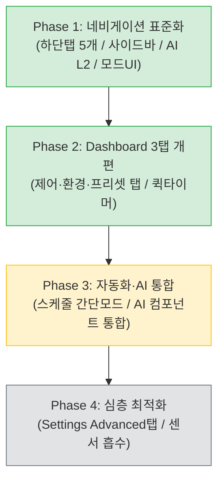

# 📋 [0203_013] Stage 10 — UI/UX 정보구조(IA) 재설계 및 사용자 시나리오 최적화 계획서

> **문서 ID**: `0203_013_10보완_02.md` (Stage 10 개선안)  
> **이전 문서**: [`0203_013_10보완_01.md`](0203_013_10보완_01.md) (변경 전 초안)  
> **대상 버전**: SmartNatureWind v0203 (FW_Ver_2.0.3)  
> **작성/개정일**: 2026-11-09  
> **작업 성격**: 일반 사용자 시나리오 기반 프론트엔드 정보구조(IA) 재설계 및 화면 최적화  
> **적용 범위**: 프론트엔드 SPA 레이어 (`index.html`, `js/core/`, `js/app/`, `css/`) + CBD 계약 문서  
> **관련 계약 문서**: [SPEC_0203.md](../../contract_doc_0203/SPEC_0203.md), [FLOW_0203.md](../../contract_doc_0203/FLOW_0203.md), [CONTRACT_0203.md](../../contract_doc_0203/CONTRACT_0203.md), [STATE_0203.md](../../contract_doc_0203/STATE_0203.md), [BUDGET_0203.md](../../contract_doc_0203/BUDGET_0203.md), [TEST_PLAN_0203.md](../../contract_doc_0203/TEST_PLAN_0203.md)

---

## 1. 개요 및 아키텍처 원칙 준수

### 1.1 배경 및 목적
SmartNatureWind v0203은 다양한 기능(자연풍 시뮬레이션, 스튜디오 작곡, 센서 모니터링, AI 대화 및 실시간 음성, 스케줄러 등)이 추가되면서 메뉴 항목이 급증하고 화면 간 중복 경로가 발생했습니다.
특히 일반 사용자 관점에서 "잠들기 전 조용한 바람 설정", "원하는 시간에 켜지게 하기" 등의 일상적인 조작을 수행할 때 불필요하게 많은 화면 이동과 개념 학습(예: 프로필 작곡 선행)을 요구하는 마찰 지점이 확인되었습니다.

본 문서는 **일반 사용자의 핵심 시나리오(수면, 예약, 진단, 온습도 조절, AI, 프리셋 설정)**를 중심으로 정보구조(IA)와 네비게이션을 재편하여 진입 장벽을 낮추고 화면 이동 피로도를 최소화하는 종합 실행 계획을 정의합니다.

### 1.2 4대 불변 개발 원칙 준수성

| 원칙 | 내용 | 본 계획 준수 방안 |
|:---|:---|:---|
| **원칙 1: 백엔드 수정 승인** | C++ 소스(`.h`, `.cpp`) 수정 시 목적/기능변화 사전 승인 필수 | **전체 기본 과제(Phase 1, 2)는 FE 단독 실행(C++ 무수정)**.<br>향후 백엔드 변경이 수반되는 항목(Comfort 자동 시작, 스케줄 직속 프리셋 바인딩)은 별도 사전 승인 분리. |
| **원칙 2: Graph-First** | `graphify query` 후 최소 라인 Read & `graphify update .` | 라우터 및 대시보드 컴포넌트 라인 확정 후 수정, 작업 후 그래프 동기화 실행. |
| **원칙 3: 정적 에셋 파이프라인** | FE 소스 수정 후 `pio_gzip_0203.py` 필수 실행 | `js/`, `css/`, `index.html` 수정 후 번들링 및 `check_i18n.py --strict` 무결성 검증 필수 수행. |
| **원칙 4: CBD 계약 동시 갱신** | 인터페이스/FSM/스키마 변경 시 6대 계약 문서 동시 갱신 | Dashboard 3탭 및 라우트 변경에 따른 SPEC, FLOW, CONTRACT, STATE, BUDGET, TEST_PLAN 동시 갱신 및 검증. |

---

## 2. 현행 UI/UX 및 IA 현황 진단 (AS-IS)

### 2.1 라우트 인벤토리 분석 (총 20개 라우트)

현재 라우터(`070.router.js`)에 등록된 20개 라우트 중 4개 라우트에서 명백한 기능 중복 및 파사드 위임이 발견됩니다.

| 번호 | 라우트 경로 | 바인딩 컴포넌트 / 대상 | 최소 레벨 | 진단 결과 및 문제점 |
|:---:|:---|:---|:---:|:---|
| 1 | `/dashboard` | `SNW.Page.Dashboard` | L1 | 정상 (메인 홈) |
| 2 | `/chart` | `SNW.Page.Chart` | L2 | 정상 (실시간 파형) |
| 3 | `/sensors` | `SNW.Page.Sensors` | L2 | 정상 (센서 상세) |
| 4 | `/monitor` | `SNW.Page.Monitor` | L2 | 정상 (라이프사이클 모니터) |
| 5 | `/simulation` | `SNW.Page.Simulation` | L3 | ⚠️ Studio/WindProfile과 역할 중복 및 인지도 저하 |
| 6 | `/windprofile` | `SNW.Page.WindProfile` | L3 | 정상 (프리셋 파라미터 관리) |
| 7 | `/schedule` | `220.page.schedule.js` | L2 | 🔴 `/automation/schedule` (#9)와 완전 동일 기능 위임 |
| 8 | `/profiles` | `230.page.profiles.js` | L2 | 🔴 `/automation/playlist` (#10)과 완전 동일 기능 위임 |
| 9 | `/automation/schedule` | `SNW.SchedulePanel` | L2 | 🔴 #7과 중복 (자동화 탭 내 하위 뷰) |
| 10 | `/automation/playlist` | `SNW.Playlist` | L2 | 🔴 #8과 중복 (자동화 탭 내 하위 뷰) |
| 11 | `/automation/studio` | `SNW.Studio` | L2 | 정상 (프로필 작곡기) |
| 12 | `/automation/timer` | `SNW.TimerPanel` | L2 | 정상 (타이머 패널) |
| 13 | `/settings` | `SNW.Page.Settings` | L3 | 정상 (환경설정) |
| 14 | `/network` | `SNW.Page.Network` | L3 | 정상 (네트워크/AP 설정) |
| 15 | `/logs` | `SNW.Page.Logs` | L3 | 정상 (시스템 로그) |
| 16 | `/diagnostics` | `SNW.Page.Diagnostics` | L4 | 정상 (개발자 하드웨어 진단) |
| 17 | `/firmware` | `SNW.Page.Firmware` | L4 | 정상 (OTA/펌웨어 업데이트) |
| 18 | `/ai` | `SNW.Page.AI` | L4 | 🔴 우측 하단 상시 FAB(AI Sheet)과 기능 중복 및 L4 격리로 접근성 저하 |
| 19 | `/info` | `SNW.Page.Info` | L1 | 정상 (기기/시스템 정보) |
| 20 | `/automation` | `SNW.Page.Automation` | L2 | 기본 라우트 (`/automation/studio`로 연결) |

### 2.2 사이드바 네비게이션 구조의 문제점
현재 사이드바(`NAV_GROUPS`)는 3개 그룹, 총 16개 항목이 나열되어 있습니다.

```
· 제어 그룹 (7개): Dashboard, Chart, Automation, Schedule, Profiles, Sensors, Monitor
· 설정 그룹 (4개): Simulation, Windprofile, Settings, Network
· 시스템 그룹 (5개): Logs, Diagnostics, Firmware, AI, Info
```

1. **중복 노출**: `Automation` 메뉴가 있음에도 불구하고 하위 기능인 `Schedule`과 `Profiles`가 제어 그룹에 별도 항목으로 중복 노출되어 사이드바가 과도하게 길어집니다.
2. **AI의 부적절한 배치**: 제품의 핵심 차별화 기능인 AI Assistant가 시스템 그룹 최하단(L4 레벨)에 배치되어 일반 사용자가 찾을 수 없습니다.
3. **기능적 그룹핑 모호성**: `Simulation`이 설정 그룹에 포함되어 있어 사용자가 성격을 파악하기 어렵습니다.

### 2.3 모바일 하단 탭 바 (Material Design 가이드 위반)
현재 모바일 하단 탭 바(`index.html:79~96`)는 6개 항목으로 구성되어 있습니다.

```
[대시보드] · [차트] · [자동화] · [스케줄] · [설정] · [더보기(···)]
```

- **Material Design 표준(3~5개) 위반**: 6개 탭으로 인해 모바일 뷰(375px 너비)에서 라벨이 축소되거나 터치 타깃(최소 44px) 확보가 불안정합니다.
- **불필요한 '더보기' 탭**: 모바일 헤더 좌측에 이미 사이드바 토글 햄버거 버튼(`btn-menu`)이 상시 노출되어 있으므로 '더보기' 탭은 중복 액션입니다.
- **인라인 onclick 이벤트**: `onclick="document.getElementById('btn-menu').click()"` 등 인라인 핸들러 사용으로 CSP 안정성 및 코드 품질 저해.

### 2.4 권한 레벨(L1~L4) 구조의 문제점
현재 기본 권한 레벨 설정이 개발/디버깅 편의를 위해 `SNW.CFG.DEFAULT_LEVEL = 'L4'`로 되어 있거나, 일반 사용자가 자신의 수준에 맞게 인터페이스를 간소화할 수 있는 전환 장치가 없습니다.

---

## 3. 사용자 핵심 시나리오(A~F) 여정 분석 및 개선안

### 3.1 시나리오 A: "잠들기 전 조용한 바람 30분" (수면 및 타이머)
- **사용자 목표**: 침대에 누워 취침용 바람(약풍/수면 스타일)을 선택하고 30분 뒤 꺼지도록 설정.
- **현재 사용자 여정 (5단계, 4개 화면 이동)**:
  ```
  Dashboard 진입 → 스타일 "수면" 클릭 → 프리셋 "FOREST_CANOPY" 클릭 
    → 하단 탭 [자동화] 이동 → [타이머] 탭 전환 → [30분] 버튼 클릭 → [대시보드] 복귀
  ```
- **마찰 지점**: 스타일/프리셋 선택과 타이머 실행이 완전히 분리된 화면에 존재하여 동선이 매우 길고 모바일에서 피로도가 높음.
- **이상적 여정 (2단계, 단일 화면)**:
  ```
  Dashboard 진입 → 스타일/프리셋 선택 → Now Playing Bar 옆 [⏱️ 30분] 퀵 액션 터치 → 완료
  ```
- **보완 사항**:
  1. Now Playing 컨트롤 영역에 `⏱️` 퀵 타이머 버튼 추가 (활성 세션 시 즉시 노출).
  2. 클릭 시 인라인 빠른 시간 선택(15/30/60분) 다이얼로그 연동 (`SNW.TimerManager`).

---

### 3.2 시나리오 B: "매일 아침 7시에 자동으로 켜지게" (스케줄 예약)
- **사용자 목표**: 기상 시간(07:00)에 맞춰 상쾌한 자연풍이 자동으로 시작되도록 예약.
- **현재 사용자 여정 (6단계 + 개념 이해 필요)**:
  ```
  1. Studio 진입하여 "프로필(Profile)" 개념 파악
  2. Studio → Step 추가 → 프리셋/스타일 선택 → 프로필 저장
  3. Playlist 탭으로 이동하여 저장 확인
  4. Schedule 탭으로 이동
  5. 새 스케줄 추가 → 위에서 생성한 프로필 바인딩
  6. 가동 시간/요일 설정 후 저장
  ```
- **마찰 지점**: 스케줄에 프리셋을 직접 지정할 수 없고, 반드시 작곡 스튜디오를 통해 프로필을 생성해야만 스케줄을 만들 수 있는 강제 워크플로 존재.
- **이상적 여정 (3단계)**:
  ```
  Schedule 탭 진입 → [+ 새 스케줄] → [간단 모드] 선택: 원하는 프리셋/시간/요일 직접 지정 후 저장
  ```
- **보완 사항**:
  1. `SNW.SchedulePanel`에 "간단 모드(Simple)"와 "고급 모드(Advanced)" 듀얼 모드 도입.
  2. FE 단독 우회 구현: 간단 모드 선택 시 단일 Step을 갖는 프로필을 내부에서 자동 생성(`Date.now()` 기반 고유 ID)하여 스케줄에 연결.

---

### 3.3 시나리오 C: "팬이 안 돌아요" (원인 진단 및 문제 해결)
- **사용자 목표**: 팬이 멈춰 있을 때 그 원인(PIR 재실 감지 부재, 스케줄 종료, 에러 등)을 즉시 파악하고 재가동.
- **현재 사용자 여정 (탐색적 방황)**:
  ```
  Dashboard (정지 확인) → 원인 불명 → Sensors? Chart? Monitor? Diagnostics? Logs? 5개 화면 방황
  ```
- **마찰 지점**: 상태 진단 정보가 여러 화면에 흩어져 있고, 시스템 로그나 Diagnostics는 전문 용어로 가득 차 일반인이 원인을 알 수 없음.
- **이상적 여정 (1단계 원클릭 해결)**:
  ```
  Dashboard 상단 배너 확인: ⚠️ "재실 감지 없음으로 인해 자동 정지되었습니다. [지금 다시 켜기]"
  ```
- **보완 사항**:
  1. 대시보드 상단에 원인 인지형 상태 배너(`SNW.Banner` 활용) 배치.
  2. `control.stateCode !== 0 && sim.active === false` 조건 시 중단 사유(PIR 타임아웃, 리미트 도달 등) 및 즉시 재개 버튼 표출.
  3. 개발자용 Diagnostics 메뉴는 "고급 진단"으로 명칭 변경 후 L4 유지.

---

### 3.4 시나리오 D: "방 온도에 맞춰 알아서 조절" (Comfort 자동화)
- **사용자 목표**: 센서로 측정된 온도/습도에 따라 최적의 바람 세기와 스타일이 자동 유지되기를 원함.
- **현재 사용자 여정**:
  - 대시보드에 Comfort 카드가 존재하여 추천 프리셋을 띄우고 [▶ 지금 재생] 버튼을 제공하지만, 1회성 적용에 불과함.
  - 사용자가 환경 변화마다 수동으로 버튼을 눌러야 함.
- **이상적 여정**:
  - Comfort 카드 내에 "쾌적 자동 모드(Auto Comfort)" 토글 스위치 제공. 활성화 시 실내 불쾌지수 변화에 따라 자동 튜닝.
- **보완 사항**:
  - **FE 1단계**: Comfort 카드에 자동 모드 UI 토글 추가 (L3 노출).
  - **백엔드 연계 2단계**: 백엔드 CT10 제어 루프에 `autoComfort` 상태 추가 필요 (⚠️ 백엔드 승인 대상 분리).

---

### 3.5 시나리오 E: "AI한테 말로 시키기" (음성 및 어시스턴트)
- **사용자 목표**: 화면의 복잡한 버튼 대신 "바람 부드럽게 틀어줘", "1시간 뒤에 꺼줘"라고 음성/채팅으로 지시.
- **현재 여정 및 문제점**:
  - AI 전용 페이지(`/ai`)는 L4(전문가 레벨)로 묶여 있어 사이드바에서 찾을 수 없음.
  - 우측 하단 상시 노출되는 AI FAB(Sheet)과 `/ai` 페이지가 서로 다른 컴포넌트로 분리되어 경험의 불일치 발생.
- **이상적 여정**:
  - FAB을 누르든 메뉴에서 AI를 선택하든 동일한 AI 인터페이스(`SNW.AISheet` / 대화 이력)로 일원화되어 자연스럽게 접근.
- **보완 사항**:
  1. `/ai` 페이지 권한 레벨을 L4에서 **L2(표준)**로 격상하고 사이드바 [제어] 그룹으로 이동.
  2. FAB 시트와 AI 페이지 간 UI 컴포넌트 공유 리팩토링.
  3. 첫 진입 사용자를 위한 온보딩 말풍선 팁 연동.

---

### 3.6 시나리오 F: "프리셋 커스터마이징" (나만의 바람 저장)
- **현재 상태 및 문제점**:
  - 바람 조절/편집 기능이 4개 화면에 분산됨:
    - `Dashboard`: 3대 슬라이더 (강도/변동성/돌풍) → 임시 override
    - `Simulation (/simulation)`: 프리셋+스타일 파형 시뮬레이션
    - `Studio (/automation/studio)`: Step 단위 복합 프로필 작곡
    - `WindProfile (/windprofile)`: 10대 기본 프리셋 파라미터 CRUD 영구 저장
  - 사용자는 대시보드에서 맞춘 마음에 드는 바람을 어떻게 저장해야 하는지 알 수 없음.
- **이상적 여정**:
  ```
  Dashboard 슬라이더 조절 → [수동 튜닝됨] 배지 표시 → 클릭 시 "이 설정을 내 프리셋으로 저장할까요? [저장]"
  ```
- **보완 사항**:
  1. Dashboard 슬라이더 옆에 [프리셋으로 저장] 퀵 액션 추가 (`SNW.Api.saveWindProfile` 호출).
  2. `/simulation` 라우트는 `/windprofile` 내부의 탭 또는 테스트 서브뷰로 통합.

---

## 4. 정보구조(IA) 재설계 방안 (TO-BE)

### 4.1 사이드바 네비게이션 그룹 재편 (옵션 A 확정)
사이드바를 기능 중심 5대 논리 그룹으로 재편하여 탐색 동선을 직관화합니다.

```
┌─────────────────────────────────────────────────────────────┐
│ 🏠 제어 (Control)                                           │
│   • Dashboard (L1) - 홈 / 실시간 통합 제어                  │
│   • AI Assistant (L2) - ✨ 대화 및 음성 어시스턴트 (L4→L2) │
│   • Chart (L2) - 실시간 풍속/주파수 파형                   │
│   • Automation (L2) - 자동화 통합 (Studio/Playlist/Timer)   │
│   • Sensors (L2) - 온습도/환경 센서 상세                    │
│   • Monitor (L2) - 라이프사이클 및 시스템 상태              │
├─────────────────────────────────────────────────────────────┤
│ ⚙️ 설정 (Settings)                                          │
│   • Settings (L2) - 기기 설정 및 인터페이스 모드 (L3→L2)    │
│   • Network (L3) - Wi-Fi, SoftAP 설정                       │
│   • WindProfile (L3) - 자연풍 프리셋 커스텀 관리            │
│   • Simulation (L3) - 프리셋 테스트 시뮬레이터             │
├─────────────────────────────────────────────────────────────┤
│ 🛠️ 시스템 (System)                                          │
│   • Logs (L3) - 실시간 런타임 로그                          │
│   • Diagnostics (L4) - 하드웨어 상세 진단                   │
│   • Firmware (L4) - OTA 펌웨어 업데이트                     │
│   • Info (L1) - 기기 라이선스 및 빌드 정보                  │
└─────────────────────────────────────────────────────────────┘
```

- **주요 변경점**:
  1. `/schedule`, `/profiles` 항목 사이드바 직접 노출 제거 (Automation 하위로 완벽 통합).
  2. `/ai` Assistant를 [시스템] 최하단(L4)에서 [제어] 2번째 순위(L2)로 격상.
  3. `Settings`를 일반 사용자 언어/레벨 설정을 위해 L2로 완화.

---

### 4.2 모바일 하단 탭 바 (5대 표준 준수 — 제안 B 확정)
Material Design 가이드라인(5개 이하)을 엄격히 준수하고 '더보기'를 헤더 햄버거 메뉴로 대체합니다.

| 탭 인덱스 | 아이콘 | 라벨 (`data-i18n`) | 라우트 경로 | 선정 이유 |
|:---:|:---:|:---|:---|:---|
| **1** | 🏠 | 대시보드 (`nav.dashboard`) | `#/dashboard` | 최우선 홈 화면 |
| **2** | 📈 | 차트 (`nav.chart`) | `#/chart` | 바람 파형 실시간 시각화 |
| **3** | 🎨 | 자동화 (`nav.automation`) | `#/automation` | 작곡/프로필/스케줄/타이머 허브 |
| **4** | 🌡️ | 센서 (`nav.sensors`) | `#/sensors` | 실내 환경 상시 모니터링 가치 우수 |
| **5** | ⚙️ | 설정 (`nav.settings`) | `#/settings` | 기본 인터페이스/네트워크 설정 |

> **더보기(···) 제거 근거**: 모바일 뷰(`max-width: 767px`)에서 상단 헤더의 ☰ 메뉴 버튼(`btn-menu`)이 상시 표시되므로, 사이드바를 통한 심층 메뉴(Logs, Diagnostics 등) 접근성이 완벽히 보장됩니다.

---

### 4.3 라우트 통폐합 및 리다이렉트 정책

기존 북마크 및 외부 링크와의 하위 호환성을 위해 폐지 대상 라우트는 자동 리다이렉트로 처리합니다.

| 기존 요청 라우트 | 변경 처리 방식 | 최종 목적지 | 호환성 조치 |
|:---|:---:|:---|:---|
| `#/schedule` | **301 내부 리다이렉트** | `#/automation/schedule` | 북마크 유지, `220.page.schedule.js` 파사드 제거 |
| `#/profiles` | **301 내부 리다이렉트** | `#/automation/playlist` | 북마크 유지, `230.page.profiles.js` 파사드 제거 |
| `#/simulation` | **유지 / 추후 탭화** | `#/simulation` (L3) | WindProfile 연계 테스트 뷰로 활용 |
| `#/ai` | **레벨 완화 (L4→L2)** | `#/ai` (L2) | 제어 그룹으로 이동하여 일반 접근 허용 |

---

### 4.4 권한 레벨(L1~L4) 시나리오 기반 재정의

사용자가 자신의 숙련도와 목적에 따라 UI 복잡도를 제어할 수 있도록 4단계 인터페이스 모드를 정립합니다.

| 레벨 | 모드 명칭 | 주 타깃 사용자 | 노출 화면 범위 |
|:---:|:---|:---|:---|
| **L1** | **일상 (Simple)** | 초보 사용자, 가족 구성원 | Dashboard, Info (최소 필수 기능만 노출) |
| **L2** | **표준 (Standard)** | 일반 사용자 (기본 권장) | + AI Assistant, Chart, Automation 전체, Sensors, Monitor, Settings |
| **L3** | **고급 (Advanced)** | 파워 유저, 튜너 | + Network, WindProfile, Simulation, Logs |
| **L4** | **전문가 (Expert)** | 엔지니어, 개발자 | + Diagnostics, Firmware (모든 기능 및 원시 제어) |

---

## 5. 5대 핵심 화면 재설계 상세 명세

### 5.1 Dashboard 3탭 구조 (제어 / 환경 / 프리셋)

모바일 화면 스크롤이 카드 7개로 인해 3화면 이상 길어지던 문제를 사용자의 목적별 3개 탭으로 분리하여 해결합니다.

```
┌──────────────────────────────────────────────────────────────────┐
│ [🎛️ 제어]          [🌡️ 환경]          [🌿 프리셋]  ← 상단 탭  │
├──────────────────────────────────────────────────────────────────┤
│  ▼ [🎛️ 제어 탭] (기본)                                           │
│  ┌────────────────────────────────────────────────────────────┐  │
│  │ [Now Playing 대형 카드]                                     │  │
│  │   • 20-Band 실시간 애니메이션 EQ                           │  │
│  │   • 현재 동작 프리셋 / 세션 상태                           │  │
│  │   • [⏸ 일시정지]  [⏹ 정지]  [⏱️ 퀵 타이머]                │  │
│  └────────────────────────────────────────────────────────────┘  │
│  ┌────────────────────────────────────────────────────────────┐  │
│  │ [수동 팬 제어 카드]                                         │  │
│  │   • 0~100% Snap 슬라이더 (0단=Off, 1~5단 스냅)              │  │
│  │   • 즉시 On/Off 및 RPM 감응 표시                            │  │
│  └────────────────────────────────────────────────────────────┘  │
├──────────────────────────────────────────────────────────────────┤
│  ▼ [🌡️ 환경 탭]                                                 │
│  ┌────────────────────────────────────────────────────────────┐  │
│  │ [Comfort 카드]                                             │  │
│  │   • 온습도 불쾌지수 상태 (쾌적/보통/주의/경고)               │  │
│  │   • 인공지능 추천 바람 및 [▶ 지금 재생] 원클릭             │  │
│  └────────────────────────────────────────────────────────────┘  │
│  ┌────────────────────────────────────────────────────────────┐  │
│  │ [센서 요약 카드]                                           │  │
│  │   • 실내 온도, 습도, PIR 인체 감지 상태                     │  │
│  │   • [상세 센서 데이터 보기 →] 링크 (`#/sensors` 연결)        │  │
│  └────────────────────────────────────────────────────────────┘  │
├──────────────────────────────────────────────────────────────────┤
│  ▼ [🌿 프리셋 탭]                                               │
│  ┌────────────────────────────────────────────────────────────┐  │
│  │ [스타일 선택기]                                             │  │
│  │   • ⚖️균형 · ⚡활력 · 🎯집중 · 🍃휴식 · 🌙수면 5종 라디오       │  │
│  └────────────────────────────────────────────────────────────┘  │
│  ┌────────────────────────────────────────────────────────────┐  │
│  │ [10대 자연풍 프리셋 그리드]                                │  │
│  │   • 4×3 카드 그리드 (바다, 산들바람, 지중해, 고산, 평원 등)   │  │
│  │   • 터치 시 즉시 재생 및 햅틱 피드백                        │  │
│  └────────────────────────────────────────────────────────────┘  │
└──────────────────────────────────────────────────────────────────┘
```

---

### 5.2 Schedule 듀얼 모드 (간단 모드 / 고급 모드)

초보자가 복잡한 Studio 작곡 없이도 스케줄을 손쉽게 등록할 수 있도록 이중 모드를 제공합니다.

```
┌─ 자동화 > 스케줄 등록 ──────────────────────────────────────────┐
│  모드 선택: (●) 간단 모드       ( ) 고급 모드 (Studio 프로필)     │
├─────────────────────────────────────────────────────────────────┤
│  [간단 모드 설정]                                               │
│    • 가동 요일: [월] [화] [수] [목] [금] [토] [일]               │
│    • 시작 시간: [ 07 ] : [ 00 ]                                │
│    • 종료 시간: [ 08 ] : [ 30 ]                                │
│    • 바람 선택: [ 🌊 OCEAN (바다바람) ▾ ]                       │
│    • 바람 스타일: [ ⚡ ACTIVE (활력) ▾ ]                         │
│                                                                 │
│  ※ 백그라운드 처리: 단일 Step 프로필을 자동 생성하여 스케줄러 바인딩 │
└─────────────────────────────────────────────────────────────────┘
```

---

### 5.3 AI 인터페이스 통합 (FAB Sheet ↔ AI Page)
- 기존 `999b.ai-sheet.js`에 구현된 채팅/음성 UI를 독립 컴포넌트로 분리하여 `290.page.ai.js`에서도 서브뷰로 렌더링.
- FAB 클릭 시에는 모바일 바텀시트로 열리고, 사이드바 `/ai` 진입 시에는 메인 컨테이너 전체 화면으로 매끄럽게 확장.
- 대화 히스토리 및 음성 파형 상태를 `SNW.Store`를 통해 단일 공유.

---

### 5.4 Now Playing 인라인 퀵 타이머
- Now Playing Card 컨트롤 영역에 `⏱️` 버튼 배치.
- 클릭 시 번거로운 화면 전환 없이 `15분`, `30분`, `60분`, `취소` 퀵 다이얼로그 노출.
- 현재 실행 중인 타이머가 있을 경우 남은 시간 카운트다운을 버튼 배지에 표시.

---

## 6. Stage 10 단계별 실행 로드맵 (Phase 1 ~ Phase 4)



### 6.1 Phase 1 — 네비게이션 표준화 (우선순위 1~4, 즉시 실행)
- **작업 범위**: FE 소스 (`index.html`, `070.router.js`, `240.page.settings.js`, `020.i18n.js`).
- **승인 요건**: FE 단독 (C++ 무수정, 승인 불필요).
- **상세 내역**:
  1. 하단 탭 5개 표준화 (대시보드/차트/자동화/센서/설정), '더보기' 및 인라인 이벤트 제거.
  2. 사이드바 `NAV_GROUPS`에서 중복 라우트(`/schedule`, `/profiles`) 노출 제거.
  3. 라우터 `ROUTES`에 리다이렉트 분기 추가 (`/schedule`→`/automation/schedule`, `/profiles`→`/automation/playlist`).
  4. `/ai` 라우트 레벨을 L4에서 L2로 격상하고 제어 그룹에 배치.
  5. Settings 일반 탭에 "인터페이스 모드(L1~L4)" 선택기 신설 (`localStorage['snw.level']`).

### 6.2 Phase 2 — 대시보드 3탭 재구성 (우선순위 5, 즉시 실행)
- **작업 범위**: `200.page.dashboard.js`, `020.i18n.js`, CBD 6문서 갱신.
- **승인 요건**: FE 단독 (C++ 무수정), **원칙 4(CBD 계약 동시 갱신) 적용**.
- **상세 내역**:
  1. Dashboard 컨테이너를 [제어], [환경], [프리셋] 3개 탭으로 구조화.
  2. 제어 탭: Now Playing Card (EQ + 활성 세션 제어 + ⏱️ 퀵 타이머) + Snap 슬라이더.
  3. 환경 탭: Comfort 불쾌지수 분석 카드 + 센서 실시간 요약 카드.
  4. 프리셋 탭: 5대 스타일 버튼군 + 10대 자연풍 프리셋 그리드 + 플레이리스트 뷰.
  5. 탭 전환 상태를 `localStorage['snw.dashboard.tab']`에 유지하여 재진입 시 복원.

### 6.3 Phase 3 — 자동화 및 AI 컴포넌트 통합 (후속 과제)
- **작업 범위**: `293.schedule_panel.js`, `290.page.ai.js`, `999b.ai-sheet.js`.
- **상세 내역**:
  1. Schedule 패널에 "간단 모드" UI 추가 및 단일 Step 자동 생성 바인딩.
  2. AI Sheet와 AI Page의 중복 렌더링 로직 단일 뷰 컴포넌트로 통합.
  3. Comfort "자동 모드" 토글 추가 (백엔드 `autoComfort` 기능 승인 후 연동).

### 6.4 Phase 4 — 심층 최적화 및 어드밴스드 정돈 (장기 과제)
- Settings 화면 내 전문가용 핀맵/주파수 설정을 [Advanced] 탭으로 격리 (L4).
- 센서 상세 화면(`225.page.sensors.js`)을 대시보드 환경 탭 내부 서브 패널로 흡수 검토.

---

## 7. 상세 구현 명세 및 코드 패치 가이드 (Phase 1 ~ Phase 2)

### 7.1 `index.html` 하단 탭 바 5개 표준화
- **파일 경로**: `src/v0203/data_v0203_src/html_v0203/index.html` (라인 79~96 부근)
- **변경 내용**: 6개 탭 중 '더보기' 및 중복 '스케줄'을 정리하고, 상시 확인 가치가 높은 '센서'를 포함한 5개 표준 탭으로 개편.

```html
<!-- AS-IS (6개 탭, 인라인 핸들러) -->
<nav class="snw-bottom-nav" id="mobile-bottom-nav">
    <a href="#/dashboard" data-route="/dashboard" class="snw-bottom-nav__item">
        <span class="snw-bottom-nav__icon">📊</span>
        <span class="snw-bottom-nav__label" data-i18n="nav.dashboard">대시보드</span>
    </a>
    <a href="#/chart" data-route="/chart" class="snw-bottom-nav__item">
        <span class="snw-bottom-nav__icon">📈</span>
        <span class="snw-bottom-nav__label" data-i18n="nav.chart">차트</span>
    </a>
    <a href="#/automation" data-route="/automation" class="snw-bottom-nav__item">
        <span class="snw-bottom-nav__icon">🎨</span>
        <span class="snw-bottom-nav__label" data-i18n="nav.automation">자동화</span>
    </a>
    <a href="#/schedule" data-route="/schedule" class="snw-bottom-nav__item">
        <span class="snw-bottom-nav__icon">📅</span>
        <span class="snw-bottom-nav__label" data-i18n="nav.schedule">스케줄</span>
    </a>
    <a href="#/settings" data-route="/settings" class="snw-bottom-nav__item">
        <span class="snw-bottom-nav__icon">⚙</span>
        <span class="snw-bottom-nav__label" data-i18n="nav.settings">설정</span>
    </a>
    <a href="javascript:void(0)" onclick="document.getElementById('btn-menu').click()" class="snw-bottom-nav__item">
        <span class="snw-bottom-nav__icon">···</span>
        <span class="snw-bottom-nav__label">더보기</span>
    </a>
</nav>

<!-- TO-BE (5개 탭 표준, Material Design 가이드라인 준수) -->
<nav class="snw-bottom-nav" id="mobile-bottom-nav">
    <a href="#/dashboard" data-route="/dashboard" class="snw-bottom-nav__item">
        <span class="snw-bottom-nav__icon">🏠</span>
        <span class="snw-bottom-nav__label" data-i18n="nav.dashboard">대시보드</span>
    </a>
    <a href="#/chart" data-route="/chart" class="snw-bottom-nav__item">
        <span class="snw-bottom-nav__icon">📈</span>
        <span class="snw-bottom-nav__label" data-i18n="nav.chart">차트</span>
    </a>
    <a href="#/automation" data-route="/automation" class="snw-bottom-nav__item">
        <span class="snw-bottom-nav__icon">🎨</span>
        <span class="snw-bottom-nav__label" data-i18n="nav.automation">자동화</span>
    </a>
    <a href="#/sensors" data-route="/sensors" class="snw-bottom-nav__item">
        <span class="snw-bottom-nav__icon">🌡️</span>
        <span class="snw-bottom-nav__label" data-i18n="nav.sensors">센서</span>
    </a>
    <a href="#/settings" data-route="/settings" class="snw-bottom-nav__item">
        <span class="snw-bottom-nav__icon">⚙️</span>
        <span class="snw-bottom-nav__label" data-i18n="nav.settings">설정</span>
    </a>
</nav>
```

---

### 7.2 `070.router.js` 사이드바 및 리다이렉트 개편
- **파일 경로**: `src/v0203/data_v0203_src/html_v0203/js/core/070.router.js`
- **변경 내용**:
  1. `NAV_GROUPS`에서 `/schedule`, `/profiles` 제거 및 `/ai`를 제어 그룹(L2)으로 이동.
  2. `ROUTES`에서 `/schedule`, `/profiles`를 리다이렉트 객체로 전환.
  3. `dispatch()` 시작부에 리다이렉트 분기 추가.

```javascript
// 1. NAV_GROUPS 개편
const NAV_GROUPS = [
    {
        key: 'nav.groupControl',
        items: [
            { path: '/dashboard', key: 'nav.dashboard', icon: '🏠', minLevel: 'L1' },
            { path: '/ai',        key: 'nav.ai',        icon: '✨', minLevel: 'L2' },  // L4 -> L2 격상
            { path: '/chart',     key: 'nav.chart',     icon: '📈', minLevel: 'L2' },
            { path: '/automation',key: 'nav.automation',icon: '🎨', minLevel: 'L2' },
            { path: '/sensors',   key: 'nav.sensors',   icon: '🌡️', minLevel: 'L2' },
            { path: '/monitor',   key: 'nav.monitor',   icon: '📺', minLevel: 'L2' }
        ]
    },
    {
        key: 'nav.groupSettings',
        items: [
            { path: '/settings',   key: 'nav.settings',   icon: '⚙️', minLevel: 'L2' }, // L3 -> L2
            { path: '/network',    key: 'nav.network',    icon: '📶', minLevel: 'L3' },
            { path: '/windprofile',key: 'nav.windprofile',icon: '🌬️', minLevel: 'L3' },
            { path: '/simulation', key: 'nav.simulation', icon: '📊', minLevel: 'L3' }
        ]
    },
    {
        key: 'nav.groupSystem',
        items: [
            { path: '/logs',       key: 'nav.logs',       icon: '📜', minLevel: 'L3' },
            { path: '/diagnostics',key: 'nav.diagnostics',icon: '🔧', minLevel: 'L4' },
            { path: '/firmware',   key: 'nav.firmware',   icon: '💾', minLevel: 'L4' },
            { path: '/info',       key: 'nav.info',       icon: 'ℹ️', minLevel: 'L1' }
        ]
    }
];

// 2. ROUTES 리다이렉트 정의
const ROUTES = {
    '/dashboard': { page: 'dashboard', level: 'L1' },
    '/chart':     { page: 'chart',     level: 'L2' },
    '/sensors':   { page: 'sensors',   level: 'L2' },
    '/monitor':   { page: 'monitor',   level: 'L2' },
    '/schedule':  { redirect: '/automation/schedule' }, // 하위 호환 리다이렉트
    '/profiles':  { redirect: '/automation/playlist' }, // 하위 호환 리다이렉트
    '/ai':        { page: 'ai',        level: 'L2' },   // L4 -> L2
    // ... 기타 라우트 유지
};

// 3. dispatch() 리다이렉트 처리 가드
async function dispatch() {
    if (_dispatching) return;
    const path = parseHash();
    if (path === currentPath) return;

    // 리다이렉트 라우트 분기 (하위 호환)
    const targetRoute = ROUTES[path];
    if (targetRoute && targetRoute.redirect) {
        location.hash = targetRoute.redirect;
        return;
    }

    _dispatching = true;
    try {
        // 기존 렌더링 디스패치 로직...
    } finally {
        _dispatching = false;
    }
}
```

---

### 7.3 `240.page.settings.js` 인터페이스 모드 UI
- **파일 경로**: `src/v0203/data_v0203_src/html_v0203/js/app/240.page.settings.js`
- **변경 내용**: 일반 설정 탭 상단에 "인터페이스 모드" 셀렉터를 추가하고, 저장 시 `localStorage` 갱신 및 3초 후 새로고침 안내.

```javascript
// _loadSystem() 내부 일반 설정 템플릿 상단 삽입
logSlot.innerHTML = `
    <h3 class="snw-form-section">${T('settings.secUiMode')}</h3>
    <div class="snw-form-row">
        <label>${T('settings.uiLevel')}</label>
        <select id="ui-level" class="snw-input-select" style="padding:8px;background:var(--snw-surface-2);border:1px solid var(--snw-border);color:var(--snw-text);border-radius:6px;">
            <option value="L1" ${SNW.LevelUtil.current() === 'L1' ? 'selected' : ''}>${T('settings.levelL1')}</option>
            <option value="L2" ${SNW.LevelUtil.current() === 'L2' ? 'selected' : ''}>${T('settings.levelL2')}</option>
            <option value="L3" ${SNW.LevelUtil.current() === 'L3' ? 'selected' : ''}>${T('settings.levelL3')}</option>
            <option value="L4" ${SNW.LevelUtil.current() === 'L4' ? 'selected' : ''}>${T('settings.levelL4')}</option>
        </select>
        <small class="snw-form-row__hint">${T('settings.uiLevelHint')}</small>
    </div>

    <h3 class="snw-form-section">${T('settings.secMeta')}</h3>
    <div class="snw-form-row">
        <label>${T('settings.fieldDeviceName')}</label>
        <input type="text" id="meta-deviceName" value="${esc(nz(meta.deviceName, 'SmartNatureWind'))}">
    </div>
    ...
`;

// _onSave() 내 검증 통과 후 UI 레벨 저장 추가
const uiLevelEl = q('#ui-level');
if (uiLevelEl && uiLevelEl.value !== SNW.LevelUtil.current()) {
    try {
        localStorage.setItem(SNW.CFG.LS_KEY.LEVEL, uiLevelEl.value);
        SNW.ToastUtil.info(SNW.I18n.t('settings.uiLevelSaved'));
        setTimeout(() => location.reload(), 2500);
    } catch (e) {
        SNW.LogUtil.warn('[Settings] UI level save failed', e);
    }
}
```

---

### 7.4 `200.page.dashboard.js` 대시보드 3탭 구조 구현
- **파일 경로**: `src/v0203/data_v0203_src/html_v0203/js/app/200.page.dashboard.js`
- **핵심 로직**:
  - `_render()`: 3탭 래퍼 렌더링 및 탭 버튼 이벤트 등록.
  - `_switchDashTab(tab)`: 활성 탭 전환 및 `localStorage['snw.dashboard.tab']` 동기화.
  - `_renderStyleSelector()`: 5대 스타일 버튼군 렌더링.
  - `_renderPresetGrid()`: 10대 자연풍 프리셋 카드 그리드 렌더링.
  - `_onQuickTimer()`: Now Playing 카드 내 `⏱️` 클릭 시 팝업 타이머 연동.

```javascript
_render() {
    this.el.innerHTML = `
        <div class="snw-dashboard">
            <!-- 3탭 네비게이션 헤더 -->
            <div class="snw-tabs snw-dashboard__tabs" data-slot="dash-tabs" style="margin-bottom:14px;">
                <button type="button" class="snw-tab-btn is-active" data-dash-tab="control">🎛️ ${SNW.I18n.t('dashboard.tabControl')}</button>
                <button type="button" class="snw-tab-btn" data-dash-tab="env">🌡️ ${SNW.I18n.t('dashboard.tabEnv')}</button>
                <button type="button" class="snw-tab-btn" data-dash-tab="preset">🌿 ${SNW.I18n.t('dashboard.tabPreset')}</button>
            </div>

            <!-- 탭 1: 제어 (Control) -->
            <div data-dash-content="control" style="display:block;">
                <section class="snw-card snw-card--nowplaying">
                    <div class="snw-np-big">
                        <div class="snw-np-big__eq" data-slot="eq"></div>
                        <div class="snw-np-big__info">
                            <div class="snw-np-big__title" data-slot="np-title">꺼짐</div>
                            <div class="snw-np-big__sub" data-slot="np-sub">세션 없음</div>
                        </div>
                        <div class="snw-np-big__controls">
                            <button type="button" class="snw-btn" data-action="pause" hidden>⏸</button>
                            <button type="button" class="snw-btn" data-action="stop" hidden>⏹</button>
                            <button type="button" class="snw-btn" data-action="timer-quick" title="타이머" hidden>⏱️</button>
                        </div>
                    </div>
                </section>

                <section class="snw-card snw-card--fan">
                    <h2 style="font-size:16px;margin-bottom:12px;font-weight:600;">🌀 ${SNW.I18n.t('home.normalFan')}</h2>
                    <div data-slot="slider"></div>
                </section>
            </div>

            <!-- 탭 2: 환경 (Environment) -->
            <div data-dash-content="env" style="display:none;">
                <section class="snw-card snw-card--comfort" data-slot="comfort-card">
                    <div class="snw-comfort">
                        <div class="snw-comfort__header">
                            <span data-slot="comfort-env" style="font-family:var(--snw-font-mono, monospace);">🌡️ --°C  💧 --%</span>
                            <span class="snw-comfort__level" data-slot="comfort-level">--</span>
                        </div>
                        <div class="snw-comfort__body">
                            <span data-slot="comfort-recommend">실내 환경 분석 중...</span>
                        </div>
                        <button type="button" class="snw-btn snw-btn-primary snw-btn--full" data-action="play-recommend" disabled>
                            ▶ 지금 추천 바람 재생
                        </button>
                    </div>
                </section>

                <section class="snw-card">
                    <h2 style="font-size:16px;margin-bottom:12px;font-weight:600;">🌡️ ${SNW.I18n.t('dashboard.sensorTitle')}</h2>
                    <div data-slot="sensors"></div>
                    <a href="#/sensors" class="snw-btn snw-btn--sm" style="margin-top:12px;display:inline-block;">${SNW.I18n.t('common.details')} →</a>
                </section>
            </div>

            <!-- 탭 3: 프리셋 (Presets) -->
            <div data-dash-content="preset" style="display:none;">
                <section class="snw-card snw-card--style">
                    <div style="display:flex; justify-content:space-between; align-items:center; margin-bottom:8px;">
                        <h2 style="margin:0; font-size:14px; font-weight:600;">${SNW.I18n.t('dashboard.styleTitle')}</h2>
                        <span style="font-size:11px; color:var(--snw-text-dim);">${SNW.I18n.t('dashboard.styleHint')}</span>
                    </div>
                    <div class="snw-style-selector" id="style-selector"></div>
                </section>

                <section class="snw-card snw-card--preset">
                    <div style="display:flex; justify-content:space-between; align-items:center; margin-bottom:8px;">
                        <h2 style="margin:0; font-size:14px; font-weight:600;">${SNW.I18n.t('dashboard.presetTitle')}</h2>
                        <span style="font-size:11px; color:var(--snw-text-dim);">${SNW.I18n.t('dashboard.presetHint')}</span>
                    </div>
                    <div data-slot="presets"></div>
                </section>

                <section class="snw-card snw-card--playlist">
                    <h2 style="font-size:16px;margin-bottom:12px;font-weight:600;">🎵 ${SNW.I18n.t('home.playlist')}</h2>
                    <div data-slot="playlist-grid" class="snw-playlist-grid"></div>
                </section>
            </div>
        </div>`;

    // 탭 전환 이벤트 바인딩
    this.el.querySelectorAll('[data-dash-tab]').forEach(btn => {
        btn.addEventListener('click', () => this._switchDashTab(btn.getAttribute('data-dash-tab')));
    });

    // EQ 및 슬라이더 초기화...
    this._initEqAndSlider();

    // 퀵 액션 버튼 이벤트
    const btnTimerQuick = this.el.querySelector('[data-action="timer-quick"]');
    if (btnTimerQuick) btnTimerQuick.onclick = () => this._onQuickTimer();

    // 저장된 탭 복원
    const savedTab = localStorage.getItem('snw.dashboard.tab') || 'control';
    this._switchDashTab(savedTab);
}

_switchDashTab(tab) {
    this.el.querySelectorAll('[data-dash-tab]').forEach(b => {
        b.classList.toggle('is-active', b.getAttribute('data-dash-tab') === tab);
    });
    this.el.querySelectorAll('[data-dash-content]').forEach(c => {
        c.style.display = (c.getAttribute('data-dash-content') === tab) ? 'block' : 'none';
    });
    localStorage.setItem('snw.dashboard.tab', tab);

    if (tab === 'preset' && !this._presetRendered) {
        this._renderStyleSelector();
        this._renderPresetGrid();
        this._presetRendered = true;
    }
}
```

---

### 7.5 `020.i18n.js` 신규 다국어 키 정의
- **파일 경로**: `src/v0203/data_v0203_src/html_v0203/js/core/020.i18n.js`
- **규칙 준수**: 한국어(`ko`)와 영어(`en`) 100% 대칭 등록 (`check_i18n.py --strict` 게이트 통과 필수).

```javascript
// DICT.ko 추가 항목
'settings.secUiMode': '인터페이스 모드',
'settings.uiLevel': '사용자 레벨',
'settings.uiLevelHint': '선택한 레벨에 따라 노출 메뉴가 재구성됩니다 (자동 새로고침)',
'settings.uiLevelSaved': '설정 저장됨 · 잠시 후 새로고침됩니다',
'settings.levelL1': '일상 (간단하게)',
'settings.levelL2': '표준 (일반 사용 권장)',
'settings.levelL3': '고급 (세부 파라미터)',
'settings.levelL4': '전문가 (모든 엔지니어링 기능)',
'dashboard.tabControl': '제어',
'dashboard.tabEnv': '환경',
'dashboard.tabPreset': '프리셋',
'dashboard.sensorTitle': '센서 모니터링',
'dashboard.styleTitle': '바람 스타일',
'dashboard.styleHint': '바람의 변동 패턴 보정',
'dashboard.presetTitle': '자연풍 프리셋',
'dashboard.presetHint': '10대 시뮬레이션 환경 선택',
'common.details': '상세보기',
'timer.quickPrompt': '몇 분 후 팬을 종료할까요? (분 단위 입력)',

// DICT.en 추가 항목
'settings.secUiMode': 'Interface Mode',
'settings.uiLevel': 'User Level',
'settings.uiLevelHint': 'Reconfigures menus based on selected level (auto reloads)',
'settings.uiLevelSaved': 'Settings saved · Reloading shortly',
'settings.levelL1': 'Simple (Beginner)',
'settings.levelL2': 'Standard (Recommended)',
'settings.levelL3': 'Advanced (Detailed Tuning)',
'settings.levelL4': 'Expert (All Engineering Tools)',
'dashboard.tabControl': 'Control',
'dashboard.tabEnv': 'Environment',
'dashboard.tabPreset': 'Presets',
'dashboard.sensorTitle': 'Sensors Monitoring',
'dashboard.styleTitle': 'Wind Style',
'dashboard.styleHint': 'Waveform pattern modifier',
'dashboard.presetTitle': 'Nature Presets',
'dashboard.presetHint': '10 nature simulation environments',
'common.details': 'Details',
'timer.quickPrompt': 'Minutes until fan auto stop? (Enter number)',
```

---

## 8. CBD 계약 문서 영향 평가 (원칙 4 준수)

Dashboard 3탭 개편 및 SPA 라우트 정돈에 따라 아래 6대 계약 문서를 동시 갱신하고 `commit_contracts_0203.py --dry-run --strict` 검증을 통과해야 합니다.

| 번호 | 계약 문서 파일명 | 개정 대상 섹션 | 변경 반영 핵심 내용 |
|:---:|:---|:---|:---|
| **1** | `SPEC_0203.md` | §5.4.2.1, §5.4.4 | • 대시보드 3탭(제어/환경/프리셋) 레이아웃 스키마 표준 정의<br>• SPA 라우트 인벤토리 갱신 (리다이렉트 맵 명시) |
| **2** | `FLOW_0203.md` | §14 | • 웹 UI/UX 동적 인터랙션 흐름 내 3탭 전환 및 퀵 타이머 시퀀스 추가 |
| **3** | `CONTRACT_0203.md` | §7.17 | • `UI-9` 신설: Dashboard 탭 상태 유지 및 Now Playing 바인딩 계약 |
| **4** | `STATE_0203.md` | §1, §6 | • `localStorage` 상태 소유권 (`snw.level`, `snw.dashboard.tab`) 명시 |
| **5** | `BUDGET_0203.md` | §10.5 | • Dashboard 3탭 및 프리셋 그리드 재도입에 따른 번들 자산 예산 영향 평가 (+~1.8 KB gzip) |
| **6** | `TEST_PLAN_0203.md` | §3.7 (L11 레이어) | • 신규 회귀 시나리오 **T-153** (대시보드 3탭 전환 및 퀵 타이머 동작) 추가 |

---

## 9. 검증 및 테스트 계획

### 9.1 신규 및 회귀 테스트 케이스 매트릭스

| ID | 검증 항목 | 대상 컴포넌트 | 테스트 조건 및 기대 결과 | 판정 기준 |
|:---:|:---|:---|:---|:---:|
| **T-149** | 모바일 하단 탭 표준성 | `index.html`, `_layout.css` | 375×667 뷰포트에서 5개 탭 표시, 텍스트 잘림 0건, 터치 높이 44px 이상 | PASS |
| **T-150** | 사이드바 토글 동작 | `070.router.js`, Header | 모바일에서 헤더 ☰ 터치 시 사이드바 정상 개폐 | PASS |
| **T-151** | 폐지 라우트 리다이렉트 | `070.router.js` | `#/schedule` 직접 입력 시 `#/automation/schedule`로 자동 리다이렉트 | PASS |
| **T-152** | AI 페이지 레벨 완화 | `070.router.js` | L2 사용자 모드에서 `#/ai` 정상 접근 및 사이드바 노출 확인 | PASS |
| **T-153** | **대시보드 3탭 및 퀵타이머** | `200.page.dashboard.js` | • [제어]/[환경]/[프리셋] 탭 전환 정상 작동<br>• 프리셋 탭에서 카드 클릭 시 세션 즉시 시작<br>• Now Playing `⏱️` 버튼으로 퀵 타이머 동작<br>• 새로고침 후 마지막 선택 탭 복원 | PASS |

### 9.2 정적 검증 파이프라인 게이트
1. **i18n 대칭성 검증**:
   ```bash
   python src/v0203/tools_0203/check_i18n.py --strict
   # 결과: MISSING 0건, SYMMETRIC exit 0
   ```
2. **CBD 계약 6문서 검증**:
   ```bash
   python src/v0203/tools_0203/commit_contracts_0203.py --dry-run --strict
   # 결과: 6문서 해시 및 정합성 일치 exit 0
   ```

---

## 10. 빌드/배포 및 롤아웃 절차

모든 소스 수정 및 계약 갱신 후 아래 표준 파이프라인 순서에 따라 배포를 완료합니다.

```bash
# ----------------------------------------------------------------------
# 1. 다국어 사전 정합성 검증 (원칙 3 Gate)
# ----------------------------------------------------------------------
python src/v0203/tools_0203/check_i18n.py --strict

# ----------------------------------------------------------------------
# 2. CBD 계약 문서 무결성 검증 (원칙 4 Gate)
# ----------------------------------------------------------------------
python src/v0203/tools_0203/commit_contracts_0203.py --dry-run --strict

# ----------------------------------------------------------------------
# 3. 프론트엔드 번들링 및 Gzip 압축 (원칙 3)
# ----------------------------------------------------------------------
python src/v0203/tools_0203/pio_gzip_0203.py

# ----------------------------------------------------------------------
# 4. LittleFS 파일시스템 빌드 및 디바이스 업로드
# ----------------------------------------------------------------------
pio run -e esp32-s3-zero -j 12 --target uploadfs

# ----------------------------------------------------------------------
# 5. E2E 회귀 테스트 실행 (T-149 ~ T-153)
# ----------------------------------------------------------------------
python test/e2e_stage8_4.py <DEVICE_IP>

# ----------------------------------------------------------------------
# 6. 코드 및 계약 문서 원자적 Git 커밋
# ----------------------------------------------------------------------
python src/v0203/tools_0203/commit_contracts_0203.py -m "feat(ia): Stage 10 IA 재설계 및 대시보드 3탭 최적화 (T-149~T-153)"
```

---

## 11. 개정 이력

| 일자 | 버전 | 작성자 / 에이전트 | 개정 내용 요약 |
|:---:|:---:|:---|:---|
| 2026-11-09 | v1.0 | Antigravity AI | • Stage 10 사용자 시나리오 기반 IA 분석 및 로드맵 수립<br>• 중복 채팅 텍스트 통합 및 10대 표준 챕터 체계로 전면 정돈 보완<br>• Phase 1~2 상세 코드 diff, CBD 6문서 영향, 신규 T-153 회귀 명세 확립 |
