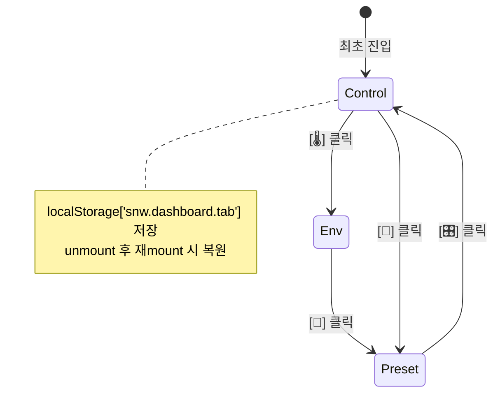
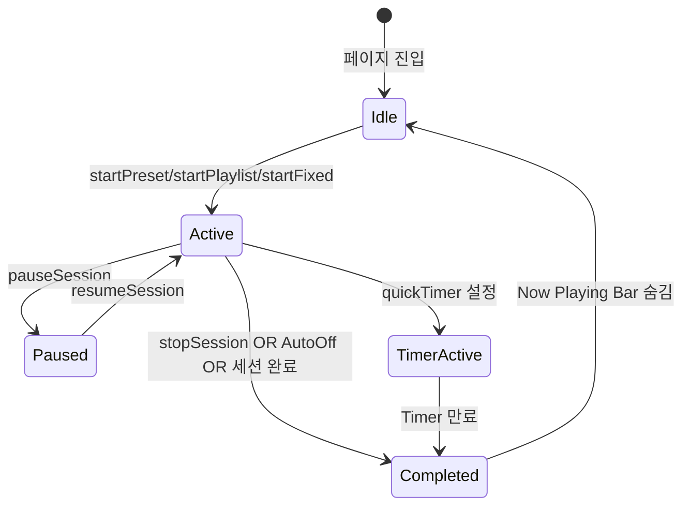
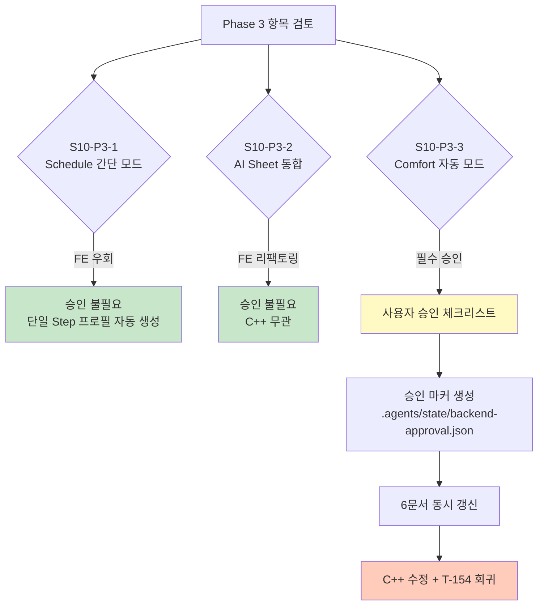
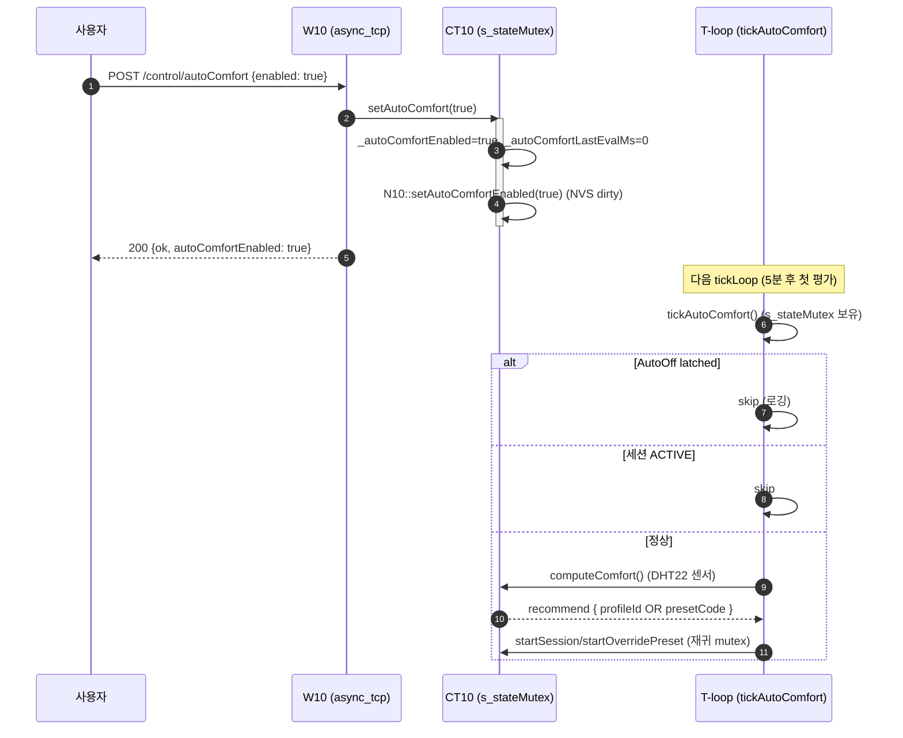

Part 2. Dashboard 3탭 세부 설계 문서 + Part 3. Phase 3 백엔드 승인 절차

원칙 1 (백엔드 승인): Part 3은 승인 요청 문서로, 승인 전 C++ 무수정.
원칙 4 (CBD): Part 2는 SPEC §5.4.2.1 / FLOW §14 / CONTRACT §7.17 영향 → 6문서 갱신 표기.

---

📐 Part 2 — Dashboard 3탭 세부 설계

2.1 파일 경로 (문서 산출물)

```
src/v0203/Req_ImplPlan_0203/
└── Stage10_Dashboard_3Tabs_Design_0203.md
```

---

2.2 마스터 와이어프레임 (모바일 375×667)

```
┌────────────────────────────────────────┐
│  ☰   Smart Nature Wind   ● 10:23  🌐  │ ← Header (고정)
├────────────────────────────────────────┤
│ [🎛 제어]  [🌡 환경]  [🌿 프리셋]       │ ← 탭 (3개)
├────────────────────────────────────────┤
│                                        │
│  ╔══════════════════════════════════╗  │
│  ║  ╭─────────╮                     ║  │
│  ║  │  ▁▃▅▇▅▃  │  Ocean Breeze      ║  │ ← Now Playing
│  ║  │  (EQ)   │  Step 2/4 · 08:45  ║  │    (활성 시)
│  ║  ╰─────────╯                     ║  │
│  ║  [⏸] [⏹] [⏱️]                    ║  │ ← 컨트롤
│  ╚══════════════════════════════════╝  │
│                                        │
│  ┌────────────────────────────────┐    │
│  │ 🌀 일반 선풍기                  │    │
│  │                                │    │
│  │  ●━━━━━━━━━━━━━━━━━━━━━━━     │    │ ← Snap Slider
│  │  끔   1   2   3   4   5        │    │
│  └────────────────────────────────┘    │
│                                        │
│  ┌────────────────────────────────┐    │
│  │ 🎵 재생할 플레이리스트          │    │ ← Playlist
│  │  [수면모드]  [집중모드]         │    │    (탭 3에서 이동)
│  └────────────────────────────────┘    │
│                                        │
├────────────────────────────────────────┤
│ Now Playing Bar (플로팅)                │ ← 고정 (별개)
├────────────────────────────────────────┤
│  🏠    📈    🎨    🌡    ⚙            │ ← Bottom Nav (5개)
└────────────────────────────────────────┘
```

탭별 콘텐츠 스택

탭 콘텐츠 스택 (위→아래) 스크롤
🎛 제어 Now Playing → 일반 선풍기 (Snap Slider) → 플레이리스트 (최근 4개) ✅
🌡 환경 Comfort DI 카드 → 센서 3종 → "상세 →" 링크 ✅
🌿 프리셋 Style 5종 → Preset Grid (4×2 + 더보기) → 플레이리스트 카드 ✅

---

2.3 탭 1: 제어 (Control)

2.3.1 Now Playing 카드

상태별 렌더링:

세션 상태 EQ 타이틀 서브 컨트롤
없음 (type=0) 정적 (회색 라인) "꺼짐" "세션 없음" ❌
ACTIVE (Preset) 애니 "✋ OCEAN · BALANCE" "재생 중" ⏸ ⏹ ⏱️
ACTIVE (Playlist) 애니 "✋ 수면모드" "Step 2/4 · 08:45" ⏸ ⏹ ⏱️
ACTIVE (Fixed) 애니 "🌀 일반 선풍기 60%" "재생 중" ⏸ ⏹ ⏱️
PAUSED 정적 "⏸ OCEAN · BALANCE" "일시정지" ▶ ⏹
Timer 활성 + 배지 (기존) (기존) + ⏱️ 활성

컴포넌트 구조 (DOM):

```html
<section class="snw-card snw-card--nowplaying">
  <div class="snw-np-big">
    <div class="snw-np-big__eq" data-slot="eq">
      <canvas class="snw-eq-canvas"></canvas>
    </div>
    <div class="snw-np-big__info">
      <div class="snw-np-big__title" data-slot="np-title">꺼짐</div>
      <div class="snw-np-big__sub" data-slot="np-sub">세션 없음</div>
    </div>
    <div class="snw-np-big__controls">
      <button data-action="pause" hidden>⏸</button>
      <button data-action="stop" hidden>⏹</button>
      <button data-action="timer-quick" hidden>⏱️</button>
    </div>
  </div>
</section>
```

2.3.2 일반 선풍기 (Snap Slider)

6단 스냅: 0, 20, 40, 60, 80, 100 (끔·1·2·3·4·5단)

동작:

슬라이더 값 API 호출
0 SNW.Api.stopSession()
20~100 SNW.Api.startFixed(pct)

햅틱: 스냅 시 SNW.Haptic.snap() (10ms)

접근성:

· 최소 터치 영역 44px (min-height: 44px for .snw-snapslider__stop)
· ARIA: role="slider" aria-valuemin="0" aria-valuemax="100" aria-valuenow="60" aria-valuetext="3단"

2.3.3 플레이리스트 카드 (최근 4개)

· 카드 클릭 → SNW.Api.startPlaylist(profileId)
· 카드 없음 → "Studio에서 작곡하기" 링크 (#/automation/studio)

---

2.4 탭 2: 환경 (Environment)

2.4.1 Comfort DI 카드 (기존 로직 재사용)

상태:

DI 레벨 뱃지 추천
<68 0 쾌적 🟢 FOREST_CANOPY × RELAX
68~75 1 약간 덥네요 🟡 COUNTRY_BREEZE × BALANCE
75~80 2 끈적이는 날씨 🟠 OCEAN × ACTIVE
≥80 3 숨이 막혀요 🔴 MOUNTAIN × ACTIVE

액션: [▶ 지금 재생] → startPlaylist 또는 startPreset

Refresh: _onControlUpdate() 10초 throttle → 3초로 단축 (Part 2 개선)

2.4.2 센서 카드 3종

카드 데이터 소스 갱신
🌡️ 온도 control.sensor.tempC WS state (800ms)
💧 습도 control.sensor.humidity WS state (800ms)
👤 재실 control.sensor.motionActive WS state (800ms)

하단 액션: <a href="#/sensors">상세 →</a>

2.4.3 (L3+) Comfort 자동 모드 토글 — Phase 3 승인 필요

```
┌─ Comfort 카드 하단 ─────────────┐
│ [🔘 자동 모드]  현재 OFF        │
│ 자동 모드 시 5분마다 추천 재평가│
└─────────────────────────────────┘
```

· ⚠️ 백엔드 계약 필요: autoComfort 상태 (Phase 3 승인 대상)

---

2.5 탭 3: 프리셋 (Preset)

2.5.1 Style 5종 탭

컴포넌트 (기존 _components.css 재사용):

```html
<div class="snw-style-selector" id="style-selector">
  <button data-style="BALANCE">⚖ 균형</button>
  <button data-style="ACTIVE">⚡ 활동</button>
  <button data-style="FOCUS">🎯 집중</button>
  <button data-style="RELAX">🍃 휴식</button>
  <button data-style="SLEEP">🌙 수면</button>
</div>
```

동작: 클릭 → SNW.Api.patchSim({ styleCode }) (세션 실행 중이면 즉시 반영)

2.5.2 Preset Grid (4×2 + 더보기)

레이아웃: 프리셋 10개 중 8개 표시 + "더보기" 카드 1개 (3행)

```
┌──────┬──────┬──────┬──────┐
│ OCEAN│COUNTRY│MEDIT │MOUNT │
├──────┼──────┼──────┼──────┤
│PLAINS│HARBOR│FOREST│URBAN │
├──────┼──────┼──────┼──────┤
│TROPIC│DESERT│  더보기  (2열 병합)│
└──────┴──────┴──────┴──────┘
```

더보기 클릭 → 모달로 나머지 2개 표시 (또는 #/windprofile 이동)

동작: 카드 클릭 → SNW.Api.startPreset(presetCode, styleCode)

미리보기: hover 시 SNW.Preview.generate() 호출 → 스파크라인 표시 (기존 presetGrid 로직 재사용)

2.5.3 플레이리스트 카드 (Studio 접근)

· 상단: "🎵 재생할 플레이리스트" 헤더 + [+ 새로 작곡] 버튼
· 카드 클릭 → 재생
· 카드 없음 → "🎨 Studio에서 작곡하기" CTA

---

2.6 상태 전이 다이어그램

2.6.1 탭 전환



2.6.2 세션 상태 ↔ Now Playing



---

2.7 반응형 브레이크포인트

뷰포트 탭 스타일 Preset Grid Now Playing
<768px (모바일) 가로 3탭 (flex) 4×2 (더보기) 상단 카드
768~1023 (태블릿) 가로 3탭 4×2 상단 카드 (더 큼)
≥1024 (데스크톱) 세로 사이드탭 (좌측) 4×2.5 (더보기 없음) 좌측 상단

데스크톱 와이어프레임 (1024×768):

```
┌──────┬──────────────────────────────────┐
│ 탭   │  ╔══════════════════════════════╗│
│      │  ║  ▁▃▅▇  Ocean Breeze        ║│
│ 🎛   │  ║         Step 2/4 · 08:45    ║│
│ 제어 │  ║         [⏸] [⏹] [⏱️]        ║│
│      │  ╚══════════════════════════════╝│
│ 🌡   │                                  │
│ 환경 │  ┌──────────────┐                │
│      │  │ Snap Slider  │                │
│ 🌿   │  └──────────────┘                │
│ 프리 │                                  │
│ 셋   │                                  │
└──────┴──────────────────────────────────┘
```

CSS:

```css
@media (min-width: 1024px) {
    .snw-dashboard {
        display: grid;
        grid-template-columns: 140px 1fr;
        gap: 24px;
    }
    .snw-dashboard__tabs {
        flex-direction: column;  /* 세로 사이드탭 */
        border-right: 1px solid var(--snw-border);
        padding-right: 12px;
    }
}
```

---

2.8 i18n 키 매트릭스 (신규/재사용)

Key ko en 상태
dashboard.tabControl 제어 Control 🆕
dashboard.tabEnv 환경 Environment 🆕
dashboard.tabPreset 프리셋 Presets 🆕
dashboard.styleHint 스타일 보정 Style Correction 🆕
dashboard.presetHint 10대 자연 환경 10 Nature Presets 🆕
home.normalFan 일반 선풍기 Normal Fan ♻️ 재사용
dashboard.sensorTitle 센서 Sensors ♻️ 재사용
dashboard.styleTitle 바람 스타일 Wind Style ♻️ 재사용
dashboard.presetTitle 자연풍 프리셋 Nature Presets ♻️ 재사용
home.playlist 🎵 재생할 플레이리스트 🎵 Play Playlists ♻️ 재사용
timer.quickPrompt 몇 분 후 종료할까요? Stop after how many minutes? 🆕
common.details 상세 Details 🆕

총 신규: 7개 (ko/en 대칭)

---

2.9 접근성 (WCAG 2.1 AA)

항목 기준 구현
탭 접근성 role="tablist" / role="tab" / aria-selected ✅
탭 키보드 ←/→ 화살표 이동 ✅ (keydown 이벤트)
터치 영역 44×44px 최소 ✅
색 대비 4.5:1 이상 ✅ (--snw-text / --snw-surface 검증)
포커스 표시 :focus-visible 아웃라인 ✅
동적 콘텐츠 aria-live="polite" (Now Playing) ✅
reduced-motion 애니메이션 축소 ✅ (기존 prefers-reduced-motion)

탭 ARIA 샘플:

```html
<div role="tablist" aria-label="Dashboard Sections">
  <button role="tab" aria-selected="true" aria-controls="panel-control">제어</button>
  <button role="tab" aria-selected="false" aria-controls="panel-env">환경</button>
  <button role="tab" aria-selected="false" aria-controls="panel-preset">프리셋</button>
</div>
<div role="tabpanel" id="panel-control">...</div>
```

---

2.10 계약 문서 영향 매트릭스 (Part D 재확인)

문서 갱신 위치 추가 내용 개정 이력
SPEC_0203.md §5.4.2.1 3탭 구조 명세, 탭별 콘텐츠 스택 v2.19
FLOW_0203.md §14.2 (신규) Now Playing ↔ 탭 상태 전이 v3.4
CONTRACT_0203.md §7.19 (신규) UI-9: Dashboard 3탭 계약 v3.6
STATE_0203.md §1 localStorage['snw.dashboard.tab'] 소유권 v3.4
BUDGET_0203.md §10.5 +~2 KB gzip (Style/Preset 재도입) v3.4
TEST_PLAN_0203.md §3.7 T-153 신규: 3탭 전환 + 상태 유지 v4.1
README_0203.md §3 Stage 10 Phase 2 마일스톤 v2.18

---

2.11 T-153 회귀 절차 (신규)

```markdown
### T-153. Dashboard 3탭 전환 및 상태 유지

**목적**: 3탭(제어/환경/프리셋) 전환 시 콘텐츠 렌더링 + 탭 상태 유지 검증.

**검증 절차**:
```javascript
// 브라우저 콘솔
location.hash = '/dashboard';
await new Promise(r => setTimeout(r, 1500));

// 1. 초기 탭 = 제어
console.assert(document.querySelector('[data-dash-tab="control"]').classList.contains('is-active'), 'T-153: 초기 제어 탭');

// 2. 프리셋 탭 전환
document.querySelector('[data-dash-tab="preset"]').click();
await new Promise(r => setTimeout(r, 100));
console.assert(document.querySelector('[data-dash-content="preset"]').style.display === 'block', 'T-153: 프리셋 탭 표시');

// 3. localStorage 저장
console.assert(localStorage.getItem('snw.dashboard.tab') === 'preset', 'T-153: 탭 상태 저장');

// 4. 새로고침 후 복원
location.reload();
// (재진입 후)
console.assert(document.querySelector('[data-dash-tab="preset"]').classList.contains('is-active'), 'T-153: 탭 복원');
```

합격 판정:

☐ 초기 진입 = 제어 탭
☐ 3탭 전환 시 콘텐츠 표시
☐ localStorage 저장 및 복원
☐ 키보드 ←/→ 탐색 동작
☐ aria-selected 정확

```

---

# 🔐 Part 3 — Phase 3 백엔드 승인 절차

## 3.1 승인 대상 인벤토리

| ID | 항목 | 백엔드 영향 | 승인 필요도 |
|:---:|---|:---:|:---:|
| **S10-P3-1** | Schedule "간단 모드" | 🟡 **선택적** (FE 우회 가능) | 🟡 낮음 |
| **S10-P3-2** | AI Sheet = AI Page 통합 | ✅ 없음 | 🟢 불필요 |
| **S10-P3-3** | Comfort "자동 모드" 토글 | 🔴 **필수** | 🔴 **높음** |

---

## 3.2 S10-P3-1: Schedule 간단 모드 — **선택적 승인**

### 3.2.1 목적 및 기능 변화

**사용자 시나리오**: "매일 아침 7시에 OCEAN × BALANCE 바람 틀어줘" (프로필 개념 없이)

| 방식 | 백엔드 | 사용자 경험 |
|---|:---:|---|
| **FE 우회 (승인 불필요)** | 무수정 | FE가 단일 Step 프로필 자동 생성 후 스케줄 연결 |
| **BE 직접 지원 (승인 필요)** | `schedule.presetCode` 직접 지원 | 스케줄 스키마 확장 |

### 3.2.2 옵션 A: FE 우회 (권장, **승인 불필요**)

**FE 로직**:
```javascript
// 293.schedule_panel.js — "간단 모드" 저장 시
async _onSaveSimpleSchedule(simpleData) {
    // 1. 단일 Step 프로필 자동 생성
    const tempProfile = {
        profileNo: Date.now() % 65535,
        name: `[간단] ${simpleData.presetCode}`,
        enabled: true,
        repeatSegments: false,
        repeatCount: 0,
        steps: [{
            stepNo: 10,
            durationMin: simpleData.durationMin || 120,
            type: 'PRESET',
            presetCode: simpleData.presetCode,
            styleCode: simpleData.styleCode || 'BALANCE',
            override: { enabled: false },
        }],
        autoOff: { timer: { enabled: false }, offTime: { enabled: false }, offTemp: { enabled: false } },
        motion: { pir: { enabled: false } },
    };
    
    const createRes = await SNW.Api.addProfile(tempProfile);
    const newProfileId = createRes?.id || createRes?.profileId;
    
    // 2. 스케줄 생성
    await SNW.Api.addSchedule({
        schNo: Date.now() % 65535,
        name: simpleData.name || `${simpleData.presetCode} 스케줄`,
        enabled: true,
        period: {
            days: simpleData.days,
            startTime: simpleData.startTime,
            endTime: simpleData.endTime,
        },
        profileId: newProfileId,
    });
}
```

장점:

· C++ 무수정
· 기존 스키마 100% 재사용
· Playlist에 자동 프로필 노출 (사용자 편집 가능)

단점:

· Playlist에 "[간단] OCEAN" 프로필이 쌓임 (사용자 인지 필요)
· 삭제 시 스케줄 미참조 확인 로직 필요 (이미 구현됨)

3.2.3 옵션 B: BE 직접 지원 (승인 필요)

스키마 변경:

```json
// cfg_schedules_0203.json
{
    "schId": 4,
    "name": "아침 산들바람",
    "period": { ... },
    // profileId 제거, 아래 중 하나 사용
    "presetCode": "COUNTRY_BREEZE",   // ← 신규
    "styleCode": "BALANCE"             // ← 신규
}
```

백엔드 수정 범위 (참고):

파일 변경
A20_Const_Sch_0203.h ST_A20_Schedule_t에 presetCode, styleCode 필드 추가
C10_Config_Sch_JSON_0203.cpp 파싱 로직
CT10_Ctl_Ctl_Seg_0203.cpp::tickSchedule profileId 없을 시 presetCode 직접 실행
C10_Config_Sch_CRUD_0203.cpp 검증 (profileId XOR presetCode)

영향 문서: SPEC §4, §5.1.1 / FLOW §4.2 / CONTRACT §7.11 / STATE §1 / BUDGET(무관) / TEST_PLAN §3.4

3.2.4 권장: 옵션 A (FE 우회)

· 승인 불필요
· 사용자 경험 동일 (프로필 개념 불필요)
· 백엔드 리스크 0

---

3.3 S10-P3-2: AI Sheet = AI Page 통합 — 승인 불필요

결론: FE 리팩토링만, 백엔드 무관 → 승인 불필요

실행 계획:

1. 290.page.ai.js의 _onLiveToggle, _onSend, _onVoiceToggle을 SNW.AISheet 클래스로 이전
2. AI Page는 SNW.AISheet.renderInline() 호출 (동일 컴포넌트)
3. FAB은 SNW.AISheet.open() 호출 (동일 컴포넌트)
4. 단일 진실 공급원(SSOT)

검증: T-114~T-120 회귀 재실행

---

3.4 S10-P3-3: Comfort "자동 모드" — 필수 승인

3.4.1 목적 및 기능 변화

사용자 시나리오: "방 온도/습도에 맞춰 알아서 조절해줘"

현재 목표
Comfort DI 카드에서 [▶ 지금 재생] 일회성 사용자가 "자동 모드" 토글 ON → 5분마다 재평가 후 자동 재생
AutoOff만 존재 AutoStart (온도 기반) + AutoOff 통합

3.4.2 백엔드 영향 범위

파일 변경 유형 상세
CT10_Ctl_0203.h 🆕 필드 _autoComfortEnabled, _autoComfortLastEvalMs
CT10_Ctl_Comfort_0203.cpp 🆕 함수 tickAutoComfort() — 5분 게이트
CT10_Ctl_0203.h 🆕 getter setAutoComfort(bool), isAutoComfortEnabled()
W10_Web_Routes_Control_0203.cpp 🆕 라우트 POST /api/v001/control/autoComfort
N10_NvsManager_0203.cpp 🆕 NVS 키 auto_comfort_en (uint8)
cfg_nvsSpec_0203.json 🆕 항목 { "key": "auto_comfort_en", "type": "uint8", "defaultValue": "0" }
cfg_system_0203.json 🆕 섹션 system.autoComfort: { enabled: false, evalIntervalMin: 5 }

3.4.3 동시성 및 락 영향

락 영향
CT10::s_stateMutex tickAutoComfort() 내 획득 (기존 패턴 준수)
N10::s_mutex setAutoComfort() → NVS dirty 표시
S10::_recursiveMutex 미사용 (CT10 위임 경유)

락 순서: s_stateMutex → N10::s_mutex (기존 §5.1 준수) ✅

3.4.4 WCET 영향 (BUDGET §2)

신규 함수 WCET 비고
tickAutoComfort() < 1 ms 5분 게이트, 평상 조기 반환
setAutoComfort() < 1 ms NVS dirty만 (실제 쓰기 10초 지연)

결론: BUDGET §2 예산 여유 내 ✅

3.4.5 계약 문서 6건 동시 갱신 (원칙 4)

# 문서 갱신 위치 추가 내용
1 SPEC_0203.md §5.1.5 (신규) Comfort 자동 모드 API 명세
2 FLOW_0203.md §7.1 (신규) Comfort 자동 모드 시퀀스 다이어그램
3 CONTRACT_0203.md §7.20 (신규) COMFORT-1~COMFORT-3 계약
4 STATE_0203.md §1, §3.2 (신규) _autoComfortEnabled 소유권
5 BUDGET_0203.md §10.4 Stage 10 Phase 3 WCET + 1ms
6 TEST_PLAN_0203.md §3.8 (신규) T-154: Comfort 자동 모드 회귀

3.4.6 승인 체크리스트 (원칙 1)

```
□ 목적 정리
  "Comfort DI 기반 자동 재생 — 사용자가 토글 ON 시 5분마다 실내 환경 재평가 후
   추천 프리셋/프로필 자동 재생. AutoOff와 독립 동작 (AutoOff가 자동 모드보다 우선)."

□ 기능 변화
  1. 신규 API: POST /api/v001/control/autoComfort { enabled: bool }
  2. 신규 상태: _autoComfortEnabled (NVS 영구 저장)
  3. 신규 tick: tickAutoComfort() 5분 게이트
  4. 신규 NVS 키: auto_comfort_en
  5. 기존 Comfort API (/api/v001/comfort) 응답 무변경

□ 백엔드 수정 범위
  - CT10_Ctl_0203.h (+3 필드/메서드)
  - CT10_Ctl_Comfort_0203.cpp (+tickAutoComfort)
  - W10_Web_Routes_Control_0203.cpp (+라우트 1개)
  - N10_NvsManager_0203.cpp (+NVS 키 처리)
  - cfg_nvsSpec_0203.json (+1 항목)
  - cfg_system_0203.json (+1 섹션)

□ 위험 요소
  - 락 순서: s_stateMutex → N10::s_mutex (기존 준수) ✅
  - WCET: < 1ms (5분 게이트, 조기 반환) ✅
  - AutoOff 우선순위: AutoOff 래치 시 자동 모드 중단 (명시)
  - 세션 위임: startOverridePreset 경유 (기존 패턴)

□ 계약 문서 동시 갱신 (6문서)
  - SPEC / FLOW / CONTRACT / STATE / BUDGET / TEST_PLAN

□ 회귀 절차
  - T-154 신규: Comfort 자동 모드 ON/OFF, 5분 게이트, AutoOff 우선순위
  - T-105 (Comfort 카드) 재검증
  - T-98~T-99 (세션 위임) 재검증
```

3.4.7 승인 후 실행 순서

```bash
# 1. 사용자 승인 확인
# 2. 승인 마커 생성 (원칙 1)
cat > .agents/state/backend-approval.json << 'EOF'
{
  "approvedAt": "2026-11-09T...",
  "approvedBy": "user",
  "scope": ["S10-P3-3"],
  "files": [
    "src/v0203/CT10_Ctl_0203.h",
    "src/v0203/CT10_Ctl_Comfort_0203.cpp",
    "src/v0203/W10_Web_Routes_Control_0203.cpp",
    "src/v0203/N10_NvsManager_0203.cpp"
  ],
  "contractDocs": [
    "SPEC_0203.md",
    "FLOW_0203.md",
    "CONTRACT_0203.md",
    "STATE_0203.md",
    "BUDGET_0203.md",
    "TEST_PLAN_0203.md"
  ]
}
EOF

# 3. 계약 문서 6건 동시 갱신 (Part 3.4.5)
# 4. C++ 수정 (backend-cpp.md 규칙 준수)
# 5. 계약 검증
python src/v0203/tools_0203/commit_contracts_0203.py --dry-run --strict

# 6. 빌드 + 회귀
pio run -e esp32-s3-zero -j 12
# T-154 + T-98~T-99 + T-105

# 7. 커밋
```

---

3.5 승인 요약 시각화



---

3.6 사용자 결정 필요 사항

아래 중 선택 부탁드립니다:

Option A (최소 승인)

· S10-P3-1: FE 우회 (승인 불필요)
· S10-P3-2: FE 리팩토링 (승인 불필요)
· S10-P3-3: 보류 (AutoOff로 충분, 자동 모드 필요 시 추후)

결과: C++ 무수정, Phase 3 부분 진행

Option B (전체 승인)

· S10-P3-1: FE 우회
· S10-P3-2: FE 리팩토링
· S10-P3-3: 승인 요청 → 승인 체크리스트(3.4.6) 검토 후 승인

결과: C++ 수정 4파일 + 계약 문서 6건, Stage 10 완전 구현

Option C (자동 모드만 승인)

· S10-P3-1, S10-P3-2: 승인 불필요 (자동 진행)
· S10-P3-3: 승인 요청

결과: Phase 3 최소 C++ 수정

---

📋 원칙 준수 최종 확인

원칙 Part 2 Part 3
원칙 1 (백엔드 승인) ✅ FE 전용 설계 ✅ 승인 체크리스트 제시
원칙 2 (Graph-First) ⚠️ 실행 시 graphify query 권장 ⚠️ 동일
원칙 3 (에셋 파이프라인) ✅ pio_gzip 필수 명시 ✅
원칙 4 (CBD 6문서) ✅ Part 2.10 매트릭스 ✅ Part 3.4.5 매트릭스

---

어떤 Option(A/B/C)으로 진행할까요?
선택해 주시면 해당 범위로 실제 파일 수정 계획(diff)을 준비하겠습니다.


--- ---

Option B 승인 확인 + Phase 3 전체 실행 계획

원칙 1 (백엔드 수정 승인): S10-P3-3 승인 확인. 승인 마커 .agents/state/backend-approval.json 생성 후 C++ 수정 착수.
원칙 3 (에셋 파이프라인): FE 수정 후 pio_gzip_0203.py 필수.
원칙 4 (CBD): S10-P3-3 → 6문서 동시 갱신.

---

Part A. 승인 확정 (S10-P3-3)

A.1 승인 대상 (3.4.6 체크리스트 승인 확정)

```
✅ 목적: Comfort DI 기반 자동 재생 — 토글 ON 시 5분마다 실내 환경 재평가 후
        추천 프리셋/프로필 자동 재생 (AutoOff와 독립, AutoOff 우선)

✅ 기능 변화:
  1. 신규 API: POST /api/v001/control/autoComfort { enabled: bool }
  2. 신규 상태: _autoComfortEnabled (NVS 영구 저장)
  3. 신규 tick: tickAutoComfort() 5분 게이트
  4. 신규 NVS 키: auto_comfort_en
  5. 기존 /api/v001/comfort 응답 무변경

✅ 백엔드 수정 범위 (6 파일):
  - CT10_Ctl_0203.h (+3 필드/메서드)
  - CT10_Ctl_Comfort_0203.cpp (+tickAutoComfort)
  - W10_Web_Routes_Control_0203.cpp (+라우트 1개)
  - N10_NvsManager_0203.cpp (+NVS 키 처리)
  - cfg_nvsSpec_0203.json (+1 항목)
  - cfg_system_0203.json (+1 섹션)

✅ 락 순서: s_stateMutex → N10::s_mutex (CONTRACT §5.1 준수)

✅ WCET: < 1 ms (5분 게이트, 평상 조기 반환) — BUDGET §2 예산 내

✅ 계약 문서 6건 동시 갱신 확정
```

A.2 승인 마커 생성

파일: .agents/state/backend-approval.json

```json
{
  "approvedAt": "2026-11-09T00:00:00+09:00",
  "approvedBy": "user",
  "stage": "Stage 10 Phase 3",
  "scope": ["S10-P3-3"],
  "summary": "Comfort DI 기반 자동 모드 (5분 게이트) 도입",
  "files": [
    "src/v0203/CT10_Ctl_0203.h",
    "src/v0203/CT10_Ctl_Comfort_0203.cpp",
    "src/v0203/W10_Web_Routes_Control_0203.cpp",
    "src/v0203/N10_NvsManager_0203.cpp",
    "src/v0203/data_v0203/json/cfg_nvsSpec_0203.json",
    "src/v0203/data_v0203/json/cfg_system_0203.json"
  ],
  "contractDocs": [
    "SPEC_0203.md",
    "FLOW_0203.md",
    "CONTRACT_0203.md",
    "STATE_0203.md",
    "BUDGET_0203.md",
    "TEST_PLAN_0203.md"
  ],
  "risk": {
    "lockOrder": "s_stateMutex → N10::s_mutex (기존 준수)",
    "wcet": "< 1ms",
    "priorityConflict": "AutoOff 우선 (자동 모드 중단)"
  },
  "verification": ["T-154", "T-98~T-99", "T-105"],
  "rollback": "git revert + NVS 키 무시 (하위 호환)"
}
```

---

Part B. S10-P3-1: Schedule 간단 모드 (FE 우회)

승인 불필요 · C++ 무수정

B.1 변경 파일: 293.schedule_panel.js

B.1.1 _openEditor() — 모드 토글 추가

Before (라인: _openEditor(sch) 내부):

```javascript
_openEditor(sch) {
    const isEdit = !!sch;
    const days = sch ? ((sch.period && sch.period.days) || [0,0,0,0,0,0,0]) : [0,1,1,1,1,1,0];
    const dayNames = ['월', '화', '수', '목', '금', '토', '일'];
    
    const content = document.createElement('div');
    content.className = 'snw-schedule-editor';
    content.innerHTML = `
        <div class="snw-form">
            <div class="snw-form-row">
                <label>스케줄 이름</label>
                <input type="text" data-field="name" ...>
            </div>
            ...
            <h3>🎵 실행할 플레이리스트</h3>
            <div class="snw-profile-picker">
                ${this._profiles.map(p => `...radio...`).join('')}
            </div>
        </div>`;
```

After:

```javascript
_openEditor(sch) {
    const isEdit = !!sch;
    // 편집 시 스케줄이 프로필 참조가 아닌 presetCode 직접 참조인지 판별
    const isSimpleMode = isEdit && sch && sch.presetCode && !sch.profileId;
    
    const days = sch ? ((sch.period && sch.period.days) || [0,0,0,0,0,0,0]) : [0,1,1,1,1,1,0];
    const dayNames = ['월', '화', '수', '목', '금', '토', '일'];
    
    // 프리셋/스타일 목록 (캐시)
    const presets = (SNW.Studio && SNW.Studio._windDict && SNW.Studio._windDict.presets) || [];
    const styles  = (SNW.Studio && SNW.Studio._windDict && SNW.Studio._windDict.styles)  || [];
    
    const content = document.createElement('div');
    content.className = 'snw-schedule-editor';
    content.innerHTML = `
        <div class="snw-form">
            <div class="snw-form-row">
                <label>스케줄 이름</label>
                <input type="text" data-field="name" ...>
            </div>
            
            <div class="snw-form-row">
                <label>요일</label>
                <div class="snw-day-picker">...</div>
            </div>
            
            <div class="snw-form-row snw-form-row--inline">
                <label>시작</label> <input type="time" data-field="startTime" ...>
                <label>종료</label> <input type="time" data-field="endTime" ...>
            </div>
            
            <!-- [S10-P3-1] 모드 토글 -->
            <div class="snw-form-row" style="margin-top:16px;">
                <label style="font-weight:600;font-size:13px;">바람 선택 방식</label>
                <div style="display:flex;gap:8px;margin-top:6px;">
                    <label style="flex:1;padding:8px;border:1.5px solid var(--snw-border);border-radius:8px;cursor:pointer;text-align:center;${!isSimpleMode ? 'border-color:var(--snw-primary);background:rgba(74,158,255,0.1);' : ''}">
                        <input type="radio" name="mode" value="simple" ${!isSimpleMode ? 'checked' : ''} style="display:none;">
                        <span>🎯 <b>간단 모드</b><br><small style="color:var(--snw-text-dim);">프리셋 직접 선택</small></span>
                    </label>
                    <label style="flex:1;padding:8px;border:1.5px solid var(--snw-border);border-radius:8px;cursor:pointer;text-align:center;${isSimpleMode ? 'border-color:var(--snw-primary);background:rgba(74,158,255,0.1);' : ''}">
                        <input type="radio" name="mode" value="profile" ${isSimpleMode ? 'checked' : ''} style="display:none;">
                        <span>🎵 <b>프로필 모드</b><br><small style="color:var(--snw-text-dim);">Studio 산출 프로필</small></span>
                    </label>
                </div>
            </div>
            
            <!-- 간단 모드 UI -->
            <div data-slot="simple-mode" style="display:${!isSimpleMode ? 'block' : 'none'};margin-top:12px;">
                <div class="snw-form-row">
                    <label>프리셋</label>
                    <select data-field="presetCode" style="...">
                        ${presets.map(p => `<option value="${p.code}">${SNW.I18n.t('preset.' + p.code)}</option>`).join('')}
                    </select>
                </div>
                <div class="snw-form-row">
                    <label>스타일</label>
                    <select data-field="styleCode" style="...">
                        ${styles.map(s => `<option value="${s.code}">${SNW.I18n.t('style.' + s.code)}</option>`).join('')}
                    </select>
                </div>
                <div class="snw-form-row">
                    <label>재생 시간 (분)</label>
                    <input type="number" data-field="durationMin" min="10" max="480" value="${sch?.durationMin || 120}" style="...">
                </div>
            </div>
            
            <!-- 프로필 모드 UI (기존) -->
            <div data-slot="profile-mode" style="display:${!isSimpleMode ? 'none' : 'block'};margin-top:12px;">
                <h3>🎵 실행할 플레이리스트</h3>
                <div class="snw-profile-picker">
                    ${this._profiles.map(p => `...radio...`).join('')}
                </div>
            </div>
        </div>`;
    
    // 모드 토글 이벤트
    content.querySelectorAll('input[name="mode"]').forEach(radio => {
        radio.addEventListener('change', () => {
            const mode = content.querySelector('input[name="mode"]:checked').value;
            content.querySelector('[data-slot="simple-mode"]').style.display  = (mode === 'simple')  ? 'block' : 'none';
            content.querySelector('[data-slot="profile-mode"]').style.display = (mode === 'profile') ? 'block' : 'none';
            
            // 라벨 스타일 갱신
            content.querySelectorAll('input[name="mode"]').forEach(r => {
                const label = r.closest('label');
                const isActive = r.checked;
                label.style.borderColor = isActive ? 'var(--snw-primary)' : 'var(--snw-border)';
                label.style.background  = isActive ? 'rgba(74,158,255,0.1)' : 'transparent';
            });
        });
    });
    
    // 기존 요일 칩, 프로필 라디오 이벤트...
    
    SNW.UI.modal(
        isEdit ? '스케줄 편집' : '새 스케줄',
        content,
        async () => {
            const mode = content.querySelector('input[name="mode"]:checked').value;
            
            if (mode === 'simple') {
                return await this._saveSimpleSchedule(content, sch, isEdit);
            } else {
                return await this._saveProfileSchedule(content, sch, isEdit);  // 기존 로직
            }
        },
        null,
        { width: '480px' }
    );
}
```

B.1.2 _saveSimpleSchedule() — 신규 메서드

```javascript
async _saveSimpleSchedule(content, sch, isEdit) {
    const nameEl     = content.querySelector('[data-field="name"]');
    const startEl    = content.querySelector('[data-field="startTime"]');
    const endEl      = content.querySelector('[data-field="endTime"]');
    const presetEl   = content.querySelector('[data-field="presetCode"]');
    const styleEl    = content.querySelector('[data-field="styleCode"]');
    const durationEl = content.querySelector('[data-field="durationMin"]');
    
    // 검증
    if (!nameEl.value.trim()) {
        SNW.ToastUtil.error('이름을 입력하세요');
        return false;
    }
    if (startEl.value === endEl.value) {
        SNW.ToastUtil.error('시작 시각과 종료 시각이 같을 수 없습니다');
        return false;
    }
    const durationMin = Number(durationEl.value);
    if (!durationMin || durationMin < 10 || durationMin > 480) {
        SNW.ToastUtil.error('재생 시간은 10~480분이어야 합니다');
        return false;
    }
    
    // 편집 시 기존 프로필 참조 스케줄이면 경고
    if (isEdit && sch && sch.profileId) {
        if (!confirm('프로필 모드 스케줄입니다. 간단 모드로 전환하면 기존 프로필 참조가 해제됩니다. 계속?')) {
            return false;
        }
    }
    
    try {
        // 1. 단일 Step 프로필 자동 생성 (편집 시엔 새로 생성하지 않고 기존 재사용)
        let profileId;
        
        if (isEdit && sch && sch.presetCode) {
            // 이미 간단 모드 스케줄 → 기존 프로필 업데이트
            const existingProf = this._profiles.find(p => p.profileId === sch.profileId);
            if (existingProf) {
                profileId = sch.profileId;
                await SNW.Api.updateProfile(profileId, {
                    ...existingProf,
                    name: `[간단] ${presetEl.value}`,
                    steps: [{
                        stepNo: 10,
                        durationMin,
                        type: 'PRESET',
                        presetCode: presetEl.value,
                        styleCode: styleEl.value,
                        override: { enabled: false },
                    }],
                });
            }
        }
        
        if (!profileId) {
            // 신규 프로필 생성
            const createRes = await SNW.Api.addProfile({
                profileNo: Date.now() % 65535,
                name: `[간단] ${presetEl.value}`,  // 사용자에게 인지되도록 [간단] prefix
                enabled: true,
                repeatSegments: false,
                repeatCount: 0,
                steps: [{
                    stepNo: 10,
                    durationMin,
                    type: 'PRESET',
                    presetCode: presetEl.value,
                    styleCode: styleEl.value,
                    override: { enabled: false },
                }],
                autoOff: { timer: { enabled: false }, offTime: { enabled: false }, offTemp: { enabled: false } },
                motion: { pir: { enabled: false } },
            });
            profileId = createRes?.id || createRes?.profileId || createRes?.profileNo;
        }
        
        if (!profileId) {
            throw new Error('프로필 생성 실패');
        }
        
        // 2. 스케줄 생성/업데이트
        const schedule = {
            schNo: isEdit ? sch.schNo : (Date.now() % 65535) + 1,
            name: nameEl.value.trim(),
            enabled: isEdit ? sch.enabled : true,
            period: {
                days: Array.from(content.querySelectorAll('[data-day]')).map(cb => cb.checked ? 1 : 0),
                startTime: startEl.value,
                endTime: endEl.value,
            },
            profileId,
            // [S10-P3-1] 간단 모드 표식 (선택적, FE 표시용)
            _mode: 'simple',
        };
        
        if (isEdit) {
            await SNW.Api.updateSchedule(sch.schId, schedule);
        } else {
            await SNW.Api.addSchedule(schedule);
        }
        
        SNW.ToastUtil.success(isEdit ? '스케줄 업데이트' : '스케줄 생성');
        await this.mount();
        return true;
    } catch (e) {
        SNW.ToastUtil.error(e.message || '저장 실패');
        return false;
    }
}
```

B.1.3 _saveProfileSchedule() — 기존 로직 분리

Before (_openEditor 내부 onConfirm):

```javascript
async () => {
    // ... 검증 + 저장
}
```

After (별도 메서드로 추출):

```javascript
async _saveProfileSchedule(content, sch, isEdit) {
    // 기존 로직 그대로 이전
    const selectedRadio = content.querySelector('input[name="profile"]:checked');
    if (!selectedRadio) {
        SNW.ToastUtil.error('실행할 플레이리스트를 선택하세요');
        return false;
    }
    const profileId = Number(selectedRadio.value);
    const schedule = {
        schNo: isEdit ? sch.schNo : (Date.now() % 65535) + 1,
        name: content.querySelector('[data-field="name"]').value.trim(),
        enabled: isEdit ? sch.enabled : true,
        period: {
            days: Array.from(content.querySelectorAll('[data-day]')).map(cb => cb.checked ? 1 : 0),
            startTime: content.querySelector('[data-field="startTime"]').value,
            endTime: content.querySelector('[data-field="endTime"]').value,
        },
        profileId,
        _mode: 'profile',
    };
    if (isEdit) await SNW.Api.updateSchedule(sch.schId, schedule);
    else         await SNW.Api.addSchedule(schedule);
    SNW.ToastUtil.success(isEdit ? '스케줄 업데이트' : '스케줄 생성');
    await this.mount();
    return true;
}
```

B.1.4 Playlist 카드에서 "[간단]" 배지 표시

292.playlist.js::_renderCard():

```javascript
// 이름 표시 부분에 추가
const isSimple = profile.name && profile.name.startsWith('[간단]');
const displayName = isSimple 
    ? `<span class="snw-badge snw-badge--info" style="font-size:10px;margin-right:4px;">간단</span>${SNW.DomUtil.escape(profile.name.replace('[간단] ', ''))}`
    : SNW.DomUtil.escape(profile.name);
```

B.2 i18n 신규 키

```javascript
// DICT.ko
'schedule.modeLabel': '바람 선택 방식',
'schedule.modeSimple': '간단 모드',
'schedule.modeSimpleDesc': '프리셋 직접 선택',
'schedule.modeProfile': '프로필 모드',
'schedule.modeProfileDesc': 'Studio 산출 프로필',
'schedule.durationMin': '재생 시간 (분)',
'schedule.simpleSaveWarning': '프로필 모드 스케줄입니다. 간단 모드로 전환하면 기존 프로필 참조가 해제됩니다. 계속?',
'schedule.simpleBadge': '간단',

// DICT.en (대칭)
'schedule.modeLabel': 'Wind Selection Mode',
'schedule.modeSimple': 'Simple Mode',
'schedule.modeSimpleDesc': 'Pick preset directly',
'schedule.modeProfile': 'Profile Mode',
'schedule.modeProfileDesc': 'Studio-created profile',
'schedule.durationMin': 'Duration (min)',
'schedule.simpleSaveWarning': 'This is a profile-mode schedule. Switching to simple mode removes the profile reference. Continue?',
'schedule.simpleBadge': 'Simple',
```

---

Part C. S10-P3-2: AI Sheet = AI Page 통합

승인 불필요 · C++ 무관 · FE 리팩토링

C.1 리팩토링 전략: SNW.AIChatCore 공용 모듈 도입

C.1.1 신규 파일: 147c.ai.chat.core.js

파일 경로: src/v0203/data_v0203_src/html_v0203/147c.ai.chat.core.js

```javascript
// =========================================================
// 147c.ai.chat.core.js — AI 대화 공용 코어 (REST/Live)
// Layer 3 (AI 공용 로직)
// - 290.page.ai.js (풀스크린)와 999b.ai-sheet.js (FAB)가 공유
// =========================================================
window.SNW = window.SNW || {};
(function (SNW) {
    'use strict';

    const MAX_MSG_LEN = 4000;

    class AIChatCore {
        constructor(opts = {}) {
            this._history = [];
            this._mode = opts.mode || 'rest';  // 'rest' | 'live'
            this._isLiveConnected = false;
            this._isListening = false;
            this._liveCostStatus = null;
            
            // UI 콜백 (외부에서 주입)
            this._onStateChange = opts.onStateChange || (() => {});
            this._onMessage     = opts.onMessage     || (() => {});
            this._onToolCall    = opts.onToolCall    || (() => {});
            this._onCostUpdate  = opts.onCostUpdate  || (() => {});
            this._onError       = opts.onError       || (() => {});
            
            // 이력 로드
            if (SNW.AIClient) {
                this._history = SNW.AIClient.loadHistory();
            }
        }

        // =========================================================
        // REST 텍스트 대화
        // =========================================================
        async send(text, opts = {}) {
            const msg = (text || '').trim();
            if (!msg) return null;
            
            this._history.push({ role: 'user', text: msg });
            if (SNW.AIClient) SNW.AIClient.saveHistory(this._history);
            
            this._onMessage('user', msg);
            this._onMessage('assistant-pending', '🤔 ...');
            
            try {
                let reply = '';
                let hint = '';
                let actions = [];
                
                if (SNW.AIClient) {
                    const res = await SNW.AIClient.send(msg, this._history, {
                        lang: (SNW.I18n && SNW.I18n.getLang) ? SNW.I18n.getLang() : 'ko',
                        voiceMode: !!opts.voiceMode,
                    });
                    reply   = (res && res.text) || '(no response)';
                    hint    = (res && res._speechHint) || reply;
                    actions = (res && res.actions) || [];
                } else if (SNW.Api && SNW.Api.gemini) {
                    const res = await SNW.Api.gemini({ message: msg });
                    reply = (res && res.text) || '(no response)';
                }
                
                this._history.push({ role: 'assistant', text: reply });
                if (SNW.AIClient) SNW.AIClient.saveHistory(this._history);
                
                this._onMessage('assistant', reply, actions);
                
                if (hint && SNW.AIVoice && SNW.AIVoice.isTTSSupported()) {
                    SNW.AIVoice.speak(hint);
                }
                
                return { reply, actions, hint };
            } catch (e) {
                this._onMessage('assistant', `❌ ${e.message || 'Error'}`);
                this._onError(e);
                throw e;
            }
        }

        // =========================================================
        // Voice 입력 (STT)
        // =========================================================
        async voiceInput() {
            if (!SNW.AIVoice || !SNW.AIVoice.isSTTSupported()) {
                throw new Error('STT_NOT_SUPPORTED');
            }
            if (this._isListening) return;
            this._isListening = true;
            try {
                const res = await SNW.AIVoice.startListening();
                return res && res.transcript ? res.transcript : '';
            } finally {
                this._isListening = false;
            }
        }

        // =========================================================
        // Live 음성 모드
        // =========================================================
        async startLive() {
            if (!SNW.AiLive || !SNW.AiLive.isSupported()) {
                throw new Error('LIVE_NOT_SUPPORTED');
            }
            if (SNW.AiLive.isConnected() || SNW.AiLive.isConnecting()) {
                return;  // 이미 연결 중
            }
            
            if (this._liveCostStatus && this._liveCostStatus.level === 'cap') {
                throw new Error(SNW.I18n.t('ai.dailyCapReached'));
            }
            
            this._onStateChange('connecting');
            
            await SNW.AiLive.startSession({
                onStateChange: (state) => {
                    this._isLiveConnected = (state === 'connected' || state === 'listening' || state === 'speaking');
                    this._onStateChange(state);
                },
                onText: (text, isComplete) => {
                    this._onMessage(isComplete ? 'assistant-end' : 'assistant-stream', text);
                },
                onToolCall: (name, args, res) => {
                    this._onToolCall(name, args, res);
                },
                onCostUpdate: (cost) => {
                    this._liveCostStatus = cost;
                    this._onCostUpdate(cost);
                },
                onError: (err) => {
                    this._onError(err);
                },
            });
        }
        
        stopLive() {
            if (SNW.AiLive) SNW.AiLive.stopSession();
            this._isLiveConnected = false;
            this._onStateChange('idle');
        }

        // =========================================================
        // 상태 접근자
        // =========================================================
        getHistory()    { return this._history; }
        getMode()       { return this._mode; }
        setMode(m)      { this._mode = m; }
        isLiveActive()  { return this._isLiveConnected; }

        clearHistory() {
            if (SNW.AIClient) SNW.AIClient.clearHistory();
            this._history = [];
        }

        async loadCostStatus() {
            try {
                if (SNW.Api && SNW.Api.getAiCostStatus) {
                    const now = new Date();
                    const today = `${now.getFullYear()}-${String(now.getMonth() + 1).padStart(2, '0')}-${String(now.getDate()).padStart(2, '0')}`;
                    const res = await SNW.Api.getAiCostStatus(today);
                    this._liveCostStatus = res;
                    this._onCostUpdate(res);
                    return res;
                }
            } catch (e) {
                console.warn('[AIChatCore] cost status load failed', e);
            }
            return null;
        }
    }

    SNW.AIChatCore = AIChatCore;
})(window.SNW);
```

C.1.2 290.page.ai.js — AIChatCore 사용으로 리팩토링

Before (내부 _onSend, _onLiveToggle, _onVoiceToggle 직접 구현):

```javascript
async _onSend(isVoiceMode = false) {
    // ... 100줄 로직
}
async _onLiveToggle() {
    // ... 80줄 로직
}
```

After:

```javascript
SNW.Page.AI = class AI {
    constructor(container) {
        this.el = container;
        this._active = true;
        this._core = new SNW.AIChatCore({
            onStateChange: (state) => this._updateLiveUI(state),
            onMessage:     (role, text, actions) => this._appendMessage(role, text, actions),
            onToolCall:    (name, args, res) => this._appendToolCall(name, res),
            onCostUpdate:  (cost) => this._updateCostBadge(cost),
            onError:       (err) => SNW.ToastUtil.error(err.message),
        });
    }
    
    async mount() {
        // ... 템플릿 렌더 (기존과 동일)
        this._core.loadCostStatus();
    }
    
    async _onSend(isVoiceMode = false) {
        const inp = this.el.querySelector('[data-slot="input"]');
        const msg = (inp && inp.value || '').trim();
        if (!msg) return;
        inp.value = '';
        await this._core.send(msg, { voiceMode: isVoiceMode });
    }
    
    async _onLiveToggle() {
        if (this._core.isLiveActive()) {
            this._core.stopLive();
        } else {
            try {
                await this._core.startLive();
            } catch (e) {
                SNW.ToastUtil.error(e.message);
            }
        }
    }
    
    async _onVoiceToggle() {
        try {
            const transcript = await this._core.voiceInput();
            if (transcript) {
                const inp = this.el.querySelector('[data-slot="input"]');
                if (inp) { inp.value = transcript; this._onSend(true); }
            }
        } catch (e) {
            SNW.ToastUtil.error(SNW.I18n.t('ai.micError'));
        }
    }
};
```

C.1.3 999b.ai-sheet.js — AIChatCore 사용

Before (자체 REST 호출):

```javascript
async _onSend() {
    // ... SNW.AIClient.send 직접 호출
}
```

After:

```javascript
const AISheet = {
    _core: null,
    
    init() {
        if (_initialized) return;
        _initialized = true;
        
        this._core = new SNW.AIChatCore({
            onMessage:     (role, text, actions) => this._appendBubble(role, text, actions),
            onToolCall:    (name, args, res) => this._appendBubble('tool', `✓ ${name}`),
            onError:       (err) => SNW.ToastUtil.error(err.message),
        });
        
        // ... 렌더, 이벤트 바인딩
    },
    
    async _onSend() {
        const inputEl = _sheetEl.querySelector('[data-slot="sheet-input"]');
        const msg = (inputEl && inputEl.value || '').trim();
        if (!msg) return;
        inputEl.value = '';
        await this._core.send(msg);
    },
    
    async _onVoiceInput() {
        try {
            const transcript = await this._core.voiceInput();
            if (transcript) {
                const inputEl = _sheetEl.querySelector('[data-slot="sheet-input"]');
                if (inputEl) { inputEl.value = transcript; this._onSend(); }
            }
        } catch (e) {
            SNW.ToastUtil.error('Voice input failed');
        }
    },
    
    _renderMessages() {
        const box = _sheetEl.querySelector('[data-slot="sheet-messages"]');
        if (!box) return;
        box.innerHTML = '';
        const hist = this._core.getHistory().slice(-10);
        for (const m of hist) this._appendBubble(m.role, m.text);
    },
};
```

C.1.4 pio_gzip_0203.py 번들 순서 주의

147c.ai.chat.core.js가 145.ai.client.js 이후, 290.page.ai.js 이전에 로드되도록 파일명 정렬 활용:

· 145.ai.client.js (L0 유틸)
· 146.ai.voice.js
· 147.ai.live.js
· 147a.audio.capture.js
· 147b.audio.playback.js
· 147c.ai.chat.core.js ← 신규
· 290.page.ai.js (L4 페이지)
· 999b.ai-sheet.js (L5 부트)

glob("*.js") 정렬로 자동 보장 (147c > 147b > 147a > 147).

---

Part D. S10-P3-3: Comfort 자동 모드 (C++ 수정)

승인 확정 (Part A) · 6문서 동시 갱신

D.1 C++ 수정 diff

D.1.1 CT10_Ctl_0203.h — 필드/메서드 추가

추가 위치: private 멤버 영역 하단

```cpp
private:
    // 기존 필드...
    
    // [Stage 10 Phase 3] Comfort 자동 모드
    bool     _autoComfortEnabled = false;
    uint32_t _autoComfortLastEvalMs = 0;
    uint32_t _autoComfortIntervalMs = 5 * 60 * 1000;   // 5분

public:
    // [Stage 10 Phase 3] Comfort 자동 모드 API
    void setAutoComfort(bool p_enabled);
    bool isAutoComfortEnabled() const { return _autoComfortEnabled; }
```

참고: _autoComfortIntervalMs는 cfg_system_0203.json system.autoComfort.evalIntervalMin에서 로드 (기본 5분).

D.1.2 CT10_Ctl_Comfort_0203.cpp — tickAutoComfort() 추가

파일 하단:

```cpp
// =========================================================
// [Stage 10 Phase 3] Comfort 자동 모드 tick (5분 게이트)
// - s_stateMutex 보유 상태에서 호출 (tickLoop 내부)
// - AutoOff 래치 우선 (AUTOOFF_STOPPED 상태면 skip)
// - 세션 실행 중(ACTIVE)이면 skip (사용자 의도 우선)
// =========================================================
void CL_CT10::tickAutoComfort() {
    if (!_autoComfortEnabled) return;
    
    const uint32_t v_now = millis();
    if (v_now - _autoComfortLastEvalMs < _autoComfortIntervalMs) return;
    _autoComfortLastEvalMs = v_now;
    
    // AutoOff 래치 우선 (사용자 확인 전 재개 차단)
    if (_autoOffLatched) {
        CL_D10_Logger::log(EN_L10_LOG_INFO, "[CT10] AutoComfort: skip (AutoOff latched)");
        return;
    }
    
    // 세션 이미 실행 중이면 skip
    if (_session.state == EN_SESSION_STATE_ACTIVE) {
        return;
    }
    
    // Comfort DI 조회 + 추천
    ST_CT10_ComfortResult_t v_result;
    if (!computeComfort(&v_result)) return;   // 센서 무효
    
    if (v_result.recommend.profileId > 0) {
        // 프로필 우선 추천
        CL_D10_Logger::log(EN_L10_LOG_INFO, "[CT10] AutoComfort: start profile %d", v_result.recommend.profileId);
        startSession(EN_SESSION_TYPE_PLAYLIST, EN_SESSION_TRIGGER_MANUAL,
                     /* payload */ _buildPlaylistPayload(v_result.recommend.profileId));
    } else if (v_result.recommend.presetCode[0] != '\0') {
        // 프리셋 폴백
        CL_D10_Logger::log(EN_L10_LOG_INFO, "[CT10] AutoComfort: start preset %s×%s",
                           v_result.recommend.presetCode, v_result.recommend.styleCode);
        startOverridePreset(v_result.recommend.presetCode, v_result.recommend.styleCode,
                            /* forever */ false, /* seconds */ 3600);
    }
}

// =========================================================
// [Stage 10 Phase 3] AutoComfort 상태 변경 (NVS dirty 표시)
// =========================================================
void CL_CT10::setAutoComfort(bool p_enabled) {
    if (_autoComfortEnabled == p_enabled) return;
    _autoComfortEnabled = p_enabled;
    _autoComfortLastEvalMs = 0;   // 즉시 첫 평가 유도
    
    // NVS dirty (N10::tick 10초 게이트로 flush)
    CL_N10_NvsManager::setAutoComfortEnabled(p_enabled);
    
    markDirty("state");
    CL_D10_Logger::log(EN_L10_LOG_INFO, "[CT10] AutoComfort: %s", p_enabled ? "ON" : "OFF");
}
```

D.1.3 CT10_Ctl_Ctl_0203.cpp::tickLoop — 호출 삽입

위치: tickLoop() 내 tickAutoOff() 직후

```cpp
void CL_CT10::tickLoop() {
    _recursiveMutex->take();
    
    // ... 기존 tick들
    tickAutoOff();       // 기존
    tickAutoComfort();   // [Stage 10 Phase 3] 신규
    
    _recursiveMutex->give();
}
```

주의: tickAutoComfort() 내부에서 startSession() 등 위임 호출은 재귀 mutex이므로 안전 (CONTRACT §5.1 준수).

D.1.4 W10_Web_Routes_Control_0203.cpp — 신규 라우트

W10_registerControlRoutes()에 추가:

```cpp
// [Stage 10 Phase 3] POST /api/v001/control/autoComfort
g_A00_server->on("/api/v001/control/autoComfort", HTTP_POST,
    [](AsyncWebServerRequest* p_request) {
        if (!checkApiKey(p_request)) return;
        
        // B-2 원칙: async_tcp에서는 getRootSnapshot 경유
        ST_A20_ConfigSnapshot_t v_snap;
        getRootSnapshot(v_snap);
        
        // body 파싱
        JsonDocument v_doc;
        if (!parseJsonBody(p_request, v_doc)) {
            sendJson(p_request, 400, "{\"error\":\"invalid body\"}");
            return;
        }
        
        // ArduinoJson v7 타입 안전성
        if (!v_doc["enabled"].is<bool>()) {
            sendJson(p_request, 400, "{\"error\":\"enabled field required (bool)\"}");
            return;
        }
        const bool v_enabled = v_doc["enabled"].as<bool>();
        
        // 위임 (T-loop로 위임하지 않고 s_stateMutex 경유)
        CL_CT10::instance()->setAutoComfort(v_enabled);
        
        char v_buf[96];
        snprintf(v_buf, sizeof(v_buf), "{\"ok\":true,\"autoComfortEnabled\":%s}",
                 v_enabled ? "true" : "false");
        sendJson(p_request, 200, v_buf);
    }
);
```

W10_Web_0203.h::W10_AI_Limits에 상수 추가:

```cpp
static constexpr uint16_t G_AUTO_COMFORT_EVAL_MIN_DEFAULT = 5;   // 분
static constexpr uint16_t G_AUTO_COMFORT_EVAL_MIN_MIN     = 1;
static constexpr uint16_t G_AUTO_COMFORT_EVAL_MIN_MAX     = 60;
```

D.1.5 N10_NvsManager_0203.cpp — NVS 키 처리

N10_NvsManager_0203.h:

```cpp
// [Stage 10 Phase 3]
static void setAutoComfortEnabled(bool p_enabled);
static bool getAutoComfortEnabled();
```

N10_NvsManager_0203.cpp::flush() 내 nvs_set_* 블록:

```cpp
// [Stage 10 Phase 3]
uint8_t v_autoComfort = s_state.autoComfortEnabled ? 1 : 0;
esp_err_t v_err = nvs_set_u8(s_nvsHandle, G_N10_KEY_AUTO_COMFORT_EN, v_autoComfort);
if (v_err != ESP_OK) { /* dirty 유지 재시도 (B-7) */ }
```

N10_NvsManager_0203.h 상수:

```cpp
// [Stage 10 Phase 3] 신규 NVS 키 (기존 G_N10_KEY_* 패턴 준수)
static constexpr const char* G_N10_KEY_AUTO_COMFORT_EN = "auto_comfort_en";
```

N10::loadAll() 내 로드:

```cpp
uint8_t v_autoComfort = 0;
if (nvs_get_u8(s_nvsHandle, G_N10_KEY_AUTO_COMFORT_EN, &v_autoComfort) == ESP_OK) {
    s_state.autoComfortEnabled = (v_autoComfort != 0);
}
```

D.1.6 JSON 스키마 변경

cfg_nvsSpec_0203.json (+1 항목):

```json
{
  "key": "auto_comfort_en",
  "type": "uint8",
  "defaultValue": "0"
}
```

cfg_system_0203.json system 객체에 추가:

```json
"autoComfort": {
  "enabled": false,
  "evalIntervalMin": 5
}
```

C10_Config_Sys_0203.cpp — 파싱 및 applySystemRuntimeFromConfig() 확장 (선택적):

```cpp
// timeCfg 파싱 블록 근처
if (v_doc["system"]["autoComfort"].is<JsonObject>()) {
    const auto v_ac = v_doc["system"]["autoComfort"];
    _root->system.autoComfort.enabled         = v_ac["enabled"].as<bool>();
    _root->system.autoComfort.evalIntervalMin = v_ac["evalIntervalMin"].as<uint16_t>();
}
```

A20_Const_Sys_0203.h — 구조체 확장:

```cpp
struct ST_A20_AutoComfort_t {
    bool     enabled;
    uint16_t evalIntervalMin;
};
// ST_A20_System_t 내부에 ST_A20_AutoComfort_t autoComfort; 추가
```

---

D.2 계약 문서 6건 동시 갱신

D.2.1 SPEC_0203.md §5.1.5 (신규)

```markdown
### 5.1.5 Comfort 자동 모드 (Stage 10 Phase 3)

`POST /api/v001/control/autoComfort`
- 입력: `{ "enabled": bool }`
- 응답: `{ ok: true, autoComfortEnabled: bool }`
- 동작: `enabled=true` 시 5분마다 Comfort DI 재평가 → AutoOff 래치 없고 세션 미실행 시 추천 프리셋/프로필 자동 재생
- 우선순위: AutoOff 래치 > 사용자 세션(ACTIVE) > 자동 모드
- NVS 키: `auto_comfort_en` (uint8)
- 설정: `cfg_system_0203.json` → `system.autoComfort.evalIntervalMin` (기본 5분)

**응답 예시**:
```json
{ "ok": true, "autoComfortEnabled": true }
```

에러:

· 400: enabled 필드 누락 또는 bool 아님
· 401: API Key 인증 실패

```

**개정 이력**: `2026-11-09 | v2.19 | Stage 10 Phase 3 — Comfort 자동 모드 API | Antigravity AI`

### D.2.2 `FLOW_0203.md` §7.1 (신규)

```markdown
### 7.1 Comfort 자동 모드 시퀀스 (Stage 10 Phase 3)



```

**개정 이력**: `v3.4`

### D.2.3 `CONTRACT_0203.md` §7.20 (신규)

```markdown
### 7.20 Comfort 자동 모드 계약 (COMFORT-1~COMFORT-3) (Stage 10 Phase 3)

- **[COMFORT-1] NVS 영구 저장**: `_autoComfortEnabled` 상태는 `auto_comfort_en` NVS 키에 영구 저장. `setAutoComfort()` 호출 시 `N10::setAutoComfortEnabled()` 위임으로 dirty 표시 (10초 게이트 flush).
- **[COMFORT-2] 우선순위 계약**: `tickAutoComfort()`는 ① `_autoOffLatched` 시 skip → ② `_session.state == ACTIVE` 시 skip → ③ 정상 시 Comfort DI 재평가. **AutoOff > 사용자 세션 > 자동 모드** 엄격 준수.
- **[COMFORT-3] 락 순서**: `setAutoComfort()`는 `s_stateMutex → N10::s_mutex` 순서만 허용 (CONTRACT §5.1 준수). `tickAutoComfort()` 내 `startSession()` 등은 재귀 mutex 경유 (역방향 금지).
```

개정 이력: v3.6

D.2.4 STATE_0203.md §1 + §3.2 (신규)

§1 테이블 추가:

상태 변수 단독 Writer 허용 Reader 보호 기제
_autoComfortEnabled T-async (setAutoComfort) T-loop (tickAutoComfort), T-async (exportStateJson_v02) CT10::s_stateMutex
_autoComfortLastEvalMs T-loop (tickAutoComfort) T-loop CT10::s_stateMutex

§3.2 (신규 섹션):

```markdown
### 3.2 Comfort 자동 모드 상태 소유권

- `_autoComfortEnabled`: T-async 쓰기 → NVS dirty 경유 (`N10::s_mutex`)
- `_autoComfortLastEvalMs`: T-loop만 쓰기 (재평가 게이트)
- `auto_comfort_en` NVS 키: T-loop flush 시 갱신
```

개정 이력: v3.4

D.2.5 BUDGET_0203.md §10.4

Stage 10 Phase 3 예산 영향:

항목 영향
tickAutoComfort() WCET < 1 ms (5분 게이트, 평상 조기 반환)
setAutoComfort() WCET < 1 ms (NVS dirty만)
RAM +9 bytes (_autoComfortEnabled 1 + _autoComfortLastEvalMs 4 + _autoComfortIntervalMs 4)
Flash +~1.2 KB (라우트 + 로직)
NVS +1 키 (auto_comfort_en)

결론: 예산 여유 내 ✅

개정 이력: v3.4

D.2.6 TEST_PLAN_0203.md §3.8 (신규 T-154)

```markdown
### T-154. [S10-P3-3] Comfort 자동 모드 회귀

**목적**: Comfort 자동 모드 ON/OFF, 5분 게이트, AutoOff 우선순위 검증.

**검증 절차**:
```bash
# 1. 자동 모드 OFF 확인
curl -s -X POST http://$IP/api/v001/control/autoComfort -H "X-API-Key: $KEY" -d '{"enabled":false}' | jq .autoComfortEnabled
# 기대: false

# 2. 자동 모드 ON
curl -s -X POST http://$IP/api/v001/control/autoComfort -H "X-API-Key: $KEY" -d '{"enabled":true}' | jq .autoComfortEnabled
# 기대: true

# 3. 5분 대기 → 세션 자동 시작 확인
sleep 300
curl -s http://$IP/api/v001/state | jq '.control.session.state'
# 기대: "ACTIVE"

# 4. AutoOff 우선순위: AutoOff 래치 강제 후 5분 대기 → 세션 미시작 확인
curl -s -X POST http://$IP/api/v001/control/factoryReset  # 또는 AutoOff 유발
# 기대: control.stateCode == 5 (AUTOOFF_STOPPED)

# 5. NVS 영구 저장 확인
curl -s -X POST http://$IP/api/v001/control/reboot
sleep 30
curl -s http://$IP/api/v001/state | jq '.control.autoComfortEnabled'
# 기대: true (NVS 복원)
```

합격 판정:

☐ 자동 모드 ON/OFF API 정상
☐ 5분 게이트 후 자동 세션 시작
☐ AutoOff 래치 시 자동 모드 skip
☐ 사용자 세션 ACTIVE 시 자동 모드 skip
☐ NVS 영구 저장 (재부팅 후 복원)
☐ 시리얼 로그: [CT10] AutoComfort: ON/OFF/start profile N/start preset X×Y/skip

```

**개정 이력**: `v4.1`

---

# Part E. 실행 순서 (Option B 전체)

```bash
# ========================================
# Phase 1: 승인 마커 + 계약 문서 (Part A, D.2)
# ========================================
# 1. 승인 마커 생성 (C++ 수정 전 필수)
cat > .agents/state/backend-approval.json << 'EOF'
{ ... Part A.2 내용 ... }
EOF

# 2. 계약 문서 6건 동시 갱신 (SPEC/FLOW/CONTRACT/STATE/BUDGET/TEST_PLAN)
# (Part D.2.1 ~ D.2.6 참조)

# 3. 계약 검증 (문서만 우선)
python src/v0203/tools_0203/commit_contracts_0203.py --dry-run --strict
# 기대: exit 0

# ========================================
# Phase 2: S10-P3-1 Schedule 간단 모드 (FE)
# ========================================
# 4. 293.schedule_panel.js 수정 (Part B.1)
# 5. 020.i18n.js 신규 키 추가 (Part B.2)
# 6. 292.playlist.js [간단] 배지 (Part B.1.4)

# ========================================
# Phase 3: S10-P3-2 AI Chat 통합 (FE)
# ========================================
# 7. 신규 파일: 147c.ai.chat.core.js (Part C.1.1)
# 8. 290.page.ai.js 리팩토링 (Part C.1.2)
# 9. 999b.ai-sheet.js 리팩토링 (Part C.1.3)

# ========================================
# Phase 4: S10-P3-3 Comfort 자동 모드 (C++ + FE)
# ========================================
# 10. C++ 수정 (Part D.1.1 ~ D.1.5)
#     - CT10_Ctl_0203.h
#     - CT10_Ctl_Comfort_0203.cpp
#     - CT10_Ctl_Ctl_0203.cpp (tickLoop 호출)
#     - W10_Web_Routes_Control_0203.cpp
#     - N10_NvsManager_0203.h/.cpp
#     - A20_Const_Sys_0203.h
#     - C10_Config_Sys_0203.cpp
# 11. JSON 수정 (Part D.1.6)
#     - cfg_nvsSpec_0203.json
#     - cfg_system_0203.json

# ========================================
# Phase 5: FE 자동 모드 토글 UI (선택)
# ========================================
# 12. 200.page.dashboard.js [환경] 탭에 토글 추가
# 13. 020.i18n.js 키 추가

# ========================================
# Phase 6: 검증
# ========================================
# 14. i18n 검증
python src/v0203/tools_0203/check_i18n.py --strict

# 15. 계약 검증
python src/v0203/tools_0203/commit_contracts_0203.py --dry-run --strict

# 16. 프론트엔드 번들 (원칙 3)
python src/v0203/tools_0203/pio_gzip_0203.py

# 17. 빌드 + 플래시
pio run -e esp32-s3-zero -j 12 --target upload
pio run -e esp32-s3-zero -j 12 --target uploadfs

# 18. 회귀
# - T-154 (Comfort 자동 모드)
# - T-98~T-99 (Session 위임) 재검증
# - T-105 (Comfort 카드) 재검증
# - T-101 (Schedule profileId 단일) 재검증 (간단 모드 영향)
# - 수동: 하단 탭 5개, 사이드바, AI L2, 인터페이스 모드, Dashboard 3탭

# ========================================
# Phase 7: 커밋 (문서+코드 원자적)
# ========================================
git add -A
python src/v0203/tools_0203/commit_contracts_0203.py -m "feat(stage10): Phase 3 완료 — Schedule 간단모드, AI Chat 통합, Comfort 자동모드"
```

---

Part F. 검증 매트릭스

항목 검증 기대
P3-1 Schedule 간단 모드로 저장 → Playlist에 "[간단] OCEAN" 프로필 자동 생성 프로필 + 스케줄 연결
P3-1 간단 모드 스케줄 실행 → 자동 프로필 재생 세션 ACTIVE
P3-1 프로필 모드 스케줄 재편집 → 기존 로직 유지 정상
P3-2 AI FAB 열고 "바다 바람 틀어줘" 대화 + 액션 (기존 동일)
P3-2 AI Page 열고 대화 → 히스토리 공유 FAB/Page 이력 동기화
P3-2 Live 음성 FAB → Page 전환 시 세션 유지 세션 유지
P3-3 T-154 전체 6/6 통과
P3-3 AutoComfort 재부팅 후 NVS 복원 autoComfortEnabled 유지
P3-3 Lock 순서 위반 0건 (정적 검사) s_stateMutex → N10::s_mutex 만
CBD commit_contracts --dry-run --strict exit 0
i18n check_i18n --strict exit 0
회귀 T-98, T-99, T-101, T-105, T-154 모두 통과

---

📋 원칙 준수 최종 확인

원칙 준수
원칙 1 (백엔드 승인) ✅ 승인 마커 생성 + 6문서 동시 갱신 후 C++ 수정
원칙 2 (Graph-First) ⚠️ 실행 시 graphify query "tickAutoComfort" → 최소 라인 Read → build --update 권장
원칙 3 (에셋 파이프라인) ✅ Phase 6-16 pio_gzip_0203.py 필수
원칙 4 (CBD 6문서) ✅ Part D.2.1~D.2.6 완비

---

다음 진행 희망 사항:

1. "Phase 1부터 실행" — 승인 마커 + 계약 문서 갱신부터 순차 실행
2. "특정 항목 상세 diff" — 예: S10-P3-3 CT10_Ctl_Comfort_0203.cpp 전체 함수 흐름
3. "Phase 5 FE 토글 UI 상세 설계" — 대시보드 환경 탭 내 자동 모드 토글 UI

선택해 주시면 해당 단계를 구체화하겠습니다.

