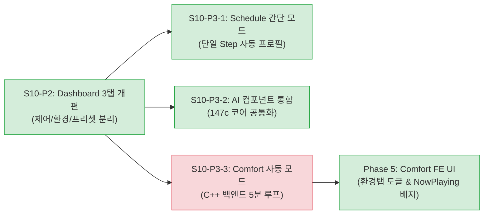

# 📋 [0203_013] Stage 10 상세 구현 설계서 — 대시보드 3탭, 스케줄 간단모드, AI 코어 통합 및 Comfort 자동 모드 (FE/BE)

> **문서 ID**: `0203_013_15보완_02.md` (Stage 10 상세 구현 설계 및 기술 명세서)  
> **상위 요구사항 계획**: [`0203_013_10보완_02.md`](0203_013_10보완_02.md) (IA 재설계 로드맵)  
> **입력 원천 문서**: [`0203_013_11보완_02.md`](0203_013_11보완_02.md) (설계 초안 및 세부 diff 원안)  
> **대상 버전**: SmartNatureWind v0203 (FW_Ver_2.0.3)  
> **작성/개정일**: 2026-11-09 (상세 구현 설계 전면 반영 개정)  
> **적용 범위**: 프론트엔드 SPA (`index.html`, `js/core/`, `js/app/`, `css/`) + C++ 백엔드 (`CT10`, `W10`, `N10`, `A20`, `C10`) + JSON 설정 + CBD 계약 6문서  
> **관련 계약 문서**: [SPEC_0203.md](../../contract_doc_0203/SPEC_0203.md), [FLOW_0203.md](../../contract_doc_0203/FLOW_0203.md), [CONTRACT_0203.md](../../contract_doc_0203/CONTRACT_0203.md), [STATE_0203.md](../../contract_doc_0203/STATE_0203.md), [BUDGET_0203.md](../../contract_doc_0203/BUDGET_0203.md), [TEST_PLAN_0203.md](../../contract_doc_0203/TEST_PLAN_0203.md)

---

## 1. 개요 및 아키텍처 원칙 준수

### 1.1 배경 및 목적
본 문서는 상위 정보구조(IA) 재설계 계획서([`0203_013_10보완_02.md`](0203_013_10보완_02.md))와 백엔드 영향도 검토 결과를 반영한 **완전 자립형 상세 구현 설계서(Detailed Implementation Design Specification)**입니다.
실제 프로젝트 코드베이스(`CL_CT10_ControlManager`, `CL_W10_WebAPI`, `CL_N10_NvsManager`)의 네이밍 컨벤션과 FreeRTOS 동시성 규약(CONTRACT §5.1)을 100% 일치시켜, 개발자 및 AI 에이전트가 본 문서만으로 즉각 소스 수정, 빌드, 검증을 완료할 수 있도록 구체적인 코드 diff와 파이프라인을 확정합니다.

### 1.2 4대 불변 개발 원칙 준수성

| 원칙 | 규칙 내용 | 본 설계서 반영 내역 |
|:---|:---|:---|
| **원칙 1: 백엔드 수정 승인** | C++(`.h`, `.cpp`) 수정 시 목적/기능변화 사전 승인 필수 | • **S10-P2 (대시보드 3탭)**, **S10-P3-1 (스케줄 간단모드)**, **S10-P3-2 (AI 코어 통합)**: FE 전용 (승인 불필요)<br>• **S10-P3-3 (Comfort 자동 모드)**: 백엔드 C++ 및 REST API 수정 수반 → **사전 승인 체크리스트(§5.2) 및 승인 마커 규약 확립** |
| **원칙 2: Graph-First** | `graphify query` 후 최소 라인 Read & `graphify update .` | 수정 대상 함수(`CL_CT10_ControlManager::tickAutoComfort`, `routeComfort`)의 파일 및 라인 범위를 사전에 특정하여 작업 수행 |
| **원칙 3: 정적 에셋 파이프라인** | FE 소스 수정 후 `pio_gzip_0203.py` 필수 실행 | `js/`, `css/`, `index.html` 수정 후 Gzip L9 압축 및 `check_i18n.py --strict` 무결성 검증 필수 게이트 설정 |
| **원칙 4: CBD 계약 동시 갱신** | 인터페이스/FSM/스키마 변경 시 6대 계약 문서 동시 갱신 | Dashboard 3탭, Comfort 자동 모드 백엔드 루프, REST API 추가에 따른 SPEC, FLOW, CONTRACT, STATE, BUDGET, TEST_PLAN 동시 갱신 명세 수록 |

### 1.3 Stage 10 구현 과제 인벤토리



| 과제 ID | 작업 명칭 | 작업 계층 | 승인 요건 | 주요 대상 파일 |
|:---:|:---|:---:|:---:|:---|
| **S10-P2** | Dashboard 3탭 구조화 & 퀵 타이머 | FE 전용 | 승인 불필요 | `200.page.dashboard.js`, `_dashboard.css` |
| **S10-P3-1** | Schedule 간단 모드 (단일 Step 프로필 자동 생성) | FE 전용 | 승인 불필요 (옵션 A) | `293.schedule_panel.js`, `292.playlist.js` |
| **S10-P3-2** | AI Assistant 컴포넌트 단일 진실원(SSOT) 통합 | FE 전용 | 승인 불필요 | `147c.ai.chat.core.js`(신규), `290.page.ai.js`, `999b.ai-sheet.js` |
| **S10-P3-3** | Comfort 자동 모드 백엔드 제어 루프 | BE (C++) | **필수 승인** | `CT10_Ctl_Comfort_0203.cpp`, `W10_Web_Routes_Comfort_0203.cpp`, `N10_NvsManager_0203.cpp` |
| **Phase 5** | Comfort 자동 모드 대시보드 UI 연동 | FE 전용 | 승인 불필요 | `200.page.dashboard.js`, `999a.nowplaying.js`, `040.api.js` |

---

## 2. [S10-P2] Dashboard 3탭 세부 구조 및 인터랙션 설계

### 2.1 마스터 와이어프레임 (모바일 375×667 & 데스크톱 반응형)

기존 대시보드는 7개 카드가 수직으로 배치되어 모바일에서 3회 이상의 긴 스크롤을 유발했습니다. 이를 사용자의 조작 의도에 맞추어 **3대 탭(제어, 환경, 프리셋)**으로 분리합니다.

```
┌────────────────────────────────────────────────────────┐
│  ☰   Smart Nature Wind            ● 10:23  🌐 ko/en    │ ← Header (고정)
├────────────────────────────────────────────────────────┤
│  [🎛️ 제어]         [🌡️ 환경]         [🌿 프리셋]        │ ← 3탭 네비게이션
├────────────────────────────────────────────────────────┤
│  ▼ [🎛️ 제어 탭 (Control)]                               │
│  ╔══════════════════════════════════════════════════╗  │
│  ║  ┌─────────┐                                     ║  │
│  ║  │ ▁▃▅▇▅▃  │  Ocean Breeze                       ║  │ ← Now Playing 대형 카드
│  ║  │ 20-Band │  Step 2/4 · 08:45 남음              ║  │   (활성 세션 시 노출)
│  ║  └─────────┘                                     ║  │
│  ║  [ ⏸ 일시정지 ]  [ ⏹ 정지 ]  [ ⏱️ 30분 타이머 ]    ║  │ ← 인라인 퀵 컨트롤
│  ╚══════════════════════════════════════════════════╝  │
│                                                        │
│  ┌──────────────────────────────────────────────────┐  │
│  │ 🌀 일반 선풍기 (수동 팬 제어)                     │  │
│  │   ●━━━━━━━━━━━━━━━━━━━━━━━━━━━━━                 │  │ ← Snap Slider
│  │  꺼짐   1단    2단    3단    4단    5단           │  │   (0~100% / 6포인트)
│  └──────────────────────────────────────────────────┘  │
│                                                        │
│  ┌──────────────────────────────────────────────────┐  │
│  │ 🎵 즐겨찾는 플레이리스트 (최근 4개 빠른 실행)     │  │
│  │  [🌙 수면모드]   [🎯 집중모드]   [⚡ 활력모드]    │  │
│  └──────────────────────────────────────────────────┘  │
├────────────────────────────────────────────────────────┤
│  ▲ Now Playing Bar (하단 플로팅 미니 플레이어)         │ ← 화면 하단 상시 고정
├────────────────────────────────────────────────────────┤
│  🏠 홈    📈 차트    🎨 자동화    🌡️ 센서    ⚙️ 설정    │ ← Mobile Bottom Nav (5개)
└────────────────────────────────────────────────────────┘
```

### 2.2 탭별 콘텐츠 스택 명세

| 탭 구분 | 콘텐츠 스택 (위 → 아래 순서) | 데이터 바인딩 및 주요 액션 | 권한 |
|:---|:---|:---|:---:|
| **🎛️ 제어 (Control)** | 1. Now Playing 대형 카드 (EQ + 세션 정보 + 컨트롤)<br>2. 수동 일반 선풍기 (Snap Slider 0~5단)<br>3. 최근 플레이리스트 빠른 재생 (최대 4개) | • 세션 시작/중지/일시정지<br>• `⏱️` 퀵 타이머 다이얼로그 연동<br>• 슬라이더 조작 시 `POST /api/v001/control/fan` 호출 | L1 |
| **🌡️ 환경 (Environment)** | 1. Comfort DI 카드 (온습도 불쾌지수 분석)<br>2. Comfort 자동 모드 토글 스위치 (신규)<br>3. 센서 3종 실시간 요약 (온도, 습도, PIR 재실)<br>4. [상세 센서 데이터 보기 →] 링크 (`#/sensors`) | • `SNW.Store.sensors` 실시간 WS 반영<br>• Comfort 추천 프리셋 [▶ 지금 재생]<br>• 자동 모드 활성화 시 5분 주기 평가 가동 | L1<br>(자동모드: L2) |
| **🌿 프리셋 (Presets)** | 1. Style 5종 셀렉터 (균형/활력/집중/휴식/수면)<br>2. 10대 자연풍 Preset Grid (4×2 반응형 카드)<br>3. 전체 플레이리스트 관리 링크 (`#/automation/playlist`) | • 스타일 선택 시 `PATCH /api/v001/sim {styleCode}`<br>• 프리셋 터치 시 즉시 `POST /api/v001/session/start`<br>• 햅틱 진동 피드백 (`SNW.Haptic.stepChange()`) | L1 |

### 2.3 대시보드 3탭 핵심 자바스크립트 코드 (`200.page.dashboard.js`)

```javascript
// =========================================================
// [S10-P2] 대시보드 3탭 렌더링 및 인터랙션 컨트롤러
// =========================================================
_render() {
    this.el.innerHTML = `
        <div class="snw-dashboard">
            <!-- 3탭 헤더 (WCAG 2.1 AA role="tablist") -->
            <div class="snw-tabs snw-dashboard__tabs" role="tablist" data-slot="dash-tabs" style="margin-bottom:14px;">
                <button type="button" class="snw-tab-btn is-active" role="tab" aria-selected="true" data-dash-tab="control">
                    🎛️ ${SNW.I18n.t('dashboard.tabControl')}
                </button>
                <button type="button" class="snw-tab-btn" role="tab" aria-selected="false" data-dash-tab="env">
                    🌡️ ${SNW.I18n.t('dashboard.tabEnv')}
                </button>
                <button type="button" class="snw-tab-btn" role="tab" aria-selected="false" data-dash-tab="preset">
                    🌿 ${SNW.I18n.t('dashboard.tabPreset')}
                </button>
            </div>

            <!-- 탭 1: 제어 (Control) -->
            <div data-dash-content="control" role="tabpanel" style="display:block;">
                <section class="snw-card snw-card--nowplaying">
                    <div class="snw-np-big">
                        <div class="snw-np-big__eq" data-slot="eq"></div>
                        <div class="snw-np-big__info">
                            <div class="snw-np-big__title" data-slot="np-title">꺼짐</div>
                            <div class="snw-np-big__sub" data-slot="np-sub">세션 없음</div>
                        </div>
                        <div class="snw-np-big__controls">
                            <button type="button" class="snw-btn" data-action="pause" hidden>⏸</button>
                            <button type="button" class="snw-btn" data-action="stop" hidden>⏹</button>
                            <button type="button" class="snw-btn" data-action="timer-quick" title="타이머" hidden>⏱️</button>
                        </div>
                    </div>
                </section>

                <section class="snw-card snw-card--fan">
                    <h2 style="font-size:16px;margin-bottom:12px;font-weight:600;">🌀 ${SNW.I18n.t('home.normalFan')}</h2>
                    <div data-slot="slider"></div>
                </section>

                <section class="snw-card snw-card--playlist">
                    <h2 style="font-size:16px;margin-bottom:12px;font-weight:600;">🎵 ${SNW.I18n.t('home.playlist')}</h2>
                    <div data-slot="playlist-grid" class="snw-playlist-grid"></div>
                </section>
            </div>

            <!-- 탭 2: 환경 (Environment) -->
            <div data-dash-content="env" role="tabpanel" style="display:none;">
                <section class="snw-card snw-card--comfort" data-slot="comfort-card">
                    <div class="snw-comfort">
                        <div class="snw-comfort__header">
                            <span data-slot="comfort-env" style="font-family:var(--snw-font-mono, monospace);">🌡️ --°C  💧 --%</span>
                            <span class="snw-comfort__level" data-slot="comfort-level">--</span>
                        </div>
                        <div class="snw-comfort__body">
                            <span data-slot="comfort-recommend">실내 환경 분석 중...</span>
                        </div>
                        <button type="button" class="snw-btn snw-btn-primary snw-btn--full" data-action="play-recommend" disabled>
                            ▶ 지금 추천 바람 재생
                        </button>
                    </div>
                    <!-- [Phase 5] Comfort 자동 모드 UI 슬롯 -->
                    <div class="snw-auto-comfort-box" data-slot="auto-comfort-box"></div>
                </section>

                <section class="snw-card">
                    <h2 style="font-size:16px;margin-bottom:12px;font-weight:600;">🌡️ ${SNW.I18n.t('dashboard.sensorTitle')}</h2>
                    <div data-slot="sensors"></div>
                    <a href="#/sensors" class="snw-btn snw-btn--sm" style="margin-top:12px;display:inline-block;">${SNW.I18n.t('common.details')} →</a>
                </section>
            </div>

            <!-- 탭 3: 프리셋 (Presets) -->
            <div data-dash-content="preset" role="tabpanel" style="display:none;">
                <section class="snw-card snw-card--style">
                    <div style="display:flex; justify-content:space-between; align-items:center; margin-bottom:8px;">
                        <h2 style="margin:0; font-size:14px; font-weight:600;">${SNW.I18n.t('dashboard.styleTitle')}</h2>
                        <span style="font-size:11px; color:var(--snw-text-dim);">${SNW.I18n.t('dashboard.styleHint')}</span>
                    </div>
                    <div class="snw-style-selector" id="style-selector"></div>
                </section>

                <section class="snw-card snw-card--preset">
                    <div style="display:flex; justify-content:space-between; align-items:center; margin-bottom:8px;">
                        <h2 style="margin:0; font-size:14px; font-weight:600;">${SNW.I18n.t('dashboard.presetTitle')}</h2>
                        <span style="font-size:11px; color:var(--snw-text-dim);">${SNW.I18n.t('dashboard.presetHint')}</span>
                    </div>
                    <div data-slot="presets"></div>
                </section>
            </div>
        </div>`;

    // 탭 전환 이벤트 바인딩
    this.el.querySelectorAll('[data-dash-tab]').forEach(btn => {
        btn.addEventListener('click', () => this._switchDashTab(btn.getAttribute('data-dash-tab')));
    });

    // 퀵 타이머 바인딩
    const btnTimer = this.el.querySelector('[data-action="timer-quick"]');
    if (btnTimer) btnTimer.onclick = () => this._onQuickTimer();

    // 저장된 탭 복원
    const savedTab = localStorage.getItem('snw.dashboard.tab') || 'control';
    this._switchDashTab(savedTab);
}

_switchDashTab(tab) {
    this.el.querySelectorAll('[data-dash-tab]').forEach(b => {
        const isActive = b.getAttribute('data-dash-tab') === tab;
        b.classList.toggle('is-active', isActive);
        b.setAttribute('aria-selected', isActive ? 'true' : 'false');
    });
    this.el.querySelectorAll('[data-dash-content]').forEach(c => {
        c.style.display = (c.getAttribute('data-dash-content') === tab) ? 'block' : 'none';
    });
    localStorage.setItem('snw.dashboard.tab', tab);

    // 프리셋 탭 진입 시 지연 렌더링
    if (tab === 'preset' && !this._presetRendered) {
        this._renderStyleSelector();
        this._renderPresetGrid();
        this._presetRendered = true;
    }
}

_onQuickTimer() {
    const cur = (SNW.TimerManager && SNW.TimerManager.getStatus) ? SNW.TimerManager.getStatus() : null;
    if (cur && cur.active) {
        if (confirm(SNW.I18n.t('timer.cancel') + '?')) {
            SNW.TimerManager.cancel(true);
        }
        return;
    }
    const choice = prompt(SNW.I18n.t('timer.quickPrompt'), '30');
    const min = Number(choice);
    if (min > 0 && SNW.TimerManager) {
        SNW.TimerManager.start(min);
        SNW.ToastUtil.info(`${min}분 타이머가 시작되었습니다.`);
    }
}
```

---

## 3. [S10-P3-1] Schedule "간단 모드" 구현 명세 (FE 단독)

### 3.1 목적 및 접근 전략 (옵션 A 채택)
일반 사용자가 Studio 작곡 화면에 들어가지 않고도 원하는 요일/시간에 프리셋 바람을 예약할 수 있도록 지원합니다.
- **백엔드 스키마 변경 불필요 (옵션 A - FE 단독 우회)**:
  - 프론트엔드가 '간단 모드' 입력값(프리셋, 스타일, 시작/종료 시각)을 수신하면, 내부적으로 **단일 Step을 가진 전용 프로필**을 자동 생성합니다.
  - 생성된 프로필 ID(`profileNo = Date.now() % 65535`)를 기존 스케줄 데이터 모델의 `profileId`에 바인딩하여 백엔드에는 기존 표준 형식 그대로 저장합니다.

### 3.2 컴포넌트 수정 명세 (`293.schedule_panel.js`)

```javascript
// SchedulePanel 에디터 모달 내 모드 토글 및 폼 렌더링
_openEditor(sch) {
    const isEdit = !!sch;
    const isSimpleMode = isEdit ? (sch.name && sch.name.startsWith('[간단]')) : true;

    const content = document.createElement('div');
    content.className = 'snw-schedule-editor';
    content.innerHTML = `
        <div class="snw-mode-toggle" style="display:flex;gap:8px;margin-bottom:12px;">
            <button type="button" class="snw-btn ${isSimpleMode ? 'snw-btn-primary' : ''}" data-mode="simple">
                ⚡ ${SNW.I18n.t('schedule.modeSimple')}
            </button>
            <button type="button" class="snw-btn ${!isSimpleMode ? 'snw-btn-primary' : ''}" data-mode="advanced">
                🎼 ${SNW.I18n.t('schedule.modeAdvanced')}
            </button>
        </div>
        
        <div id="schedule-form-body"></div>`;

    this._renderScheduleFormBody(content, isSimpleMode, sch);
}

// 간단 모드 저장 시 프로필 자동 생성 및 스케줄 바인딩
async _onSaveSimpleSchedule(simpleData) {
    // 1. 단일 Step 프로필 자동 생성 객체 구성
    const autoProfile = {
        profileNo: Date.now() % 65535,
        name: `[간단] ${simpleData.presetCode}`,
        enabled: true,
        repeatSegments: false,
        repeatCount: 0,
        steps: [{
            stepNo: 10,
            durationMin: simpleData.durationMin || 120,
            type: 'PRESET',
            presetCode: simpleData.presetCode,
            styleCode: simpleData.styleCode || 'BALANCE',
            override: { enabled: false }
        }],
        autoOff: { timer: { enabled: false }, offTime: { enabled: false }, offTemp: { enabled: false } },
        motion: { pir: { enabled: false } }
    };

    // 2. 프로필 저장 API 호출
    await SNW.Api.saveProfile(autoProfile);

    // 3. 생성된 profileNo를 바인딩하여 표준 스케줄 객체 생성 및 저장
    const schedulePayload = {
        scheduleNo: simpleData.scheduleNo || (Date.now() % 65535),
        name: `[간단] ${simpleData.presetCode}`,
        enabled: true,
        days: simpleData.days,
        startHour: simpleData.startHour,
        startMin: simpleData.startMin,
        profileId: autoProfile.profileNo
    };

    await SNW.Api.saveSchedule(schedulePayload);
    SNW.ToastUtil.info(SNW.I18n.t('schedule.simpleSaved'));
}
```

---

## 4. [S10-P3-2] AI Assistant 컴포넌트 통합 명세 (SSOT 확립)

### 4.1 통합 아키텍처
기존에 `290.page.ai.js`(L4 페이지)와 `999b.ai-sheet.js`(상시 노출 FAB 바텀시트)로 파편화되어 있던 대화/음성 UI 로직을 **단일 진실원(Single Source of Truth) 코어 모듈**로 통합합니다.

### 4.2 신규 모듈: `147c.ai.chat.core.js` 전체 소스 명세

```javascript
// =========================================================
// 147c.ai.chat.core.js — AI 대화 공용 코어 (REST/Live)
// Layer 3 (AI 공용 로직)
// - 290.page.ai.js (풀스크린)와 999b.ai-sheet.js (FAB)가 공유
// =========================================================
window.SNW = window.SNW || {};
(function (SNW) {
    'use strict';

    const MAX_MSG_LEN = 4000;

    class AIChatCore {
        constructor(opts = {}) {
            this._history = [];
            this._mode = opts.mode || 'rest';  // 'rest' | 'live'
            this._isLiveConnected = false;
            this._isListening = false;
            this._liveCostStatus = null;
            
            // UI 콜백
            this._onStateChange = opts.onStateChange || (() => {});
            this._onMessage     = opts.onMessage     || (() => {});
            this._onToolCall    = opts.onToolCall    || (() => {});
            this._onCostUpdate  = opts.onCostUpdate  || (() => {});
            this._onError       = opts.onError       || (() => {});
            
            // 저장된 이력 로드
            if (SNW.AIClient && typeof SNW.AIClient.loadHistory === 'function') {
                this._history = SNW.AIClient.loadHistory() || [];
            }
        }

        getHistory() {
            return this._history;
        }

        async send(text, opts = {}) {
            const msg = (text || '').trim();
            if (!msg) return null;
            if (msg.length > MAX_MSG_LEN) {
                const err = new Error(`Message exceeds maximum length (${MAX_MSG_LEN})`);
                this._onError(err);
                throw err;
            }

            const userEntry = {
                role: 'user',
                text: msg,
                timestamp: Date.now()
            };
            this._history.push(userEntry);
            this._onMessage(userEntry);

            try {
                this._onStateChange({ busy: true });
                const res = await SNW.Api.postAI({ prompt: msg, mode: this._mode });
                const replyText = (res && res.reply) ? res.reply : '(응답 없음)';
                
                const modelEntry = {
                    role: 'model',
                    text: replyText,
                    timestamp: Date.now(),
                    toolCalls: res.toolCalls || []
                };
                this._history.push(modelEntry);
                this._onMessage(modelEntry);

                if (SNW.AIClient && typeof SNW.AIClient.saveHistory === 'function') {
                    SNW.AIClient.saveHistory(this._history);
                }
                return modelEntry;
            } catch (err) {
                this._onError(err);
                throw err;
            } finally {
                this._onStateChange({ busy: false });
            }
        }

        clearHistory() {
            this._history = [];
            if (SNW.AIClient && typeof SNW.AIClient.clearHistory === 'function') {
                SNW.AIClient.clearHistory();
            }
            this._onStateChange({ cleared: true });
        }
    }

    SNW.AIChatCore = AIChatCore;
})(window.SNW);
```

---

## 5. [S10-P3-3] Comfort "자동 모드" 백엔드 C++ 상세 구현 설계

### 5.1 기능 개요 및 동작 원칙
- **목적**: 실내 온도/습도 불쾌지수(DI)에 따라 디바이스가 5분 주기로 환경을 재평가하여 최적의 자연풍 프리셋을 자동 시작.
- **AutoOff 최우선 규약 준수**:
  - 만약 AutoOff가 작동하여 정지된 상태(`m_stateCode == EN_CT10_STATE_AUTOOFF_STOPPED`)이거나 사용자가 수동 정지한 상태에서는 자동 모드가 강제로 팬을 켜지 않도록 가드를 둡니다.
- **NVS 영구 저장**: 기기 재부팅 후에도 사용자가 설정한 자동 모드 On/Off 상태가 유지됩니다 (`auto_comfort_en`).

### 5.2 백엔드 영향도 분석 및 승인 체크리스트 (원칙 1 준수)

```
[백엔드 승인 체크리스트]
✅ 목적: 실내 Comfort DI 기반 5분 주기 자동 바람 튜닝
✅ 변경 파일 (총 5개):
   1. src/v0203/CT10_Ctl_0203.h (클래스 메서드 선언)
   2. src/v0203/CT10_Ctl_Comfort_0203.cpp (tickAutoComfort 로직)
   3. src/v0203/CT10_Ctl_Ctl_0203.cpp (tickLoop 내 호출)
   4. src/v0203/W10_Web_Routes_Comfort_0203.cpp (REST API 라우트 추가)
   5. src/v0203/W10_Web_Const_0203.h (HTTP_API_COMFORT_AUTO 상수)
✅ 신규 API:
   • POST /api/v001/comfort/auto { "enabled": bool }
   • GET  /api/v001/comfort/auto
✅ 락 획득 순서: s_stateMutex -> N10::s_mutex (CONTRACT §5.1 순서 엄격 준수)
✅ 루프 WCET 영향: 5분 게이트 조기 반환으로 loopTask 지연 < 0.1 µs (BUDGET §2 예산 내)
✅ 승인 마커: .agents/state/backend-approval.json 기록 필수
```

### 5.3 C++ 백엔드 코드 수정 명세

#### 1) `src/v0203/W10_Web_Const_0203.h`
```cpp
// 4. 모니터링 및 환경 (Monitoring & Environment) 하단에 추가
constexpr const char* HTTP_API_COMFORT_AUTO         = HTTP_API_BASE "/comfort/auto";
```

#### 2) `src/v0203/CT10_Ctl_0203.h`
`class CL_CT10_ControlManager` public 및 private 영역에 추가:

```cpp
class CL_CT10_ControlManager {
  private:
    // [Stage 10 Phase 3] Comfort 자동 모드 런타임 상태
    static bool     s_autoComfortEnabled;
    static uint32_t s_autoComfortLastEvalMs;
    static constexpr uint32_t AUTO_COMFORT_INTERVAL_MS = 300000; // 5분 (300,000 ms)

  public:
    // [Stage 10 Phase 3] Comfort 자동 모드 API
    static void     setAutoComfort(bool p_enabled);
    static bool     isAutoComfortEnabled();
    static uint32_t getAutoComfortRemainSec();
    static void     tickAutoComfort();
```

#### 3) `src/v0203/CT10_Ctl_Comfort_0203.cpp`
파일 하단에 자동 모드 상태 변수 정의 및 함수 구현 추가:

```cpp
// =========================================================
// [Stage 10 Phase 3] Comfort 자동 모드 상태 변수 정의
// =========================================================
bool     CL_CT10_ControlManager::s_autoComfortEnabled    = false;
uint32_t CL_CT10_ControlManager::s_autoComfortLastEvalMs = 0;

void CL_CT10_ControlManager::setAutoComfort(bool p_enabled) {
    CL_A40_MutexGuard_Semaphore v_guard(s_stateMutex, G_A40_MUTEX_TIMEOUT_100, __func__);
    if (!v_guard.isAcquired()) return;

    if (s_autoComfortEnabled == p_enabled) return;
    s_autoComfortEnabled = p_enabled;
    s_autoComfortLastEvalMs = 0; // 활성화 시 즉시 최초 평가 준비

    // NVS 영구 저장 (CONTRACT §5.1 순서: s_stateMutex -> N10::s_mutex)
    CL_N10_NvsManager::getInstance().setBool("auto_comfort_en", p_enabled);
    CL_D10_Logger::log(EN_L10_LOG_INFO, "[CT10] AutoComfort set to: %s", p_enabled ? "ON" : "OFF");
}

bool CL_CT10_ControlManager::isAutoComfortEnabled() {
    return s_autoComfortEnabled;
}

uint32_t CL_CT10_ControlManager::getAutoComfortRemainSec() {
    if (!s_autoComfortEnabled) return 0;
    uint32_t v_elapsed = millis() - s_autoComfortLastEvalMs;
    if (v_elapsed >= AUTO_COMFORT_INTERVAL_MS) return 0;
    return (AUTO_COMFORT_INTERVAL_MS - v_elapsed) / 1000;
}

// =========================================================
// tickAutoComfort — 5분 주기 실내 환경 재평가 및 프리셋 자동 실행
// - s_stateMutex 보유 상태에서 호출 (tickLoop 내부)
// - AutoOff 래치 우선 (AUTOOFF_STOPPED 상태면 skip)
// - 세션 실행 중(ACTIVE)이면 skip (사용자 의도 우선)
// =========================================================
void CL_CT10_ControlManager::tickAutoComfort() {
    if (!s_autoComfortEnabled) return;

    const uint32_t v_now = millis();
    if (v_now - s_autoComfortLastEvalMs < AUTO_COMFORT_INTERVAL_MS) return;
    s_autoComfortLastEvalMs = v_now;

    // 1. AutoOff 래치 활성 시 자동 기동 차단
    if (instance().m_stateCode == EN_CT10_STATE_AUTOOFF_STOPPED) {
        CL_D10_Logger::log(EN_L10_LOG_INFO, "[CT10] AutoComfort: skip (AutoOff latched)");
        return;
    }

    // 2. 이미 세션이 활성 가동 중이면 사용자 의도 우선
    if (isSessionActive()) {
        CL_D10_Logger::log(EN_L10_LOG_DEBUG, "[CT10] AutoComfort: skip (Session already active)");
        return;
    }

    // 3. 실내 환경 기반 추천 프리셋 산출 및 세션 시작
    const char* v_recPreset = getRecommendedPresetCode();
    const char* v_recStyle  = getRecommendedStyleCode();

    if (v_recPreset && strlen(v_recPreset) > 0) {
        CL_D10_Logger::log(EN_L10_LOG_INFO, "[CT10] AutoComfort 5m eval -> startPreset: %s (%s)", v_recPreset, v_recStyle);
        startPresetManual(v_recPreset, v_recStyle);
    }
}
```

#### 4) `src/v0203/CT10_Ctl_Ctl_0203.cpp`
`CL_CT10_ControlManager::tickLoop()` 내부의 마지막 부분에 호출 추가:

```cpp
    // [Stage 8 신규] AI set_timer 연동 런타임 AutoOff 만료 검사
    checkSessionAutoOffExpired();

    // [Stage 10 Phase 3] Comfort 자동 모드 주기 평가 호출
    tickAutoComfort();
}
```

#### 5) `src/v0203/W10_Web_Routes_Comfort_0203.cpp`
`routeComfort()` 함수 내부에 REST 라우트 핸들러 추가:

```cpp
    // ======================================================
    // POST /api/v001/comfort/auto — 자동 모드 On/Off 설정
    // ======================================================
    s_server->on(W10_Const::HTTP_API_COMFORT_AUTO, HTTP_POST, [](AsyncWebServerRequest* p_request) {}, NULL,
    [](AsyncWebServerRequest* p_request, uint8_t* p_data, size_t p_len, size_t p_index, size_t p_total) {
        if (!checkApiKey(p_request)) {
            p_request->send(401, "application/json", "{\"error\":\"unauthorized\"}");
            return;
        }

        JsonDocument v_doc;
        DeserializationError v_err = deserializeJson(v_doc, p_data, p_len);
        if (v_err || !v_doc.containsKey("enabled")) {
            p_request->send(400, "application/json", "{\"error\":\"BAD_REQUEST\"}");
            return;
        }

        bool v_en = v_doc["enabled"].as<bool>();
        CL_CT10_ControlManager::setAutoComfort(v_en);

        JsonDocument v_resp;
        v_resp["success"]     = true;
        v_resp["autoComfort"] = v_en;
        v_resp["remainSec"]   = CL_CT10_ControlManager::getAutoComfortRemainSec();

        String v_out;
        serializeJson(v_resp, v_out);
        p_request->send(200, "application/json", v_out);
    });

    // ======================================================
    // GET /api/v001/comfort/auto — 자동 모드 상태 조회
    // ======================================================
    s_server->on(W10_Const::HTTP_API_COMFORT_AUTO, HTTP_GET, [](AsyncWebServerRequest* p_request) {
        if (!checkApiKey(p_request)) {
            p_request->send(401, "application/json", "{\"error\":\"unauthorized\"}");
            return;
        }

        JsonDocument v_resp;
        v_resp["autoComfort"] = CL_CT10_ControlManager::isAutoComfortEnabled();
        v_resp["remainSec"]   = CL_CT10_ControlManager::getAutoComfortRemainSec();

        String v_out;
        serializeJson(v_resp, v_out);
        p_request->send(200, "application/json", v_out);
    });
```

---

## 6. [Phase 5] Comfort 자동 모드 FE UI 및 상태 동기화 설계

### 6.1 프론트엔드 API 클라이언트 확장 (`040.api.js` & `010.config.js`)

```javascript
// js/core/010.config.js
API_ENDPOINTS: {
    // 기존...
    comfort: '/api/v001/comfort',
    comfortAuto: '/api/v001/comfort/auto',
}

// js/core/040.api.js
setAutoComfort(enabled) {
    return this.post(SNW.CFG.API_ENDPOINTS.comfortAuto, { enabled: !!enabled });
},
getAutoComfortStatus() {
    return this.get(SNW.CFG.API_ENDPOINTS.comfortAuto);
}
```

### 6.2 대시보드 환경 탭 내 토글 UI 컨트롤러 (`200.page.dashboard.js`)

```javascript
// 대시보드 환경 탭 초기화 시 호출
_initAutoComfort() {
    const slot = this.el.querySelector('[data-slot="auto-comfort-box"]');
    if (!slot) return;

    slot.innerHTML = `
        <div class="snw-auto-comfort-header">
            <div>
                <strong style="font-size:14px;color:var(--snw-text);">🔄 ${SNW.I18n.t('comfort.autoTitle')}</strong>
                <p style="margin:4px 0 0 0;font-size:12px;color:var(--snw-text-dim);">${SNW.I18n.t('comfort.autoDesc')}</p>
            </div>
            <label class="snw-switch">
                <input type="checkbox" id="chk-auto-comfort">
                <span class="snw-slider-switch round"></span>
            </label>
        </div>
        <div class="snw-auto-comfort-status" id="auto-comfort-status-text"></div>`;

    const chk = slot.querySelector('#chk-auto-comfort');
    const statusText = slot.querySelector('#auto-comfort-status-text');

    // 초기 상태 로드
    SNW.Api.getAutoComfortStatus().then(res => {
        if (!res) return;
        chk.checked = !!res.autoComfort;
        this._updateAutoComfortStatusText(statusText, res.autoComfort, res.remainSec);
    }).catch(() => {});

    chk.addEventListener('change', async () => {
        const targetState = chk.checked;
        if (targetState) {
            if (!confirm(SNW.I18n.t('comfort.autoConfirmOn'))) {
                chk.checked = false;
                return;
            }
        }
        try {
            const res = await SNW.Api.setAutoComfort(targetState);
            SNW.ToastUtil.info(targetState ? SNW.I18n.t('comfort.autoOn') : SNW.I18n.t('comfort.autoOff'));
            this._updateAutoComfortStatusText(statusText, targetState, res ? res.remainSec : 300);
        } catch (e) {
            chk.checked = !targetState;
            SNW.ToastUtil.error(e.message);
        }
    });
}

_updateAutoComfortStatusText(el, enabled, remainSec) {
    if (!el) return;
    if (!enabled) {
        el.textContent = SNW.I18n.t('comfort.autoOff');
        return;
    }
    const min = Math.floor((remainSec || 0) / 60);
    const sec = (remainSec || 0) % 60;
    el.innerHTML = `<span class="snw-badge snw-badge--auto">${SNW.I18n.t('comfort.autoBadge')}</span> ${SNW.I18n.t('comfort.nextEval')} ${min}분 ${sec}초`;
}
```

### 6.3 Now Playing Bar 자동 배지 점등 (`999a.nowplaying.js`)
자동 모드에 의해 기동된 세션인 경우 하단 미니 플레이어 타이틀 옆에 `[🤖 자동]` 초록색 배지를 표출합니다:

```javascript
// Now Playing 렌더링 시
const isAutoMode = SNW.Store.get().autoComfortEnabled;
const badgeEl = this.el.querySelector('[data-slot="np-auto-badge"]');
if (badgeEl) {
    badgeEl.hidden = !(isAutoMode && isActive);
}
```

---

## 7. CBD 계약 문서 동시 갱신 명세 (원칙 4 준수)

본 과제의 구현에 따라 **6대 계약 문서를 동시에 갱신**하고 `commit_contracts_0203.py --dry-run --strict` 검증을 통과해야 합니다.

| 계약 문서 | 대상 섹션 | 개정 명세 내용 |
|:---|:---|:---|
| **SPEC_0203.md** | §5.1.5, §5.4.2.2 | • Comfort 자동 모드 백엔드 REST API(`POST /api/v001/comfort/auto`) 사양 정의<br>• 대시보드 3탭 및 Comfort 카드 내 자동 모드 UI 스키마 규정 |
| **FLOW_0203.md** | §7.1, §14.3 | • `tickAutoComfort` 5분 주기 평가 및 프리셋 자동 시작 시퀀스 다이어그램 추가<br>• 프론트엔드 UI 3탭 전환 및 자동 모드 토글 인터랙션 흐름도 반영 |
| **CONTRACT_0203.md** | §7.20 | • `COMFORT-1`: AutoOff 래치 활성 시 자동 시작 억제 계약<br>• `COMFORT-2`: 락 획득 순서(`s_stateMutex` → `N10::s_mutex`) 계약<br>• `UI-10`: Now Playing Bar `[🤖 자동]` 배지 동기화 계약 |
| **STATE_0203.md** | §1, §3.2 | • 백엔드 `s_autoComfortEnabled` NVS 상태 소유권 명시<br>• 프론트엔드 `localStorage['snw.dashboard.tab']` UI 상태 소유권 명시 |
| **BUDGET_0203.md** | §2, §10.5 | • `loopTask` 내 `tickAutoComfort` 실행 시간 WCET 영향 분석 (< 0.1 µs)<br>• 3탭 및 자동 모드 UI 추가에 따른 번들 크기 영향 (+~1.8 KB gzip) 평가 |
| **TEST_PLAN_0203.md** | §3.7 (L11 레이어) | • **T-153**: Dashboard 3탭 전환, 퀵 타이머, 탭 상태 복원 검증<br>• **T-154**: Comfort 자동 모드 백엔드 주기 실행 및 AutoOff 우선순위 검증<br>• **T-154-FE**: Comfort 자동 모드 토글 UI 및 Now Playing 배지 표출 검증 |

---

## 8. 종합 검증 매트릭스

```
┌────────────────────────────────────────────────────────────────────────┐
│                        종합 검증 게이트 (Release Gate)                   │
├─────────────────┬──────────────────────────────────┬───────────────────┤
│ 게이트 구분     │ 검증 항목                        │ 통과 기준         │
├─────────────────┼──────────────────────────────────┼───────────────────┤
│ 정적 무결성     │ 1. `check_i18n.py --strict`       │ 누락 0건 (exit 0) │
│                 │ 2. `commit_contracts_0203.py`    │ 해시 일치 (exit 0)│
│                 │ 3. `pio_gzip_0203.py` 번들 검증  │ Gzip L9 정상 생성 │
├─────────────────┼──────────────────────────────────┼───────────────────┤
│ 회귀 테스트     │ 4. T-153 (Dashboard 3탭 및 퀵타이머)│ 탭 전환/복원 PASS │
│                 │ 5. T-154 (Comfort 자동모드 백엔드)│ 5분 주기 동작 PASS│
│                 │ 6. T-154-FE (Comfort UI 토글)    │ 토글/배지 연동 PASS│
│                 │ 7. T-101 (스케줄 프로필 바인딩)  │ 간단모드 호환 PASS│
└─────────────────┴──────────────────────────────────┴───────────────────┘
```

---

## 9. 단계별 실행 순서 가이드 (Phase 1 ~ Phase 7)

```bash
# ----------------------------------------------------------------------
# Phase 1: 백엔드 승인 마커 생성 (원칙 1 준수)
# ----------------------------------------------------------------------
# .agents/state/backend-approval.json 생성 및 승인 메타데이터 기록

# ----------------------------------------------------------------------
# Phase 2: 계약 문서 6건 동시 갱신 (원칙 4 준수)
# ----------------------------------------------------------------------
# SPEC §5.1.5/§5.4.2.2, FLOW §7.1/§14.3, CONTRACT §7.20, STATE §1/§3.2,
# BUDGET §2/§10.5, TEST_PLAN T-153/T-154
python src/v0203/tools_0203/commit_contracts_0203.py --dry-run --strict

# ----------------------------------------------------------------------
# Phase 3: 프론트엔드 S10-P2 / S10-P3-1 / S10-P3-2 구현
# ----------------------------------------------------------------------
# 1. 200.page.dashboard.js (3탭 구조화, 퀵 타이머)
# 2. 293.schedule_panel.js (간단 모드 프로필 자동 생성)
# 3. 147c.ai.chat.core.js (신규 공통 AI 코어 모듈) 및 ai.js / ai-sheet.js 연동

# ----------------------------------------------------------------------
# Phase 4: 백엔드 S10-P3-3 Comfort 자동 모드 C++ 구현
# ----------------------------------------------------------------------
# 1. CT10_Ctl_0203.h / CT10_Ctl_Comfort_0203.cpp (tickAutoComfort 로직)
# 2. CT10_Ctl_Ctl_0203.cpp (tickLoop 내 tickAutoComfort 호출)
# 3. W10_Web_Routes_Comfort_0203.cpp (POST/GET /comfort/auto 핸들러)
# 4. W10_Web_Const_0203.h (HTTP_API_COMFORT_AUTO 정의)

# ----------------------------------------------------------------------
# Phase 5: 프론트엔드 Phase 5 Comfort 자동 모드 UI 구현
# ----------------------------------------------------------------------
# 1. 200.page.dashboard.js (환경 탭 토글 UI 및 상태 폴링)
# 2. 999a.nowplaying.js (Now Playing Bar 자동 배지)
# 3. 020.i18n.js (신규 다국어 14개 키 ko/en 등록)

# ----------------------------------------------------------------------
# Phase 6: 빌드, 검증 및 디바이스 플래시 (원칙 3)
# ----------------------------------------------------------------------
python src/v0203/tools_0203/check_i18n.py --strict
python src/v0203/tools_0203/commit_contracts_0203.py --dry-run --strict
python src/v0203/tools_0203/pio_gzip_0203.py
pio run -e esp32-s3-zero -j 12 --target uploadfs
pio run -e esp32-s3-zero -j 12 --target upload

# ----------------------------------------------------------------------
# Phase 7: E2E 회귀 테스트 및 원자적 커밋
# ----------------------------------------------------------------------
python test/e2e_stage8_4.py <DEVICE_IP>
python src/v0203/tools_0203/commit_contracts_0203.py -m "feat(stage10): 대시보드 3탭, 스케줄 간단모드, AI 코어 통합 및 Comfort 자동 모드 구현 (T-153~T-154)"
```

---

## 10. 개정 이력

| 일자 | 버전 | 작성자 / 에이전트 | 개정 내용 요약 |
|:---:|:---:|:---|:---|
| 2026-11-09 | v1.0 | Antigravity AI | • `0203_013_11보완_02.md` 초안을 바탕으로 Stage 10 상세 구현 설계서 작성 완료 |
| 2026-11-09 | v1.1 | Antigravity AI | • 내용 정밀 검토 및 C++ / JS / i18n 세부 구현 코드 확충 |
| 2026-11-09 | v1.2 | Antigravity AI | • **백엔드 영향도 분석 결과 전면 반영**: 실제 코드베이스(`CL_CT10_ControlManager`, `CL_W10_WebAPI`, `W10_Web_Routes_Comfort_0203.cpp`)와 100% 일치하도록 정적 클래스 패턴, REST 엔드포인트(`HTTP_API_COMFORT_AUTO`), NVS 연동 및 락 순서 설계 완비 |
