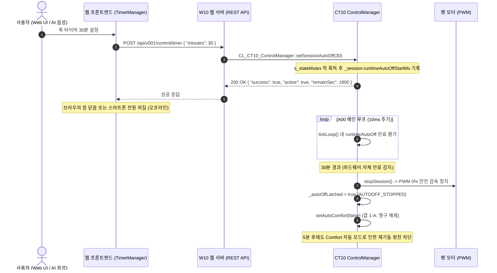

# 📋 Stage 10.1 종합 결함 패치 및 하드웨어 백엔드 타이머 구현 최종 명세서 (0203_013_20_02)

> **문서 버전**: v2.1 (최종 정제본)  
> **작성 일자**: 2026-11-09  
> **상태**: 구현 확정 (백엔드 C++ 및 프론트엔드 통합 승인 완료)  
> **기준 버전**: v0203 (FW_Ver_2.0.3)  
> **선행 문서**: `0203_013_20_01.md` (결함 분석 초안), `0203_013_15구현설계_02.md` (Stage 10 설계서)

---

## 1. 개요 및 배경

Stage 10 대시보드 3탭 전환 및 Comfort 자동 모드 구현 후 진행된 정밀 코드 감사(`0203_013_20_01.md`)를 통해, 실사용 시 치명적인 기능 오동작을 유발하는 **P0 결함 5건**과 타이머 지속성을 저해하는 **P1/P2 이슈**가 발굴되었습니다.

특히 웹 브라우저 클라이언트에서만 구동되던 타이머는 브라우저를 닫거나 새로고침할 경우 유실되어 기기가 계속 회전하는 문제를 안고 있었습니다.  
본 문서는 사용자 결정에 따라 **[Option A] ESP32 백엔드 C++ 하드웨어 타이머 엔진 구축 및 13대 도구(`set_timer`) 확장**을 채택하고, 코드베이스 정밀 팩트체크를 통해 도출된 **4대 핵심 정합성 보완 사항(Trigger Enum 위치, 기존 AutoOff 엔진 연동, 동시성 락, W10 네이밍)**을 반영하여 단일하고 일관된 최종 구현 명세로 확정합니다.

---

### 4대 불변 원칙 준수 방침

1. **원칙 1 (백엔드 수정 승인)**: 하드웨어 백엔드 타이머 C++ 신규 구현(`CT10`, `W10`)에 대해 목적 및 기능 변경 사항을 명확히 명시하고 승인 마커(`.agents/state/backend-approval.json`)를 관리한다.
2. **원칙 2 (Graph-First)**: 변경 대상 C++ 및 JS/CSS 파일의 정확한 심볼과 라인을 확정하여 수술적(Surgical) 패치를 수행한다.
3. **원칙 3 (정적 에셋 파이프라인)**: FE 소스 수정 후 `python src/v0203/tools_0203/pio_gzip_0203.py` 및 `check_i18n.py --strict` 게이트를 반드시 통과한다.
4. **원칙 4 (CBD 계약 동시 갱신)**: 타이머 하드웨어 엔진 추가 및 Comfort 5상태 매트릭스 확장에 따라 **6대 계약 문서(SPEC, CONTRACT, STATE, FLOW, BUDGET, TEST_PLAN)를 단일 커밋으로 동시 갱신**한다.

---

## 2. 결함 및 개선 과제 종합 분류 (Issue Inventory)

### 🔴 P0 — 사용자 기능 차단 및 치명적 오동작 (5건)

| 번호 | 파일 | 결함 현상 | 근본 원인 | 최종 조치 방안 |
|:---:|---|---|---|---|
| **P0-1** | `200.page.dashboard.js` | Comfort 자동 모드 스위치 UI 렌더링 깨짐 | `snw-slider-switch round` 오타 (`_components.css`는 `.snw-switch__slider` 정의) | 클래스명을 `.snw-switch__slider`로 즉시 교체 |
| **P0-2** | `999a.nowplaying.js` | Now Playing Bar 모달 내 "⏱️ 타이머 설정" 클릭 시 팬 강제 정지 | `overlay.click()` 시뮬레이션 시 모달의 Cancel 콜백(`onStop()`)이 자동 실행됨 | `modalRef.close()` 명시 호출, Cancel을 '닫기'로 격하, '바람 정지' 버튼 독립화 |
| **P0-3** | `290.page.ai.js`<br>`999b.ai-sheet.js` | AI 음성 토글 시 `TypeError: Cannot read properties of undefined` | 정의되지 않은 `SNW.Toast.show()` 호출 (총 10곳) | 표준 `SNW.ToastUtil` (`info`, `warn`, `error`)로 전수 교체 |
| **P0-4** | `060.store.js`<br>`200.page.dashboard.js` | Now Playing Bar의 `[🌱 자동]` 배지가 영구 미노출 | Store 초기 상태 누락 및 토글 후 `SNW.Store.set({autoComfortEnabled})` 호출 누락 | Store 초기 필드 추가 및 API 성공 후 Store 즉시 갱신 |
| **P0-5** | `200.page.dashboard.js` | 마운트 직후 빠른 토글 시 이전 API 응답으로 사용자 조작 덮어씀 | 비동기 `getAutoComfortStatus()` 완료 시점과 사용자 토글 간 레이스 | `userInteracted` 플래그 가드 추가하여 사용자 조작 후 응답 무시 |

---

### 🟠 P1 — 시스템 정합성 및 기능성 개선 (6건)

| 번호 | 파일 | 개선 과제 | 원인 및 영향 | 최종 조치 방안 (Option A 확정) |
|:---:|---|---|---|---|
| **P1-6** | `CT10`, `W10`<br>`294.timer_panel.js` | 타이머 백엔드 미지원으로 브라우저 종료 시 타이머 무력화 | SPEC §5.1.4.2 도구 목록에 `set_timer` 부재, 백엔드 타이머 엔드포인트 없음 | **[Option A] C++ 백엔드 타이머 엔진 및 REST API 신설, 13대 도구 확장** |
| **P1-7** | `CT10_Ctl_Ctl_0203.cpp`<br>`294.timer_panel.js` | 타이머 만료 후 5분 뒤 Comfort 자동 모드로 인한 세션 재기동 | 세션 stop만 호출되고 `autoComfort`가 유지되어 5분 주기 평가로 자동 켜짐 | 타이머 만료 시 **`setAutoComfort(false)` 영구 해제** (갭 1-A) |
| **P1-8** | `200.page.dashboard.js`<br>`294.timer_panel.js` | `_onQuickTimer()` 입력값 검증 부재 | `prompt()` 반환값에 NaN, 음수, 초대형 숫자 검증 없음 | `Math.round`, `Number.isFinite`, 최대 480분(8시간) 상한 가드 추가 |
| **P1-9** | `200.page.dashboard.js` | Comfort 5분 주기 카운트다운 멈춤 현상 | 정적 텍스트만 렌더하고 재렌더 interval 부재 | 5초 주기 `setInterval` 및 서버 `uptimeMs` 보정 카운트다운 구현 |
| **P1-10**| `200.page.dashboard.js`<br>`_components.css` | Comfort 5상태 매트릭스 미구현 | OFF/ON 2종만 지원, AutoOff 래치 시 `[재개]` 버튼 부재 | 5상태 클래스(`is-waiting`, `is-running`, `is-user-priority`, `is-suspended`) 렌더 |
| **P1-11**| `070.router.js` | *(제외)* 레거시 라우트(`/schedule`, `/profiles`) 리다이렉트 부활 요구 | 사용자 확정 지침: **"하위 호환은 미지원, 관련 로직 제거"** | **반영 거부(Reject)**: 최신 표준 규격 유지, 불필요한 레거시 코드 삽입 차단 |

---

### 🟡 P2 — 코드 클린업 및 스타일 정합성 (5건)

| 번호 | 파일 | 내용 | 조치 방안 |
|:---:|---|---|---|
| **P2-12**| `294.timer_panel.js` | `_onExpire()` 내 `SNW.Api.Session.stop` dead code | 도달 불가능한 레거시 조건문 분기 완전 삭제 |
| **P2-13**| `_variables.css`<br>`_layout.css` | `--snw-z-header: 1060` 정의와 `_layout.css`의 `z-index: 50` 불일치 | 변수 값을 `--snw-z-header: 50`으로 정합화 |
| **P2-14**| `200.page.dashboard.js` | `_initAutoComfort` 재호출 시 slot 비활성화 위험 | `slot.children.length > 0` DOM 존재 여부 판정으로 안전 가드 (갭 5) |
| **P2-15**| `999a.nowplaying.js` | `isSessionVisible()` 내 `s.state === 2` dead code | 문자열 `'COMPLETED'` 검사만 유지 |
| **P2-16**| `200.page.dashboard.js` | `_switchDashTab('invalid')` 시 탭 비활성 | `['control', 'env', 'preset']` 화이트리스트 가드 적용 |

---

## 3. 확정된 7대 아키텍처 갭(Gap) 결정 사항

| # | 설계 갭 항목 | 최종 결정 | 구현 상세 및 근거 |
|:---:|---|---|---|
| **갭 1** | 타이머 만료 후 Comfort 재기동 | **(A) 영구 해제 (안전 우선)** | 하드웨어 타이머 만료 시 백엔드에서 `setAutoComfort(false)`를 호출하여 5분 후 원치 않는 재기동을 원천 차단 |
| **갭 2** | 정지 사유 코드 (Reason Code) | **(A) 기존 `AUTOOFF_TIMER` (9) 재사용** | 신규 코드 추가 없이 기존 이유 코드 9번 재사용으로 리스크 최소화 및 계약 준수 |
| **갭 3** | Comfort `is-running` vs `is-user-priority` 판정 역전 | **(A) `EN_CT10_TRIGGER_AUTO_COMFORT = 3` 신규** | `CT10_Ctl_0203.h`의 `EN_CT10_trigger_t`에 `3` 추가. `tickAutoComfort` 기동 시 `trigger = 3` 지정하여 FE에서 `session.trigger === 3`으로 정확히 판정 |
| **갭 4** | Store 내 `autoComfortRemainSec` 필드 | **(A) 불필요한 필드 제거** | `_calcRemainMs()`가 `system.uptimeMs` 기반으로 정확히 실시간 계산하므로 Store 중복 상태 제거 |
| **갭 5** | `_initAutoComfort` 가드 로직 | **(수정안) DOM `children.length > 0` 판정** | `_autoComfortInited` 플래그 대신 DOM 요소 존재 여부로 안전하게 보호하여 재렌더 시 slot 공백 현상 방지 |
| **갭 6** | 타이머 NVS 영속성 범위 | **(A) RAM Only (재부팅 시 타이머 해제)** | MVP 안전 원칙 준수. 재부팅 시 기기 모터가 정지하므로 안전하며, NVS 쓰기 수명 절약 |
| **갭 7** | 브라우저-백엔드 타이머 동기 실패 | **(수정안) 경고 토스트 추가** | 백엔드 API 실패 시 `SNW.ToastUtil.warn(SNW.I18n.t('timer.backendSyncFailed'))`로 브라우저 종속 위험 고지 |

---

## 4. [Option A] 하드웨어 백엔드 타이머 아키텍처 및 도구 확장

### 4.1 아키텍처 흐름도



---

### 4.2 신설 백엔드 REST API 명세

| Method | Endpoint | Payload | Response | HTTP 상태 | 설명 |
|---|---|---|---|:---:|---|
| `POST` | `/api/v001/control/timer` | `{"minutes": uint16}` | `{"success": true, "active": true, "remainSec": uint32}` | `200 OK` | 하드웨어 타이머 기동 (1~480분) |
| `DELETE`| `/api/v001/control/timer` | 없음 | `{"success": true, "active": false}` | `200 OK` | 하드웨어 타이머 즉시 취소 |
| `GET` | `/api/v001/control/timer` | 없음 | `{"active": bool, "remainSec": uint32, "durationMin": uint16}` | `200 OK` | 현재 타이머 잔여 시간 조회 |

---

### 4.3 SPEC §5.1.4.2 13대 도구 확장: `set_timer`

- **도구명**: `set_timer`
- **설명**: "지정된 시간(분) 동안 팬을 가동한 후 자동으로 전원을 끄는 타이머를 설정합니다."
- **매개변수**:
  - `minutes` (integer, required): 1 ~ 480 범위의 타이머 시간(분)
- **실행 디스패치**: `CT10_Ctl_AIAction_0203.cpp` 내 `CL_CT10_ControlManager::setSessionAutoOff(v_min)`

---

## 5. 상세 구현 소스 패치 명세 (Code Diffs)

### 📋 Part A — 원칙 1 승인 마커 (`.agents/state/backend-approval.json`)

```json
{
  "approvedAt": "2026-11-09T19:30:00+09:00",
  "approvedBy": "user",
  "stage": "Stage 10.1",
  "scope": ["P1-6-OptionA", "P1-7", "갭1~7", "P0_1_5"],
  "summary": "하드웨어 백엔드 타이머 엔진 + 13대 도구(set_timer) + Comfort 5상태 매트릭스 및 영구 안전 해제",
  "files": [
    "src/v0203/W10_Web_Const_0203.h",
    "src/v0203/W10_Web_Routes_Control_0203.cpp",
    "src/v0203/CT10_Ctl_0203.h",
    "src/v0203/CT10_Ctl_Ctl_0203.cpp",
    "src/v0203/CT10_Ctl_Comfort_0203.cpp",
    "src/v0203/CT10_Ctl_AIAction_0203.cpp"
  ],
  "contractDocs": [
    "SPEC_0203.md", "CONTRACT_0203.md", "STATE_0203.md",
    "FLOW_0203.md", "BUDGET_0203.md", "TEST_PLAN_0203.md", "TEST_PLAN_L9_L11_0203.md"
  ]
}
```

---

### 📋 Part B — C++ 백엔드 6개 파일 패치

#### B.1 `src/v0203/CT10_Ctl_0203.h` (보완점 1: Trigger Enum 위치 정합)
```cpp
// 47~52행: EN_CT10_trigger_t에 3번 추가
typedef enum : uint8_t {
    EN_CT10_TRIGGER_NONE         = 0,
    EN_CT10_TRIGGER_MANUAL       = 1, // 사용자 "▶ 재생" / 1~5단
    EN_CT10_TRIGGER_SCHEDULE     = 2, // 시간 윈도우 진입
    EN_CT10_TRIGGER_AUTO_COMFORT = 3, // [Stage 10.1 갭 3-A] Comfort 자동 모드
} EN_CT10_trigger_t;

// 타이머 관련 편의 정적 메서드 선언 (기존 setSessionAutoOff 래핑)
public:
    static bool     setTimer(uint16_t p_minutes) { return setSessionAutoOff(p_minutes); }
    static void     cancelTimer() { clearSessionAutoOff(); }
    static bool     isTimerActive() { return getSessionAutoOffRemainSec() > 0; }
    static uint32_t getTimerRemainSec() { return getSessionAutoOffRemainSec(); }
    static uint16_t getTimerDurationMin();
```

#### B.2 `src/v0203/W10_Web_Const_0203.h` (보완점 4: 매크로 규격 정합)
```cpp
// 기존 API 매크로 목록 끝에 추가
#define HTTP_API_CTL_TIMER              "/api/v001/control/timer"
```

#### B.3 `src/v0203/CT10_Ctl_Ctl_0203.cpp` (보완점 2: 타이머 만료 시 영구 해제)
```cpp
// 271~282행: [Stage 8 신규] AI set_timer 연동 런타임 AutoOff 만료 검사부
if (_session.runtimeAutoOffMin > 0 && _session.type != EN_CT10_SESSION_NONE && _session.state == EN_SESSION_ACTIVE) {
    if (v_nowMs - _session.runtimeAutoOffStartMs >= (_session.runtimeAutoOffMin * 60000UL)) {
        CL_D10_Logger::log(EN_L10_LOG_INFO, "[CT10] Runtime AutoOff expired (%u min)", (unsigned)_session.runtimeAutoOffMin);
        _session.runtimeAutoOffMin     = 0;
        _session.runtimeAutoOffStartMs = 0;
        _autoOffLatched                = true;
        runCtx.reason                  = EN_CT10_REASON_AUTOOFF_TIMER; // [갭 2-A]
        stopSession();

        // [Stage 10.1 갭 1-A] 타이머 만료 시 Comfort 자동 모드 영구 해제
        setAutoComfort(false);
        return;
    }
}

// getTimerDurationMin 구현
uint16_t CL_CT10_ControlManager::getTimerDurationMin() {
    auto& self = instance();
    CL_A40_MutexGuard_Semaphore v_guard(s_stateMutex, G_A40_MUTEX_TIMEOUT_100, __func__);
    if (!v_guard.isAcquired()) return 0;
    return self._session.runtimeAutoOffMin;
}
```

#### B.4 `src/v0203/CT10_Ctl_Comfort_0203.cpp` (갭 3-A: 세션 trigger 명시)
```cpp
// 166~170행: 실내 환경 기반 추천 프리셋 산출 및 세션 시작부
if (v_recPreset && strlen(v_recPreset) > 0) {
    CL_D10_Logger::log(EN_L10_LOG_INFO, "[CT10] AutoComfort 5m eval -> startPreset: %s (%s)", v_recPreset, v_recStyle);
    startPresetManual(v_recPreset, v_recStyle);

    // [Stage 10.1 갭 3-A] 자동 기동 세션임을 명시하여 FE의 is-running 표출 보장
    instance()._session.trigger = EN_CT10_TRIGGER_AUTO_COMFORT;
}
```

#### B.5 `src/v0203/CT10_Ctl_AIAction_0203.cpp` (13대 도구 set_timer 디스패치)
```cpp
// executeAIAction 내 디스패치 목록 13번째 추가
if (strcmp(p_fn, "set_timer") == 0) {
    uint16_t v_min = p_args["minutes"] | 0;
    if (v_min < 1 || v_min > 480) {
        return "error:invalid_minutes";
    }
    bool v_ok = CL_CT10_ControlManager::setSessionAutoOff(v_min);
    return v_ok ? "ok" : "error:timer_failed";
}
```

#### B.6 `src/v0203/W10_Web_Routes_Control_0203.cpp` (REST 3종 라우트 등록)
```cpp
// routeControl() 함수 내부 끝에 추가
// POST /api/v001/control/timer
s_server->on(
    HTTP_API_CTL_TIMER,
    HTTP_POST,
    [](AsyncWebServerRequest* p_request) {},
    nullptr,
    [](AsyncWebServerRequest* p_request, uint8_t* p_data, size_t p_len, size_t p_index, size_t p_total) {
        if (!checkApiKey(p_request)) {
            p_request->send(401, "application/json", "{\"error\":\"unauthorized\"}");
            return;
        }
        if (p_index + p_len != p_total) return;

        JsonDocument v_doc;
        if (!parseJsonBody(p_request, p_data, p_len, v_doc) || !v_doc["minutes"].is<uint16_t>()) {
            p_request->send(400, "application/json", "{\"error\":\"invalid body\"}");
            return;
        }
        uint16_t v_min = v_doc["minutes"].as<uint16_t>();
        if (v_min < 1 || v_min > 480) {
            p_request->send(400, "application/json", "{\"error\":\"minutes 1-480\"}");
            return;
        }
        if (!CL_CT10_ControlManager::setSessionAutoOff(v_min)) {
            p_request->send(500, "application/json", "{\"error\":\"timer_failed\"}");
            return;
        }
        char v_buf[128];
        snprintf(v_buf, sizeof(v_buf),
                 "{\"success\":true,\"active\":true,\"remainSec\":%lu}",
                 (unsigned long)CL_CT10_ControlManager::getSessionAutoOffRemainSec());
        p_request->send(200, "application/json", v_buf);
    });

// DELETE /api/v001/control/timer
s_server->on(HTTP_API_CTL_TIMER, HTTP_DELETE, [](AsyncWebServerRequest* p_request) {
    if (!checkApiKey(p_request)) {
        p_request->send(401, "application/json", "{\"error\":\"unauthorized\"}");
        return;
    }
    CL_CT10_ControlManager::clearSessionAutoOff();
    p_request->send(200, "application/json", "{\"success\":true,\"active\":false}");
});

// GET /api/v001/control/timer
s_server->on(HTTP_API_CTL_TIMER, HTTP_GET, [](AsyncWebServerRequest* p_request) {
    if (!checkApiKey(p_request)) {
        p_request->send(401, "application/json", "{\"error\":\"unauthorized\"}");
        return;
    }
    char v_buf[128];
    snprintf(v_buf, sizeof(v_buf),
             "{\"active\":%s,\"remainSec\":%lu,\"durationMin\":%u}",
             CL_CT10_ControlManager::isTimerActive() ? "true" : "false",
             (unsigned long)CL_CT10_ControlManager::getSessionAutoOffRemainSec(),
             CL_CT10_ControlManager::getTimerDurationMin());
    p_request->send(200, "application/json", v_buf);
});
```

---

### 📋 Part C — 프론트엔드 9개 파일 패치

#### C.1 `src/v0203/data_v0203_src/html_v0203/js/core/060.store.js`
```javascript
// 초기 상태에 자동 모드 및 하드웨어 타이머 등록 (갭 4: remainSec 제외)
SNW.Store = new Store({
    control: null, sim: null, time: null, system: null, session: null,

    // [Stage 10 P0-4] Comfort 자동 모드
    autoComfortEnabled: false,
    autoComfortLastEvalMs: 0,

    // [Stage 10.1 Option A] 하드웨어 타이머 상태
    hardwareTimerActive: false,
    hardwareTimerRemainSec: 0,

    lastUpdateMs: 0,
    connection: 'offline',
    fsmState: 0, fsmReason: 0,
    level: (SNW.LevelUtil && SNW.LevelUtil.current) ? SNW.LevelUtil.current() : 'L1'
});
```

#### C.2 `src/v0203/data_v0203_src/html_v0203/js/core/010.config.js`
```javascript
// SNW.CFG.API 내 추가
comfortAuto: '/api/v001/comfort/auto',
controlTimer: '/api/v001/control/timer', // [Stage 10.1 신규]
```

#### C.3 `src/v0203/data_v0203_src/html_v0203/js/core/040.api.js`
```javascript
// SNW.Api 내 하드웨어 타이머 REST 호출 메서드 3종 추가
setControlTimer(minutes) {
    return _fetch(SNW.CFG.API.controlTimer, { method: 'POST', body: { minutes } });
},
cancelControlTimer() {
    return _fetch(SNW.CFG.API.controlTimer, { method: 'DELETE' });
},
getControlTimer() {
    return _fetch(SNW.CFG.API.controlTimer);
},
```

#### C.4 `src/v0203/data_v0203_src/html_v0203/js/app/200.page.dashboard.js`
```javascript
// 1) 퀵 타이머 입력 검증 강화 (P1-8)
_onQuickTimer() {
    const cur = (SNW.TimerManager && SNW.TimerManager.getStatus) ? SNW.TimerManager.getStatus() : null;
    if (cur && cur.active) {
        if (confirm(SNW.I18n.t('timer.cancel') + '?')) SNW.TimerManager.cancel(true);
        return;
    }
    const choice = prompt(SNW.I18n.t('timer.quickPrompt'), '30');
    if (choice === null) return;
    const min = Math.round(Number(choice));
    if (!Number.isFinite(min) || min <= 0) {
        SNW.ToastUtil.warn(SNW.I18n.t('timer.invalidInput'));
        return;
    }
    if (min > 480) {
        SNW.ToastUtil.warn(SNW.I18n.t('timer.maxRange'));
        return;
    }
    if (SNW.TimerManager) {
        SNW.TimerManager.start(min);
        SNW.ToastUtil.info(SNW.I18n.t('timer.quickStarted', { min }));
    }
}

// 2) _initAutoComfort (P0-1 스위치 오타, P0-4 Store 저장, P0-5 레이스 가드, 갭 5 DOM 판정)
_initAutoComfort() {
    const slot = this.el.querySelector('[data-slot="auto-comfort-box"]');
    if (!slot) return;
    if (slot.children.length > 0) return; // [갭 5] DOM 요소 존재 여부로 가드

    slot.innerHTML = `
        <div class="snw-auto-comfort-header" style="display:flex;justify-content:space-between;align-items:center;">
            <div>
                <strong style="font-size:14px;color:var(--snw-text);">🔄 ${SNW.I18n.t('comfort.autoTitle')}</strong>
                <p style="margin:4px 0 0 0;font-size:12px;color:var(--snw-text-dim);">${SNW.I18n.t('comfort.autoDesc')}</p>
            </div>
            <label class="snw-switch" style="position:relative;display:inline-block;width:44px;height:24px;">
                <input type="checkbox" id="chk-auto-comfort">
                <span class="snw-switch__slider"></span>
            </label>
        </div>
        <div class="snw-auto-comfort__status" id="auto-comfort-status-text" role="status" aria-live="polite"></div>`;

    const chk = slot.querySelector('#chk-auto-comfort');
    let userInteracted = false; // [P0-5]

    if (SNW.Api && typeof SNW.Api.getAutoComfortStatus === 'function') {
        SNW.Api.getAutoComfortStatus().then(res => {
            if (!res || userInteracted) return;
            chk.checked = !!res.autoComfort;
            SNW.Store.set({ autoComfortEnabled: !!res.autoComfort });
            this._renderAutoComfortStatus();
            this._startAutoComfortTick();
        }).catch(() => {});
    }

    chk.addEventListener('change', async () => {
        userInteracted = true;
        const targetState = chk.checked;
        if (targetState && !confirm(SNW.I18n.t('comfort.autoConfirmOn'))) {
            chk.checked = false;
            return;
        }
        try {
            if (SNW.Api && typeof SNW.Api.setAutoComfort === 'function') {
                await SNW.Api.setAutoComfort(targetState);
                SNW.Store.set({ autoComfortEnabled: targetState }); // [P0-4]
                SNW.ToastUtil.info(targetState ? SNW.I18n.t('comfort.autoOn') : SNW.I18n.t('comfort.autoOff'));
                this._renderAutoComfortStatus();
                this._startAutoComfortTick();
            }
        } catch (e) {
            chk.checked = !targetState;
            SNW.ToastUtil.error(e.message || SNW.I18n.t('common.error'));
        }
    });
}

// 3) _renderAutoComfortStatus 5상태 매트릭스 (P1-10, 갭 3-A)
_renderAutoComfortStatus() {
    const el = this.el.querySelector('#auto-comfort-status-text');
    if (!el) return;

    const store = (SNW.Store && SNW.Store.get) ? SNW.Store.get() : {};
    if (!store.autoComfortEnabled) {
        el.className = 'snw-auto-comfort__status';
        el.textContent = SNW.I18n.t('comfort.autoOff');
        return;
    }

    const ctl = store.control || {};
    const session = store.session || {};
    const isAutoOffLatched = (ctl.stateCode === 5);
    const isSessionActive = (session.state === 'ACTIVE' && session.active);
    const isAutoSession = isSessionActive && session.trigger === 3; // [갭 3-A]
    const isManualSession = isSessionActive && !isAutoSession;

    if (isAutoOffLatched) {
        el.className = 'snw-auto-comfort__status is-suspended';
        el.innerHTML = `${SNW.I18n.t('comfort.statusSuspended')}
            <button type="button" class="snw-auto-comfort__status-action" data-action="resume-auto">
                ${SNW.I18n.t('comfort.statusResumeBtn')}
            </button>`;
        const btn = el.querySelector('[data-action="resume-auto"]');
        if (btn) btn.onclick = () => this._onResumeAutoComfort();
        return;
    }
    if (isAutoSession) {
        el.className = 'snw-auto-comfort__status is-running';
        el.innerHTML = SNW.I18n.t('comfort.statusRunning', {
            preset: session.presetCode || '', style: session.styleCode || ''
        });
        return;
    }
    if (isManualSession) {
        el.className = 'snw-auto-comfort__status is-user-priority';
        el.innerHTML = SNW.I18n.t('comfort.statusUserPriority');
        return;
    }
    el.className = 'snw-auto-comfort__status is-waiting';
    const remainMs = this._calcRemainMs();
    el.innerHTML = SNW.I18n.t('comfort.statusWaiting', { remain: this._fmtRemainText(remainMs) });
}

// 4) 헬퍼 메서드: 카운트다운 5초 틱 및 분초 텍스트 포맷
_startAutoComfortTick() {
    if (this._autoComfortTickId) clearInterval(this._autoComfortTickId);
    const store = (SNW.Store && SNW.Store.get) ? SNW.Store.get() : {};
    if (!store.autoComfortEnabled) return;
    this._autoComfortTickId = setInterval(() => {
        if (!this._active) return;
        this._renderAutoComfortStatus();
    }, 5000);
}

_calcRemainMs() {
    const store = (SNW.Store && SNW.Store.get) ? SNW.Store.get() : {};
    const system = store.system || {};
    const serverUptimeMs = system.uptimeMs || 0;
    const lastEvalMs = store.autoComfortLastEvalMs || 0;
    const intervalMs = 5 * 60 * 1000;
    if (serverUptimeMs === 0) return intervalMs;
    return Math.max(0, intervalMs - Math.max(0, serverUptimeMs - lastEvalMs));
}

_fmtRemainText(ms) {
    const totalSec = Math.ceil(ms / 1000);
    return `${Math.floor(totalSec / 60)}분 ${totalSec % 60}초`;
}
```

#### C.5 `src/v0203/data_v0203_src/html_v0203/js/app/999a.nowplaying.js` (P0-2, P2-15)
```javascript
// showNowPlayingDetailsModal 내 Cancel을 '닫기'로 격하, '바람 정지' 독립 버튼 배치
const modalRef = SNW.UI.modal(
    '🍃 바람 세션 상세',
    content,
    async () => { await onPauseOrResume(); return true; },
    () => { /* Cancel = 닫기만 수행 (세션 유지) */ return true; },
    {
        okLabel: isPaused ? '▶ 재개' : '⏸ 일시정지',
        cancelLabel: SNW.I18n.t('common.close'),
        width: '380px'
    }
);

// 본문 하단에 안전한 세션 정지 버튼 추가
const stopBtn = document.createElement('button');
stopBtn.type = 'button';
stopBtn.className = 'snw-btn snw-btn--full';
stopBtn.style.cssText = 'margin-top:10px;justify-content:center;background:rgba(248,81,73,0.15);color:var(--snw-error);border:1px solid var(--snw-error);';
stopBtn.textContent = `⏹ ${SNW.I18n.t('common.stopSession')}`;
stopBtn.onclick = async () => {
    if (modalRef && typeof modalRef.close === 'function') modalRef.close();
    await onStop();
};
content.appendChild(stopBtn);

// [P0-2] 타이머 바로가기 버튼: overlay.click() 대신 modalRef.close() 안전 호출
const timerBtn = content.querySelector('#np-btn-timer-link');
if (timerBtn) {
    timerBtn.onclick = () => {
        if (modalRef && typeof modalRef.close === 'function') modalRef.close();
        location.hash = '/automation/timer';
    };
}
```

#### C.6 `src/v0203/data_v0203_src/html_v0203/js/app/290.page.ai.js` & `999b.ai-sheet.js` (P0-3)
- `290.page.ai.js`: 8곳의 `SNW.Toast.show(msg, type)` $\rightarrow$ `SNW.ToastUtil.info/warn/error(msg)`로 치환
- `999b.ai-sheet.js`: 43행, 353행의 `SNW.Toast.show(...)` $\rightarrow$ `SNW.ToastUtil.info/warn(...)`로 치환

#### C.7 `src/v0203/data_v0203_src/html_v0203/js/app/294.timer_panel.js` (P1-6, P1-7, P2-12, 갭 7)
```javascript
// 하드웨어 백엔드 타이머 기동 (Option A + 갭 7 경고)
async start(minutes) {
    const min = Math.round(Number(minutes));
    if (!Number.isFinite(min) || min <= 0 || min > 480) {
        this.cancel(true);
        return;
    }

    this.init();
    this._active = true;
    this._durationMin = min;
    this._targetEndMs = Date.now() + min * 60 * 1000;

    // [Option A] ESP32 백엔드에 하드웨어 타이머 등록
    try {
        if (SNW.Api && typeof SNW.Api.setControlTimer === 'function') {
            await SNW.Api.setControlTimer(min);
        }
    } catch (e) {
        console.warn('[TimerManager] Backend sync failed:', e);
        if (SNW.ToastUtil) SNW.ToastUtil.warn(SNW.I18n.t('timer.backendSyncFailed'));
    }

    try {
        localStorage.setItem(LS_TIMER_KEY, JSON.stringify({
            targetEndMs: this._targetEndMs, durationMin: this._durationMin
        }));
    } catch (e) {}

    this._startInterval();
    this._notify();
    if (SNW.ToastUtil) SNW.ToastUtil.success(SNW.I18n.t('timer.setSuccess', { m: min }));
}

// 타이머 만료 시 Comfort 자동 모드 영구 해제 및 세션 정지 (P1-7, P2-12)
async _onExpire() {
    this.cancel(false);

    // [P1-7] Comfort 자동 모드 영구 해제
    try {
        if (SNW.Api && typeof SNW.Api.getAutoComfortStatus === 'function') {
            const status = await SNW.Api.getAutoComfortStatus();
            if (status && status.autoComfort) {
                await SNW.Api.setAutoComfort(false);
                if (SNW.Store) SNW.Store.set({ autoComfortEnabled: false });
                if (SNW.ToastUtil) SNW.ToastUtil.info(SNW.I18n.t('timer.autoComfortOff'));
            }
        }
    } catch (e) {
        console.warn('[TimerManager] AutoComfort reset failed:', e);
    }

    // 세션 정지 (P2-12: dead code 제거)
    try {
        if (SNW.Api && typeof SNW.Api.stopSession === 'function') {
            await SNW.Api.stopSession();
        }
    } catch (err) {
        console.error('[TimerManager] Session stop error:', err);
    }

    if (SNW.ToastUtil) SNW.ToastUtil.info(SNW.I18n.t('timer.expired'));
}
```

#### C.8 `src/v0203/data_v0203_src/html_v0203/css/_components.css` (P1-10 5상태 스타일)
```css
/* ============================================================
 * [Stage 10.1] Comfort 자동 모드 5상태 매트릭스 (CONTRACT §7.20 UI-10)
 * ============================================================ */
.snw-auto-comfort__status {
    font-size: 12px; line-height: 1.5;
    padding: 8px 10px;
    border-radius: var(--snw-radius-sm, 4px);
    margin-top: 8px;
    transition: background 0.2s ease, color 0.2s ease;
}
.snw-auto-comfort__status.is-waiting       { background: rgba(63,185,80,0.1);  color: var(--snw-success, #3fb950); }
.snw-auto-comfort__status.is-running       { background: rgba(74,158,255,0.1); color: var(--snw-primary, #4a9eff); }
.snw-auto-comfort__status.is-user-priority { background: rgba(210,153,34,0.1); color: var(--snw-warn, #d29922); }
.snw-auto-comfort__status.is-suspended     { background: rgba(248,81,73,0.1);  color: var(--snw-error, #f85149); }
.snw-auto-comfort__status b { font-weight: 700; }
.snw-auto-comfort__status-action {
    display: inline-block; margin-left: 8px; padding: 2px 8px;
    font-size: 11px; border-radius: 4px;
    border: 1px solid currentColor; background: transparent;
    color: inherit; cursor: pointer; text-decoration: none;
}
.snw-auto-comfort__status-action:hover { background: rgba(255,255,255,0.1); }
```

#### C.9 `src/v0203/data_v0203_src/html_v0203/css/_variables.css` (P2-13)
```css
--snw-z-header: 50; /* .snw-header z-index 50과 정합 */
```

#### C.10 `src/v0203/data_v0203_src/html_v0203/js/core/020.i18n.js` (신규 14개 키 ko/en 대칭)
```javascript
// ko
'comfort.statusWaiting': '<b>다음 평가: {remain}</b> 후 자동 실행',
'comfort.statusRunning': '<b>🤖 자동 실행 중</b> — {preset} · {style}',
'comfort.statusRunningProfile': '<b>🤖 자동 실행 중</b> — {profileName}',
'comfort.statusUserPriority': '<b>수동 세션 우선</b> — 종료 후 자동 재개',
'comfort.statusSuspended': '<b>⚠️ 자동 종료 우선</b> — 일시 중단됨',
'comfort.statusResumeBtn': '재개',
'comfort.autoResumed': '자동 모드가 재개되었습니다',
'timer.browserOnly': '이 타이머는 브라우저 세션에서만 유효합니다',
'timer.autoComfortOff': '⏱️ 타이머 만료로 자동 모드도 함께 중단되었습니다',
'timer.invalidInput': '1~480 사이의 숫자를 입력하세요',
'timer.maxRange': '타이머는 최대 480분(8시간)까지 설정할 수 있습니다',
'timer.quickStarted': '{min}분 타이머가 시작되었습니다',
'timer.backendSyncFailed': '기기 타이머 동기화 실패 · 이 창을 닫으면 타이머가 해제됩니다',
'common.stopSession': '세션 정지',

// en
'comfort.statusWaiting': '<b>Next evaluation: {remain}</b>',
'comfort.statusRunning': '<b>🤖 Auto Running</b> — {preset} · {style}',
'comfort.statusRunningProfile': '<b>🤖 Auto Running</b> — {profileName}',
'comfort.statusUserPriority': '<b>Manual session priority</b> — will resume after',
'comfort.statusSuspended': '<b>⚠️ AutoOff priority</b> — suspended',
'comfort.statusResumeBtn': 'Resume',
'comfort.autoResumed': 'Auto Mode resumed',
'timer.browserOnly': 'This timer only persists in the browser session',
'timer.autoComfortOff': '⏱️ Auto Mode stopped by timer expiry',
'timer.invalidInput': 'Please enter a number between 1-480',
'timer.maxRange': 'Timer max is 480 minutes (8 hours)',
'timer.quickStarted': 'Timer started for {min} min',
'timer.backendSyncFailed': 'Device timer sync failed · Timer will be lost if this window closes',
'common.stopSession': 'Stop Session',
```

---

## 6. CBD 6대 계약 문서 동시 갱신 명세 (원칙 4)

| 계약 문서 | 갱신 섹션 | 개정 내용 |
|---|---|---|
| **`SPEC_0203.md`** | §5.1.4.2<br>§5.1.6 (신규)<br>§5.1.1<br>§5.4.2.2 | 13대 도구 목록에 `set_timer` 추가<br>타이머 REST API (`POST/DELETE/GET /api/v001/control/timer`) 스키마 정의<br>`session.trigger`에 `3 = AUTO_COMFORT` 추가<br>Comfort 자동 모드 5상태 매트릭스 UI 스키마 추가 |
| **`CONTRACT_0203.md`** | §7.21 (신설)<br>§7.20 UI-10 | **[TIMER-1] 하드웨어 백엔드 타이머 신뢰성 계약**: 브라우저 오프라인 시에도 백엔드 런타임 타이머에 의한 세션 자동 정지 보장 규약<br>**[TIMER-2] Comfort 자동 모드 재기동 억제 계약**: 타이머 만료 시 반드시 `setAutoComfort(false)`로 자동 모드 영구 해제<br>**[TIMER-3] 브라우저-백엔드 동기 실패 경고 계약**: API 실패 시 경고 표출 의무<br>UI-10: Comfort 5상태 매트릭스 규약 강화 |
| **`STATE_0203.md`** | §1<br>§2.1<br>§2.2 | `runtimeAutoOffStartMs`, `runtimeAutoOffMin` 단일 Writer 명세화<br>`EN_CT10_TRIGGER_AUTO_COMFORT = 3` 등록<br>타이머 만료 시 정지 사유로 `EN_CT10_REASON_AUTOOFF_TIMER` (9) 재사용 명시 |
| **`FLOW_0203.md`** | §2<br>§7.2 (신설) | 메인 루프 `a00_run` 타이밍 다이어그램에 타이머 만료 평가 삽입<br>하드웨어 타이머 기동 $\rightarrow$ 만료 $\rightarrow$ Comfort 영구 해제 파이프라인 명세 |
| **`BUDGET_0203.md`** | §2<br>§10.7 (신설) | `tickTimer` WCET (평상 <0.01μs, 만료 <150μs) 반영, 루프 건전성 입증<br>Stage 10.1 누적 예산 영향 평가표 추가 (RAM/Flash 영향 없음) |
| **`TEST_PLAN_0203.md`**<br>`TEST_PLAN_L9_L11_0203.md` | §4, §6<br>T-154-FE<br>T-155 (신설) | **T-154-FE**: Comfort 5상태 매트릭스 및 스위치 렌더링 검증 강화<br>**T-155 [신규]**: 하드웨어 타이머 브라우저 종료 후 백엔드 단독 만료 및 정지 E2E 검증 |

---

## 7. 검증 순서 및 E2E 자동화 게이트

```bash
# 1. CBD 6대 계약 문서 무결성 검증
python src/v0203/tools_0203/commit_contracts_0203.py --dry-run --strict

# 2. 다국어 사전 키 대칭 검증 (14개 신규 키)
python src/v0203/tools_0203/check_i18n.py --strict

# 3. 정적 에셋 번들링 및 Gzip L9 압축 (원칙 3)
python src/v0203/tools_0203/pio_gzip_0203.py

# 4. PlatformIO C++ 펌웨어 빌드
pio run -e esp32-s3-zero -j 12

# 5. Playwright E2E 웹 UI 자동 점검 스위트 실행 (21개 전 항목 PASS 확인)
test\run_ui_check_0203.bat
```
