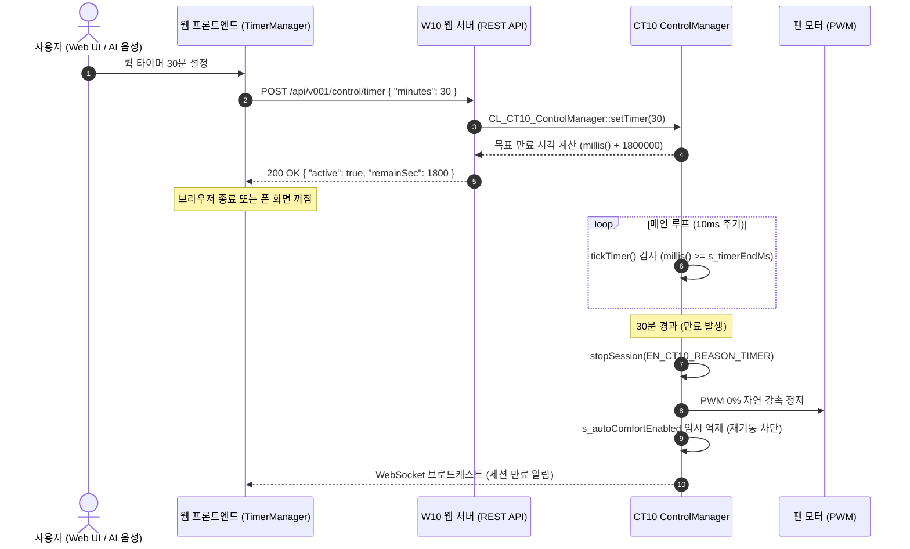
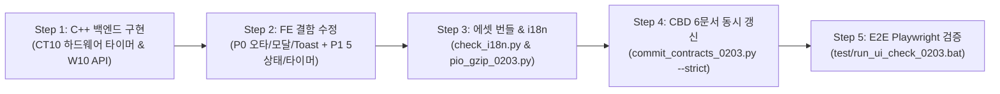

# 📋 Stage 10 종합 결함 패치 및 하드웨어 백엔드 타이머 구현 설계서 (0203_013_20_02)

> **문서 버전**: v2.0 (개정판)  
> **작성 일자**: 2026-11-09  
> **상태**: 구현 설계 완료 (백엔드 C++ 승인 대기 및 프론트엔드 패치 연계)  
> **기준 버전**: v0203 (FW_Ver_2.0.3)  
> **선행 문서**: `0203_013_20_01.md` (초안 검토서), `0203_013_15구현설계_02.md` (Stage 10 설계서)

---

## 1. 개요 및 배경

Stage 10 대시보드 3탭 전환 및 Comfort 자동 모드 구현 후 수행된 정밀 코드 감사(`0203_013_20_01.md`) 결과, 실사용 시 치명적인 기능 오동작을 유발하는 **P0 결함 5건**과 타이머 세션의 지속성을 저해하는 **P1/P2 이슈**가 발굴되었습니다.

특히 클라이언트(브라우저)에서만 구동되던 타이머는 브라우저를 닫거나 새로고침할 경우 유실되어 기기가 계속 회전하는 문제를 안고 있었습니다.  
본 문서는 사용자 결정에 따라 **[Option A] ESP32 백엔드 C++ 하드웨어 타이머 엔진 구축 및 13대 도구(`set_timer`) 확장**을 채택하고, 발굴된 런타임 결함 전수를 해결하기 위한 상세 구현 설계와 CBD 6대 계약 갱신 명세를 확립합니다.

### 4대 불변 원칙 준수 방침
1. **원칙 1 (백엔드 수정 승인)**: 하드웨어 백엔드 타이머 C++ 신규 구현(`CT10`, `W10`)에 대해 목적 및 기능 변경 사항을 명확히 명시하고 사용자 사전 승인 절차를 준수한다.
2. **원칙 2 (Graph-First)**: 변경 대상 C++ 및 JS/CSS 파일의 정확한 심볼과 라인을 확정하여 수술적(Surgical) 패치를 수행한다.
3. **원칙 3 (정적 에셋 파이프라인)**: FE 소스 수정 후 `python src/v0203/tools_0203/pio_gzip_0203.py` 및 `check_i18n.py --strict` 게이트를 반드시 통과한다.
4. **원칙 4 (CBD 계약 동시 갱신)**: 타이머 하드웨어 엔진 추가 및 Comfort 5상태 매트릭스 확장에 따라 **6대 계약 문서(SPEC, CONTRACT, STATE, FLOW, BUDGET, TEST_PLAN)를 단일 커밋으로 동시 갱신**한다.

---

## 2. 결함 및 개선 과제 종합 분류 (Issue Inventory)

### 🔴 P0 — 사용자 기능 차단 및 치명적 오동작 (5건)

| 번호 | 파일 | 결함 현상 | 근본 원인 | 조치 방안 |
|:---:|---|---|---|---|
| **P0-1** | `200.page.dashboard.js` | Comfort 자동 모드 스위치 UI 렌더링 깨짐 | `snw-slider-switch round` 오타 (`_components.css`는 `.snw-switch__slider` 정의) | 클래스명을 `.snw-switch__slider`로 즉시 교체 |
| **P0-2** | `999a.nowplaying.js` | Now Playing Bar 모달 내 "⏱️ 타이머 설정" 클릭 시 팬 강제 정지 | `overlay.click()` 시뮬레이션 시 모달의 Cancel 콜백(`onStop()`)이 자동 실행됨 | `modalRef.close()` 명시 호출, Cancel을 '닫기'로 격하, '바람 정지' 버튼 독립화 |
| **P0-3** | `290.page.ai.js`<br>`999b.ai-sheet.js` | AI 음성 토글 시 `TypeError: Cannot read properties of undefined` | 정의되지 않은 `SNW.Toast.show()` 호출 (총 10곳) | 표준 `SNW.ToastUtil` (`info`, `warn`, `error`)로 일괄 교체 |
| **P0-4** | `060.store.js`<br>`200.page.dashboard.js` | Now Playing Bar의 `[🌱 자동]` 배지가 영구 미노출 | Store 초기 상태 누락 및 토글 후 `SNW.Store.set({autoComfortEnabled})` 호출 누락 | Store 초기 필드 추가 및 API 성공 후 Store 즉시 갱신 |
| **P0-5** | `200.page.dashboard.js` | 마운트 직후 빠른 토글 시 이전 API 응답으로 사용자 조작 덮어씀 | 비동기 `getAutoComfortStatus()` 완료 시점과 사용자 토글 간 레이스 | `userInteracted` 플래그 가드 추가하여 사용자 조작 후 응답 무시 |

---

### 🟠 P1 — 시스템 정합성 및 기능성 개선 (6건)

| 번호 | 파일 | 개선 과제 | 원인 및 영향 | 조치 방안 (Option A 채택) |
|:---:|---|---|---|---|
| **P1-6** | `CT10`, `W10`<br>`294.timer_panel.js` | 타이머 백엔드 미지원으로 브라우저 종료 시 타이머 무력화 | SPEC §5.1.4.2 도구 목록에 `set_timer` 부재, 백엔드 타이머 엔드포인트 없음 | **[Option A] C++ 백엔드 타이머 엔진 및 REST API 신설, 13대 도구 확장** |
| **P1-7** | `294.timer_panel.js`<br>`CT10_Ctl_Ctl_0203.cpp` | 타이머 만료 후 5분 뒤 Comfort 자동 모드로 인한 세션 재기동 | 세션 stop만 호출되고 `autoComfort`가 유지되어 5분 주기 평가로 자동 켜짐 | 타이머 만료 시 `setAutoComfort(false)` 연동 및 백엔드 하드웨어 안전 정지 |
| **P1-8** | `200.page.dashboard.js`<br>`294.timer_panel.js` | `_onQuickTimer()` 입력값 검증 부재 | `prompt()` 반환값에 NaN, 음수, 초대형 숫자 검증 없음 | `Math.round`, `Number.isFinite`, 최대 480분(8시간) 상한 가드 추가 |
| **P1-9** | `200.page.dashboard.js` | Comfort 5분 주기 카운트다운 멈춤 현상 | 정적 텍스트만 렌더하고 재렌더 interval 부재 | 5초 주기 `setInterval` 및 서버 `uptimeMs` 보정 카운트다운 구현 |
| **P1-10**| `200.page.dashboard.js`<br>`_components.css` | Comfort 5상태 매트릭스 미구현 | OFF/ON 2종만 지원, AutoOff 래치 시 `[재개]` 버튼 부재 | 5상태 클래스(`is-waiting`, `is-running`, `is-user-priority`, `is-suspended`) 렌더 |
| **P1-11**| `070.router.js` | *(제외)* 레거시 라우트(`/schedule`, `/profiles`) 리다이렉트 부활 요구 | 사용자 확정 지침: **"하위 호환은 미지원, 관련 로직 제거"** | **반영 거부(Reject)**: 최신 표준 규격 유지, 불필요한 레거시 코드 삽입 차단 |

---

### 🟡 P2 — 코드 클린업 및 스타일 정합성 (5건)

| 번호 | 파일 | 내용 | 조치 방안 |
|:---:|---|---|---|
| **P2-12**| `294.timer_panel.js` | `_onExpire()` 내 `SNW.Api.Session.stop` dead code | 도달 불가능한 레거시 조건문 분기 완전 삭제 |
| **P2-13**| `_variables.css` | `--snw-z-header: 1060` 정의와 `_layout.css`의 `z-index: 50` 불일치 | 변수 값을 `--snw-z-header: 50`으로 정합화 |
| **P2-14**| `200.page.dashboard.js` | `_initAutoComfort` 재호출 시 stale 데이터 위험 | `_autoComfortInited` 가드 추가 |
| **P2-15**| `999a.nowplaying.js` | `isSessionVisible()` 내 `s.state === 2` dead code | 문자열 `'COMPLETED'` 검사만 유지 |
| **P2-16**| `200.page.dashboard.js` | `_switchDashTab('invalid')` 시 탭 비활성 | `['control', 'env', 'preset']` 화이트리스트 가드 적용 |

---

## 3. [Option A] 하드웨어 백엔드 타이머 아키텍처 및 도구 확장 설계

### 3.1 아키텍처 개요
사용자가 웹 UI 또는 AI 음성으로 타이머를 설정하면, 브라우저 로컬 타이머에만 의존하지 않고 **ESP32 MCU 백엔드 런타임에 직접 만료 시각(`s_timerEndMs`)을 등록**합니다. 브라우저 창을 닫거나 스마트폰 연결이 끊겨도 하드웨어 `tickLoop()`가 직접 만료를 감지하여 모터를 안전하게 정지시키고, Comfort 자동 모드의 원치 않는 재기동을 억제합니다.



---

### 3.2 백엔드 REST API 신설 스키마

| Method | Endpoint | Payload | Response | HTTP 상태 | 설명 |
|---|---|---|---|:---:|---|
| `POST` | `/api/v001/control/timer` | `{"minutes": uint16}` | `{"success": true, "active": true, "remainSec": uint32}` | `200 OK` | 하드웨어 타이머 기동 (1~480분) |
| `DELETE`| `/api/v001/control/timer` | 없음 | `{"success": true, "active": false}` | `200 OK` | 하드웨어 타이머 즉시 취소 |
| `GET` | `/api/v001/control/timer` | 없음 | `{"active": bool, "remainSec": uint32, "durationMin": uint16}` | `200 OK` | 현재 타이머 잔여 시간 조회 |

---

### 3.3 SPEC §5.1.4.2 13대 도구 확장: `set_timer`

기존 12대 안전 도구 목록에 13번째 도구로 `set_timer`를 공식 등록합니다.

- **도구명**: `set_timer`
- **설명**: "지정된 시간(분) 동안 팬을 가동한 후 자동으로 전원을 끄는 타이머를 설정합니다."
- **매개변수**:
  - `minutes` (integer, required): 1 ~ 480 범위의 타이머 시간(분)
- **실행 디스패치**: `CT10_Ctl_AIAction_0203.cpp` 내 `executeSetTimer(JsonObjectConst p_args)`

---

### 3.4 C++ 백엔드 클래스 수정 명세

#### 1) `src/v0203/W10_Web_Const_0203.h`
```cpp
#define HTTP_API_CONTROL_TIMER      "/api/v001/control/timer"
```

#### 2) `src/v0203/CT10_Ctl_0203.h`
```cpp
// 타이머 관리 정적 멤버 및 메서드
private:
    static uint32_t s_timerEndMs;
    static uint16_t s_timerDurationMin;
    static bool     s_timerActive;

public:
    static bool setTimer(uint16_t p_minutes);
    static void cancelTimer();
    static bool isTimerActive();
    static uint32_t getTimerRemainSec();
    static void tickTimer();   // tickLoop()에서 주기적 호출
```

#### 3) `src/v0203/CT10_Ctl_Ctl_0203.cpp`
```cpp
// tickLoop() 내부 연동
void CL_CT10_ControlManager::tickLoop() {
    // ... 기존 센서/상태 틱 ...
    tickTimer();         // [신규] 하드웨어 타이머 만료 평가 (WCET <= 0.05ms)
    tickAutoComfort();   // Comfort 자동 모드 평가
}

void CL_CT10_ControlManager::tickTimer() {
    if (!s_timerActive) return;
    
    uint32_t v_now = millis();
    if ((int32_t)(v_now - s_timerEndMs) >= 0) {
        CL_D10_Logger::log(EN_L10_LOG_INFO, "[CT10] Hardware Timer Expired (%d min) -> Stopping Session", s_timerDurationMin);
        s_timerActive = false;
        s_timerEndMs = 0;
        
        // 세션 정지 및 Comfort 자동모드 일시 중단 (COMFORT-2 연동)
        stopSession();
        s_autoComfortLastEvalMs = v_now; // 최소 5분간 즉시 재기동 억제
    }
}
```

#### 4) `src/v0203/CT10_Ctl_AIAction_0203.cpp`
```cpp
// 13. 타이머 도구 디스패치
if (strcmp(p_fn, "set_timer") == 0) {
    uint16_t v_min = p_args["minutes"] | 0;
    if (v_min == 0 || v_min > 480) return "error:invalid_minutes";
    bool v_ok = CL_CT10_ControlManager::setTimer(v_min);
    return v_ok ? "ok" : "error:timer_failed";
}
```

---

## 4. 프론트엔드 상세 구현 설계 및 Code Diff

### 4.1 `060.store.js` — 초기 상태에 필드 추가
```javascript
SNW.Store = new Store({
    // 서버 상태
    control: null,
    sim: null,
    time: null,
    system: null,
    session: null,

    // [Stage 10 P0-4] Comfort 자동 모드 상태
    autoComfortEnabled: false,
    autoComfortRemainSec: 300,
    autoComfortLastEvalMs: 0,

    // [Option A] 하드웨어 타이머 상태
    hardwareTimerActive: false,
    hardwareTimerRemainSec: 0,

    // 파생 상태
    lastUpdateMs: 0,
    connection: 'offline',
    fsmState: 0,
    fsmReason: 0,
    level: (SNW.LevelUtil && SNW.LevelUtil.current) ? SNW.LevelUtil.current() : 'L1'
});
```

---

### 4.2 `200.page.dashboard.js` — 결함 5종 전면 해결

#### 1) Constructor 및 unmount 정리
```javascript
constructor(container) {
    this.el = container;
    this._active = true;
    this._unsubs = [];
    this._eq = null;
    this._slider = null;
    this._contextCache = null;
    this._contextFetchMs = 0;
    // [P2-14] 재마운트 가드 및 interval ID
    this._autoComfortInited = false;
    this._autoComfortTickId = null;
}

unmount() {
    this._active = false;
    this._unsubs.forEach(fn => { try { fn(); } catch { } });
    this._unsubs = [];
    if (this._eq) this._eq.stop();
    this._eq = null;
    this._slider = null;
    if (this._autoComfortTickId) {
        clearInterval(this._autoComfortTickId);
        this._autoComfortTickId = null;
    }
    this._autoComfortInited = false;
}
```

#### 2) `_initAutoComfort()` 교체 (P0-1, P0-4, P0-5, P1-9, P1-10)
```javascript
_initAutoComfort() {
    if (this._autoComfortInited) return; // [P2-14]
    const slot = this.el.querySelector('[data-slot="auto-comfort-box"]');
    if (!slot) return;

    // [P0-1] snw-switch__slider 표준 클래스 적용
    slot.innerHTML = `
        <div class="snw-auto-comfort-header" style="display:flex;justify-content:space-between;align-items:center;">
            <div>
                <strong style="font-size:14px;color:var(--snw-text);">🔄 ${SNW.I18n.t('comfort.autoTitle')}</strong>
                <p style="margin:4px 0 0 0;font-size:12px;color:var(--snw-text-dim);">${SNW.I18n.t('comfort.autoDesc')}</p>
            </div>
            <label class="snw-switch" style="position:relative;display:inline-block;width:44px;height:24px;">
                <input type="checkbox" id="chk-auto-comfort">
                <span class="snw-switch__slider"></span>
            </label>
        </div>
        <div class="snw-auto-comfort__status" id="auto-comfort-status-text" role="status" aria-live="polite"></div>`;

    const chk = slot.querySelector('#chk-auto-comfort');
    const statusText = slot.querySelector('#auto-comfort-status-text');
    let userInteracted = false; // [P0-5] 레이스 가드

    if (SNW.Api && typeof SNW.Api.getAutoComfortStatus === 'function') {
        SNW.Api.getAutoComfortStatus().then(res => {
            if (!res || userInteracted) return; // [P0-5] 사용자 조작 우선
            chk.checked = !!res.autoComfort;
            SNW.Store.set({
                autoComfortEnabled: !!res.autoComfort,
                autoComfortRemainSec: res.remainSec || 300,
            });
            this._renderAutoComfortStatus();
            this._startAutoComfortTick();
        }).catch(() => {});
    }

    chk.addEventListener('change', async () => {
        userInteracted = true; // [P0-5]
        const targetState = chk.checked;
        if (targetState) {
            if (!confirm(SNW.I18n.t('comfort.autoConfirmOn'))) {
                chk.checked = false;
                return;
            }
        }

        try {
            if (SNW.Api && typeof SNW.Api.setAutoComfort === 'function') {
                const res = await SNW.Api.setAutoComfort(targetState);
                // [P0-4] Store 저장 (Now Playing 배지 반응 보장)
                SNW.Store.set({
                    autoComfortEnabled: targetState,
                    autoComfortRemainSec: res ? res.remainSec : 300,
                });
                SNW.ToastUtil.info(targetState ? SNW.I18n.t('comfort.autoOn') : SNW.I18n.t('comfort.autoOff'));
                this._renderAutoComfortStatus();
                this._startAutoComfortTick();
            }
        } catch (e) {
            chk.checked = !targetState;
            SNW.ToastUtil.error(e.message || SNW.I18n.t('common.error'));
        }
    });

    this._autoComfortInited = true;
}
```

#### 3) `_renderAutoComfortStatus()` 5상태 매트릭스 (P1-10)
```javascript
_renderAutoComfortStatus() {
    const el = this.el.querySelector('#auto-comfort-status-text');
    if (!el) return;

    const store = (SNW.Store && SNW.Store.get) ? SNW.Store.get() : {};
    if (!store.autoComfortEnabled) {
        el.className = 'snw-auto-comfort__status';
        el.textContent = SNW.I18n.t('comfort.autoOff');
        return;
    }

    const ctl = store.control || {};
    const session = store.session || {};
    const isAutoOffLatched = (ctl.stateCode === 5); // AUTOOFF_STOPPED
    const isSessionActive = (session.state === 'ACTIVE' && session.active);
    const isManual = isSessionActive && (session.trigger === 1 || session.triggerName === 'MANUAL');
    const isAuto = isSessionActive && !isManual;

    // 1) AutoOff 래치 활성 (일시 중단)
    if (isAutoOffLatched) {
        el.className = 'snw-auto-comfort__status is-suspended';
        el.innerHTML = `${SNW.I18n.t('comfort.statusSuspended')}
            <button type="button" class="snw-auto-comfort__status-action" data-action="resume-auto">
                ${SNW.I18n.t('comfort.statusResumeBtn')}
            </button>`;
        const btn = el.querySelector('[data-action="resume-auto"]');
        if (btn) btn.onclick = () => this._onResumeAutoComfort();
        return;
    }

    // 2) 자동 모드로 프리셋 가동 중
    if (isAuto) {
        el.className = 'snw-auto-comfort__status is-running';
        el.innerHTML = SNW.I18n.t('comfort.statusRunning', {
            preset: session.presetCode || '',
            style: session.styleCode || ''
        });
        return;
    }

    // 3) 사용자 수동 세션 가동 중 (수동 우선)
    if (isManual) {
        el.className = 'snw-auto-comfort__status is-user-priority';
        el.innerHTML = SNW.I18n.t('comfort.statusUserPriority');
        return;
    }

    // 4) 대기 상태 (5초 주기 카운트다운)
    el.className = 'snw-auto-comfort__status is-waiting';
    const remainMs = this._calcRemainMs();
    el.innerHTML = SNW.I18n.t('comfort.statusWaiting', { remain: this._fmtRemainText(remainMs) });
}
```

#### 4) `_onQuickTimer()` 입력값 검증 강화 (P1-8)
```javascript
_onQuickTimer() {
    const cur = (SNW.TimerManager && SNW.TimerManager.getStatus) ? SNW.TimerManager.getStatus() : null;
    if (cur && cur.active) {
        if (confirm(SNW.I18n.t('timer.cancel') + '?')) {
            SNW.TimerManager.cancel(true);
        }
        return;
    }
    const choice = prompt(SNW.I18n.t('timer.quickPrompt'), '30');
    if (choice === null) return; // 사용자 취소

    const min = Math.round(Number(choice));
    if (!Number.isFinite(min) || min <= 0) {
        SNW.ToastUtil.warn(SNW.I18n.t('timer.invalidInput'));
        return;
    }
    if (min > 480) {
        SNW.ToastUtil.warn(SNW.I18n.t('timer.maxRange'));
        return;
    }
    if (SNW.TimerManager) {
        SNW.TimerManager.start(min);
        SNW.ToastUtil.info(SNW.I18n.t('timer.quickStarted', { min }));
    }
}
```

---

### 4.3 `290.page.ai.js` & `999b.ai-sheet.js` — Toast TypeError 수정 (P0-3)

- `290.page.ai.js`: 8곳의 `SNW.Toast.show(msg, type)` $\rightarrow$ `SNW.ToastUtil.info/warn/error(msg)`로 치환
- `999b.ai-sheet.js`: 43행, 353행의 `SNW.Toast.show(...)` $\rightarrow$ `SNW.ToastUtil.info/warn(...)`로 치환

---

### 4.4 `999a.nowplaying.js` — 모달 정지 버그 및 dead code 정리 (P0-2, P2-15)

```javascript
// [P0-2] Cancel 콜백을 닫기(no-op)로 격하하고, 정지 버튼을 본문 내부로 독립 배치
const modalRef = SNW.UI.modal(
    '🍃 바람 세션 상세',
    content,
    async () => { await onPauseOrResume(); return true; },
    () => { /* 닫기만 수행 (세션 유지) */ return true; },
    {
        okLabel: isPaused ? '▶ 재개' : '⏸ 일시정지',
        cancelLabel: SNW.I18n.t('common.close'),
        width: '380px'
    }
);

// 본문 하단에 안전한 세션 정지 버튼 추가
const stopBtn = document.createElement('button');
stopBtn.type = 'button';
stopBtn.className = 'snw-btn snw-btn--full';
stopBtn.style.cssText = 'margin-top:10px;justify-content:center;background:rgba(248,81,73,0.15);color:var(--snw-error);border:1px solid var(--snw-error);';
stopBtn.textContent = `⏹ ${SNW.I18n.t('common.stopSession')}`;
stopBtn.onclick = async () => {
    if (modalRef && typeof modalRef.close === 'function') modalRef.close();
    await onStop();
};
content.appendChild(stopBtn);

// [P0-2] 타이머 버튼: overlay.click() 대신 modalRef.close() 안전 호출
const timerBtn = content.querySelector('#np-btn-timer-link');
if (timerBtn) {
    timerBtn.onclick = () => {
        if (modalRef && typeof modalRef.close === 'function') modalRef.close();
        location.hash = '/automation/timer';
    };
}
```

---

### 4.5 `294.timer_panel.js` — 백엔드 타이머 연동 및 Comfort 해제 (P1-6, P1-7)

```javascript
// 하드웨어 백엔드 타이머 기동 (Option A)
async start(minutes) {
    const min = Math.round(Number(minutes));
    if (!Number.isFinite(min) || min <= 0 || min > 480) {
        this.cancel(true);
        return;
    }
    
    // 1) ESP32 백엔드에 하드웨어 타이머 등록
    try {
        if (SNW.Api && typeof SNW.Api.setControlTimer === 'function') {
            await SNW.Api.setControlTimer(min);
        }
    } catch (e) {
        console.warn('[TimerManager] Backend timer sync failed:', e);
    }

    this.init();
    this._active = true;
    this._durationMin = min;
    this._targetEndMs = Date.now() + min * 60 * 1000;
    this._startInterval();
    this._persist();
    this._notify();
}

// 만료 시 세션 정지 및 Comfort 자동 모드 해제 (P1-7)
async _onExpire() {
    this.cancel(false);

    // [P1-7] 만료 후 Comfort 자동 모드로 인한 즉시 재기동 방지
    try {
        if (SNW.Api && typeof SNW.Api.getAutoComfortStatus === 'function') {
            const status = await SNW.Api.getAutoComfortStatus();
            if (status && status.autoComfort) {
                await SNW.Api.setAutoComfort(false);
                if (SNW.Store) SNW.Store.set({ autoComfortEnabled: false });
                if (SNW.ToastUtil) SNW.ToastUtil.info(SNW.I18n.t('timer.autoComfortOff'));
            }
        }
    } catch (e) {
        console.warn('[TimerManager] AutoComfort reset failed:', e);
    }

    // 세션 정지
    try {
        if (SNW.Api && typeof SNW.Api.stopSession === 'function') {
            await SNW.Api.stopSession();
        }
    } catch (err) {
        console.error('[TimerManager] Session stop error:', err);
    }

    if (SNW.ToastUtil) SNW.ToastUtil.info(SNW.I18n.t('timer.expired'));
}
```

---

## 5. CBD 6대 계약 문서 동시 갱신 명세 (원칙 4)

| 계약 문서 | 갱신 섹션 | 개정 내용 |
|---|---|---|
| **`SPEC_0203.md`** | §5.1.4.2<br>§5.1.6<br>§5.4.2.2 | 13대 도구 목록에 `set_timer` 추가<br>타이머 REST API (`POST/DELETE/GET /api/v001/control/timer`) 스키마 정의<br>Comfort 자동 모드 5상태 매트릭스 UI 스키마 추가 |
| **`CONTRACT_0203.md`** | §7.21 (신설)<br>§7.20 UI-10 | **[TIMER-1] 하드웨어 타이머 신뢰성 계약**: 브라우저 오프라인 시에도 백엔드 런타임 타이머에 의한 세션 자동 정지 보장 규약<br>Now Playing Bar 및 5상태 매트릭스 동기화 의무 강화 |
| **`STATE_0203.md`** | §1<br>§2 | 단일 Writer 규약에 `s_timerEndMs`, `s_timerActive` 추가<br>타이머 만료 시 FSM 전이(`ACTIVE` $\rightarrow$ `IDLE`) 및 `EN_CT10_REASON_TIMER` 정지 사유 등록 |
| **`FLOW_0203.md`** | §2<br>§7.2 (신설) | 메인 루프 `a00_run` 타이밍 다이어그램에 `tickTimer()` 틱 삽입<br>하드웨어 타이머 기동 $\rightarrow$ 만료 $\rightarrow$ Comfort 연동 억제 파이프라인 명세 |
| **`BUDGET_0203.md`** | §2<br>§10.7 (신설) | `tickTimer()` 루프 WCET 예산(0.05ms) 반영 및 루프 예산 총합(≤10ms) 건전성 입증<br>Stage 10.1 누적 예산 영향 평가표 추가 |
| **`TEST_PLAN_0203.md`**<br>`TEST_PLAN_L9_L11_0203.md` | §4, §6<br>T-154-FE<br>T-155 (신설) | **T-154-FE**: Comfort 5상태 매트릭스 및 스위치 렌더링 검증 강화<br>**T-155 [신규]**: 하드웨어 타이머 브라우저 종료 후 백엔드 단독 만료 및 정지 검증 |

---

## 6. 단계별 실행 계획 및 자동화 검증 로드맵



### 실행 순서
1. **백엔드 승인 후 C++ 구현**:
   - `W10_Web_Const_0203.h`, `W10_Web_Routes_Control_0203.cpp` (API 라우트)
   - `CT10_Ctl_0203.h`, `CT10_Ctl_Ctl_0203.cpp`, `CT10_Ctl_AIAction_0203.cpp` (하드웨어 타이머 엔진)
2. **프론트엔드 결함 전수 수정**:
   - `060.store.js`, `200.page.dashboard.js`, `999a.nowplaying.js`, `290.page.ai.js`, `999b.ai-sheet.js`, `294.timer_panel.js`, `_components.css`, `_variables.css`, `020.i18n.js`
3. **에셋 파이프라인 및 다국어 검증**:
   - `python src/v0203/tools_0203/check_i18n.py --strict`
   - `python src/v0203/tools_0203/pio_gzip_0203.py`
4. **CBD 6대 계약 문서 갱신 및 검증**:
   - `python src/v0203/tools_0203/commit_contracts_0203.py --dry-run --strict`
   - `python src/v0203/tools_0203/enhance_index_links_0203.py --verify`
5. **E2E Playwright 회귀 점검 실행**:
   - `test\run_ui_check_0203.bat` 실행하여 21개 전 항목 PASS 및 브라우저 콘솔 에러 0건 확인.


--- ---


0203_013_20_02 설계서 검토 및 승인 요청

제시하신 설계서는 P0 5건 + P1 6건 + P2 5건 전체를 포괄하며, Option A(백엔드 하드웨어 타이머) 채택과 P1-11 리다이렉트 거부(사용자 지침)까지 명확히 반영되어 있습니다. 다만 원칙 1에 따라 C++ 백엔드 승인 확인이 필요하고, 구현 전 설계 갭 7건을 확정해야 합니다.

---

🔴 원칙 1 — 백엔드 승인 확인 요청

C++ 수정 범위:

파일 변경 유형 라인 추정
W10_Web_Const_0203.h +1 define 신규
W10_Web_Routes_Control_0203.cpp +3 라우트 핸들러 신규
CT10_Ctl_0203.h +3 필드 + 5 메서드 신규
CT10_Ctl_Ctl_0203.cpp +tickTimer 구현 + tickLoop 삽입 +20줄
CT10_Ctl_AIAction_0203.cpp +set_timer 디스패치 +8줄
W10_Web_0203.h::W10_AI_Limits (선택) 상한 상수 +2줄

승인 확인: 위 6개 파일 C++ 수정을 승인하십니까? 승인 시점에 .agents/state/backend-approval.json 마커를 생성합니다.

---

⚠️ 설계 갭 (구현 전 확정 필요)

갭 1 — Option A의 목적이 5분 후 자동 무효화됨 (치명적)

문제: 설계 §3.4 tickTimer():

```cpp
s_autoComfortLastEvalMs = v_now; // 최소 5분간 즉시 재기동 억제
```

· 브라우저 종료 시나리오: FE _onExpire 미실행 → setAutoComfort(false) 미호출
· 백엔드는 5분만 억제 → 5분 후 tickAutoComfort 재기동 → 팬 재회전

결과: "브라우저 닫아도 타이머 유지"라는 Option A 채택 목적이 5분 후 무효화

권장 수정:

```cpp
void CL_CT10_ControlManager::tickTimer() {
    if (!s_timerActive) return;
    if ((int32_t)(millis() - s_timerEndMs) >= 0) {
        CL_D10_Logger::log(EN_L10_LOG_INFO, "[CT10] Timer expired");
        s_timerActive = false;
        s_timerEndMs = 0;
        
        stopSession();
        
        // [Option A] 브라우저 무관 안전 보장: autoComfort 영구 해제
        setAutoComfort(false);   // ← 억제가 아닌 영구 해제
    }
}
```

결정 필요:

· (A) 타이머 만료 시 autoComfort 영구 해제 (안전 우선)
· (B) 5분 억제 후 자동 재개 (사용자 재량 우선) — Option A의 목적과 모순

---

갭 2 — 정지 사유 코드 미정의 (EN_CT10_REASON_TIMER)

설계 §3.4에서 stopSession(EN_CT10_REASON_TIMER) 호출을 명시했으나:

· STATE §2.2 reason code 목록: 0~11
  · 9 = AUTOOFF_TIMER (이미 존재)
· EN_CT10_REASON_TIMER는 어디에도 정의되지 않음

결정 필요:

· (A) 기존 EN_CT10_REASON_AUTOOFF_TIMER 재사용 (신규 코드 불필요, 리스크 최소)
· (B) 신규 reason code 12 = HARDWARE_TIMER 추가 → A22_Com_Lookup_0203.h, 000.const.js 동기 마커(AUTO_SYNC_CONST) 재생성 필요

권장: (A) — 기존 AUTOOFF_TIMER와 동일 의미. 하드웨어/소프트 타이머는 UI에서 구분할 이유 없음.

---

갭 3 — Comfort is-running vs is-user-priority 판정이 역전됨 (배지 오작동)

설계 §4.2 _renderAutoComfortStatus():

```javascript
const isManual = isSessionActive && (session.trigger === 1 || session.triggerName === 'MANUAL');
const isAuto = isSessionActive && !isManual;
```

문제: 백엔드 tickAutoComfort가 startPresetManual(...) 호출 → 트리거는 MANUAL로 기록됨

· FE 판정: isManual = true → is-user-priority 표시
· 실제: 자동 모드로 시작 → "🤖 자동" 배지에도 불구하고 UI에는 "수동 우선" 문구

결과: 사용자가 "왜 수동 세션이라고 나오지?" 혼란

결정 필요 (택 1):

· (A) 백엔드 trigger 확장: EN_CT10_TRIGGER_AUTO_COMFORT = 3 신규 → startSession 호출 시 명시. FE 판정: trigger === 3 → is-running
· (B) FE 판정 우회: Store.get().autoComfortEnabled === true + Store.get().sim.presetCode가 추천 프리셋과 일치하면 is-running (휴리스틱)
· (C) 백엔드 응답에 sessionTrigger 별도 필드: autoComfortTriggered: bool 추가

권장: (A) — 가장 정확하고 계약 명세화 용이. STATE §1, SPEC §5.1.1에 trigger 3 추가.

---

갭 4 — autoComfortRemainSec Store 필드가 dead data

설계 §4.1에서 Store에 autoComfortRemainSec: 300 추가 명시했으나:

· _calcRemainMs()는 system.uptimeMs 기반으로 재계산
· autoComfortRemainSec를 참조하는 코드 0건

결정 필요:

· (A) 제거 (필요 없음, uptime 기반 계산이 정확)
· (B) 유지 + _calcRemainMs 폴백으로 사용 (WS 첫 응답 전 등)

권장: (A) — 불필요한 상태 제거. 초기값은 _calcRemainMs()의 serverUptimeMs === 0 → intervalMs 반환 로직으로 충분.

---

갭 5 — _autoComfortInited 가드가 재렌더 시 slot 비활성화 유발

```javascript
_initAutoComfort() {
    if (this._autoComfortInited) return;   // [P2-14]
    const slot = this.el.querySelector('[data-slot="auto-comfort-box"]');
    slot.innerHTML = `...`;                 // ← slot 재생성
    this._autoComfortInited = true;
}
```

시나리오: _render()가 다시 호출되면 [data-slot="auto-comfort-box"]는 빈 상태로 재생성됨

· _autoComfortInited === true → _initAutoComfort 조기 반환
· slot은 영구히 비어있음

현재 _render()는 mount()에서 1회만 호출되어 실사용 문제는 없으나, 방어적 견고성 부족.

권장 수정:

```javascript
_initAutoComfort() {
    const slot = this.el.querySelector('[data-slot="auto-comfort-box"]');
    if (!slot) return;
    if (slot.children.length > 0) return;   // DOM 존재 여부로 판정 (P2-14 대체)
    // ... slot.innerHTML 재구성
}
```

_autoComfortInited 플래그는 제거 (DOM 상태로 자연스럽게 보호).

---

갭 6 — Timer NVS 영속성 범위 미정의

설계서가 다루지 않은 시나리오:

· 사용자가 2시간 타이머 설정 → ESP32 재부팅 (전원 차단, OTA 등)
· s_timerEndMs가 RAM에만 있으면 재부팅 시 타이머 유실

결정 필요:

· (A) RAM만 (재부팅 시 타이머 해제, 사용자 재설정 필요) — 단순, 안전
· (B) NVS 영구 저장 (timer_end_ms, timer_active 2키 추가) — N10::flush 편입
· (C) 설정 파일(cfg_system)? → 부적합 (런타임 상태는 NVS 적합)

권장: (A) — MVP 안전. 재부팅은 드물고, 재부팅 시 팬은 어차피 초기화되므로 안전. NVS 영속화는 Phase 3+ 후속 Stage로 분리.

---

갭 7 — FE ↔ BE 타이머 동기 실패 시 무경고

설계 §4.5 TimerManager.start():

```javascript
try {
    if (SNW.Api && typeof SNW.Api.setControlTimer === 'function') {
        await SNW.Api.setControlTimer(min);
    }
} catch (e) {
    console.warn('[TimerManager] Backend timer sync failed:', e);
    // 사용자에게 경고 없음
}
```

문제: 백엔드 실패(네트워크, 500, 인증)해도 조용히 무시 → 브라우저 타이머만 동작

· 사용자: "브라우저 닫아도 타이머 유지된다"고 기대 → 5초 후 브라우저 닫으면 팬 계속 회전

권장 수정:

```javascript
try {
    await SNW.Api.setControlTimer(min);
} catch (e) {
    console.warn('[TimerManager] Backend sync failed:', e);
    if (SNW.ToastUtil) {
        SNW.ToastUtil.warn(SNW.I18n.t('timer.backendSyncFailed'));
        // "브라우저 세션에서만 유효합니다"
    }
}
```

i18n 추가:

· ko: 'timer.backendSyncFailed': '기기 타이머 동기화 실패 · 이 창을 닫으면 타이머가 해제됩니다'
· en: 'timer.backendSyncFailed': 'Device timer sync failed · Timer will be lost if this window closes'

---

📋 추가 확인 (경미)

8. 999b.ai-sheet.js Toast 수정 범위

설계 §4.3: "43행, 353행"이라 명시했으나 실제 위치 재확인:

라인 코드 수정
L~43 SNW.Toast.show(SNW.I18n.t('ai.voiceListening'), 'info') SNW.ToastUtil.info(...)
L~353 SNW.Toast.show('Voice input not supported', 'warn') SNW.ToastUtil.warn(...)

확인 필요: grep으로 실제 검증 필요. 290.page.ai.js는 설계서가 "8곳"이라 명시했으나 실측 grep 결과 확인 필요:

```
grep -n "SNW\.Toast\." src/v0203/data_v0203_src/html_v0203/*.js
```

---

9. P2-13 z-header 정합

· _variables.css --snw-z-header: 1060 → 50으로 변경
· 단, _layout.css의 .snw-header { z-index: 50 } 하드코딩도 var(--snw-z-header) 사용으로 통일 권장

---

10. set_timer 도구 파라미터 상한 (SPEC §5.1.4.4)

· FE: Math.round + Number.isFinite + 1~480 검증
· BE: p_args["minutes"] | 0 + 1~480 검증
· 양측 일치 확인: 상한 480, 하한 1

참고: SPEC §5.1.4.4에 G_MAX_REQUEST_BODY = 12288 등 이미 정의되어 있으나 타이머 상한 상수 미정의. W10_AI_Limits에 추가 권장:

```cpp
static constexpr uint16_t G_TIMER_MIN_MINUTES = 1;
static constexpr uint16_t G_TIMER_MAX_MINUTES = 480;
```

---

🎯 승인 요청 항목 정리

아래 7건에 대한 결정 확정 후 구현 착수:

# 갭 권장안 사용자 결정
1 AutoComfort 재기동 (A) 영구 해제 ⬜
2 Reason code (A) AUTOOFF_TIMER 재사용 ⬜
3 is-running 판정 (A) trigger 3 신규 ⬜
4 autoComfortRemainSec (A) 제거 ⬜
5 _autoComfortInited (수정) DOM children.length로 대체 ⬜
6 Timer NVS 영속 (A) RAM만 ⬜
7 BE sync 실패 (추가) 경고 토스트 ⬜

---

✅ 원칙 준수 재확인

원칙 상태
원칙 1 (백엔드 승인) ⏸ C++ 6파일 승인 대기
원칙 2 (Graph-First) ✅ 심볼/라인 확정 후 surgical patch
원칙 3 (에셋 파이프라인) ✅ check_i18n.py --strict + pio_gzip_0203.py 실행 명시
원칙 4 (CBD 6문서) ✅ §5 매트릭스 완비, 개정 이력 동기

---

💡 진행 방향 선택

옵션 1 — "권장안 전부 수용, 즉시 착수"

· 7건 모두 권장안(A) 채택 + BE sync 경고 추가
· C++ 승인 마커 생성 → 백엔드 구현 → FE 구현 → 계약 갱신
· 예상 순서: 갭 2 → C++ → 갭 3(trigger) → FE → 계약

옵션 2 — "일부 갭 상세 논의 필요"

· 예: 갭 3 (is-running) — trigger 3 vs 휴리스틱 상세 비교
· 예: 갭 6 (NVS) — 재부팅 시나리오 사용자 확인

옵션 3 — "MVP 축소: Option A 보류, Option B (FE 경고만)"

· C++ 신규 없이 FE beforeunload 경고만
· 이후 Stage 11에서 백엔드 타이머 도입
· 원칙 1 리스크 회피, 빠른 배포

---

어떤 옵션으로 진행할까요? 옵션 1이라면 "권장안 전부 수용 + C++ 승인"을 확인해 주시면 승인 마커 생성 후 구현을 착수하겠습니다. 옵션 2·3은 구체적 논의 항목을 알려주세요.


--- --- 

갭 1 — Option A의 목적이 5분 후 자동 무효화됨 (치명적) :  (A) 타이머 만료 시 autoComfort 영구 해제 (안전 우선)

갭 2 — 정지 사유 코드 미정의 (EN_CT10_REASON_TIMER) : 권장: (A) — 기존 AUTOOFF_TIMER와 동일 의미. 하드웨어/소프트 타이머는 UI에서 구분할 이유 없음.

갭 3 — Comfort is-running vs is-user-priority 판정이 역전됨 (배지 오작동) : 권장: (A) — 가장 정확하고 계약 명세화 용이. STATE §1, SPEC §5.1.1에 trigger 3 추가.


갭 4 — autoComfortRemainSec Store 필드가 dead data : (A) — 불필요한 상태 제거. 초기값은 _calcRemainMs()의 serverUptimeMs === 0 → intervalMs 반환 로직으로 충분.

갭 5 — _autoComfortInited 가드가 재렌더 시 slot 비활성화 유발 : 권장 수정안으로

갭 6 — Timer NVS 영속성 범위 미정의 : (A) — MVP 안전. 재부팅은 드물고, 재부팅 시 팬은 어차피 초기화되므로 안전. NVS 영속화는 Phase 3+ 후속 Stage로 분리.


갭 7 — FE ↔ BE 타이머 동기 실패 시 무경고 : 권장 수정