# Smart Nature Wind v0203 — 사용자 매뉴얼 (User Manual)

> **스마트 자연풍 팬 제어기 (ESP32 스마트 IoT 펌웨어)**  
> **문서 번호**: `UserManual_0203_005.md`  
> **문서 버전**: `v2.16` (0203_014: Wind Studio `#/wind/studio` 경로 통합, 스마트 쾌적·자동 정지 규칙 모달 편집기 및 접근성 개선 반영)  
> **대상 제품**: `Smart Nature Wind v0203` (FW 2.0.3)  
> **지원 하드웨어**: ESP32-S3 / ESP32-C3 계열 제어 보드

---

## 📋 전체 목차 (Table of Contents)

- [📖 이 설명서 사용법](#-이-설명서-사용법)
- [파트 I. 시작하기 (Getting Started)](#파트-i-시작하기-getting-started)
  - [1. 30초 빠른 시작 (처음 사용자용)](#1-30초-빠른-시작-처음-사용자용)
  - [2. 제품 소개 및 핵심 혁신 기능](#2-제품-소개-및-핵심-혁신-기능)
    - [2.1 Smart Nature Wind는 어떤 제품인가요?](#21-smart-nature-wind는-어떤-제품인가요)
    - [2.2 10대 핵심 기능 요약](#22-10대-핵심-기능-요약)
  - [3. 기기 연결 및 웹 대시보드 접속](#3-기기-연결-및-웹-대시보드-접속)
    - [3.1 기기 직접 연결 모드 (SoftAP, 기본 방식)](#31-기기-직접-연결-모드-softap-기본-방식)
    - [3.2 가정/사무실 Wi-Fi 공유기 연동 모드](#32-가정사무실-wi-fi-공유기-연동-모드)
    - [3.3 스마트폰 홈 화면에 바로가기 추가 (앱처럼 쓰기)](#33-스마트폰-홈-화면에-바로가기-추가-앱처럼-쓰기)
    - [3.4 하드웨어 배선 및 안전 설치 가이드 (DIY / 제작 가이드)](#34-하드웨어-배선-및-안전-설치-가이드-diy--제작-가이드)
- [파트 II. 자연풍 제어 및 조작 (Daily Operation)](#파트-ii-자연풍-제어-및-조작-daily-operation)
  - [4. 메인 대시보드 인터페이스 조작 가이드 (`#/home`)](#4-메인-대시보드-인터페이스-조작-가이드-home)
    - [4.1 대시보드 화면 구성도 및 원터치 시나리오 9종](#41-대시보드-화면-구성도-및-원터치-시나리오-9종)
    - [4.2 실내 쾌적도 (Comfort DI) 실시간 추천 및 5상태 카드](#42-실내-쾌적도-comfort-di-실시간-추천-및-5상태-카드)
    - [4.3 바람 스타일 5종 탭 (터치 최적화)](#43-바람-스타일-5종-탭-터치-최적화)
    - [4.4 10대 자연풍 프리셋 그리드 (4x2 배열)](#44-10대-자연풍-프리셋-그리드-4x2-배열)
    - [4.5 3대 물리 슬라이더 및 수동 조작 (맞춤 미세 조절)](#45-3대-물리-슬라이더-및-수동-조작-맞춤-미세-조절)
    - [4.6 플로팅 Now Playing Bar 및 세션 상세 확장 창](#46-플로팅-now-playing-bar-및-세션-상세-확장-창)
    - [4.7 PC/모바일 오프라인 시연 데모 툴바](#47-pc모바일-오프라인-시연-데모-툴바)
    - [4.8 데스크톱 PC 와이드 2열 화면 레이아웃](#48-데스크톱-pc-와이드-2열-화면-레이아웃)
    - [4.9 원클릭 실시간 다국어 전환 (한국어 / English)](#49-원클릭-실시간-다국어-전환-한국어--english)
  - [5. 자연풍 물리 시뮬레이션 10대 바람 사전](#5-자연풍-물리-시뮬레이션-10대-바람-사전)
    - [5.1 10대 자연풍 프리셋 특성표](#51-10대-자연풍-프리셋-특성표)
    - [5.2 5대 바람 스타일 승수 및 체감 효과](#52-5대-바람-스타일-승수-및-체감-효과)
    - [5.3 프리셋 × 스타일 시너지 조합 가이드](#53-프리셋--스타일-시너지-조합-가이드)
  - [6. 스마트 센서 연동 및 3대 자동 종료 (AutoOff)](#6-스마트-센서-연동-및-3대-자동-종료-autooff)
    - [6.1 인체 감지 센서(PIR) 스마트 절전 운전](#61-인체-감지-센서pir-스마트-절전-운전)
    - [6.2 3대 스마트 자동 종료 (AutoOff) 시스템](#62-3대-스마트-자동-종료-autooff-시스템)
    - [6.3 자동 종료 후 안전 잠금(래치) 보호 기능](#63-자동-종료-후-안전-잠금래치-보호-기능)
  - [7. Comfort DI 기반 실내 쾌적도 지능형 추천 및 자동 모드](#7-comfort-di-기반-실내-쾌적도-지능형-추천-및-자동-모드)
    - [7.1 일본 기상청 표준 불쾌지수 (DI) 산출식](#71-일본-기상청-표준-불쾌지수-di-산출식)
    - [7.2 4단계 쾌적도 분류 및 맞춤 추천 매트릭스](#72-4단계-쾌적도-분류-및-맞춤-추천-매트릭스)
    - [7.3 사용자 맞춤 프로필 지능형 매칭 원리](#73-사용자-맞춤-프로필-지능형-매칭-원리)
    - [7.4 Comfort 자동 모드 (5분 주기 자동 가동 & 안전 가드)](#74-comfort-자동-모드-5분-주기-자동-가동--안전-가드)
- [파트 III. 자동화 및 맞춤 제작 (Automation & Studio)](#파트-iii-자동화-및-맞춤-제작-automation--studio)
  - [8. 바람 재생 세션 및 수명주기 관리](#8-바람-재생-세션-및-수명주기-관리)
    - [8.1 3단계 세션 상태 (재생 중 / 일시정지 / 정지)](#81-3단계-세션-상태-재생-중--일시정지--정지)
    - [8.2 똑똑한 이어듣기 기능 (Smart Resume)](#82-똑똑한-이어듣기-기능-smart-resume)
  - [9. Wind Studio — 8스텝 바람 작곡기 (`#/wind/studio`)](#9-wind-studio--8스텝-바람-작곡기-windstudio)
    - [9.1 8스텝 작곡기 개요 및 스텝 유형 (자연풍 / 고정풍 / 휴식)](#91-8스텝-작곡기-개요-및-스텝-유형-자연풍--고정풍--휴식)
    - [9.2 스텝별 바람 세부 설정(직접 지정) 및 원클릭 복원](#92-스텝별-바람-세부-설정직접-지정-및-원클릭-복원)
    - [9.3 시나리오 실시간 미리보기 (`🎬 미리보기`)](#93-시나리오-실시간-미리보기--미리보기)
    - [9.4 스마트 쾌적 & 자동 정지 규칙 편집기 (`규칙 편집` 모달)](#94-스마트-쾌적--자동-정지-규칙-편집기-규칙-편집-모달)
  - [10. 맞춤 프로파일 및 주간 스케줄러 (`#/automation`)](#10-맞춤-프로파일-및-주간-스케줄러-automation)
    - [10.1 재생 목록 (Playlist) 관리 (`#/wind/playlist`)](#101-재생-목록-playlist-관리-windplaylist)
    - [10.2 프로파일 구조 (단계별 스텝 구성)](#102-프로파일-구조-단계별-스텝-구성)
    - [10.3 주간 스케줄러 설정 (`#/automation/schedule`)](#103-주간-스케줄러-설정-automationschedule)
    - [10.4 스케줄과 프로파일 연동 및 충돌 방지](#104-스케줄과-프로파일-연동-및-충돌-방지)
    - [10.5 자동화 규칙 관리 (`#/automation/rules`)](#105-자동화-규칙-관리-automationrules)
  - [11. 세션 자동 종료 타이머 (`#/automation/timer`) — 독립 하드웨어 타이머](#11-세션-자동-종료-타이머-automationtimer--독립-하드웨어-타이머)
    - [11.1 원터치 빠른 프리셋 (15분 / 30분 / 1시간 / 2시간)](#111-원터치-빠른-프리셋-15분--30분--1시간--2시간)
    - [11.2 미세 슬라이더 직접 설정 (1분~480분 안심 제한)](#112-미세-슬라이더-직접-설정-1분480분-안심-제한)
    - [11.3 실시간 카운트다운 및 전역 미니플레이어 배지](#113-실시간-카운트다운-및-전역-미니플레이어-배지)
    - [11.4 기기 자체 독립 하드웨어 타이머 동작 및 Comfort 모드 연계](#114-기기-자체-독립-하드웨어-타이머-동작-및-comfort-모드-연계)
- [파트 IV. 지능형 AI 및 전문 시각화 (AI & Analytics)](#파트-iv-지능형-ai-및-전문-시각화-ai--analytics)
  - [12. Gemini AI 대화형 비서 & Live 실시간 음성](#12-gemini-ai-대화형-비서--live-실시간-음성)
    - [12.1 2가지 진입 경로 (AI Studio & 플로팅 마이크 버튼)](#121-2가지-진입-경로-ai-studio--플로팅-마이크-버튼)
    - [12.2 2가지 대화 모드 (텍스트 대화 vs 실시간 음성 통화)](#122-2가지-대화-모드-텍스트-대화-vs-실시간-음성-통화)
    - [12.3 자연스러운 음성 대화 (공식 음성, 반응형 오디오 구체, 말 끊고 끼어들기)](#123-자연스러운-음성-대화-공식-음성-반응형-오디오-구체-말-끊고-끼어들기)
    - [12.4 자연어로 제어 가능한 13대 스마트 제어 도구](#124-자연어로-제어-가능한-13대-스마트-제어-도구)
    - [12.5 안심 3중 안전 보호 기능 (위험명령 차단, 30분 자동 종료, $0.50 한도)](#125-안심-3중-안전-보호-기능-위험명령-차단-30분-자동-종료-050-한도)
    - [12.6 Gemini API 키 발급/등록 및 당일 비용 모니터링](#126-gemini-api-키-발급등록-및-당일-비용-모니터링)
  - [13. 실시간 물리 시뮬레이션 차트 (`#/monitor/chart`)](#13-실시간-물리-시뮬레이션-차트-monitorchart)
    - [13.1 실측 풍속 vs 예상 풍속 파형 대조](#131-실측-풍속-vs-예상-풍속-파형-대조)
    - [13.2 실시간 바람 물리 요소 그래픽 관측](#132-실시간-바람-물리-요소-그래픽-관측)
    - [13.3 시간 범위 전환 및 CSV 데이터 내보내기](#133-시간-범위-전환-및-csv-데이터-내보내기)
  - [14. 모니터링 및 세션 히스토리 타임라인 (`#/monitor`)](#14-모니터링-및-세션-히스토리-타임라인-monitor)
    - [14.1 실시간 탭 (20밴드 바람 이퀄라이저 & 환경 지표)](#141-실시간-탭-20밴드-바람-이퀄라이저--환경-지표)
    - [14.2 히스토리 탭 (운전 이력 타임라인 & 반응형 가동 요약)](#142-히스토리-탭-운전-이력-타임라인--반응형-가동-요약)
    - [14.3 운전 기록 보관 방식 (단기 메모리 / 장기 플래시 저장소)](#143-운전-기록-보관-방식-단기-메모리--장기-플래시-저장소)
- [파트 V. 시스템 관리 및 문제 해결 (System & Support)](#파트-v-시스템-관리-및-문제-해결-system--support)
  - [15. 시스템 및 네트워크 고급 설정 (`#/settings/general` / `#/settings/network`)](#15-시스템-및-네트워크-고급-설정-settingsgeneral--settingsnetwork)
    - [15.1 팬 모터 안전 풍속(출력) 범위 설정](#151-팬-모터-안전-풍속출력-범위-설정)
    - [15.2 보안 비밀번호 및 API 키 관리](#152-보안-비밀번호-및-api-키-관리)
    - [15.3 골든 룰: 설정 저장과 재부팅 없는 즉각 적용](#153-골든-룰-설정-저장과-재부팅-없는-즉각-적용)
    - [15.4 네트워크 및 인터넷 시간(NTP) 설정](#154-네트워크-및-인터넷-시간ntp-설정)
    - [15.5 브라우저 오프라인 가상 체험 모드](#155-브라우저-오프라인-가상-체험-모드)
  - [16. 자가 진단, 시스템 로그 및 무선 펌웨어 업데이트 (OTA)](#16-자가-진단-시스템-로그-및-무선-펌웨어-업데이트-ota)
    - [16.1 시스템 자가 진단 (`#/settings/diagnostics`)](#161-시스템-자가-진단-settingsdiagnostics)
    - [16.2 실시간 동작 로그 확인 (`#/monitor/logs`)](#162-실시간-동작-로그-확인-monitorlogs)
    - [16.3 브라우저 원클릭 무선 펌웨어 업데이트 (`#/settings/firmware`)](#163-브라우저-원클릭-무선-펌웨어-업데이트-settingsfirmware)
    - [16.4 기기 상세 정보 확인 (`#/info`)](#164-기기-상세-정보-확인-info)
    - [16.5 첫 방문 온보딩 마법사 다시 시작하기 팁](#165-첫-방문-온보딩-마법사-다시-시작하기-팁)
  - [17. 자주 묻는 질문 (FAQ) 및 단계별 문제 해결 가이드](#17-자주-묻는-질문-faq-및-단계별-문제-해결-가이드)
  - [18. 제품 기술 제원 및 빠른 조작 치트시트](#18-제품-기술-제원-및-빠른-조작-치트시트)
    - [18.1 제품 하드웨어 및 소프트웨어 제원표](#181-제품-하드웨어-및-소프트웨어-제원표)
    - [18.2 핵심 조작 치트시트](#182-핵심-조작-치트시트)

---

## 📖 이 설명서 사용법

이 설명서는 전원을 켜고 자연풍을 즐기시는 초보 사용자부터, 주간 예약 스케줄, Gemini AI 연동, 맞춤형 기류 시뮬레이션을 설정하는 파워 유저까지 모두를 위한 종합 안내서입니다.

- **처음 제품을 설치하신 분**: **[1장(30초 빠른 시작)](#1-30초-빠른-시작-처음-사용자용)** → **[3장(기기 연결 및 웹 대시보드)](#3-기기-연결-및-웹-대시보드-접속)** → **[4장(메인 대시보드 조작)](#4-메인-대시보드-인터페이스-조작-가이드-dashboard)**을 먼저 읽어보세요.
- **다양한 자연풍과 스케줄을 즐기실 분**: **[5장(10대 자연풍 프리셋 + 5종 스타일)](#5-자연풍-물리-시뮬레이션-10대-바람-사전)** → **[9장(Wind Studio 작곡기)](#9-wind-studio--8스텝-바람-작곡기-automationstudio)** → **[10장(스케줄러 & 프로파일)](#10-맞춤-프로파일-및-주간-스케줄러-automation)**을 확인하세요.
- **수면 케어 및 인체 감지 절전을 원하시는 분**: **[6장(스마트 센서 및 3대 AutoOff)](#6-스마트-센서-연동-및-3대-자동-종료-autooff)**과 **[11장(세션 자동 종료 타이머)](#11-세션-자동-종료-타이머-automationtimer--독립-하드웨어-타이머)**을 참고하세요.
- **실내 환경 쾌적도 추천**: **[7장(Comfort DI 기반 추천)](#7-comfort-di-기반-실내-쾌적도-지능형-추천-및-자동-모드)**을 활용하세요.
- **AI 대화형 음성 제어**: **[12장(Gemini AI 대화형 비서 & 실시간 음성)](#12-gemini-ai-대화형-비서--live-실시간-음성)**을 활용하세요.
- **전문 파형 관측 및 사용 통계**: **[13장(물리 시뮬레이션 차트)](#13-실시간-물리-시뮬레이션-차트-chart)** 및 **[14장(모니터링 & 히스토리)](#14-모니터링-및-세션-히스토리-타임라인-monitor)**을 참고하세요.
- **고급 설정 및 문제 해결**: **[15장(고급 설정)](#15-시스템-및-네트워크-고급-설정-settings--network)** → **[17장(FAQ/문제 해결)](#17-자주-묻는-질문-faq-및-단계별-문제-해결-가이드)**을 확인하세요.

---

# 파트 I. 시작하기 (Getting Started)

## 1. 30초 빠른 시작 (처음 사용자용)

1. **전원 켜기**: 기기에 DC 5V(USB-C) 또는 DC 12V 전원을 연결합니다. 기기 상태 표시등(LED)이 파란색으로 점멸하며 약 2초 내에 준비를 마칩니다.
2. **Wi-Fi 연결**: 스마트폰이나 PC의 Wi-Fi 설정에서 **`NatureWind`**를 선택합니다.
   - **초기 비밀번호**: `2540`
3. **웹 대시보드 열기**: 웹 브라우저(Chrome, Safari 등)를 열고 주소창에 아래 주소를 입력합니다:
   ```text
   http://192.168.4.1
   ```
   *(초경량 최적화 웹 기술을 통해 0.5초 이내에 제어 화면이 즉시 열립니다)*
4. **4단계 온보딩 진행**: 첫 방문 시 나타나는 친절한 안내를 따라 **[언어 선택 → Wi-Fi 안내 → 첫 바람 선택 → "지금 시작"]** 4단계를 진행합니다.
5. **자연풍 가동**: 대시보드 상단에서 **바람 스타일(균형/활동/집중/휴식/수면)** 을 고르고, 하단 카드 목록에서 **자연풍 프리셋(10종)** 중 하나를 탭하면 상쾌한 자연풍이 즉시 시작됩니다.
6. **팬 정지**: 화면 하단 **Now Playing Bar(미니플레이어)** 의 **`⏹`** 버튼 또는 대시보드의 **[정지]** 버튼을 누르면 팬이 부드럽게 감속하며 안전하게 멈춥니다.

---

## 2. 제품 소개 및 핵심 혁신 기능

### 2.1 Smart Nature Wind는 어떤 제품인가요?
Smart Nature Wind v0203은 기존 선풍기의 인위적인 1-2-3단 단순 회전 대신, **실제 대기(大氣)의 기류 변화, 돌풍, 자연 난류를 정밀한 물리 공식으로 실시간 연산하여 구현하는 차세대 스마트 자연풍 제어기**입니다.

고성능 ESP32 스마트 칩셋과 고속 내장 웹서버를 탑재하여, 별도의 인터넷 클라우드나 복잡한 앱 설치 없이 스마트폰 브라우저만으로 모든 기능을 직관적이고 완벽하게 제어할 수 있습니다.

### 2.2 10대 핵심 기능 요약

| 기능 영역 | 주요 특징 | 사용자 체감 가치 |
|---|---|---|
| **물리 기반 자연풍** | 10종 프리셋 + 5종 스타일 + 3대 파라미터(풍속 세기/변동성/돌풍 빈도) 자동 연동 및 직접 미세 튜닝 | 획일적이지 않은 부드럽고 상쾌한 자연의 바람 및 나만의 맞춤형 미세 조절 |
| **바람 작곡기 & 세션 관리** | 3단계(재생/일시정지/정지) 상태 관리 + 5분/30분 스마트 이어듣기 + 8스텝 작곡기 + 상시 미니플레이어 | 원하는 바람 시나리오를 자유롭게 작곡·저장하고 언제 어디서나 원클릭 제어 |
| **쾌적도 지능형 추천 & 자동 가동** | 표준 불쾌지수(DI) 실시간 산출 → 4단계 쾌적도 판정 → 5상태 카드(자동 가동/정지 추천, 자동 운전, 대기) 및 5분 주기 자동 모드 | "지금 날씨엔 어떤 바람이 좋을까?"를 기기가 스스로 판단하여 제안하고 필요 시 자동 운전 |
| **인체 감지 절전 (PIR)** | 100° 광각 디지털 센서 기반 사람의 재실/외출 자동 감지 | 자리 비움 시 자동 정지, 복귀 시 부드러운 자동 재개로 전기세 절약 |
| **온습도 환경 적응 (DHT22)** | 고정밀 온습도 센서 측정 + 과냉 방지 자동 종료 (취침 안심 보호) | 잠든 사이 실내 온도가 내려가면 감기 예방을 위해 선풍기를 자동 차단 |
| **3대 스마트 자동 종료 & HW 타이머** | 독립 하드웨어 타이머(스마트폰을 꺼도 기기 자체 정지) / 지정 시각 종료 / 과냉 방지 온도 + 안전 잠금(래치) 보호 | 야간 취침 시 체온 저하 없는 안심 수면 보장 및 브라우저 종료와 무관한 안정성 |
| **Gemini AI 비서 & 실시간 음성** | Google 최신 Gemini 기반 자연어 텍스트 명령 및 실시간 저지연 음성 대화 (Google 공식 음성) | "더운데 시원하게 해줘", "2시간 뒤에 꺼줘" 등 일상 대화로 손쉬운 제어 |
| **실시간 물리 차트 & 모니터** | 실시간 풍속 파형 그래픽 + 실측/예상 곡선 대조 + 20밴드 바람 이퀄라이저 + 운전 이력 타임라인 | 살아있는 기류를 눈으로 감상하고 사용 통계를 직관적으로 확인 |
| **스마트폰/PC 화면 최적화** | 한 손 터치 최적화 버튼, 반응형 레이아웃, 데스크톱 PC 와이드 2열 화면 지원 | 작은 스마트폰부터 대화면 PC까지 언제나 쾌적하고 편리한 조작감 |
| **초경량 독립 펌웨어** | 4MB 고속 플래시 최적화 및 135KB 초경량 웹 화면으로 0.5초 초고속 로딩 실현 | 외부 인터넷 단절이나 서버 장애 상황에서도 100% 로컬 독립 구동 |

---

## 3. 기기 연결 및 웹 대시보드 접속

Smart Nature Wind는 2가지 Wi-Fi 연결 모드를 제공합니다:

```text
[모드 1: 기기 직접 연결 모드 (SoftAP)]         [모드 2: 공유기 연동 모드 (STA)]
스마트폰 ──(1:1 Wi-Fi 직접 연결)──► 기기         스마트폰/PC ──► 가정 내 공유기 ──► 기기
(야외, 공유기 없는 환경, 192.168.4.1 접속)        (가정/사무실 어디서나 접속, 인터넷 시간 자동 동기화)
```

### 3.1 기기 직접 연결 모드 (SoftAP, 기본 방식)
1. 스마트폰의 Wi-Fi 설정 화면으로 이동하여 **`NatureWind`** 무선 네트워크를 선택합니다.
2. 비밀번호 **`2540`**을 입력하고 연결합니다.
3. 스마트폰 웹 브라우저(Safari, Chrome 등)를 실행하고 주소창에 **`http://192.168.4.1`**을 입력합니다.
> 💡 **안내**: 스마트폰 화면에 "인터넷에 연결되어 있지 않음" 또는 "Wi-Fi 연결 유지 여부" 메시지가 뜨더라도 반드시 **"연결 유지"**를 선택해 주세요. 인터넷 회선 없이 기기와 스마트폰이 1:1로 통신하는 정상적인 연결 과정입니다.

### 3.2 가정/사무실 Wi-Fi 공유기 연동 모드
1. 기기 직접 연결 상태에서 상단 메뉴의 **`설정 → 네트워크`** (`#/settings/network`) 페이지로 이동합니다.
2. 주변 Wi-Fi 검색 목록에서 연결할 가정용 공유기 이름을 선택하고 암호를 입력한 후 **[Wi-Fi 설정 저장]**을 클릭합니다.
3. 기기가 공유기와 성공적으로 연결되면 기기 상태 표시등이 **초록색 점등**으로 바뀌며, 공유기로부터 할당받은 IP 주소(예: `http://192.168.0.50`)로 동일한 공유기에 연결된 모든 스마트폰과 PC에서 자유롭게 접속할 수 있습니다.

### 3.3 스마트폰 홈 화면에 바로가기 추가 (앱처럼 쓰기)
- **아이폰 (iOS Safari)**: 브라우저 하단 중앙의 **[공유]** 아이콘 탭 → **`홈 화면에 추가`** 선택
- **안드로이드 (Android Chrome)**: 브라우저 우측 상단 더보기(`⋮`) 탭 → **`홈 화면에 추가`** 또는 **`앱 설치`** 선택
- 이제 스마트폰 바탕화면의 아이콘을 터치하는 것만으로 전용 앱처럼 전체 화면으로 바로 실행됩니다.
- 모바일 크롬 좌측 상단의 햄버거 메뉴(`☰`)를 터치하면 화면 좌측에서 부드럽게 사이드바 내비게이션 드로어가 나타나 주요 화면으로 원터치 이동할 수 있습니다.

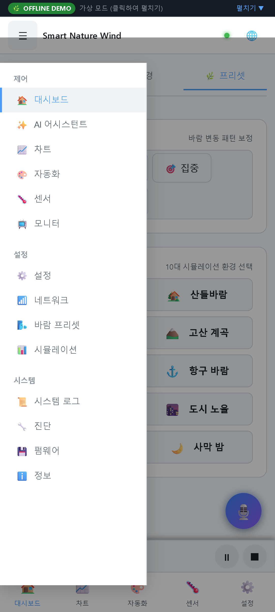

### 3.4 하드웨어 배선 및 안전 설치 가이드 (DIY / 제작 가이드)
Smart Nature Wind 제어기를 실제 팬 모터 및 센서와 연결할 때 참고하는 표준 핀맵과 전원 구성도입니다:

```text
┌────────────────────────────────────────────────────────┐
│             Smart Nature Wind 하드웨어 배선도            │
├────────────────────────────────────────────────────────┤
│  [ESP32 보드]                                          │
│   • GPIO 6  ────────► 팬 모터 제어선 (MOSFET 드라이버) │
│   • GPIO 17 ────────► 온습도 센서 데이터 (DHT22)       │
│   • GPIO 13 ────────► 인체 감지 센서 신호 (PIR)        │
│   • GPIO 48 ────────► 상태 표시 풀컬러 LED             │
│   • GND     ────────► 공통 접지선 (Common GND)         │
├────────────────────────────────────────────────────────┤
│  [전원 배선 주의사항]                                   │
│   • ESP32 로직 전원: 5V (USB-C 포트 입력)              │
│   • 팬 구동 모터 전원: 12V 2A~3A 어댑터 권장            │
│   • ⚠️ 중요: 12V 어댑터의 (-)극과 ESP32의 GND는          │
│     반드시 하나로 묶어 '공통 접지(Common GND)'를 유지!  │
└────────────────────────────────────────────────────────┘
```

| 기능 | 핀 번호 (GPIO) | 신호 규격 및 권장 부품 안내 |
|---|:---:|---|
| **팬 모터 속도 제어** | **GPIO 6** | 25kHz 고주파수 무소음 모터 제어 신호 (PWM), MOSFET 구동 모듈 게이트 연결 |
| **온습도 센서 (DHT22)** | **GPIO 17** | 디지털 온습도 신호선, 전원(3.3V)과 데이터 핀 사이에 10kΩ 저항 연결 권장 |
| **인체 감지 센서 (PIR)** | **GPIO 13** | 인체 감지 디지털 입력 신호 (HC-SR501 또는 AM312 모듈 사용) |
| **상태 표시등 (LED)** | **GPIO 48** | 온보드 풀컬러 RGB LED (부팅/네트워크/절전 상태 표출) |
| **USB 통신 포트** | **USB D+/D-** | 네이티브 USB 포트 (115200bps, 펌웨어 업데이트 및 실시간 점검) |

---

# 파트 II. 자연풍 제어 및 조작 (Daily Operation)

## 4. 메인 대시보드 인터페이스 조작 가이드 (`#/home`)

### 4.1 대시보드 화면 구성도 및 원터치 시나리오 9종
대시보드는 **`제어(#/home/control)` · `환경(#/home/env)` · `프리셋(#/home/preset)`** 3개 탭으로 구성되며, 상단의 **원터치 시나리오 9종(3×3 그리드)**을 통해 수면·사무·학습·휴식·운동·유아·반려동물·전체 자동·선택 자동 모드를 한 번의 터치로 즉시 시작/정지할 수 있습니다. (가동 중인 시나리오 카드는 강조 표시되며, 길게 누르면 세부 설정으로 이동할 수 있습니다.)

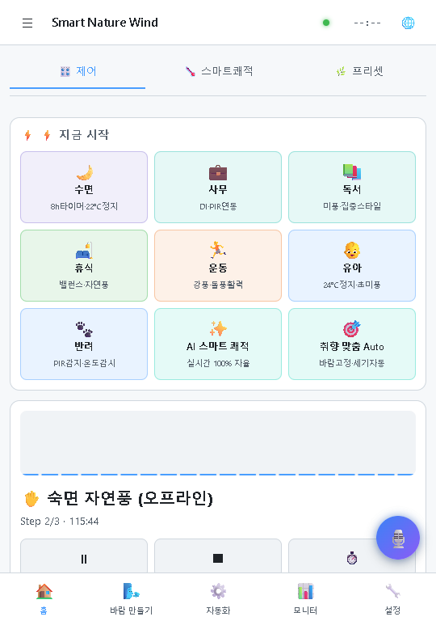

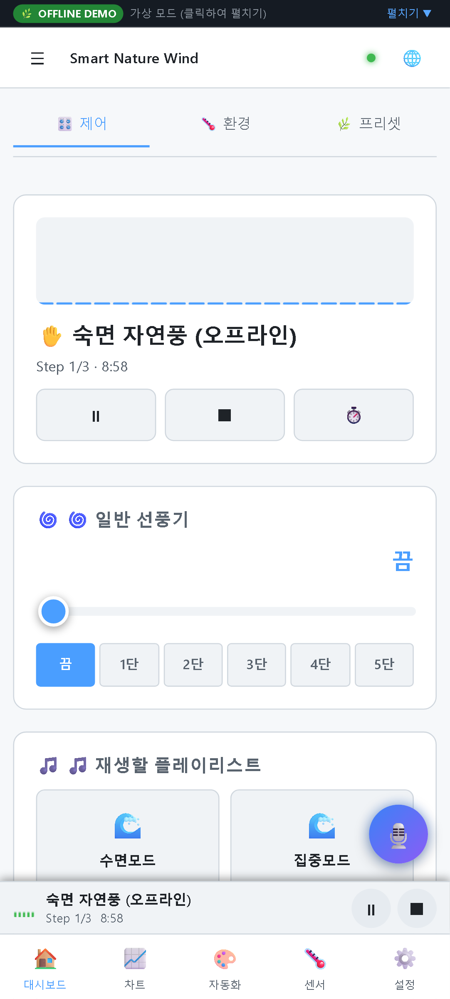

```text
┌────────────────────────────────────────────────────────┐
│  🍃 Smart Nature Wind v0203        [● STA 연결됨]      │
├────────────────────────────────────────────────────────┤
│  [Comfort DI 추천 카드]                                │
│   🌡️ 25.4℃  💧 54%  ➔  DI 71.5 (약간 덥네요)           │
│   💡 추천: COUNTRY_BREEZE · BALANCE    [▶ 지금 재생]   │
├────────────────────────────────────────────────────────┤
│  [바람 스타일 5종 탭 (44px 터치 최적화 규격)]          │
│   [ 균형 ]  [ 활동 ]  [ 집중 ]  [ 휴식 ]  [ 수면 ]     │
├────────────────────────────────────────────────────────┤
│  [자연풍 프리셋 10종 그리드 (4x2 대칭 배열)]           │
│   [🌊 OCEAN]    [🏡 COUNTRY]  [🏖 MEDIT.]  [🏔 MOUNTAIN]│
│   [🌾 PLAINS]   [⚓ HARBOR]   [🌲 FOREST]  [🌆 URBAN]   │
│   [🌴 TROPICAL] [🌙 DESERT]                            │
├────────────────────────────────────────────────────────┤
│  [3대 물리 바람 파라미터 슬라이더 (0~100%)]            │
│   • 풍속 세기  : [ ──●────── ] 48% (약 2.4 m/s 산들바람)│
│   • 바람 변동성: [ ────●──── ] 60% (생동감 있는 자연난류)│
│   • 돌풍 빈도  : [ ──●────── ] 35% (약 45초 주기 돌풍)  │
├────────────────────────────────────────────────────────┤
│  [Now Playing Bar 플로팅 미니 플레이어]                │
│   [|||||] OCEAN · ACTIVE   00:14:20    [⏸]  [⏹]        │
└────────────────────────────────────────────────────────┘
```

### 4.2 실내 쾌적도 (Comfort DI) 실시간 추천 및 5상태 카드
대시보드 상단에는 실시간 센서 온·습도를 기반으로 일본 기상청 표준 불쾌지수를 연산하여 실내 쾌적도와 최적의 바람을 제안하는 지능형 추천 카드가 배치되어 있습니다. 우측 상단의 **[자동 모드]** 토글 스위치를 켜면 사용자가 일일이 조작하지 않아도 실내 환경에 맞춰 자동으로 선풍기를 가동하고 멈춥니다.

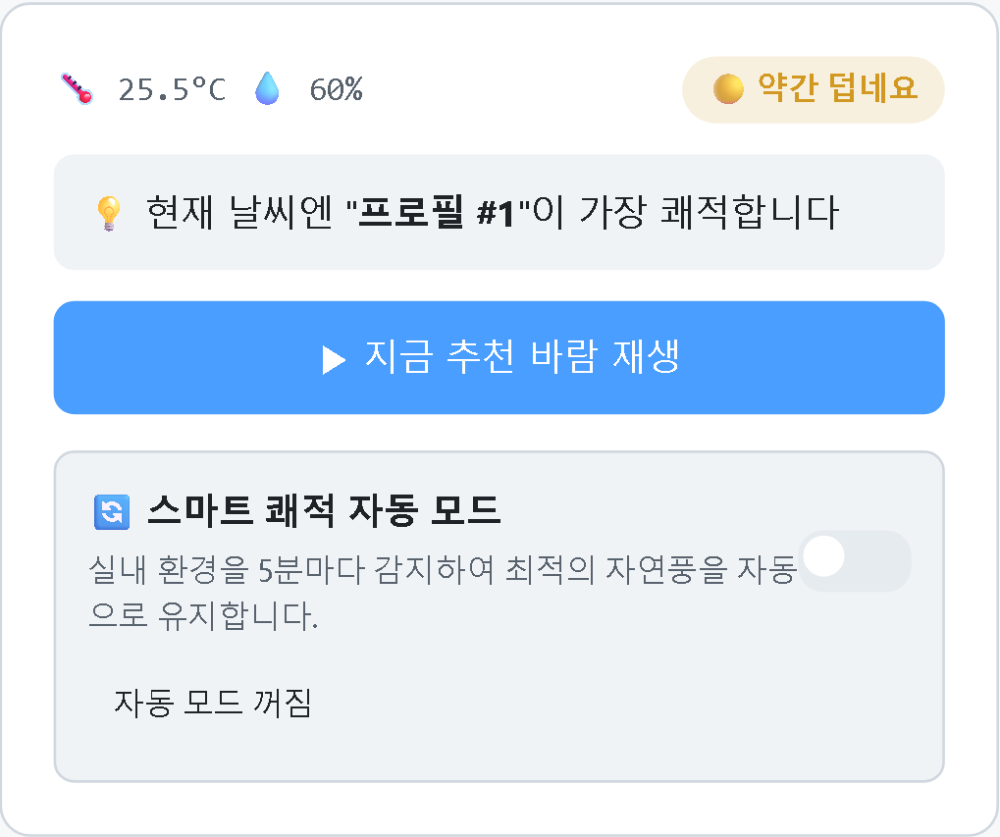

#### 4.2.1 추천 카드의 5가지 표시 상태
추천 카드는 현재 기기 가동 상태와 자동 모드 설정 여부에 따라 아래 5가지 상태로 명확하게 시각적 정보를 제공합니다:

1. **자동 모드 ON · 가동 추천 (`자동 운전 추천`)**:
   - 불쾌지수가 높아 가동이 권장되는 상황이며, 기기가 스스로 자연풍을 가동하기 전 5초 카운트다운을 표시합니다.
   - 원클릭 **[지금 시작]** 버튼을 누르면 5초 대기 없이 즉각 가동할 수 있습니다.
2. **자동 모드 OFF · 가동 권장 (`가동 권장 대기`)**:
   - 실내가 다소 덥거나 끈적여 최적의 추천 프리셋이 계산되었으나, 자동 모드가 꺼져 있어 사용자 선택을 대기하는 상태입니다.
   - **[지금 시작]** 버튼을 누르면 추천 바람이 즉시 재생됩니다.
3. **Comfort 자동 가동 중 (`자동 운전 중`)**:
   - 쾌적도 자동 모드에 의해 최적의 자연풍 세션이 실행 중인 상태입니다.
   - 초록색 상태 배지와 함께 **[⏹ 세션 정지]** 버튼이 노출되어 언제든 원클릭으로 종료할 수 있습니다.
4. **수동 운전 중 (`수동 운전 중`)**:
   - 사용자가 직접 프리셋이나 슬라이더, Wind Studio 작곡 세션을 재생 중인 상태입니다.
   - 사용자 제어권을 최우선으로 존중하여 자동 제어는 일시 대기하며, 현재 수동 바람 정보가 안내됩니다.
5. **대기 및 주기 평가 중 (`환경 평가 대기 중`)**:
   - 실내가 쾌적하거나 현재 정지 상태에서 다음 5분 주기 평가를 기다리는 상태입니다.
   - "다음 평가까지 X분 Y초 대기 중" 카운트다운이 표시됩니다.

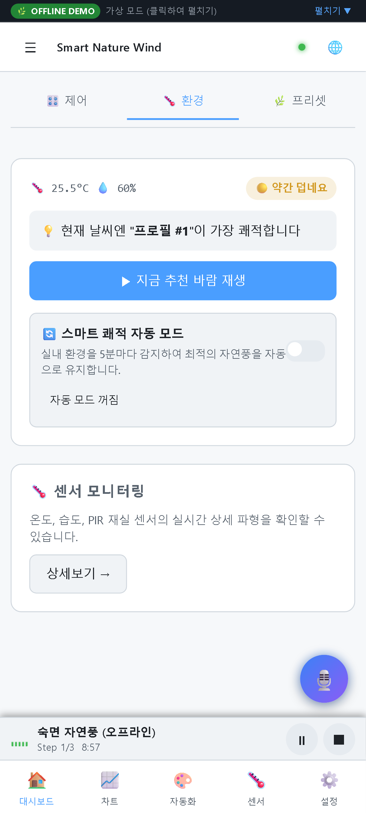

### 4.3 바람 스타일 5종 탭 (터치 최적화)
스마트폰에서도 한 손으로 오작동 없이 편안하게 누를 수 있는 큼직한 터치 버튼입니다:
- **`균형 (BALANCE)`**: 프리셋 본연의 표준 물리 값을 100% 그대로 연산합니다 (기본값).
- **`활동 (ACTIVE)`**: 무더운 한낮이나 운동 직후 강한 냉감과 역동적인 돌풍을 선사합니다.
- **`집중 (FOCUS)`**: 기류의 급격한 변동과 모터 소음을 억제하여 공부나 업무에 몰입하도록 돕습니다.
- **`휴식 (RELAX)`**: 은은하고 부드러운 바람으로 피로를 풀어주는 릴랙스 기류입니다.
- **`수면 (SLEEP)`**: 수면 중 체온 저하를 막기 위해 돌풍을 최소화하고 극저소음으로 회전합니다.

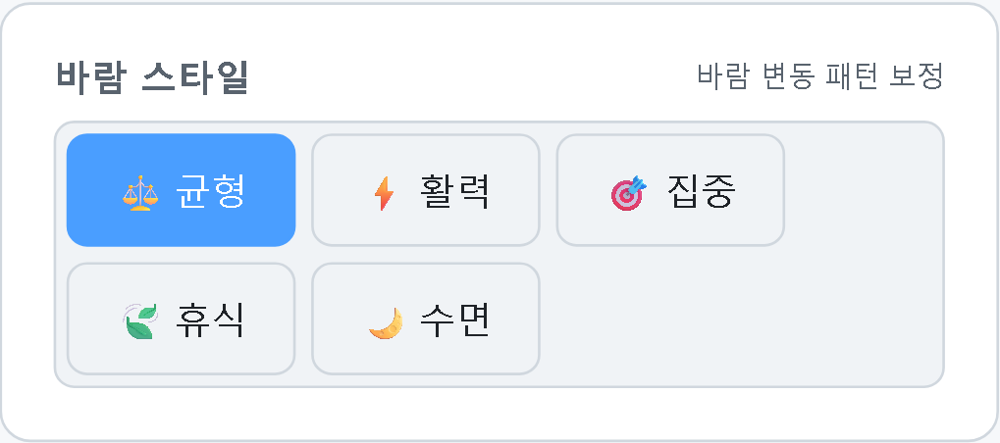

### 4.4 10대 자연풍 프리셋 그리드 (4x2 배열)
대양의 숨결부터 사막의 고요한 밤까지, 전 세계 10가지 자연 명소의 바람 특성을 담은 감성 카드입니다. 카드를 탭하면 즉시 해당 바람으로 부드럽게 전환됩니다.

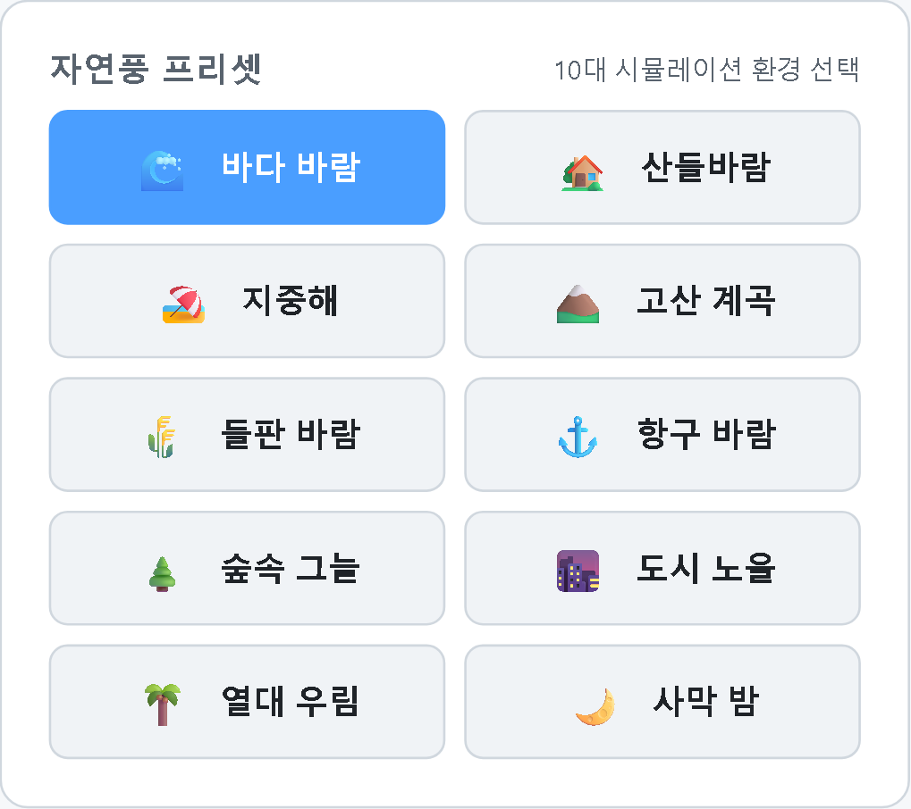

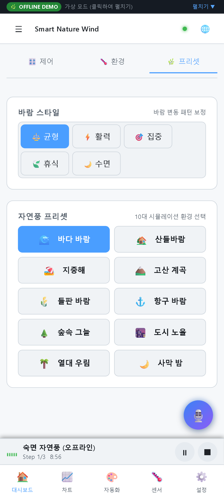

### 4.5 3대 물리 슬라이더 및 수동 조작 (맞춤 미세 조절)
- **자동 동기화**: 프리셋이나 스타일을 변경하면 내부 물리 공식에 의해 3대 슬라이더(`풍속 세기`, `바람 변동성`, `돌풍 빈도`)의 위치와 정량 수치(m/s, 주기)가 자동으로 맞춰집니다.
- **수동 튜닝 (직접 지정)**: 슬라이더 손잡이를 직접 움직이면 즉시 나만의 맞춤형 물리 값으로 고정되며, 슬라이더 상단에 **`[수동 튜닝됨]`** 뱃지가 표시됩니다.
- **원클릭 복원**: 원래 프리셋 기준값으로 되돌아가고 싶을 때는 **`[↺ 기본값 원복]`** 버튼을 탭하거나 다른 프리셋을 누르면 즉시 기본값으로 원상 복구됩니다.


### 4.6 플로팅 Now Playing Bar 및 세션 상세 확장 창
- **상시 노출 제어**: 화면을 스크롤하거나 다른 메뉴로 이동하더라도 화면 최하단에 항상 떠 있어 현재 바람 정보 확인 및 일시정지(`⏸`), 정지(`⏹`) 조작이 가능합니다.


- **스마트 상태 배지 3종**:
  - `⏰ 스케줄 충돌/대기 배지`: 수동 재생 중 예약 스케줄 시간이 도래했을 때 표시되며, 탭하면 스케줄 전환 팝업창이 열립니다.
  - `⏱️ 하드웨어 타이머 배지`: 취침 타이머가 활성화되었을 때 남은 시간(예: `28m`, `1h15m`)이 실시간 표출되며, 탭하면 즉시 타이머 설정 패널로 이동합니다.
  - `🌿 Auto Comfort 배지`: 실내 쾌적도 지능형 자동 모드에 의해 기동된 세션임을 안내합니다.
- **바람 세션 상세 확장 창**:
  Now Playing Bar 좌측의 텍스트 영역이나 이퀄라이저 애니메이션을 탭하면 **바람 세션 상세 확장 창**이 열립니다:

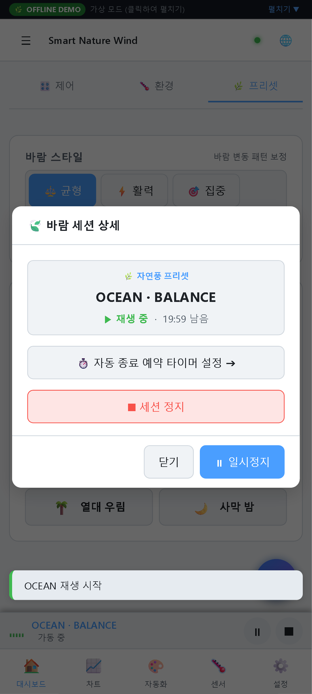

```text
┌────────────────────────────────────────────────────────┐
│  🍃 바람 세션 상세 정보                        [ ✕ ]  │
├────────────────────────────────────────────────────────┤
│  [||||||||||||||||||||] 실시간 바람 이퀄라이저 그래픽   │
│                                                        │
│  • 세션 유형 : 맞춤 프로파일 (Wind Studio 작곡 세션)     │
│  • 프로파일명: "상쾌한 아침 기상 (Morning Glow)"        │
│  • 스텝 진행 : Step 2 / 총 4스텝 (50% 완료)            │
│  • 스텝 잔여 : 00:08:45  (현재 스텝 총 15분 중)        │
│  • 전체 잔여 : 00:38:45  (세션 총 60분 중)             │
├────────────────────────────────────────────────────────┤
│  [ ⏸ 일시정지 ]   [ ▶ 이어서 재생 ]                   │
│  [ ⏹ 세션 정지 ] (빨간색)    [ 닫기 ] (세션 유지)      │
├────────────────────────────────────────────────────────┤
│  ⏱️ 세션 자동 종료 타이머 예약하기:                      │
│   [ 15분 뒤 종료 ]   [ 30분 뒤 종료 ]   [ 1시간 뒤 종료 ]│
│   ➔ 원클릭으로 취침 안심 타이머를 바로 설정할 수 있습니다│
└────────────────────────────────────────────────────────┘
```

> 💡 **안심 닫기 안내**:  
> 창 우측 상단의 `[ ✕ ]` 또는 하단의 **[닫기]** 버튼을 누르면 바람은 멈추지 않고 창만 안전하게 닫힙니다. 선풍기를 완전히 멈추려면 **[⏹ 세션 정지]** 버튼을 누르십시오. 또한 타이머 예약 버튼을 누르면 설정이 적용되면서 창이 자동으로 닫힙니다.

### 4.7 PC/모바일 오프라인 시연 데모 툴바
실제 하드웨어 기기 없이 PC 브라우저나 모바일 로컬 환경에서 웹을 열었을 때 상단에 슬림한 접이식 데모 툴바가 활성화됩니다. '자연 산들바람', '취침 수면풍', '바닷바람 돌풍', '인체 감지 절전', '취침 자동 종료' 등 5가지 가상 시나리오를 즉시 시연해 볼 수 있습니다.

### 4.8 데스크톱 PC 와이드 2열 화면 레이아웃
Smart Nature Wind v0203 웹 화면은 화면 크기에 따라 최적화된 반응형 레이아웃을 제공합니다:
- **데스크톱 PC 와이드 화면**:
  - 좌측 내비게이션 메뉴가 영구적으로 펼쳐지는 **좌우 2열 와이드 레이아웃**이 적용됩니다.
  - 상단 햄버거 메뉴 버튼과 어두운 배경 오버레이가 자동으로 숨겨지며, 메뉴를 클릭하여 화면을 이동해도 사이드바가 고정되어 넓은 모니터에서 쾌적하게 조작할 수 있습니다.
- **스마트폰/태블릿 세로 화면**:
  - 상단 좌측의 햄버거 메뉴(`☰`)를 탭하면 좌측에서 부드럽게 내비게이션 메뉴가 열립니다.
  - 메뉴 선택 시 또는 어두운 배경을 터치하면 자동으로 닫혀 모바일 화면 공간을 최대로 확보합니다.

### 4.9 원클릭 실시간 다국어 전환 (한국어 / English)
- 화면 우측 상단의 언어 버튼(**`🌐 한국어`** 또는 **`🌐 English`**)을 탭하면, 웹페이지를 새로고침하지 않고도 전체 475개 UI 단어가 **0.01초 만에 100% 실시간으로 전환**됩니다.
- 선택된 언어는 브라우저에 저장되어 다음 접속 시에도 그대로 유지됩니다.

---

## 5. 자연풍 물리 시뮬레이션 10대 바람 사전

### 5.1 10대 자연풍 프리셋 특성표

| 프리셋 코드 | 감성 한글 명칭 | 기저 물리 특성 및 권장 추천 상황 |
|---|---|---|
| **`OCEAN`** | 바다 바람 | 파도가 밀려오듯 긴 주기의 거대한 파동과 시원하고 강렬한 돌풍이 교차하는 대양의 바람 |
| **`COUNTRY_BREEZE`** | 시골 들판 바람 | 완만한 곡선을 그리며 나뭇잎을 부드럽게 흔드는 가장 평온하고 친숙한 쉼표 바람 |
| **`MEDITERRANEAN`** | 지중해 연안 바람 | 적당한 난류와 온화한 기류가 어우러져 이국적인 휴양지의 오후를 연상시키는 산뜻한 바람 |
| **`MOUNTAIN`** | 깊은 산속 계곡풍 | 울창한 숲과 깊은 계곡에서 불어오는 역동적이고 차가운 쿨링 계곡 바람 |
| **`PLAINS`** | 대평원 바람 | 막힘없이 광활한 대지를 가로지르는 시원한 지속풍으로 실내 공기 환기에 최적 |
| **`HARBOR_BREEZE`** | 항구 바람 | 도심의 열기 속에서 바다의 여운을 전달하는 경쾌하고 리듬감 있는 바람 |
| **`FOREST_CANOPY`** | 숲속 쉼표 바람 | 우거진 나뭇가지 사이로 부서져 내리듯 고요하고 은은한 초저소음 휴식 및 수면 기류 |
| **`URBAN_SUNSET`** | 도시 일몰 바람 | 하루 일과를 마치고 저녁 노을을 바라보며 마음을 차분하게 가라앉히는 온화한 바람 |
| **`TROPICAL_RAIN`** | 열대 소나기 바람 | 소나기가 내리기 직전의 예측 불가능한 돌풍과 서늘한 전율을 담은 다이내믹한 바람 |
| **`DESERT_NIGHT`** | 사막의 밤 바람 | 밤하늘의 고요한 정적, 모터 소음을 극도로 억제하여 깊은 사색과 독서에 적합한 바람 |

### 5.2 5대 바람 스타일 승수 및 체감 효과

| 스타일 | 한글 명칭 | 세기 배수 | 변동성 배수 | 돌풍 배수 | 핵심 사용 시점 |
|:---:|:---:|:---:|:---:|:---:|---|
| **`BALANCE`** | 균형 | **1.00×** | **1.00×** | **1.00×** | 프리셋 본연의 기준 바람 (가장 자연스러운 일상 모드) |
| **`ACTIVE`** | 활동 | **1.25×** | **1.20×** | **1.30×** | 실내 온도가 높거나 야외 활동 직후 빠른 열기 냉각 |
| **`FOCUS`** | 집중 | **1.05×** | **0.80×** | **0.85×** | 소음과 기류 흔들림을 억제하여 업무/공부 몰입 |
| **`RELAX`** | 휴식 | **0.80×** | **0.85×** | **0.70×** | 소파나 침대에서 편안하게 휴식을 취할 때 |
| **`SLEEP`** | 수면 | **0.65×** | **0.60×** | **0.40×** | 새벽 체온 유지, 극저소음 무자극 수면 케어 |

### 5.3 프리셋 × 스타일 시너지 조합 가이드
- **극강의 시원함**: `OCEAN` 또는 `MOUNTAIN` × `ACTIVE` 스타일
- **독서 및 재택근무**: `COUNTRY_BREEZE` 또는 `DESERT_NIGHT` × `FOCUS` 스타일
- **안심 취침 모드**: `FOREST_CANOPY` × `SLEEP` 스타일 (소음 20dB 이하 실현)

---

## 6. 스마트 센서 연동 및 3대 자동 종료 (AutoOff)

### 6.1 인체 감지 센서(PIR) 스마트 절전 운전
기기 전면의 고감도 PIR 센서는 사람의 움직임을 지속적으로 감시합니다:
- **자동 대기 절전**: 사용자가 방을 비우면 설정된 시간(기본 120초) 동안 대기 후 팬을 부드럽게 정지시켜 불필요한 전력 낭비를 차단합니다.
- **부드러운 자동 재개**: 사용자가 다시 방 안으로 들어서면 센서가 즉각 감지하여, 이전 바람 모드로 모터에 무리 없이 서서히 회전 속도를 올리며 자동 복귀합니다.

### 6.2 3대 스마트 자동 종료 (AutoOff) 시스템

```text
┌────────────────────────────────────────────────────────┐
│                   3대 스마트 자동 종료 시스템            │
├───────────────────┬───────────────────┬────────────────┤
│ ⏱ 취침 타이머      │ ⏰ 지정 시각 종료  │ 🌡 과냉 방지 온도 │
│ (Timer AutoOff)   │ (Off-Time)        │ (Off-Temp)     │
├───────────────────┼───────────────────┼────────────────┤
│ 지정한 시간(분)이  │ 매일 특정 시각     │ 실내 온도가     │
│ 경과하면 자동으로   │ (예: 새벽 04:00)에 │ 설정값(예: 23℃) │
│ 팬을 정지         │ 1회 안전 종료     │ 이하로 내려가면 │
│                   │                   │ 감기 예방 정지 │
└───────────────────┴───────────────────┴────────────────┘
```

### 6.3 자동 종료 후 안전 잠금(래치) 보호 기능
> 🔒 **안전 정지 잠금(래치) 기능이란?**  
> 자동 종료 조건(타이머 완료, 지정 시각 도래, 과냉 방지 온도 도달)이 발생하면 기기는 안전을 위해 **자동 정지 잠금 상태**를 유지합니다. 이는 새벽에 실내 온도가 22.9℃에서 다시 23.1℃로 미세하게 올라갔다고 해서 잠든 사용자의 머리맡에서 선풍기가 갑자기 켜지는 위험을 원천 차단하기 위함입니다. 잠금 상태를 풀고 다시 가동하려면 대시보드에서 프리셋을 선택하거나 시작 버튼을 탭하면 정상 해제됩니다.

---

## 7. Comfort DI 기반 실내 쾌적도 지능형 추천 및 자동 모드

### 7.1 일본 기상청 표준 불쾌지수 (DI) 산출식
Smart Nature Wind는 실시간으로 측정되는 건구온도(T)와 상대습도(H)를 바탕으로 일본 기상청(JMA) 표준 공식을 적용하여 불쾌지수를 연산합니다:
$$\text{DI} = 0.81 \times T + 0.01 \times H \times (0.99 \times T - 14.3) + 46.3$$

### 7.2 4단계 쾌적도 분류 및 맞춤 추천 매트릭스

| 레벨 | DI 수치 범위 | 실내 체감 표시 | 추천 프리셋 | 추천 스타일 | 작동 메커니즘 |
|:---:|:---:|:---:|:---:|:---:|---|
| **0** | DI < 68 | **쾌적함** | `FOREST_CANOPY` | `RELAX` | 은은한 공기 순환 및 초저소음 힐링 |
| **1** | 68 ≤ DI < 75 | **약간 덥네요** | `COUNTRY_BREEZE` | `BALANCE` | 기분 좋은 표준 산들바람으로 체온 조절 |
| **2** | 75 ≤ DI < 80 | **끈적이는 날씨** | `OCEAN` | `ACTIVE` | 습도를 날려버리는 상쾌하고 큰 파도 바람 |
| **3** | DI ≥ 80 | **숨이 막혀요** | `MOUNTAIN` | `ACTIVE` | 강력한 계곡풍과 시원한 냉감 극대화 |

### 7.3 사용자 맞춤 프로필 지능형 매칭 원리
만약 사용자가 Wind Studio에서 작곡해 둔 맞춤 프로파일 중 현재 추천 프리셋과 스타일을 포함하는 스텝이 있다면, 기기는 단순 프리셋 대신 **"사용자 작곡 프로파일 재생"**을 우선적으로 추천 카드에 띄워줍니다.

### 7.4 Comfort 자동 모드 (5분 주기 자동 가동 & 안전 가드)
대시보드 추천 카드의 **[자동 모드]** 스위치를 켜면 기기 내부 시스템이 매 5분(300초)마다 환경을 평가하여 최적의 실내 환경을 유지합니다:
- **자동 기동 판단**: 불쾌지수(DI)가 기준치 이상으로 올라가 추천 바람이 산출되면, 사용자가 버튼을 누르지 않아도 세션을 자동으로 시작합니다.
- **자동 정지 판단**: 온도가 내려가 쾌적 구간(DI < 68)에 도달하면 선풍기를 자동으로 멈추어 불필요한 과냉을 방지합니다.
- **3중 안전 보호 기능**:
  1. 사용자가 직접 수동 바람을 틀어둔 경우, 사용자의 조작을 최우선하여 자동 모드가 개입하지 않습니다.
  2. 자동 정지 안전 잠금이 걸려 있거나 취침 타이머가 만료된 경우, 의도치 않게 다시 켜지지 않도록 기동을 억제합니다.
  3. 사용자가 세션 자동 종료 타이머를 설정하거나 수동으로 선풍기를 끄면, 원치 않는 재가동을 막기 위해 Comfort 자동 모드가 자동으로 안전 해제(OFF)됩니다.

---

# 파트 III. 자동화 및 맞춤 제작 (Automation & Studio)

## 8. 바람 재생 세션 및 수명주기 관리

### 8.1 3단계 세션 상태 (재생 중 / 일시정지 / 정지)
Smart Nature Wind v0203의 모든 바람 재생은 체계적인 세션 제어 엔진에 의해 관리됩니다:
- **`재생 중 (ACTIVE)`**: 프리셋이나 작곡 스케줄이 실제로 팬을 구동하며 동작 중인 상태.
- **`일시정지 (PAUSED)`**: 사용자가 Now Playing Bar에서 `⏸` 버튼을 눌러 팬을 잠시 멈춘 상태 (기존 진행 스텝과 재생 시간은 기기 메모리에 안전하게 보존됨).
- **`정지/완료 (COMPLETED)`**: 모든 스텝이 끝나거나 `⏹` 버튼으로 세션이 완전히 종료된 상태.

### 8.2 똑똑한 이어듣기 기능 (Smart Resume)
일시정지 후 다시 `▶` 버튼을 눌렀을 때, 멈춰있던 경과 시간에 따라 사용자 의도를 파악하여 똑똑하게 재개합니다:
- **5분 이내 재개**: **연속 재개** — 방금 멈췄던 그 자리(초 단위)에서 즉시 이어서 재생합니다.
- **5분 ~ 30분 재개**: **스텝 유지 재개** — 진행 중이던 스텝의 처음부터 부드럽게 다시 시작합니다.
- **30분 초과 재개**: **처음부터 리셋** — 장시간 자리를 비웠으므로 전체 세션의 첫 스텝부터 신선하게 시작합니다.

---

## 9. Wind Studio — 8스텝 바람 작곡기 (`#/wind/studio`)

`자동화 → Studio` 메뉴에서는 마치 음악을 작곡하듯 최대 8개의 스텝을 연결하여 나만의 맞춤 바람 시나리오를 만들 수 있습니다.

```text
┌────────────────────────────────────────────────────────┐
│  🎼 Wind Studio (바람 작곡기 — 2열 그리드 폼)          │
├────────────────────────────────────────────────────────┤
│  [Step 1] 🌊 OCEAN · ACTIVE (15분)                     │
│           • 세기: 65% / 변동성: 70% / 돌풍: 50%        │
│           • 80px 기류 스파크라인 파형 렌더링           │
│  [Step 2] 🌲 FOREST_CANOPY · RELAX (30분)              │
│           • 세기: 40% / 변동성: 30% / 돌풍: 10%        │
│  [Step 3] ⏸ 모터 휴지 (REST) (5분)                     │
│  [Step 4] 🌙 DESERT_NIGHT · SLEEP (60분)               │
├────────────────────────────────────────────────────────┤
│  반복 횟수: [ 0 ] 회 (0=무한)                          │
├────────────────────────────────────────────────────────┤
│  [🎬 미리보기]                 [ 취소 ]  [ 저장/업데이트 ]│
└────────────────────────────────────────────────────────┘
```

### 9.1 8스텝 작곡기 개요 및 스텝 유형 (자연풍 / 고정풍 / 휴식)
- **`자연풍 (PRESET)`**: 10대 자연풍 프리셋과 5대 스타일을 선택하여 풍부한 물리 기류를 재생합니다.
- **`고정풍 (FIXED)`**: 특정 풍속(세기 %)을 지정하여 일정한 속도로 팬을 계속 회전시킵니다.
- **`휴식 (REST)`**: 모터 회전을 완전히 멈추고 자연스러운 바람의 휴지기를 가집니다.
- **반응형 2열 그리드 & 80px 스파크라인**: PC와 태블릿에서는 2열 그리드로 쾌적하게 파라미터를 입력할 수 있으며(모바일 1열), 카드 내 스파크라인 차트가 80px로 확대되어 설정한 바람 곡선의 변화를 더욱 명확하게 볼 수 있습니다.

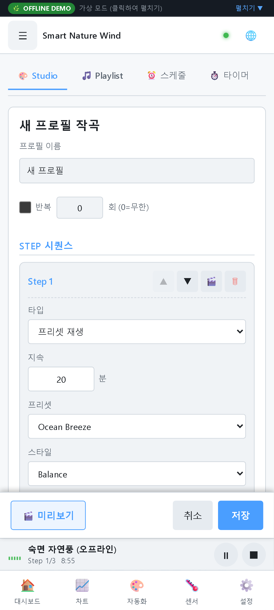

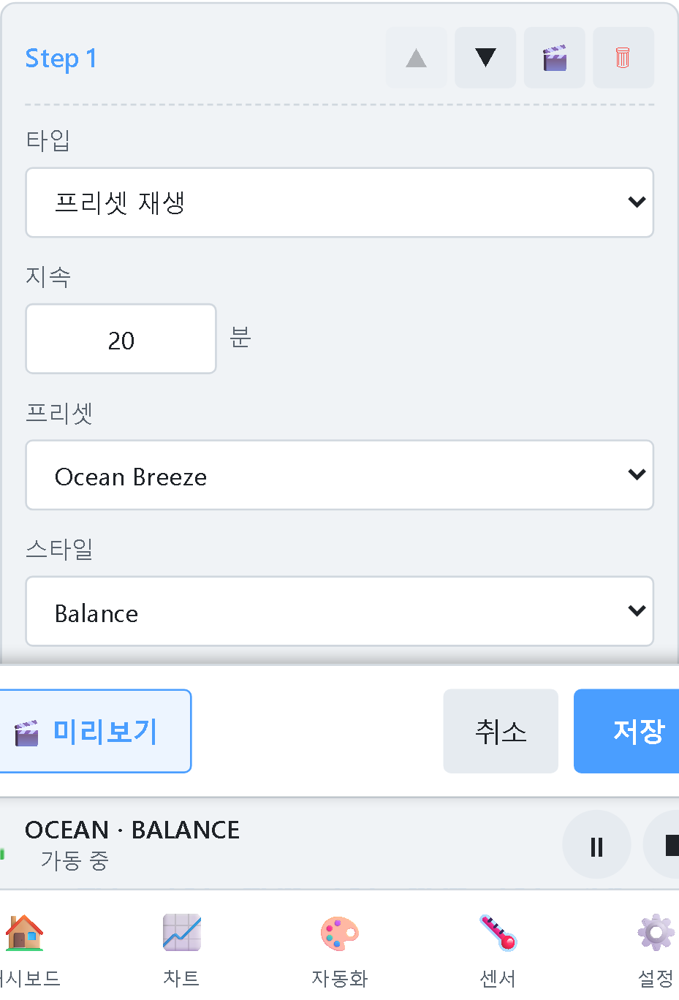

### 9.2 스텝별 바람 세부 설정(직접 지정) 및 원클릭 복원
각 스텝마다 기저 프리셋 값 외에 풍속 세기, 변동성, 돌풍 빈도를 0~100% 수치로 미세 조정할 수 있습니다. `⚙ 물리 세부 조정 (직접 지정)` 접기/펼치기 영역을 통해 직관적으로 옵션을 켜고 끌 수 있으며, 튜닝된 스텝에는 `[수동 튜닝됨]` 배지가 붙고 **`[↺ 기본값 원복]`** 버튼으로 언제든 프리셋 고유 값으로 되돌릴 수 있습니다.

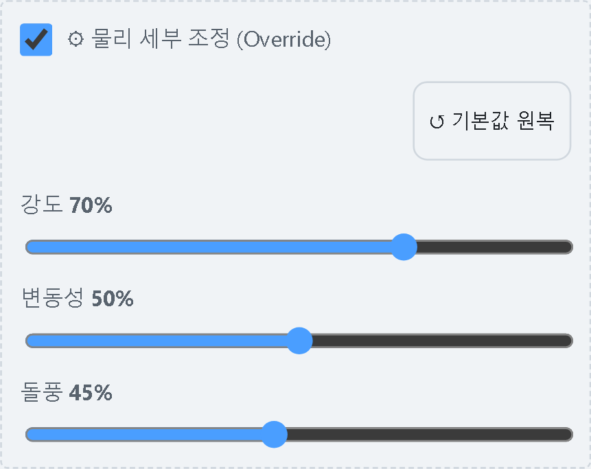

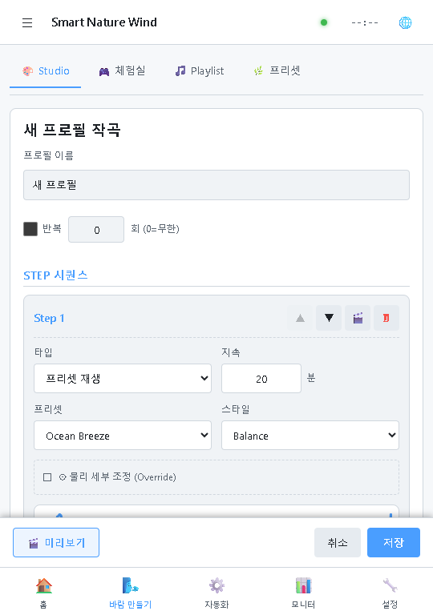

### 9.3 시나리오 실시간 미리보기 및 하단 분리 액션바
- **좌우 분리 하단 바**: 하단 바 좌측에 **`[🎬 미리보기]`**, 우측에 **`[취소]`** 및 **`[저장/업데이트]`** 버튼이 명확히 분리 배치되어 실수로 저장을 누르는 오작동을 차단합니다.
- **플로팅 마이크 버튼 자동 숨김**: 스튜디오 화면으로 들어오면 우하단을 가리던 AI 마이크 버튼이 자동으로 숨겨져 스텝 작성 및 편집 시야를 100% 확보해 줍니다. 스튜디오를 벗어나면 원래대로 나타납니다.
- **시나리오 미리보기 (`🎬 미리보기`)**: 실제로 몇 시간을 기다릴 필요 없이, 버튼을 누르면 전체 스텝의 기류 파형이 어떻게 흘러가는지 모달 창에서 시뮬레이션으로 압축 감상할 수 있습니다.

### 9.4 스마트 쾌적 & 자동 정지 규칙 편집기 (`규칙 편집` 모달)
Wind Studio 하단의 **`⚙ 스마트 쾌적 & 자동 정지 규칙`** 패널에서 **`[규칙 편집 →]`** 버튼을 누르면 화면 중앙에 전용 모달 창이 열립니다.
- **원터치 추천 템플릿 3종**: `🌙 숙면 권장`, `👶 유아 안심`, `💼 사무 집중` 버튼을 눌러 상황에 맞는 온·습도/DI/자동 정지 조건을 즉시 불러올 수 있습니다.
- **모바일 최적화 모달 스크롤**: 모바일 화면에서도 모달 헤더와 하단 저장/닫기 버튼은 고정된 채 본문만 부드럽게 스크롤되어 쾌적하게 규칙을 편집할 수 있습니다.

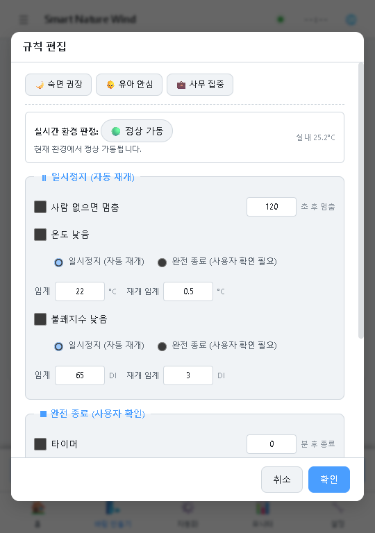

---

## 10. 맞춤 프로파일 및 주간 스케줄러 (`#/automation`)

### 10.1 재생 목록 (Playlist) 관리 (`#/wind/playlist`)
Wind Studio에서 작곡한 바람은 **프로파일(Profile)** 로 저장되어 Playlist 탭에서 카드 목록으로 열람할 수 있습니다. 언제든 원클릭으로 즉시 재생(`▶`)하거나 편집(`✏️`), 삭제(`🗑`)할 수 있으며, 100px 대형 스파크라인 차트를 통해 프로파일의 기류 흐름을 목록에서 바로 직관적으로 확인할 수 있습니다.

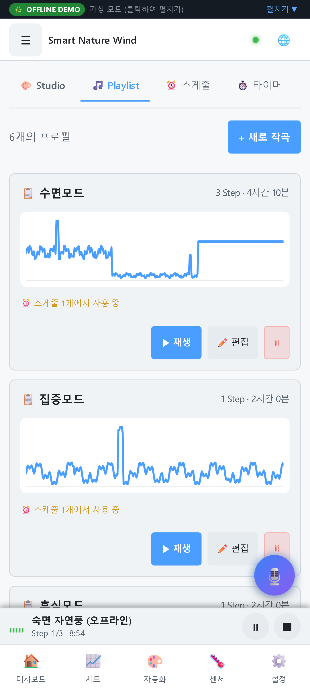

### 10.2 프로파일 구조 (단계별 스텝 구성)
v0203 펌웨어는 복잡한 하위 호환 구조를 배제하고 직관적인 **단일 스텝 배열 구조**로 동작합니다. 스텝 순서 변경 시 카드 상단의 `[▲]` / `[▼]` 버튼으로 즉시 재배치할 수 있으며, 스텝 실수 삭제 시 화면 하단에 5초간 **실행 취소(Undo) 팝업 알림**이 표시되어 안전하게 되살릴 수 있습니다.

### 10.3 주간 스케줄러 설정 (`#/automation/schedule`)
원하는 요일과 시간대를 지정하여 선풍기가 알아서 켜지고 꺼지도록 생활 맞춤 예약이 가능합니다:
- **기상 스케줄**: 평일 아침 07:00 ~ 08:30 활기찬 바닷바람 재생
- **퇴근 스케줄**: 매일 저녁 19:30 ~ 22:00 시골 들판 바람 재생
- **취침 스케줄**: 매일 밤 23:00 ~ 익일 03:00 숲속 수면 바람 재생

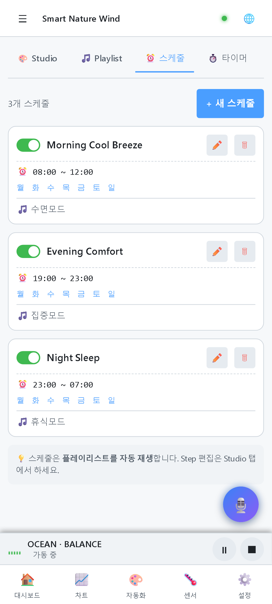

### 10.4 스케줄과 프로파일 연동 및 충돌 방지
스케줄은 미리 만들어둔 프로파일을 연결하여 실행됩니다. 만약 사용자가 수동으로 다른 바람을 틀고 있는 도중에 예약 스케줄 시간이 도래하면, Now Playing Bar에 충돌 경고 배지가 뜨며 "스케줄로 전환할지, 현재 바람을 유지할지" 안전하게 선택할 수 있습니다.

### 10.5 자동화 규칙 관리 (`#/automation/rules`)
`자동화 → 규칙` 탭에서는 온도·습도·불쾌지수(DI)·인체 감지(PIR)·연속 가동 시간 조건에 따른 **스마트 쾌적 & 자동 정지 규칙(`TriggerRule`)**을 한눈에 조회하고 활성화 여부를 제어할 수 있습니다.

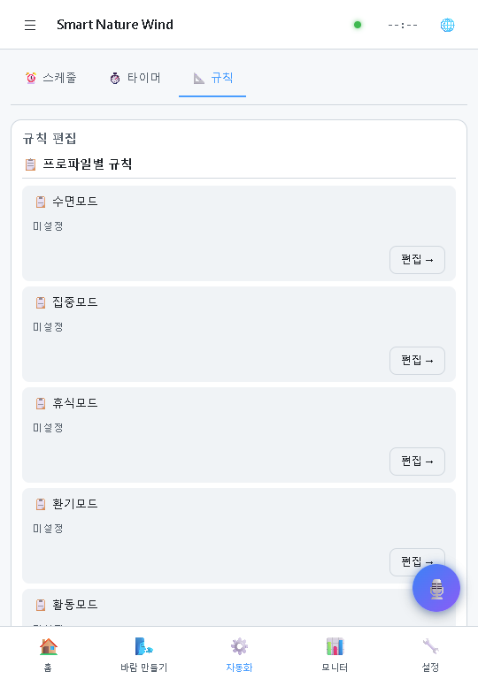

---

## 11. 세션 자동 종료 타이머 (`#/automation/timer`) — 독립 하드웨어 타이머

`자동화 → 타이머` 탭에서는 현재 재생 중인 바람을 일정 시간 뒤 부드럽게 멈추도록 원클릭 예약할 수 있습니다. 스마트폰 브라우저나 화면을 완전히 꺼도 **기기 자체에서 독립적으로 정확하게 카운트다운되는 독립 하드웨어 타이머**가 작동합니다.

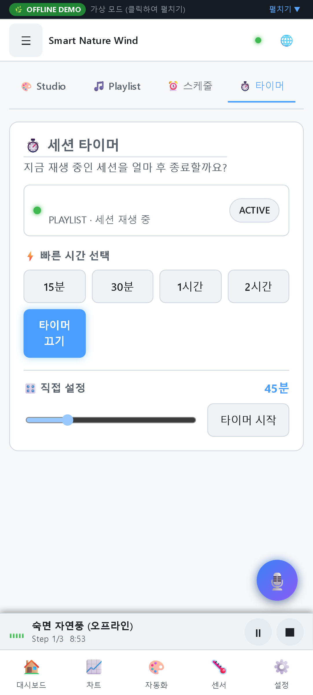

### 11.1 원터치 빠른 프리셋 (15분 / 30분 / 1시간 / 2시간)
침대에 눕기 전 복잡한 조작 없이 **`[15분]`, `[30분]`, `[1시간]`, `[2시간]`** 버튼 중 하나를 탭하면 즉시 기기 자체 하드웨어 타이머가 기동됩니다.

### 11.2 미세 슬라이더 직접 설정 (1분~480분 안심 제한)
원하는 정밀한 시간이 있다면 슬라이더를 움직여 1분부터 최대 480분(8시간)까지 자유롭게 설정한 후 **[타이머 시작]**을 누릅니다. 시스템 안전을 위해 480분(8시간)을 초과하는 설정은 자동으로 제한됩니다.

### 11.3 실시간 카운트다운 및 전역 미니플레이어 배지
타이머가 가동되면 남은 시간(`HH:MM:SS`)과 종료 예정 시각(예: "23:45 종료 예정")이 실시간으로 흐르며, 화면 하단 Now Playing Bar에도 `⏱️ 29m` 배지가 함께 표시되어 어디서나 잔여 시간을 한눈에 볼 수 있습니다.

### 11.4 기기 자체 독립 하드웨어 타이머 동작 및 Comfort 모드 연계
- **스마트폰 전원 종료 후에도 정확한 정지 보장**:  
  타이머가 설정되면 기기 내부 타이머 엔진이 자체적으로 카운트다운을 유지합니다. 따라서 **스마트폰 화면을 끄거나 웹 브라우저를 완전히 닫아도 정해진 시간에 기기가 알아서 100% 완전 정지**합니다.
- **Comfort 자동 모드와의 스마트 안전 연계**:  
  취침 타이머가 만료되어 선풍기가 꺼진 후, 몇 분 뒤 자동 모드에 의해 선풍기가 다시 켜져 잠을 깨우는 현상을 막기 위해, **타이머 만료 시점(및 수동 설정 시점)에 Comfort 자동 모드가 자동으로 안전 해제(OFF)**됩니다.

---

# 파트 IV. 지능형 AI 및 전문 시각화 (AI & Analytics)

## 12. Gemini AI 대화형 비서 & Live 실시간 음성

Smart Nature Wind v0203은 Google의 최신 생성형 인공지능(Gemini)과 결합하여, 단순한 버튼 터치를 넘어 **자연어 텍스트와 실시간 저지연 음성(Gemini Live)**으로 선풍기를 사람처럼 대화하며 다룰 수 있는 차세대 AI 제어 시스템을 탑재했습니다.

### 12.1 2가지 진입 경로 (AI Studio & 플로팅 마이크 버튼)
1. **풀스크린 AI Studio (`#/ai`)**: 반응형 오디오 구체(Audio Orb), 음성 설정, 오늘 사용 비용 대시보드, 상세 대화 로그를 총망라한 종합 AI 작업 공간입니다.
2. **플로팅 마이크 버튼**: 화면 어느 페이지에서나 우측 하단의 원형 마이크 아이콘을 탭하면 즉시 음성 대화 창이 아래에서 위로 올라옵니다. Now Playing Bar(미니플레이어)가 켜져 있을 때도 버튼 위치가 자동으로 올라가 메뉴 가림 없이 편리하게 누를 수 있습니다.

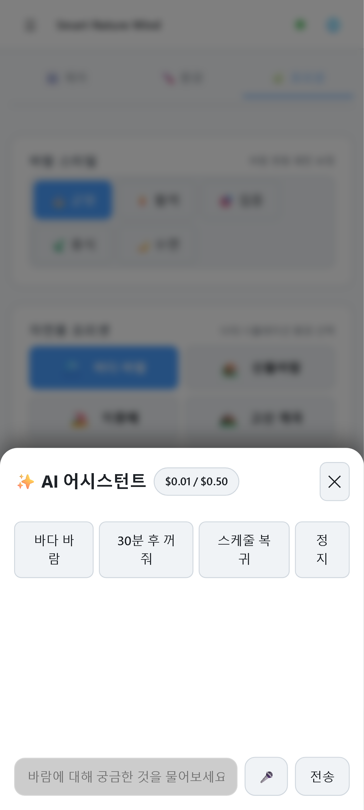

### 12.2 2가지 대화 모드 (텍스트 대화 vs 실시간 음성 통화)
AI Studio 상단의 모던한 전환 버튼을 통해 언제든 원하는 모드로 즉시 변경할 수 있습니다:
- **텍스트 대화 모드**: 가벼운 데이터 소모로 정확한 제어 명령을 실행하고 텍스트 및 음성(TTS) 답변을 받습니다.
  * **2x2 퀵 예시 칩**: `[🌊 바다 바람]`, `[⏱ 30분 후 끄기]`, `[📅 스케줄 복귀]`, `[🌤 날씨 추천]` 등 4가지 대표 명령 칩이 2열 그리드로 정렬되어 있어 한 번의 터치로 손쉽게 명령을 내릴 수 있습니다.
  * **스마트 자동 신축 입력창**: 처음에는 1줄 높이로 콤팩트하게 유지되다가, 긴 문장을 타이핑하면 내용량에 맞춰 최대 120px까지 부드럽게 창 높이가 늘어나 긴 지시문도 시원하게 확인하며 입력할 수 있습니다 (`Shift+Enter`로 줄바꿈, `Enter`로 즉시 전송).
- **실시간 양방향 음성 통화 모드**: 스마트폰 마이크와 Google Gemini Live 서버 간의 고속 음성 통신을 직결하여, 0.8초 이하의 빠른 응답 속도로 실제 사람과 통화하듯 자연스럽게 대화하며 기기를 제어합니다.
- **비용 배지 말줄임 보호**: 상단 비용 모니터링 배지가 좁은 모바일 화면에서도 2줄로 깨지지 않고 깔끔하게 한 줄(`...` 말줄임)로 표시되어 UI 레이아웃이 항상 단정하게 유지됩니다.

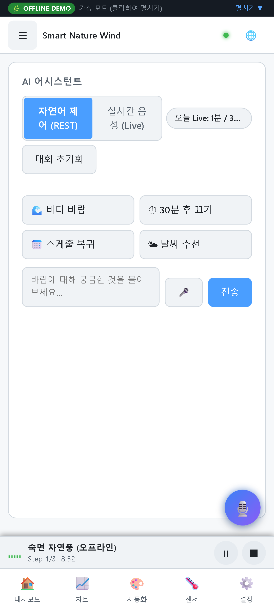

### 12.3 자연스러운 음성 대화 (공식 음성, 반응형 오디오 구체, 말 끊고 끼어들기)
- **Google 공식 음성 (Aoede 보이스)**: 가장 자연스럽고 지적인 한국어/영어 발음을 구사하는 Google 공식 프리셋 음성을 기본 지원합니다.
- **반응형 오디오 구체 (Audio Orb)**: 사용자의 음성 입력 음량과 AI의 음성 출력에 실시간 반응하여 살아 움직이듯 맥동하는 그래픽 구체입니다.
- **말 끊고 끼어들기**: AI가 말하고 있는 도중이라도 사용자가 "잠깐만" 하고 말을 끊으면 AI 음성 출력을 즉시 멈추고 사용자의 새로운 말을 우선 청취합니다.

### 12.4 자연어로 제어 가능한 13대 스마트 제어 도구

| 사용자의 일상 언어 예시 | AI 실행 동작 (도구) | 실제 하드웨어 수행 동작 |
|---|---|---|
| *"선풍기 켜줘"*, *"틀어"* | `turn_on` | 팬 가동 시작 (마지막 바람 상태 복원) |
| *"선풍기 꺼줘"*, *"정지"* | `turn_off` | 팬 모터 부드러운 감속 정지 |
| *"바람 세기 절반으로 해줘"* | `set_fan_speed` | 팬 PWM 속도 50% 즉시 변경 |
| *"시원한 바닷바람 틀어줘"* | `start_preset` | `OCEAN` 프리셋 + `ACTIVE` 스타일 시작 |
| *"잘 거니까 조용하게 틀어줘"* | `start_preset` | `FOREST_CANOPY` + `SLEEP` 시작 |
| *"30분 뒤에 꺼줘"*, *"1시간만 틀어줘"* | `set_timer` | 지정 시간(1~480분) 동안 가동 후 자동 정지 하드웨어 타이머 기동 |
| *"매일 아침 7시마다 시골바람 예약해줘"* | `add_schedule` | 프로파일 기반 주간 예약 스케줄 자동 등록 |
| *"지금 등록된 스케줄 뭐 있어?"* | `list_schedules` | 등록된 예약 목록 친절 음성 브리핑 |
| *"1번 예약 지워줘"* | `delete_schedule` | 지정한 예약 스케줄 즉각 삭제 |
| *"내가 좋아하는 맞춤 바람 프로파일 만들어줘"* | `add_profile` | 단계별 풍속과 지속시간을 조합한 프로파일 작곡 |
| *"지금 방 온도랑 습도 몇 도야?"* | `get_environment` | DHT22 센서 온습도 및 실내 불쾌지수(DI) 보고 |
| *"스케줄 바람으로 다시 돌려놔줘"* | `release_manual_to_schedule` | 수동 조작을 풀고 현재 시간대의 예약 스케줄로 복귀 |
| *"좌우 회전 시작해줘 / 멈춰줘"* | `set_oscillation` | 좌우 풍향 모터 회전 각도 제어 |

### 12.5 안심 3중 안전 보호 기능 (위험명령 차단, 30분 자동 종료, $0.50 한도)
1. **15대 위험 시스템 명령 원천 차단**: 기기 리셋, Wi-Fi 초기화, 공장 출하 리셋, API 키 탈취 등 기기 안전에 위해가 되는 명령은 AI가 요청해도 시스템에서 100% 거절됩니다.
2. **세션당 30분 자동 종료 타이머**: 실시간 음성 모드를 켜둔 채 잠들거나 외출하더라도 30분이 지나면 세션이 자동으로 닫혀 불필요한 비용 발생을 막습니다.
3. **일일 비용 한도 ($0.50 USD) 및 영구 메모리 누적**: 하루 사용 금액이 $0.50(약 700원)에 도달하면 신규 음성 접속이 자동으로 안전 제한되며 무료 텍스트 모드로 전환됩니다.

### 12.6 Gemini API 키 발급/등록 및 당일 비용 모니터링
1. **API 키 발급**: Google AI Studio(aistudio.google.com)에서 무료 Gemini API Key를 발급받습니다.
2. **기기에 등록**: `#/settings` 또는 `#/ai` 설정 창에서 API 키를 입력하고 저장합니다.
3. **비용 확인**: AI Studio 상단 배지에서 오늘 사용한 토큰과 누적 비용($), 잔여 한도를 실시간 확인할 수 있습니다.

---

## 13. 실시간 물리 시뮬레이션 차트 (`#/monitor/chart`)

기기가 인위적인 회전이 아닌, 실제 지구의 대기 물리 방정식으로 기류를 만들고 있음을 눈으로 검증하는 전문 파형 분석 도구입니다.

```text
  풍속(m/s)
    ▲
7.0 │               ╭─╮           ╭──╮       돌풍(Gust) 피크 구간
5.0 │      ╭─╮     │ │   ╭─╮     │  │
3.0 │  ╭──╯ ╰──╮  │ ╰──╯ ╰─╮   │  ╰──╮   기저 자연풍 곡선
1.0 └──┴────────┴─┴──────────┴───┴───────► 시간(초)
       0s       30s       60s       90s      120s
```

### 13.1 실측 풍속 vs 예상 풍속 파형 대조
- **실측 파형**: 0.1초(100ms) 주기로 팬에 실시간 전달되는 실제 바람 풍속 곡선입니다.
- **예상 파형 (점선 표시)**: 현재 프리셋과 스타일 공식에 의해 앞으로 전개될 이론적 파형을 점선으로 겹쳐 표시하여 시뮬레이션 정확도를 대조할 수 있습니다.

### 13.2 실시간 바람 물리 요소 그래픽 관측
차트 상에서 기저 풍속(Base), 난류 변동폭(Turbulence), 돌풍 피크(Gust Peak), 열기포 상승(Thermal Bubble) 구간을 시각적으로 구분하여 감상할 수 있습니다.

### 13.3 시간 범위 전환 및 CSV 데이터 내보내기
5초, 30초, 120초 등 3단계 줌 레벨을 지원하며, **[CSV 내보내기]** 버튼을 통해 연구 및 분석용 원본 데이터를 파일로 저장할 수 있습니다.

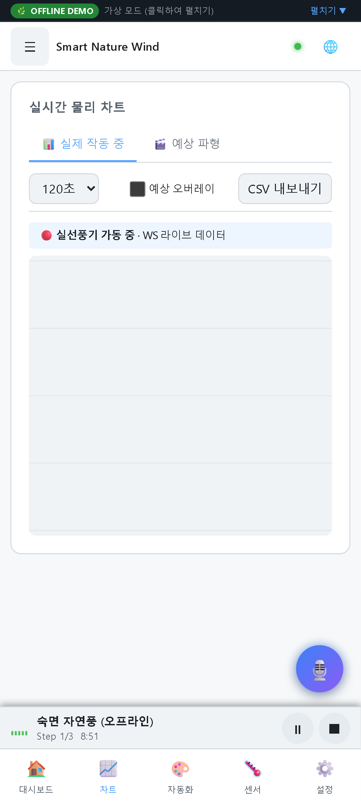

---

## 14. 모니터링 및 세션 히스토리 타임라인 (`#/monitor`)

### 14.1 실시간 탭 (20밴드 바람 이퀄라이저 & 환경 지표)
- **20밴드 바람 이퀄라이저**: 현재 풍속의 생동감을 20개의 수직 막대로 렌더링하는 기류 시각화 이퀄라이저입니다.
- **환경 지표**: 실시간 온도, 습도, 사람 재실 감지 여부, 현재 구동 모드를 한눈에 브리핑합니다.

### 14.2 히스토리 탭 (운전 이력 타임라인 & 반응형 가동 요약)
기존 "회고" 탭이 더욱 직관적인 **`🎬 히스토리`** 탭으로 개편되어 과거의 기기 운전 이력을 한눈에 추적할 수 있습니다:
- **반응형 가동 요약 (Summary Grid)**: 최근 1시간, 24시간 또는 7일간의 총 가동 시간, 평균 풍속, 평균 실내 온도, 재실 감지율을 깔끔한 그리드로 보여주어 모바일 좁은 화면에서도 글자 깨짐 없이 표시됩니다.
- **2단 지그재그 타임라인**: 
  * 세션 시작(`▶`), 정지(`⏹`), 수동 조작(`✋`), 자동 종료(`🌙`), 일시정지(`⏸`) 등 주요 라이프사이클 이벤트 64개를 시간순으로 시각화합니다.
  * 이벤트 간격이 좁아 마커가 겹칠 경우, 위/아래 2단 레인으로 엇갈려 자동 배치되어 모든 이벤트를 가림 없이 명확히 확인할 수 있습니다.
  * 양 끝 마커가 잘리지 않도록 안전 여백이 적용되었으며, 하단에 시작 및 현재 시간 라벨이 표시됩니다.
  * 마커를 터치하거나 마우스를 올리면 발생 시각과 상세 내용이 풍선 도움말로 나타납니다.
- **스마트 시간축 표기 및 이벤트 목록**: 최근 30개의 이벤트 목록에서 1시간/24시간 조회 시에는 `HH:mm`, 7일 조회 시에는 `MM/DD HH:mm` 포맷으로 날짜와 시간이 알기 쉽게 자동 표기됩니다.

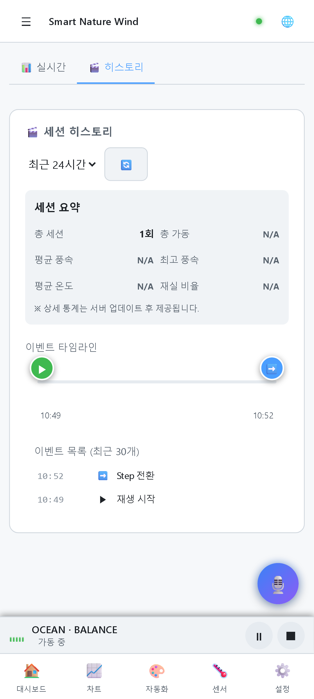

### 14.3 운전 기록 보관 방식 (단기 메모리 / 장기 플래시 저장소)
- **단기 고해상도 데이터 (RAM 메모리)**: 최근 1시간 분량의 정밀 1초 단위 데이터를 메모리에 유지하여 부드러운 차트를 표시합니다.
- **장기 누적 데이터 (기기 플래시 저장소)**: 1시간 단위로 압축하여 내부 저장소에 안전하게 보관하므로 전원을 껐다 켜도 과거 이력이 유지됩니다.

---

# 파트 V. 시스템 관리 및 문제 해결 (System & Support)

## 15. 시스템 및 네트워크 고급 설정 (`#/settings/general` / `#/settings/network`)

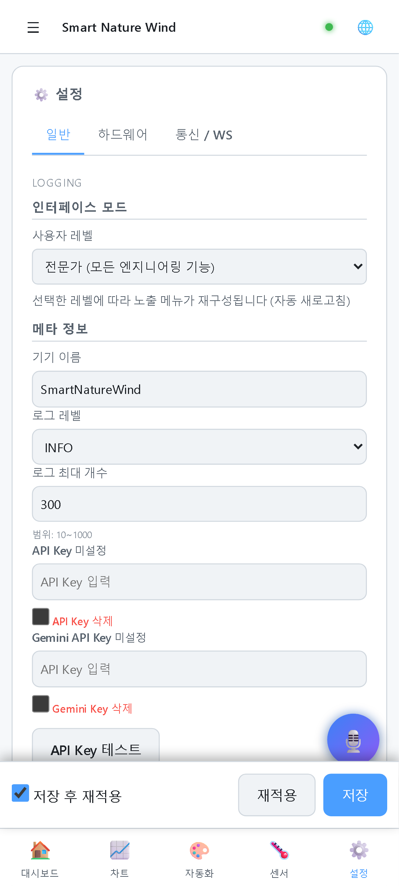

### 15.1 팬 모터 안전 풍속(출력) 범위 설정
`설정 → 하드웨어` 탭에서는 팬 모터의 수명 보호와 안전 운전을 위한 출력 경계를 지정합니다:
- **`최소 회전 시작 세기 (Start Percent Min)`**: 모터 날개가 멈칫거리지 않고 안정적으로 회전을 시작하는 최소 출력 세기 (기본 18%).
- **`일상 안심 최대 세기 (Comfort Percent Max)`**: 일상 자연풍 자동 모드에서 허용되는 안심 최대 풍속 세기 (기본 65%).
- **`절대 최대 한계 세기 (Hard % Max)`**: 초강풍 수동 모드 시 도달할 수 있는 시스템 최대 한계 세기 (기본 90%).

### 15.2 보안 비밀번호 및 API 키 관리
비인가자의 임의 조작을 차단하기 위해 관리자 보안 비밀번호(API Key)를 등록할 수 있습니다. 비밀번호가 설정되면 웹 브라우저나 외부 제어 요청 시 올바른 키를 입력해야만 제어가 허용됩니다.

### 15.3 골든 룰: 설정 저장과 재부팅 없는 즉각 적용
- **임시 메모리 즉시 반영**: 슬라이더 조작이나 임시 제어는 기기 수명(메모리 쓰기 횟수) 보호를 위해 기기 임시 메모리(RAM)에 먼저 즉각 반영됩니다.
- **[설정 저장] 버튼**: 수정한 설정을 기기에 영구 보존하려면 반드시 상단 **[설정 저장]** 버튼을 눌러야 전원을 껐다 켜도 유지됩니다.
- **재부팅 없는 즉시 적용 (Zero-Reboot)**: 타임존이나 시간 동기화 주기를 변경하더라도 기기를 재부팅할 필요 없이 백그라운드에서 즉각 새 설정이 동기화됩니다.

### 15.4 네트워크 및 인터넷 시간(NTP) 설정
`네트워크` 탭에서는 기기 직접 연결(SoftAP), 가정용 공유기 연동, 주변 Wi-Fi 검색, 인터넷 표준 시간(NTP) 동기화 주기 및 한국 표준시(KST, UTC+9) 타임존을 설정합니다.

### 15.5 브라우저 오프라인 가상 체험 모드
기기가 근처에 없거나 연결되지 않은 환경에서도 PC나 스마트폰 브라우저에서 가상의 센서와 바람 파형을 시뮬레이션하여 모든 화면과 기능을 미리 체험해 볼 수 있는 모드입니다. 상단 오프라인 데모 툴바를 통해 손쉽게 다양한 동작 시나리오를 테스트할 수 있습니다.

---

## 16. 자가 진단, 시스템 로그 및 무선 펌웨어 업데이트 (OTA)

### 16.1 시스템 자가 진단 (`#/settings/diagnostics`)
시스템 여유 메모리(Heap), 플래시 저장 공간, 기기 내부 작동 상태 및 설정 저장 대기 여부 등을 한눈에 정밀 점검합니다.

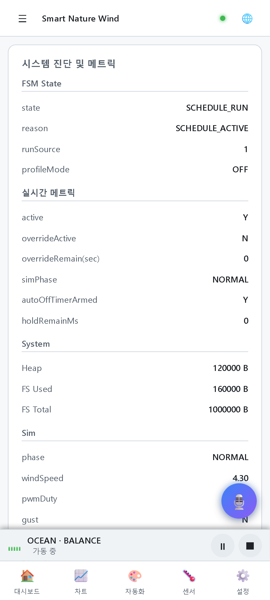

### 16.2 실시간 동작 로그 확인 (`#/monitor/logs`)
기기 내부 메모리에 기록되는 동작 로그를 실시간으로 확인하여 센서 통신이나 네트워크 상태를 즉시 추적할 수 있으며, 필요 시 로그를 파일로 다운로드할 수 있습니다.

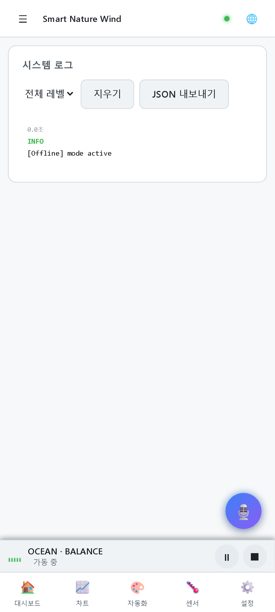

### 16.3 브라우저 원클릭 무선 펌웨어 업데이트 (`#/settings/firmware`)
기기를 분해하거나 USB 케이블을 꽂을 필요 없이, 브라우저 화면에서 새 `firmware.bin` 파일을 선택하는 것만으로 무선(OTA)으로 최신 펌웨어를 안전하게 업데이트할 수 있습니다.

### 16.4 기기 상세 정보 확인 (`#/info`)
현재 펌웨어 버전(`v0203`), 빌드 날짜, 기기 고유 번호(MAC), Wi-Fi 신호 세기(RSSI), 가동 시간(업타임)을 종합 조회합니다.

### 16.5 첫 방문 온보딩 마법사 다시 시작하기 팁
첫 방문 시 나타났던 4단계 온보딩 마법사(언어 선택 → Wi-Fi 안내 → 첫 바람 고르기 → 시작)를 다시 보고 싶다면, PC나 스마트폰 브라우저 개발자 도구 콘솔(`F12`)에서 아래 명령을 입력하고 새로고침하면 언제든 마법사를 다시 실행할 수 있습니다:
```javascript
localStorage.removeItem('snw_onboarded_v0203'); location.reload();
```

---

## 17. 자주 묻는 질문 (FAQ) 및 단계별 문제 해결 가이드

### Q1. 선풍기 날개가 회전하지 않아요.
- **원인 1 (세션 정지 상태)**: 대시보드에서 자연풍 프리셋 카드를 탭하거나 Comfort 추천 카드의 **[▶ 지금 재생]** 버튼을 눌러보세요.
- **원인 2 (자동 종료 안전 잠금 상태)**: 새벽 시간 타이머나 과냉 방지로 종료된 경우 안전 잠금(래치) 상태일 수 있습니다. 대시보드의 바람 프리셋 카드를 선택하면 즉시 잠금이 풀리고 가동됩니다.
- **원인 3 (인체 미감지 절전 대기)**: 사람이 자리를 비워 절전 대기 상태에 들어갔을 수 있습니다. 센서 앞에서 손을 흔들면 즉시 부드럽게 재개됩니다.
- **원인 4 (모터 최저 기동 전압 부족)**: `#/settings` (하드웨어 탭)에서 `최소 회전 시작 세기(Start Percent Min)`를 18%에서 22% 정도로 올려보세요.

### Q2. 스마트폰에서 `192.168.4.1` 웹 화면이 뜨지 않아요.
- **점검**: 스마트폰 Wi-Fi 설정에서 **`NatureWind`**에 정상 연결되어 있는지 확인하세요. LTE/5G 모바일 데이터가 켜져 있으면 로컬 접속을 방해할 수 있으므로, 잠시 **모바일 데이터를 끄고** 접속해 보세요.

### Q3. 방에 사람이 가만히 누워있는데 선풍기가 꺼져요.
- **점검**: 침대에 누워 미세한 움직임이 없는 환경이라면 `#/settings`에서 모션 감지 유지 시간(`holdSec`)을 기본 120초에서 300초(5분) 이상으로 늘려주세요.

### Q4. 예약한 스케줄 시각에 선풍기가 켜지지 않아요.
- **점검 1**: 기기가 가정용 Wi-Fi에 연결되어 인터넷 표준 시각(NTP)을 받아왔는지 `#/info` 페이지에서 확인하세요. 기기 내부 시계가 맞춰져 있어야 스케줄이 작동합니다.
- **점검 2**: 해당 스케줄이 연결하고 있는 바람 프로파일이 Playlist에서 삭제되지 않았는지 확인하세요.

### Q5. 세션을 일시정지했다가 켰는데 처음부터 다시 시작해요.
- **정상 동작입니다**: 스마트 이어듣기(Smart Resume) 기능에 따라 일시정지 시간이 30분을 초과하면 안전을 위해 첫 스텝부터 신규 세션으로 리셋됩니다. 5분 이내 재개 시에는 멈췄던 그 자리에서 오차 없이 연속 재생됩니다.

---

## 18. 제품 기술 제원 및 빠른 조작 치트시트

### 18.1 제품 하드웨어 및 소프트웨어 제원표

| 구분 | 세부 항목 | 규격 사양 및 제원 |
|---|---|---|
| **기본 MCU 보드** | 메인 컨트롤러 | **ESP32-S3 Zero** (듀얼코어 240MHz 고성능 IoT 칩셋) |
| | 메모리 사양 | 4MB 고속 Flash / 2MB PSRAM |
| **서브 MCU 보드** | 경량 컨트롤러 | **ESP32-C3 Zero** (RISC-V 싱글코어 160MHz 저전력 칩셋) |
| **확장 참조 보드** | 고성능 보드 | **ESP32-S3-N16R8** (16MB Flash, 8MB PSRAM) |
| **모터 제어** | 팬 제어 방식 | 초고주파 무소음 모터 제어 (PWM 10-bit 분해능) |
| **온습도 센서** | 디지털 센서 | DHT22 (온도 측정 범위: -40~80℃ ±0.5℃, 습도: 0~100% ±2%RH) |
| **인체 감지 센서** | 디지털 센서 | 고감도 디지털 PIR 센서 (감지 화각 100°, 유효 반경 5~7m) |
| **상태 표시등** | 풀컬러 LED | 온보드 풀컬러 RGB LED (기기 상태 표시) |
| **무선 네트워크** | Wi-Fi 규격 | 2.4GHz IEEE 802.11 b/g/n (기기 직접 연결 및 공유기 연동 지원) |
| **웹 아키텍처** | 프론트엔드/통신 | 고속 내장 웹서버 + 실시간 양방향 통신 + 단일 페이지 웹앱(SPA) |
| **웹 정적 자산** | 압축 최적화 | 초경량 고압축 웹 자산 (총 135 KB로 0.5초 초고속 화면 로딩) |
| **전원 공급** | 동작 입력 전원 | 제어부 DC 5V (USB Type-C) / 팬 모터 구동 겸용 DC 12V 2A 이상 어댑터 |

### 18.2 핵심 조작 치트시트

```text
┌────────────────────────────────────────────────────────────────────────┐
│               🍃 Smart Nature Wind v0203 핵심 조작 치트시트            │
├────────────────────────────────────────────────────────────────────────┤
│ 1. 기본 접속:                                                          │
│    • Wi-Fi 이름: NatureWind  (비밀번호: 2540)                           │
│    • 접속 주소 : http://192.168.4.1 (0.5초 초고속 웹 로딩)              │
├────────────────────────────────────────────────────────────────────────┤
│ 2. 상태 표시등 (LED) 의미:                                             │
│    • 초록색 점등: 공유기(Wi-Fi) 정상 연결 (인터넷 시간 동기화 완료)      │
│    • 파란색 점멸: 기기 직접 연결 대기 모드 (SoftAP)                    │
│    • 주황색 서서히 점멸: 인체 미감지 절전 대기 상태                    │
├────────────────────────────────────────────────────────────────────────┤
│ 3. 추천 자연풍 프리셋 & 스타일 조합:                                   │
│    • 주간 활동/환기: OCEAN 또는 MOUNTAIN + ACTIVE                       │
│    • 독서/재택 업무: COUNTRY_BREEZE 또는 DESERT_NIGHT + FOCUS           │
│    • 야간 숙면 취침: FOREST_CANOPY + SLEEP                              │
├────────────────────────────────────────────────────────────────────────┤
│ 4. 건강한 안심 수면 3단 세팅:                                          │
│    ① 바람 선택: FOREST_CANOPY + SLEEP 스타일 (초저소음 무자극)           │
│    ② 취침 타이머: 120분 설정                                           │
│    ③ 과냉 방지: Off-Temp 23.5℃ 활성화 (새벽 저체온증 원천 차단)        │
├────────────────────────────────────────────────────────────────────────┤
│ 5. 스마트 조작 편의 팁:                                                │
│    • 대시보드 3대 슬라이더: 세기/변동성/돌풍을 0~100% 나만의 수치로 튜닝 │
│    • Comfort 추천: 상단 카드의 [▶ 지금 재생]으로 1초 만에 최적 바람 가동 │
│    • Now Playing Bar: 어디서나 탭하여 세션 상세 창 열기 및 ⏸/⏹ 제어   │
│    • 플로팅 마이크 버튼: 어느 화면에서나 Gemini AI 호출                 │
│    • Gemini Live 음성: Google 공식 음성 & 말 끊고 끼어들기 완벽 지원     │
├────────────────────────────────────────────────────────────────────────┤
│ 6. 꼭 기억할 주의사항:                                                  │
│    • 설정 변경 후 영구 보존하려면 반드시 [설정 저장] 버튼을 누르세요!    │
│    • 시간(NTP) 설정은 재부팅 없이 즉시 백그라운드 동기화됩니다          │
│    • Gemini Live는 30분 자동 종료 및 하루 $0.50 한도로 요금 안심 차단   │
└────────────────────────────────────────────────────────────────────────┘
```

---

*본 설명서의 저작권은 Smart Nature Wind 개발팀에 있으며, 펌웨어 기능 향상에 따라 일부 세부 사양은 지속적으로 개선될 수 있습니다.*
