# FLOW_0203.md — 데이터 흐름 및 시퀀스 명세 (v3.2)

> **목적**: v0203의 부팅 초기화, 메인 루프 파이프라인, 태스크 간 비동기 위임 시퀀스 및 예외 복구 흐름을 명세.  
> T-loop (`loopTask`), T-async (`async_tcp`), T-wf (`WF10_Reconnect`), T-sys_evt (`esp_event_loop`) 협력 구조.  
> F-01~F-10, I-1~I-6, N-1~N-4, A-1~A-3, B-1~B-6, C-1~C-8, D-1~D-5, E-1~E-10, E-2.1~E-2.7, F-1~F-10, Batch G (C-1~C-5, B-1~B-13) 반영.  
> **파일명 정책**: 계약 문서 `_0203.md` 유지, 코드 참조 `_0203` 접미사.

---

## 📋 목차 (Table of Contents)

1. [부팅 시퀀스 (`A00_init()`)](#1-부팅-시퀀스-a00_init)
2. [메인 루프 파이프라인 (`A00_run()`)](#2-메인-루프-파이프라인-a00_run)
3. [설정 재로드(Reload) 위임 시퀀스 (F-05)](#3-설정-재로드reload-위임-시퀀스-f-05)
4. [Motion Patch 위임 시퀀스 (F-06)](#4-motion-patch-위임-시퀀스-f-06)
   - [4.1 Session 위임 시퀀스 (ADR-1, Phase 3)](#41-session-위임-시퀀스-adr-1-phase-3)
     - [4.1.1 Session Start — 3-way 위임](#411-session-start--3-way-위임)
     - [4.1.2 Session Pause/Resume/Stop](#412-session-pauseresumestop)
   - [4.2 Schedule → Profile 참조 단일 실행 흐름 (ADR-3, Phase 3)](#42-schedule--profile-참조-단일-실행-흐름-adr-3-phase-3)
   - [4.3 Runtime (NVS) Export 흐름 (N-7, Phase 2)](#43-runtime-nvs-export-흐름-n-7-phase-2)
   - [4.4 Settings timeCfg → TM10 재적용 (N-2, Phase 2)](#44-settings-timecfg--tm10-재적용-n-2-phase-2)
5. [Wi-Fi 연결/재연결 (F-01, F-02)](#5-wi-fi-연결재연결-f-01-f-02)
6. [시간 동기화 (SNTP 콜백 + 다중 경로)](#6-시간-동기화-sntp-콜백--다중-경로)
7. [PIR 모션 센서 피드/감쇠 (F-03, A-2)](#7-pir-모션-센서-피드감쇠-f-03-a-2)
8. [배치 A-2 캡슐화 위임 흐름](#8-배치-a-2-캡슐화-위임-흐름)
9. [배치 F-2/F-3 POST/PATCH 공통 헬퍼 흐름](#9-배치-f-2f-3-postpatch-공통-헬퍼-흐름)
10. [예외/폴백 경로](#10-예외폴백-경로)
11. [웹 에셋 빌드/서빙 파이프라인](#11-웹-에셋-빌드서빙-파이프라인)
    - [11.1 빌드 전처리 및 자동 동기화 (`pio_gzip_0203.py`)](#111-빌드-전처리-및-자동-동기화-pio_gzip_0203py)
    - [11.2 오프라인 2분할 어댑터 부트스트랩 시퀀스](#112-오프라인-2분할-어댑터-부트스트랩-시퀀스)
    - [11.3 런타임 정적 서빙 (`W10_Web_Static_0203.cpp`)](#113-런타임-정적-서빙-w10_web_static_0203cpp)
12. [바람 물리 파라미터 해석 및 Override 파이프라인 (`S20_resolveWindParams`)](#12-바람-물리-파라미터-해석-및-override-파이프라인-s20_resolvewindparams)
13. [Stage 8 AI 제어 및 Gemini Live 실시간 음성 시퀀스](#13-stage-8-ai-제어-및-gemini-live-실시간-음성-시퀀스)
    - [13.1 Gemini REST 2-turn 프록시 시퀀스](#131-gemini-rest-2-turn-프록시-시퀀스)
    - [13.2 Gemini Live 실시간 양방향 음성 & 도구 위임 시퀀스 (AudioWorklet)](#132-gemini-live-실시간-양방향-음성--도구-위임-시퀀스-audioworklet)
14. [웹 UI/UX 동적 뷰포트 레이아웃 및 인터랙션 흐름 (0203_012 신규)](#14-웹-uiux-동적-뷰포트-레이아웃-및-인터랙션-흐름-0203_012-신규)
    - [14.1 Now Playing Bar 상태에 따른 동적 레이아웃 스택 흐름](#141-now-playing-bar-상태에-따른-동적-레이아웃-스택-흐름)
15. [개정 이력](#15-개정-이력)

---

## 1. 부팅 시퀀스 (`A00_init()`)

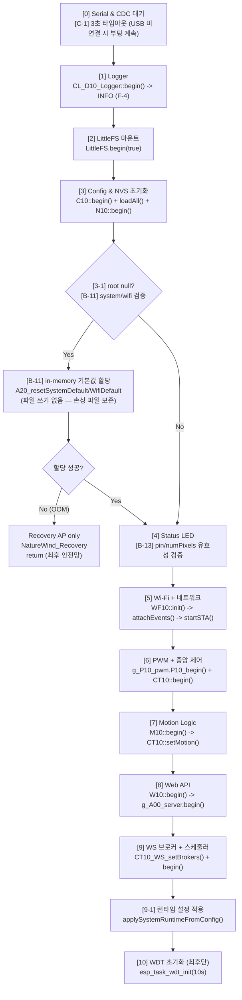

> **가드**: WDT는 반드시 `A00_init()` 맨 마지막. Wi-Fi 재시도 등 블로킹 회피.

---

## 2. 메인 루프 파이프라인 (`A00_run()`)

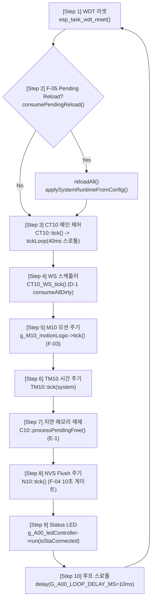

---

## 3. 설정 재로드(Reload) 위임 시퀀스 (F-05)

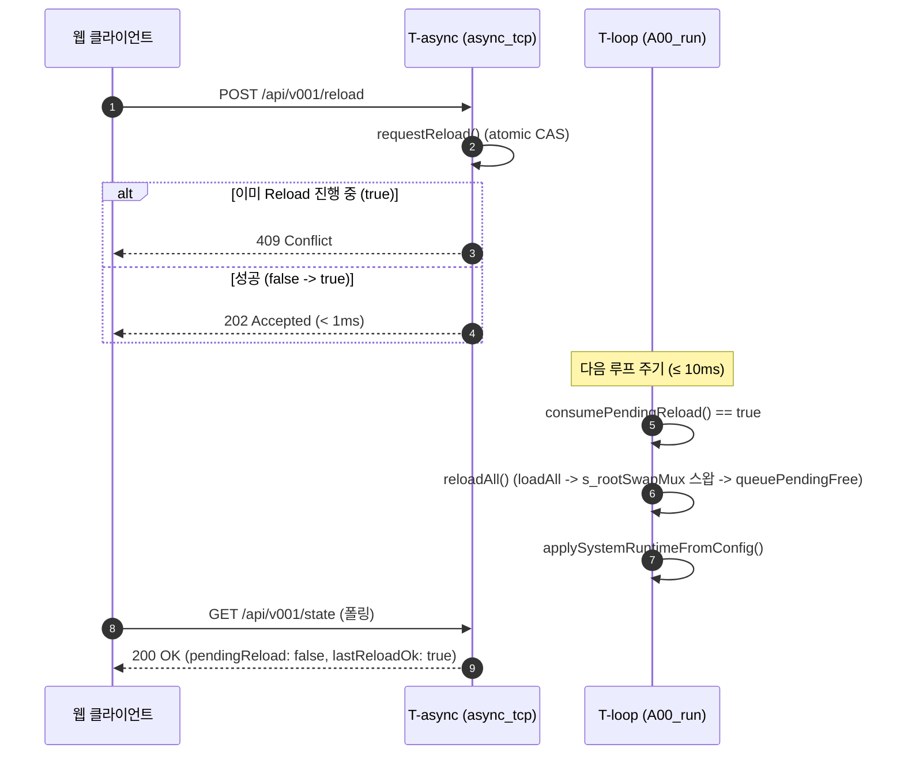

---

## 4. Motion Patch 위임 시퀀스 (F-06)

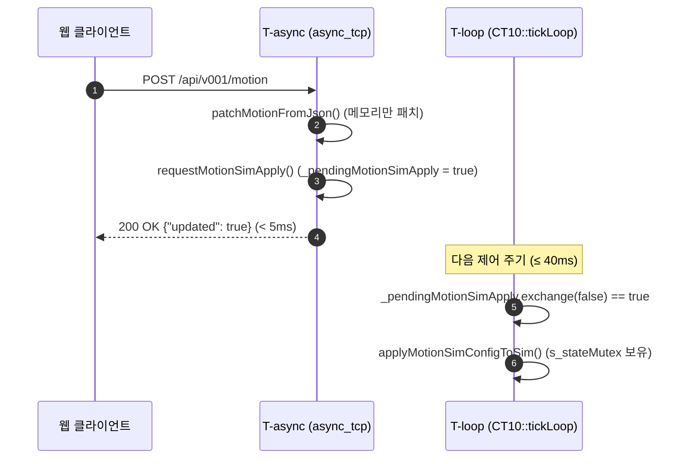

---

## 4.1 Session 위임 시퀀스 (ADR-1, Phase 3)

### 4.1.1 Session Start — 3-way 위임

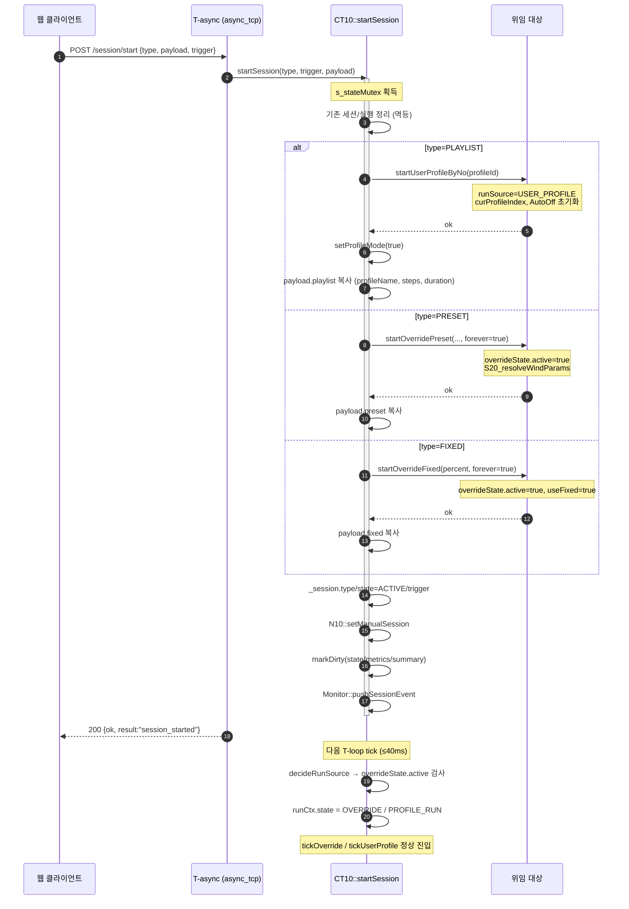

### 4.1.2 Session Pause/Resume/Stop

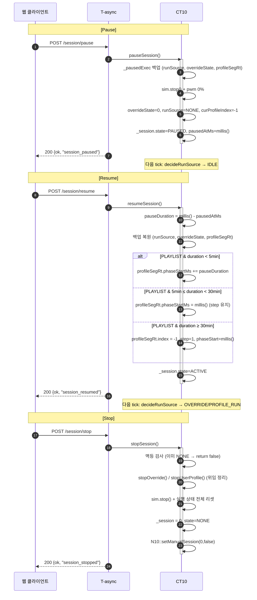

## 4.2 Schedule → Profile 참조 단일 실행 흐름 (ADR-3, Phase 3)

> **단일 규격 준수 (하위 호환 배제)**: v0203에서는 스케줄 내 자체 `segments[]` 정의를 완전히 배제하고, 반드시 `profileId`를 통한 사용자 프로파일 단일 참조 방식으로 일원화한다.

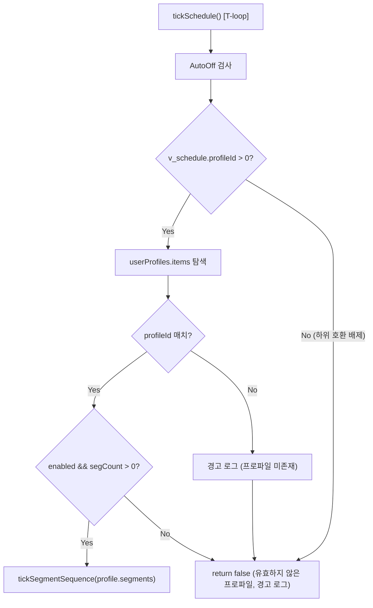

## 4.3 Runtime (NVS) Export 흐름 (N-7, Phase 2)

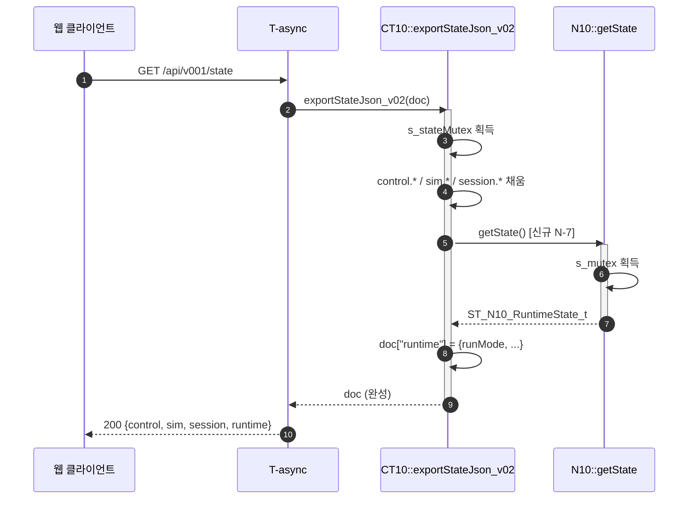

## 4.4 Settings timeCfg → TM10 재적용 (N-2, Phase 2)

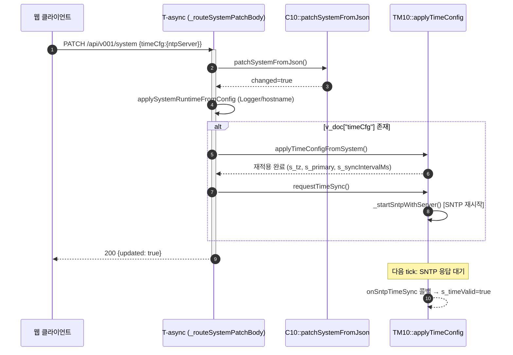

---

## 5. Wi-Fi 연결/재연결 (F-01, F-02)

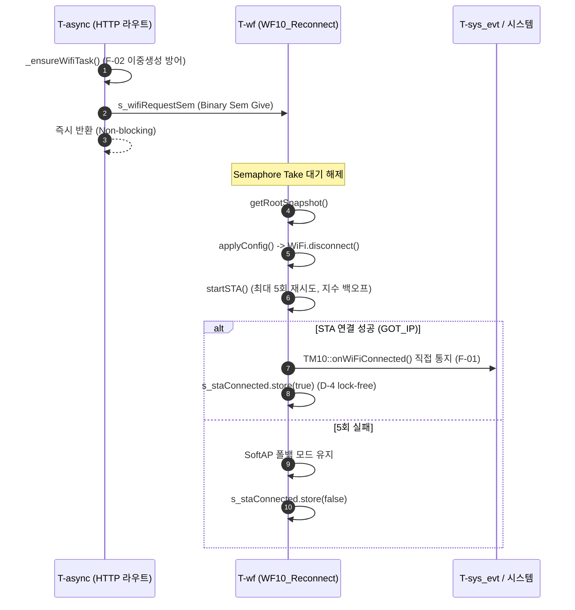

---

## 6. 시간 동기화 (SNTP 콜백 + 다중 경로)

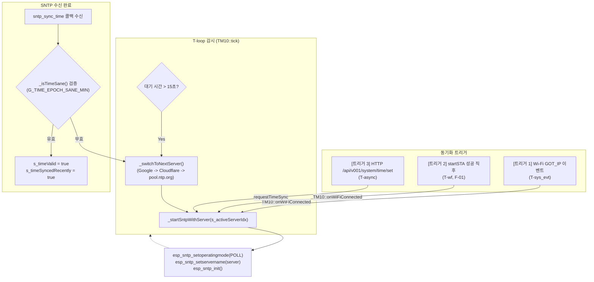

---

## 7. PIR 모션 센서 피드/감쇠 (F-03, A-2)

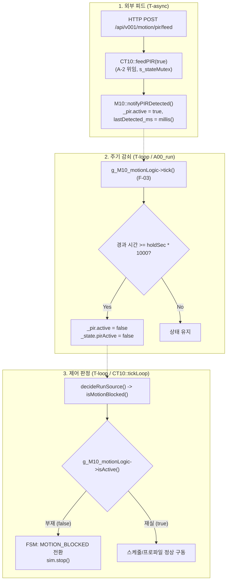

---

## 8. 배치 A-2 캡슐화 위임 흐름

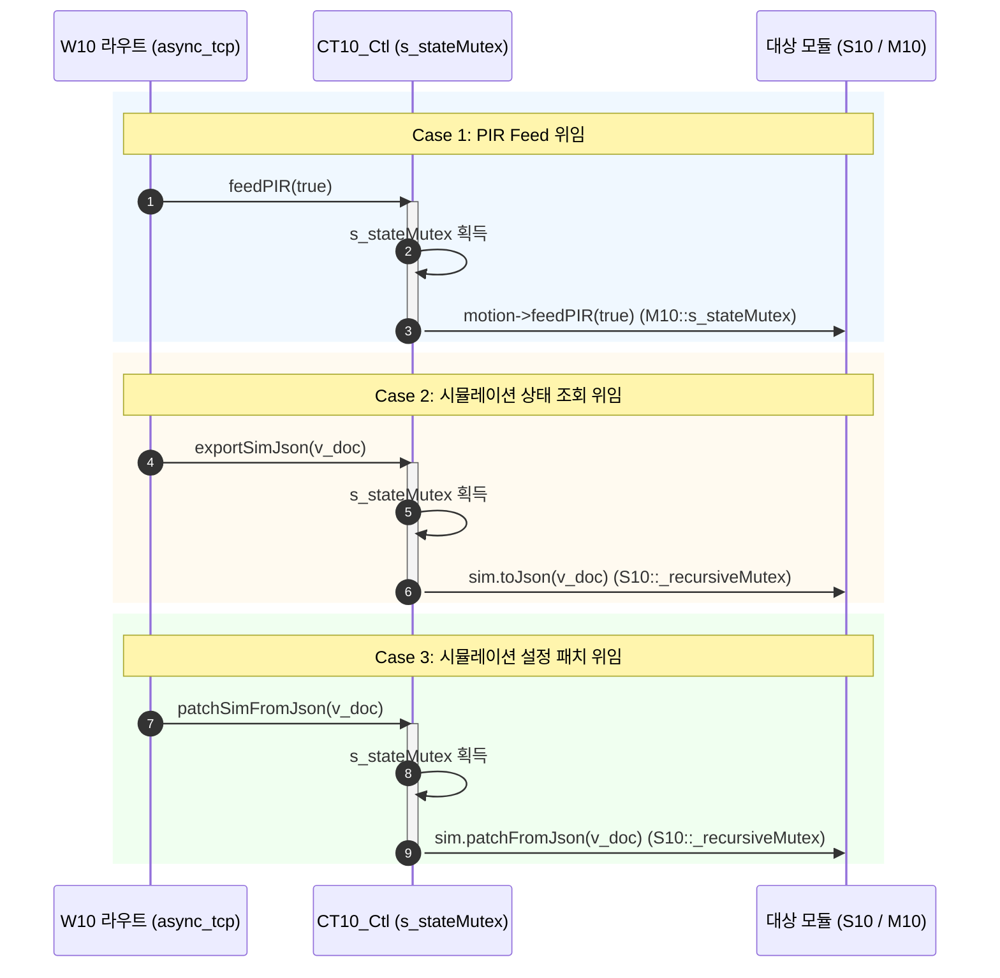

> **락 순서**: CT10 `s_stateMutex` → M10/S10 mutex (CONTRACT §5 준수). 역방향 금지.

---

## 9. 배치 F-2/F-3 POST/PATCH 공통 헬퍼 흐름

```mermaid
flowchart TD
    subgraph System ["/api/v001/system"]
        S_POST["POST /api/v001/system"] --> H_SYS["_routeSystemPatchBody()"]
        S_PATCH["PATCH /api/v001/system"] --> H_SYS
        H_SYS --> H_SYS_1["1. checkApiKey() 검증"]
        H_SYS_1 --> H_SYS_2["2. parseJsonBody() 파싱"]
        H_SYS_2 --> H_SYS_3["3. patchSystemFromJson() 적용"]
        H_SYS_3 --> H_SYS_4["4. applySystemRuntimeFromConfig() 갱신"]
        H_SYS_4 --> H_SYS_5["5. sendJson() 동일 응답 반환"]
    end

    subgraph WiFi ["/api/v001/wifi/config"]
        W_POST["POST /api/v001/wifi/config"] --> H_WIFI["_routeWifiConfigPatchBody()"]
        W_PATCH["PATCH /api/v001/wifi/config"] --> H_WIFI
        H_WIFI --> H_WIFI_1["1. checkApiKey() 검증"]
        H_WIFI_1 --> H_WIFI_2["2. parseJsonBody() 파싱"]
        H_WIFI_2 --> H_WIFI_3["3. patchWifiFromJson() 적용"]
        H_WIFI_3 --> H_WIFI_4["4. saveDirtyConfigs() 플래그 설정"]
        H_WIFI_4 --> H_WIFI_5["5. WF10::requestReconnect() 비동기 위임"]
        H_WIFI_5 --> H_WIFI_6["6. sendJson() 동일 응답 반환"]
    end
```

---

## 10. 예외/폴백 경로

| 장애 유형 | 감지 지점 | 폴백/복구 |
|---|---|---|
| Wi-Fi STA 접속 불가 | startSTA 5회 실패 | SoftAP 폴백 |
| GOT_IP 이벤트 mutex 경합 | `isAcquired()==false` | startSTA 성공 시 명시 통지 (F-01) |
| NTP 타임아웃 | 15초 콜백 미수신 | Google → Cloudflare → pool.ntp.org |
| 설정 JSON 손상 | LittleFS 파싱 실패 | `.bak` 자동 복구 (`A40_Com_Utils_IO_0203.cpp`) |
| 중복 Reload | requestReload CAS 실패 | 409 Conflict |
| 재실자 부재 | PIR holdSec 만료 | MOTION_BLOCKED + 팬 정지 |
| AutoOff 조건 | 타이머/시간/온도 | `_autoOffLatched=true` + 팬 안전 정지 |
| Gzip 파일 부재 | `exists(uri+".gz")==false` | raw 폴백 |
| 정적 에셋 요청 | `/html_v0203` 자산 부재 | 404 진단 메시지 반환 (레거시 제거) |
| Factory reset 후 NVS 잔존 | (F-1 이전) | **F-1**: `N10::resetRuntime()` 호출 |
| Logger 초기 DEBUG (양산) | (F-4 이전) | **F-4**: INFO로 변경 |
| **USB 미연결 부팅** | **(C-1) `!Serial` 3초 초과** | **타임아웃 후 부팅 계속** |
| **Config 파일 손상** | **(B-11) `system`/`wifi` null** | **in-memory defaults → 웹 UI 복구** |
| **OOM (defaults 할당 실패)** | **(B-11) `new` 실패** | **Recovery AP만 기동 → 수동 복구** |
| **OTA 세션 중단** | **(B-12) 클라이언트 끊김** | **`Update.abort()` → 다음 OTA 재시도** |
| **OTA 쓰기 실패** | **(B-12) `write` 반환 < len** | **`Update.abort()` + 500 응답** |
| **LED pin 손상 (음수)** | **(B-13) `pin < 0 \|\| pin > 48`** | **WARN 로그 + GPIO 48 폴백** |
| **API Key 삭제 요청** | **(B-4) `clearApiKey=true`** | **`security.apiKey[0]='\0'`** |
| **`gzip;q=0` 요청** | **(B-5) `W10_acceptsGzip()` 반환 false** | **raw 파일 서빙** |

---

## 11. 웹 에셋 빌드/서빙 파이프라인

### 11.1 빌드 전처리 및 자동 동기화 (`pio_gzip_0203.py`)

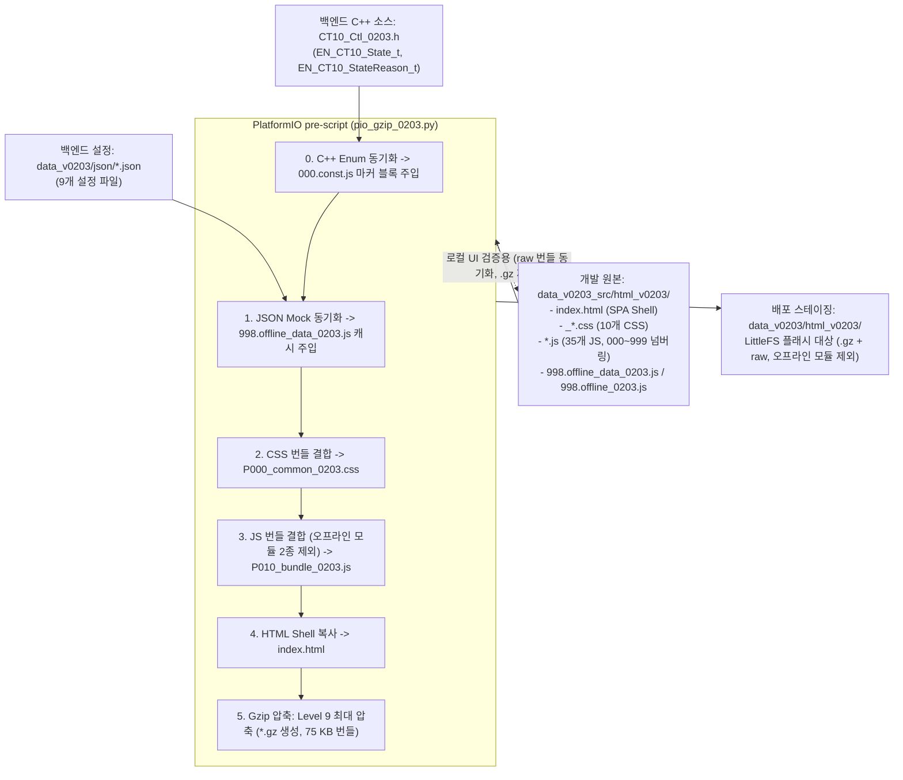

### 11.2 오프라인 2분할 어댑터 부트스트랩 시퀀스

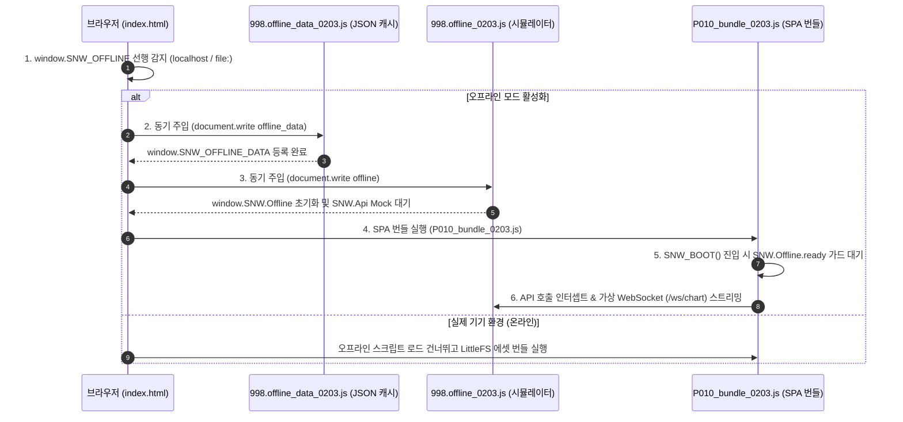

### 11.3 런타임 정적 서빙 (`W10_Web_Static_0203.cpp`)

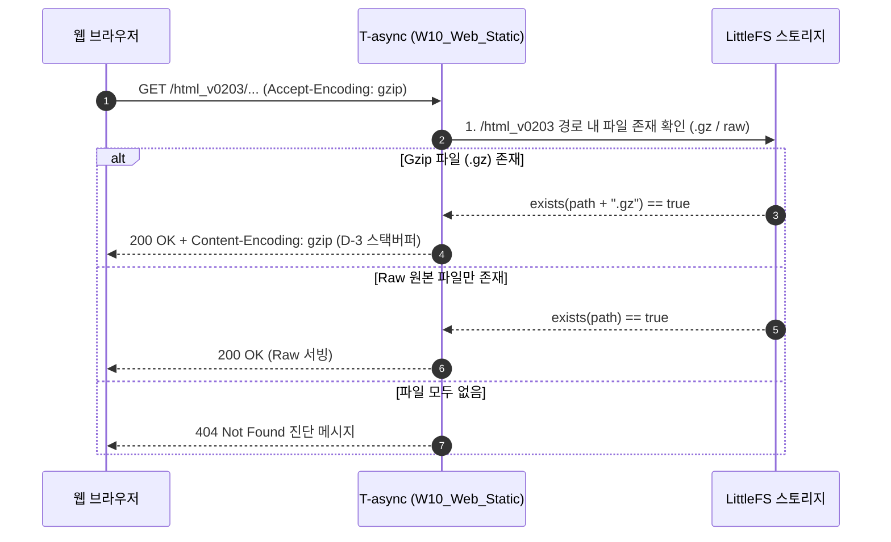

---


## 12. 바람 물리 파라미터 해석 및 Override 파이프라인 (`S20_resolveWindParams`)

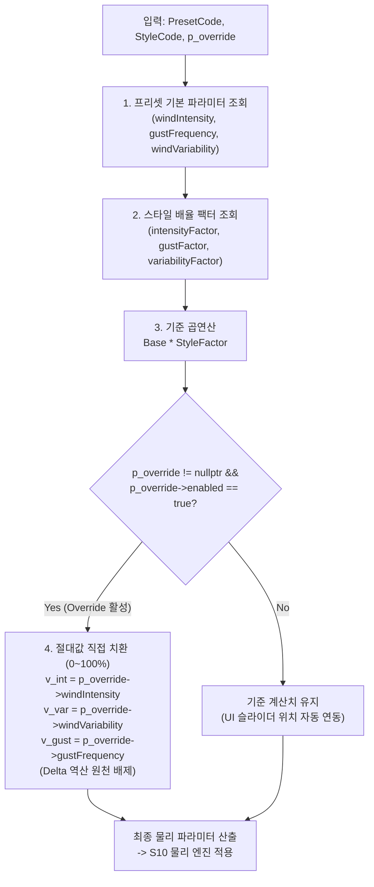

---

---

## 13. Stage 8 AI 제어 및 Gemini Live 실시간 음성 시퀀스

### 13.1 Gemini REST 2-turn 프록시 시퀀스

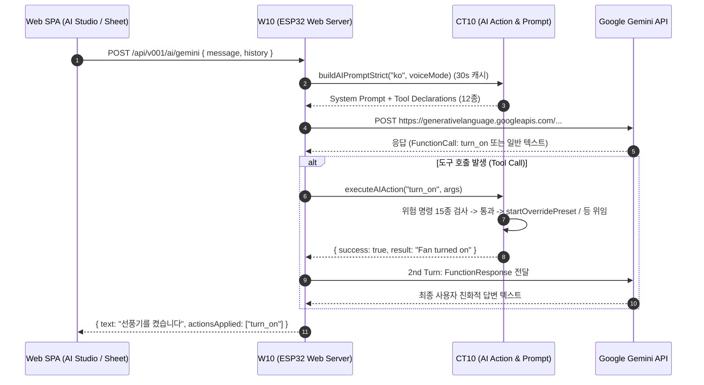

### 13.2 Gemini Live 실시간 양방향 음성 & 도구 위임 시퀀스 (AudioWorklet)

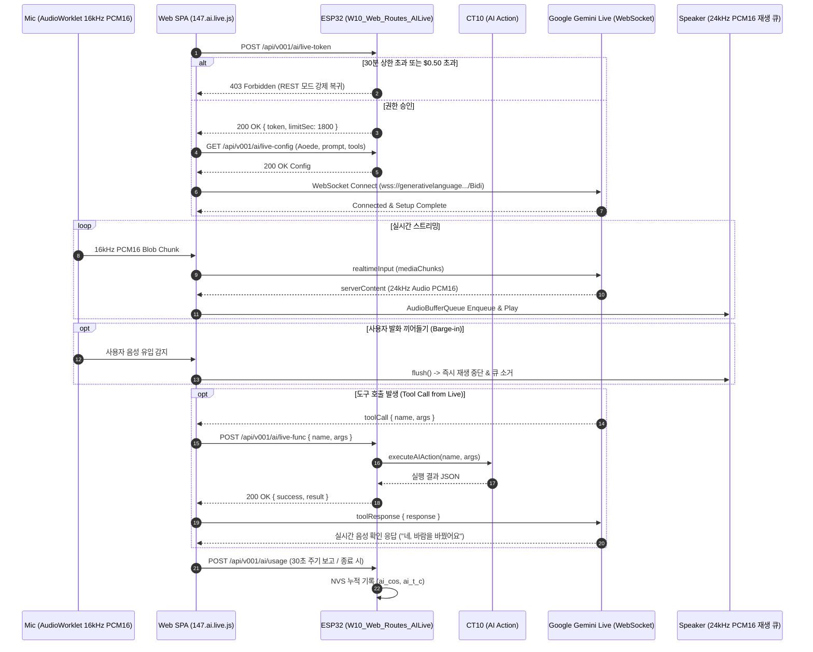

---

## 14. 웹 UI/UX 동적 뷰포트 레이아웃 및 인터랙션 흐름 (0203_012 신규)

### 14.1 Now Playing Bar 상태에 따른 동적 레이아웃 스택 흐름

```mermaid
sequenceDiagram
    autonumber
    participant Store as SNW.Store (WS / API)
    participant NP as 999a.nowplaying.js
    participant Body as document.body
    participant FAB as 999b.ai-sheet.js (FAB)
    participant Toast as .snw-toast-host
    participant Main as .snw-main

    Note over Store,Main: 세션 시작 (PRESET / PLAYLIST / FIXED)
    Store->>NP: session.active = true 브로드캐스트
    NP->>NP: render() -> barEl.root.hidden = false
    NP->>Body: classList.add('has-nowplaying')
    Body-->>FAB: CSS 변수 --snw-fab-bottom: 124px 전환
    FAB->>FAB: 0.25s 동안 bottom: 124px로 자동 부상
    Body-->>Toast: CSS 변수 --snw-toast-bottom: 124px 전환
    Toast->>Toast: bottom: 124px로 자동 부상
    Body-->>Main: CSS 변수 --snw-content-pb: 128px 전환
    Main->>Main: 하단 패딩 128px 확장 (스크롤 가림 완전 해소)

    Note over Store,Main: 사용자 Now Playing Bar 미니 플레이어 탭
    NP->>NP: onExpand() 호출
    NP->>NP: showNowPlayingDetailsModal(session)
    NP-->>Body: 바텀 모달 팝업 표시 (진행 단계/남은 시간/타이머 바로가기/일시정지/정지)
```

---

## 15. 개정 이력

| 날짜 | 버전 | 변경 내용 | 작성자 |
|---|---|---|---|
| **2026-11-08** | **v3.2** | **Stage 9 웹 UI/UX 동적 레이아웃 및 Now Playing 상세 확장 인터랙션 흐름 신설 (§14, 0203_012)**: Now Playing Bar 활성화에 따른 `has-nowplaying` 클래스 토글, AI FAB 및 Toast 동적 부상(76px➔124px), 메인 컨테이너 패딩 확장(80px➔128px) 및 미니플레이어 탭 시 세션 상세 모달 팝업 시퀀스 명세 | Antigravity AI |
| **2026-11-08** | **v3.1** | **통합 감사 28대 이슈 부팅 및 파이프라인 흐름 현행화 (0203_012)**: §1 C10 begin 실패 시 B-11 Recovery AP 폴백 분기 복구 및 부팅 최후단 `applySystemRuntimeFromConfig` 호출 추가, §11.1 빌드 파이프라인에 `validate_contracts.py` SSOT 자동 대조 CI 게이트 연계 | Antigravity AI |
| **2026-11-06** | **v3.0** | **Stage 8 AI 제어 및 Gemini Live 실시간 음성 시퀀스 신설 (§13)**: §13.1 Gemini REST 2-turn 프록시 시퀀스, §13.2 Gemini Live AudioWorklet 양방향 음성·Barge-in·도구 위임 시퀀스 다이어그램 추가 | Antigravity AI |
| **2026-11-05** | **v2.9** | **Phase 1~6 통합 (v0203_011) — Session 위임 + Runtime Export + Settings timeCfg 시퀀스 신설**: §4.1 Session Start/Pause/Resume/Stop 위임 시퀀스 (ADR-1), §4.2 Schedule profileId 단일 실행 (ADR-3 하위 호환 배제), §4.3 Runtime(NVS) Export, §4.4 Settings→TM10 재적용 (N-2). | Antigravity AI |
| 2026-10-28 | v2.8 | 프론트엔드-백엔드 동기화 및 오프라인 2분할 부트스트랩 시퀀스 갱신 (§11.1~11.2, §12): `pio_gzip_0203.py` C++ Enum/JSON Mock 주입, `offline_data` ➔ `offline` 순차 주입 및 차트 가상 스트리밍 흐름 반영 | Antigravity AI |
| 2026-10-28 | v2.7 | Batch I — §12 바람 물리 파라미터 해석 및 Override 파이프라인(S20_resolveWindParams) 시퀀스 신설 | Antigravity AI |
| 2026-10-27 | v2.6 | Batch H — 프론트엔드 오프라인 어댑터 선행 주입 및 부트스트랩 대기 가드(LOAD-1~LOAD-2) 시퀀스 반영 | Antigravity AI |
| 2026-10-26 | v2.5 | Batch G — §1 C-1/B-11/B-13 부팅 분기, §10 예외 8건 추가 (C-1/B-4/B-5/B-11/B-12/B-13) | Antigravity AI |
| 2026-10-21 | v2.4 | 전체 흐름/시퀀스 다이어그램을 GitHub 및 Obsidian 호환 Mermaid 표준 형식으로 전면 전환 | Antigravity AI |
| 2026-10-21 | v2.3 | `pio_gzip_0203.py`, `data_v0203` 경로, 듀얼 서빙 폴백 시퀀스, `_0203` 자산 일괄 현행화 | Antigravity AI |
| 2026-10-20 | v2.2 | Batch A~F 반영: §8 A-2 위임 흐름 신규, §9 F-2/F-3 헬퍼 신규, §2 Step2/3/5/8/10 F-03~F-06/C-5 반영, §10 예외 F-1/F-4 추가, §11 D-2/D-3 정적 서빙 | Antigravity AI |
| 2026-10-19 | v2.1 | N-1 state 폴링, G-2/G-4 regex 서빙, root 404 차단 | Antigravity AI |
| 2026-10-19 | v2.0 | v0203 승격 + (v1.2의 빌드 파이프라인 흐름 유지) | Antigravity AI |
| 2026-10-19 | v1.2 | 빌드 파이프라인 + Gzip 서빙 흐름 | Antigravity AI |
| 2026-10-19 | v1.1 | A00_init/A00_run 순서 동기화 | Antigravity AI |
| (초기) | v1.0 | 최초 정적 감사 기반 흐름도 | 개발팀 |
